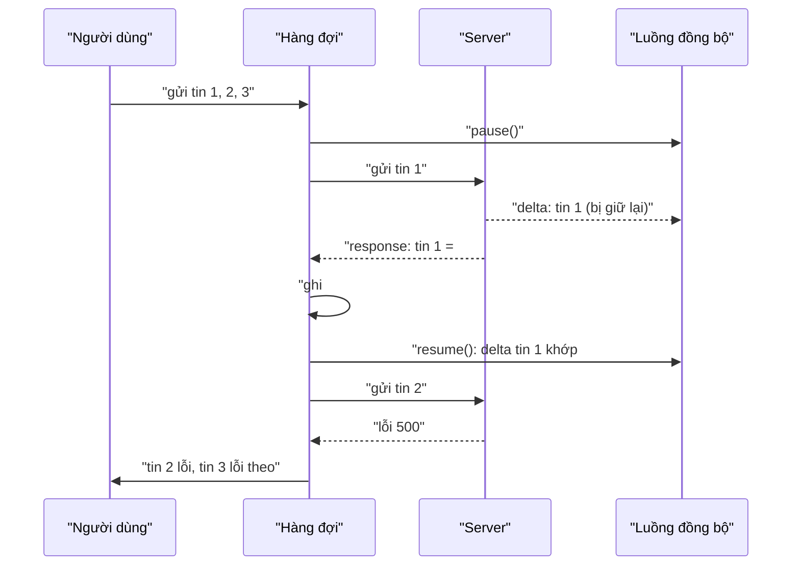

Bạn gõ nhanh ba tin: "Ê", "tối nay", "đi ăn không?". Ở phía người nhận, cuộc trò chuyện phải hiện đúng thứ tự đó. Nghe hiển nhiên, nhưng nếu mỗi tin là một `fetch` độc lập thì thứ tự server nhận được phụ thuộc vào request nào tới trước. Tin dài, tin có ảnh, một gói tin bị gửi lại ở tầng TCP… và "đi ăn không?" có thể tới trước "Ê".

Còn một lỗi khó thấy hơn. App chat có hai đường dữ liệu: **response** của request gửi tin, và **luồng đồng bộ** (realtime: MQTT, WebSocket) đẩy về mọi tin mới trong cuộc trò chuyện, kể cả tin của chính mình. Nếu bản vọng lại qua luồng đồng bộ tới **trước** response, app chưa biết tin đó là của mình và hiện nó thành tin thứ hai.

> [!TIP]
> **Tóm tắt**
> - `MercuryServerSendMessageQueue` của Messenger chỉ cho **một** tin bay tại một thời điểm; tin sau đợi tin trước có phản hồi.
> - Trong lúc gửi, nó **tạm dừng** luồng đồng bộ (`MercurySyncDeltaHandler.pause()`), nên bản vọng lại không thể tới trước response.
> - Tin đang gửi lỗi thì **mọi tin phía sau cũng bị đánh dấu lỗi**: thà bắt người dùng bấm "gửi lại" còn hơn để tin sau tới trước tin trước.
> - Mang về: hàng đợi tuần tự + id phía client (idempotency key) + tạm dừng sync, gói trong khoảng 100 dòng TypeScript.

<iframe class="demo-frame" src="/demos/facebook-patterns/index.html?theme=dark#/send-queue" title="Demo send-queue" loading="lazy" style="height: 880px"></iframe>

<p class="demo-links">▶ <a href="/demos/facebook-patterns/index.html#/send-queue" target="_blank" rel="noopener">Mở demo toàn màn hình ↗</a> · <a href="https://stackblitz.com/github/hunghg255/blog-hunghg/tree/master/examples/facebook-patterns?file=src/lib/sendQueue.ts" target="_blank" rel="noopener">Sửa code trên StackBlitz ↗</a> · <a href="https://github.com/hunghg255/blog-hunghg/blob/master/examples/facebook-patterns/src/lib/sendQueue.ts" target="_blank" rel="noopener">Xem source trên GitHub ↗</a></p>

## Facebook làm thế nào?

Module `MercuryServerSendMessageQueue` nằm trong `55.js`. "Mercury" là tên nội bộ cũ của Messenger trên web. Mỗi người gửi (`sender_id`) và mỗi endpoint có một hàng đợi riêng.

### Một tin bay một lúc

Rút gọn và đổi tên biến cho dễ đọc:

```js
enqueue(message) {
  this.queue.push(message);
  this.sendNext();
}

sendNext() {
  if (this.pendingMessage || !this.queue.length) {
    if (this.pendingMessage) this.logDelayed(); // ODS: "send_queue.delayed.queue_length.N"
    return;
  }
  this.pendingMessage = this.queue.shift();
  const payload = this.preparePayload(this.pendingMessage);
  for (const k in payload) if (payload[k] == null) delete payload[k];
  this.syncHandler.pause();                       // tạm dừng luồng đồng bộ
  MercuryServerDispatcher.trySend(SEND_URI, payload, null, this.senderId, this.queueId);
}
```

`pendingMessage` là chốt chặn: có tin đang bay thì tin mới chỉ được đẩy vào mảng và ghi một chỉ số (`send_queue.delayed.queue_length.<N>`) để biết người dùng hay phải chờ bao lâu.

Payload mang theo `offline_threading_id`, một id do client sinh ra cho mỗi tin. Có lẽ server dùng nó để nhận ra tin trùng khi client gửi lại (khoá idempotency), và luồng đồng bộ cũng trả nó về để client khớp tin.

### Khi có phản hồi

```js
handleSuccess(response) {
  this.pendingMessage = null;
  // … đổi attachment GraphQL trong response sang dạng của store
  this.onSuccess(response);
  this.syncHandler.resume();  // chỉ chạy lại sync SAU khi đã ghi nhận tin thật
  this.sendNext();
}

handleError(error) {          // handleTransportError, handleTimeout giống hệt
  this.pendingMessage = null;
  this.syncHandler.resume();
  this.onError(error);
  this.failAllQueued();
}

failAllQueued() {
  while (this.queue.length) {
    const message = this.queue.shift();
    this.onError(SimulatedError.create(message)); // lỗi "giả" cho các tin chưa kịp gửi
    log.error('mark_as_failed', obfuscate(message));
  }
}
```

Thứ tự trong `handleSuccess` rất quan trọng: `onSuccess` ghi id thật của server vào tin, **rồi** mới `resume()` luồng đồng bộ. Delta bị giữ lại giờ được xử lý, thấy id đã tồn tại, và bỏ qua. Không có tin trùng.

Ba loại lỗi (server trả lỗi, lỗi mạng, timeout) đều dẫn tới `failAllQueued`. Các tin còn trong hàng đợi chưa hề được gửi, nhưng vẫn bị đánh dấu lỗi bằng một `SimulatedError`. Lý do: nếu tin số 3 lỗi mà tin 4, 5 vẫn đi tiếp, lúc người dùng bấm gửi lại tin 3 thì nó sẽ nằm **sau** tin 4, 5.

### Hỏi lại trước khi đóng tab

Hàng đợi đăng ký `Run.onBeforeUnload`: còn tin trong hàng đợi hoặc đang bay thì trả về câu "Bạn vẫn chưa gửi tin nhắn. Bạn có muốn thoát mà không gửi không?". Chuỗi là bản tiếng Việt nằm sẵn trong bundle (có lẽ bản dump được lấy khi đang dùng giao diện tiếng Việt). Ngày nay trình duyệt không còn hiện chuỗi tuỳ biến trong hộp thoại `beforeunload`, chỉ hiện thông báo chung, nhưng việc chặn vẫn có tác dụng.

### Log có che nội dung

Mỗi bước ghi vào `LogHistory("mercury_server_send_message_queue")`, nhưng luôn qua `MercuryLoggingHelper.obfuscateMessage`: log đủ để debug thứ tự, không chứa nội dung tin nhắn.



## Bên trong trình duyệt: vì sao request song song không giữ thứ tự

`fetch` trả về Promise, và HTTP/2 cho phép nhiều request chạy song song trên một kết nối. Không có gì đảm bảo server **xử lý** request theo thứ tự client gọi: mỗi request có thể đi qua load balancer khác nhau, tới máy khác nhau, kích thước body khác nhau. Ngay cả trên cùng một kết nối HTTP/2, các stream được ghép xen nhau.

Muốn giữ thứ tự, có hai cách:

1. **Tuần tự ở client**: chỉ gửi tin sau khi tin trước đã có phản hồi. Đơn giản, đúng tuyệt đối, đổi lại thông lượng thấp: gửi 5 tin liên tiếp tốn 5 vòng mạng.
2. **Đánh số thứ tự** cho mỗi tin và để server sắp lại. Nhanh hơn, nhưng server phải giữ trạng thái chờ tin còn thiếu.

Messenger chọn cách 1. Người dùng gõ tin chậm hơn nhiều so với thời gian một request, nên hàng đợi hiếm khi dài.

Còn chuyện tin trùng là một race condition giữa hai kênh. Kênh realtime thường nhanh hơn: server đẩy delta ngay khi ghi xong tin, trong khi response HTTP còn phải đi qua các lớp middleware. Trong demo, mình đặt delta tới sau 40ms còn response sau 260ms, và tắt "tạm dừng sync" là thấy cả 5 tin hiện trùng.

## Viết lại

Phần lõi: `failRest` và vòng `pump` (một tin bay một lúc, xử lý kết quả):

```ts title=src/lib/sendQueue.ts
  function failRest() {
    // giữ thứ tự: các tin sau tin lỗi xếp tiếp vào danh sách lỗi, không gửi vượt lên trước
    while (queue.length > 0) {
      const message = queue.shift()!;
      failed.push(message);
      onFailed?.(message, 'cascade');
    }
  }

  async function pump() {
    if (destroyed || inFlight != null || queue.length === 0) return;
    const message = queue.shift()!;
    inFlight = message;
    controller = new AbortController();
    const { signal } = controller;
    sync?.pause();
    let timer: ReturnType<typeof setTimeout> | undefined;
    let outcome: { ok: true; result: R } | { ok: false; error: unknown };
    try {
      const result = await Promise.race([
        send(message, signal),
        new Promise<never>((_, reject) => {
          timer = setTimeout(() => {
            controller?.abort();
            reject(new SendTimeoutError(timeoutMs));
          }, timeoutMs);
        }),
      ]);
      outcome = { ok: true, result };
    } catch (error) {
      outcome = { ok: false, error };
    }
    clearTimeout(timer);
    inFlight = null;
    if (destroyed) return;
    if (outcome.ok) {
      // callback của app lỗi thì không được coi là tin gửi lỗi (server đã nhận rồi)
      try {
        onSent?.(message, outcome.result);
      } finally {
        sync?.resume();
        void pump();
      }
      return;
    }
    failed.push(message);
    onFailed?.(message, outcome.error instanceof SendTimeoutError ? 'timeout' : 'error', outcome.error);
    sync?.resume();
    failRest();
  }
```

Luồng đồng bộ có thể tạm dừng, đếm số lần pause để lồng nhau vẫn an toàn:

```ts title=src/lib/sendQueue.ts
/**
 * Luồng đồng bộ có thể tạm dừng: delta tới lúc đang dừng được giữ lại, chạy lại thì áp dụng
 * theo đúng thứ tự. Đếm số lần pause để lồng nhau vẫn an toàn.
 */
export function createPausableSync<D>(apply: (delta: D) => void) {
  let pauses = 0;
  const buffer: D[] = [];
  return {
    push(delta: D) {
      if (pauses > 0) buffer.push(delta);
      else apply(delta);
    },
    pause() {
      pauses++;
    },
    resume() {
      pauses = Math.max(0, pauses - 1);
      while (pauses === 0 && buffer.length > 0) apply(buffer.shift()!);
    },
    isPaused: () => pauses > 0,
    buffered: () => buffer.length,
  };
}
```

::: spoiler Xem toàn bộ src/lib/sendQueue.ts

```ts title=src/lib/sendQueue.ts
/**
 * Hàng đợi gửi tin nhắn chat giữ đúng thứ tự.
 *
 * Ý tưởng từ MercuryServerSendMessageQueue (Messenger trên facebook.com):
 * - Mỗi lúc chỉ có MỘT tin đang bay; tin sau chỉ được gửi khi tin trước đã có phản hồi.
 * - Trong lúc gửi, tạm dừng xử lý "delta" đồng bộ từ server, để bản vọng lại của chính tin
 *   vừa gửi không tới trước phản hồi và bị hiện thành tin thứ hai.
 * - Tin đang bay lỗi (lỗi server, lỗi mạng, timeout) thì MỌI tin còn trong hàng đợi cũng bị
 *   đánh dấu lỗi: gửi tiếp các tin sau sẽ làm đảo thứ tự cuộc trò chuyện.
 * - Còn tin chưa gửi mà người dùng đóng tab thì hỏi lại (beforeunload).
 */

export type FailReason = 'error' | 'timeout' | 'cascade';

export interface SendQueueOptions<M, R> {
  send: (message: M, signal: AbortSignal) => Promise<R>;
  /** FB đặt timeout cho từng request; hết giờ thì coi như lỗi */
  timeoutMs?: number;
  onSent?: (message: M, result: R) => void;
  onFailed?: (message: M, reason: FailReason, error?: unknown) => void;
  /** tạm dừng / chạy lại luồng đồng bộ trong lúc có tin đang bay */
  sync?: { pause(): void; resume(): void };
}

export interface SendQueue<M> {
  enqueue(message: M): void;
  /** gửi lại các tin đã lỗi, đúng thứ tự cũ */
  retryFailed(): void;
  hasUnsent(): boolean;
  snapshot(): { inFlight: M | null; queued: M[]; failed: M[] };
  destroy(): void;
}

export class SendTimeoutError extends Error {
  constructor(ms: number) {
    super(`Không có phản hồi sau ${ms}ms`);
  }
}

export function createSendQueue<M, R>(options: SendQueueOptions<M, R>): SendQueue<M> {
  const { send, timeoutMs = 15_000, onSent, onFailed, sync } = options;
  const queue: M[] = [];
  const failed: M[] = [];
  let inFlight: M | null = null;
  let controller: AbortController | null = null;
  let destroyed = false;

  function failRest() {
    // giữ thứ tự: các tin sau tin lỗi xếp tiếp vào danh sách lỗi, không gửi vượt lên trước
    while (queue.length > 0) {
      const message = queue.shift()!;
      failed.push(message);
      onFailed?.(message, 'cascade');
    }
  }

  async function pump() {
    if (destroyed || inFlight != null || queue.length === 0) return;
    const message = queue.shift()!;
    inFlight = message;
    controller = new AbortController();
    const { signal } = controller;
    sync?.pause();
    let timer: ReturnType<typeof setTimeout> | undefined;
    let outcome: { ok: true; result: R } | { ok: false; error: unknown };
    try {
      const result = await Promise.race([
        send(message, signal),
        new Promise<never>((_, reject) => {
          timer = setTimeout(() => {
            controller?.abort();
            reject(new SendTimeoutError(timeoutMs));
          }, timeoutMs);
        }),
      ]);
      outcome = { ok: true, result };
    } catch (error) {
      outcome = { ok: false, error };
    }
    clearTimeout(timer);
    inFlight = null;
    if (destroyed) return;
    if (outcome.ok) {
      // callback của app lỗi thì không được coi là tin gửi lỗi (server đã nhận rồi)
      try {
        onSent?.(message, outcome.result);
      } finally {
        sync?.resume();
        void pump();
      }
      return;
    }
    failed.push(message);
    onFailed?.(message, outcome.error instanceof SendTimeoutError ? 'timeout' : 'error', outcome.error);
    sync?.resume();
    failRest();
  }

  return {
    enqueue(message) {
      queue.push(message);
      void pump();
    },
    retryFailed() {
      // tin lỗi gửi lại TRƯỚC các tin mới gõ thêm sau đó
      queue.unshift(...failed.splice(0));
      void pump();
    },
    hasUnsent: () => inFlight != null || queue.length > 0,
    snapshot: () => ({ inFlight, queued: [...queue], failed: [...failed] }),
    destroy() {
      destroyed = true;
      controller?.abort();
      queue.length = 0;
    },
  };
}

/**
 * Luồng đồng bộ có thể tạm dừng: delta tới lúc đang dừng được giữ lại, chạy lại thì áp dụng
 * theo đúng thứ tự. Đếm số lần pause để lồng nhau vẫn an toàn.
 */
export function createPausableSync<D>(apply: (delta: D) => void) {
  let pauses = 0;
  const buffer: D[] = [];
  return {
    push(delta: D) {
      if (pauses > 0) buffer.push(delta);
      else apply(delta);
    },
    pause() {
      pauses++;
    },
    resume() {
      pauses = Math.max(0, pauses - 1);
      while (pauses === 0 && buffer.length > 0) apply(buffer.shift()!);
    },
    isPaused: () => pauses > 0,
    buffered: () => buffer.length,
  };
}

/** Hỏi lại trước khi đóng tab nếu còn tin chưa gửi (Run.onBeforeUnload ở bản gốc). */
export function guardUnsentOnUnload(queue: Pick<SendQueue<unknown>, 'hasUnsent'>) {
  const onBeforeUnload = (event: BeforeUnloadEvent) => {
    if (!queue.hasUnsent()) return;
    event.preventDefault();
    // trình duyệt cũ cần returnValue; nội dung chuỗi không còn được hiển thị
    event.returnValue = '';
  };
  window.addEventListener('beforeunload', onBeforeUnload);
  return () => window.removeEventListener('beforeunload', onBeforeUnload);
}
```

:::

**Khác bản gốc:**

- `retryFailed()` đưa các tin lỗi về **đầu** hàng đợi theo đúng thứ tự cũ, trước những tin gõ thêm sau đó. Bản gốc chỉ báo lỗi; việc gửi lại do UI tự làm.
- Timeout nằm ngay trong hàng đợi và huỷ request bằng `AbortController`. Ở bản gốc, timeout do `MercuryServerDispatcher` lo.
- Callback `onSent` của app ném lỗi thì không bị coi là tin gửi lỗi (server đã nhận rồi), và sync vẫn được `resume()`.
- `createPausableSync` đếm số lần pause. Bản gốc gọi `pause()`/`resume()` theo cặp, an toàn vì mỗi lúc chỉ có một tin bay; bản đếm cho phép dùng chung luồng sync với các tác vụ khác.

## Đi qua code

1. **`pump()`** chỉ chạy khi không có tin đang bay và hàng đợi còn tin. Nó lấy tin đầu, `pause()` sync, rồi chạy đua giữa `send` và một timer timeout.
2. **Thành công**: xoá `inFlight`, gọi `onSent` (app ghi id thật vào tin), `resume()` sync, rồi `pump()` tin tiếp theo.
3. **Thất bại**: đưa tin vào danh sách lỗi với lý do `error` hoặc `timeout`, `resume()` sync, rồi `failRest()` chuyển mọi tin còn lại sang lỗi với lý do `cascade`.
4. **`retryFailed()`** gộp danh sách lỗi vào đầu hàng đợi và chạy lại `pump()`.
5. **`createPausableSync`**: lúc đang pause, delta được giữ trong mảng; `resume()` về 0 thì áp dụng theo đúng thứ tự tới.
6. **`guardUnsentOnUnload`**: còn tin chưa gửi thì `preventDefault()` trong `beforeunload`, trình duyệt sẽ hỏi lại.

Kết quả Playwright trên demo (5 tin gửi liên tiếp, độ trễ upload cố định 520/180/400/90/260ms để kết quả lặp lại được):

| Cách gửi | Tạm dừng sync | Thứ tự trên server | Tin hiện trùng |
|---|---|---|---|
| Hàng đợi | có | 1, 2, 3, 4, 5 | 0 |
| Hàng đợi | không | 1, 2, 3, 4, 5 | 5 |
| Song song | có | 4, 2, 5, 3, 1 | 0 |
| Song song | không | 4, 2, 5, 3, 1 | 5 |

Bật "server lỗi ở lần đầu gửi tin 3": hàng đợi dừng ở tin 2, tin 3 lỗi, tin 4 và 5 hiện "chờ tin trước"; bấm gửi lại thì server nhận đủ 1→5 đúng thứ tự. Ở chế độ song song, tin 4 và 5 đã lên server trước, gửi lại xong thì thứ tự thành 4, 2, 5, 1, 3.

## Tại sao không làm cách khác?

**Khớp delta bằng `offline_threading_id` thay vì tạm dừng sync?** Nếu delta mang theo id phía client thì app có thể khớp ngay mà không cần chờ response. Đây là cách tốt hơn khi bạn kiểm soát được server, và có lẽ Messenger cũng dựa vào nó ở những chỗ khác. Tạm dừng sync là lớp bảo vệ thêm: không cần mọi loại delta đều mang id phía client.

**Gửi song song rồi sắp xếp theo timestamp phía client?** Đồng hồ máy người dùng có thể lệch, và hai thiết bị của cùng một người sẽ cho thứ tự khác nhau. Thứ tự đáng tin là thứ tự server ghi nhận.

**Cho các tin sau tiếp tục gửi khi một tin lỗi?** Người dùng sẽ thấy câu trả lời nằm trước câu hỏi. Với chat, sai thứ tự còn tệ hơn chậm.

**Gửi lại tự động ngay khi lỗi?** Có thể, với backoff, cho lỗi mạng tạm thời. Nhưng lỗi 4xx (tin bị từ chối, bị chặn) gửi lại bao nhiêu lần cũng vậy. Bản gốc để người dùng quyết định.

## Edge case và cạm bẫy

- **Timeout nhưng server đã nhận tin.** Client đánh dấu lỗi, người dùng bấm gửi lại. Không có id phía client thì tin bị nhân đôi. Luôn gửi kèm idempotency key và để server bỏ qua tin trùng; demo làm đúng như vậy (`serverSeen` theo `clientId`).
- **Tab bị đóng giữa chừng:** tin còn trong hàng đợi mất. `beforeunload` chỉ hỏi lại; muốn chắc chắn thì lưu hàng đợi vào IndexedDB và gửi tiếp ở lần mở sau.
- **Tạm dừng sync quá lâu:** request treo thì mọi delta (tin của người khác) cũng bị giữ. Luôn có timeout, và `resume()` trong cả nhánh lỗi.
- **Nhiều cuộc trò chuyện:** dùng một hàng đợi cho mỗi cuộc trò chuyện (hoặc mỗi người gửi như bản gốc), không thì một tin chậm ở nhóm A chặn tin ở nhóm B.
- **Tin có ảnh:** upload ảnh có thể chạy song song từ trước, chỉ bước "gửi tin" (kèm id ảnh đã upload) mới cần tuần tự. Xem cách Telegram làm trong [Học từ Telegram #1](/blogs/telegram-optimistic-send).

## Dùng trong dự án

```ts
import { createPausableSync, createSendQueue, guardUnsentOnUnload } from './sendQueue';

// delta từ WebSocket đi qua sync; tin mình gửi được khớp theo serverId
const sync = createPausableSync<MessageDelta>((delta) => store.applyDelta(delta));
socket.on('delta', (delta) => sync.push(delta));

const queue = createSendQueue<OutgoingMessage, { serverId: string }>({
  send: (m, signal) =>
    fetch('/api/messages', {
      method: 'POST',
      body: JSON.stringify({ clientId: m.clientId, threadId: m.threadId, text: m.text }),
      signal,
    }).then((r) => {
      if (!r.ok) throw new Error(String(r.status));
      return r.json();
    }),
  timeoutMs: 15_000,
  onSent: (m, { serverId }) => store.markSent(m.clientId, serverId),
  onFailed: (m, reason) => store.markFailed(m.clientId, reason),
  sync,
});

guardUnsentOnUnload(queue);

export function sendMessage(threadId: string, text: string) {
  const message = { clientId: crypto.randomUUID(), threadId, text };
  store.addOptimistic(message); // hiện ngay, trạng thái "đang gửi"
  queue.enqueue(message);
}
```

## Kiểm thử

::: spoiler Ví dụ test (bản phác, không có trong repo)

```ts
import { describe, expect, it, vi } from 'vitest';
import { createPausableSync, createSendQueue } from './sendQueue';

/** promise điều khiển bằng tay để quyết định khi nào "server" trả lời */
function deferred<T>() {
  let resolve!: (v: T) => void;
  let reject!: (e: unknown) => void;
  const promise = new Promise<T>((res, rej) => {
    resolve = res;
    reject = rej;
  });
  return { promise, resolve, reject };
}
const tick = () => new Promise((r) => setTimeout(r, 0));

describe('createSendQueue', () => {
  it('mỗi lúc chỉ một tin đang bay, gửi đúng thứ tự', async () => {
    const calls: string[] = [];
    const pending: Array<ReturnType<typeof deferred<string>>> = [];
    const queue = createSendQueue<string, string>({
      send: (m) => {
        calls.push(m);
        const d = deferred<string>();
        pending.push(d);
        return d.promise;
      },
    });
    queue.enqueue('a');
    queue.enqueue('b');
    queue.enqueue('c');
    expect(calls).toEqual(['a']);
    pending[0].resolve('ok');
    await tick();
    expect(calls).toEqual(['a', 'b']);
    pending[1].resolve('ok');
    await tick();
    expect(calls).toEqual(['a', 'b', 'c']);
  });

  it('một tin lỗi kéo theo các tin sau; gửi lại giữ nguyên thứ tự', async () => {
    const failed: Array<[string, string]> = [];
    const sent: string[] = [];
    let failB = true;
    const queue = createSendQueue<string, string>({
      send: async (m) => {
        if (m === 'b' && failB) {
          failB = false;
          throw new Error('500');
        }
        return m;
      },
      onSent: (m) => sent.push(m),
      onFailed: (m, reason) => failed.push([m, reason]),
    });
    ['a', 'b', 'c', 'd'].forEach((m) => queue.enqueue(m));
    await tick();
    expect(sent).toEqual(['a']);
    expect(failed).toEqual([
      ['b', 'error'],
      ['c', 'cascade'],
      ['d', 'cascade'],
    ]);
    queue.retryFailed();
    for (let i = 0; i < 5; i++) await tick();
    expect(sent).toEqual(['a', 'b', 'c', 'd']);
  });

  it('timeout cũng là lỗi', async () => {
    vi.useFakeTimers();
    const reasons: string[] = [];
    const queue = createSendQueue<string, string>({
      send: () => new Promise(() => {}),
      timeoutMs: 1000,
      onFailed: (_, reason) => reasons.push(reason),
    });
    queue.enqueue('a');
    await vi.advanceTimersByTimeAsync(1000);
    expect(reasons).toEqual(['timeout']);
    vi.useRealTimers();
  });

  it('delta tới lúc đang gửi được giữ lại, áp dụng SAU khi đã có phản hồi', async () => {
    const events: string[] = [];
    const sync = createPausableSync<string>((delta) => events.push(`delta ${delta}`));
    const d = deferred<string>();
    const queue = createSendQueue<string, string>({
      send: () => d.promise,
      onSent: (m) => events.push(`sent ${m}`),
      sync,
    });
    queue.enqueue('a');
    sync.push('a'); // bản vọng lại tới trước response
    expect(events).toEqual([]);
    d.resolve('ok');
    await tick();
    expect(events).toEqual(['sent a', 'delta a']);
  });
});
```

:::

## So với thư viện và chuẩn web

- **Không có API trình duyệt** nào giữ thứ tự cho nhiều `fetch`; đây luôn là việc của ứng dụng.
- **Background Sync API** (`SyncManager`) cho phép service worker gửi tiếp khi có mạng lại, nhưng chỉ có trên trình duyệt nhân Chromium (tính tới 10/2026, xem [caniuse](https://caniuse.com/background-sync)) và cũng không giữ thứ tự hộ bạn.
- **TanStack Query** có `scope` cho mutation (các mutation cùng `scope.id` chạy tuần tự), giải quyết phần "một tin bay một lúc". Phần tạm dừng sync và đánh dấu lỗi dây chuyền vẫn phải tự làm.
- Telegram giải cùng bài toán theo cách khác: upload song song, gửi tuần tự qua một chuỗi Promise và khớp tin bằng `randomId`. Xem [Học từ Telegram #1: gửi tin lạc quan](/blogs/telegram-optimistic-send).

---

Bài này thuộc series **[Học từ mã nguồn Facebook](/series/facebook)** (38 bài, đọc theo thứ tự).

::: spoiler Xem nhanh danh sách bài trong series

*Phần 1*

- [Mở đầu: cách đọc code minify của Facebook](/blogs/learn-from-facebook-source-code)
- [#1 Dùng chung IntersectionObserver + infinite scroll](/blogs/facebook-shared-intersection-observer)
- [#2 useViewportDuration: đo thời gian thực sự được xem](/blogs/facebook-use-viewport-duration)
- [#3 Preload code + data khi hover](/blogs/facebook-preload-on-hover)
- [#4 Toast manager với external store](/blogs/facebook-toast-manager)
- [#5 Network status + heartbeat backoff](/blogs/facebook-network-status-heartbeat)
- [#6 ErrorGuard: bắt lỗi theo ngữ cảnh](/blogs/facebook-error-guard)
- [#7 Banzai: gom log theo lô + sendBeacon](/blogs/facebook-batch-logger)
- [#8 Focus trap + Esc theo layer](/blogs/facebook-focus-trap)

*Phần 2*

- [#9 Mẹo calc(… * 9999): container query, line-clamp, mũi tên carousel bằng CSS](/blogs/facebook-css-9999-trick)
- [#10 Thanh cuộn tuỳ biến bằng CSS 3D](/blogs/facebook-css-3d-scrollbar)
- [#11 Modal cuộn bằng window, giữ vị trí trang nền](/blogs/facebook-document-scroll-modal)
- [#12 Popover, tooltip group và hovercard](/blogs/facebook-popover-tooltip)
- [#13 Primitive Pressable + focus-visible](/blogs/facebook-pressable)
- [#14 Tab "Xem thêm" + sticky header bằng IntersectionObserver](/blogs/facebook-priority-tabs-sticky-header)
- [#15 Avatar khoét mask, gradient Messenger, skeleton steps()](/blogs/facebook-visual-tricks)
- [#16 Khung chat không giật](/blogs/facebook-chat-scroller)
- [#17 Thuật toán chọn bố cục collage ảnh](/blogs/facebook-photo-collage-layout)
- [#18 Keep-alive tab trong SPA](/blogs/facebook-keep-alive-tabs)
- [#19 Tự đo Visual Completion & interaction tracing](/blogs/facebook-visual-completion)
- [#20 Router SPA bền bỉ & tải chunk có retry](/blogs/facebook-spa-router-resilient-loading)

*Phần 3*

- [#21 Smart Compose: gợi ý chữ mờ khi gõ](/blogs/facebook-smart-compose-ghost-text)
- [#22 MQTT ngay trong trình duyệt, tự chuyển sang long-poll](/blogs/facebook-mqtt-in-browser)
- [#23 Đo thời gian dùng bằng bitmap 64 giây](/blogs/facebook-time-spent-bitmap)
- [#24 Bảng reaction nhấn giữ rồi trượt](/blogs/facebook-reaction-press-slide)
- [#25 Tìm kiếm gấp dấu, phiên âm và highlight đầu từ](/blogs/facebook-search-diacritics-tokenize)
- [#26 Ring buffer biết trace nào đã mất log](/blogs/facebook-trace-ring-buffer)
- [#27 Engine animation JS: một vòng rAF và solver cubic-bezier](/blogs/facebook-keyframes-loop-cubic-bezier)
- [#28 Bootloader: bitmap tài nguyên đã tải, chỉ reload khi cần](/blogs/facebook-bootloader-bitmap-consistency)
- [#29 Nhận biết click do screen reader tạo ra](/blogs/facebook-virtual-cursor-detection)
- [#30 Tải trước feed theo chất lượng mạng, đoán hạng thiết bị](/blogs/facebook-network-aware-prefetch)
- **#31 Hàng đợi gửi tin chat giữ đúng thứ tự** (bài này)
- [#32 Gộp lời gọi API trong cùng một tick](/blogs/facebook-api-batcher)
- [#33 Resize ảnh trong pool Web Worker](/blogs/facebook-jpeg-resize-worker-pool)
- [#34 Crop ảnh theo nhiều khuôn mặt](/blogs/facebook-face-aware-crop)
- [#35 Kéo-thả sắp xếp và vùng thả file không nhấp nháy](/blogs/facebook-flicker-free-drag-drop)
- [#36 Tiện ích UI: fade-out, sticky event, hàm huỷ được](/blogs/facebook-ui-utility-hooks)
- [#37 Hạ tầng nhỏ: cookie, hash lỗi, prefetch khi chuột dừng](/blogs/facebook-small-infra-cookie-hash-idle)

:::

Code + demo: [`examples/facebook-patterns`](https://github.com/hunghg255/blog-hunghg/tree/master/examples/facebook-patterns) · [Mở trên StackBlitz](https://stackblitz.com/github/hunghg255/blog-hunghg/tree/master/examples/facebook-patterns)
