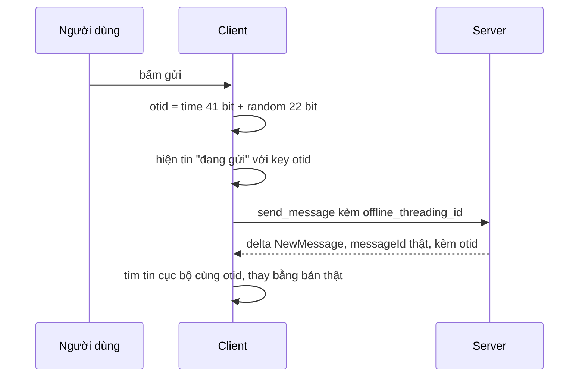

Người dùng bấm gửi. Tin phải hiện ngay trong khung chat, trước khi server trả lời. Vậy tin đó mang ID gì?

- ID của server chưa có: request còn đang bay.
- Dùng tạm `Date.now()`: hai tin gửi cùng mili-giây (dán ba ảnh một lúc) trùng nhau.
- Dùng UUID ngẫu nhiên: không trùng, nhưng không sắp được theo thời gian. Danh sách tin "đang gửi" đảo lộn khi render lại.

Và khi server dội tin về (qua kênh realtime, xem [bài #38](/blogs/facebook-messenger-sync-seqid-gaps)), client phải biết tin dội về chính là tin "đang gửi" nào để thay thế, không hiện hai lần.

Messenger web dùng một ID làm được cả ba việc: **offline threading ID**, gọi tắt OTID.

> [!TIP]
> **Tóm tắt**
> - OTID = 41 bit `Date.now()` ghép 22 bit ngẫu nhiên, cắt còn 63 bit, viết dạng chuỗi thập phân. Sinh ngay ở client, không cần hỏi server.
> - Tin sinh sau (khác mili-giây) luôn có OTID lớn hơn; tin cùng mili-giây phân biệt nhờ 22 bit ngẫu nhiên.
> - Tin gửi đi kèm OTID; delta "tin mới" dội về mang lại OTID; client ghép hai bản theo OTID.
> - Bản gốc tự chia dài nhị phân → thập phân vì thời đó chưa có `BigInt`; nay dùng `BigInt` gọn hơn. Cả hai sẽ quay vòng khi `Date.now()` vượt 41 bit (tháng 9/2039).

<iframe class="demo-frame" src="/demos/facebook-patterns/index.html?theme=dark#/otid" title="Demo otid" loading="lazy" style="height: 900px"></iframe>

<p class="demo-links">▶ <a href="/demos/facebook-patterns/index.html#/otid" target="_blank" rel="noopener">Mở demo toàn màn hình ↗</a> · <a href="https://stackblitz.com/github/hunghg255/blog-hunghg/tree/master/examples/facebook-patterns?file=src/lib/otid.ts" target="_blank" rel="noopener">Sửa code trên StackBlitz ↗</a> · <a href="https://github.com/hunghg255/blog-hunghg/blob/master/examples/facebook-patterns/src/lib/otid.ts" target="_blank" rel="noopener">Xem source trên GitHub ↗</a></p>

## Facebook làm thế nào?

### Sinh ID: `MercuryLocalIDs` (bundle `19.js`)

Module chỉ có 3 hàm. Đổi tên biến cho dễ đọc:

```js
function generateOfflineThreadingID(now) {
  now = now != null ? now : Date.now();
  let rand = randomInt(0, 4294967295);                         // 32 bit
  rand = ('0000000000000000000000' + rand.toString(2)).slice(-22); // giữ 22 bit thấp
  const bits = now.toString(2) + rand;                         // 41 + 22 = 63 ký tự
  return binaryToDecimal(bits.slice(-63));
}

function generateThreadID(now) {
  return 'root:' + generateOfflineThreadingID(now);            // thread tạo ở client
}
```

`binaryToDecimal` chuyển chuỗi nhị phân sang chuỗi thập phân bằng phép chia dài cho 10, làm trên từng ký tự:

```js
function binaryToDecimal(bits) {
  let out = '';
  while (bits != '0') {
    let rem = 0, quotient = '';
    for (const ch of bits) {
      rem = 2 * rem + Number(ch);
      if (rem >= 10) { quotient += '1'; rem -= 10; } else quotient += '0';
    }
    out = rem + out;                          // số dư là chữ số cuối
    bits = quotient.slice(quotient.indexOf('1'));
  }
  return out;
}
```

Lý do có hàm này: số JavaScript (`number`, kiểu double) chỉ biểu diễn chính xác số nguyên tới 2^53. ID 63 bit vượt ngưỡng đó, nên không thể ghép bằng phép dịch bit thông thường. Code này viết từ trước khi `BigInt` có mặt ở mọi trình duyệt.

### Đi kèm khi gửi: `MercuryServerRequests.sendNewMessage` (bundle `55.js`)

```js
sendNewMessage(message) {
  message.offline_threading_id || BanzaiODS.bumpEntityKey(3303, 'chat.web', 'missing_otid_on_send');
  const { type, value } = MercuryIDs.tokenize(message.thread_id);
  if (type === 'user')        payload.other_user_fbid = value;
  else if (type === 'thread') payload.thread_fbid = value;
  else if (type === 'root' && value === payload.offline_threading_id)
                              payload.client_thread_id = message.thread_id;  // thread mới tạo ở client
  else /* thread cục bộ */     threadIDMap.getServerIDFromClientID(message.thread_id, …);
  …
}
```

Thiếu OTID thì không chặn, chỉ tăng một bộ đếm (`missing_otid_on_send`) để đội chat biết có đường gửi nào quên sinh ID. Thread mới tạo ở client có ID `root:<OTID>`, chính bằng OTID của tin đầu tiên, nên server biết tin nào mở thread nào.

### Ghép khi dội về: `MessengerState.bs`

Delta `NewMessage` từ server mang `messageMetadata.offlineThreadingId`. Bộ chuyển delta (`MessengerDeltaTransformer.bs`) chép nó vào `offline_threading_id`. Khi cập nhật state, `MessengerState.bs` (viết bằng ReasonML) kiểm tra: nếu payload tới từ kênh realtime và trong state đang có tin cục bộ cùng OTID, thì gán `client_message_id = offline_threading_id`, `status = SUCCESS` cho bản server. Tin "đang gửi" được thay bằng tin thật, không sinh thêm dòng.

Cũng chính OTID làm khoá để đo độ trễ gửi tin đầu-cuối: xem [bài #40](/blogs/facebook-qpl-send-rtt).



## Bên trong: vì sao thứ tự thời gian được giữ?

Đặt thời gian ở **bit cao**, phần ngẫu nhiên ở bit thấp. Hai OTID sinh ở hai mili-giây khác nhau thì phần thời gian khác nhau, và phần đó quyết định so sánh, bất kể 22 bit ngẫu nhiên là gì. Trong cùng một mili-giây, thứ tự giữa các tin là ngẫu nhiên, nhưng xác suất trùng rất nhỏ: 2^22 ≈ 4,2 triệu giá trị, phải sinh khoảng 2.400 ID trong cùng một mili-giây thì xác suất có ít nhất một cặp trùng mới chạm 50% (bài toán ngày sinh).

Đây là cùng ý tưởng với Snowflake của Twitter (41 bit thời gian + 10 bit máy + 12 bit bộ đếm). Khác ở chỗ OTID không có ID máy và bộ đếm, vì mỗi client chỉ cần không trùng với chính nó trong cùng mili-giây.

**Chuỗi, không phải số.** OTID được truyền và lưu dưới dạng chuỗi thập phân. Nếu để JSON parse thành `number`, các chữ số cuối bị làm tròn và hai ID khác nhau thành một. So hai OTID cũng không được so chuỗi: `"999" > "1000"` theo thứ tự từ điển. Phải so độ dài trước, hoặc đổi sang `BigInt`.

## Quay vòng năm 2039

`Date.now()` hiện cần 41 bit. Tới **2039-09-07 15:47:35.552 UTC** (2^41 ms), nó cần 42 bit. Lúc đó `now.toString(2) + rand` dài 64 ký tự, và `.slice(-63)` cắt mất bit cao nhất. OTID quay về một số rất nhỏ, nhỏ hơn mọi OTID sinh trước đó. Demo in ra hai giá trị quanh mốc này: một giây trước mốc là `9223372…`, một giây sau là `4194304…`.

Còn 13 năm, và có lẽ server của Messenger đã đổi định dạng từ lâu. Nhưng nếu bạn chép nguyên thuật toán vào sản phẩm của mình thì nên biết.

## Viết lại

```ts title=src/lib/otid.ts
export function generateOtid({ now = Date.now(), random = random22() }: OtidOptions = {}): string {
  if (!Number.isInteger(now) || now < 0) throw new RangeError(`now không hợp lệ: ${now}`);
  if (now >= OTID_TIME_LIMIT) {
    // Bản gốc cắt lấy 63 bit cuối nên tới mốc này ID sẽ quay vòng về số nhỏ.
    // Ở đây báo lỗi rõ ràng thay vì âm thầm sinh ID sai thứ tự.
    throw new RangeError('Date.now() đã vượt 41 bit, cần đổi định dạng OTID');
  }
  const id = ((BigInt(now) << BigInt(OTID_RANDOM_BITS)) | (BigInt(random) & RANDOM_MASK)) & ID_MASK;
  return id.toString();
}

/** Lấy lại thời điểm sinh (ms) từ một OTID. */
export function otidTime(otid: string): number {
  return Number(BigInt(otid) >> BigInt(OTID_RANDOM_BITS));
}

/** So hai OTID theo giá trị số (không so chuỗi: "999" > "1000" theo chuỗi). */
export function compareOtid(a: string, b: string): number {
  const x = BigInt(a);
  const y = BigInt(b);
  return x < y ? -1 : x > y ? 1 : 0;
}
```

**Khác bản gốc:**

- Dùng `BigInt` để ghép bit thay cho chia dài trên chuỗi; test so 1.000 mẫu ngẫu nhiên, khớp từng chữ số với thuật toán gốc.
- 22 bit ngẫu nhiên lấy từ `crypto.getRandomValues` thay cho `Math.random`.
- Tới mốc 2^41 thì ném `RangeError`, không âm thầm sinh ID sai thứ tự.
- Có thêm `otidTime` để đọc lại thời điểm sinh, và `compareOtid` để so theo giá trị.

::: spoiler Xem toàn bộ src/lib/otid.ts

```ts title=src/lib/otid.ts
/**
 * OTID (offline threading ID): ID tin nhắn do client tự sinh, sắp được theo thời gian
 * (ý tưởng từ MercuryLocalIDs.generateOfflineThreadingID của Messenger web).
 *
 *   63 bit = [ 41 bit Date.now() ][ 22 bit ngẫu nhiên ]
 *
 * - Sinh ngay khi bấm gửi, không cần hỏi server.
 * - Hai OTID sinh ở hai mili-giây khác nhau luôn so được đúng thứ tự thời gian.
 * - Server dội tin về kèm lại OTID, client dùng nó để ghép bản "đang gửi" với bản thật.
 */

export const OTID_TIME_BITS = 41;
export const OTID_RANDOM_BITS = 22;
/** Mốc Date.now() làm phần thời gian vượt 41 bit: 2^41 ms ≈ 2039-09-07 15:47 UTC. */
export const OTID_TIME_LIMIT = 2 ** OTID_TIME_BITS;

const RANDOM_MASK = (1n << BigInt(OTID_RANDOM_BITS)) - 1n;
const ID_MASK = (1n << 63n) - 1n;

function random22(): number {
  const buf = new Uint32Array(1);
  crypto.getRandomValues(buf);
  return buf[0] & Number(RANDOM_MASK);
}

export interface OtidOptions {
  /** mặc định Date.now() */
  now?: number;
  /** 22 bit ngẫu nhiên, mặc định lấy từ crypto.getRandomValues */
  random?: number;
}

/** Sinh OTID dạng chuỗi số thập phân (JSON và server đều nhận chuỗi, không mất chính xác). */
export function generateOtid({ now = Date.now(), random = random22() }: OtidOptions = {}): string {
  if (!Number.isInteger(now) || now < 0) throw new RangeError(`now không hợp lệ: ${now}`);
  if (now >= OTID_TIME_LIMIT) {
    // Bản gốc cắt lấy 63 bit cuối nên tới mốc này ID sẽ quay vòng về số nhỏ.
    // Ở đây báo lỗi rõ ràng thay vì âm thầm sinh ID sai thứ tự.
    throw new RangeError('Date.now() đã vượt 41 bit, cần đổi định dạng OTID');
  }
  const id = ((BigInt(now) << BigInt(OTID_RANDOM_BITS)) | (BigInt(random) & RANDOM_MASK)) & ID_MASK;
  return id.toString();
}

/** Lấy lại thời điểm sinh (ms) từ một OTID. */
export function otidTime(otid: string): number {
  return Number(BigInt(otid) >> BigInt(OTID_RANDOM_BITS));
}

/** So hai OTID theo giá trị số (không so chuỗi: "999" > "1000" theo chuỗi). */
export function compareOtid(a: string, b: string): number {
  const x = BigInt(a);
  const y = BigInt(b);
  return x < y ? -1 : x > y ? 1 : 0;
}

/**
 * Bản chép lại thuật toán gốc để so sánh: ghép chuỗi nhị phân, cắt 63 ký tự cuối,
 * rồi đổi nhị phân → thập phân bằng phép chia dài thủ công (thời chưa có BigInt).
 */
export function generateOtidFbStyle(now: number, random: number): string {
  const randBits = ('0000000000000000000000' + (random >>> 0).toString(2)).slice(-22);
  const bits = (now.toString(2) + randBits).slice(-63);
  return binaryToDecimal(bits);
}

function binaryToDecimal(bits: string): string {
  let out = '';
  let rest = bits;
  while (rest !== '0') {
    let carry = 0;
    let quotient = '';
    for (let i = 0; i < rest.length; i++) {
      carry = 2 * carry + Number(rest[i]);
      if (carry >= 10) {
        quotient += '1';
        carry -= 10;
      } else {
        quotient += '0';
      }
    }
    out = carry.toString() + out;
    rest = quotient.slice(quotient.indexOf('1'));
  }
  return out;
}
```

:::

## Đi qua code

- `BigInt(now) << 22n` đẩy thời gian lên bit cao; `| (random & 0x3FFFFF)` đặt 22 bit ngẫu nhiên xuống bit thấp; `& ((1n << 63n) − 1n)` giữ 63 bit, khớp với `.slice(-63)` của bản gốc.
- Giới hạn 63 bit (không phải 64) để ID nằm vừa kiểu `int64` có dấu ở server (Java `long`, MySQL `BIGINT`) mà không thành số âm.
- `generateOtidFbStyle` giữ nguyên thuật toán chuỗi để demo và test so sánh, và để thấy năm 2039 quay vòng thế nào.

## Tại sao không làm cách khác?

- **UUID v4**: 122 bit ngẫu nhiên, không trùng, nhưng không mang thời gian. Phải lưu thêm `createdAt` để sắp, và ID dài 36 ký tự.
- **UUID v7** (RFC 9562, 2024): 48 bit thời gian ở đầu + phần ngẫu nhiên, sắp được theo thời gian. Nếu thiết kế mới, đây là lựa chọn chuẩn. OTID gọn hơn (vừa một số 64 bit) và có trước UUID v7 nhiều năm.
- **Bộ đếm tăng dần ở client**: hai tab hoặc hai thiết bị cùng bắt đầu từ 1. Cần thời gian hoặc ngẫu nhiên để không đụng nhau.
- **Đợi server cấp ID rồi mới hiện tin**: mất cảm giác "gửi tức thì". Optimistic UI là lý do OTID tồn tại.

## Edge case và cạm bẫy

- **Đồng hồ máy chạy sai**: OTID dùng giờ của client. Máy lệch 5 phút thì OTID lệch 5 phút. Dùng để ghép và sắp tin của chính client thì không sao; đừng dùng OTID làm thời gian hiển thị hay sắp tin giữa nhiều người. Facebook dùng timestamp của server cho việc đó.
- **Đồng hồ chạy lùi** (đồng bộ NTP): tin gửi sau có thể có OTID nhỏ hơn tin trước vài mili-giây. Nếu cần thứ tự tuyệt đối trong một client, giữ `max(lastTime, Date.now())`.
- **JSON**: luôn gửi và nhận OTID dạng chuỗi. `JSON.parse('{"id": 7520940664699190245}')` cho ra `7520940664699190000`.
- **Khoá React**: dùng OTID làm `key` cho tin đang gửi, và giữ nguyên key đó sau khi có ID server. Đổi key giữa chừng làm React unmount rồi mount lại dòng tin (mất animation, mất focus).

## Dùng trong dự án

```ts
import { compareOtid, generateOtid } from './otid';

function sendMessage(text: string) {
  const otid = generateOtid();
  store.addLocal({ key: otid, otid, text, status: 'sending' });
  api.send({ text, offline_threading_id: otid });
}

realtime.on('new_message', (msg) => {
  // msg.offline_threading_id có mặt nếu là tin của chính client này
  const local = msg.offline_threading_id && store.findLocal(msg.offline_threading_id);
  if (local) store.replace(local.key, { ...msg, key: local.key, status: 'sent' });
  else store.add({ ...msg, key: msg.id });
});

const pending = store.localMessages().sort((a, b) => compareOtid(a.otid, b.otid));
```

## Kiểm thử

::: spoiler Ví dụ test (bản phác, không có trong repo)

```ts
import { describe, expect, it } from 'vitest';
import { compareOtid, generateOtid, generateOtidFbStyle, otidTime, OTID_TIME_LIMIT } from './otid';

describe('OTID', () => {
  it('đọc lại được thời điểm sinh', () => {
    const now = Date.UTC(2026, 9, 27, 10, 0, 0);
    expect(otidTime(generateOtid({ now }))).toBe(now);
  });

  it('OTID sinh sau luôn lớn hơn, kể cả khi phần ngẫu nhiên nhỏ hơn', () => {
    const a = generateOtid({ now: 1_000_000, random: 4_194_303 });
    const b = generateOtid({ now: 1_000_001, random: 0 });
    expect(compareOtid(a, b)).toBe(-1);
  });

  it('khớp từng chữ số với thuật toán chuỗi nhị phân của bản gốc', () => {
    for (let i = 0; i < 1000; i++) {
      const now = 1_500_000_000_000 + Math.floor(Math.random() * 6e11);
      const random = Math.floor(Math.random() * 2 ** 22);
      expect(generateOtid({ now, random })).toBe(generateOtidFbStyle(now, random));
    }
  });

  it('bản gốc quay vòng khi Date.now() vượt 41 bit, bản viết lại báo lỗi', () => {
    const before = generateOtidFbStyle(OTID_TIME_LIMIT - 1, 0);
    const after = generateOtidFbStyle(OTID_TIME_LIMIT + 1, 0);
    expect(BigInt(after) < BigInt(before)).toBe(true);
    expect(() => generateOtid({ now: OTID_TIME_LIMIT })).toThrow(RangeError);
  });

  it('so theo giá trị số, không theo chuỗi', () => {
    expect(['1000', '999'].sort(compareOtid)).toEqual(['999', '1000']);
  });
});
```

:::

## So với thư viện và chuẩn web

- **UUID v7** (RFC 9562): `crypto.randomUUID()` hiện chỉ sinh v4; cần thư viện (ví dụ gói `uuid` có `v7()`) để sinh v7 (tính tới 10/2026).
- **ULID**: 48 bit thời gian + 80 bit ngẫu nhiên, mã hoá Crockford base32 26 ký tự, sắp được theo chuỗi. Hợp khi ID phải là chuỗi sắp được trực tiếp.
- **Snowflake** (Twitter, Discord, Instagram dùng biến thể): thêm ID máy và bộ đếm, dành cho server sinh ID với tốc độ cao. Client không cần.
- **`BigInt`** có ở mọi trình duyệt chính từ khoảng 2020; `JSON.stringify` không tự serialize BigInt, nên vẫn phải đổi sang chuỗi khi gửi.

---

Bài này thuộc series **[Học từ mã nguồn Facebook](/series/facebook)** (58 bài, đọc theo thứ tự).

::: spoiler Xem nhanh danh sách bài trong series

*Phần 1*

- [Mở đầu: cách đọc code minify của Facebook](/blogs/learn-from-facebook-source-code)
- [#1 Dùng chung IntersectionObserver + infinite scroll](/blogs/facebook-shared-intersection-observer)
- [#2 useViewportDuration: đo thời gian thực sự được xem](/blogs/facebook-use-viewport-duration)
- [#3 Preload code + data khi hover](/blogs/facebook-preload-on-hover)
- [#4 Toast manager với external store](/blogs/facebook-toast-manager)
- [#5 Network status + heartbeat backoff](/blogs/facebook-network-status-heartbeat)
- [#6 ErrorGuard: bắt lỗi theo ngữ cảnh](/blogs/facebook-error-guard)
- [#7 Banzai: gom log theo lô + sendBeacon](/blogs/facebook-batch-logger)
- [#8 Focus trap + Esc theo layer](/blogs/facebook-focus-trap)

*Phần 2*

- [#9 Mẹo calc(… * 9999): container query, line-clamp, mũi tên carousel bằng CSS](/blogs/facebook-css-9999-trick)
- [#10 Thanh cuộn tuỳ biến bằng CSS 3D](/blogs/facebook-css-3d-scrollbar)
- [#11 Modal cuộn bằng window, giữ vị trí trang nền](/blogs/facebook-document-scroll-modal)
- [#12 Popover, tooltip group và hovercard](/blogs/facebook-popover-tooltip)
- [#13 Primitive Pressable + focus-visible](/blogs/facebook-pressable)
- [#14 Tab "Xem thêm" + sticky header bằng IntersectionObserver](/blogs/facebook-priority-tabs-sticky-header)
- [#15 Avatar khoét mask, gradient Messenger, skeleton steps()](/blogs/facebook-visual-tricks)
- [#16 Khung chat không giật](/blogs/facebook-chat-scroller)
- [#17 Thuật toán chọn bố cục collage ảnh](/blogs/facebook-photo-collage-layout)
- [#18 Keep-alive tab trong SPA](/blogs/facebook-keep-alive-tabs)
- [#19 Tự đo Visual Completion & interaction tracing](/blogs/facebook-visual-completion)
- [#20 Router SPA bền bỉ & tải chunk có retry](/blogs/facebook-spa-router-resilient-loading)

*Phần 3*

- [#21 Smart Compose: gợi ý chữ mờ khi gõ](/blogs/facebook-smart-compose-ghost-text)
- [#22 MQTT ngay trong trình duyệt, tự chuyển sang long-poll](/blogs/facebook-mqtt-in-browser)
- [#23 Đo thời gian dùng bằng bitmap 64 giây](/blogs/facebook-time-spent-bitmap)
- [#24 Bảng reaction nhấn giữ rồi trượt](/blogs/facebook-reaction-press-slide)
- [#25 Tìm kiếm gấp dấu, phiên âm và highlight đầu từ](/blogs/facebook-search-diacritics-tokenize)
- [#26 Ring buffer biết trace nào đã mất log](/blogs/facebook-trace-ring-buffer)
- [#27 Engine animation JS: một vòng rAF và solver cubic-bezier](/blogs/facebook-keyframes-loop-cubic-bezier)
- [#28 Bootloader: bitmap tài nguyên đã tải, chỉ reload khi cần](/blogs/facebook-bootloader-bitmap-consistency)
- [#29 Nhận biết click do screen reader tạo ra](/blogs/facebook-virtual-cursor-detection)
- [#30 Tải trước feed theo chất lượng mạng, đoán hạng thiết bị](/blogs/facebook-network-aware-prefetch)
- [#31 Hàng đợi gửi tin chat giữ đúng thứ tự](/blogs/facebook-ordered-send-queue)
- [#32 Gộp lời gọi API trong cùng một tick](/blogs/facebook-api-batcher)
- [#33 Resize ảnh trong pool Web Worker](/blogs/facebook-jpeg-resize-worker-pool)
- [#34 Crop ảnh theo nhiều khuôn mặt](/blogs/facebook-face-aware-crop)
- [#35 Kéo-thả sắp xếp và vùng thả file không nhấp nháy](/blogs/facebook-flicker-free-drag-drop)
- [#36 Tiện ích UI: fade-out, sticky event, hàm huỷ được](/blogs/facebook-ui-utility-hooks)
- [#37 Hạ tầng nhỏ: cookie, hash lỗi, prefetch khi chuột dừng](/blogs/facebook-small-infra-cookie-hash-idle)

*Phần 4–6*

- [#38 Đồng bộ tin nhắn: phát hiện lỗ seqID và fetch bù theo tầng](/blogs/facebook-messenger-sync-seqid-gaps)
- **#39 OTID: ID tin nhắn kiểu Snowflake sinh ở client** (bài này)
- [#40 QPL: lấy mẫu từ lúc bắt đầu, đo RTT gửi tin đầu-cuối](/blogs/facebook-qpl-send-rtt)
- [#41 Bộ điều phối request bảy chế độ gộp và chống trùng](/blogs/facebook-request-dispatcher-modes)
- [#42 Thread list theo mốc thời gian, cookie presence có version](/blogs/facebook-threadlist-ranged-presence)
- [#43 Composer dạng plugin: reducer, dirty checker, chuỗi kiểm tra](/blogs/facebook-plugin-composer)
- [#44 Thanh toán bất đồng bộ: subscribe trước, poll dự phòng](/blogs/facebook-async-checkout)
- [#45 Validate số thẻ: sửa lỗi gõ, dải BIN, Luhn](/blogs/facebook-card-validation)
- [#46 Lịch chọn khoảng ngày: bo góc dải chọn, phím đủ bộ, RTL](/blogs/facebook-range-calendar-a11y)
- [#47 Giờ mở cửa theo tuần: qua đêm, gộp khoảng, phần bù](/blogs/facebook-weekly-hours-intervals)
- [#48 Tiến độ đăng realtime: giữ event chờ snapshot, watchdog](/blogs/facebook-realtime-publish-snapshot)
- [#49 Tiền tệ theo đơn vị nhỏ nhất và ô nhập tiền](/blogs/facebook-currency-minor-units)
- [#50 Sửa hàng loạt Empty/Uniform/Mixed, seen/read bằng 2 bit](/blogs/facebook-bulk-edit-seen-bits)
- [#51 Phát hiện script lạ hook vào hàm native](/blogs/facebook-native-hook-detection)
- [#52 localStorage tự dọn khi đầy quota](/blogs/facebook-quota-aware-storage)
- [#53 Cache tuyến do server phân giải, chờ sẵn promise](/blogs/facebook-route-cache-prefetch)
- [#54 Lưới phím mũi tên 2D và focus không làm cuộn trang](/blogs/facebook-focus-table-grid)
- [#55 Tách emoji bằng máy trạng thái](/blogs/facebook-emoji-segmentation)
- [#56 Đọc trước ghi sau trong một frame, con tự biết vị trí](/blogs/facebook-read-then-write-dom)
- [#57 Hàng đợi lệnh cho video và stream sắp lại chunk](/blogs/facebook-video-command-queue)

:::

Code + demo: [`examples/facebook-patterns`](https://github.com/hunghg255/blog-hunghg/tree/master/examples/facebook-patterns) · [Mở trên StackBlitz](https://stackblitz.com/github/hunghg255/blog-hunghg/tree/master/examples/facebook-patterns)
