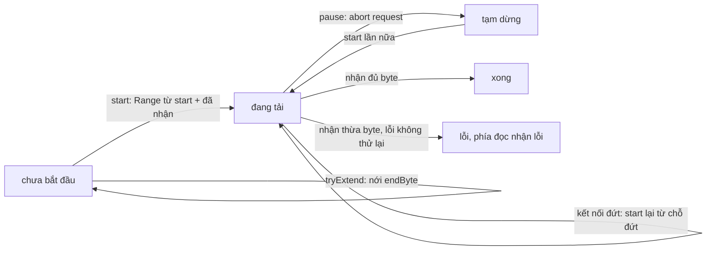

Trình phát video lúc nào cũng có vài request đang chạy: segment hình, segment tiếng, manifest. Có lúc nó cần **dừng một request giữa chừng**: người xem bấm pause và không cần tải thêm, một segment ưu tiên cao hơn vừa xuất hiện (người xem vừa tua), hay mạng chập chờn làm kết nối đứt ở 60%. Cách dễ nhất là `abort()` rồi tải lại từ đầu. Với segment vài MB trên mạng di động, "tải lại từ đầu" là phí cả băng thông lẫn thời gian.

HTTP có sẵn công cụ cho việc này: header `Range`. Đã nhận 400 KB đầu thì request tiếp theo xin từ byte 409 600. Khó là ở phía code: phần đã nhận đang ở đâu, ai đang đọc nó, làm sao để nơi đọc (thường là vòng lặp đẩy dữ liệu vào `SourceBuffer`) không phải biết đã có bao nhiêu request.

> [!TIP]
> **Tóm tắt**
> - oz-player tách **phía mạng** và **phía đọc** bằng một hàng đợi (`OzDeferredBuffer`). Phía đọc là một `ReadableStream` duy nhất; phía mạng có thể bị huỷ rồi thay bằng request mới bao nhiêu lần cũng được.
> - `OzPausableRangeStream.startStream()` gửi `Range` từ `startByte + số byte đã nhận`. Có một chế độ thay thế: tải lại từ đầu rồi bỏ đúng số byte đã đưa xuống, và cấu hình production lại bật chính chế độ này.
> - Mấy chỗ đáng chú ý: range mở (`bytes=X-`) từng làm stream không bao giờ đóng, pause trong lúc chờ response bị mất, và các segment chỉ được gộp thành một request khi **tất cả** liền nhau.
> - Bản viết lại dùng `AbortController` cho mỗi lần thử, tự xử lý server trả `200` thay vì `206`, coi kết nối đứt là "tạm dừng ngoài ý muốn" để tải tiếp, và gộp segment theo từng đoạn liền nhau.

<iframe class="demo-frame" src="/demos/facebook-patterns/index.html?theme=dark#/pausable-range-stream" title="Demo pausable-range-stream" loading="lazy" style="height: 1080px"></iframe>

<p class="demo-links">▶ <a href="/demos/facebook-patterns/index.html#/pausable-range-stream" target="_blank" rel="noopener">Mở demo toàn màn hình ↗</a> · <a href="https://stackblitz.com/github/hunghg255/blog-hunghg/tree/master/examples/facebook-patterns?file=src/lib/rangeStream.ts" target="_blank" rel="noopener">Sửa code trên StackBlitz ↗</a> · <a href="https://github.com/hunghg255/blog-hunghg/blob/master/examples/facebook-patterns/src/lib/rangeStream.ts" target="_blank" rel="noopener">Xem source trên GitHub ↗</a></p>

## Facebook làm thế nào?

Bốn module trong bundle `26.VideoPlayer/all.js` (bản trùng ở `21.js`):

- `oz-player/manifests/OzByteRange`: các phép trên khoảng byte `{startByte, endByte}` (`endByte = null` là tới hết file).
- `oz-player/networks/getOzSegmentStreamableRange`: gộp nhiều segment thành một range.
- `oz-player/networks/OzDeferredBuffer`: hàng đợi producer/consumer.
- `oz-player/networks/OzPausableRangeStream`: stream tạm dừng được.

### Gộp segment liền nhau

Segment trong một file DASH (xem [bài #92](/blogs/facebook-webm-ebml-cues)) thường nằm sát nhau: segment 3 kết thúc ở byte 99 922, segment 4 bắt đầu ở 99 923. Tải ba segment liền nhau bằng một request thì đỡ hai lần bắt tay và hai lần chờ byte đầu tiên.

```js
// getOzSegmentStreamableRange, đổi tên biến
function streamableRange(segments) {
  if (!segments.length) return null;
  const url = segments[0].getURI().toString();
  const first = segments[0].getByteRange();
  if (!first) return null;
  let prev = first;
  for (let i = 1; i < segments.length; i++) {
    if (segments[i].getURI().toString() !== url) return null;
    const r = segments[i].getByteRange();
    if (!prev || !r) return null;
    if (prev.endByte === null || r.startByte !== prev.endByte + 1) return null;   // có một chỗ hở là bỏ cả
    prev = r;
  }
  return { startByte: first.startByte, endByte: prev.endByte };
}
```

Quy tắc là **tất cả hoặc không**. Nơi gọi trong `OzNetworkManager` xử lý kết quả `null` như sau:

```js
const range = getOzSegmentStreamableRange(segments) || { startByte: 0, endByte: null };
```

Với một segment không có byte range (mỗi segment một URL), `{0, null}` nghĩa là "cả URL", hợp lý. Nhưng nếu ai đó truyền vào các segment có byte range mà không liền nhau, kết quả là request **cả file từ byte 0**. Có lẽ nơi gọi luôn chỉ truyền segment liền nhau nên chưa ai gặp; đọc code thì thấy vậy. Bản viết lại gộp theo từng đoạn: 6 segment có một chỗ hở thành 2–3 request, không bao giờ thành "cả file".

`OzPausableRangeStream.tryConcatByteRange()` cho phép nới `endByte` của một stream **chưa bắt đầu** khi segment mới nằm ngay sau nó: hàng đợi tải vừa nhận thêm segment 5 thì nối vào request đang chờ, không tạo request mới.

### Hai phía, một hàng đợi

```text
mạng  ──►  WritableStream #1  ─┐
           (bị lỗi khi pause)   │
mạng  ──►  WritableStream #2  ─┼──►  OzDeferredBuffer  ──►  ReadableStream  ──►  SourceBuffer
           (tạo lại sau pause) ─┘      (mảng chunk)          (chỉ một, sống suốt)
```

```js
// OzPausableRangeStream, đổi tên biến
makeWritable() {
  this.writable = new WritableStream({
    start: (c) => { this.writableController = c; },
    write: (chunk) => { this.buffer.produce(chunk); this.bytesReceived += chunk.length; },
    close: () => {
      this.upstreamClosed = true;
      const { startByte, endByte } = this.range;
      if (this.fixUndefinedEnd && endByte === null) this.buffer.produce(new Uint8Array([]));  // đánh thức phía đọc
      if (endByte !== null && this.bytesReceived !== endByte - startByte + 1)
        this.readableController.error(new Error('Upstream has an inconsistent range'));
    },
  });
}

pauseStream() {
  this.writableController.error(STREAM_PAUSED);   // pipeTo của request hiện tại dừng lại
  this.status?.resolve('stream_paused');
  this.makeWritable();                            // writable mới cho lần start sau
}

startStream() {
  const range = { ...this.range };
  if (!this.resumeFromStartDangerously) range.startByte += this.bytesReceived;   // chỉ xin phần còn thiếu
  else if (this.bytesReceived) { this.buffer.produce('skip_buffered_bytes'); this.bytesReceived = 0; }
  const writable = this.writable;
  return this.upstream.startStream(range).then((body) => {
    body.pipeTo(this.fixPausePreReadableStream ? writable : this.writable) /* … */;
  });
}
```

Phía đọc (`pull` của `ReadableStream`) lấy từng chunk từ `OzDeferredBuffer.consume(max)`. Số byte đã đưa xuống được đếm riêng; nếu vượt độ dài range thì báo `Upstream has an inconsistent range`. Vậy dữ liệu được kiểm hai lần: khi upstream đóng (nhận đủ chưa) và khi đưa xuống (có thừa không).

### Chế độ "tải lại từ đầu, bỏ phần đã có"

Với cờ `enablePausableStreamResumeFromStartDangerously`, `startStream()` không đổi `startByte` mà đẩy một token chuỗi `"skip_buffered_bytes"` vào hàng đợi. Phía đọc gặp token (nó bị ném ra như một lỗi vì không phải `Uint8Array`), đặt "số byte cần bỏ" bằng số byte **đã đưa xuống**, rồi `consume(n)` cắt bỏ đúng chừng đó từ dữ liệu mới. Thứ tự trong hàng đợi đảm bảo phép tính đúng: các chunk cũ chưa đọc nằm trước token, nên lúc gặp token, mọi byte của lần tải trước đều đã được đưa xuống.

Nơi tạo stream trong `OzNetworkManager` truyền:

```js
new OzPausableRangeStream(ReadableStream, WritableStream, range, upstream, {
  fixStreamingUndefinedEndByte: true,
  enablePausableStreamResumeFromStartDangerously: true,
  fixPausePreReadableStream: true,
  throwErrorWhenAborted: config.getBool('pausable_stream_throws_error_when_aborted'),
});
```

Tức là ở bản đang chạy, **tạm dừng rồi tiếp tục sẽ tải lại từ đầu**. Lợi ích còn lại là phía đọc không bị gián đoạn, còn băng thông thì không tiết kiệm được. Code không nói lý do; có lẽ request có range lệch khỏi ranh giới segment không trúng cache của CDN hay của lớp cache request (`OzNetworkRequestStream` giữ một `Map` cache theo request), hoặc có server trả `200` cho range lẻ. Chữ "Dangerously" trong tên cờ cho thấy chính nhóm viết cũng thấy đây là đánh đổi.

### Các cờ sửa lỗi kể lại lịch sử

**`fixStreamingUndefinedEndByte`.** Với range mở (`endByte = null`, như segment cuối ở bài #92), điều kiện đóng ở `pull` là "đã đưa xuống đủ độ dài" mà độ dài là `null`. Upstream đóng xong, hàng đợi rỗng, `consume()` chờ mãi: phía đọc treo. Bản sửa đẩy một chunk rỗng khi upstream đóng để đánh thức `pull`, rồi `pull` thấy "upstream đã đóng và hàng rỗng" thì `close()`.

**`fixPausePreReadableStream`.** `startStream()` chờ upstream trả response rồi mới `pipeTo`. Nếu `pauseStream()` chạy trong lúc chờ, nó tạo writable mới. Không có cờ, `pipeTo(this.writable)` đọc writable **mới** ở thời điểm response về, nên dữ liệu vẫn chảy vào như chưa hề pause. Có cờ thì dùng writable đã chụp lúc gọi `startStream()`, cái đã bị lỗi `STREAM_PAUSED`.

**`disableArrayShift` của `OzDeferredBuffer`.** `Array.prototype.shift()` dời mọi phần tử, O(n). Chế độ này dùng con trỏ chỉ số và gán `undefined` cho ô đã đọc. Đổi lại, mảng chỉ dài ra, không bao giờ thu lại. Ngoài ra khi chunk lớn hơn `max`, buffer cắt bằng `slice()`, tức là chép.



## Bên trong trình duyệt

- **`Range: bytes=a-b`** tính cả byte `b`. Server hỗ trợ thì trả `206 Partial Content` kèm `Content-Range: bytes a-b/tổng`. Server (hay proxy) không hỗ trợ thì trả `200` và **cả file**; code phải nhận ra để bỏ phần đầu.
- **`fetch` + `AbortController`.** `controller.abort()` làm promise của `fetch` reject nếu chưa có response, hoặc làm `reader.read()` reject với `AbortError` nếu đang đọc body. Mỗi lần thử nên có controller riêng; dùng chung thì abort lần cũ cũng giết luôn lần mới.
- **`ReadableStream` kiểu pull.** Hàm `pull` chỉ được gọi khi phía đọc cần thêm dữ liệu, và không bị gọi lại khi promise của lần trước chưa xong. Nhờ vậy phía đọc chậm (SourceBuffer đang bận) tự kìm phía nhận, đây là áp lực ngược (backpressure).
- **`subarray` không chép, `slice` thì chép.** Cắt chunk 64 KB thành hai phần bằng `subarray` chỉ tạo hai view trên cùng vùng nhớ.
- **`Content-Range` qua CORS.** Header này không nằm trong danh sách header phản hồi mà JavaScript đọc được mặc định; CDN khác origin phải gửi `Access-Control-Expose-Headers: Content-Range` nếu code muốn kiểm tra nó.

## Viết lại

Bản viết lại giữ ý tưởng hai phía và một hàng đợi, nhưng thay "writable bị lỗi" bằng thứ trình duyệt có sẵn: mỗi lần `start()` là một `fetch` với `AbortController` riêng và một số thứ tự `attempt`. Lần thử nào thấy `attempt` đã đổi thì tự dừng, không ghi gì vào hàng đợi.

Gộp segment theo từng đoạn liền nhau:

```ts title=src/lib/rangeStream.ts
/** Gom các segment liền nhau (cùng URL, byte nối tiếp) thành ít request nhất, giữ thứ tự. */
export function groupContiguous<T extends RangedItem>(items: T[]): { url: string; range: ByteRange; items: T[] }[] {
  const out: { url: string; range: ByteRange; items: T[] }[] = [];
  for (const it of items) {
    const last = out[out.length - 1];
    if (last && last.url === it.url && isRightAfter(it.range, last.range)) {
      last.range = { start: last.range.start, end: it.range.end };
      last.items.push(it);
    } else {
      out.push({ url: it.url, range: { ...it.range }, items: [it] });
    }
  }
  return out;
}
```

Hàng đợi: con trỏ đầu, thu gọn khi phần đã đọc chiếm quá nửa, cắt bằng `subarray`:

```ts title=src/lib/rangeStream.ts
  /** Lấy tối đa `max` byte; chờ nếu hàng rỗng. Trả null khi đã hết dữ liệu. */
  async take(max = Infinity): Promise<Uint8Array | null> {
    while (this.pending === 0) await new Promise<void>((r) => (this.wake = r));
    const item = this.items[this.head]!;
    if (item === END) return null;
    if (item instanceof Error) {
      this.advance();
      throw item;
    }
    if (item.length > max) {
      this.items[this.head] = item.subarray(max);
      return item.subarray(0, max);
    }
    this.advance();
    return item;
  }

  private advance() {
    this.items[this.head++] = undefined; // nhả tham chiếu tới chunk đã đọc
    if (this.head > 32 && this.head * 2 > this.items.length) {
      this.items = this.items.slice(this.head);
      this.head = 0;
    }
  }
```

Phía đọc là một `ReadableStream` duy nhất:

```ts title=src/lib/rangeStream.ts
export class PausableRangeStream {
  readonly readable: ReadableStream<Uint8Array>;
  private readonly queue = new ByteQueue();
  private received = 0;
  private wasted = 0;
  private attempt = 0;
  private controller: AbortController | null = null;
  private started = false;
  private finished = false;
  private failed = false;

  constructor(
    private range: ByteRange,
    private readonly fetcher: RangeFetcher,
    private readonly onEvent: (e: RangeEvent) => void = () => {},
  ) {
    this.readable = new ReadableStream<Uint8Array>({
      pull: async (c) => {
        try {
          const chunk = await this.queue.take();
          if (chunk) c.enqueue(chunk);
          else c.close();
        } catch (e) {
          c.error(e);
        }
      },
      cancel: () => this.pause(),
    });
  }
```

`start()`: xin phần còn thiếu, nhận ra `200`, kiểm số byte:

```ts title=src/lib/rangeStream.ts
  /** Gửi request cho phần còn thiếu: từ start + số byte đã nhận. */
  async start(): Promise<StartResult> {
    if (this.failed) return 'error';
    if (this.finished) return 'done';
    this.started = true;
    this.controller?.abort();
    const id = ++this.attempt;
    const controller = (this.controller = new AbortController());
    const from = this.range.start + this.received;
    const total = rangeLength(this.range);
    const req = { start: from, end: this.range.end };
    this.onEvent({ type: 'request', range: req, attempt: id });
    try {
      const res = await this.fetcher(req, controller.signal);
      if (id !== this.attempt) {
        void res.body.cancel().catch(() => {});
        return 'paused'; // pause() được gọi trong lúc chờ header
      }
      if (res.status !== 200 && res.status !== 206) throw new Error(`HTTP ${res.status}`);
      // 200 nghĩa là server bỏ qua Range và gửi cả file từ byte 0: bỏ đúng `from` byte đầu.
      let skip = res.status === 200 ? from : 0;
      this.onEvent({ type: 'response', status: res.status, skip, attempt: id });
```

```ts title=src/lib/rangeStream.ts
      const reader = res.body.getReader();
      for (;;) {
        const { done, value } = await reader.read();
        if (id !== this.attempt) {
          void reader.cancel().catch(() => {});
          return 'paused';
        }
        if (done) break;
        let chunk = value;
        if (skip > 0) {
          const n = Math.min(skip, chunk.length);
          skip -= n;
          this.wasted += n;
          chunk = chunk.subarray(n);
        }
        if (total != null && this.received + chunk.length > total) {
          if (res.status === 206) return this.fail(new Error('Upstream trả nhiều byte hơn range đã xin'));
          this.wasted += this.received + chunk.length - total;
          chunk = chunk.subarray(0, total - this.received);
        }
        if (chunk.length) {
          this.received += chunk.length;
          this.queue.push(chunk);
        }
        if (total != null && this.received === total) {
          void reader.cancel().catch(() => {});
          break;
        }
      }
      if (total != null && this.received < total) throw new Error(`Kết nối đóng sớm: mới có ${this.received}/${total} byte`);
      this.finished = true;
      this.controller = null;
      this.queue.end();
      this.onEvent({ type: 'done', received: this.received });
      return 'done';
    } catch (e) {
      if (id !== this.attempt) return 'paused';
      if (e instanceof RangeFatalError) return this.fail(e);
      this.controller = null;
      this.onEvent({ type: 'network-error', message: (e as Error).message, received: this.received });
      return 'error';
    }
  }
```

Tạm dừng thì giữ dữ liệu; huỷ hẳn thì phía đọc nhận lỗi:

```ts title=src/lib/rangeStream.ts
  /** Huỷ request đang chạy. Byte đã nhận vẫn nằm trong hàng đợi, phía đọc không bị lỗi. */
  pause() {
    if (this.finished || !this.controller) return;
    this.attempt++;
    this.controller.abort();
    this.controller = null;
    this.onEvent({ type: 'paused', received: this.received });
  }

  /** Bỏ hẳn: phía đọc nhận lỗi. */
  abort(reason = new Error('Đã huỷ')) {
    this.pause();
    if (!this.finished && !this.failed) this.fail(reason);
  }
```

::: spoiler Xem toàn bộ src/lib/rangeStream.ts

```ts title=src/lib/rangeStream.ts
/**
 * Tải một byte range qua HTTP Range, tạm dừng được và tải tiếp đúng byte còn thiếu.
 * Ý tưởng học từ oz-player (OzPausableRangeStream, OzDeferredBuffer, OzByteRange,
 * getOzSegmentStreamableRange) của Facebook, viết lại từ đầu.
 */

/** Khoảng byte, `end` tính cả byte cuối; null nghĩa là "tới hết file". */
export interface ByteRange {
  start: number;
  end: number | null;
}

export const rangeLength = (r: ByteRange) => (r.end == null ? null : r.end - r.start + 1);
export const rangeHeader = (r: ByteRange) => `bytes=${r.start}-${r.end ?? ''}`;
/** `next` bắt đầu ngay sau byte cuối của `prev`. */
export const isRightAfter = (next: ByteRange, prev: ByteRange) => prev.end != null && next.start === prev.end + 1;

export interface RangedItem {
  url: string;
  range: ByteRange;
}

/** Gom các segment liền nhau (cùng URL, byte nối tiếp) thành ít request nhất, giữ thứ tự. */
export function groupContiguous<T extends RangedItem>(items: T[]): { url: string; range: ByteRange; items: T[] }[] {
  const out: { url: string; range: ByteRange; items: T[] }[] = [];
  for (const it of items) {
    const last = out[out.length - 1];
    if (last && last.url === it.url && isRightAfter(it.range, last.range)) {
      last.range = { start: last.range.start, end: it.range.end };
      last.items.push(it);
    } else {
      out.push({ url: it.url, range: { ...it.range }, items: [it] });
    }
  }
  return out;
}

const END = Symbol('end');
type QueueItem = Uint8Array | Error | typeof END;

/**
 * Hàng đợi giữa phía nhận (mạng) và phía đọc. Đọc bằng con trỏ đầu thay vì shift() O(n),
 * và thu gọn mảng khi phần đã đọc chiếm quá nửa. Chunk lớn hơn `max` được cắt bằng subarray (không chép).
 */
export class ByteQueue {
  private items: (QueueItem | undefined)[] = [];
  private head = 0;
  private wake: (() => void) | null = null;

  push(item: Uint8Array | Error) {
    this.items.push(item);
    this.notify();
  }

  end() {
    this.items.push(END);
    this.notify();
  }

  get pending() {
    return this.items.length - this.head;
  }

  /** Lấy tối đa `max` byte; chờ nếu hàng rỗng. Trả null khi đã hết dữ liệu. */
  async take(max = Infinity): Promise<Uint8Array | null> {
    while (this.pending === 0) await new Promise<void>((r) => (this.wake = r));
    const item = this.items[this.head]!;
    if (item === END) return null;
    if (item instanceof Error) {
      this.advance();
      throw item;
    }
    if (item.length > max) {
      this.items[this.head] = item.subarray(max);
      return item.subarray(0, max);
    }
    this.advance();
    return item;
  }

  private advance() {
    this.items[this.head++] = undefined; // nhả tham chiếu tới chunk đã đọc
    if (this.head > 32 && this.head * 2 > this.items.length) {
      this.items = this.items.slice(this.head);
      this.head = 0;
    }
  }

  private notify() {
    const w = this.wake;
    this.wake = null;
    w?.();
  }
}

export type RangeFetcher = (range: ByteRange, signal: AbortSignal) => Promise<{ status: number; body: ReadableStream<Uint8Array> }>;

export type RangeEvent =
  | { type: 'request'; range: ByteRange; attempt: number }
  | { type: 'response'; status: number; skip: number; attempt: number }
  | { type: 'paused'; received: number }
  | { type: 'done'; received: number }
  | { type: 'network-error'; message: string; received: number };

/** 'error' là lỗi mạng: dữ liệu đã nhận vẫn giữ, gọi start() lần nữa để tải tiếp. */
export type StartResult = 'done' | 'paused' | 'error';

/** Fetcher ném lỗi này khi không nên thử lại (ví dụ ETag đổi: file trên server đã khác). */
export class RangeFatalError extends Error {
  override name = 'RangeFatalError';
}

export class PausableRangeStream {
  readonly readable: ReadableStream<Uint8Array>;
  private readonly queue = new ByteQueue();
  private received = 0;
  private wasted = 0;
  private attempt = 0;
  private controller: AbortController | null = null;
  private started = false;
  private finished = false;
  private failed = false;

  constructor(
    private range: ByteRange,
    private readonly fetcher: RangeFetcher,
    private readonly onEvent: (e: RangeEvent) => void = () => {},
  ) {
    this.readable = new ReadableStream<Uint8Array>({
      pull: async (c) => {
        try {
          const chunk = await this.queue.take();
          if (chunk) c.enqueue(chunk);
          else c.close();
        } catch (e) {
          c.error(e);
        }
      },
      cancel: () => this.pause(),
    });
  }

  get byteRange(): ByteRange {
    return { ...this.range };
  }

  get stats() {
    return { received: this.received, wasted: this.wasted, finished: this.finished };
  }

  /** Nới range để gộp segment liền sau, chỉ khi chưa gửi request nào. */
  tryExtend(next: ByteRange): boolean {
    if (this.started || !isRightAfter(next, this.range)) return false;
    this.range = { start: this.range.start, end: next.end };
    return true;
  }

  /** Gửi request cho phần còn thiếu: từ start + số byte đã nhận. */
  async start(): Promise<StartResult> {
    if (this.failed) return 'error';
    if (this.finished) return 'done';
    this.started = true;
    this.controller?.abort();
    const id = ++this.attempt;
    const controller = (this.controller = new AbortController());
    const from = this.range.start + this.received;
    const total = rangeLength(this.range);
    const req = { start: from, end: this.range.end };
    this.onEvent({ type: 'request', range: req, attempt: id });
    try {
      const res = await this.fetcher(req, controller.signal);
      if (id !== this.attempt) {
        void res.body.cancel().catch(() => {});
        return 'paused'; // pause() được gọi trong lúc chờ header
      }
      if (res.status !== 200 && res.status !== 206) throw new Error(`HTTP ${res.status}`);
      // 200 nghĩa là server bỏ qua Range và gửi cả file từ byte 0: bỏ đúng `from` byte đầu.
      let skip = res.status === 200 ? from : 0;
      this.onEvent({ type: 'response', status: res.status, skip, attempt: id });
      const reader = res.body.getReader();
      for (;;) {
        const { done, value } = await reader.read();
        if (id !== this.attempt) {
          void reader.cancel().catch(() => {});
          return 'paused';
        }
        if (done) break;
        let chunk = value;
        if (skip > 0) {
          const n = Math.min(skip, chunk.length);
          skip -= n;
          this.wasted += n;
          chunk = chunk.subarray(n);
        }
        if (total != null && this.received + chunk.length > total) {
          if (res.status === 206) return this.fail(new Error('Upstream trả nhiều byte hơn range đã xin'));
          this.wasted += this.received + chunk.length - total;
          chunk = chunk.subarray(0, total - this.received);
        }
        if (chunk.length) {
          this.received += chunk.length;
          this.queue.push(chunk);
        }
        if (total != null && this.received === total) {
          void reader.cancel().catch(() => {});
          break;
        }
      }
      if (total != null && this.received < total) throw new Error(`Kết nối đóng sớm: mới có ${this.received}/${total} byte`);
      this.finished = true;
      this.controller = null;
      this.queue.end();
      this.onEvent({ type: 'done', received: this.received });
      return 'done';
    } catch (e) {
      if (id !== this.attempt) return 'paused';
      if (e instanceof RangeFatalError) return this.fail(e);
      this.controller = null;
      this.onEvent({ type: 'network-error', message: (e as Error).message, received: this.received });
      return 'error';
    }
  }

  /** Huỷ request đang chạy. Byte đã nhận vẫn nằm trong hàng đợi, phía đọc không bị lỗi. */
  pause() {
    if (this.finished || !this.controller) return;
    this.attempt++;
    this.controller.abort();
    this.controller = null;
    this.onEvent({ type: 'paused', received: this.received });
  }

  /** Bỏ hẳn: phía đọc nhận lỗi. */
  abort(reason = new Error('Đã huỷ')) {
    this.pause();
    if (!this.finished && !this.failed) this.fail(reason);
  }

  private fail(err: Error): 'error' {
    this.failed = true;
    this.attempt++;
    this.controller?.abort();
    this.controller = null;
    this.queue.push(err);
    return 'error';
  }
}
```

:::

Server giả cho demo và test nằm ở `src/lib/rangeStreamFake.ts`: phục vụ một mảng byte theo `Range`, giới hạn tốc độ, có thể bỏ qua `Range` hoặc cắt kết nối một lần.

::: spoiler Xem src/lib/rangeStreamFake.ts

```ts title=src/lib/rangeStreamFake.ts
/** Server giả cho demo/test: phục vụ một mảng byte theo header Range, có giới hạn tốc độ. */
import type { ByteRange, RangeFetcher } from './rangeStream';

/** File giả có nội dung xác định (byte i phụ thuộc i) để kiểm tra dữ liệu ghép lại có đúng không. */
export function makeFakeFile(size: number): Uint8Array {
  const out = new Uint8Array(size);
  let x = 2166136261;
  for (let i = 0; i < size; i++) {
    x = Math.imul(x ^ i, 16777619);
    out[i] = x >>> 24;
  }
  return out;
}

/** FNV-1a 32 bit, đủ để so hai dãy byte trong demo. */
export function fnv1a(bytes: Uint8Array, h = 2166136261): number {
  for (let i = 0; i < bytes.length; i++) h = Math.imul(h ^ bytes[i], 16777619);
  return h >>> 0;
}

export interface FakeServerOptions {
  chunkSize?: number;
  /** ms giữa hai chunk. */
  tickMs?: number;
  /** ms chờ trước khi có header. */
  latencyMs?: number;
  /** false: bỏ qua Range, luôn trả 200 kèm cả file (như vài CDN/proxy cấu hình sai). */
  honorRange?: () => boolean;
  /** Cắt kết nối (đóng body sớm) một lần khi đã gửi tới byte tuyệt đối này. */
  dropAtByte?: () => number | null;
}

export interface FakeServer {
  fetch: RangeFetcher;
  /** Tổng byte đã đẩy ra "mạng". */
  sent: () => number;
  requests: () => number;
}

export function fakeRangeServer(file: Uint8Array, o: FakeServerOptions = {}): FakeServer {
  const chunkSize = o.chunkSize ?? 16 * 1024;
  const tickMs = o.tickMs ?? 20;
  let sent = 0;
  let requests = 0;
  let dropped = false;
  const wait = (ms: number, signal: AbortSignal) =>
    new Promise<void>((resolve, reject) => {
      const t = setTimeout(resolve, ms);
      signal.addEventListener('abort', () => (clearTimeout(t), reject(new DOMException('Aborted', 'AbortError'))), { once: true });
    });

  const fetch: RangeFetcher = async (range: ByteRange, signal) => {
    requests++;
    await wait(o.latencyMs ?? 60, signal);
    const honor = o.honorRange ? o.honorRange() : true;
    const start = honor ? range.start : 0;
    const end = honor ? Math.min(range.end ?? file.length - 1, file.length - 1) : file.length - 1;
    let pos = start;
    const body = new ReadableStream<Uint8Array>({
      pull: async (c) => {
        try {
          await wait(tickMs, signal);
        } catch (e) {
          c.error(e);
          return;
        }
        const drop = o.dropAtByte?.();
        if (!dropped && drop != null && pos >= drop) {
          dropped = true;
          c.close(); // kết nối rớt: body kết thúc sớm
          return;
        }
        if (pos > end) {
          c.close();
          return;
        }
        const chunk = file.slice(pos, Math.min(pos + chunkSize, end + 1));
        pos += chunk.length;
        sent += chunk.length;
        c.enqueue(chunk);
      },
    });
    return { status: honor ? 206 : 200, body };
  };
  return { fetch, sent: () => sent, requests: () => requests };
}
```

:::

**Khác bản gốc:**

- Mặc định xin phần còn thiếu. Server trả `200` thì tự bỏ `from` byte đầu của body; không cần cờ chọn chế độ.
- Kết nối đóng sớm (thiếu byte) là lỗi **thử lại được**: `start()` trả `'error'`, dữ liệu đã nhận vẫn giữ. Nhận thừa byte với `206` là lỗi hỏng dữ liệu: phía đọc nhận lỗi. Fetcher có thể ném `RangeFatalError` cho trường hợp không nên thử lại.
- Range mở đóng khi body kết thúc.
- Pause lúc đang chờ header được xử lý bằng `attempt`: response về muộn bị huỷ ngay.
- Hàng đợi thu gọn mảng và cắt chunk bằng `subarray`.
- `groupContiguous` gộp theo từng đoạn và giữ URL riêng cho từng nhóm.
- Không có `throwErrorWhenAborted`, `OzMaybeNativePromise`, logging; không có lớp cache request.

## Đi qua code

- **`groupContiguous(items)`** đi một lượt, nối item vào nhóm cuối nếu cùng URL và bắt đầu ngay sau byte cuối của nhóm.
- **`ByteQueue.take(max)`** chờ bằng một promise được `notify()` đánh thức. Phần tử `Error` trong hàng được ném ra đúng thứ tự, sau mọi chunk đứng trước nó.
- **`PausableRangeStream.start()`** tính `from = start + received`. Mọi `await` đều được theo sau bằng phép so `id !== this.attempt`, nên một lần thử cũ không bao giờ đẩy dữ liệu vào hàng đợi sau khi đã có lần thử mới.
- **`skip`** chỉ khác 0 khi status là `200`: body bắt đầu từ byte 0 của file, nên bỏ đúng `from` byte.
- **Nhánh `received === total`** huỷ body ngay khi đủ, cần cho trường hợp `200` (server gửi cả file nhưng ta chỉ cần một đoạn).
- **`pause()`** tăng `attempt` trước rồi mới `abort()`, để `catch` của lần thử đang chạy nhận ra mình đã bị thay thế và trả `'paused'` thay vì báo lỗi mạng.

## Tại sao không làm cách khác?

**Mỗi lần tiếp tục là một stream mới, phía đọc tự nối?** Được, nhưng mọi nơi đọc đều phải biết chuyện pause/resume. Với oz-player, phía đọc là vòng lặp append vào `SourceBuffer` ([bài #95](/blogs/facebook-sourcebuffer-video-sync)), vốn đã đủ phức tạp.

**Chỉ dùng `fetch` + `AbortController`, tiếp tục thì tải lại cả segment?** Segment 2–4 giây ở 1080p là 1–3 MB. Trên mạng 3G, dừng ở 80% rồi tải lại là mất vài giây. Facebook chọn đúng cách này ở production (cờ "Dangerously"), nên rõ ràng đây là đánh đổi có thật, không phải lựa chọn sai.

**`fetch` với `priority: 'low'` thay cho pause?** `RequestInit.priority` chỉ là gợi ý cho trình duyệt khi xếp hàng request, không dừng được request đang chạy.

**Background Fetch API?** Dành cho tải file lớn khi trang đã đóng, có giao diện riêng của trình duyệt. Không hợp với segment vài giây.

## Edge case và cạm bẫy

- **File trên server đổi giữa hai lần tải.** Nối nửa đầu bản cũ với nửa sau bản mới là hỏng dữ liệu âm thầm. Lưu `ETag` của response đầu và so ở các lần sau (xem phần dưới). `If-Range` là cách chuẩn, nhưng khi không khớp server trả `200` cả file mới, và code phải biết đó là "file đã đổi" chứ không phải "server bỏ qua Range".
- **Nén theo đường truyền.** `Range` tính trên byte sau khi nén (`Content-Encoding`). Video thì CDN gần như không nén, nhưng file văn bản lớn thì có.
- **`Content-Range` khác range đã xin.** Server được phép trả đoạn khác (ví dụ ngắn hơn). Muốn chặt thì đọc header và so với `from`.
- **Đứt mạng liên tục.** Bản viết lại không tự thử lại; nơi gọi quyết định số lần và độ trễ ([bài #86](/blogs/facebook-retry-backoff-schedules) đi qua các lịch retry của Facebook).
- **Hàng đợi không giới hạn.** Phía mạng nhanh hơn phía đọc thì dữ liệu dồn trong bộ nhớ. Với segment vài MB thì ổn; với range mở dài thì nên pause khi `pending` quá lớn.

## Dùng trong dự án

```ts
import { PausableRangeStream, RangeFatalError, rangeHeader, type RangeFetcher } from './rangeStream';

let etag: string | null = null;
const fetcher: RangeFetcher = async (range, signal) => {
  const res = await fetch(url, { headers: { Range: rangeHeader(range) }, signal });
  const tag = res.headers.get('ETag');
  if (etag && tag && tag !== etag) throw new RangeFatalError('File trên server đã đổi');
  etag ??= tag;
  return { status: res.status, body: res.body! };
};

const stream = new PausableRangeStream({ start: seg.startByte, end: seg.endByte }, fetcher);
void appendLoop(stream.readable);                    // phía đọc: không biết gì về pause

async function download() {
  for (let attempt = 0; attempt < 5; attempt++) {
    const r = await stream.start();
    if (r !== 'error' || stream.stats.finished) return r;
    await new Promise((ok) => setTimeout(ok, 500 * 2 ** attempt));   // đứt mạng: chờ rồi tải tiếp
  }
  stream.abort(new Error('Hết lượt thử'));
}

video.addEventListener('pause', () => stream.pause());
video.addEventListener('play', () => void download());
```

## Kiểm thử

::: spoiler Ví dụ test (bản phác, không có trong repo)

```ts
import { describe, expect, it } from 'vitest';
import { PausableRangeStream, groupContiguous } from './rangeStream';
import { fakeRangeServer, fnv1a, makeFakeFile } from './rangeStreamFake';

const sleep = (ms: number) => new Promise((r) => setTimeout(r, ms));
async function readAll(rs: ReadableStream<Uint8Array>) {
  const parts: Uint8Array[] = [];
  for (const reader = rs.getReader(); ; ) {
    const { done, value } = await reader.read();
    if (done) break;
    parts.push(value);
  }
  const out = new Uint8Array(parts.reduce((n, p) => n + p.length, 0));
  parts.reduce((o, p) => (out.set(p, o), o + p.length), 0);
  return out;
}

const file = makeFakeFile(300_000);
const opts = { chunkSize: 10_000, tickMs: 2, latencyMs: 5 };

describe('PausableRangeStream', () => {
  it('pause rồi tiếp tục: không tải lại, dữ liệu khớp', async () => {
    const srv = fakeRangeServer(file, opts);
    const s = new PausableRangeStream({ start: 50_000, end: 249_999 }, srv.fetch);
    const all = readAll(s.readable);
    const first = s.start();
    await sleep(15);
    s.pause();
    expect(await first).toBe('paused');
    expect(await s.start()).toBe('done');
    expect(fnv1a(await all)).toBe(fnv1a(file.subarray(50_000, 250_000)));
    expect(srv.sent()).toBeLessThanOrEqual(200_000 + 10_000); // tối đa một chunk đã đẩy ra trước lúc abort
  });

  it('pause trong lúc chờ header thì không có byte nào lọt vào', async () => {
    const srv = fakeRangeServer(file, { ...opts, latencyMs: 30 });
    const s = new PausableRangeStream({ start: 0, end: 99_999 }, srv.fetch);
    const p = s.start();
    await sleep(5);
    s.pause();
    expect(await p).toBe('paused');
    expect(s.stats.received).toBe(0);
  });

  it('server trả 200: bỏ phần đầu body', async () => {
    const srv = fakeRangeServer(file, { ...opts, honorRange: () => false });
    const s = new PausableRangeStream({ start: 50_000, end: 99_999 }, srv.fetch);
    const all = readAll(s.readable);
    expect(await s.start()).toBe('done');
    expect(fnv1a(await all)).toBe(fnv1a(file.subarray(50_000, 100_000)));
    expect(s.stats.wasted).toBeGreaterThanOrEqual(50_000);
  });

  it('kết nối đứt: start() lần sau tải tiếp từ chỗ đứt', async () => {
    const srv = fakeRangeServer(file, { ...opts, dropAtByte: () => 120_000 });
    const s = new PausableRangeStream({ start: 0, end: 199_999 }, srv.fetch);
    const all = readAll(s.readable);
    expect(await s.start()).toBe('error');
    expect(s.stats.received).toBe(120_000);
    expect(await s.start()).toBe('done');
    expect((await all).length).toBe(200_000);
    expect(srv.sent()).toBe(200_000);
  });

  it('range mở đóng khi body kết thúc', async () => {
    const s = new PausableRangeStream({ start: 290_000, end: null }, fakeRangeServer(file, opts).fetch);
    const all = readAll(s.readable);
    expect(await s.start()).toBe('done');
    expect((await all).length).toBe(10_000);
  });

  it('tryExtend chỉ khi chưa bắt đầu và liền nhau', () => {
    const s = new PausableRangeStream({ start: 0, end: 9 }, fakeRangeServer(file).fetch);
    expect(s.tryExtend({ start: 11, end: 19 })).toBe(false);
    expect(s.tryExtend({ start: 10, end: 19 })).toBe(true);
    expect(s.byteRange).toEqual({ start: 0, end: 19 });
  });
});

it('groupContiguous gộp theo từng đoạn', () => {
  const g = groupContiguous([
    { url: 'a', range: { start: 0, end: 9 } },
    { url: 'a', range: { start: 10, end: 19 } },
    { url: 'a', range: { start: 25, end: 29 } },
    { url: 'b', range: { start: 30, end: 39 } },
  ]);
  expect(g.map((x) => [x.url, x.range, x.items.length])).toEqual([
    ['a', { start: 0, end: 19 }, 2],
    ['a', { start: 25, end: 29 }, 1],
    ['b', { start: 30, end: 39 }, 1],
  ]);
});
```

:::

## So với thư viện và chuẩn web

- **HTTP Range** được định nghĩa trong [RFC 9110, mục 14](https://www.rfc-editor.org/rfc/rfc9110#name-range-requests), gồm cả `If-Range` và `206`/`416`.
- **Streams API** (`ReadableStream`, `WritableStream`, `pipeTo`) và `AbortController` có trên mọi trình duyệt chính (tính tới 10/2026), xem [caniuse](https://caniuse.com/streams).
- **tus** (giao thức upload tiếp tục được) là chiều ngược lại: client nói với server "tôi đã gửi tới byte X". [Bài #62](/blogs/facebook-resumable-upload) đi qua cách Facebook làm phía upload.

---

Bài này thuộc series **[Học từ mã nguồn Facebook](/series/facebook)** (106 bài, đọc theo thứ tự).

::: spoiler Xem nhanh danh sách bài trong series

*Phần 1*

- [Mở đầu: cách đọc code minify của Facebook](/blogs/learn-from-facebook-source-code)
- [#1 Dùng chung IntersectionObserver + infinite scroll](/blogs/facebook-shared-intersection-observer)
- [#2 useViewportDuration: đo thời gian thực sự được xem](/blogs/facebook-use-viewport-duration)
- [#3 Preload code + data khi hover](/blogs/facebook-preload-on-hover)
- [#4 Toast manager với external store](/blogs/facebook-toast-manager)
- [#5 Network status + heartbeat backoff](/blogs/facebook-network-status-heartbeat)
- [#6 ErrorGuard: bắt lỗi theo ngữ cảnh](/blogs/facebook-error-guard)
- [#7 Banzai: gom log theo lô + sendBeacon](/blogs/facebook-batch-logger)
- [#8 Focus trap + Esc theo layer](/blogs/facebook-focus-trap)

*Phần 2*

- [#9 Mẹo calc(… * 9999): container query, line-clamp, mũi tên carousel bằng CSS](/blogs/facebook-css-9999-trick)
- [#10 Thanh cuộn tuỳ biến bằng CSS 3D](/blogs/facebook-css-3d-scrollbar)
- [#11 Modal cuộn bằng window, giữ vị trí trang nền](/blogs/facebook-document-scroll-modal)
- [#12 Popover, tooltip group và hovercard](/blogs/facebook-popover-tooltip)
- [#13 Primitive Pressable + focus-visible](/blogs/facebook-pressable)
- [#14 Tab "Xem thêm" + sticky header bằng IntersectionObserver](/blogs/facebook-priority-tabs-sticky-header)
- [#15 Avatar khoét mask, gradient Messenger, skeleton steps()](/blogs/facebook-visual-tricks)
- [#16 Khung chat không giật](/blogs/facebook-chat-scroller)
- [#17 Thuật toán chọn bố cục collage ảnh](/blogs/facebook-photo-collage-layout)
- [#18 Keep-alive tab trong SPA](/blogs/facebook-keep-alive-tabs)
- [#19 Tự đo Visual Completion & interaction tracing](/blogs/facebook-visual-completion)
- [#20 Router SPA bền bỉ & tải chunk có retry](/blogs/facebook-spa-router-resilient-loading)

*Phần 3*

- [#21 Smart Compose: gợi ý chữ mờ khi gõ](/blogs/facebook-smart-compose-ghost-text)
- [#22 MQTT ngay trong trình duyệt, tự chuyển sang long-poll](/blogs/facebook-mqtt-in-browser)
- [#23 Đo thời gian dùng bằng bitmap 64 giây](/blogs/facebook-time-spent-bitmap)
- [#24 Bảng reaction nhấn giữ rồi trượt](/blogs/facebook-reaction-press-slide)
- [#25 Tìm kiếm gấp dấu, phiên âm và highlight đầu từ](/blogs/facebook-search-diacritics-tokenize)
- [#26 Ring buffer biết trace nào đã mất log](/blogs/facebook-trace-ring-buffer)
- [#27 Engine animation JS: một vòng rAF và solver cubic-bezier](/blogs/facebook-keyframes-loop-cubic-bezier)
- [#28 Bootloader: bitmap tài nguyên đã tải, chỉ reload khi cần](/blogs/facebook-bootloader-bitmap-consistency)
- [#29 Nhận biết click do screen reader tạo ra](/blogs/facebook-virtual-cursor-detection)
- [#30 Tải trước feed theo chất lượng mạng, đoán hạng thiết bị](/blogs/facebook-network-aware-prefetch)
- [#31 Hàng đợi gửi tin chat giữ đúng thứ tự](/blogs/facebook-ordered-send-queue)
- [#32 Gộp lời gọi API trong cùng một tick](/blogs/facebook-api-batcher)
- [#33 Resize ảnh trong pool Web Worker](/blogs/facebook-jpeg-resize-worker-pool)
- [#34 Crop ảnh theo nhiều khuôn mặt](/blogs/facebook-face-aware-crop)
- [#35 Kéo-thả sắp xếp và vùng thả file không nhấp nháy](/blogs/facebook-flicker-free-drag-drop)
- [#36 Tiện ích UI: fade-out, sticky event, hàm huỷ được](/blogs/facebook-ui-utility-hooks)
- [#37 Hạ tầng nhỏ: cookie, hash lỗi, prefetch khi chuột dừng](/blogs/facebook-small-infra-cookie-hash-idle)

*Phần 4–6*

- [#38 Đồng bộ tin nhắn: phát hiện lỗ seqID và fetch bù theo tầng](/blogs/facebook-messenger-sync-seqid-gaps)
- [#39 OTID: ID tin nhắn kiểu Snowflake sinh ở client](/blogs/facebook-otid-client-snowflake)
- [#40 QPL: lấy mẫu từ lúc bắt đầu, đo RTT gửi tin đầu-cuối](/blogs/facebook-qpl-send-rtt)
- [#41 Bộ điều phối request bảy chế độ gộp và chống trùng](/blogs/facebook-request-dispatcher-modes)
- [#42 Thread list theo mốc thời gian, cookie presence có version](/blogs/facebook-threadlist-ranged-presence)
- [#43 Composer dạng plugin: reducer, dirty checker, chuỗi kiểm tra](/blogs/facebook-plugin-composer)
- [#44 Thanh toán bất đồng bộ: subscribe trước, poll dự phòng](/blogs/facebook-async-checkout)
- [#45 Validate số thẻ: sửa lỗi gõ, dải BIN, Luhn](/blogs/facebook-card-validation)
- [#46 Lịch chọn khoảng ngày: bo góc dải chọn, phím đủ bộ, RTL](/blogs/facebook-range-calendar-a11y)
- [#47 Giờ mở cửa theo tuần: qua đêm, gộp khoảng, phần bù](/blogs/facebook-weekly-hours-intervals)
- [#48 Tiến độ đăng realtime: giữ event chờ snapshot, watchdog](/blogs/facebook-realtime-publish-snapshot)
- [#49 Tiền tệ theo đơn vị nhỏ nhất và ô nhập tiền](/blogs/facebook-currency-minor-units)
- [#50 Sửa hàng loạt Empty/Uniform/Mixed, seen/read bằng 2 bit](/blogs/facebook-bulk-edit-seen-bits)
- [#51 Phát hiện script lạ hook vào hàm native](/blogs/facebook-native-hook-detection)
- [#52 localStorage tự dọn khi đầy quota](/blogs/facebook-quota-aware-storage)
- [#53 Cache tuyến do server phân giải, chờ sẵn promise](/blogs/facebook-route-cache-prefetch)
- [#54 Lưới phím mũi tên 2D và focus không làm cuộn trang](/blogs/facebook-focus-table-grid)
- [#55 Tách emoji bằng máy trạng thái](/blogs/facebook-emoji-segmentation)
- [#56 Đọc trước ghi sau trong một frame, con tự biết vị trí](/blogs/facebook-read-then-write-dom)
- [#57 Hàng đợi lệnh cho video và stream sắp lại chunk](/blogs/facebook-video-command-queue)

*Phần 7–10*

- [#58 Ước lượng băng thông EWMA: loại outlier, nhớ qua phiên](/blogs/facebook-bandwidth-ewma-estimator)
- [#59 ABR theo độ tự tin phát và cắt bậc bitrate theo MOS](/blogs/facebook-abr-playback-confidence)
- [#60 Prefetch segment dự đoán từ manifest, parse hộp sidx](/blogs/facebook-dash-predicted-segments)
- [#61 Đọc metadata MP4/MOV ngay trên client](/blogs/facebook-mp4-metadata-client)
- [#62 Upload tiếp tục được: offset, hash dedupe, phát hiện treo](/blogs/facebook-resumable-upload)
- [#63 Fenwick tree: chọn ngẫu nhiên có trọng số và offset dòng](/blogs/facebook-fenwick-weighted-random)
- [#64 Vạch trục số và trục thời gian "đẹp"](/blogs/facebook-nice-axis-ticks)
- [#65 Damerau-Levenshtein theo dải chéo và tự sửa tên gõ sai](/blogs/facebook-damerau-levenshtein)
- [#66 PRNG có seed, shuffle tái lập và lấy mẫu trace](/blogs/facebook-seeded-prng-sampling)
- [#67 Cặp min/max-heap tái dùng vị trí trong danh sách ảo](/blogs/facebook-dual-heap-buffer-set)
- [#68 Memo nhiều đối số bằng Map/WeakMap và interning object](/blogs/facebook-multikey-memo-interning)
- [#69 Thống kê cửa sổ trượt và đại số khoảng thời gian](/blogs/facebook-moving-stat-intervals)
- [#70 Int64 từ hai số 32-bit, decode UTF, offset theo code point](/blogs/facebook-int64-utf-codepoints)
- [#71 Engine múi giờ IANA trên client, phát hiện lệch giờ](/blogs/facebook-client-iana-timezone)
- [#72 Tự cài semver range](/blogs/facebook-semver-range)
- [#73 Auto-link URL, cắt chữ an toàn, giới hạn LaTeX](/blogs/facebook-autolink-safe-truncate)
- [#74 Parser query kiểu PHP chống prototype pollution](/blogs/facebook-php-query-serializer)
- [#75 Popover tự lật theo phần tràn nhỏ nhất](/blogs/facebook-popover-auto-flip)
- [#76 Tiền tố for(;;) chống JSON hijacking, đọc stream](/blogs/facebook-csrf-prefix-streaming)
- [#77 Chống lộ Referer, linkshim, xoá token trên URL](/blogs/facebook-referrer-linkshim-url-scrub)
- [#78 setImmediate bằng postMessage, gom delta chuột theo frame](/blogs/facebook-setimmediate-mouse-batching)
- [#79 Phát hiện crash qua heartbeat, dò proxy cache hỏng](/blogs/facebook-crash-heartbeat-proxy-check)
- [#80 DPR vào cookie cho ảnh @2x, che khoá trong log](/blogs/facebook-dpr-cookie-secret-redaction)
- [#81 Flux waitFor tự viết và proxy có đệm](/blogs/facebook-flux-dispatch-buffered-proxy)
- [#82 Crop đúng tỉ lệ, xoay sticker bằng ma trận](/blogs/facebook-image-crop-rotation-geometry)

*Phần 11–15*

- [#83 Chia subdomain giữa các tab bằng lease, long-poll theo bảng trạng thái](/blogs/facebook-tab-subdomain-lease-longpoll)
- [#84 MQTT QoS1: giữ publish chờ ack, gửi lại khi kết nối lại](/blogs/facebook-mqtt-qos1-republish)
- [#85 Cache Promise gộp request, cache lỗi ngắn, đua dữ liệu nhúng sẵn](/blogs/facebook-promise-cache-preload-race)
- [#86 Lịch retry: backoff có trần, Fibonacci, báo lỗi CDN mỗi N ngày](/blogs/facebook-retry-backoff-schedules)
- [#87 Giữ nguyên tham chiếu nhánh dữ liệu không đổi](/blogs/facebook-relay-recycle-nodes)
- [#88 Store optimistic: copy-on-write, rollback rồi áp lại](/blogs/facebook-relay-optimistic-store)
- [#89 Chỉ mục subscription theo record, hàng đợi task theo chiều sâu](/blogs/facebook-relay-subscription-index)
- [#90 Phân trang connection: cursor khớp đầu, edge không trùng](/blogs/facebook-relay-connection-pagination)
- [#91 Profiler kiểu middleware và memo selector có lấy mẫu kiểm tra](/blogs/facebook-profiler-middleware-memo-check)
- [#92 Đọc EBML/WebM Cues để tìm byte range của segment](/blogs/facebook-webm-ebml-cues)
- **#93 Stream HTTP Range tạm dừng được, tải tiếp đúng byte** (bài này)
- [#94 Bảng khoảng thời gian gắn nhãn và nhảy qua lỗ buffer](/blogs/facebook-tagged-time-ranges-gaps)
- [#95 Gom chunk cho SourceBuffer, đồng bộ video bằng playbackRate](/blogs/facebook-sourcebuffer-video-sync)
- [#96 Gom tin nhắn thành cụm, vạch ngày và avatar đã xem](/blogs/facebook-message-grouping)
- [#97 Bao nhiêu tab chat vừa màn hình, chuỗi luật mở tab](/blogs/facebook-chat-tab-policy)
- [#98 Phím tắt Markdown trong editor, Backspace để hoàn tác](/blogs/facebook-markdown-shortcuts-editor)
- [#99 Offset theo code point hay UTF-16: bốn bug cùng một gốc](/blogs/facebook-codepoint-offset-bugs)
- [#100 Typeahead không nhảy: cache tiền tố, chặn reflow, khoá hover](/blogs/facebook-typeahead-stable-results)
- [#101 Hit-test trên canvas bằng phát lại path, nét đứt và cung Bézier](/blogs/facebook-canvas-hit-regions)
- [#102 Vòng tròn theo mét trên bản đồ Mercator](/blogs/facebook-mercator-meter-circles)
- [#103 Dò tính năng trình duyệt: ảnh EXIF 2×1, getter bẫy, scrollbar](/blogs/facebook-feature-probe-tricks)
- [#104 Bug định dạng số và kiểm tra dữ liệu theo locale](/blogs/facebook-locale-validation-bugs)
- [#105 Dispose cho đúng: idle callback, splice(-1), xoá nhầm key](/blogs/facebook-dispose-leak-bugs)

:::

Code + demo: [`examples/facebook-patterns`](https://github.com/hunghg255/blog-hunghg/tree/master/examples/facebook-patterns) · [Mở trên StackBlitz](https://stackblitz.com/github/hunghg255/blog-hunghg/tree/master/examples/facebook-patterns)
