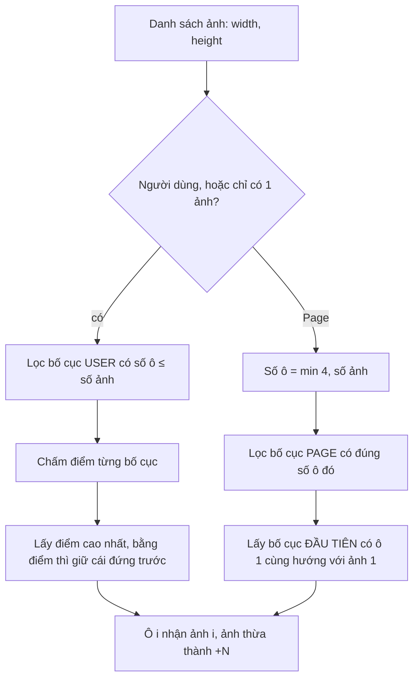

Đăng 3 tấm ảnh lên Facebook: một ảnh ngang, một ảnh dọc, một ảnh vuông. Facebook không xếp chúng thành một hàng ba ô bằng nhau. Nó chọn **một ô to nằm trên, hai ô nhỏ bên dưới**, sao cho mỗi ảnh bị cắt ít nhất có thể. Đăng 7 tấm thì chỉ thấy 5 ô, ô cuối phủ lớp "+3".

Toàn bộ logic đó nằm trong vài module nhỏ, và dễ hiểu đến bất ngờ. Bài này mổ xẻ nó, viết lại, và kiểm chứng bản viết lại cho ra **đúng từng con số** như code gốc.

<iframe class="demo-frame" src="/demos/facebook-patterns/index.html?theme=dark#/photo-collage" title="Demo photo-collage" loading="lazy" style="height: 900px"></iframe>

<p class="demo-links">▶ <a href="/demos/facebook-patterns/index.html#/photo-collage" target="_blank" rel="noopener">Mở demo toàn màn hình ↗</a> · <a href="https://stackblitz.com/github/hunghg255/blog-hunghg/tree/master/examples/facebook-patterns?file=src/lib/collageLayout.ts" target="_blank" rel="noopener">Sửa code trên StackBlitz ↗</a> · <a href="https://github.com/hunghg255/blog-hunghg/blob/master/examples/facebook-patterns/src/lib/collageLayout.ts" target="_blank" rel="noopener">Xem source trên GitHub ↗</a></p>

## Bài toán

Đầu vào là danh sách ảnh, mỗi ảnh có chiều rộng và chiều cao. Đầu ra là một khung hình chữ nhật chia thành các ô, mỗi ô chứa một ảnh và **phủ kín ô** (kiểu `object-fit: cover`). Phủ kín nghĩa là ảnh khác tỉ lệ với ô sẽ bị cắt bớt. Mục tiêu:

- Cắt càng ít càng tốt.
- Hiện được càng nhiều ảnh càng tốt.
- Trông "có chủ đích": ảnh ngang vào ô ngang, ảnh dọc vào ô dọc.
- Phần bị cắt không được rơi vào thứ quan trọng (khuôn mặt chẳng hạn).

## Facebook làm thế nào

Các module nằm trong `252.js` và thư mục `00 Album grid/`, `0 000A/FEEEEEEED/` của [facebook-codebase](https://github.com/hunghg255/facebook-codebase):

| Module | Vai trò |
| --- | --- |
| `ReactComposerJSONCollageLayoutData` | dữ liệu: danh sách bố cục theo số ảnh |
| `ReactComposerCollageLayoutModel` | một bố cục: các ô (`Rect`), đối tượng được dùng, hàm `score()` |
| `ReactComposerCollageLayoutSelection` | chọn bố cục tốt nhất cho người dùng hoặc Page |
| `CometAlbumGridLayout.react` | vẽ bố cục ra màn hình, ô "+N" |
| `CometFeedFocusMedia.react` | cắt ảnh trong một ô theo focal point |

### 1. Bố cục là dữ liệu trên lưới 6×6

```js
// ReactComposerJSONCollageLayoutData (trích)
2: [{ validActors: 3, photoLayouts: [[0,3,3,0], [0,6,3,3]] },   // 2 ô vuông cạnh nhau
    { validActors: 3, photoLayouts: [[0,6,3,0], [3,6,6,0]] },   // 2 ô ngang chồng nhau
    { validActors: 3, photoLayouts: [[0,3,6,0], [0,6,6,3]] },   // 2 ô dọc cạnh nhau
    { validActors: 1, photoLayouts: [[0,6,2,0], [2,6,4,0]] }],  // 2 dải 3:1
```

Mỗi ô là một `Rect` theo thứ tự **`[top, right, bottom, left]`**. Constructor `Rect(t, r, b, l)` cùng hai hàm `w() = r − l`, `h() = b − t` nằm trong module `Rect`. Hằng `MAX_NUM_COLS = MAX_NUM_ROWS = 6`. Ô `[0,6,3,0]` là dải ngang cả chiều rộng (6) và nửa chiều cao (3), tỉ lệ 2:1.

`validActors` là bitmask: `USER = 1`, `PAGE = 2`, `3` là cả hai. Số bố cục theo số ảnh:

| Số ảnh | 1 | 2 | 3 | 4 | 5 |
| --- | --- | --- | --- | --- | --- |
| Bố cục (tổng) | 1 | 4 | 7 | 3 | 2 |
| Dùng được cho Page | 1 | 3 | 3 | 3 | 0 |

Không có bố cục nào quá 5 ô: ảnh thứ 6 trở đi gom vào "+N".

### 2. Hàm chấm điểm

`ReactComposerCollageLayoutModel.score(media)` duyệt song song (zip) các ô của bố cục và các ảnh **theo đúng thứ tự**. Ô thứ i nhận ảnh thứ i. Với mỗi cặp (ô `cw × ch`, ảnh `mw × mh`):

**Bước 1: tỉ lệ bị cắt `k`.** Phóng ảnh cho rộng bằng ô; nếu dư chiều cao thì `k` là phần cao bị cắt. Ngược lại phóng cho cao bằng ô và tính phần rộng bị cắt:

```js
if (mw === 0 || mh === 0) k = 0;
else if (cw * mh / mw >= ch) { l = cw * mh / mw; k = (l - ch) / l; }   // cắt trên/dưới
else if (ch * mw / mh > cw)  { l = ch * mw / mh; k = (l - cw) / l; }   // cắt hai bên
```

Ví dụ ảnh 3:2 (1500×1000) vào ô vuông 3×3: phóng cho cao bằng ô, ảnh rộng `3 × 1.5 = 4.5`, cắt mất `(4.5 − 3)/4.5 = 33.3%`.

**Bước 2: cộng trừ điểm.**

```js
b -= k * 100;
mw === mh                ? b -= k * 5     // ảnh vuông
: cw > ch  ? (mw > mh ? b += k * 25 : b -= k * 25)   // ô ngang: ảnh ngang thì đỡ phạt
: cw < ch  ? (mw < mh ? b += k * 25 : b -= k * 25)   // ô dọc: ảnh dọc thì đỡ phạt
: (b -= k * 5);                                     // ô vuông, ảnh không vuông
```

**Bước 3: thưởng theo số ô:** `b += 200 × số ô của bố cục`.

### 3. Ba điều thú vị ẩn trong công thức

**(a) Mọi hạng tử về hướng đều nhân với `k`.** Ảnh không bị cắt (`k = 0`) thì đặt vào ô ngang hay dọc đều 0 điểm như nhau. Hướng chỉ có ý nghĩa **khi đã phải cắt**: cắt "đúng hướng" bị phạt `−75k`, cắt "ngược hướng" bị phạt `−125k`. Ví dụ ảnh 2:3 cắt 25% để vào ô dọc 3:6 (cùng là dọc) chỉ mất 18.75 điểm, nhưng cắt 25% để vào một ô ngang thì mất 31.25.

**(b) +200 mỗi ô luôn thắng.** Mức phạt tối đa của một ô là `100k + 25k ≤ 125` (vì `k < 1`). Bố cục thêm 1 ô được +200. Vậy **bố cục có nhiều ô hơn luôn thắng**, bất kể cắt thế nào. 7 ảnh thì chắc chắn chọn một trong hai bố cục 5 ô. Việc chấm điểm độ cắt thực chất chỉ để chọn **giữa các bố cục cùng số ô**.

**(c) Thứ tự ảnh là cố định, và ô to hay nhỏ đều nặng như nhau.** Thuật toán không thử đổi chỗ ảnh: ảnh đầu tiên luôn vào ô đầu tiên. Mọi ô cũng có trọng số bằng nhau dù diện tích chênh nhau 2–4 lần. Hệ quả đôi khi bất ngờ. Với 3 ảnh **dọc, ngang, ngang**, bảng điểm thật (tính bằng bản viết lại, khớp code gốc):

| Bố cục (3 ô) | Ô 1 (ảnh dọc) | Ô 2 (ngang) | Ô 3 (ngang) | Tổng |
| --- | --- | --- | --- | --- |
| 1 to trên (6×4) + 2 dưới (3×2) | cắt 55.6% → −69.4 | 0% → 0 | 0% → 0 | **530.6** ✓ |
| 1 to trái (3×6) + 2 phải (3×3) | cắt 25% → −18.8 | 33% → −35 | 33% → −35 | 511.3 |
| 1 to trên (6×3) + 2 dưới (3×3) | 66.7% → −83.3 | 33% → −35 | 33% → −35 | 446.7 |

Bố cục thắng đặt **ảnh dọc vào ô ngang to nhất** và cắt mất hơn nửa ảnh, chỉ vì hai ô nhỏ được 0 điểm phạt. Nếu trọng số theo diện tích ô (ô to có diện tích gấp 4 ô nhỏ), lựa chọn thứ hai mới hợp lý. Đây là một hướng cải tiến dễ làm, kèm theo việc thử mọi hoán vị (5 ảnh chỉ có 120 hoán vị).

Còn với bộ **ngang, dọc, vuông**, thuật toán chọn rất đẹp: ô ngang to trên cùng cho ảnh ngang (cắt 25%), ảnh dọc vào ô vuông (cắt 33%), ảnh vuông vào ô vuông (0%). Tổng 546.25.

### 4. Chọn bố cục



- **Người dùng** (`getBestUserCollageLayout`): lọc bố cục USER có số ô không vượt quá số ảnh, chấm điểm, lấy cao nhất. Phép so dùng `>` nên bằng điểm thì bố cục đứng trước trong dữ liệu thắng.
- **Page** (`getBestPageCollageLayout`): **không chấm điểm**. Số ô bằng số ảnh nhưng tối đa bằng số ô lớn nhất mà bố cục Page hỗ trợ (4). Lấy bố cục **đầu tiên** có ô đầu cùng hướng (ngang, dọc, vuông) với ảnh đầu. Không có thì ném lỗi `"no valid layout for these media starts with a suitable aspect"`. Page thường đăng ảnh sản phẩm, quảng cáo: bố cục ổn định, dễ đoán quan trọng hơn bố cục "tối ưu".
- `CometAlbumGridLayout` gọi nhánh người dùng khi `isUser || số ảnh < 2`.

### 5. Vẽ ra màn hình: chỉ dùng % và `calc`

`CometAlbumGridLayout` không dùng CSS grid. Nó tính kích thước lưới thực tế (số cột = max của `left + width`, số hàng = max của `top + height`), rồi:

```js
// khung ngoài: giữ tỉ lệ rows/cols bằng padding-top (padding % tính theo CHIỀU RỘNG)
style: { paddingTop: "calc(" + rows * 100 + "% / " + cols + ")" }

// từng ô: định vị tuyệt đối, cạnh tiếp giáp ô khác thì lùi vào O = 2/2 + 0.01 px
top:    "calc((" + rowStart * 100 + "% / " + rows + ") + " + (rowStart > 0 ? O : 0) + "px)",
left:   "calc((" + colStart * 100 + "% / " + cols + ") + " + (colStart > 0 ? O : 0) + "px)",
bottom: "calc((" + (rows - rowEnd) * 100 + "% / " + rows + ") + " + (rowEnd < rows ? O : 0) + "px)",
right:  "calc((" + (cols - colEnd) * 100 + "% / " + cols + ") + " + (colEnd < cols ? O : 0) + "px)",
```

- Khe giữa hai ô là `m = 2px`, mỗi ô lùi vào `m/2 + 0.01px` ở cạnh tiếp giáp. Phần `0.01` nhiều khả năng để tránh khe 1px bị làm tròn mất trên màn hình có tỉ lệ điểm ảnh lẻ (nhưng code không ghi lý do).
- Khung có tỉ lệ biết trước, **trước khi ảnh tải về**. Không có layout shift.
- Ô "+N": `numItemsNotShown = total === shown ? 0 : total − shown + 1`. Phần **+1** là vì lớp phủ che luôn ảnh ở ô cuối: 7 ảnh, hiện 5 ô thì ghi "+3" (ảnh 5, 6, 7).
- Tỉ lệ của mỗi ô truyền cho ảnh là `columnSpan / rowSpan`. Vì khung ngoài giữ đúng tỉ lệ `cols:rows`, mỗi đơn vị lưới là hình vuông.

### 6. Focal point: cắt mà không bao giờ hở mép

`CometFeedFocusMedia` nhận `focusX`, `focusY` (0..1, mặc định 0.5) đi kèm dữ liệu ảnh từ server (`CometAlbumGridLayout` đọc chúng từ attachment). Code client không tự tính focus; điểm này do server cung cấp, ví dụ theo vùng quan trọng nhất của ảnh.

```js
l = mediaWidth / mediaHeight;           // tỉ lệ ảnh
if (l < viewportAR) {                   // ảnh "cao" hơn khung -> trượt dọc
  m = viewportAR / l;  height = "calc((" + viewportAR + "/(" + w + "/" + h + "))*100%)"; focus = focusY; side = "top";
} else {                                // ảnh "rộng" hơn -> trượt ngang
  m = l / viewportAR;  width  = "calc(((" + w + "/" + h + ")/" + viewportAR + ")*100%)"; focus = focusX; side = "left";
}
offset = Math.max(Math.min(.5 - m * focus, 0), 1 - m);   // [side] = offset * 100 + "%"
```

Giải thích: ảnh được phóng cho phủ kín khung, nên theo trục còn lại nó dài gấp `m` lần khung. Muốn điểm focus `f` nằm giữa khung thì `offset + m·f = 0.5`, tức `offset = 0.5 − m·f`. Kẹp vào `[1 − m, 0]`: offset dương thì hở mép đầu, nhỏ hơn `1 − m` thì hở mép cuối. Focus gần mép ảnh thì khung "dừng" ở sát mép, không bao giờ để lộ nền.

Trong demo, mỗi ảnh có một mặt cười nằm lệch về góc trên phải. Cắt ở giữa thì mặt cười bị mất một nửa. Bấm vào mặt cười trên ảnh thu nhỏ để đặt focus: ô tương ứng dịch từ `top: −16.7%` về `top: 0%` và mặt cười hiện đủ.

## Viết lại

Thuật toán (dữ liệu bố cục chép đúng số liệu gốc):

```ts title=src/lib/collageLayout.ts
/**
 * Chọn bố cục collage ảnh (ý tưởng từ ReactComposerCollageLayoutSelection + ReactComposerCollageLayoutModel
 * của Facebook).
 *
 * - Mỗi bố cục là DỮ LIỆU: danh sách ô trên lưới 6×6, ô thứ i dành cho ảnh thứ i.
 * - Mỗi bố cục được chấm điểm theo: ảnh bị cắt bao nhiêu, ảnh và ô có cùng hướng (ngang/dọc)
 *   không, và bố cục hiện được bao nhiêu ảnh.
 * - Chọn bố cục điểm cao nhất. Ảnh không có ô thì gom vào ô cuối dạng "+N".
 */

/** Ô trên lưới, theo thứ tự [top, right, bottom, left] giống Rect của Facebook. */
export type Cell = readonly [top: number, right: number, bottom: number, left: number];

export const ACTOR_USER = 1;
export const ACTOR_PAGE = 2;

export interface CollageLayout {
  /** bitmask: 1 = dùng cho người dùng, 2 = dùng cho Page, 3 = cả hai */
  validActors: number;
  cells: readonly Cell[];
}

/** Dữ liệu bố cục, chép đúng số liệu từ ReactComposerJSONCollageLayoutData (theo số ảnh). */
export const COLLAGE_LAYOUTS: readonly CollageLayout[] = [
  // 1 ảnh
  { validActors: 3, cells: [[0, 1, 1, 0]] },
  // 2 ảnh
  { validActors: 3, cells: [[0, 3, 3, 0], [0, 6, 3, 3]] }, // 2 ô vuông cạnh nhau
  { validActors: 3, cells: [[0, 6, 3, 0], [3, 6, 6, 0]] }, // 2 ô ngang chồng nhau
  { validActors: 3, cells: [[0, 3, 6, 0], [0, 6, 6, 3]] }, // 2 ô dọc cạnh nhau
  { validActors: 1, cells: [[0, 6, 2, 0], [2, 6, 4, 0]] }, // 2 dải ngang 3:1
  // 3 ảnh
  { validActors: 3, cells: [[0, 6, 3, 0], [3, 3, 6, 0], [3, 6, 6, 3]] }, // 1 to trên, 2 dưới
  { validActors: 3, cells: [[0, 3, 6, 0], [0, 6, 3, 3], [3, 6, 6, 3]] }, // 1 to trái, 2 phải
  { validActors: 2, cells: [[0, 2, 2, 0], [0, 4, 2, 2], [0, 6, 2, 4]] }, // 3 ô vuông một hàng
  { validActors: 1, cells: [[0, 6, 4, 0], [4, 3, 6, 0], [4, 6, 6, 3]] },
  { validActors: 1, cells: [[0, 4, 6, 0], [0, 6, 3, 4], [3, 6, 6, 4]] },
  { validActors: 1, cells: [[0, 6, 2, 0], [2, 6, 4, 0], [4, 6, 6, 0]] }, // 3 dải ngang
  { validActors: 1, cells: [[0, 2, 6, 0], [0, 4, 6, 2], [0, 6, 6, 4]] }, // 3 dải dọc
  // 4 ảnh
  { validActors: 3, cells: [[0, 3, 3, 0], [0, 6, 3, 3], [3, 3, 6, 0], [3, 6, 6, 3]] }, // lưới 2×2
  { validActors: 3, cells: [[0, 6, 4, 0], [4, 2, 6, 0], [4, 4, 6, 2], [4, 6, 6, 4]] }, // 1 to trên, 3 dưới
  { validActors: 3, cells: [[0, 4, 6, 0], [0, 6, 2, 4], [2, 6, 4, 4], [4, 6, 6, 4]] }, // 1 to trái, 3 phải
  // 5 ảnh
  { validActors: 1, cells: [[0, 3, 3, 0], [3, 3, 6, 0], [0, 6, 2, 3], [2, 6, 4, 3], [4, 6, 6, 3]] },
  { validActors: 1, cells: [[0, 3, 3, 0], [0, 6, 3, 3], [3, 2, 5, 0], [3, 4, 5, 2], [3, 6, 5, 4]] },
];

export const cellWidth = (c: Cell) => c[1] - c[3];
export const cellHeight = (c: Cell) => c[2] - c[0];

export type Orientation = 'landscape' | 'portrait' | 'square';

export function orientationOf(width: number, height: number): Orientation {
  return width > height ? 'landscape' : width < height ? 'portrait' : 'square';
}

/**
 * Tỉ lệ diện tích bị cắt khi ảnh (mw × mh) phủ kín ô (cw × ch) kiểu object-fit: cover.
 * Ví dụ ảnh 4:3 vào ô vuông: phóng ảnh cho cao bằng ô thì bề ngang dư 25% -> trả về 0.25.
 */
export function cropLoss(cw: number, ch: number, mw: number, mh: number): number {
  if (mw === 0 || mh === 0) return 0;
  // phóng ảnh cho rộng bằng ô: ảnh cao cw·mh/mw
  const scaledHeight = (cw * mh) / mw;
  if (scaledHeight >= ch) return (scaledHeight - ch) / scaledHeight; // dư chiều cao -> cắt trên/dưới
  // ngược lại phóng cho cao bằng ô: ảnh rộng ch·mw/mh
  const scaledWidth = (ch * mw) / mh;
  if (scaledWidth > cw) return (scaledWidth - cw) / scaledWidth; // dư chiều ngang -> cắt hai bên
  return 0;
}

export interface CellScore {
  loss: number;
  /** điểm của riêng ô này (âm) */
  points: number;
  reason: 'square-photo' | 'same-orientation' | 'different-orientation' | 'square-cell';
}

/**
 * Điểm cho một cặp (ô, ảnh), đúng công thức trong ReactComposerCollageLayoutModel.score:
 *   −100·k, sau đó
 *   ảnh vuông:                −5·k
 *   ô ngang/dọc, ảnh cùng hướng: +25·k
 *   ô ngang/dọc, ảnh khác hướng: −25·k
 *   ô vuông, ảnh không vuông:  −5·k
 * với k = tỉ lệ bị cắt. Để ý: mọi hạng tử đều nhân với k, nên ảnh không bị cắt thì hướng không
 * quan trọng; còn khi phải cắt, cắt "đúng hướng" (−75·k) đỡ phạt hơn cắt "ngược hướng" (−125·k).
 */
export function scoreCell(cell: Cell, media: readonly [width: number, height: number]): CellScore {
  const cw = cellWidth(cell);
  const ch = cellHeight(cell);
  const [mw, mh] = media;
  const k = cropLoss(cw, ch, mw, mh);
  let points = -k * 100;
  let reason: CellScore['reason'];
  if (mw === mh) {
    points -= k * 5;
    reason = 'square-photo';
  } else if (cw !== ch) {
    const sameOrientation = (cw > ch) === (mw > mh);
    points += sameOrientation ? k * 25 : -k * 25;
    reason = sameOrientation ? 'same-orientation' : 'different-orientation';
  } else {
    points -= k * 5;
    reason = 'square-cell';
  }
  return { loss: k, points, reason };
}

export interface LayoutScore {
  layout: CollageLayout;
  cells: CellScore[];
  /** +200 cho mỗi ô: bố cục chứa nhiều ảnh hơn luôn thắng (mức phạt cắt tối đa chỉ 125/ô) */
  countBonus: number;
  total: number;
}

export function scoreLayout(layout: CollageLayout, media: readonly (readonly [number, number])[]): LayoutScore {
  // ghép ô i với ảnh i; thừa bên nào thì bỏ bên đó (giống zip của Facebook)
  const n = Math.min(layout.cells.length, media.length);
  const cells = Array.from({ length: n }, (_, i) => scoreCell(layout.cells[i], media[i]));
  const countBonus = 200 * layout.cells.length;
  const total = cells.reduce((sum, c) => sum + c.points, 0) + countBonus;
  return { layout, cells, countBonus, total };
}

export interface PlacedCell {
  /** chỉ số ảnh trong danh sách gốc */
  mediaIndex: number;
  cell: Cell;
}

export interface CollageResult {
  placed: PlacedCell[];
  /** tất cả bố cục đã xét kèm điểm (để debug / demo) */
  candidates: LayoutScore[];
  winner: LayoutScore | null;
  /** số hiển thị trên ô cuối, 0 nếu hiện đủ */
  overflowCount: number;
}

/**
 * Người dùng: xét mọi bố cục cho USER có số ô ≤ số ảnh, lấy điểm cao nhất
 * (bằng điểm thì giữ bố cục đứng trước, vì so sánh dùng dấu > ).
 */
export function selectUserLayout(media: readonly (readonly [number, number])[]): CollageResult {
  const candidates = COLLAGE_LAYOUTS.filter(
    (l) => l.validActors & ACTOR_USER && l.cells.length <= media.length,
  ).map((l) => scoreLayout(l, media));
  let winner: LayoutScore | null = null;
  for (const c of candidates) if (winner === null || c.total > winner.total) winner = c;
  return finalize(media.length, candidates, winner);
}

/**
 * Page: không chấm điểm. Lấy bố cục đầu tiên có đúng số ô (tối đa số ô Page hỗ trợ) mà ô đầu
 * tiên cùng hướng với ảnh đầu tiên.
 */
export function selectPageLayout(media: readonly (readonly [number, number])[]): CollageResult {
  const pageLayouts = COLLAGE_LAYOUTS.filter((l) => l.validActors & ACTOR_PAGE);
  const maxCells = Math.max(...pageLayouts.map((l) => l.cells.length));
  const count = Math.min(maxCells, media.length);
  const first = media[0];
  const candidates = pageLayouts.filter((l) => l.cells.length === count).map((l) => scoreLayout(l, media));
  const winner =
    candidates.find(
      (c) =>
        first != null &&
        orientationOf(cellWidth(c.layout.cells[0]), cellHeight(c.layout.cells[0])) === orientationOf(first[0], first[1]),
    ) ?? null;
  return finalize(media.length, candidates, winner);
}

function finalize(total: number, candidates: LayoutScore[], winner: LayoutScore | null): CollageResult {
  const shown = winner ? Math.min(winner.layout.cells.length, total) : 0;
  const placed = winner
    ? winner.layout.cells.slice(0, shown).map((cell, mediaIndex) => ({ mediaIndex, cell }))
    : [];
  // Ô cuối bị che bởi lớp "+N", nên N tính cả chính ảnh ở ô cuối: 7 ảnh, hiện 5 ô -> "+3"
  // (giống CometAlbumGridLayout: totalNumItems − số ô + 1).
  const overflowCount = total === shown ? 0 : total - shown + 1;
  return { placed, candidates, winner, overflowCount };
}

/** Kích thước lưới thực tế của bố cục (bố cục 1 ảnh chỉ là lưới 1×1). */
export function gridSize(placed: readonly PlacedCell[]) {
  return {
    columns: placed.reduce((m, p) => Math.max(m, p.cell[1]), 0),
    rows: placed.reduce((m, p) => Math.max(m, p.cell[2]), 0),
  };
}
```

Cắt theo focal point:

```tsx title=src/lib/focalPointImage.tsx
import type { CSSProperties } from 'react';

/**
 * Cắt ảnh vừa khung theo "điểm quan trọng" (focal point), không bao giờ để hở mép
 * (ý tưởng từ CometFeedFocusMedia / CometFeedFocusImage của Facebook).
 *
 * Giống object-fit: cover, nhưng thay vì luôn căn giữa, ta dịch ảnh sao cho điểm focus nằm
 * càng gần tâm khung càng tốt, rồi kẹp lại để mép ảnh không lọt vào trong khung.
 */

export interface FocalCrop {
  /** kích thước lớp bọc ảnh, tính theo % khung */
  width: string;
  height: string;
  /** dịch theo trục nào và bao nhiêu % */
  axis: 'top' | 'left';
  offsetPercent: number;
}

/**
 * @param mediaAspect  tỉ lệ rộng/cao của ảnh
 * @param frameAspect  tỉ lệ rộng/cao của khung
 * @param focusX, focusY  điểm focus trong ảnh, 0..1 (0.5 = giữa)
 */
export function computeFocalCrop(
  mediaAspect: number,
  frameAspect: number,
  focusX = 0.5,
  focusY = 0.5,
): FocalCrop {
  if (mediaAspect < frameAspect) {
    // Ảnh "cao" hơn khung: rộng = 100% khung, cao = m lần khung (m > 1) -> trượt theo trục dọc.
    const m = frameAspect / mediaAspect;
    return { width: '100%', height: `${m * 100}%`, axis: 'top', offsetPercent: clampOffset(m, focusY) };
  }
  // Ảnh "rộng" hơn (hoặc bằng) khung: cao = 100%, rộng = m lần -> trượt theo trục ngang.
  const m = mediaAspect / frameAspect;
  return { width: `${m * 100}%`, height: '100%', axis: 'left', offsetPercent: clampOffset(m, focusX) };
}

/**
 * Ảnh dài gấp m lần khung theo trục đang xét. Muốn điểm focus f (0..1 theo chiều dài ảnh) nằm
 * giữa khung: vị trí focus = offset + m·f = 0.5  =>  offset = 0.5 − m·f.
 * Kẹp vào [1 − m, 0]: offset > 0 thì hở mép đầu, offset < 1 − m thì hở mép cuối.
 */
function clampOffset(m: number, focus: number) {
  return Math.max(Math.min(0.5 - m * focus, 0), 1 - m) * 100;
}

export interface FocalPointImageProps {
  src: string;
  alt?: string;
  mediaWidth: number;
  mediaHeight: number;
  focusX?: number;
  focusY?: number;
  /** tỉ lệ rộng/cao của khung */
  frameAspect: number;
  /** true = lấp đầy phần tử cha (cha phải có kích thước), false = tự tạo khung theo frameAspect */
  fill?: boolean;
  style?: CSSProperties;
}

export function FocalPointImage({
  src,
  alt = '',
  mediaWidth,
  mediaHeight,
  focusX = 0.5,
  focusY = 0.5,
  frameAspect,
  fill = false,
  style,
}: FocalPointImageProps) {
  const crop = computeFocalCrop(mediaWidth / mediaHeight, frameAspect, focusX, focusY);
  const frame: CSSProperties = fill
    ? { position: 'absolute', inset: 0, overflow: 'hidden' }
    : // padding-top theo % tính trên CHIỀU RỘNG của cha -> khung giữ đúng tỉ lệ (trước khi có aspect-ratio)
      { position: 'relative', overflow: 'hidden', paddingTop: `${100 / frameAspect}%` };
  return (
    <div style={{ ...frame, ...style }}>
      <div
        style={{
          position: 'absolute',
          top: 0,
          left: 0,
          width: crop.width,
          height: crop.height,
          [crop.axis]: `${crop.offsetPercent}%`,
        }}
      >
        
      </div>
    </div>
  );
}
```

Vẽ lưới, ô "+N":

```tsx title=src/lib/collageGrid.tsx
import { cellHeight, cellWidth, gridSize, type PlacedCell } from './collageLayout';
import { FocalPointImage } from './focalPointImage';

/**
 * Vẽ collage bằng định vị tuyệt đối theo %, giống CometAlbumGridLayout của Facebook:
 * khung ngoài giữ tỉ lệ rows/cols bằng padding-top, mỗi ô đặt top/right/bottom/left bằng
 * calc(% + khe hở). Không cần CSS grid, không cần đo bằng JS.
 */

export interface CollagePhoto {
  src: string;
  width: number;
  height: number;
  focusX?: number;
  focusY?: number;
  alt?: string;
}

// Facebook: khe giữa các ô 2px, mỗi bên ô lùi 2/2 + 0.01 px (0.01 để tránh khe 0.5px bị làm tròn mất)
const GAP_PX = 2 / 2 + 0.01;

export interface CollageGridProps {
  photos: readonly CollagePhoto[];
  placed: readonly PlacedCell[];
  overflowCount: number;
  onCellClick?: (mediaIndex: number) => void;
}

export function CollageGrid({ photos, placed, overflowCount, onCellClick }: CollageGridProps) {
  const { columns, rows } = gridSize(placed);
  if (columns === 0) return null;
  return (
    <div style={{ position: 'relative', paddingTop: `calc(${rows * 100}% / ${columns})` }}>
      {placed.map(({ mediaIndex, cell }, i) => {
        const [top, right, bottom, left] = cell;
        const photo = photos[mediaIndex];
        const isLast = i === placed.length - 1;
        return (
          <div
            key={mediaIndex}
            onClick={() => onCellClick?.(mediaIndex)}
            style={{
              position: 'absolute',
              overflow: 'hidden',
              // chỉ lùi vào ở cạnh tiếp giáp ô khác, cạnh sát viền ngoài thì không
              top: `calc(${(top * 100) / rows}% + ${top > 0 ? GAP_PX : 0}px)`,
              left: `calc(${(left * 100) / columns}% + ${left > 0 ? GAP_PX : 0}px)`,
              bottom: `calc(${((rows - bottom) * 100) / rows}% + ${bottom < rows ? GAP_PX : 0}px)`,
              right: `calc(${((columns - right) * 100) / columns}% + ${right < columns ? GAP_PX : 0}px)`,
              cursor: onCellClick ? 'pointer' : undefined,
            }}
          >
            <FocalPointImage
              fill
              src={photo.src}
              alt={photo.alt}
              mediaWidth={photo.width}
              mediaHeight={photo.height}
              focusX={photo.focusX}
              focusY={photo.focusY}
              // ô trên lưới có đơn vị vuông nên tỉ lệ khung = số cột / số hàng của ô
              frameAspect={cellWidth(cell) / cellHeight(cell)}
            />
            {isLast && overflowCount > 0 && (
              <div
                style={{
                  position: 'absolute',
                  inset: 0,
                  display: 'grid',
                  placeItems: 'center',
                  background: 'rgb(0 0 0 / 0.45)',
                  color: '#fff',
                  font: '700 28px system-ui, sans-serif',
                  pointerEvents: 'none',
                }}
              >
                +{overflowCount}
              </div>
            )}
          </div>
        );
      })}
    </div>
  );
}
```

Đi qua vài điểm:

1. **`scoreCell` trả thêm `loss` và `reason`** để demo giải thích được vì sao một ô bị phạt. Điểm thì tính đúng y công thức gốc.
2. **`scoreLayout` zip ô với ảnh**: thừa ảnh hay thừa ô thì bỏ phần thừa, giống `zip` (viết bằng generator) trong code gốc.
3. **`selectUserLayout` dùng `>`** (không phải `>=`) để giữ đúng luật "bằng điểm thì cái đứng trước thắng".
4. **`selectPageLayout` trả `winner: null`** thay vì ném lỗi như Facebook, để UI tự quyết định hiển thị gì.
5. **`FocalPointImage`** dùng giá trị % tính sẵn trong JS thay vì chuỗi `calc((a/(b/c))*100%)`. Kết quả như nhau, dễ đọc hơn.
6. **`CollageGrid`** giữ nguyên cách định vị `calc(% + px)` và khe `2/2 + 0.01px`.

## Kiểm chứng: khớp 100% với công thức gốc

Thuật toán chấm điểm mà sai một dấu là chọn sai bố cục mà không ai để ý. Để chắc bản viết lại đúng, mình chép nguyên văn biểu thức `score` từ `252.js` vào một script kiểm thử (chỉ dùng để so, không có trong repo), rồi so với `scoreLayout` trên **2.000 bộ ảnh ngẫu nhiên × 17 bố cục = 34.000 phép tính**: **0 sai khác**. Ý tưởng test kiểu "so với bản tham chiếu" (differential testing) rất đáng dùng mỗi khi bạn port một thuật toán:

```ts
// ví dụ, không có trong repo
import { describe, expect, it } from 'vitest';
import { COLLAGE_LAYOUTS, scoreLayout, selectUserLayout } from './collageLayout';
import { referenceScore } from './reference'; // bản chép nguyên văn từ code gốc

const DIMS = [[1500, 1000], [1000, 1500], [1200, 1200], [1600, 900], [900, 1600], [2400, 800]] as const;
const randomMedia = () =>
  Array.from({ length: 1 + Math.floor(Math.random() * 7) }, () => DIMS[Math.floor(Math.random() * DIMS.length)]);

describe('collage score', () => {
  it('khớp bản tham chiếu', () => {
    for (let i = 0; i < 2000; i++) {
      const media = randomMedia();
      for (const layout of COLLAGE_LAYOUTS) {
        expect(scoreLayout(layout, media).total).toBeCloseTo(referenceScore(layout.cells, media), 9);
      }
    }
  });

  it('ngang + dọc + vuông -> 1 ô ngang trên, 2 ô vuông dưới', () => {
    const r = selectUserLayout([[1500, 1000], [1000, 1500], [1200, 1200]]);
    expect(r.winner?.layout.cells).toEqual([[0, 6, 3, 0], [3, 3, 6, 0], [3, 6, 6, 3]]);
    expect(r.winner?.total).toBeCloseTo(546.25);
  });

  it('7 ảnh -> 5 ô và +3', () => {
    expect(selectUserLayout(Array(7).fill([1200, 1200])).overflowCount).toBe(3);
  });
});
```

## Tại sao không làm cách khác?

**"Sao không dùng CSS grid?"** Hoàn toàn được, và ngày nay gọn hơn:

```css
.collage { display: grid; grid-template: repeat(var(--rows), 1fr) / repeat(var(--cols), 1fr);
           aspect-ratio: var(--cols) / var(--rows); gap: 2px; }
.cell    { grid-area: calc(var(--top) + 1) / calc(var(--left) + 1) / calc(var(--bottom) + 1) / calc(var(--right) + 1); }
```

(Nếu `calc()` trong `grid-area` khó đọc, cứ tính sẵn số dòng/cột trong JS.) Cách `% + calc` của Facebook có từ thời trình duyệt chưa hỗ trợ grid và `aspect-ratio` đồng đều. Ý tưởng cốt lõi (khung biết tỉ lệ trước, ô định vị theo phân số) thì vẫn giữ nguyên.

**"Sao không dùng `object-position` thay vì tự tính offset?"** `object-fit: cover; object-position: X% Y%` cũng dịch ảnh, nhưng `X%` của `object-position` có nghĩa khác: căn **điểm X% của ảnh** trùng với **điểm X% của khung**. Đặt `object-position: 78% 28%` không đưa điểm (78%, 28%) vào **giữa** khung, nó chỉ đưa điểm đó về vị trí 78%, 28% của khung. Để focus nằm giữa khung (và tự kẹp ở mép), công thức `0.5 − m·f` của Facebook là cách trực tiếp. Có thể quy đổi ngược ra `object-position` nếu muốn, nhưng phải tự kẹp.

**"Justified layout như Flickr/Google Photos?"** Cách đó xếp ảnh theo hàng, giữ **nguyên tỉ lệ** từng ảnh và co giãn chiều cao hàng cho vừa chiều rộng, nên không cắt ảnh nào (Flickr có thư viện mã nguồn mở `justified-layout`). Đổi lại, chiều cao tổng thay đổi theo bộ ảnh và không có "ô hero". Trong feed, Facebook cần một khối gọn, tỉ lệ cố định, ảnh đầu nổi bật. Collage có cắt là lựa chọn hợp lý cho bối cảnh đó.

## Cạm bẫy khi đưa vào dự án

- **Phải biết kích thước ảnh trước.** Thuật toán cần `width`/`height` ngay lúc render. Hãy lưu chúng khi upload (server đọc header ảnh), đừng đợi ảnh tải về rồi mới đo.
- **EXIF orientation.** Ảnh chụp dọc từ điện thoại thường được lưu ngang kèm cờ xoay. Kích thước đưa vào thuật toán phải là kích thước **sau khi xoay**, không thì ảnh dọc bị xếp như ảnh ngang.
- **Panorama.** Ảnh 6:1 vào bất kỳ ô nào cũng bị cắt rất nhiều. Bố cục 2 dải ngang 3:1 (chỉ dành cho người dùng) là nơi duy nhất nó trông ổn.
- **Thứ tự là của người dùng.** Đừng tự hoán vị nếu người dùng đã sắp thứ tự có chủ ý (ví dụ ảnh bìa đứng đầu). Facebook cũng không hoán vị.
- **Truy cập:** mỗi ô là một liên kết hoặc nút mở trình xem ảnh, cần nhãn (`alt` hoặc `aria-label`). Facebook dùng chú thích tự sinh, mặc định "Hình ảnh trong album". Ô "+N" cũng nên được đọc lên ("và 3 ảnh khác").

---

**Series "Học từ mã nguồn Facebook"**

*Phần 1*

- [Mở đầu: cách đọc code minify của Facebook](/blogs/learn-from-facebook-source-code)
- [#1 Dùng chung IntersectionObserver + infinite scroll](/blogs/facebook-shared-intersection-observer)
- [#2 useViewportDuration: đo thời gian thực sự được xem](/blogs/facebook-use-viewport-duration)
- [#3 Preload code + data khi hover](/blogs/facebook-preload-on-hover)
- [#4 Toast manager với external store](/blogs/facebook-toast-manager)
- [#5 Network status + heartbeat backoff](/blogs/facebook-network-status-heartbeat)
- [#6 ErrorGuard: bắt lỗi theo ngữ cảnh](/blogs/facebook-error-guard)
- [#7 Banzai: gom log theo lô + sendBeacon](/blogs/facebook-batch-logger)
- [#8 Focus trap + Esc theo layer](/blogs/facebook-focus-trap)

*Phần 2*

- [#9 Mẹo calc(… * 9999): container query, line-clamp, mũi tên carousel bằng CSS](/blogs/facebook-css-9999-trick)
- [#10 Thanh cuộn tuỳ biến bằng CSS 3D](/blogs/facebook-css-3d-scrollbar)
- [#11 Modal cuộn bằng window, giữ vị trí trang nền](/blogs/facebook-document-scroll-modal)
- [#12 Popover, tooltip group và hovercard](/blogs/facebook-popover-tooltip)
- [#13 Primitive Pressable + focus-visible](/blogs/facebook-pressable)
- [#14 Tab "Xem thêm" + sticky header bằng IntersectionObserver](/blogs/facebook-priority-tabs-sticky-header)
- [#15 Avatar khoét mask, gradient Messenger, skeleton steps()](/blogs/facebook-visual-tricks)
- [#16 Khung chat không giật](/blogs/facebook-chat-scroller)
- **#17 Thuật toán chọn bố cục collage ảnh** (bài này)
- [#18 Keep-alive tab trong SPA](/blogs/facebook-keep-alive-tabs)
- [#19 Tự đo Visual Completion & interaction tracing](/blogs/facebook-visual-completion)
- [#20 Router SPA bền bỉ & tải chunk có retry](/blogs/facebook-spa-router-resilient-loading)

Code + demo: [`examples/facebook-patterns`](https://github.com/hunghg255/blog-hunghg/tree/master/examples/facebook-patterns) · [Mở trên StackBlitz](https://stackblitz.com/github/hunghg255/blog-hunghg/tree/master/examples/facebook-patterns)
