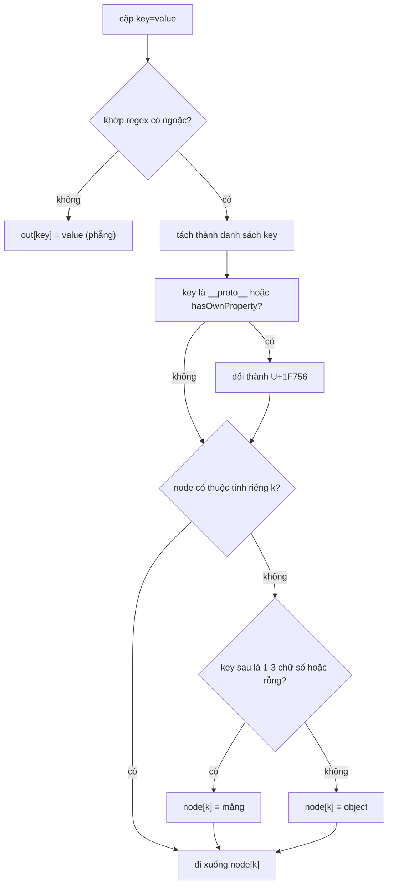

Backend của Facebook viết bằng PHP (nay là Hack), và PHP có một quy ước đọc query string rất tiện: `user[name]=An&user[tags][]=js&user[tags][]=css` thành mảng lồng nhau `['user' => ['name' => 'An', 'tags' => ['js', 'css']]]`. Phía client phải nói cùng "ngôn ngữ" đó, cả chiều ghi (gửi form, gọi API) lẫn chiều đọc (đọc lại tham số trên URL).

Chiều đọc là chỗ nguy hiểm. Chỉ cần viết `obj[key] = obj[key] || {}` trong một vòng lặp, query `?__proto__[isAdmin]=1` sẽ gắn `isAdmin` vào `Object.prototype`, và **mọi object** trong trang bỗng có `isAdmin`. Đây là **prototype pollution**, lớp lỗi đã có CVE ở `qs`, `jquery.extend`, `lodash.merge`, `minimist`…

> [!TIP]
> **Tóm tắt**
> - `PHPQuerySerializer` đọc key dạng `a[b][]`: key toàn số ≤ 3 chữ số thành chỉ số mảng, còn lại thành key object.
> - Chống prototype pollution bằng hai lớp: đổi key `__proto__` và `hasOwnProperty` thành ký tự lính canh U+1F756 (🝖), và chỉ đi vào thuộc tính **riêng** (`hasOwnProperty.call`).
> - Bản viết lại chặt hơn: object không prototype (`Object.create(null)`), bỏ hẳn cặp có `__proto__`/`constructor`/`prototype`, giới hạn độ sâu, số cặp, chỉ số mảng.
> - Điểm lệch của bản gốc: key trong ngoặc không được giải mã URL (`a%5Bb%20c%5D=1` thành key phẳng `"a[b c]"`); gán lên chuỗi thì trả sớm, bỏ mọi cặp sau; `a[x]=1&a[][y]=2` ném `TypeError`.

<iframe class="demo-frame" src="/demos/facebook-patterns/index.html?theme=dark#/query-serializer" title="Demo query-serializer" loading="lazy" style="height: 760px"></iframe>

<p class="demo-links">▶ <a href="/demos/facebook-patterns/index.html#/query-serializer" target="_blank" rel="noopener">Mở demo toàn màn hình ↗</a> · <a href="https://stackblitz.com/github/hunghg255/blog-hunghg/tree/master/examples/facebook-patterns?file=src/lib/querySerializer.ts" target="_blank" rel="noopener">Sửa code trên StackBlitz ↗</a> · <a href="https://github.com/hunghg255/blog-hunghg/blob/master/examples/facebook-patterns/src/lib/querySerializer.ts" target="_blank" rel="noopener">Xem source trên GitHub ↗</a></p>

## Prototype pollution trong ba dòng

```js
const node = {};
node['__proto__'] = node['__proto__'] || {}; // __proto__ là accessor trả về Object.prototype
node['__proto__']['isAdmin'] = '1';           // ghi thẳng lên Object.prototype
({}).isAdmin; // '1'
```

`__proto__` không phải key bình thường: trên mọi object kế thừa `Object.prototype`, đọc `obj.__proto__` trả về chính prototype. Đường thứ hai là `constructor[prototype][isAdmin]`: `obj.constructor` là hàm `Object`, `Object.prototype` là prototype. Một parser ngây thơ đi theo chuỗi key mà không hỏi "key này có phải của chính object không" sẽ đi thẳng lên prototype.

Hậu quả tuỳ code xung quanh: `if (user.isAdmin)` thành đúng với mọi user, `options.url` có giá trị mặc định do kẻ tấn công chọn, template engine chèn chuỗi vào HTML (XSS). Demo chạy bản ngây thơ trên một prototype "hộp cát" riêng, nên trang không bị nhiễm thật, nhưng bạn thấy rõ một object mới tạo đã có `isAdmin`.

## Facebook làm thế nào?

`PHPQuerySerializer` (bundle `1.js`, bản sao trong `22.js`) có `serialize` và `deserialize`.

### serialize

Đi đệ quy object, ghép tiền tố `a[b][c]`. `null` thành key không có `=`, `undefined` bị bỏ. Mã hoá bằng `encodeURIComponent` nhưng đổi `%5B` và `%5D` về `[` `]` cho URL dễ đọc. Hàm này không có rủi ro gì đặc biệt.

### deserialize

Đọc từng cặp sau khi `split('&')`. Trước khi tách, toàn chuỗi được đổi `%5B`, `%5D` thành `[`, `]`. Mỗi cặp khớp regex:

```js
/^([-_\w]+)((?:\[[-_\w]*\])+)=?(.*)/
```

- Không khớp (key thường, hoặc key có ký tự ngoài `[-_\w]` trong ngoặc): gán phẳng `out[decode(key)] = decode(value)`.
- Khớp: tách phần ngoặc thành danh sách key, rồi đi xuống từng cấp.

Ở mỗi cấp, key qua một hàm ánh xạ: `"hasOwnProperty"` và `"__proto__"` thành `"🝖"`, tức ký tự **U+1F756** (🝖, một ký hiệu giả kim; dễ nhầm với emoji đùi gà 🍖 U+1F356). Chọn ký tự này vì gần như không ai đặt tên tham số như vậy, nên dữ liệu vẫn giữ được (không bị vứt), chỉ không còn nguy hiểm.

Lớp thứ hai: trước khi đi vào `node[k]`, code kiểm tra `Object.prototype.hasOwnProperty.call(node, k)`. Chưa có thì tạo mới: key **tiếp theo** là 1–3 chữ số (`/^\d{1,3}$/`) hoặc rỗng thì tạo mảng, còn lại tạo object. `constructor` không phải thuộc tính riêng của `{}`, nên `constructor[prototype][x]=1` tạo ra một object con tên `constructor`, không chạm vào hàm `Object`.

Lớp thứ ba, ít ai để ý: sau khi gán `node[k] = next`, code kiểm tra `node[k] !== next`. Module không chạy ở strict mode, nên gán thuộc tính lên một chuỗi không ném lỗi mà chỉ không có tác dụng; phép so sánh này bắt đúng trường hợp đó, ví dụ `a=1&a[b][c]=2`. Nhưng nhánh này `return` **cả kết quả**, không chỉ bỏ cặp hiện tại: `a=1&a[b][c]=2&z=3` cho ra `{ a: '1' }`, `z` mất luôn.

Có một nhánh nữa không được bảo vệ: ô rỗng `[]` ở **giữa** đường dẫn (`a[][y]`) gọi thẳng `node.push(...)`. Nếu `node` lúc đó là object (vì trước đó đã có `a[x]=1`) thì `push` không tồn tại và hàm ném `TypeError`. Một URL như `?a[x]=1&a[][y]=2` đủ để làm hỏng đoạn code đọc query, trừ khi người gọi bọc `try/catch`. Hai nút "Gán lên chuỗi" và "[] giữa object" trong demo dựng lại cả hai trường hợp (bằng bản mô phỏng trong `querySerializerFbStyle.ts`, viết lại theo logic đã giải mã, không phải mã của Meta).

### Tại sao giới hạn 3 chữ số?

`a[99999999]=x` với một parser coi mọi số là chỉ số mảng sẽ tạo một mảng thưa dài 100 triệu. Bản thân mảng thưa rẻ, nhưng code phía sau `forEach`, `JSON.stringify`, `map` qua nó thì không: `JSON.stringify` in ra 100 triệu `null`. Giới hạn 3 chữ số (≤ 999) biến chỉ số lớn thành key object, chặn kiểu DoS này. Thư viện `qs` có option tương tự: `arrayLimit` mặc định 20.



## Viết lại

Bản viết lại đi đường khác: thay vì đổi tên key nguy hiểm, nó làm cho **không có prototype nào để làm bẩn**. Mọi object tạo ra bằng `Object.create(null)`: không có `__proto__` accessor, không có `constructor`. Thêm vào đó, cặp nào có một đoạn key là `__proto__`, `constructor` hoặc `prototype` thì bỏ hẳn, vì dữ liệu đó gần như chắc chắn là tấn công và giữ lại chỉ làm code phía sau khó đoán.

```ts title=src/lib/querySerializer.ts
export function parseQuery(query: string, options: ParseOptions = {}): QueryObject {
  const { maxArrayIndex = 999, maxDepth = 20, maxPairs = 1000 } = options;
  const root = newObject();
  const pairs = query.replace(/^\?/, '').split('&').filter(Boolean).slice(0, maxPairs);

  for (const pair of pairs) {
    const eq = pair.indexOf('=');
    // khác bản gốc: giải mã key TRƯỚC khi tách ngoặc, nên `a%5Bb%5D` và `a[b]` như nhau
    const rawKey = decode(eq === -1 ? pair : pair.slice(0, eq));
    const value = eq === -1 ? null : decode(pair.slice(eq + 1));
    const path = splitKey(rawKey) ?? [rawKey];
    if (path.length - 1 > maxDepth || path.some((p) => DANGEROUS.has(p))) continue;

    // `parent[key]` của bước hiện tại; cần giữ cả parent để có thể thay mảng bằng object
    let parent: QueryObject | QueryValue[] = root;
    const resolved: string[] = []; // key thật đã đi qua (ô `[]` đã đổi thành chỉ số)
    for (let i = 0; i < path.length; i++) {
      const isLast = i === path.length - 1;
      let key = path[i];
      if (Array.isArray(parent) && key !== '' && !isIndex(key, maxArrayIndex)) {
        // mảng gặp key chữ hoặc chỉ số quá lớn: đổi container cha thành object
        const converted = toObject(parent);
        replaceChild(root, resolved, converted);
        parent = converted;
      }
      if (key === '') {
        if (!Array.isArray(parent)) key = String(Object.keys(parent).length);
        else key = String(parent.length);
      }
      const container = parent as Record<string, QueryValue>;
      resolved.push(key);
      if (isLast) {
        container[key] = value;
        break;
      }
      const next = path[i + 1];
      const existing = container[key];
      if (existing === undefined || existing === null || typeof existing === 'string') {
        container[key] = next === '' || isIndex(next, maxArrayIndex) ? [] : newObject();
      }
      parent = container[key] as QueryObject | QueryValue[];
    }
  }
  return root;
}
```

::: spoiler Xem toàn bộ src/lib/querySerializer.ts

```ts title=src/lib/querySerializer.ts
/**
 * Query string kiểu PHP (`a[b][]=1&a[b][]=2`) ↔ object lồng nhau, an toàn với
 * prototype pollution (ý tưởng từ PHPQuerySerializer của Facebook).
 *
 * Bản gốc đổi key nguy hiểm (`__proto__`, `hasOwnProperty`) thành một ký tự "lính canh"
 * và chỉ đi vào key là thuộc tính riêng (hasOwnProperty). Bản này làm chặt hơn:
 *  - mọi object tạo ra đều không có prototype (Object.create(null))
 *  - bỏ hẳn cặp key/value nếu đường dẫn chứa `__proto__`, `constructor`, `prototype`
 *  - giới hạn chỉ số mảng, độ sâu và số cặp để chống input lớn bất thường
 */

export type QueryValue = string | null | QueryValue[] | { [key: string]: QueryValue };
export type QueryObject = { [key: string]: QueryValue };

const DANGEROUS = new Set(['__proto__', 'constructor', 'prototype']);

export interface ParseOptions {
  /** chỉ số lớn hơn thì coi như key của object (bản gốc: tối đa 3 chữ số = 999) */
  maxArrayIndex?: number;
  /** số cấp `[...]` tối đa của một key */
  maxDepth?: number;
  /** số cặp key=value tối đa được đọc */
  maxPairs?: number;
}

const newObject = (): QueryObject => Object.create(null);

function decode(part: string): string {
  try {
    return decodeURIComponent(part.replace(/\+/g, ' '));
  } catch {
    return part; // chuỗi % hỏng: giữ nguyên thay vì ném lỗi
  }
}

/** Tách `a[b][][c]` thành ['a', 'b', '', 'c']; trả null nếu dấu ngoặc lệch. */
export function splitKey(key: string): string[] | null {
  const m = /^([^[\]]+)((?:\[[^[\]]*\])*)$/.exec(key);
  if (!m) return null;
  const parts = [m[1]];
  for (const seg of m[2].matchAll(/\[([^[\]]*)\]/g)) parts.push(seg[1]);
  return parts;
}

const isIndex = (key: string, max: number) => /^\d+$/.test(key) && Number(key) <= max;

/** Mảng nhận một key không phải chỉ số hợp lệ: chuyển thành object, giữ phần tử cũ. */
function toObject(arr: QueryValue[]): QueryObject {
  const obj = newObject();
  arr.forEach((v, i) => {
    obj[String(i)] = v;
  });
  return obj;
}

export function parseQuery(query: string, options: ParseOptions = {}): QueryObject {
  const { maxArrayIndex = 999, maxDepth = 20, maxPairs = 1000 } = options;
  const root = newObject();
  const pairs = query.replace(/^\?/, '').split('&').filter(Boolean).slice(0, maxPairs);

  for (const pair of pairs) {
    const eq = pair.indexOf('=');
    // khác bản gốc: giải mã key TRƯỚC khi tách ngoặc, nên `a%5Bb%5D` và `a[b]` như nhau
    const rawKey = decode(eq === -1 ? pair : pair.slice(0, eq));
    const value = eq === -1 ? null : decode(pair.slice(eq + 1));
    const path = splitKey(rawKey) ?? [rawKey];
    if (path.length - 1 > maxDepth || path.some((p) => DANGEROUS.has(p))) continue;

    // `parent[key]` của bước hiện tại; cần giữ cả parent để có thể thay mảng bằng object
    let parent: QueryObject | QueryValue[] = root;
    const resolved: string[] = []; // key thật đã đi qua (ô `[]` đã đổi thành chỉ số)
    for (let i = 0; i < path.length; i++) {
      const isLast = i === path.length - 1;
      let key = path[i];
      if (Array.isArray(parent) && key !== '' && !isIndex(key, maxArrayIndex)) {
        // mảng gặp key chữ hoặc chỉ số quá lớn: đổi container cha thành object
        const converted = toObject(parent);
        replaceChild(root, resolved, converted);
        parent = converted;
      }
      if (key === '') {
        if (!Array.isArray(parent)) key = String(Object.keys(parent).length);
        else key = String(parent.length);
      }
      const container = parent as Record<string, QueryValue>;
      resolved.push(key);
      if (isLast) {
        container[key] = value;
        break;
      }
      const next = path[i + 1];
      const existing = container[key];
      if (existing === undefined || existing === null || typeof existing === 'string') {
        container[key] = next === '' || isIndex(next, maxArrayIndex) ? [] : newObject();
      }
      parent = container[key] as QueryObject | QueryValue[];
    }
  }
  return root;
}

/** Thay container tại `path` (tính từ root) bằng `value`. */
function replaceChild(root: QueryObject, path: string[], value: QueryValue) {
  let node: Record<string, QueryValue> = root;
  for (let i = 0; i < path.length - 1; i++) node = node[path[i]] as Record<string, QueryValue>;
  node[path[path.length - 1]] = value;
}

/** Mã hoá giống bản gốc: encodeURIComponent nhưng giữ nguyên `[` `]` cho dễ đọc. */
export function encodeComponent(s: string): string {
  return encodeURIComponent(s).replace(/%5B/g, '[').replace(/%5D/g, ']');
}

export function serializeQuery(data: Record<string, unknown>): string {
  const out: string[] = [];
  const walk = (prefix: string, value: unknown) => {
    if (value === undefined) return;
    if (value === null) {
      out.push(encodeComponent(prefix));
    } else if (Array.isArray(value)) {
      value.forEach((v, i) => walk(`${prefix}[${i}]`, v));
    } else if (typeof value === 'object') {
      for (const [k, v] of Object.entries(value)) walk(`${prefix}[${k}]`, v);
    } else {
      out.push(`${encodeComponent(prefix)}=${encodeComponent(String(value))}`);
    }
  };
  for (const [k, v] of Object.entries(data)) walk(k, v);
  return out.join('&');
}

/** JSON hoá object không prototype (JSON.stringify xử lý được, chỉ cần sắp key cho dễ so). */
export function toJSON(value: QueryValue): string {
  return JSON.stringify(value, null, 2);
}
```

:::

## Đi qua code

- **`splitKey`** dùng regex `^([^[\]]+)((?:\[[^[\]]*\])*)$`: tên gốc không chứa ngoặc, theo sau là các cụm `[...]`. Ngoặc lệch (`a[b`, `a]b[`) trả `null` và cặp đó được giữ phẳng nguyên key.
- **Giải mã key trước khi tách**, nên `a%5Bb%20c%5D` và `a[b c]` cho cùng một kết quả. Bản gốc chỉ đổi `%5B`/`%5D` rồi đòi ký tự trong ngoặc khớp `[-_\w]`, nên `b%20c` (có dấu cách) rơi về nhánh phẳng.
- **Kiểm tra `DANGEROUS` trên cả đường dẫn** trước khi đi xuống. Nhờ object không prototype, kể cả quên kiểm tra thì `root['__proto__']` cũng chỉ là một key bình thường; kiểm tra là lớp thứ hai.
- **Mảng gặp key chữ** (`a[]=x&a[k]=y`) hoặc chỉ số quá `maxArrayIndex`: `toObject` đổi mảng thành object giữ nguyên phần tử cũ, `replaceChild` thay vào chỗ của nó trong cây. `resolved` ghi lại key thật đã đi qua (ô `[]` đã đổi thành chỉ số) để `replaceChild` tìm đúng chỗ.
- **Giá trị cũ là chuỗi** (`a=1&a[b]=2`): bị thay bằng container mới, các cặp sau vẫn được đọc. Muốn giữ giá trị đầu thì `continue` ở đây; điều quan trọng là không dừng cả hàm và không ném lỗi.
- **Ô `[]` giữa đường dẫn** khi container là object: dùng `Object.keys(parent).length` làm key mới thay vì gọi `push`.
- **`maxPairs`, `maxDepth`** chặn input lớn bất thường: một query 1MB với 100.000 cặp, hay một key lồng 10.000 cấp.

**Khác bản gốc:**

- Object không prototype thay cho ký tự lính canh.
- Bỏ cặp nguy hiểm thay vì đổi tên.
- Giải mã key trước khi tách ngoặc, và chấp nhận mọi ký tự trong ngoặc.
- Có giới hạn số cặp và độ sâu.
- Không trả sớm, không ném lỗi với input lệch kiểu.

## Tại sao không làm cách khác?

- **Chỉ chặn `__proto__`**: quên `constructor.prototype` là lỗi kinh điển. Bản vá đầu tiên của nhiều thư viện chỉ chặn `__proto__` rồi phải phát hành bản vá thứ hai.
- **`Object.freeze(Object.prototype)`** ở đầu trang: chặn được mọi kiểu pollution, nhưng có thể làm hỏng thư viện bên thứ ba vẫn gán vào prototype (polyfill). Là lớp phòng thủ tốt cho ứng dụng mới, khó áp dụng cho trang cũ như facebook.com.
- **`Map` thay cho object**: an toàn tuyệt đối, nhưng code nhận kết quả phải đổi hết `obj.a.b` thành `map.get('a').get('b')`, và `JSON.stringify` không in `Map`. Object không prototype giữ được cú pháp quen thuộc.
- **`URLSearchParams`**: an toàn vì không lồng nhau, nhưng không hiểu `a[b][]`. Nếu backend của bạn không cần quy ước PHP thì đây là lựa chọn đúng.

## Edge case và cạm bẫy

- **Object không prototype không có method**: `result.hasOwnProperty('a')` ném `TypeError`, `String(result)` cũng vậy. Dùng `Object.hasOwn(result, 'a')`, `'a' in result`. `JSON.stringify` và `Object.keys` vẫn chạy bình thường.
- **So sánh trong test**: `toEqual` của Vitest/Jest có thể báo khác nhau giữa object thường và object không prototype. Đi qua `JSON.parse(JSON.stringify(x))` trước khi so.
- **Thứ tự key số**: object JavaScript luôn đưa key là số nguyên lên đầu theo thứ tự tăng. Mảng bị đổi thành object vẫn giữ thứ tự đúng, nhưng key chữ thì luôn đứng sau key số.
- **`+` trong query** là dấu cách (quy ước form). `decodeURIComponent` không đổi `+`, nên phải `replace(/\+/g, ' ')` trước.
- **`%` hỏng** (`a=%E0%A4%A`): `decodeURIComponent` ném `URIError`. Bản viết lại giữ nguyên chuỗi gốc; đừng để một tham số hỏng làm sập cả trang.

## Dùng trong dự án

```ts
import { parseQuery, serializeQuery } from './querySerializer';

// đọc filter phức tạp từ URL: ?filter[status][]=open&filter[owner]=me&page=2
const params = parseQuery(location.search);
const filter = params.filter as Record<string, unknown> | undefined;

// gửi form tới backend PHP/Laravel/Rails (cùng quy ước a[b][])
await fetch('/api/search', {
  method: 'POST',
  headers: { 'content-type': 'application/x-www-form-urlencoded' },
  body: serializeQuery({ filter: { status: ['open', 'pending'], owner: 'me' }, page: 2 }),
});
```

Rails và Laravel đọc cùng quy ước `a[b][]`, nên `serializeQuery` dùng được cho cả hai.

## Kiểm thử

::: spoiler Ví dụ test (bản phác, không có trong repo)

```ts
import { expect, it } from 'vitest';
import { parseQuery, serializeQuery } from './querySerializer';
import { makeSandboxProto, parseFbStyle, parseNaive } from '../demos/querySerializerFbStyle';

it('lồng nhau kiểu PHP', () => {
  const q = parseQuery('user[name]=An&user[tags][]=a&user[tags][]=b&page=2');
  expect(JSON.parse(JSON.stringify(q))).toEqual({ user: { name: 'An', tags: ['a', 'b'] }, page: '2' });
});

it('bỏ cặp có __proto__/constructor', () => {
  const q = parseQuery('__proto__[isAdmin]=1&constructor[prototype][x]=1&ok=1');
  expect(Object.keys(q)).toEqual(['ok']);
  expect(({} as any).isAdmin).toBeUndefined();
});

it('chỉ số quá lớn biến mảng thành object', () => {
  const q = parseQuery('a[]=x&a[99999999]=y') as any;
  expect(Array.isArray(q.a)).toBe(false);
  expect(q.a['0']).toBe('x');
  expect(q.a['99999999']).toBe('y');
});

it('key mã hoá %5B giống key thường', () => {
  expect(JSON.stringify(parseQuery('a%5Bb%20c%5D=1'))).toBe(JSON.stringify(parseQuery('a[b c]=1')));
});

it('round-trip', () => {
  const data = { a: { b: ['1', '2'] }, c: 'x y' };
  expect(JSON.parse(JSON.stringify(parseQuery(serializeQuery(data))))).toEqual(data);
});

it('bản kiểu FB: key nguy hiểm thành U+1F756, key có ký tự lạ trong ngoặc thì không lồng', () => {
  const fb = parseFbStyle('__proto__[x]=1&a%5Bb%20c%5D=1');
  expect(Object.keys(fb)).toContain('\u{1F756}');
  expect(fb['a[b c]']).toBe('1');
});

it('bản ngây thơ làm bẩn prototype hộp cát', () => {
  const proto = makeSandboxProto();
  parseNaive('__proto__[isAdmin]=yes', proto);
  expect((Object.create(proto) as any).isAdmin).toBe('yes');
  expect(({} as any).isAdmin).toBeUndefined();
});

it('bản kiểu FB: gán lên chuỗi thì trả sớm, [] giữa object thì ném lỗi', () => {
  expect(parseFbStyle('a=1&a[b][c]=2&z=3')).toEqual({ a: '1' });
  expect(() => parseFbStyle('a[x]=1&a[][y]=2')).toThrow(TypeError);
  expect(JSON.parse(JSON.stringify(parseQuery('a[x]=1&a[][y]=2')))).toEqual({ a: { x: '1', '1': { y: '2' } } });
});
```

:::

## So với thư viện và chuẩn web

- **`qs`** (thư viện query string phổ biến nhất trên npm, dùng trong Express): cùng quy ước `a[b][]`, có `arrayLimit` (mặc định 20), `depth` (mặc định 5), `parameterLimit` (1000), và mặc định **bỏ** key trùng tên thuộc tính của `Object.prototype` (`allowPrototypes: false`). Option `plainObjects: true` cho kết quả là object không prototype, giống bản viết lại. `qs` từng có CVE prototype pollution (CVE-2017-1000048, CVE-2022-24999).
- **`URLSearchParams`**: chuẩn web, phẳng, an toàn, không hiểu ngoặc. `Object.fromEntries(new URLSearchParams(q))` tạo object thường; key `__proto__` thành một thuộc tính **riêng** tên `__proto__` (vì `fromEntries` định nghĩa thuộc tính chứ không gán), không làm bẩn `Object.prototype`.
- **`Object.hasOwn`**, `structuredClone` và `Object.create(null)` là ba công cụ chuẩn đáng dùng khi tự viết hàm merge/parse. Node.js còn có cờ `--disable-proto=throw` để tắt hẳn accessor `__proto__`.

---

Bài này thuộc series **[Học từ mã nguồn Facebook](/series/facebook)** (83 bài, đọc theo thứ tự).

::: spoiler Xem nhanh danh sách bài trong series

*Phần 1*

- [Mở đầu: cách đọc code minify của Facebook](/blogs/learn-from-facebook-source-code)
- [#1 Dùng chung IntersectionObserver + infinite scroll](/blogs/facebook-shared-intersection-observer)
- [#2 useViewportDuration: đo thời gian thực sự được xem](/blogs/facebook-use-viewport-duration)
- [#3 Preload code + data khi hover](/blogs/facebook-preload-on-hover)
- [#4 Toast manager với external store](/blogs/facebook-toast-manager)
- [#5 Network status + heartbeat backoff](/blogs/facebook-network-status-heartbeat)
- [#6 ErrorGuard: bắt lỗi theo ngữ cảnh](/blogs/facebook-error-guard)
- [#7 Banzai: gom log theo lô + sendBeacon](/blogs/facebook-batch-logger)
- [#8 Focus trap + Esc theo layer](/blogs/facebook-focus-trap)

*Phần 2*

- [#9 Mẹo calc(… * 9999): container query, line-clamp, mũi tên carousel bằng CSS](/blogs/facebook-css-9999-trick)
- [#10 Thanh cuộn tuỳ biến bằng CSS 3D](/blogs/facebook-css-3d-scrollbar)
- [#11 Modal cuộn bằng window, giữ vị trí trang nền](/blogs/facebook-document-scroll-modal)
- [#12 Popover, tooltip group và hovercard](/blogs/facebook-popover-tooltip)
- [#13 Primitive Pressable + focus-visible](/blogs/facebook-pressable)
- [#14 Tab "Xem thêm" + sticky header bằng IntersectionObserver](/blogs/facebook-priority-tabs-sticky-header)
- [#15 Avatar khoét mask, gradient Messenger, skeleton steps()](/blogs/facebook-visual-tricks)
- [#16 Khung chat không giật](/blogs/facebook-chat-scroller)
- [#17 Thuật toán chọn bố cục collage ảnh](/blogs/facebook-photo-collage-layout)
- [#18 Keep-alive tab trong SPA](/blogs/facebook-keep-alive-tabs)
- [#19 Tự đo Visual Completion & interaction tracing](/blogs/facebook-visual-completion)
- [#20 Router SPA bền bỉ & tải chunk có retry](/blogs/facebook-spa-router-resilient-loading)

*Phần 3*

- [#21 Smart Compose: gợi ý chữ mờ khi gõ](/blogs/facebook-smart-compose-ghost-text)
- [#22 MQTT ngay trong trình duyệt, tự chuyển sang long-poll](/blogs/facebook-mqtt-in-browser)
- [#23 Đo thời gian dùng bằng bitmap 64 giây](/blogs/facebook-time-spent-bitmap)
- [#24 Bảng reaction nhấn giữ rồi trượt](/blogs/facebook-reaction-press-slide)
- [#25 Tìm kiếm gấp dấu, phiên âm và highlight đầu từ](/blogs/facebook-search-diacritics-tokenize)
- [#26 Ring buffer biết trace nào đã mất log](/blogs/facebook-trace-ring-buffer)
- [#27 Engine animation JS: một vòng rAF và solver cubic-bezier](/blogs/facebook-keyframes-loop-cubic-bezier)
- [#28 Bootloader: bitmap tài nguyên đã tải, chỉ reload khi cần](/blogs/facebook-bootloader-bitmap-consistency)
- [#29 Nhận biết click do screen reader tạo ra](/blogs/facebook-virtual-cursor-detection)
- [#30 Tải trước feed theo chất lượng mạng, đoán hạng thiết bị](/blogs/facebook-network-aware-prefetch)
- [#31 Hàng đợi gửi tin chat giữ đúng thứ tự](/blogs/facebook-ordered-send-queue)
- [#32 Gộp lời gọi API trong cùng một tick](/blogs/facebook-api-batcher)
- [#33 Resize ảnh trong pool Web Worker](/blogs/facebook-jpeg-resize-worker-pool)
- [#34 Crop ảnh theo nhiều khuôn mặt](/blogs/facebook-face-aware-crop)
- [#35 Kéo-thả sắp xếp và vùng thả file không nhấp nháy](/blogs/facebook-flicker-free-drag-drop)
- [#36 Tiện ích UI: fade-out, sticky event, hàm huỷ được](/blogs/facebook-ui-utility-hooks)
- [#37 Hạ tầng nhỏ: cookie, hash lỗi, prefetch khi chuột dừng](/blogs/facebook-small-infra-cookie-hash-idle)

*Phần 4–6*

- [#38 Đồng bộ tin nhắn: phát hiện lỗ seqID và fetch bù theo tầng](/blogs/facebook-messenger-sync-seqid-gaps)
- [#39 OTID: ID tin nhắn kiểu Snowflake sinh ở client](/blogs/facebook-otid-client-snowflake)
- [#40 QPL: lấy mẫu từ lúc bắt đầu, đo RTT gửi tin đầu-cuối](/blogs/facebook-qpl-send-rtt)
- [#41 Bộ điều phối request bảy chế độ gộp và chống trùng](/blogs/facebook-request-dispatcher-modes)
- [#42 Thread list theo mốc thời gian, cookie presence có version](/blogs/facebook-threadlist-ranged-presence)
- [#43 Composer dạng plugin: reducer, dirty checker, chuỗi kiểm tra](/blogs/facebook-plugin-composer)
- [#44 Thanh toán bất đồng bộ: subscribe trước, poll dự phòng](/blogs/facebook-async-checkout)
- [#45 Validate số thẻ: sửa lỗi gõ, dải BIN, Luhn](/blogs/facebook-card-validation)
- [#46 Lịch chọn khoảng ngày: bo góc dải chọn, phím đủ bộ, RTL](/blogs/facebook-range-calendar-a11y)
- [#47 Giờ mở cửa theo tuần: qua đêm, gộp khoảng, phần bù](/blogs/facebook-weekly-hours-intervals)
- [#48 Tiến độ đăng realtime: giữ event chờ snapshot, watchdog](/blogs/facebook-realtime-publish-snapshot)
- [#49 Tiền tệ theo đơn vị nhỏ nhất và ô nhập tiền](/blogs/facebook-currency-minor-units)
- [#50 Sửa hàng loạt Empty/Uniform/Mixed, seen/read bằng 2 bit](/blogs/facebook-bulk-edit-seen-bits)
- [#51 Phát hiện script lạ hook vào hàm native](/blogs/facebook-native-hook-detection)
- [#52 localStorage tự dọn khi đầy quota](/blogs/facebook-quota-aware-storage)
- [#53 Cache tuyến do server phân giải, chờ sẵn promise](/blogs/facebook-route-cache-prefetch)
- [#54 Lưới phím mũi tên 2D và focus không làm cuộn trang](/blogs/facebook-focus-table-grid)
- [#55 Tách emoji bằng máy trạng thái](/blogs/facebook-emoji-segmentation)
- [#56 Đọc trước ghi sau trong một frame, con tự biết vị trí](/blogs/facebook-read-then-write-dom)
- [#57 Hàng đợi lệnh cho video và stream sắp lại chunk](/blogs/facebook-video-command-queue)

*Phần 7–10*

- [#58 Ước lượng băng thông EWMA: loại outlier, nhớ qua phiên](/blogs/facebook-bandwidth-ewma-estimator)
- [#59 ABR theo độ tự tin phát và cắt bậc bitrate theo MOS](/blogs/facebook-abr-playback-confidence)
- [#60 Prefetch segment dự đoán từ manifest, parse hộp sidx](/blogs/facebook-dash-predicted-segments)
- [#61 Đọc metadata MP4/MOV ngay trên client](/blogs/facebook-mp4-metadata-client)
- [#62 Upload tiếp tục được: offset, hash dedupe, phát hiện treo](/blogs/facebook-resumable-upload)
- [#63 Fenwick tree: chọn ngẫu nhiên có trọng số và offset dòng](/blogs/facebook-fenwick-weighted-random)
- [#64 Vạch trục số và trục thời gian "đẹp"](/blogs/facebook-nice-axis-ticks)
- [#65 Damerau-Levenshtein theo dải chéo và tự sửa tên gõ sai](/blogs/facebook-damerau-levenshtein)
- [#66 PRNG có seed, shuffle tái lập và lấy mẫu trace](/blogs/facebook-seeded-prng-sampling)
- [#67 Cặp min/max-heap tái dùng vị trí trong danh sách ảo](/blogs/facebook-dual-heap-buffer-set)
- [#68 Memo nhiều đối số bằng Map/WeakMap và interning object](/blogs/facebook-multikey-memo-interning)
- [#69 Thống kê cửa sổ trượt và đại số khoảng thời gian](/blogs/facebook-moving-stat-intervals)
- [#70 Int64 từ hai số 32-bit, decode UTF, offset theo code point](/blogs/facebook-int64-utf-codepoints)
- [#71 Engine múi giờ IANA trên client, phát hiện lệch giờ](/blogs/facebook-client-iana-timezone)
- [#72 Tự cài semver range](/blogs/facebook-semver-range)
- [#73 Auto-link URL, cắt chữ an toàn, giới hạn LaTeX](/blogs/facebook-autolink-safe-truncate)
- **#74 Parser query kiểu PHP chống prototype pollution** (bài này)
- [#75 Popover tự lật theo phần tràn nhỏ nhất](/blogs/facebook-popover-auto-flip)
- [#76 Tiền tố for(;;) chống JSON hijacking, đọc stream](/blogs/facebook-csrf-prefix-streaming)
- [#77 Chống lộ Referer, linkshim, xoá token trên URL](/blogs/facebook-referrer-linkshim-url-scrub)
- [#78 setImmediate bằng postMessage, gom delta chuột theo frame](/blogs/facebook-setimmediate-mouse-batching)
- [#79 Phát hiện crash qua heartbeat, dò proxy cache hỏng](/blogs/facebook-crash-heartbeat-proxy-check)
- [#80 DPR vào cookie cho ảnh @2x, che khoá trong log](/blogs/facebook-dpr-cookie-secret-redaction)
- [#81 Flux waitFor tự viết và proxy có đệm](/blogs/facebook-flux-dispatch-buffered-proxy)
- [#82 Crop đúng tỉ lệ, xoay sticker bằng ma trận](/blogs/facebook-image-crop-rotation-geometry)

:::

Code + demo: [`examples/facebook-patterns`](https://github.com/hunghg255/blog-hunghg/tree/master/examples/facebook-patterns) · [Mở trên StackBlitz](https://stackblitz.com/github/hunghg255/blog-hunghg/tree/master/examples/facebook-patterns)
