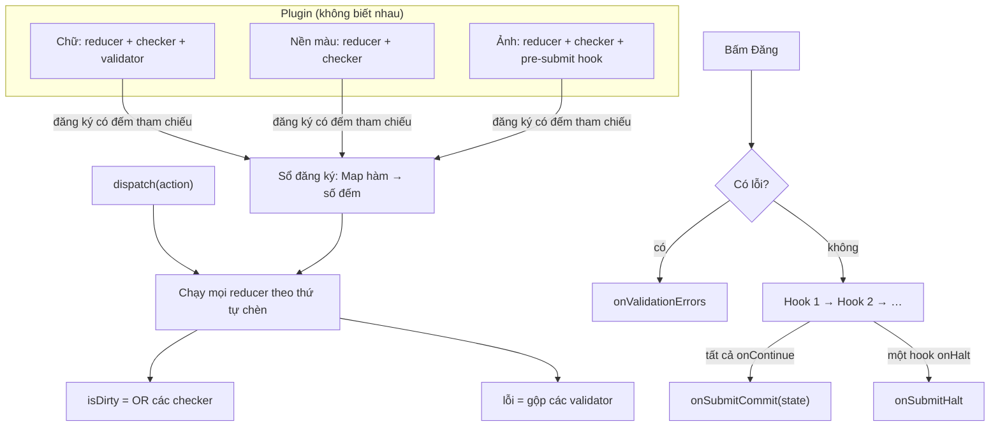

Ô "Bạn đang nghĩ gì?" của Facebook trông như một textarea, nhưng bên trong là hàng chục tính năng: ảnh, video, nền màu, gắn thẻ bạn bè, cảm xúc, check-in, link preview, chọn đối tượng xem… Mỗi tính năng do một nhóm khác nhau làm, bật tắt theo quốc gia, theo loại tài khoản, theo thử nghiệm A/B.

Viết composer theo kiểu thông thường thì component cha biết hết: một `useReducer` lớn với `case 'ADD_PHOTO'`, `case 'SET_BACKGROUND'`…, một hàm `isDirty()` so từng trường, một hàm `validate()` kiểm từng điều kiện. Mỗi plugin mới là một lần sửa file trung tâm, và gỡ một plugin thì phải nhớ gỡ ở năm chỗ.

> [!TIP]
> **Tóm tắt**
> - `CometComposer` của Facebook giữ **một** view state. Mỗi plugin tự đăng ký reducer, "dirty checker", validator và pre-submit hook qua context. Composer không có danh sách plugin nào.
> - Việc đăng ký có **đếm tham chiếu**: hai component dùng chung một hàm chỉ chạy một lần, và hàm chỉ bị gỡ khi lần đăng ký cuối cùng được gỡ.
> - `isDirty` là phép OR các checker: mỗi plugin chỉ trả lời "phần của tôi đã bị sửa chưa". Pre-submit hook nối thành một chuỗi Promise, hook nào cũng có thể mở hộp thoại rồi mới quyết định cho đăng hay dừng.
> - Bản gốc đăng ký chính hàm plugin truyền vào. Plugin truyền hàm inline thì mỗi lần render, hàm bị gỡ rồi thêm lại ở **cuối** danh sách, nên thứ tự reducer chạy phụ thuộc thứ tự render. Bản viết lại sửa bằng wrapper ổn định.

<iframe class="demo-frame" src="/demos/facebook-patterns/index.html?theme=dark#/plugin-composer" title="Demo plugin-composer" loading="lazy" style="height: 760px"></iframe>

<p class="demo-links">▶ <a href="/demos/facebook-patterns/index.html#/plugin-composer" target="_blank" rel="noopener">Mở demo toàn màn hình ↗</a> · <a href="https://stackblitz.com/github/hunghg255/blog-hunghg/tree/master/examples/facebook-patterns?file=src/lib/pluginComposer.ts" target="_blank" rel="noopener">Sửa code trên StackBlitz ↗</a> · <a href="https://github.com/hunghg255/blog-hunghg/blob/master/examples/facebook-patterns/src/lib/pluginComposer.ts" target="_blank" rel="noopener">Xem source trên GitHub ↗</a></p>

## Facebook làm thế nào?

Các module nằm trong bundle `15.js` và `6.js` (cùng được gộp vào `UFIReactionsDialogLayerImpl.react.js`): `CometComposer.react`, `reduceComposerViewState`, `useComposerViewStateReducer`, `useContextRef`, `getComposerPluginEligibility`.

### Một state, bốn sổ đăng ký

`CometComposer` tạo bốn `useRef(new Map())` và đưa mỗi cái vào một context riêng:

```js
const reducers = useRef(new Map());       // CometComposerViewStateReducersContext
const alteredCheckers = useRef(new Map()); // CometComposerViewStateAlteredContext
const validationErrors = useRef({});       // CometComposerValidationErrorsContext
const preSubmitHooks = useRef(new Map());  // CometComposerPreSubmitHooksContext
```

Context chứa **ref** chứ không chứa Map. Plugin thêm hay bớt hàm thì chỉ sửa Map bên trong, giá trị context không đổi, nên không component nào phải render lại.

Plugin đăng ký qua một hook nhỏ, `useContextRef`:

```js
function useContextRef(fn, Context) {
  const map = useContext(Context).current;
  useEffect(() => {
    map.set(fn, (map.get(fn) ?? 0) + 1);             // mount: +1
    return () => {
      const n = map.get(fn);
      if (n === 1) map.delete(fn); else map.set(fn, n - 1); // unmount: -1, về 0 thì xoá
    };
  }, [map, fn]);
}
```

Map ở đây dùng **hàm làm key, số đếm làm value**. Hai component cùng đăng ký một hàm thì hàm đó vẫn chỉ có một entry, đếm bằng 2. Đây là đếm tham chiếu (reference counting), giống cách hệ điều hành quản lý file handle.

`useComposerViewStateReducer(reducer, alteredChecker)` gọi `useContextRef` hai lần: một cho reducer, một cho checker. Plugin không có checker thì nhận một hàm mặc định `() => false`.

### Reducer chạy lần lượt, isDirty là OR

`reduceComposerViewState` được gọi bên trong reducer của `useReducer`:

```js
function reduceComposerViewState(reducersRef, checkersRef, state, unalteredBeginning, action) {
  let next = state;
  for (const reducer of reducersRef.current.keys()) next = reducer(next, action);
  return {
    ...next,
    isDirty: Array.from(checkersRef.current.keys()).some((check) => check(unalteredBeginning, next)),
  };
}
```

Mọi action đi qua **mọi** reducer, theo thứ tự chèn của Map. Plugin nền màu có thể phản ứng với action gõ chữ của plugin text (ví dụ: chữ dài quá thì tắt nền), mà không cần plugin text biết nó tồn tại.

`isDirty` không do composer tự so sánh. Mỗi plugin cung cấp một checker chỉ so phần của mình: `CometFormattedBackgroundAlterationStateChecker` chỉ so preset nền màu. Cờ này điều khiển `CometOnBeforeUnload`, hộp "Bạn có chắc muốn rời trang?".

### Ổn định tham chiếu để context không làm render thừa

Lỗi validate và tập plugin "không đủ điều kiện" được tính lại mỗi khi state đổi, nhưng chỉ thay tham chiếu khi nội dung thật sự khác:

```js
const errors = useMemo(() => getComposerValidationErrors(validators, viewState), [validators, viewState]);
shallowEqual(errorsRef.current, errors) || (errorsRef.current = errors);
// tương tự với Set plugin không đủ điều kiện: cùng size và cùng phần tử thì giữ Set cũ
```

Consumer của `CometComposerValidationErrorsContext` chỉ render lại khi danh sách lỗi đổi, không phải mỗi lần gõ phím.

### Submit: chuỗi hook có thể dừng

```js
const onSubmit = (e) => {
  e?.type !== 'press' && e?.preventDefault();
  if (Object.keys(errorsRef.current).length > 0) return onValidationErrors?.(errorsRef.current);
  const state = latestStateRef.current;
  Array.from(preSubmitHooks.current.keys())
    .reduce((chain, hook) => chain.then(() => new Promise((onContinue, onHalt) => hook({ onContinue, onHalt }, state))),
            Promise.resolve())
    .then(() => onSubmitCommit(state))
    .catch(() => onSubmitHalt?.());
};
```

Mỗi hook nhận `onContinue` và `onHalt` (thực chất là `resolve` và `reject` của một Promise). Hook có thể mở hộp thoại "Đăng mà không gắn thẻ địa điểm?" và chỉ gọi `onContinue` khi người dùng bấm đồng ý. Hook sau chỉ được hỏi khi hook trước đã cho qua. Composer còn chèn `<input type="submit" style="display:none">` vào form để phím Enter vẫn kích hoạt submit.

### Những chỗ dễ gãy

- **Hàm inline làm đổi thứ tự reducer.** `useContextRef` có deps `[map, fn]`. Plugin truyền `useComposerViewStateReducer((s, a) => …)` thì `fn` là hàm mới sau mỗi render, effect chạy lại: gỡ hàm cũ (đếm về 0, xoá khỏi Map) rồi thêm hàm mới vào **cuối** Map. Plugin nào vừa render lại thì reducer của nó tụt xuống cuối. Thứ tự reducer chạy vì thế phụ thuộc thứ tự render, điều mà plugin không kiểm soát. Demo tái hiện được: bật "Đăng ký kiểu bản gốc", focus vào ô chữ (chỉ plugin chữ render lại), thứ tự chuyển từ `chữ → nền → ảnh` sang `nền → ảnh → chữ`. Với các plugin thật của Facebook mình không kiểm được plugin nào truyền hàm inline, nên đây là rủi ro của thiết kế chứ chưa chắc là lỗi đang xảy ra.
- **Checker mặc định cũng là hàm mới mỗi render.** Plugin không truyền checker nhận `function () { return false }` tạo mới mỗi lần gọi hook, nên checker mặc định bị gỡ và đăng ký lại sau mỗi render. Vô hại về kết quả (luôn `false`), nhưng là việc thừa.
- **Reducer có side effect.** Reducer truyền cho `useReducer` gán `latestStateRef.current = next` và gọi `onBeforeViewStateChange`. React StrictMode gọi reducer hai lần ở môi trường dev, nên callback này chạy hai lần.



## Viết lại

Bản viết lại tách phần lõi khỏi React: một class `ComposerStore` giữ state và bốn sổ đăng ký, React chỉ đọc qua `useSyncExternalStore`. Lõi vì thế test được mà không cần render.

Sổ đăng ký có đếm tham chiếu:

```ts title=src/lib/pluginComposer.ts
/**
 * Tập có đếm tham chiếu: cùng một hàm được đăng ký 2 lần (2 component dùng chung) thì
 * chỉ chạy 1 lần, và chỉ bị gỡ khi lần đăng ký cuối cùng được gỡ. Thứ tự = thứ tự đăng ký đầu.
 */
export class RefCountedRegistry<F> {
  private counts = new Map<F, number>();

  add(item: F): () => void {
    this.counts.set(item, (this.counts.get(item) ?? 0) + 1);
    let released = false;
    return () => {
      if (released) return;
      released = true;
      const n = this.counts.get(item);
      if (n === undefined) return;
      if (n <= 1) this.counts.delete(item);
      else this.counts.set(item, n - 1);
    };
  }

  values() {
    return Array.from(this.counts.keys());
  }

  get size() {
    return this.counts.size;
  }
}
```

Dispatch, submit và phần tính lại isDirty/lỗi:

```ts title=src/lib/pluginComposer.ts
  /** Chạy lần lượt mọi reducer đang đăng ký, rồi tính lại isDirty và lỗi. */
  dispatch = (action: ComposerAction) => {
    let state = this.snapshot.state;
    for (const reducer of this.reducers.values()) state = reducer(state, action);
    this.commit(state);
  };

  /**
   * Plugin vừa mount/unmount: tính lại isDirty/lỗi với tập checker mới. Chỉ báo cho consumer
   * khi kết quả thật sự đổi; nếu luôn báo thì plugin đăng ký lại mỗi render sẽ thành vòng lặp
   * render vô hạn.
   */
  recompute = () => this.commit(this.snapshot.state);

  async submit(): Promise<SubmitResult<S>> {
    const { state, errors } = this.snapshot;
    if (errors.length > 0) return { status: 'invalid', errors };
    // hook chạy NỐI TIẾP: hook sau chỉ được hỏi khi hook trước đã cho qua
    for (const hook of this.hooks.values()) {
      const ok = await hook(state);
      if (!ok) return { status: 'halted' };
    }
    return { status: 'committed', state };
  }

  private commit(state: S) {
    const isDirty = this.checkers.values().some((check) => check(this.beginning, state));
    const errors = this.validators
      .values()
      .map((validate) => validate(state))
      .filter((e): e is string => e != null);
    const prev = this.snapshot;
    // giữ nguyên tham chiếu nếu không có gì đổi: consumer không phải render lại
    if (prev.state === state && prev.isDirty === isDirty && sameStrings(prev.errors, errors))
      return;
    this.snapshot = {
      state,
      isDirty,
      errors: sameStrings(prev.errors, errors) ? prev.errors : errors,
    };
    this.listeners.forEach((l) => l());
  }
```

Hook cho plugin, đăng ký một wrapper ổn định:

```ts title=src/lib/pluginComposer.ts
/**
 * Plugin tự đăng ký các phần của mình.
 *
 * Khác bản gốc: bản gốc đăng ký CHÍNH hàm plugin truyền vào, với deps [hàm]. Plugin truyền
 * hàm inline thì mỗi lần render bị gỡ ra rồi đăng ký lại ở CUỐI Map, thứ tự reducer đổi
 * theo thứ tự render. Ở đây mỗi plugin đăng ký một wrapper ỔN ĐỊNH (tạo một lần), wrapper đọc
 * bản mới nhất qua ref, nên thứ tự chỉ phụ thuộc thứ tự mount.
 */
export function usePlugin<S>(parts: PluginParts<S>) {
  const { store } = useComposer<S>();
  const latest = useRef(parts);
  useLayoutEffect(() => {
    latest.current = parts;
  });

  const has = {
    reducer: !!parts.reducer,
    isAltered: !!parts.isAltered,
    validate: !!parts.validate,
    beforeSubmit: !!parts.beforeSubmit,
  };

  useEffect(() => {
    const releases: Array<() => void> = [];
    if (has.reducer)
      releases.push(store.reducers.add((s, a) => latest.current.reducer?.(s, a) ?? s));
    if (has.isAltered)
      releases.push(store.checkers.add((b, c) => latest.current.isAltered?.(b, c) ?? false));
    if (has.validate)
      releases.push(store.validators.add((s) => latest.current.validate?.(s) ?? null));
    if (has.beforeSubmit)
      releases.push(
        store.hooks.add((s) => latest.current.beforeSubmit?.(s) ?? Promise.resolve(true)),
      );
    store.recompute();
    return () => {
      releases.forEach((release) => release());
      store.recompute();
    };
  }, [store, has.reducer, has.isAltered, has.validate, has.beforeSubmit]);
}
```

::: spoiler Xem toàn bộ src/lib/pluginComposer.ts

```ts title=src/lib/pluginComposer.ts
import {
  createContext,
  useContext,
  useEffect,
  useLayoutEffect,
  useRef,
  useState,
  useSyncExternalStore,
} from 'react';

/**
 * Khung composer dạng plugin (ý tưởng từ CometComposer.react + reduceComposerViewState
 * + useComposerViewStateReducer + useContextRef của Facebook).
 *
 * Composer chỉ giữ MỘT state. Mỗi plugin tự đăng ký:
 * - reducer: xử lý action của mình trên state chung,
 * - dirty checker: "phần của tôi đã bị sửa chưa?",
 * - validator: lỗi chặn đăng,
 * - pre-submit hook: được hỏi trước khi đăng (vd mở hộp thoại xác nhận).
 * Không plugin nào biết plugin khác. isDirty = OR của mọi checker.
 */

export interface ComposerAction {
  type: string;
  [key: string]: unknown;
}

export type ComposerReducer<S> = (state: S, action: ComposerAction) => S;
export type DirtyChecker<S> = (beginning: S, current: S) => boolean;
/** trả chuỗi lỗi hoặc null */
export type Validator<S> = (state: S) => string | null;
/** true = cho đăng tiếp, false = dừng */
export type PreSubmitHook<S> = (state: S) => Promise<boolean>;

export type SubmitResult<S> =
  | { status: 'invalid'; errors: string[] }
  | { status: 'halted' }
  | { status: 'committed'; state: S };

/**
 * Tập có đếm tham chiếu: cùng một hàm được đăng ký 2 lần (2 component dùng chung) thì
 * chỉ chạy 1 lần, và chỉ bị gỡ khi lần đăng ký cuối cùng được gỡ. Thứ tự = thứ tự đăng ký đầu.
 */
export class RefCountedRegistry<F> {
  private counts = new Map<F, number>();

  add(item: F): () => void {
    this.counts.set(item, (this.counts.get(item) ?? 0) + 1);
    let released = false;
    return () => {
      if (released) return;
      released = true;
      const n = this.counts.get(item);
      if (n === undefined) return;
      if (n <= 1) this.counts.delete(item);
      else this.counts.set(item, n - 1);
    };
  }

  values() {
    return Array.from(this.counts.keys());
  }

  get size() {
    return this.counts.size;
  }
}

export interface ComposerSnapshot<S> {
  state: S;
  isDirty: boolean;
  errors: string[];
}

export class ComposerStore<S> {
  readonly reducers = new RefCountedRegistry<ComposerReducer<S>>();
  readonly checkers = new RefCountedRegistry<DirtyChecker<S>>();
  readonly validators = new RefCountedRegistry<Validator<S>>();
  readonly hooks = new RefCountedRegistry<PreSubmitHook<S>>();
  private listeners = new Set<() => void>();
  private snapshot: ComposerSnapshot<S>;

  constructor(private readonly beginning: S) {
    this.snapshot = { state: beginning, isDirty: false, errors: [] };
  }

  getSnapshot = () => this.snapshot;

  subscribe = (listener: () => void) => {
    this.listeners.add(listener);
    return () => void this.listeners.delete(listener);
  };

  /** Chạy lần lượt mọi reducer đang đăng ký, rồi tính lại isDirty và lỗi. */
  dispatch = (action: ComposerAction) => {
    let state = this.snapshot.state;
    for (const reducer of this.reducers.values()) state = reducer(state, action);
    this.commit(state);
  };

  /**
   * Plugin vừa mount/unmount: tính lại isDirty/lỗi với tập checker mới. Chỉ báo cho consumer
   * khi kết quả thật sự đổi; nếu luôn báo thì plugin đăng ký lại mỗi render sẽ thành vòng lặp
   * render vô hạn.
   */
  recompute = () => this.commit(this.snapshot.state);

  async submit(): Promise<SubmitResult<S>> {
    const { state, errors } = this.snapshot;
    if (errors.length > 0) return { status: 'invalid', errors };
    // hook chạy NỐI TIẾP: hook sau chỉ được hỏi khi hook trước đã cho qua
    for (const hook of this.hooks.values()) {
      const ok = await hook(state);
      if (!ok) return { status: 'halted' };
    }
    return { status: 'committed', state };
  }

  private commit(state: S) {
    const isDirty = this.checkers.values().some((check) => check(this.beginning, state));
    const errors = this.validators
      .values()
      .map((validate) => validate(state))
      .filter((e): e is string => e != null);
    const prev = this.snapshot;
    // giữ nguyên tham chiếu nếu không có gì đổi: consumer không phải render lại
    if (prev.state === state && prev.isDirty === isDirty && sameStrings(prev.errors, errors))
      return;
    this.snapshot = {
      state,
      isDirty,
      errors: sameStrings(prev.errors, errors) ? prev.errors : errors,
    };
    this.listeners.forEach((l) => l());
  }
}

function sameStrings(a: string[], b: string[]) {
  return a.length === b.length && a.every((x, i) => x === b[i]);
}

// ---------------------------------------------------------------------------
// React
// ---------------------------------------------------------------------------

// eslint-disable-next-line @typescript-eslint/no-explicit-any
export const ComposerContext = createContext<ComposerStore<any> | null>(null);

export function useComposerStore<S>(beginning: S) {
  const [store] = useState(() => new ComposerStore(beginning));
  return store;
}

export function useComposer<S>() {
  const store = useContext(ComposerContext) as ComposerStore<S> | null;
  if (!store) throw new Error('useComposer phải nằm trong <ComposerContext.Provider>');
  const snapshot = useSyncExternalStore(store.subscribe, store.getSnapshot, store.getSnapshot);
  return { ...snapshot, dispatch: store.dispatch, store };
}

export interface PluginParts<S> {
  reducer?: ComposerReducer<S>;
  isAltered?: DirtyChecker<S>;
  validate?: Validator<S>;
  beforeSubmit?: PreSubmitHook<S>;
}

/**
 * Plugin tự đăng ký các phần của mình.
 *
 * Khác bản gốc: bản gốc đăng ký CHÍNH hàm plugin truyền vào, với deps [hàm]. Plugin truyền
 * hàm inline thì mỗi lần render bị gỡ ra rồi đăng ký lại ở CUỐI Map, thứ tự reducer đổi
 * theo thứ tự render. Ở đây mỗi plugin đăng ký một wrapper ỔN ĐỊNH (tạo một lần), wrapper đọc
 * bản mới nhất qua ref, nên thứ tự chỉ phụ thuộc thứ tự mount.
 */
export function usePlugin<S>(parts: PluginParts<S>) {
  const { store } = useComposer<S>();
  const latest = useRef(parts);
  useLayoutEffect(() => {
    latest.current = parts;
  });

  const has = {
    reducer: !!parts.reducer,
    isAltered: !!parts.isAltered,
    validate: !!parts.validate,
    beforeSubmit: !!parts.beforeSubmit,
  };

  useEffect(() => {
    const releases: Array<() => void> = [];
    if (has.reducer)
      releases.push(store.reducers.add((s, a) => latest.current.reducer?.(s, a) ?? s));
    if (has.isAltered)
      releases.push(store.checkers.add((b, c) => latest.current.isAltered?.(b, c) ?? false));
    if (has.validate)
      releases.push(store.validators.add((s) => latest.current.validate?.(s) ?? null));
    if (has.beforeSubmit)
      releases.push(
        store.hooks.add((s) => latest.current.beforeSubmit?.(s) ?? Promise.resolve(true)),
      );
    store.recompute();
    return () => {
      releases.forEach((release) => release());
      store.recompute();
    };
  }, [store, has.reducer, has.isAltered, has.validate, has.beforeSubmit]);
}

/** Hỏi trước khi rời trang khi còn thay đổi chưa đăng. */
export function useWarnBeforeUnload(active: boolean) {
  useEffect(() => {
    if (!active) return;
    const onBeforeUnload = (event: BeforeUnloadEvent) => {
      event.preventDefault();
      event.returnValue = ''; // trình duyệt cũ cần gán returnValue
    };
    window.addEventListener('beforeunload', onBeforeUnload);
    return () => window.removeEventListener('beforeunload', onBeforeUnload);
  }, [active]);
}
```

:::

**Khác bản gốc:**

- **State nằm ngoài React** (`useSyncExternalStore`) thay vì `useReducer`. Reducer thuần, không gán ref hay gọi callback bên trong, nên StrictMode không làm side effect chạy hai lần.
- **Wrapper ổn định.** Mỗi plugin đăng ký **một** wrapper tạo một lần trong effect; wrapper đọc bản mới nhất của reducer qua ref. Thứ tự reducer chỉ phụ thuộc thứ tự mount. Đổi lại, hai component dùng chung một hàm sẽ có hai wrapper khác nhau, nên đếm tham chiếu không gộp được chúng. Muốn gộp thì gọi thẳng `store.reducers.add(hàmỔnĐịnh)` với hàm khai báo ở cấp module.
- **Pre-submit hook trả `Promise<boolean>`** thay cho cặp `onContinue`/`onHalt`. Hai cách tương đương, nhưng `async` function đọc dễ hơn.
- **isDirty được tính lại khi plugin mount hoặc unmount.** Bản gốc chỉ tính trong reducer, nên gỡ plugin nền màu thì `isDirty` vẫn giữ giá trị cũ tới lần dispatch sau.

## Đi qua code

- **`RefCountedRegistry.add()`** trả về hàm `release`. Gọi `release` hai lần không trừ hai lần (cờ `released`), tránh lỗi khi cleanup của React chạy lặp.
- **`dispatch()`** chạy các reducer theo thứ tự của `values()`, tức thứ tự chèn lần đầu của Map. Hàm đã có trong Map mà được thêm lần nữa thì chỉ tăng số đếm, không đổi vị trí.
- **`commit()`** so state, `isDirty` và danh sách lỗi với snapshot cũ. Không có gì đổi thì không báo listener, nên action không plugin nào xử lý không gây render.
- **`recompute()`** chỉ báo khi kết quả thật sự khác. Lúc viết demo, phiên bản đầu luôn báo, và chế độ "đăng ký kiểu bản gốc" lập tức thành vòng lặp render vô hạn: đăng ký lại → báo → render → hàm inline mới → đăng ký lại. Một ví dụ cụ thể cho thấy đăng ký trong effect mà lại kích hoạt render là rất dễ thành vòng lặp.
- **`submit()`** dùng `for…of` với `await`, nên hook chạy tuần tự đúng như chuỗi `.then` của bản gốc.
- **`usePlugin()`** chỉ đưa vào deps các cờ "có reducer không", "có checker không"… Plugin đổi nội dung hàm thì không cần đăng ký lại; plugin thêm hoặc bớt hẳn một phần thì mới đăng ký lại.

## Tại sao không làm cách khác?

**Một reducer lớn ở composer, plugin chỉ gửi action?** Composer phải biết mọi loại action và mọi trường state. Gỡ plugin "check-in" thì phải sửa composer. Với hàng chục nhóm cùng làm một composer, file trung tâm sẽ thành nơi xung đột merge liên tục.

**Mỗi plugin tự giữ state riêng bằng `useState`?** Khi đó không còn một "view state" để gửi lên server lúc đăng, và plugin không phản ứng được với nhau (nền màu phải tắt khi chữ quá dài). Composer cũng không biết `isDirty` nếu không hỏi từng plugin.

**Dùng Redux với `combineReducers`?** `combineReducers` chia state thành từng nhánh, mỗi reducer chỉ thấy nhánh của mình. Composer của Facebook cho mọi reducer thấy **toàn bộ** state, chính là thứ cho phép plugin nền màu đọc độ dài chữ. Ngoài ra, ghép reducer động (thêm khi mount, gỡ khi unmount) không phải cách dùng mặc định của Redux.

## Edge case và cạm bẫy

- **Thứ tự reducer là thứ tự mount.** Plugin A phụ thuộc kết quả của plugin B (đọc trường B vừa sửa) thì phải mount sau B. Phụ thuộc kiểu này nên tránh, hoặc ghi rõ trong code.
- **Action trong lúc plugin chưa mount.** Đăng ký nằm trong `useEffect`, nên action được dispatch trong lần render đầu tiên đi qua một tập reducer còn thiếu.
- **Unmount khi hook đang chờ.** Plugin ảnh đang hỏi "Đăng không ảnh?" mà bị gỡ: Promise của hook vẫn treo. Hook nên tự huỷ hộp thoại và trả `false` khi unmount.
- **`beforeunload` không chạy trong mọi trường hợp.** Trình duyệt di động có thể đóng tab mà không phát sự kiện này, và trình duyệt chỉ hiện câu hỏi khi người dùng đã tương tác với trang. Nó là lớp bảo vệ cuối, không thay được việc tự lưu nháp.
- **Validator chạy sau mỗi thay đổi.** Validator tốn kém (kiểm link, gọi mạng) không nên đặt ở đây; dùng pre-submit hook thay vào.

## Dùng trong dự án

Form nhiều phần do nhiều người làm: trình soạn email (đính kèm, chữ ký, lịch gửi), form tạo sản phẩm (ảnh, biến thể, giá), editor bài viết.

```tsx
function AttachmentPlugin() {
  const { state, dispatch } = useComposer<Mail>();
  usePlugin<Mail>({
    reducer: (s, a) => (a.type === 'attach' ? { ...s, files: [...s.files, a.file as File] } : s),
    isAltered: (begin, cur) => begin.files.length !== cur.files.length,
    beforeSubmit: async (s) =>
      /đính kèm|attached/i.test(s.body) && s.files.length === 0 ? confirm('Bạn nhắc tới file đính kèm mà chưa gắn file?') : true,
  });
  return <FilePicker onPick={(file) => dispatch({ type: 'attach', file })} />;
}
```

Thêm một tính năng là thêm một component plugin; gỡ tính năng là xoá component đó, không phải sửa composer.

## Kiểm thử

::: spoiler Ví dụ test (bản phác, không có trong repo)

```ts
import { describe, expect, it } from 'vitest';
import { ComposerStore, RefCountedRegistry } from './pluginComposer';

type S = { text: string; bg: string | null };

describe('RefCountedRegistry', () => {
  it('cùng hàm đăng ký 2 lần chỉ chạy 1 lần, gỡ hết mới mất', () => {
    const reg = new RefCountedRegistry<() => void>();
    const f = () => {};
    const r1 = reg.add(f);
    const r2 = reg.add(f);
    expect(reg.size).toBe(1);
    r1();
    r1(); // gọi lại không đếm hai lần
    expect(reg.size).toBe(1);
    r2();
    expect(reg.size).toBe(0);
  });
});

describe('ComposerStore', () => {
  const make = () => {
    const store = new ComposerStore<S>({ text: '', bg: null });
    store.reducers.add((s, a) => (a.type === 'text' ? { ...s, text: String(a.value) } : s));
    store.reducers.add((s, a) => (a.type === 'bg' ? { ...s, bg: a.value as string } : s));
    return store;
  };

  it('isDirty là OR của các checker đang đăng ký', () => {
    const store = make();
    const releaseBg = store.checkers.add((b, c) => b.bg !== c.bg);
    store.dispatch({ type: 'text', value: 'chào' });
    expect(store.getSnapshot().isDirty).toBe(false); // chưa có checker cho text
    store.dispatch({ type: 'bg', value: 'red' });
    expect(store.getSnapshot().isDirty).toBe(true);
    releaseBg();
    store.recompute();
    expect(store.getSnapshot().isDirty).toBe(false);
  });

  it('validator chặn submit, hook dừng được việc đăng', async () => {
    const store = make();
    store.validators.add((s) => (s.text ? null : 'trống'));
    store.recompute();
    expect(await store.submit()).toEqual({ status: 'invalid', errors: ['trống'] });

    store.dispatch({ type: 'text', value: 'x' });
    const asked: string[] = [];
    store.hooks.add(async () => (asked.push('h1'), true));
    store.hooks.add(async () => (asked.push('h2'), false));
    store.hooks.add(async () => (asked.push('h3'), true));
    expect(await store.submit()).toEqual({ status: 'halted' });
    expect(asked).toEqual(['h1', 'h2']); // h3 không được hỏi
  });
});
```

:::

## So với thư viện và chuẩn web

- **Lexical** (editor mã nguồn mở của Meta) dùng ý tưởng gần giống: plugin là component React, tự `registerCommand` và `registerUpdateListener` với editor rồi trả hàm huỷ trong effect. Editor không có danh sách plugin.
- **Redux** hỗ trợ thêm reducer lúc chạy qua `store.replaceReducer` (Redux Toolkit có `combineSlices` với `.inject`), nhưng mỗi slice vẫn chỉ thấy nhánh của mình.
- **`useSyncExternalStore`** có từ React 18; đây là cách được khuyến nghị để đọc store bên ngoài React mà không bị "tearing" khi render đồng thời.
- **`beforeunload`**: các trình duyệt hiện đại chỉ hiện thông báo chung, không hiện chuỗi tuỳ biến, và chỉ hiện khi trang đã có tương tác của người dùng (tính tới 10/2026).

---

Bài này thuộc series **[Học từ mã nguồn Facebook](/series/facebook)** (106 bài, đọc theo thứ tự).

::: spoiler Xem nhanh danh sách bài trong series

*Phần 1*

- [Mở đầu: cách đọc code minify của Facebook](/blogs/learn-from-facebook-source-code)
- [#1 Dùng chung IntersectionObserver + infinite scroll](/blogs/facebook-shared-intersection-observer)
- [#2 useViewportDuration: đo thời gian thực sự được xem](/blogs/facebook-use-viewport-duration)
- [#3 Preload code + data khi hover](/blogs/facebook-preload-on-hover)
- [#4 Toast manager với external store](/blogs/facebook-toast-manager)
- [#5 Network status + heartbeat backoff](/blogs/facebook-network-status-heartbeat)
- [#6 ErrorGuard: bắt lỗi theo ngữ cảnh](/blogs/facebook-error-guard)
- [#7 Banzai: gom log theo lô + sendBeacon](/blogs/facebook-batch-logger)
- [#8 Focus trap + Esc theo layer](/blogs/facebook-focus-trap)

*Phần 2*

- [#9 Mẹo calc(… * 9999): container query, line-clamp, mũi tên carousel bằng CSS](/blogs/facebook-css-9999-trick)
- [#10 Thanh cuộn tuỳ biến bằng CSS 3D](/blogs/facebook-css-3d-scrollbar)
- [#11 Modal cuộn bằng window, giữ vị trí trang nền](/blogs/facebook-document-scroll-modal)
- [#12 Popover, tooltip group và hovercard](/blogs/facebook-popover-tooltip)
- [#13 Primitive Pressable + focus-visible](/blogs/facebook-pressable)
- [#14 Tab "Xem thêm" + sticky header bằng IntersectionObserver](/blogs/facebook-priority-tabs-sticky-header)
- [#15 Avatar khoét mask, gradient Messenger, skeleton steps()](/blogs/facebook-visual-tricks)
- [#16 Khung chat không giật](/blogs/facebook-chat-scroller)
- [#17 Thuật toán chọn bố cục collage ảnh](/blogs/facebook-photo-collage-layout)
- [#18 Keep-alive tab trong SPA](/blogs/facebook-keep-alive-tabs)
- [#19 Tự đo Visual Completion & interaction tracing](/blogs/facebook-visual-completion)
- [#20 Router SPA bền bỉ & tải chunk có retry](/blogs/facebook-spa-router-resilient-loading)

*Phần 3*

- [#21 Smart Compose: gợi ý chữ mờ khi gõ](/blogs/facebook-smart-compose-ghost-text)
- [#22 MQTT ngay trong trình duyệt, tự chuyển sang long-poll](/blogs/facebook-mqtt-in-browser)
- [#23 Đo thời gian dùng bằng bitmap 64 giây](/blogs/facebook-time-spent-bitmap)
- [#24 Bảng reaction nhấn giữ rồi trượt](/blogs/facebook-reaction-press-slide)
- [#25 Tìm kiếm gấp dấu, phiên âm và highlight đầu từ](/blogs/facebook-search-diacritics-tokenize)
- [#26 Ring buffer biết trace nào đã mất log](/blogs/facebook-trace-ring-buffer)
- [#27 Engine animation JS: một vòng rAF và solver cubic-bezier](/blogs/facebook-keyframes-loop-cubic-bezier)
- [#28 Bootloader: bitmap tài nguyên đã tải, chỉ reload khi cần](/blogs/facebook-bootloader-bitmap-consistency)
- [#29 Nhận biết click do screen reader tạo ra](/blogs/facebook-virtual-cursor-detection)
- [#30 Tải trước feed theo chất lượng mạng, đoán hạng thiết bị](/blogs/facebook-network-aware-prefetch)
- [#31 Hàng đợi gửi tin chat giữ đúng thứ tự](/blogs/facebook-ordered-send-queue)
- [#32 Gộp lời gọi API trong cùng một tick](/blogs/facebook-api-batcher)
- [#33 Resize ảnh trong pool Web Worker](/blogs/facebook-jpeg-resize-worker-pool)
- [#34 Crop ảnh theo nhiều khuôn mặt](/blogs/facebook-face-aware-crop)
- [#35 Kéo-thả sắp xếp và vùng thả file không nhấp nháy](/blogs/facebook-flicker-free-drag-drop)
- [#36 Tiện ích UI: fade-out, sticky event, hàm huỷ được](/blogs/facebook-ui-utility-hooks)
- [#37 Hạ tầng nhỏ: cookie, hash lỗi, prefetch khi chuột dừng](/blogs/facebook-small-infra-cookie-hash-idle)

*Phần 4–6*

- [#38 Đồng bộ tin nhắn: phát hiện lỗ seqID và fetch bù theo tầng](/blogs/facebook-messenger-sync-seqid-gaps)
- [#39 OTID: ID tin nhắn kiểu Snowflake sinh ở client](/blogs/facebook-otid-client-snowflake)
- [#40 QPL: lấy mẫu từ lúc bắt đầu, đo RTT gửi tin đầu-cuối](/blogs/facebook-qpl-send-rtt)
- [#41 Bộ điều phối request bảy chế độ gộp và chống trùng](/blogs/facebook-request-dispatcher-modes)
- [#42 Thread list theo mốc thời gian, cookie presence có version](/blogs/facebook-threadlist-ranged-presence)
- **#43 Composer dạng plugin: reducer, dirty checker, chuỗi kiểm tra** (bài này)
- [#44 Thanh toán bất đồng bộ: subscribe trước, poll dự phòng](/blogs/facebook-async-checkout)
- [#45 Validate số thẻ: sửa lỗi gõ, dải BIN, Luhn](/blogs/facebook-card-validation)
- [#46 Lịch chọn khoảng ngày: bo góc dải chọn, phím đủ bộ, RTL](/blogs/facebook-range-calendar-a11y)
- [#47 Giờ mở cửa theo tuần: qua đêm, gộp khoảng, phần bù](/blogs/facebook-weekly-hours-intervals)
- [#48 Tiến độ đăng realtime: giữ event chờ snapshot, watchdog](/blogs/facebook-realtime-publish-snapshot)
- [#49 Tiền tệ theo đơn vị nhỏ nhất và ô nhập tiền](/blogs/facebook-currency-minor-units)
- [#50 Sửa hàng loạt Empty/Uniform/Mixed, seen/read bằng 2 bit](/blogs/facebook-bulk-edit-seen-bits)
- [#51 Phát hiện script lạ hook vào hàm native](/blogs/facebook-native-hook-detection)
- [#52 localStorage tự dọn khi đầy quota](/blogs/facebook-quota-aware-storage)
- [#53 Cache tuyến do server phân giải, chờ sẵn promise](/blogs/facebook-route-cache-prefetch)
- [#54 Lưới phím mũi tên 2D và focus không làm cuộn trang](/blogs/facebook-focus-table-grid)
- [#55 Tách emoji bằng máy trạng thái](/blogs/facebook-emoji-segmentation)
- [#56 Đọc trước ghi sau trong một frame, con tự biết vị trí](/blogs/facebook-read-then-write-dom)
- [#57 Hàng đợi lệnh cho video và stream sắp lại chunk](/blogs/facebook-video-command-queue)

*Phần 7–10*

- [#58 Ước lượng băng thông EWMA: loại outlier, nhớ qua phiên](/blogs/facebook-bandwidth-ewma-estimator)
- [#59 ABR theo độ tự tin phát và cắt bậc bitrate theo MOS](/blogs/facebook-abr-playback-confidence)
- [#60 Prefetch segment dự đoán từ manifest, parse hộp sidx](/blogs/facebook-dash-predicted-segments)
- [#61 Đọc metadata MP4/MOV ngay trên client](/blogs/facebook-mp4-metadata-client)
- [#62 Upload tiếp tục được: offset, hash dedupe, phát hiện treo](/blogs/facebook-resumable-upload)
- [#63 Fenwick tree: chọn ngẫu nhiên có trọng số và offset dòng](/blogs/facebook-fenwick-weighted-random)
- [#64 Vạch trục số và trục thời gian "đẹp"](/blogs/facebook-nice-axis-ticks)
- [#65 Damerau-Levenshtein theo dải chéo và tự sửa tên gõ sai](/blogs/facebook-damerau-levenshtein)
- [#66 PRNG có seed, shuffle tái lập và lấy mẫu trace](/blogs/facebook-seeded-prng-sampling)
- [#67 Cặp min/max-heap tái dùng vị trí trong danh sách ảo](/blogs/facebook-dual-heap-buffer-set)
- [#68 Memo nhiều đối số bằng Map/WeakMap và interning object](/blogs/facebook-multikey-memo-interning)
- [#69 Thống kê cửa sổ trượt và đại số khoảng thời gian](/blogs/facebook-moving-stat-intervals)
- [#70 Int64 từ hai số 32-bit, decode UTF, offset theo code point](/blogs/facebook-int64-utf-codepoints)
- [#71 Engine múi giờ IANA trên client, phát hiện lệch giờ](/blogs/facebook-client-iana-timezone)
- [#72 Tự cài semver range](/blogs/facebook-semver-range)
- [#73 Auto-link URL, cắt chữ an toàn, giới hạn LaTeX](/blogs/facebook-autolink-safe-truncate)
- [#74 Parser query kiểu PHP chống prototype pollution](/blogs/facebook-php-query-serializer)
- [#75 Popover tự lật theo phần tràn nhỏ nhất](/blogs/facebook-popover-auto-flip)
- [#76 Tiền tố for(;;) chống JSON hijacking, đọc stream](/blogs/facebook-csrf-prefix-streaming)
- [#77 Chống lộ Referer, linkshim, xoá token trên URL](/blogs/facebook-referrer-linkshim-url-scrub)
- [#78 setImmediate bằng postMessage, gom delta chuột theo frame](/blogs/facebook-setimmediate-mouse-batching)
- [#79 Phát hiện crash qua heartbeat, dò proxy cache hỏng](/blogs/facebook-crash-heartbeat-proxy-check)
- [#80 DPR vào cookie cho ảnh @2x, che khoá trong log](/blogs/facebook-dpr-cookie-secret-redaction)
- [#81 Flux waitFor tự viết và proxy có đệm](/blogs/facebook-flux-dispatch-buffered-proxy)
- [#82 Crop đúng tỉ lệ, xoay sticker bằng ma trận](/blogs/facebook-image-crop-rotation-geometry)

*Phần 11–15*

- [#83 Chia subdomain giữa các tab bằng lease, long-poll theo bảng trạng thái](/blogs/facebook-tab-subdomain-lease-longpoll)
- [#84 MQTT QoS1: giữ publish chờ ack, gửi lại khi kết nối lại](/blogs/facebook-mqtt-qos1-republish)
- [#85 Cache Promise gộp request, cache lỗi ngắn, đua dữ liệu nhúng sẵn](/blogs/facebook-promise-cache-preload-race)
- [#86 Lịch retry: backoff có trần, Fibonacci, báo lỗi CDN mỗi N ngày](/blogs/facebook-retry-backoff-schedules)
- [#87 Giữ nguyên tham chiếu nhánh dữ liệu không đổi](/blogs/facebook-relay-recycle-nodes)
- [#88 Store optimistic: copy-on-write, rollback rồi áp lại](/blogs/facebook-relay-optimistic-store)
- [#89 Chỉ mục subscription theo record, hàng đợi task theo chiều sâu](/blogs/facebook-relay-subscription-index)
- [#90 Phân trang connection: cursor khớp đầu, edge không trùng](/blogs/facebook-relay-connection-pagination)
- [#91 Profiler kiểu middleware và memo selector có lấy mẫu kiểm tra](/blogs/facebook-profiler-middleware-memo-check)
- [#92 Đọc EBML/WebM Cues để tìm byte range của segment](/blogs/facebook-webm-ebml-cues)
- [#93 Stream HTTP Range tạm dừng được, tải tiếp đúng byte](/blogs/facebook-pausable-range-stream)
- [#94 Bảng khoảng thời gian gắn nhãn và nhảy qua lỗ buffer](/blogs/facebook-tagged-time-ranges-gaps)
- [#95 Gom chunk cho SourceBuffer, đồng bộ video bằng playbackRate](/blogs/facebook-sourcebuffer-video-sync)
- [#96 Gom tin nhắn thành cụm, vạch ngày và avatar đã xem](/blogs/facebook-message-grouping)
- [#97 Bao nhiêu tab chat vừa màn hình, chuỗi luật mở tab](/blogs/facebook-chat-tab-policy)
- [#98 Phím tắt Markdown trong editor, Backspace để hoàn tác](/blogs/facebook-markdown-shortcuts-editor)
- [#99 Offset theo code point hay UTF-16: bốn bug cùng một gốc](/blogs/facebook-codepoint-offset-bugs)
- [#100 Typeahead không nhảy: cache tiền tố, chặn reflow, khoá hover](/blogs/facebook-typeahead-stable-results)
- [#101 Hit-test trên canvas bằng phát lại path, nét đứt và cung Bézier](/blogs/facebook-canvas-hit-regions)
- [#102 Vòng tròn theo mét trên bản đồ Mercator](/blogs/facebook-mercator-meter-circles)
- [#103 Dò tính năng trình duyệt: ảnh EXIF 2×1, getter bẫy, scrollbar](/blogs/facebook-feature-probe-tricks)
- [#104 Bug định dạng số và kiểm tra dữ liệu theo locale](/blogs/facebook-locale-validation-bugs)
- [#105 Dispose cho đúng: idle callback, splice(-1), xoá nhầm key](/blogs/facebook-dispose-leak-bugs)

:::

Code + demo: [`examples/facebook-patterns`](https://github.com/hunghg255/blog-hunghg/tree/master/examples/facebook-patterns) · [Mở trên StackBlitz](https://stackblitz.com/github/hunghg255/blog-hunghg/tree/master/examples/facebook-patterns)
