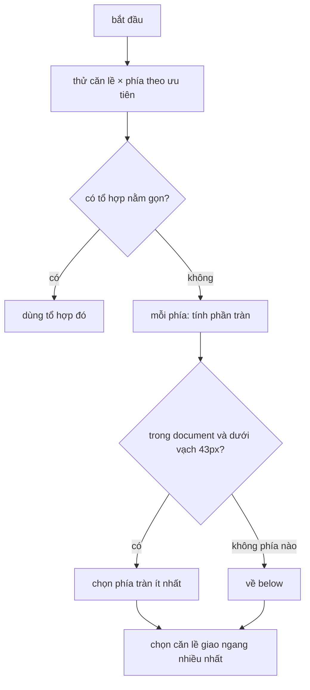

Một popover (menu, tooltip, hộp xác nhận) gắn vào một nút. Mặc định nó mở ở dưới, căn trái. Nút nằm sát đáy màn hình thì popover tràn xuống dưới, phải lật lên trên. Nút nằm sát mép phải thì phải căn phải. Đó là phần ai cũng làm.

Phần khó là khi **không phía nào vừa**: viewport thấp (điện thoại xoay ngang, cửa sổ nhỏ), popover cao. Lúc đó chọn gì? Và nếu lật lên trên làm popover chui xuống dưới thanh điều hướng cố định thì sao? Bài [Popover và tooltip](/blogs/facebook-popover-tooltip) trước đó nói về cách Facebook mở/đóng và định vị popover; bài này đi vào đúng thuật toán chọn phía.

> [!TIP]
> **Tóm tắt**
> - `ContextualLayerAutoFlip` thử lần lượt (căn lề × phía) theo thứ tự ưu tiên; tổ hợp đầu tiên nằm gọn trong viewport thắng.
> - Không tổ hợp nào vừa: chọn phía có **tổng phần tràn** (L1, cộng 4 cạnh) nhỏ nhất, nhưng chỉ xét vị trí còn nằm trong document và không lên trên vạch 43px của thanh điều hướng.
> - Căn lề cuối cùng chọn theo phần giao ngang lớn nhất với viewport.
> - Lỗi nhỏ trong bản gốc: phần tràn của bước 2 được đo với căn lề **còn sót lại** từ vòng lặp bước 1, không phải căn lề tốt nhất, nên có lúc loại nhầm phía tốt hơn.
> - `AbstractContextualDialogArrowBehavior` đặt mũi tên bằng (phần trăm + margin) và dịch cả layer khi nút quá hẹp.

<iframe class="demo-frame" src="/demos/facebook-patterns/index.html?theme=dark#/auto-flip" title="Demo auto-flip" loading="lazy" style="height: 900px"></iframe>

<p class="demo-links">▶ <a href="/demos/facebook-patterns/index.html#/auto-flip" target="_blank" rel="noopener">Mở demo toàn màn hình ↗</a> · <a href="https://stackblitz.com/github/hunghg255/blog-hunghg/tree/master/examples/facebook-patterns?file=src/lib/autoFlip.ts" target="_blank" rel="noopener">Sửa code trên StackBlitz ↗</a> · <a href="https://github.com/hunghg255/blog-hunghg/blob/master/examples/facebook-patterns/src/lib/autoFlip.ts" target="_blank" rel="noopener">Xem source trên GitHub ↗</a></p>

## Facebook làm thế nào?

Facebook gom logic định vị lớp nổi trong `ContextualLayer`: một layer gắn với một "context" (phần tử neo), có `position` (`above`, `below`, `left`, `right`) và `alignment` (`left`, `center`, `right`). Các hành vi bổ sung được cắm vào dưới dạng **behavior**: tự lật, tự ẩn khi cuộn, mũi tên… `ContextualLayerAutoFlip` (bundle `91.js`) là behavior tự lật.

### Bốn bước của `_adjustOrientation`

Mỗi lần layer cần định vị lại (mở, cuộn, đổi kích thước), behavior chạy:

1. **Danh sách ứng viên.** Phía: [phía ưu tiên, phía đối diện]. Căn lề: [căn lề ưu tiên, hai căn lề còn lại]. Với mỗi căn lề, thử từng phía; tổ hợp đầu tiên mà hình chữ nhật của layer nằm gọn trong viewport thì dùng luôn.
2. **Tràn ít nhất.** Nếu layer bật `getPreferMoreContentShownRect`, tính phần tràn của mỗi phía (tổng số pixel thò ra ở 4 cạnh), khởi đầu từ 99999. Chỉ xét những vị trí mà layer vẫn nằm trong document và cạnh trên không nhỏ hơn 43px (chiều cao thanh điều hướng xanh). Phía tràn ít nhất thắng.
3. **Mặc định.** Không có phía nào hợp lệ thì về `below` nếu được.
4. **Căn lề.** Với phía đã chọn, lấy căn lề có phần giao theo chiều ngang với viewport lớn nhất.

Khi layer nằm trong một vùng cuộn riêng (không phải `window`), danh sách phía còn được lọc theo việc phần tử neo có đang nhìn thấy trong vùng cuộn đó không.

### Lỗi "căn lề còn sót"

Bước 2 tính hình chữ nhật của layer cho mỗi phía, nhưng hình chữ nhật cần cả căn lề. Code dùng biến căn lề của vòng lặp bước 1, mà lúc này vòng lặp đã chạy hết, nên biến đang giữ **căn lề cuối danh sách**. Với ưu tiên `left`, đó là `right`.

Hậu quả: nút sát mép trái, ưu tiên căn trái. Căn phải đẩy layer ra ngoài mép trái của document (`left < 0`), nên **cả hai phía** đều bị loại ở bước 2, và bước 3 rơi về `below`, dù `above` + căn trái chỉ tràn 10px so với 24px. Nút "Không chỗ nào vừa" trong demo dựng đúng tình huống này; bảng dưới khung cho thấy kiểu Facebook chọn `below/left` (tràn 24px), bản viết lại chọn `above/left` (tràn 10px).



### Mũi tên

`AbstractContextualDialogArrowBehavior` (bundle `25.js`) đặt mũi tên của hộp thoại:

- Với layer ở trên/dưới: mũi tên ở `0%` (căn trái), `50%` (giữa) hoặc `100%` (căn phải) bề rộng layer.
- Thêm một margin: `(center ? 0 : offset) + length × percent / 100`, đổi dấu nếu không phải căn trái. Căn phải: `100% − (offset + length)`, mũi tên cách góc phải đúng `offset`.
- Nếu phần tử neo **hẹp hơn** `length + 2 × offset`, mũi tên ở góc sẽ chỉ ra ngoài phần tử neo. Behavior dịch cả layer đi `length / 2 + offset − contextWidth / 2` (có tính RTL) để đỉnh mũi tên rơi đúng tâm.

Với layer ở trái/phải, phần trăm luôn là 0 bất kể căn lề, nên có lẽ mũi tên của layer `right` căn giữa vẫn nằm sát mép trên thay vì giữa. Code còn đọc kích thước mũi tên bằng `parseInt(Style.get(...))`, sẽ là `NaN` nếu style chưa có.

## Bên trong trình duyệt

Toạ độ cần cho thuật toán: hình chữ nhật của phần tử neo (`getBoundingClientRect`), kích thước layer (phải render layer một lần, ẩn, rồi đo), viewport (`innerWidth`/`innerHeight` hoặc vùng cuộn) và kích thước document. Tất cả là phép **đọc layout**; gộp chúng trước mọi phép ghi để không gây layout thrashing.

Trên điện thoại, `innerHeight` đổi khi thanh địa chỉ co/giãn và khi bàn phím ảo mở. `visualViewport` cho kích thước vùng thực sự nhìn thấy; nếu popover nằm cạnh ô nhập liệu, dùng `visualViewport.height` thay vì `innerHeight`.

## Viết lại

Phần thuật toán là hàm thuần: nhận các hình chữ nhật, trả vị trí. Không đụng DOM nên test dễ và dùng được với bất kỳ framework nào.

```ts title=src/lib/autoFlip.ts
export function choosePlacement(input: PlacementInput): Placement {
  const { preferred, topInset = 43 } = input;
  const positions: Position[] = [preferred.position, opposite(preferred.position)];
  const alignments = alignmentOrder(preferred.alignment);

  for (const a of alignments) {
    for (const p of positions) {
      if (contains(input.viewport, layerRect(input, p, a))) return finish(input, p, a, 'fits');
    }
  }

  let best: { p: Position; score: number } | null = null;
  for (const p of positions) {
    const a = bestAlignment(input, p, alignments);
    const r = layerRect(input, p, a);
    const insideDocument = r.left >= 0 && right(r) <= input.document.width && r.top >= topInset && bottom(r) <= input.document.height;
    if (!insideDocument) continue;
    const score = overflow(input.viewport, r);
    if (!best || score < best.score) best = { p, score };
  }
  if (best) return finish(input, best.p, bestAlignment(input, best.p, alignments), 'least-overflow');

  const fallback = positions.includes('below') ? 'below' : positions[0];
  return finish(input, fallback, bestAlignment(input, fallback, alignments), 'fallback');
}
```

Mũi tên:

```ts title=src/lib/autoFlip.ts
export function arrowPlacement({ alignment, anchorWidth, arrow, rtl = false }: ArrowInput): ArrowPlacement {
  const percent = alignment === 'center' ? 50 : alignment === 'right' ? 100 : 0;
  let margin = (alignment === 'center' ? 0 : arrow.offset) + (arrow.length * percent) / 100;
  if (alignment !== 'left') margin = -margin;

  let layerShift = 0;
  if (alignment !== 'center' && anchorWidth < arrow.length + arrow.offset * 2) {
    const shift = arrow.length / 2 + arrow.offset - anchorWidth / 2;
    // căn trái: kéo layer sang trái; căn phải: đẩy sang phải
    layerShift = alignment === 'left' ? -shift : shift;
  }
  return { side: rtl ? 'right' : 'left', percent, margin, layerShift };
}
```

::: spoiler Xem toàn bộ src/lib/autoFlip.ts

```ts title=src/lib/autoFlip.ts
/**
 * Chọn vị trí cho popover/tooltip quanh một "anchor" (ý tưởng từ ContextualLayerAutoFlip
 * và AbstractContextualDialogArrowBehavior của Facebook):
 *  1. Thử (căn lề × phía) theo thứ tự ưu tiên; cái nào nằm gọn trong viewport thì lấy.
 *  2. Không cái nào vừa: chọn phía có tổng phần tràn ra ngoài viewport nhỏ nhất,
 *     nhưng chỉ xét các vị trí vẫn nằm trong document và không chui dưới thanh điều hướng.
 *  3. Cuối cùng chọn căn lề có phần giao theo chiều ngang với viewport lớn nhất.
 * Mũi tên được đặt bằng (phần trăm + margin), và nếu anchor nhỏ hơn mũi tên thì
 * dịch cả layer để mũi tên chỉ đúng tâm anchor.
 */

export type Position = 'above' | 'below';
export type Alignment = 'left' | 'center' | 'right';

export interface Rect {
  left: number;
  top: number;
  width: number;
  height: number;
}

const right = (r: Rect) => r.left + r.width;
const bottom = (r: Rect) => r.top + r.height;

export function contains(outer: Rect, inner: Rect): boolean {
  return (
    inner.left >= outer.left && inner.top >= outer.top && right(inner) <= right(outer) && bottom(inner) <= bottom(outer)
  );
}

/** Tổng phần tràn (theo pixel) ở 4 cạnh; 0 nghĩa là nằm gọn. */
export function overflow(viewport: Rect, r: Rect): number {
  return (
    Math.max(0, viewport.left - r.left) +
    Math.max(0, right(r) - right(viewport)) +
    Math.max(0, viewport.top - r.top) +
    Math.max(0, bottom(r) - bottom(viewport))
  );
}

/** Độ dài phần giao theo chiều ngang. */
export function horizontalOverlap(viewport: Rect, r: Rect): number {
  return Math.max(0, Math.min(right(viewport), right(r)) - Math.max(viewport.left, r.left));
}

export interface LayerGeometry {
  anchor: Rect;
  size: { width: number; height: number };
  /** khoảng cách giữa anchor và layer (chỗ cho mũi tên) */
  gap: number;
}

export function layerRect({ anchor, size, gap }: LayerGeometry, position: Position, alignment: Alignment): Rect {
  const left =
    alignment === 'left'
      ? anchor.left
      : alignment === 'right'
        ? right(anchor) - size.width
        : anchor.left + anchor.width / 2 - size.width / 2;
  const top = position === 'above' ? anchor.top - gap - size.height : bottom(anchor) + gap;
  return { left, top, width: size.width, height: size.height };
}

export interface PlacementInput extends LayerGeometry {
  /** viewport tính theo toạ độ document */
  viewport: Rect;
  /** kích thước toàn document */
  document: { width: number; height: number };
  preferred: { position: Position; alignment: Alignment };
  /** vùng trên cùng bị thanh điều hướng che (Facebook: 43px) */
  topInset?: number;
}

export interface Placement {
  position: Position;
  alignment: Alignment;
  rect: Rect;
  overflow: number;
  reason: 'fits' | 'least-overflow' | 'fallback';
}

const opposite = (p: Position): Position => (p === 'above' ? 'below' : 'above');
const ALIGNMENTS: Alignment[] = ['left', 'center', 'right'];

function alignmentOrder(preferred: Alignment): Alignment[] {
  return [preferred, ...ALIGNMENTS.filter((a) => a !== preferred)];
}

function bestAlignment(input: PlacementInput, position: Position, order: Alignment[]): Alignment {
  let best = order[0];
  let bestOverlap = 0;
  for (const a of order) {
    const overlap = horizontalOverlap(input.viewport, layerRect(input, position, a));
    if (overlap > bestOverlap) {
      bestOverlap = overlap;
      best = a;
    }
  }
  return best;
}

function finish(input: PlacementInput, position: Position, alignment: Alignment, reason: Placement['reason']): Placement {
  const rect = layerRect(input, position, alignment);
  return { position, alignment, rect, overflow: overflow(input.viewport, rect), reason };
}

/**
 * Bản viết lại. Khác bản gốc ở bước 2: phần tràn của mỗi phía được tính với căn lề
 * tốt nhất của chính phía đó, không phải với căn lề còn sót lại từ vòng lặp bước 1.
 */
export function choosePlacement(input: PlacementInput): Placement {
  const { preferred, topInset = 43 } = input;
  const positions: Position[] = [preferred.position, opposite(preferred.position)];
  const alignments = alignmentOrder(preferred.alignment);

  for (const a of alignments) {
    for (const p of positions) {
      if (contains(input.viewport, layerRect(input, p, a))) return finish(input, p, a, 'fits');
    }
  }

  let best: { p: Position; score: number } | null = null;
  for (const p of positions) {
    const a = bestAlignment(input, p, alignments);
    const r = layerRect(input, p, a);
    const insideDocument = r.left >= 0 && right(r) <= input.document.width && r.top >= topInset && bottom(r) <= input.document.height;
    if (!insideDocument) continue;
    const score = overflow(input.viewport, r);
    if (!best || score < best.score) best = { p, score };
  }
  if (best) return finish(input, best.p, bestAlignment(input, best.p, alignments), 'least-overflow');

  const fallback = positions.includes('below') ? 'below' : positions[0];
  return finish(input, fallback, bestAlignment(input, fallback, alignments), 'fallback');
}

// ---- Mũi tên ----

export interface ArrowInput {
  position: Position;
  alignment: Alignment;
  /** bề rộng anchor */
  anchorWidth: number;
  /** chiều dài cạnh mũi tên và khoảng cách tối thiểu tới góc layer */
  arrow: { length: number; offset: number };
  rtl?: boolean;
}

export interface ArrowPlacement {
  /** cạnh dùng để định vị mũi tên trong layer */
  side: 'left' | 'right';
  /** vị trí theo phần trăm bề rộng layer */
  percent: number;
  /** margin cộng thêm (px), có thể âm */
  margin: number;
  /**
   * Dịch layer theo chiều ngang (px). Anchor hẹp hơn mũi tên + 2×offset thì mũi tên ở góc
   * sẽ lệch khỏi anchor; dịch layer để đỉnh mũi tên rơi đúng tâm anchor.
   */
  layerShift: number;
}

export function arrowPlacement({ alignment, anchorWidth, arrow, rtl = false }: ArrowInput): ArrowPlacement {
  const percent = alignment === 'center' ? 50 : alignment === 'right' ? 100 : 0;
  let margin = (alignment === 'center' ? 0 : arrow.offset) + (arrow.length * percent) / 100;
  if (alignment !== 'left') margin = -margin;

  let layerShift = 0;
  if (alignment !== 'center' && anchorWidth < arrow.length + arrow.offset * 2) {
    const shift = arrow.length / 2 + arrow.offset - anchorWidth / 2;
    // căn trái: kéo layer sang trái; căn phải: đẩy sang phải
    layerShift = alignment === 'left' ? -shift : shift;
  }
  return { side: rtl ? 'right' : 'left', percent, margin, layerShift };
}
```

:::

## Đi qua code

- **`layerRect`** tính hình chữ nhật của layer cho một (phía, căn lề): căn trái thì mép trái trùng phần tử neo, căn phải thì mép phải trùng, căn giữa thì tâm trùng. `gap` là chỗ cho mũi tên.
- **`contains`** và **`overflow`**: nằm gọn hay không, và tràn bao nhiêu pixel ở 4 cạnh. Dùng tổng (L1) giống bản gốc: tràn 10px trên + 10px phải bằng tràn 20px một cạnh.
- **`choosePlacement`** bước 1 giữ đúng thứ tự thử của bản gốc. Bước 2 gọi `bestAlignment` **cho từng phía** trước khi đo phần tràn, nên không còn phụ thuộc vào biến còn sót.
- **`topInset`** là vạch thanh điều hướng (mặc định 43 như Facebook); đặt 0 nếu trang không có thanh cố định.
- **`arrowPlacement`** trả `percent`, `margin` và `layerShift`. CSS chỉ cần `left: calc(<percent>% + <margin>px)` cho mũi tên và cộng `layerShift` vào `left` của layer.

**Khác bản gốc:**

- Phần tràn của mỗi phía đo với căn lề tốt nhất của chính phía đó.
- Chỉ có `above`/`below`, không có `left`/`right`.
- Không có bộ lọc theo vùng cuộn riêng.
- Bước 2 luôn chạy (không cần cờ `getPreferMoreContentShownRect`).

## Tại sao không làm cách khác?

- **Chỉ lật khi tràn, không so phần tràn**: dễ, nhưng khi cả hai phía cùng tràn, popover có thể bị lật sang phía tràn nhiều hơn. So bằng số pixel là cách rẻ nhất để chọn đúng.
- **Chọn phía có nhiều chỗ trống hơn** (so khoảng trống trên và dưới phần tử neo): gần giống, nhưng không tính tới căn lề ngang và vạch thanh điều hướng.
- **Thu nhỏ popover cho vừa** (`max-height` + cuộn bên trong): thường là cách đúng cho menu dài. Có thể kết hợp: chọn phía bằng thuật toán này, rồi đặt `max-height` bằng chỗ trống thật của phía đó.
- **CSS anchor positioning** với `position-try-fallbacks`: trình duyệt tự thử các vị trí dự phòng. Nhưng nó chọn vị trí dự phòng **đầu tiên vừa**, không chọn "tràn ít nhất" khi không có vị trí nào vừa (tính tới 10/2026).

## Edge case và cạm bẫy

- **Đo kích thước layer trước khi hiện**: render với `visibility: hidden` (vẫn chiếm layout) chứ không `display: none` (kích thước 0).
- **Layer đổi kích thước sau khi mở** (ảnh tải xong, nội dung bất đồng bộ): chạy lại thuật toán bằng `ResizeObserver` trên layer.
- **Lật liên tục khi cuộn**: nút ở đúng ranh giới, mỗi pixel cuộn lại lật một lần. Có thể thêm độ trễ (hysteresis): chỉ đổi phía khi phía mới tốt hơn phía hiện tại một khoảng.
- **Vạch 43px là của Facebook**: thanh điều hướng của bạn cao bao nhiêu thì đặt `topInset` bấy nhiêu, và nhớ cả `env(safe-area-inset-top)` trên iPhone.
- **RTL**: căn "trái" trong tiếng Ả Rập là căn về phía bắt đầu dòng. `arrowPlacement` trả `side` để CSS dùng `right` thay cho `left`.

## Dùng trong dự án

```ts
function place(anchorEl: HTMLElement, layerEl: HTMLElement) {
  const a = anchorEl.getBoundingClientRect();
  const size = { width: layerEl.offsetWidth, height: layerEl.offsetHeight };
  const p = choosePlacement({
    anchor: { left: a.left + scrollX, top: a.top + scrollY, width: a.width, height: a.height },
    size,
    gap: 10,
    viewport: { left: scrollX, top: scrollY, width: innerWidth, height: innerHeight },
    document: { width: document.documentElement.scrollWidth, height: document.documentElement.scrollHeight },
    preferred: { position: 'below', alignment: 'left' },
    topInset: 56,
  });
  const arrow = arrowPlacement({ ...p, anchorWidth: a.width, arrow: { length: 16, offset: 12 } });
  layerEl.style.transform = `translate(${p.rect.left + arrow.layerShift}px, ${p.rect.top}px)`;
  layerEl.dataset.position = p.position;
}
```

## Kiểm thử

::: spoiler Ví dụ test (bản phác, không có trong repo)

```ts
import { expect, it } from 'vitest';
import { arrowPlacement, choosePlacement } from './autoFlip';
import { choosePlacementFbStyle } from '../demos/autoFlipFbStyle';

const base = {
  size: { width: 220, height: 140 },
  gap: 8,
  viewport: { left: 0, top: 200, width: 360, height: 300 },
  document: { width: 1200, height: 2000 },
  preferred: { position: 'below' as const, alignment: 'left' as const },
};

it('vừa thì giữ ưu tiên', () => {
  const p = choosePlacement({ ...base, anchor: { left: 40, top: 220, width: 60, height: 30 } });
  expect([p.position, p.alignment, p.reason]).toEqual(['below', 'left', 'fits']);
});

it('sát mép trái, không phía nào vừa: bản viết lại chọn phía tràn ít, bản kiểu FB rơi về below', () => {
  const input = { ...base, anchor: { left: 20, top: 340, width: 60, height: 30 } };
  const fixed = choosePlacement(input);
  const fb = choosePlacementFbStyle(input);
  expect(fixed.position).toBe('above');
  expect(fixed.overflow).toBeLessThan(fb.overflow);
  expect(fb.position).toBe('below');
});

it('mũi tên: căn phải ở 100% trừ offset + length; anchor hẹp thì dịch layer', () => {
  expect(
    arrowPlacement({ position: 'below', alignment: 'right', anchorWidth: 200, arrow: { length: 16, offset: 12 } }),
  ).toMatchObject({ percent: 100, margin: -28, layerShift: 0 });
  expect(
    arrowPlacement({ position: 'below', alignment: 'left', anchorWidth: 20, arrow: { length: 16, offset: 12 } }).layerShift,
  ).toBe(-10);
});
```

:::

## So với thư viện và chuẩn web

- **Floating UI** (trước là Popper): middleware `flip` thử các vị trí dự phòng, và có option `fallbackStrategy: 'bestFit'` chọn vị trí **tràn ít nhất** khi không có vị trí nào vừa, đúng ý tưởng bước 2. Middleware `shift` đẩy layer vào trong viewport, `arrow` tính vị trí mũi tên, `size` đặt `max-height`. Với dự án mới, dùng Floating UI thay vì tự viết.
- **CSS Anchor Positioning** (`anchor()`, `position-area`, `position-try-fallbacks: flip-block`): có trong Chrome, Edge, Safari 26 và Firefox (đang triển khai) tính tới 10/2026. Không cần JavaScript để lật, nhưng logic "tràn ít nhất" và vạch thanh điều hướng vẫn phải tự lo (có thể bằng `position-try-order: most-height`).
- **Popover API** (`popover`, `showPopover()`) lo phần top layer, đóng khi bấm ra ngoài, phím Esc. Nó không định vị; kết hợp với anchor positioning hoặc thuật toán ở trên.

---

Bài này thuộc series **[Học từ mã nguồn Facebook](/series/facebook)** (106 bài, đọc theo thứ tự).

::: spoiler Xem nhanh danh sách bài trong series

*Phần 1*

- [Mở đầu: cách đọc code minify của Facebook](/blogs/learn-from-facebook-source-code)
- [#1 Dùng chung IntersectionObserver + infinite scroll](/blogs/facebook-shared-intersection-observer)
- [#2 useViewportDuration: đo thời gian thực sự được xem](/blogs/facebook-use-viewport-duration)
- [#3 Preload code + data khi hover](/blogs/facebook-preload-on-hover)
- [#4 Toast manager với external store](/blogs/facebook-toast-manager)
- [#5 Network status + heartbeat backoff](/blogs/facebook-network-status-heartbeat)
- [#6 ErrorGuard: bắt lỗi theo ngữ cảnh](/blogs/facebook-error-guard)
- [#7 Banzai: gom log theo lô + sendBeacon](/blogs/facebook-batch-logger)
- [#8 Focus trap + Esc theo layer](/blogs/facebook-focus-trap)

*Phần 2*

- [#9 Mẹo calc(… * 9999): container query, line-clamp, mũi tên carousel bằng CSS](/blogs/facebook-css-9999-trick)
- [#10 Thanh cuộn tuỳ biến bằng CSS 3D](/blogs/facebook-css-3d-scrollbar)
- [#11 Modal cuộn bằng window, giữ vị trí trang nền](/blogs/facebook-document-scroll-modal)
- [#12 Popover, tooltip group và hovercard](/blogs/facebook-popover-tooltip)
- [#13 Primitive Pressable + focus-visible](/blogs/facebook-pressable)
- [#14 Tab "Xem thêm" + sticky header bằng IntersectionObserver](/blogs/facebook-priority-tabs-sticky-header)
- [#15 Avatar khoét mask, gradient Messenger, skeleton steps()](/blogs/facebook-visual-tricks)
- [#16 Khung chat không giật](/blogs/facebook-chat-scroller)
- [#17 Thuật toán chọn bố cục collage ảnh](/blogs/facebook-photo-collage-layout)
- [#18 Keep-alive tab trong SPA](/blogs/facebook-keep-alive-tabs)
- [#19 Tự đo Visual Completion & interaction tracing](/blogs/facebook-visual-completion)
- [#20 Router SPA bền bỉ & tải chunk có retry](/blogs/facebook-spa-router-resilient-loading)

*Phần 3*

- [#21 Smart Compose: gợi ý chữ mờ khi gõ](/blogs/facebook-smart-compose-ghost-text)
- [#22 MQTT ngay trong trình duyệt, tự chuyển sang long-poll](/blogs/facebook-mqtt-in-browser)
- [#23 Đo thời gian dùng bằng bitmap 64 giây](/blogs/facebook-time-spent-bitmap)
- [#24 Bảng reaction nhấn giữ rồi trượt](/blogs/facebook-reaction-press-slide)
- [#25 Tìm kiếm gấp dấu, phiên âm và highlight đầu từ](/blogs/facebook-search-diacritics-tokenize)
- [#26 Ring buffer biết trace nào đã mất log](/blogs/facebook-trace-ring-buffer)
- [#27 Engine animation JS: một vòng rAF và solver cubic-bezier](/blogs/facebook-keyframes-loop-cubic-bezier)
- [#28 Bootloader: bitmap tài nguyên đã tải, chỉ reload khi cần](/blogs/facebook-bootloader-bitmap-consistency)
- [#29 Nhận biết click do screen reader tạo ra](/blogs/facebook-virtual-cursor-detection)
- [#30 Tải trước feed theo chất lượng mạng, đoán hạng thiết bị](/blogs/facebook-network-aware-prefetch)
- [#31 Hàng đợi gửi tin chat giữ đúng thứ tự](/blogs/facebook-ordered-send-queue)
- [#32 Gộp lời gọi API trong cùng một tick](/blogs/facebook-api-batcher)
- [#33 Resize ảnh trong pool Web Worker](/blogs/facebook-jpeg-resize-worker-pool)
- [#34 Crop ảnh theo nhiều khuôn mặt](/blogs/facebook-face-aware-crop)
- [#35 Kéo-thả sắp xếp và vùng thả file không nhấp nháy](/blogs/facebook-flicker-free-drag-drop)
- [#36 Tiện ích UI: fade-out, sticky event, hàm huỷ được](/blogs/facebook-ui-utility-hooks)
- [#37 Hạ tầng nhỏ: cookie, hash lỗi, prefetch khi chuột dừng](/blogs/facebook-small-infra-cookie-hash-idle)

*Phần 4–6*

- [#38 Đồng bộ tin nhắn: phát hiện lỗ seqID và fetch bù theo tầng](/blogs/facebook-messenger-sync-seqid-gaps)
- [#39 OTID: ID tin nhắn kiểu Snowflake sinh ở client](/blogs/facebook-otid-client-snowflake)
- [#40 QPL: lấy mẫu từ lúc bắt đầu, đo RTT gửi tin đầu-cuối](/blogs/facebook-qpl-send-rtt)
- [#41 Bộ điều phối request bảy chế độ gộp và chống trùng](/blogs/facebook-request-dispatcher-modes)
- [#42 Thread list theo mốc thời gian, cookie presence có version](/blogs/facebook-threadlist-ranged-presence)
- [#43 Composer dạng plugin: reducer, dirty checker, chuỗi kiểm tra](/blogs/facebook-plugin-composer)
- [#44 Thanh toán bất đồng bộ: subscribe trước, poll dự phòng](/blogs/facebook-async-checkout)
- [#45 Validate số thẻ: sửa lỗi gõ, dải BIN, Luhn](/blogs/facebook-card-validation)
- [#46 Lịch chọn khoảng ngày: bo góc dải chọn, phím đủ bộ, RTL](/blogs/facebook-range-calendar-a11y)
- [#47 Giờ mở cửa theo tuần: qua đêm, gộp khoảng, phần bù](/blogs/facebook-weekly-hours-intervals)
- [#48 Tiến độ đăng realtime: giữ event chờ snapshot, watchdog](/blogs/facebook-realtime-publish-snapshot)
- [#49 Tiền tệ theo đơn vị nhỏ nhất và ô nhập tiền](/blogs/facebook-currency-minor-units)
- [#50 Sửa hàng loạt Empty/Uniform/Mixed, seen/read bằng 2 bit](/blogs/facebook-bulk-edit-seen-bits)
- [#51 Phát hiện script lạ hook vào hàm native](/blogs/facebook-native-hook-detection)
- [#52 localStorage tự dọn khi đầy quota](/blogs/facebook-quota-aware-storage)
- [#53 Cache tuyến do server phân giải, chờ sẵn promise](/blogs/facebook-route-cache-prefetch)
- [#54 Lưới phím mũi tên 2D và focus không làm cuộn trang](/blogs/facebook-focus-table-grid)
- [#55 Tách emoji bằng máy trạng thái](/blogs/facebook-emoji-segmentation)
- [#56 Đọc trước ghi sau trong một frame, con tự biết vị trí](/blogs/facebook-read-then-write-dom)
- [#57 Hàng đợi lệnh cho video và stream sắp lại chunk](/blogs/facebook-video-command-queue)

*Phần 7–10*

- [#58 Ước lượng băng thông EWMA: loại outlier, nhớ qua phiên](/blogs/facebook-bandwidth-ewma-estimator)
- [#59 ABR theo độ tự tin phát và cắt bậc bitrate theo MOS](/blogs/facebook-abr-playback-confidence)
- [#60 Prefetch segment dự đoán từ manifest, parse hộp sidx](/blogs/facebook-dash-predicted-segments)
- [#61 Đọc metadata MP4/MOV ngay trên client](/blogs/facebook-mp4-metadata-client)
- [#62 Upload tiếp tục được: offset, hash dedupe, phát hiện treo](/blogs/facebook-resumable-upload)
- [#63 Fenwick tree: chọn ngẫu nhiên có trọng số và offset dòng](/blogs/facebook-fenwick-weighted-random)
- [#64 Vạch trục số và trục thời gian "đẹp"](/blogs/facebook-nice-axis-ticks)
- [#65 Damerau-Levenshtein theo dải chéo và tự sửa tên gõ sai](/blogs/facebook-damerau-levenshtein)
- [#66 PRNG có seed, shuffle tái lập và lấy mẫu trace](/blogs/facebook-seeded-prng-sampling)
- [#67 Cặp min/max-heap tái dùng vị trí trong danh sách ảo](/blogs/facebook-dual-heap-buffer-set)
- [#68 Memo nhiều đối số bằng Map/WeakMap và interning object](/blogs/facebook-multikey-memo-interning)
- [#69 Thống kê cửa sổ trượt và đại số khoảng thời gian](/blogs/facebook-moving-stat-intervals)
- [#70 Int64 từ hai số 32-bit, decode UTF, offset theo code point](/blogs/facebook-int64-utf-codepoints)
- [#71 Engine múi giờ IANA trên client, phát hiện lệch giờ](/blogs/facebook-client-iana-timezone)
- [#72 Tự cài semver range](/blogs/facebook-semver-range)
- [#73 Auto-link URL, cắt chữ an toàn, giới hạn LaTeX](/blogs/facebook-autolink-safe-truncate)
- [#74 Parser query kiểu PHP chống prototype pollution](/blogs/facebook-php-query-serializer)
- **#75 Popover tự lật theo phần tràn nhỏ nhất** (bài này)
- [#76 Tiền tố for(;;) chống JSON hijacking, đọc stream](/blogs/facebook-csrf-prefix-streaming)
- [#77 Chống lộ Referer, linkshim, xoá token trên URL](/blogs/facebook-referrer-linkshim-url-scrub)
- [#78 setImmediate bằng postMessage, gom delta chuột theo frame](/blogs/facebook-setimmediate-mouse-batching)
- [#79 Phát hiện crash qua heartbeat, dò proxy cache hỏng](/blogs/facebook-crash-heartbeat-proxy-check)
- [#80 DPR vào cookie cho ảnh @2x, che khoá trong log](/blogs/facebook-dpr-cookie-secret-redaction)
- [#81 Flux waitFor tự viết và proxy có đệm](/blogs/facebook-flux-dispatch-buffered-proxy)
- [#82 Crop đúng tỉ lệ, xoay sticker bằng ma trận](/blogs/facebook-image-crop-rotation-geometry)

*Phần 11–15*

- [#83 Chia subdomain giữa các tab bằng lease, long-poll theo bảng trạng thái](/blogs/facebook-tab-subdomain-lease-longpoll)
- [#84 MQTT QoS1: giữ publish chờ ack, gửi lại khi kết nối lại](/blogs/facebook-mqtt-qos1-republish)
- [#85 Cache Promise gộp request, cache lỗi ngắn, đua dữ liệu nhúng sẵn](/blogs/facebook-promise-cache-preload-race)
- [#86 Lịch retry: backoff có trần, Fibonacci, báo lỗi CDN mỗi N ngày](/blogs/facebook-retry-backoff-schedules)
- [#87 Giữ nguyên tham chiếu nhánh dữ liệu không đổi](/blogs/facebook-relay-recycle-nodes)
- [#88 Store optimistic: copy-on-write, rollback rồi áp lại](/blogs/facebook-relay-optimistic-store)
- [#89 Chỉ mục subscription theo record, hàng đợi task theo chiều sâu](/blogs/facebook-relay-subscription-index)
- [#90 Phân trang connection: cursor khớp đầu, edge không trùng](/blogs/facebook-relay-connection-pagination)
- [#91 Profiler kiểu middleware và memo selector có lấy mẫu kiểm tra](/blogs/facebook-profiler-middleware-memo-check)
- [#92 Đọc EBML/WebM Cues để tìm byte range của segment](/blogs/facebook-webm-ebml-cues)
- [#93 Stream HTTP Range tạm dừng được, tải tiếp đúng byte](/blogs/facebook-pausable-range-stream)
- [#94 Bảng khoảng thời gian gắn nhãn và nhảy qua lỗ buffer](/blogs/facebook-tagged-time-ranges-gaps)
- [#95 Gom chunk cho SourceBuffer, đồng bộ video bằng playbackRate](/blogs/facebook-sourcebuffer-video-sync)
- [#96 Gom tin nhắn thành cụm, vạch ngày và avatar đã xem](/blogs/facebook-message-grouping)
- [#97 Bao nhiêu tab chat vừa màn hình, chuỗi luật mở tab](/blogs/facebook-chat-tab-policy)
- [#98 Phím tắt Markdown trong editor, Backspace để hoàn tác](/blogs/facebook-markdown-shortcuts-editor)
- [#99 Offset theo code point hay UTF-16: bốn bug cùng một gốc](/blogs/facebook-codepoint-offset-bugs)
- [#100 Typeahead không nhảy: cache tiền tố, chặn reflow, khoá hover](/blogs/facebook-typeahead-stable-results)
- [#101 Hit-test trên canvas bằng phát lại path, nét đứt và cung Bézier](/blogs/facebook-canvas-hit-regions)
- [#102 Vòng tròn theo mét trên bản đồ Mercator](/blogs/facebook-mercator-meter-circles)
- [#103 Dò tính năng trình duyệt: ảnh EXIF 2×1, getter bẫy, scrollbar](/blogs/facebook-feature-probe-tricks)
- [#104 Bug định dạng số và kiểm tra dữ liệu theo locale](/blogs/facebook-locale-validation-bugs)
- [#105 Dispose cho đúng: idle callback, splice(-1), xoá nhầm key](/blogs/facebook-dispose-leak-bugs)

:::

Code + demo: [`examples/facebook-patterns`](https://github.com/hunghg255/blog-hunghg/tree/master/examples/facebook-patterns) · [Mở trên StackBlitz](https://stackblitz.com/github/hunghg255/blog-hunghg/tree/master/examples/facebook-patterns)
