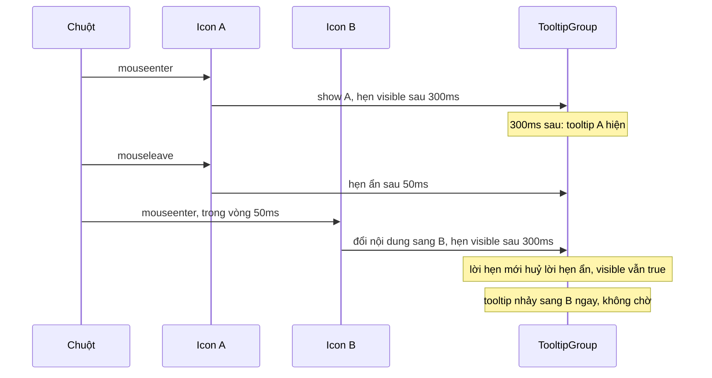
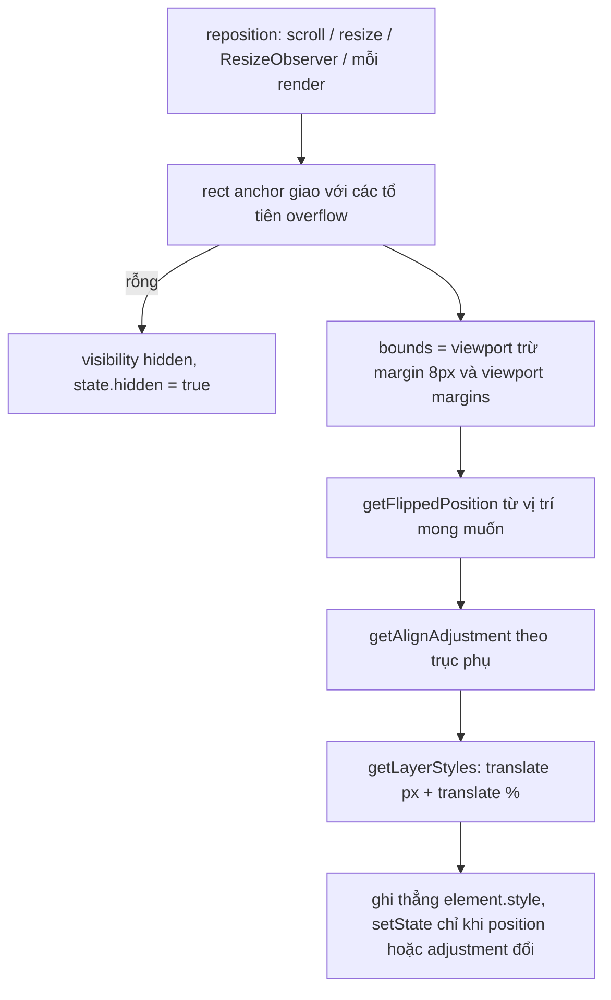

Menu "…" của một bài viết, tooltip "Thích" trên icon, card thông tin hiện ra khi rê chuột vào tên người dùng. Ba thứ này trông khác nhau nhưng chung một bài toán: **đặt một lớp nổi (layer) cạnh một phần tử (anchor)** và giữ cho nó đúng chỗ khi trang thay đổi.

Làm cho "chạy được" thì dễ. Làm cho đúng thì phải trả lời khá nhiều câu hỏi:

- Menu mở ở phía dưới nhưng nút nằm sát đáy màn hình thì sao?
- Nút nằm trong một khung cuộn (danh sách comment, sidebar). Cuộn khung thì menu có chạy theo không? Nút bị cuộn khuất hẳn thì menu đi đâu?
- Thanh icon có 5 tooltip, rê chuột dọc thanh có phải chờ 300ms ở **mỗi** icon không?
- Hovercard nằm trong portal ở cuối `<body>`. Rê chuột từ tên sang card thì `mouseleave` của tên có bắn ra và đóng card không?
- Click để **mở** menu cũng là một click "ra ngoài" menu. Vì sao menu không tự đóng ngay?

Facebook trả lời tất cả trong vài module: `BaseContextualLayer`, `BasePopoverTrigger`, `BaseTooltip`, `BaseTooltipGroup`, `useBaseHovercardTrigger`.

> [!TIP]
> **Tóm tắt**
> - Đặt layer bằng **hai lần translate**: px tới cạnh anchor, rồi `-100%`/`-50%` theo kích thước của chính layer. Không cần đo layer mới đặt được.
> - Lật chỉ khi phía bên kia đủ chỗ; anchor bị khung cuộn cắt mất hẳn thì ẩn layer.
> - Ghi vị trí thẳng vào `element.style` ở mỗi lần cuộn, React state chỉ đổi khi vị trí/độ lệch đổi.
> - Tooltip nhóm dùng **một** tooltip chung với hẹn giờ 300ms hiện / 50ms ẩn; hovercard dựa vào việc sự kiện React đi theo cây React xuyên portal.
> - Dự án mới: Floating UI, hoặc CSS anchor positioning + thuộc tính `popover` khi trình duyệt mục tiêu hỗ trợ.

## Facebook làm thế nào?

### 1. Hai lần translate: đặt layer mà không cần đo nó

Hàm `getBaseContextualLayerPositioningStyles_DEPRECATED` chỉ nhận rect của anchor và trả về một chuỗi `transform`. Phần quan trọng (đã đổi tên biến cho dễ đọc):

```js
case "above":
  y = anchor.top - offset.top;
  percentY = "-100%";
  break;
// …
transform = "translate(" + Math.round(x) + "px, " + Math.round(y) + "px) " +
            "translate(" + percentX + ", " + percentY + ")";
```

Layer luôn đứng ở `top: 0; left: 0` của khung toạ độ, rồi được dời đi bằng hai bước:

1. `translate(Xpx, Ypx)`: dời góc trên trái của layer tới **cạnh anchor** (ví dụ cạnh trên khi `above`).
2. `translate(-100%, -50%…)`: dời tiếp một khoảng bằng **phần trăm kích thước của chính layer**.

`translate` theo phần trăm luôn tính theo kích thước của element được transform. Vì vậy `above` chỉ cần "đặt đáy layer vào cạnh trên anchor" bằng `-100%`, `align: middle` thì thêm `-50%` theo trục ngang. Không cần biết layer cao bao nhiêu. Layer là một menu có nội dung tải lười (Suspense) đổi cao liên tục vẫn đứng đúng chỗ mà không phải đo lại.

### 2. Tự lật, chỉ khi phía bên kia đủ chỗ

`BaseContextualLayer` định nghĩa vùng an toàn là viewport trừ **8px** (`k = 8`) và trừ thêm "viewport margins" (thanh điều hướng cố định ở trên, lấy từ `CometViewportMarginsContext`). Quy tắc lật, ví dụ với `above`:

```js
y === "above" && a.top !== 0 && a.top < b.top && c.bottom + d < b.bottom ? z("below") : …
```

Đọc là: đang `above`, layer tràn qua mép trên **và** đặt ở dưới anchor thì vừa, thì mới lật sang `below`. Hai phía đều không vừa thì giữ nguyên, vì lật cũng chẳng tốt hơn. `a.top !== 0` nhiều khả năng là để bỏ qua lần đầu, khi layer chưa được đặt (đang ở góc 0,0).

### 3. Tự căn và "adjustment" cho mũi tên

Khi bật `autoAlign`, sau khi biết vị trí theo trục chính, module tính layer có tràn ra mép trái/phải (với `above`/`below`) hay mép trên/dưới (với `start`/`end`) không. Nếu có, nó tính một số px `adjustment` để đẩy layer vào trong, cộng vào `translate`, **và** đưa số đó vào `BaseContextualLayerLayerAdjustmentContext`. Component mũi tên đọc context này để dịch ngược lại, nên mũi tên vẫn chỉ đúng vào anchor dù thân layer đã bị đẩy đi.

### 4. Anchor bị vùng cuộn cắt thì ẩn layer

Đây là chi tiết ít thư viện tự làm. `BaseContextualLayer` lấy danh sách các `BaseScrollableArea` tổ tiên (qua `BaseScrollableAreaContext`) và **giao** rect của anchor với rect của từng vùng cuộn:

```js
var g = H.map(a => a.getDOMNode()).filter(Boolean)
  .filter(a => d.contains(a))
  .reduce((a, b) => a != null ? l(a, i(b)) : null, i(e));
if (g == null || g.left === 0 && g.right === 0) { L(!0); t && t(); return }
```

Giao rỗng nghĩa là anchor đã bị cuộn khuất hẳn. Layer chuyển sang `mode: "hidden"` (qua `LegacyHidden`) và gọi `onIndeterminatePosition` cho component cha tự quyết định (đóng menu chẳng hạn). Rect dùng để đặt layer cũng là **rect đã cắt**, nên khi anchor bị cắt một nửa, layer bám vào phần còn nhìn thấy.

Một chi tiết vui: hàm giao `l(a, b)` trong bản minify kiểm tra `b.right < b.left` thay vì `b.right < a.left`. Đây là lỗi gõ, chỉ hiếm khi gây hậu quả vì các điều kiện kia đã loại gần hết trường hợp không giao nhau. Bản viết lại bên dưới đã sửa.

### 5. Ghi thẳng vào `style`, không qua React state

Mỗi lần cuộn, hàm đặt vị trí chạy lại. Nếu kết quả đi qua `setState`, mỗi frame cuộn là một lần render. Facebook ghi thẳng:

```js
for (…) c != null ? v.style.setProperty(a, c) : v.style.removeProperty(a)
```

React state chỉ giữ những thứ cần để **vẽ** (kích thước anchor cho layer kiểu `stretch`, `adjustment` cho mũi tên), cập nhật gộp trong `unstable_batchedUpdates`. Listener: `resize` trên `window`, `scroll` (passive) trên **từng** vùng cuộn tổ tiên, không có vùng cuộn nào thì trên `window`. Kích thước layer theo dõi bằng `useResizeObserver`.

### 6. Anchor fixed/sticky thì layer cũng fixed

`isElementFixedOrSticky(anchor)` đúng thì layer dùng `position: fixed` và khung toạ độ là viewport. Không làm vậy, menu mở từ thanh điều hướng cố định sẽ trôi đi khi cuộn trang.

### 7. Portal lồng nhau và cú click "mở" không đóng chính nó

`BaseContextualLayerAnchorRoot` tạo một `div` và gắn nó **ngay sau** nội dung bằng `BaseDOMContainer`. Layer con (menu con trong menu) được portal vào div đó, tức là nằm **bên trong DOM của layer cha**. Nhờ vậy `layerCha.contains(event.target)` vẫn đúng với click trong menu con, và logic click ra ngoài không cần biết gì về cấu trúc portal.

`BasePopoverTrigger` chỉ "kích hoạt" việc đóng khi click ra ngoài sau **150ms** kể từ lúc mở:

```js
t && e !== !0 ? a = setTimeout(function () { I.current = !0 }, 150) : I.current = !1;
```

Cú click vừa mở popover cũng nổi bọt lên `document`. Nghe ngay lập tức thì popover vừa mở đã tự đóng. `useOnOutsideClick` còn tạm gỡ listener khi subtree bị ẩn (qua `HiddenSubtreePassiveContext`), để một trang đang ẩn (tab giữ sống, [bài #18](/blogs/facebook-keep-alive-tabs)) không đóng popover vì những click ở trang khác.

### 8. Tooltip: 300ms để hiện, 50ms để ẩn, một tooltip cho cả nhóm

`BaseTooltip` có hai hằng số: hiện sau **300ms** (`delayTooltipMs` mặc định), ẩn sau **50ms** khi nằm trong nhóm. Cả hai đi qua `useDelayedState`: gọi lại thì huỷ lần hẹn trước.

`BaseTooltipGroup` chỉ render **một** tooltip cho cả nhóm. Khi một target báo `onShow`, nhóm đổi nội dung (`contentKey`, `contextRef`) **ngay lập tức**, rồi hẹn `visible = true` sau 300ms. Rê chuột từ icon A sang icon B:

1. Rời A: hẹn `visible = false` sau 50ms.
2. Vào B (trong 50ms đó): đổi nội dung sang B, hẹn `visible = true` sau 300ms. Lời hẹn mới **huỷ** lời hẹn ẩn ở bước 1.
3. `visible` vẫn đang là `true`, nên tooltip không tắt mà nhảy ngay sang B.

Chỉ icon đầu tiên phải chờ, các icon sau hiện tức thì. Đó là cảm giác "ấm" (warm) ở thanh công cụ của Facebook, macOS hay VS Code.

Thêm vài chi tiết trong `BaseTooltipTargetWrapper` và `CometTooltipImpl`:

- Hiện bằng bàn phím chỉ khi `focused && focusVisible`. Click chuột vào nút cũng làm nó focus, nhưng không bật tooltip.
- `onMouseUp` cũng gọi ẩn: bấm nút xong thì tooltip biến đi cho đỡ vướng.
- `aria-describedby` chỉ gắn cho target **đang active** (`tooltipIdentifier: o === l ? n : void 0`). Các target khác không "mô tả" bằng nội dung của icon khác.
- Layer của tooltip có `pointer-events: none`. Tooltip không bao giờ chặn chuột khỏi target bên dưới.
- Nội dung tooltip có thể tải lười. Khi nó resolve trong `CometPlaceholder` (Suspense), một component con gọi `reposition({ autoflip: true })` trong layout effect, vì kích thước vừa đổi.

### 9. Hovercard: sự kiện React đi xuyên portal

`useBaseHovercardTrigger` bọc trigger trong một `div` có `onMouseEnter` / `onMouseLeave`, và render layer (qua `BasePortal`) **làm con React** của chính div đó. Cùng hai hằng số 300ms/50ms. Ngoài ra:

- `onMouseEnter` gọi `onLoadEntryPoint()` **ngay lập tức** để bắt đầu tải dữ liệu card (Relay entry point), trong lúc 300ms còn đang đếm. Nó cũng kích hoạt prerender ([bài #3](/blogs/facebook-preload-on-hover)).
- `onTouchStart` mở card luôn, vì cảm ứng không có hover.
- Đang mờ dần thì layer có `pointer-events: none`, để card đang biến mất không chặn click vào thứ phía sau.
- Nội dung card được bọc `FocusInertRegion`: không Tab vào được (đã có trang cá nhân thật cho việc đó).

Vì sao rê từ tên sang card không làm đóng card, dù card nằm ở cuối `<body>`? Xem phần dưới.

> [!NOTE]
> Nguồn trong [facebook-codebase](https://github.com/hunghg255/facebook-codebase): thư mục `BaseContextualLayer/`, `BasePopoverTrigger/`, `BaseTooltip/`, `0 000A/HoverCard/`, `001 CometHovercardTrigger/`, `Dialog/BasePortal.react.js`.

## Bên trong trình duyệt

**`transform` thay vì `top`/`left`.** Đổi `top`/`left` của phần tử `position: absolute` vẫn kích hoạt layout cho nó. `transform` chỉ ảnh hưởng bước composite, rẻ hơn khi chạy mỗi frame cuộn. Đây cũng là lý do `translate` theo % hoạt động: phần trăm trong `transform` tính theo **border box của chính phần tử**, khác hẳn `top: 50%` tính theo phần tử cha.

**Nhưng đọc vị trí thì vẫn tốn.** Mỗi lần cuộn, hàm đặt vị trí gọi `getBoundingClientRect()` cho anchor và cho từng tổ tiên bị cắt. Nếu trong cùng frame có code khác vừa ghi DOM (đổi class, thêm phần tử), lần đọc này buộc trình duyệt tính lại layout ngay (forced reflow). Vì vậy số lần đọc nên ít và cố định: bản viết lại tính danh sách tổ tiên **một lần** khi layer mở, không đi lại cây DOM và gọi `getComputedStyle` ở mỗi lần cuộn.

**`scroll` không nổi bọt, nhưng có pha capture.** Sự kiện `scroll` của một khung cuộn không bubble lên `window`. Facebook vì vậy gắn listener vào **từng** vùng cuộn. Cách gọn hơn (bản viết lại dùng) là nghe ở `window` với `capture: true`: pha capture luôn đi từ `window` xuống target, bất kể sự kiện có bubble hay không. Đổi lại, layer nhận cả scroll của những khung không liên quan, nhưng chi phí chỉ là vài lần `getBoundingClientRect`.

**Sự kiện React đi theo cây React, không theo cây DOM.** `createPortal` đặt DOM ở chỗ khác nhưng giữ nguyên vị trí trong cây React. React dựng các sự kiện tổng hợp, kể cả `mouseenter`/`mouseleave` vốn không bubble, bằng cách đi trên **cây fiber**. Khi chuột đi từ tên sang card:

- DOM: chuột rời `<a>` trong bài viết, đi vào một `<div>` ở cuối `<body>`.
- React: tổ tiên chung của "nơi rời" và "nơi đến" là `<span>` bọc hovercard. React chỉ bắn `onMouseLeave` cho các phần tử **bên dưới** tổ tiên chung đó, nên `<span>` bọc **không** nhận `onMouseLeave`.

Không cần tự tính "chuột đã vào card chưa". Còn khoảng hở giữa tên và card (vài px margin) thì sao? Chuột đi qua `<body>`, `<span>` bọc nhận `onMouseLeave` thật, card hẹn ẩn sau 50ms. Chuột vào tới card trong 50ms đó: `onMouseEnter` hẹn hiện lại và huỷ lời hẹn ẩn. 50ms chính là "cầu nối" cho khoảng hở.



## Viết lại

Bản viết lại tách làm hai file: phần định vị `contextualLayer.ts` (các hàm tính toán thuần + một hook) và phần tooltip/hovercard `tooltipGroup.tsx`.



**`reposition`**, trái tim của hook, đi đúng 5 bước như sơ đồ:

```ts title=src/lib/contextualLayer.ts
  // Danh sách tổ tiên cắt nội dung + cờ fixed/sticky: đọc getComputedStyle cho từng tổ tiên
  // khá tốn, nên tính MỘT lần khi layer mở (và khi resize), không tính lại ở mỗi lần cuộn.
  const cacheRef = useRef<{ ancestors: Element[]; fixed: boolean } | null>(null);
  const getCache = useCallback(() => {
    const anchor = anchorRef.current!;
    cacheRef.current ??= { ancestors: getClippingAncestors(anchor), fixed: isFixedOrSticky(anchor) };
    return cacheRef.current;
  }, [anchorRef]);

  const reposition = useCallback(() => {
    const anchor = anchorRef.current;
    const layer = layerRef.current;
    if (!anchor || !layer) return;
    const doc = document.documentElement;
    const { ancestors, fixed } = getCache();

    // 1. Rect của anchor sau khi bị các vùng cuộn tổ tiên cắt.
    let contextRect: Rect | null = toRect(anchor);
    for (const ancestor of ancestors) {
      contextRect = intersectRects(contextRect, toRect(ancestor));
      if (!contextRect) break;
    }
    // giao rỗng theo CẢ hai trục (anchor nằm đúng mép vùng cắt cho ra hình chữ nhật rộng 0)
    if (
      !contextRect ||
      contextRect.bottom - contextRect.top <= 0 ||
      contextRect.right - contextRect.left <= 0
    ) {
      layer.style.visibility = 'hidden';
      setState((s) => (s.hidden ? s : { ...s, hidden: true }));
      return;
    }
    layer.style.visibility = '';

    // 2. Vùng an toàn trong viewport (trừ margin + thanh điều hướng cố định).
    const bounds: Rect = {
      top: vmTop + margin,
      right: doc.clientWidth - vmRight - margin,
      bottom: doc.clientHeight - vmBottom - margin,
      left: vmLeft + margin,
    };
    const size: Size = { width: layer.offsetWidth, height: layer.offsetHeight };

    // 3. Lật & căn: luôn tính từ vị trí "mong muốn", nên còn chỗ thì tự lật về.
    let position = autoFlip ? getFlippedPosition(preferred, contextRect, size, bounds) : preferred;
    if (crossAxisFallback && !fitsSide(position, contextRect, size, bounds)) {
      if ((position === 'start' || position === 'end') && !fitsSide(opposite(position), contextRect, size, bounds)) {
        position = 'below';
      }
    }
    const adjustment = autoAlign ? getAlignAdjustment(position, align, contextRect, size, bounds) : null;

    // 4. Khung toạ độ: viewport nếu fixed, ngược lại là containing block của layer.
    const offsetRect: Rect = fixed
      ? { top: 0, left: 0, right: doc.clientWidth, bottom: doc.clientHeight }
      : getOffsetRect(layer);

    // 5. Ghi thẳng vào DOM, không re-render ở mỗi lần cuộn.
    const styles = getLayerStyles({ position, align, contextRect, offsetRect, adjustment, fixed });
    layer.style.transform = styles.transform;
    layer.style.position = styles.position ?? 'absolute';
    layer.style.width = styles.width ?? '';
    layer.style.height = styles.height ?? '';

    // React state chỉ đổi khi vị trí/độ lệch đổi (để vẽ mũi tên), không phải mỗi frame.
    setState((s) =>
      s.position === position && s.adjustment === adjustment && !s.hidden
        ? s
        : { position, adjustment, hidden: false },
    );
  }, [anchorRef, layerRef, getCache, preferred, align, autoFlip, autoAlign, crossAxisFallback, margin, vmTop, vmRight, vmBottom, vmLeft]);
```

**Khung toạ độ của layer.** Layer `position: absolute` được portal thẳng vào `<body>`. Nếu không có tổ tiên nào `position` khác `static`, khung toạ độ của nó là "initial containing block" (gốc tài liệu), **không phải** rect của `<body>`. Dùng `offsetParent.getBoundingClientRect()` một cách ngây thơ sẽ lệch đúng bằng margin của body (8px mặc định nếu trang chưa reset CSS):

```ts title=src/lib/contextualLayer.ts
/**
 * Khung toạ độ mà `position: absolute` của layer thực sự dùng (containing block).
 * - offsetParent là <body> tĩnh (layer portal thẳng vào body, không có tổ tiên positioned):
 *   containing block là "initial containing block" (gốc tài liệu), KHÔNG phải rect của body.
 *   Dùng rect của body sẽ lệch đúng bằng margin của body (8px mặc định nếu không reset CSS).
 * - Còn lại: padding box của offsetParent (rect trừ viền).
 */
export function getOffsetRect(layer: HTMLElement): Rect {
  const doc = document.documentElement;
  const parent = layer.offsetParent as HTMLElement | null;
  if (!parent || (parent === document.body && getComputedStyle(parent).position === 'static')) {
    const top = -window.scrollY;
    const left = -window.scrollX;
    return { top, left, right: left + doc.clientWidth, bottom: top + doc.clientHeight };
  }
  const r = parent.getBoundingClientRect();
  const top = r.top + parent.clientTop;
  const left = r.left + parent.clientLeft;
  return { top, left, right: left + parent.clientWidth, bottom: top + parent.clientHeight };
}
```

Phần tooltip: hẹn giờ có thể huỷ, Esc để tắt, và nhóm dùng chung một tooltip:

```tsx title=src/lib/tooltipGroup.tsx
/** setState có hẹn giờ: gọi lại sẽ huỷ lần hẹn trước (giống useDelayedState của Facebook). */
export function useDelayedState<T>(initial: T) {
  const [value, setValue] = useState(initial);
  const timer = useRef<ReturnType<typeof setTimeout> | null>(null);
  useEffect(() => () => clearTimeout(timer.current ?? undefined), []);
  const setDelayed = useCallback((next: T, delay = 0) => {
    clearTimeout(timer.current ?? undefined);
    timer.current = null;
    if (delay === 0) setValue(next);
    else timer.current = setTimeout(() => setValue(next), delay);
  }, []);
  return [value, setDelayed] as const;
}

/**
 * WCAG 1.4.13 (Content on Hover or Focus): nội dung hiện khi hover/focus phải TẮT được mà
 * không cần dời chuột/focus, thường bằng Esc. Hover bằng chuột thì focus đang ở chỗ khác,
 * nên phải nghe Esc ở cấp document trong lúc layer đang hiện, không chỉ trên trigger.
 */
export function useEscapeToDismiss(visible: boolean, onDismiss: () => void) {
  const onDismissRef = useRef(onDismiss);
  useEffect(() => {
    onDismissRef.current = onDismiss;
  });
  useEffect(() => {
    if (!visible) return;
    const onKeyDown = (e: KeyboardEvent) => {
      if (e.key !== 'Escape' || e.isComposing || e.defaultPrevented) return;
      onDismissRef.current();
    };
    document.addEventListener('keydown', onKeyDown);
    return () => document.removeEventListener('keydown', onKeyDown);
  }, [visible]);
}
```

```tsx title=src/lib/tooltipGroup.tsx
/**
 * Cả nhóm dùng CHUNG một tooltip. Rê từ icon này sang icon kia:
 * - mouseleave icon A -> hẹn ẩn sau 50ms
 * - mouseenter icon B -> đổi nội dung NGAY + hẹn hiện sau 300ms, huỷ lệnh ẩn ở trên
 *   => tooltip đang hiện vẫn hiện, chỉ nhảy sang icon B, không phải chờ lại 300ms.
 */
export function TooltipGroup({ children, className }: { children: ReactNode; className?: string }) {
  const [visible, setVisible] = useDelayedState(false);
  const [active, setActive] = useState<ActiveTooltip | null>(null);
  const tooltipId = useId();

  const value = useMemo<GroupContextValue>(
    () => ({
      activeKey: active?.key ?? null,
      tooltipId,
      show: (item) => {
        setActive(item);
        setVisible(true, SHOW_DELAY);
      },
      hide: () => setVisible(false, HIDE_DELAY),
    }),
    [active?.key, tooltipId, setVisible],
  );
  useEscapeToDismiss(visible, () => setVisible(false));

  return (
    <GroupContext.Provider value={value}>
      {children}
      {active && (
        <TooltipBubble id={tooltipId} anchorRef={active.anchorRef} visible={visible} className={className}>
          {active.content}
        </TooltipBubble>
      )}
    </GroupContext.Provider>
  );
}
```

::: spoiler Xem toàn bộ src/lib/contextualLayer.ts

```ts title=src/lib/contextualLayer.ts
import { useCallback, useLayoutEffect, useRef, useState, type RefObject } from 'react';

/**
 * Đặt một "layer" (menu, tooltip, hovercard…) cạnh một anchor.
 * Ý tưởng lấy từ BaseContextualLayer của Facebook:
 * - Đặt vị trí bằng HAI lần translate: lần 1 theo px tới cạnh anchor, lần 2 theo %
 *   (-100% / -50%) để lùi lại đúng bằng kích thước của chính layer -> không cần đo layer
 *   mới đặt được "above" hay "middle".
 * - Tự lật (auto-flip) khi chạm mép viewport, chỉ khi phía bên kia đủ chỗ.
 * - Tự căn (auto-align): đẩy layer vào trong viewport, trả về `adjustment` để mũi tên bù lại.
 * - Ẩn layer khi anchor bị các vùng cuộn tổ tiên cắt mất hoàn toàn.
 * - Anchor nằm trong vùng fixed/sticky thì layer cũng dùng position: fixed.
 * - Ghi thẳng vào element.style, không đi qua React state ở mỗi lần cuộn.
 */

export type Position = 'above' | 'below' | 'start' | 'end';
export type Align = 'start' | 'middle' | 'end' | 'stretch';

export interface Rect {
  top: number;
  right: number;
  bottom: number;
  left: number;
}

export function toRect(el: Element): Rect {
  const { top, right, bottom, left } = el.getBoundingClientRect();
  return { top, right, bottom, left };
}

/** Giao của 2 hình chữ nhật, null nếu không chạm nhau. */
export function intersectRects(a: Rect, b: Rect): Rect | null {
  // (Bản minify của Facebook viết nhầm `b.right < b.left` ở điều kiện cuối.)
  if (a.bottom < b.top || b.bottom < a.top || a.right < b.left || b.right < a.left) return null;
  return {
    top: Math.max(a.top, b.top),
    right: Math.min(a.right, b.right),
    bottom: Math.min(a.bottom, b.bottom),
    left: Math.max(a.left, b.left),
  };
}

/** Các tổ tiên có thể cắt nội dung (overflow khác visible), từ trong ra ngoài. */
export function getClippingAncestors(el: Element): Element[] {
  const result: Element[] = [];
  for (let node = el.parentElement; node && node !== document.body; node = node.parentElement) {
    const { overflowX, overflowY } = getComputedStyle(node);
    if (overflowX !== 'visible' || overflowY !== 'visible') result.push(node);
  }
  return result;
}

/** Anchor (hoặc tổ tiên của nó) là fixed/sticky -> layer phải fixed theo. */
export function isFixedOrSticky(el: Element): boolean {
  for (let node: Element | null = el; node && node !== document.body; node = node.parentElement) {
    const { position } = getComputedStyle(node);
    if (position === 'fixed' || position === 'sticky') return true;
  }
  return false;
}

/**
 * Khung toạ độ mà `position: absolute` của layer thực sự dùng (containing block).
 * - offsetParent là <body> tĩnh (layer portal thẳng vào body, không có tổ tiên positioned):
 *   containing block là "initial containing block" (gốc tài liệu), KHÔNG phải rect của body.
 *   Dùng rect của body sẽ lệch đúng bằng margin của body (8px mặc định nếu không reset CSS).
 * - Còn lại: padding box của offsetParent (rect trừ viền).
 */
export function getOffsetRect(layer: HTMLElement): Rect {
  const doc = document.documentElement;
  const parent = layer.offsetParent as HTMLElement | null;
  if (!parent || (parent === document.body && getComputedStyle(parent).position === 'static')) {
    const top = -window.scrollY;
    const left = -window.scrollX;
    return { top, left, right: left + doc.clientWidth, bottom: top + doc.clientHeight };
  }
  const r = parent.getBoundingClientRect();
  const top = r.top + parent.clientTop;
  const left = r.left + parent.clientLeft;
  return { top, left, right: left + parent.clientWidth, bottom: top + parent.clientHeight };
}

export interface LayerStyleInput {
  position: Position;
  align: Align;
  /** rect của anchor (đã cắt theo vùng cuộn) */
  contextRect: Rect;
  /** rect của khung toạ độ mà layer dùng (offset parent, hoặc viewport nếu fixed) */
  offsetRect: Rect;
  /** dịch thêm theo trục phụ để layer không tràn viewport */
  adjustment: number | null;
  fixed: boolean;
}

export interface LayerStyles {
  transform: string;
  position: 'fixed' | null;
  width: string | null;
  height: string | null;
}

/** Tính style cho layer. Thuần tính toán, không đọc DOM -> dễ test. */
export function getLayerStyles({
  position,
  align,
  contextRect: c,
  offsetRect: o,
  adjustment,
  fixed,
}: LayerStyleInput): LayerStyles {
  let x = 0;
  let y = 0;
  // phần trăm theo kích thước CHÍNH layer (translate % tính theo element được transform)
  let px: string | 0 = 0;
  let py: string | 0 = 0;
  let width: string | null = null;
  let height: string | null = null;

  switch (position) {
    case 'above':
      y = c.top - o.top;
      py = '-100%';
      break;
    case 'below':
      y = c.bottom - o.top;
      break;
    case 'start':
      x = c.left - o.left;
      px = '-100%';
      break;
    case 'end':
      x = c.right - o.left;
      break;
  }

  if (position === 'above' || position === 'below') {
    switch (align) {
      case 'start':
        x = c.left - o.left;
        break;
      case 'middle':
        x = (c.left + c.right) / 2 - o.left;
        px = '-50%';
        break;
      case 'end':
        x = c.right - o.left;
        px = '-100%';
        break;
      case 'stretch':
        x = c.left - o.left;
        width = `${c.right - c.left}px`;
        break;
    }
    if (adjustment != null) x += adjustment;
  } else {
    switch (align) {
      case 'start':
        y = c.top - o.top;
        break;
      case 'middle':
        y = (c.top + c.bottom) / 2 - o.top;
        py = '-50%';
        break;
      case 'end':
        y = c.bottom - o.top;
        py = '-100%';
        break;
      case 'stretch':
        y = c.top - o.top;
        height = `${c.bottom - c.top}px`;
        break;
    }
    if (adjustment != null) y += adjustment;
  }

  let transform = '';
  if (x !== 0 || y !== 0) transform += `translate(${Math.round(x)}px, ${Math.round(y)}px) `;
  if (px !== 0 || py !== 0) transform += `translate(${px}, ${py})`;
  return { transform: transform.trim(), position: fixed ? 'fixed' : null, width, height };
}

export interface Size {
  width: number;
  height: number;
}

/**
 * Lật sang phía đối diện nếu phía hiện tại tràn khỏi `bounds` VÀ phía kia đủ chỗ.
 * Không đủ chỗ cả hai phía thì giữ nguyên (lật cũng chẳng tốt hơn).
 */
export function getFlippedPosition(position: Position, c: Rect, size: Size, bounds: Rect): Position {
  switch (position) {
    case 'above':
      return c.top - size.height < bounds.top && c.bottom + size.height < bounds.bottom
        ? 'below'
        : 'above';
    case 'below':
      return c.bottom + size.height > bounds.bottom && c.top - size.height > bounds.top
        ? 'above'
        : 'below';
    case 'start':
      return c.left - size.width < bounds.left && c.right + size.width < bounds.right
        ? 'end'
        : 'start';
    case 'end':
      return c.right + size.width > bounds.right && c.left - size.width > bounds.left
        ? 'start'
        : 'end';
  }
}

const opposite = (p: Position): Position =>
  p === 'above' ? 'below' : p === 'below' ? 'above' : p === 'start' ? 'end' : 'start';

/** Layer đặt ở phía `position` có nằm gọn trong bounds theo trục chính không. */
export function fitsSide(position: Position, c: Rect, size: Size, bounds: Rect): boolean {
  switch (position) {
    case 'above':
      return c.top - size.height >= bounds.top;
    case 'below':
      return c.bottom + size.height <= bounds.bottom;
    case 'start':
      return c.left - size.width >= bounds.left;
    case 'end':
      return c.right + size.width <= bounds.right;
  }
}

/** Số px cần dịch theo trục phụ để layer nằm gọn trong `bounds` (null = không cần). */
export function getAlignAdjustment(
  position: Position,
  align: Align,
  c: Rect,
  size: Size,
  bounds: Rect,
): number | null {
  let from: number;
  let to: number;
  if (position === 'above' || position === 'below') {
    if (align === 'stretch') return null;
    const start = align === 'start' ? c.left : align === 'end' ? c.right - size.width : (c.left + c.right) / 2 - size.width / 2;
    from = start;
    to = start + size.width;
    if (from < bounds.left) return bounds.left - from;
    if (to > bounds.right) return bounds.right - to;
  } else {
    if (align === 'stretch') return null;
    const start = align === 'start' ? c.top : align === 'end' ? c.bottom - size.height : (c.top + c.bottom) / 2 - size.height / 2;
    from = start;
    to = start + size.height;
    if (from < bounds.top) return bounds.top - from;
    if (to > bounds.bottom) return bounds.bottom - to;
  }
  return null;
}

export interface UseContextualLayerOptions {
  position?: Position;
  align?: Align;
  autoFlip?: boolean;
  autoAlign?: boolean;
  /** khoảng cách tối thiểu tới mép viewport, Facebook dùng 8px */
  margin?: number;
  /** khoảng trống bị thanh điều hướng cố định chiếm (giống CometViewportMarginsContext) */
  viewportMargins?: Partial<Rect>;
  /** false = layer đang đóng, khỏi lắng nghe gì cả */
  enabled?: boolean;
  /**
   * Layer đặt ngang (start/end) mà CẢ HAI bên đều không đủ chỗ (màn hình hẹp) thì chuyển
   * xuống dưới anchor. Facebook không làm bước này; Floating UI gọi là "fallback placements".
   */
  crossAxisFallback?: boolean;
}

export interface ContextualLayerState {
  /** vị trí thực tế sau khi tự lật */
  position: Position;
  /** anchor bị vùng cuộn cắt mất -> layer đang bị ẩn */
  hidden: boolean;
  adjustment: number | null;
}

export function useContextualLayer(
  anchorRef: RefObject<Element | null>,
  layerRef: RefObject<HTMLElement | null>,
  {
    position: preferred = 'below',
    align = 'start',
    autoFlip = true,
    autoAlign = true,
    margin = 8,
    viewportMargins,
    enabled = true,
    crossAxisFallback = true,
  }: UseContextualLayerOptions = {},
) {
  const [state, setState] = useState<ContextualLayerState>({
    position: preferred,
    hidden: false,
    adjustment: null,
  });
  const vmTop = viewportMargins?.top ?? 0;
  const vmRight = viewportMargins?.right ?? 0;
  const vmBottom = viewportMargins?.bottom ?? 0;
  const vmLeft = viewportMargins?.left ?? 0;

  // Danh sách tổ tiên cắt nội dung + cờ fixed/sticky: đọc getComputedStyle cho từng tổ tiên
  // khá tốn, nên tính MỘT lần khi layer mở (và khi resize), không tính lại ở mỗi lần cuộn.
  const cacheRef = useRef<{ ancestors: Element[]; fixed: boolean } | null>(null);
  const getCache = useCallback(() => {
    const anchor = anchorRef.current!;
    cacheRef.current ??= { ancestors: getClippingAncestors(anchor), fixed: isFixedOrSticky(anchor) };
    return cacheRef.current;
  }, [anchorRef]);

  const reposition = useCallback(() => {
    const anchor = anchorRef.current;
    const layer = layerRef.current;
    if (!anchor || !layer) return;
    const doc = document.documentElement;
    const { ancestors, fixed } = getCache();

    // 1. Rect của anchor sau khi bị các vùng cuộn tổ tiên cắt.
    let contextRect: Rect | null = toRect(anchor);
    for (const ancestor of ancestors) {
      contextRect = intersectRects(contextRect, toRect(ancestor));
      if (!contextRect) break;
    }
    // giao rỗng theo CẢ hai trục (anchor nằm đúng mép vùng cắt cho ra hình chữ nhật rộng 0)
    if (
      !contextRect ||
      contextRect.bottom - contextRect.top <= 0 ||
      contextRect.right - contextRect.left <= 0
    ) {
      layer.style.visibility = 'hidden';
      setState((s) => (s.hidden ? s : { ...s, hidden: true }));
      return;
    }
    layer.style.visibility = '';

    // 2. Vùng an toàn trong viewport (trừ margin + thanh điều hướng cố định).
    const bounds: Rect = {
      top: vmTop + margin,
      right: doc.clientWidth - vmRight - margin,
      bottom: doc.clientHeight - vmBottom - margin,
      left: vmLeft + margin,
    };
    const size: Size = { width: layer.offsetWidth, height: layer.offsetHeight };

    // 3. Lật & căn: luôn tính từ vị trí "mong muốn", nên còn chỗ thì tự lật về.
    let position = autoFlip ? getFlippedPosition(preferred, contextRect, size, bounds) : preferred;
    if (crossAxisFallback && !fitsSide(position, contextRect, size, bounds)) {
      if ((position === 'start' || position === 'end') && !fitsSide(opposite(position), contextRect, size, bounds)) {
        position = 'below';
      }
    }
    const adjustment = autoAlign ? getAlignAdjustment(position, align, contextRect, size, bounds) : null;

    // 4. Khung toạ độ: viewport nếu fixed, ngược lại là containing block của layer.
    const offsetRect: Rect = fixed
      ? { top: 0, left: 0, right: doc.clientWidth, bottom: doc.clientHeight }
      : getOffsetRect(layer);

    // 5. Ghi thẳng vào DOM, không re-render ở mỗi lần cuộn.
    const styles = getLayerStyles({ position, align, contextRect, offsetRect, adjustment, fixed });
    layer.style.transform = styles.transform;
    layer.style.position = styles.position ?? 'absolute';
    layer.style.width = styles.width ?? '';
    layer.style.height = styles.height ?? '';

    // React state chỉ đổi khi vị trí/độ lệch đổi (để vẽ mũi tên), không phải mỗi frame.
    setState((s) =>
      s.position === position && s.adjustment === adjustment && !s.hidden
        ? s
        : { position, adjustment, hidden: false },
    );
  }, [anchorRef, layerRef, getCache, preferred, align, autoFlip, autoAlign, crossAxisFallback, margin, vmTop, vmRight, vmBottom, vmLeft]);

  const repositionRef = useRef(reposition);

  // Đặt vị trí trước khi trình duyệt vẽ để không bị "nháy" ở góc trái trên.
  // Chạy sau mỗi lần render: nội dung layer có thể vừa đổi.
  useLayoutEffect(() => {
    repositionRef.current = reposition;
    if (enabled) reposition();
  });

  useLayoutEffect(() => {
    if (!enabled) return;
    const run = () => repositionRef.current();
    // resize có thể đổi overflow/position (media query) -> tính lại danh sách tổ tiên
    const onResize = () => {
      cacheRef.current = null;
      run();
    };
    // capture: true -> bắt được scroll của MỌI vùng cuộn lồng nhau (scroll không nổi bọt)
    window.addEventListener('scroll', run, { capture: true, passive: true });
    window.addEventListener('resize', onResize);
    // nội dung layer/anchor đổi kích thước (ảnh tải xong, Suspense resolve…) -> đặt lại
    const ro = new ResizeObserver(run);
    if (layerRef.current) ro.observe(layerRef.current);
    if (anchorRef.current) ro.observe(anchorRef.current);
    return () => {
      window.removeEventListener('scroll', run, { capture: true });
      window.removeEventListener('resize', onResize);
      ro.disconnect();
      cacheRef.current = null; // mở lần sau: anchor có thể đã ở chỗ khác trong DOM
    };
  }, [enabled, anchorRef, layerRef]);

  return { ...state, reposition };
}

/**
 * Đóng popover khi click ra ngoài (BasePopoverTrigger + useOnOutsideClick).
 * Chỉ "kích hoạt" sau `armDelay` ms kể từ lúc mở: cú click vừa MỞ popover cũng nổi bọt lên
 * document, nếu nghe ngay thì popover vừa mở đã tự đóng.
 * `insideRefs`: các vùng được tính là "bên trong" (trigger + layer trong portal).
 */
export function useOutsideClick(
  insideRefs: RefObject<Element | null>[],
  onOutside: () => void,
  enabled: boolean,
  armDelay = 150,
) {
  const onOutsideRef = useRef(onOutside);
  useLayoutEffect(() => {
    onOutsideRef.current = onOutside;
  });
  useLayoutEffect(() => {
    if (!enabled) return;
    let armed = false;
    const timer = setTimeout(() => (armed = true), armDelay);
    const onClick = (event: MouseEvent) => {
      if (!armed) return;
      const target = event.target as Node;
      if (insideRefs.some((ref) => ref.current?.contains(target))) return;
      onOutsideRef.current();
    };
    document.addEventListener('click', onClick);
    return () => {
      clearTimeout(timer);
      document.removeEventListener('click', onClick);
    };
    // insideRefs là mảng ref ổn định do người gọi truyền vào
    // eslint-disable-next-line react-hooks/exhaustive-deps
  }, [enabled, armDelay]);
}
```

:::

::: spoiler Xem toàn bộ src/lib/tooltipGroup.tsx (thêm FloatingLayer, tooltip đứng riêng, Hovercard)

```tsx title=src/lib/tooltipGroup.tsx
import {
  createContext,
  useCallback,
  useContext,
  useEffect,
  useId,
  useMemo,
  useRef,
  useState,
  type FocusEvent,
  type ReactNode,
  type RefObject,
} from 'react';
import { createPortal } from 'react-dom';
import { useContextualLayer, type Align, type Position } from './contextualLayer';

/**
 * Tooltip "ấm" theo nhóm + hovercard, theo BaseTooltip / BaseTooltipGroup / useBaseHovercardTrigger.
 */

export const SHOW_DELAY = 300;
export const HIDE_DELAY = 50;

/** setState có hẹn giờ: gọi lại sẽ huỷ lần hẹn trước (giống useDelayedState của Facebook). */
export function useDelayedState<T>(initial: T) {
  const [value, setValue] = useState(initial);
  const timer = useRef<ReturnType<typeof setTimeout> | null>(null);
  useEffect(() => () => clearTimeout(timer.current ?? undefined), []);
  const setDelayed = useCallback((next: T, delay = 0) => {
    clearTimeout(timer.current ?? undefined);
    timer.current = null;
    if (delay === 0) setValue(next);
    else timer.current = setTimeout(() => setValue(next), delay);
  }, []);
  return [value, setDelayed] as const;
}

/**
 * WCAG 1.4.13 (Content on Hover or Focus): nội dung hiện khi hover/focus phải TẮT được mà
 * không cần dời chuột/focus, thường bằng Esc. Hover bằng chuột thì focus đang ở chỗ khác,
 * nên phải nghe Esc ở cấp document trong lúc layer đang hiện, không chỉ trên trigger.
 */
export function useEscapeToDismiss(visible: boolean, onDismiss: () => void) {
  const onDismissRef = useRef(onDismiss);
  useEffect(() => {
    onDismissRef.current = onDismiss;
  });
  useEffect(() => {
    if (!visible) return;
    const onKeyDown = (e: KeyboardEvent) => {
      if (e.key !== 'Escape' || e.isComposing || e.defaultPrevented) return;
      onDismissRef.current();
    };
    document.addEventListener('keydown', onKeyDown);
    return () => document.removeEventListener('keydown', onKeyDown);
  }, [visible]);
}

/** Layer nổi: portal ra body + định vị bằng useContextualLayer. */
export function FloatingLayer({
  anchorRef,
  position = 'above',
  align = 'middle',
  className,
  layerRef: externalRef,
  children,
}: {
  anchorRef: RefObject<Element | null>;
  position?: Position;
  align?: Align;
  className?: string;
  layerRef?: RefObject<HTMLDivElement | null>;
  children: ReactNode;
}) {
  const innerRef = useRef<HTMLDivElement>(null);
  const layerRef = externalRef ?? innerRef;
  const layer = useContextualLayer(anchorRef, layerRef, { position, align });
  return createPortal(
    <div
      ref={layerRef}
      className={className}
      data-position={layer.position}
      style={{ position: 'absolute', top: 0, left: 0, zIndex: 10 }}
    >
      {children}
    </div>,
    document.body,
  );
}

// ---------------- Tooltip group ----------------

interface ActiveTooltip {
  key: string;
  content: ReactNode;
  anchorRef: RefObject<HTMLElement | null>;
}

interface GroupContextValue {
  activeKey: string | null;
  tooltipId: string;
  show: (item: ActiveTooltip) => void;
  hide: () => void;
}

const GroupContext = createContext<GroupContextValue | null>(null);

/**
 * Cả nhóm dùng CHUNG một tooltip. Rê từ icon này sang icon kia:
 * - mouseleave icon A -> hẹn ẩn sau 50ms
 * - mouseenter icon B -> đổi nội dung NGAY + hẹn hiện sau 300ms, huỷ lệnh ẩn ở trên
 *   => tooltip đang hiện vẫn hiện, chỉ nhảy sang icon B, không phải chờ lại 300ms.
 */
export function TooltipGroup({ children, className }: { children: ReactNode; className?: string }) {
  const [visible, setVisible] = useDelayedState(false);
  const [active, setActive] = useState<ActiveTooltip | null>(null);
  const tooltipId = useId();

  const value = useMemo<GroupContextValue>(
    () => ({
      activeKey: active?.key ?? null,
      tooltipId,
      show: (item) => {
        setActive(item);
        setVisible(true, SHOW_DELAY);
      },
      hide: () => setVisible(false, HIDE_DELAY),
    }),
    [active?.key, tooltipId, setVisible],
  );
  useEscapeToDismiss(visible, () => setVisible(false));

  return (
    <GroupContext.Provider value={value}>
      {children}
      {active && (
        <TooltipBubble id={tooltipId} anchorRef={active.anchorRef} visible={visible} className={className}>
          {active.content}
        </TooltipBubble>
      )}
    </GroupContext.Provider>
  );
}

function TooltipBubble({
  id,
  anchorRef,
  visible,
  className = 'fb-tooltip',
  children,
}: {
  id: string;
  anchorRef: RefObject<HTMLElement | null>;
  visible: boolean;
  className?: string;
  children: ReactNode;
}) {
  return (
    <FloatingLayer anchorRef={anchorRef} position='above' align='middle'>
      {/* pointer-events: none -> tooltip không bao giờ "chặn" chuột khỏi target bên dưới */}
      <div
        id={id}
        role='tooltip'
        className={`${className}${visible ? ' is-visible' : ''}`}
        style={{ pointerEvents: 'none' }}
      >
        {children}
      </div>
    </FloatingLayer>
  );
}

/**
 * Bọc một target. Trong TooltipGroup thì dùng tooltip chung, không thì tự có tooltip riêng.
 * Bàn phím: chỉ hiện khi focus VÀ focus-visible (click chuột không bật tooltip).
 */
export function Tooltip({ content, children }: { content: ReactNode; children: ReactNode }) {
  const group = useContext(GroupContext);
  return group ? (
    <GroupedTarget group={group} content={content}>
      {children}
    </GroupedTarget>
  ) : (
    <StandaloneTooltip content={content}>{children}</StandaloneTooltip>
  );
}

function useTargetHandlers(onShow: () => void, onHide: () => void) {
  // "focus && focusVisible" như BaseTooltipTargetWrapper; dùng :focus-visible có sẵn của trình duyệt
  const onFocus = (e: FocusEvent<HTMLElement>) => {
    if ((e.target as HTMLElement).matches(':focus-visible')) onShow();
  };
  return {
    onMouseEnter: onShow,
    onMouseLeave: onHide,
    // nhấn chuột vào target (vd: bấm nút) thì ẩn tooltip đi cho đỡ vướng
    onMouseUp: onHide,
    onFocus,
    onBlur: onHide,
  };
}

function GroupedTarget({
  group,
  content,
  children,
}: {
  group: GroupContextValue;
  content: ReactNode;
  children: ReactNode;
}) {
  const key = useId();
  const ref = useRef<HTMLSpanElement>(null);
  const handlers = useTargetHandlers(
    () => group.show({ key, content, anchorRef: ref }),
    group.hide,
  );
  return (
    <span
      ref={ref}
      className='fb-tooltip-target'
      // chỉ target ĐANG active mới trỏ tới tooltip, các target khác không "mô tả" bằng
      // nội dung của icon khác
      aria-describedby={group.activeKey === key ? group.tooltipId : undefined}
      {...handlers}
    >
      {children}
    </span>
  );
}

function StandaloneTooltip({ content, children }: { content: ReactNode; children: ReactNode }) {
  const [visible, setVisible] = useDelayedState(false);
  const [mounted, setMounted] = useState(false);
  const ref = useRef<HTMLSpanElement>(null);
  const id = useId();
  const handlers = useTargetHandlers(
    () => {
      setMounted(true);
      setVisible(true, SHOW_DELAY);
    },
    () => setVisible(false),
  );
  useEscapeToDismiss(visible, () => setVisible(false));
  return (
    <>
      <span ref={ref} className='fb-tooltip-target' aria-describedby={visible ? id : undefined} {...handlers}>
        {children}
      </span>
      {mounted && (
        <TooltipBubble id={id} anchorRef={ref} visible={visible}>
          {content}
        </TooltipBubble>
      )}
    </>
  );
}

// ---------------- Hovercard ----------------

/**
 * Hovercard KHÔNG bị đóng khi rê chuột từ trigger sang card, dù card nằm trong portal ở
 * cuối <body>: card được render là con React của <span> bọc trigger, mà sự kiện tổng hợp
 * của React (kể cả mouseenter/mouseleave) đi theo CÂY REACT chứ không theo cây DOM.
 */
export function Hovercard({
  card,
  children,
  onLoad,
  className = 'fb-hovercard',
}: {
  card: ReactNode;
  children: ReactNode;
  /** gọi ngay khi chuột vừa vào trigger: bắt đầu tải data trong lúc chờ 300ms */
  onLoad?: () => void;
  className?: string;
}) {
  const [hoverVisible, setHoverVisible] = useDelayedState(false);
  const [touchVisible, setTouchVisible] = useState(false);
  const [focusVisible, setFocusVisible] = useState(false);
  const [mounted, setMounted] = useState(false);
  const anchorRef = useRef<HTMLSpanElement>(null);
  const visible = hoverVisible || touchVisible || focusVisible;
  const dismiss = () => {
    setFocusVisible(false);
    setTouchVisible(false);
    setHoverVisible(false);
  };
  // Esc ở bất cứ đâu cũng tắt (kể cả khi card mở bằng hover, focus đang ở chỗ khác)
  useEscapeToDismiss(visible, dismiss);

  return (
    <span
      style={{ display: 'inline-block' }}
      onMouseEnter={() => {
        setMounted(true);
        onLoad?.();
        setHoverVisible(true, SHOW_DELAY);
      }}
      onMouseLeave={() => setHoverVisible(false, HIDE_DELAY)}
      onTouchStart={() => {
        setMounted(true);
        onLoad?.();
        setTouchVisible(true);
      }}
      onFocus={(e) => {
        if ((e.target as HTMLElement).matches(':focus-visible')) {
          setMounted(true);
          setFocusVisible(true);
        }
      }}
      onBlur={() => setFocusVisible(false)}
    >
      <span ref={anchorRef}>{children}</span>
      {mounted && (
        <FloatingLayer anchorRef={anchorRef} position='below' align='start'>
          <div
            className={`${className}${visible ? ' is-visible' : ''}`}
            // đang mờ dần thì không bắt chuột, tránh "chặn" thứ bên dưới
            style={{ pointerEvents: visible ? undefined : 'none' }}
            onClick={() => setTouchVisible(false)}
          >
            {card}
          </div>
        </FloatingLayer>
      )}
    </span>
  );
}
```

:::

**Khác bản gốc:** bản viết lại dựa trên logic của Facebook nhưng khác ở các điểm sau.

1. **Tính lật từ vị trí mong muốn.** Facebook lưu vị trí đã lật vào state và lần sau lật từ đó. Tính từ vị trí mong muốn thì không cần nhớ trạng thái, và layer tự lật về khi đã đủ chỗ.
2. **Vùng cắt tìm bằng cách đi cây DOM** (mọi tổ tiên có `overflow` khác `visible`), thay vì các `BaseScrollableArea` đã đăng ký qua context. Danh sách này và cờ fixed/sticky được tính **một lần** khi layer mở (tính lại khi `resize`).
3. **Fallback trục phụ (`crossAxisFallback`).** Trên điện thoại 375px, một menu rộng 200px đặt `end` (bên phải) thường không vừa cả hai bên. Facebook giữ nguyên vị trí và menu tràn ra ngoài màn hình; bản viết lại chuyển xuống `below`. Floating UI gọi đây là "fallback placements".
4. **Giao rỗng theo cả hai trục.** Anchor nằm đúng mép vùng cắt cho ra hình chữ nhật cao hoặc rộng bằng 0; cả hai trường hợp đều ẩn layer.
5. **Esc tắt tooltip và hovercard ở bất cứ đâu** (listener trên `document` trong lúc layer đang hiện), kể cả khi card mở bằng hover và focus đang ở chỗ khác, đúng yêu cầu WCAG 1.4.13 (Content on Hover or Focus).
6. Bỏ RTL.

## Đi qua code

**`getLayerStyles`, `getFlippedPosition`, `getAlignAdjustment`, `fitsSide`** là hàm thuần: nhận rect, trả về số hoặc chuỗi. Không đọc DOM nên test được bằng vài dòng (xem phần Kiểm thử).

**Hai `useLayoutEffect`**: cái thứ nhất chạy sau **mỗi** render (không có deps) để đặt vị trí ngay khi nội dung đổi và trước khi trình duyệt vẽ, tránh nháy layer ở góc 0,0. Cái thứ hai gắn listener một lần khi `enabled`. Nó gọi qua `repositionRef` để luôn dùng bản `reposition` mới nhất mà không phải gỡ/gắn lại listener.

**`useOutsideClick`** nhận một **mảng** ref được coi là "bên trong": trigger và layer. Bản viết lại không có anchor root lồng nhau như Facebook, nên nếu có menu con thì truyền thêm ref của menu con vào mảng.

**`TooltipGroup`** giữ hai thứ: `active` (nội dung + anchor, đổi ngay) và `visible` (đổi có hẹn giờ). Tooltip được render **một lần** ở cuối group, dùng `FloatingLayer` để định vị theo `active.anchorRef`.

**`useTargetHandlers`** dùng `:focus-visible` có sẵn của trình duyệt thay vì tự theo dõi modality như Facebook (phần tự theo dõi nằm ở [bài #13 về Pressable](/blogs/facebook-pressable)). Kết quả tương đương với `<button>`: click chuột không khớp `:focus-visible`, Tab thì khớp.

**`useEscapeToDismiss`** gắn listener `keydown` lên `document` chỉ trong lúc layer đang hiện, bỏ qua khi đang gõ IME hoặc khi một component khác đã `preventDefault` phím Esc (cùng quy ước với [bài #8](/blogs/facebook-focus-trap)).

**`Hovercard`** có ba nguồn "hiện" độc lập: hover (có hẹn giờ), chạm (bật/tắt), focus-visible (bàn phím). Card hiện khi **bất kỳ** nguồn nào đang bật, giống `y = m || o || u` của Facebook. Esc tắt cả ba.

## Tại sao không làm cách khác?

**"Đo layer rồi tính `top`/`left` cho gọn?"** Phải đợi layer render xong mới đo được, rồi đặt lại vị trí, tức là layer bị vẽ sai chỗ ít nhất một lần, hoặc phải ẩn nó trong frame đầu. Hai lần translate làm được hầu hết các vị trí mà không cần đo. Kích thước layer chỉ cần cho việc **quyết định** lật/căn, không cần cho việc **đặt**.

**"Lưu vị trí vào state rồi render `style={{ transform }}`?"** Chạy được, nhưng mỗi frame cuộn là một lần render component layer và cả cây con của nó. Với menu có vài chục item, hoặc hovercard chứa ảnh và nút, đó là việc thừa. Ghi thẳng vào DOM rồi chỉ `setState` khi `position`/`adjustment` đổi (vài lần trong cả phiên) rẻ hơn nhiều.

**"Tooltip riêng cho từng icon, mỗi cái tự hẹn 300ms?"** Rê chuột dọc thanh công cụ sẽ thấy tooltip tắt rồi hiện lại ở mỗi icon, và phải chờ 300ms mỗi lần. Demo bên dưới có cả hai loại để so sánh.

**"Hovercard dùng `mouseleave` của DOM thật?"** Phải tự kiểm tra `relatedTarget` có nằm trong card không, và card nằm ở portal nên không phải con DOM của trigger. Cách của Facebook dựa vào cây React nên không cần dòng code nào cho việc này.

## Edge case và cạm bẫy

- **Tổ tiên có `transform`.** Một phần tử `position: fixed` nằm trong tổ tiên có `transform` (hoặc `filter`, `will-change: transform`) thì bị "giam" trong tổ tiên đó thay vì viewport. Layer luôn được portal ra `<body>` để tránh chuyện này. Đừng portal vào một container nằm trong vùng có animation transform.
- **RTL.** Facebook đổi `start`/`end` khi `Locale.isRTL()`. Bản viết lại coi `start` là trái. App có tiếng Ả Rập/Do Thái thì cần đổi tương tự.
- **Bàn phím ảo trên mobile.** Bàn phím mở ra làm "visual viewport" nhỏ lại nhưng `document.documentElement.clientHeight` (layout viewport) có thể không đổi. Layer gắn với ô nhập (gợi ý tìm kiếm) nên dùng `window.visualViewport` để tính `bounds`.
- **Layer đổi kích thước.** Ảnh trong hovercard tải xong làm card cao hơn. `ResizeObserver` trên layer gọi lại `reposition`, giống `useResizeObserver` của Facebook.
- **Tooltip dài.** `white-space: nowrap` thì tooltip có thể rộng hơn màn hình. Đặt `max-width` và cho xuống dòng.
- **Hovercard trên cảm ứng.** Chạm vào tên mở card ngay, nhưng **chạm thường cũng là click** vào link. Facebook vẫn để link điều hướng. Nếu muốn chạm lần 1 chỉ mở card, chạm lần 2 mới đi, phải tự xử lý.
- **Đừng đặt nội dung tương tác trong tooltip.** Tooltip `pointer-events: none` và không focus được. Nút bấm, link thì dùng popover hoặc hovercard.

## Demo

<iframe class="demo-frame" src="/demos/facebook-patterns/index.html?theme=dark#/popover" title="Demo popover" loading="lazy" style="height: 720px"></iframe>

<p class="demo-links">▶ <a href="/demos/facebook-patterns/index.html#/popover" target="_blank" rel="noopener">Mở demo toàn màn hình ↗</a> · <a href="https://stackblitz.com/github/hunghg255/blog-hunghg/tree/master/examples/facebook-patterns?file=src/lib/contextualLayer.ts" target="_blank" rel="noopener">Sửa code trên StackBlitz ↗</a> · <a href="https://github.com/hunghg255/blog-hunghg/blob/master/examples/facebook-patterns/src/lib/contextualLayer.ts" target="_blank" rel="noopener">Xem source trên GitHub ↗</a></p>

Thử:

- Mở "Menu (đầu khung)" rồi cuộn **khung** (không phải trang): menu chạy theo, cuộn tới khi nút khuất hẳn thì menu ẩn.
- "Sát mép phải": menu bị đẩy vào trong, dòng trạng thái ghi số px đã dịch.
- Cuộn trang để nút "Mở phía trên" sát mép trên: menu tự lật xuống dưới. Trên điện thoại, "Bên phải (end)" không đủ chỗ cả hai bên nên chuyển xuống dưới.
- Rê dọc thanh icon bên trái (nhóm) so với 3 icon bên phải (riêng lẻ).
- Rê vào tên "Nguyễn Văn A" rồi kéo xuống bấm "Nhắn tin".

## Dùng trong dự án

```tsx
function PostMenu() {
  const [open, setOpen] = useState(false);
  const anchorRef = useRef<HTMLButtonElement>(null);
  const layerRef = useRef<HTMLDivElement>(null);
  const layer = useContextualLayer(anchorRef, layerRef, { position: 'below', align: 'end', enabled: open });
  useOutsideClick([anchorRef, layerRef], () => setOpen(false), open);
  // anchor bị cuộn khuất -> đóng luôn, giống onIndeterminatePosition
  useEffect(() => {
    if (open && layer.hidden) setOpen(false);
  }, [open, layer.hidden]);

  return (
    <>
      <button ref={anchorRef} aria-haspopup='menu' aria-expanded={open} onClick={() => setOpen(!open)}>
        …
      </button>
      {open &&
        createPortal(
          <div ref={layerRef} style={{ position: 'absolute', top: 0, left: 0 }}>
            <Menu />
          </div>,
          document.body,
        )}
    </>
  );
}
```

Menu thật còn cần quản lý focus (mở thì focus item đầu, Esc đóng và trả focus về nút): xem [bài #8 về focus trap](/blogs/facebook-focus-trap). Facebook làm việc này bằng `FocusRegion` ngay trong `BaseContextualLayer` (prop `containFocus`).

## Kiểm thử

::: spoiler Ví dụ test (bản phác, không có trong repo)

```ts
import { describe, expect, it } from 'vitest';
import { getAlignAdjustment, getFlippedPosition, getLayerStyles } from './contextualLayer';

const viewport = { top: 8, left: 8, right: 392, bottom: 692 }; // 400×700, margin 8

describe('contextual layer', () => {
  it('above dùng translate -100% theo trục dọc, không cần biết chiều cao layer', () => {
    const s = getLayerStyles({
      position: 'above',
      align: 'middle',
      contextRect: { top: 300, bottom: 340, left: 100, right: 200 },
      offsetRect: { top: 0, left: 0, right: 400, bottom: 700 },
      adjustment: null,
      fixed: false,
    });
    expect(s.transform).toBe('translate(150px, 300px) translate(-50%, -100%)');
  });

  it('lật xuống dưới khi sát mép trên và phía dưới đủ chỗ', () => {
    const anchor = { top: 20, bottom: 50, left: 10, right: 100 };
    expect(getFlippedPosition('above', anchor, { width: 200, height: 160 }, viewport)).toBe('below');
  });

  it('giữ nguyên khi cả hai phía đều không đủ chỗ', () => {
    const anchor = { top: 300, bottom: 340, left: 10, right: 100 };
    expect(getFlippedPosition('above', anchor, { width: 200, height: 600 }, viewport)).toBe('above');
  });

  it('đẩy layer vào trong khi tràn ra mép phải', () => {
    const anchor = { top: 100, bottom: 130, left: 300, right: 380 };
    expect(getAlignAdjustment('below', 'start', anchor, { width: 200, height: 100 }, viewport)).toBe(-108);
  });
});
```

Phần hovercard đi xuyên portal nên test bằng trình duyệt thật (Playwright): `hover()` vào tên, chờ 400ms, `mouse.move` từng bước sang nút trong card, rồi kiểm tra card vẫn có class `is-visible`.

:::

## So với thư viện và chuẩn web

- **[Floating UI](https://floating-ui.com)** (tên cũ Popper) là lựa chọn phổ biến nhất: `computePosition` + các middleware `offset`, `flip`, `shift` (tương đương auto-align), `arrow`, `hide` (tương đương ẩn khi anchor bị cắt), `size`. `autoUpdate` cũng nghe scroll trên các tổ tiên cuộn được, `resize` và dùng `ResizeObserver`. Đọc xong bài này, mỗi middleware của nó đều có chỗ tương ứng trong code của Facebook.
- **CSS Anchor Positioning** (`anchor-name`, `position-anchor`, `position-area`, `position-try-fallbacks`) làm phần định vị và lật hoàn toàn bằng CSS, không JS. Chromium hỗ trợ từ bản 125, Safari từ bản 26; với Firefox hãy kiểm tra [caniuse](https://caniuse.com/css-anchor-positioning) (tính tới 10/2026) trước khi bỏ hẳn JS.
- **Thuộc tính `popover`** (`<div popover>` + `popovertarget`) đưa layer lên **top layer**, có sẵn light-dismiss (click ra ngoài, Esc) và đã là Baseline từ 2024. Nó không định vị layer, nên thường đi cùng anchor positioning hoặc code như trên.
- **`interestfor`** (interest invokers) là đề xuất để mở popover khi hover/focus một cách khai báo, đúng bài toán tooltip và hovercard, kể cả độ trễ hiện/ẩn. Nó mới xuất hiện ở Chromium, các trình duyệt khác chưa có. Kiểm tra hỗ trợ trước khi dựa vào nó.

---

Bài này thuộc series **[Học từ mã nguồn Facebook](/series/facebook)** (38 bài, đọc theo thứ tự).

::: spoiler Xem nhanh danh sách bài trong series

*Phần 1*

- [Mở đầu: cách đọc code minify của Facebook](/blogs/learn-from-facebook-source-code)
- [#1 Dùng chung IntersectionObserver + infinite scroll](/blogs/facebook-shared-intersection-observer)
- [#2 useViewportDuration: đo thời gian thực sự được xem](/blogs/facebook-use-viewport-duration)
- [#3 Preload code + data khi hover](/blogs/facebook-preload-on-hover)
- [#4 Toast manager với external store](/blogs/facebook-toast-manager)
- [#5 Network status + heartbeat backoff](/blogs/facebook-network-status-heartbeat)
- [#6 ErrorGuard: bắt lỗi theo ngữ cảnh](/blogs/facebook-error-guard)
- [#7 Banzai: gom log theo lô + sendBeacon](/blogs/facebook-batch-logger)
- [#8 Focus trap + Esc theo layer](/blogs/facebook-focus-trap)

*Phần 2*

- [#9 Mẹo calc(… * 9999): container query, line-clamp, mũi tên carousel bằng CSS](/blogs/facebook-css-9999-trick)
- [#10 Thanh cuộn tuỳ biến bằng CSS 3D](/blogs/facebook-css-3d-scrollbar)
- [#11 Modal cuộn bằng window, giữ vị trí trang nền](/blogs/facebook-document-scroll-modal)
- **#12 Popover, tooltip group và hovercard** (bài này)
- [#13 Primitive Pressable + focus-visible](/blogs/facebook-pressable)
- [#14 Tab "Xem thêm" + sticky header bằng IntersectionObserver](/blogs/facebook-priority-tabs-sticky-header)
- [#15 Avatar khoét mask, gradient Messenger, skeleton steps()](/blogs/facebook-visual-tricks)
- [#16 Khung chat không giật](/blogs/facebook-chat-scroller)
- [#17 Thuật toán chọn bố cục collage ảnh](/blogs/facebook-photo-collage-layout)
- [#18 Keep-alive tab trong SPA](/blogs/facebook-keep-alive-tabs)
- [#19 Tự đo Visual Completion & interaction tracing](/blogs/facebook-visual-completion)
- [#20 Router SPA bền bỉ & tải chunk có retry](/blogs/facebook-spa-router-resilient-loading)

*Phần 3*

- [#21 Smart Compose: gợi ý chữ mờ khi gõ](/blogs/facebook-smart-compose-ghost-text)
- [#22 MQTT ngay trong trình duyệt, tự chuyển sang long-poll](/blogs/facebook-mqtt-in-browser)
- [#23 Đo thời gian dùng bằng bitmap 64 giây](/blogs/facebook-time-spent-bitmap)
- [#24 Bảng reaction nhấn giữ rồi trượt](/blogs/facebook-reaction-press-slide)
- [#25 Tìm kiếm gấp dấu, phiên âm và highlight đầu từ](/blogs/facebook-search-diacritics-tokenize)
- [#26 Ring buffer biết trace nào đã mất log](/blogs/facebook-trace-ring-buffer)
- [#27 Engine animation JS: một vòng rAF và solver cubic-bezier](/blogs/facebook-keyframes-loop-cubic-bezier)
- [#28 Bootloader: bitmap tài nguyên đã tải, chỉ reload khi cần](/blogs/facebook-bootloader-bitmap-consistency)
- [#29 Nhận biết click do screen reader tạo ra](/blogs/facebook-virtual-cursor-detection)
- [#30 Tải trước feed theo chất lượng mạng, đoán hạng thiết bị](/blogs/facebook-network-aware-prefetch)
- [#31 Hàng đợi gửi tin chat giữ đúng thứ tự](/blogs/facebook-ordered-send-queue)
- [#32 Gộp lời gọi API trong cùng một tick](/blogs/facebook-api-batcher)
- [#33 Resize ảnh trong pool Web Worker](/blogs/facebook-jpeg-resize-worker-pool)
- [#34 Crop ảnh theo nhiều khuôn mặt](/blogs/facebook-face-aware-crop)
- [#35 Kéo-thả sắp xếp và vùng thả file không nhấp nháy](/blogs/facebook-flicker-free-drag-drop)
- [#36 Tiện ích UI: fade-out, sticky event, hàm huỷ được](/blogs/facebook-ui-utility-hooks)
- [#37 Hạ tầng nhỏ: cookie, hash lỗi, prefetch khi chuột dừng](/blogs/facebook-small-infra-cookie-hash-idle)

:::

Code + demo: [`examples/facebook-patterns`](https://github.com/hunghg255/blog-hunghg/tree/master/examples/facebook-patterns) · [Mở trên StackBlitz](https://stackblitz.com/github/hunghg255/blog-hunghg/tree/master/examples/facebook-patterns)
