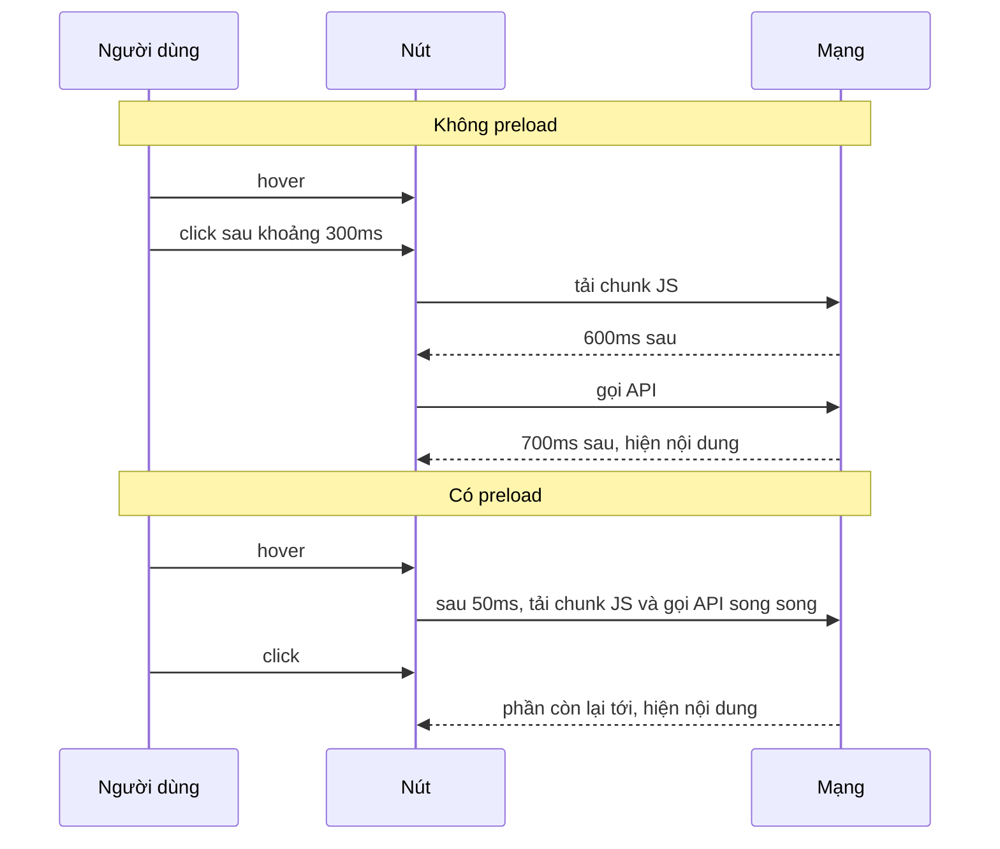

Bạn đã code-split dialog "Xem profile" bằng `React.lazy` để bundle ban đầu nhẹ hơn. Kết quả: mỗi lần bấm nút, người dùng phải chờ **tải chunk JS**, rồi component mới render, rồi mới **gọi API**, nhìn spinner gần một giây. Code-split đã đổi thời gian tải trang lấy thời gian chờ lúc tương tác.

Facebook lấy lại khoảng thời gian đó rất gọn. Từ lúc con trỏ chạm vào nút tới lúc nhả chuột click thường có **vài trăm mili-giây**: người dùng phải di chuột tới, ngắm, nhấn xuống, nhả ra. Nếu bắt đầu tải ngay khi hover, phần lớn thời gian chờ đã trôi qua trước cả khi sự kiện `click` xảy ra.

## Facebook làm thế nào?

Trong thư mục `Prerenderer/` của [facebook-codebase](https://github.com/hunghg255/facebook-codebase) có `useCometPreloaderImpl`, `useCometPrerendererImpl` và `CometMouseActivity`. Đọc kỹ thì thấy:

- **Chờ 50ms rồi mới preload.** Khi hover, hook đặt một timer `50ms` (hằng số `j = 50`). Rời chuột trước 50ms thì `clearTimeout`. Lướt chuột ngang qua một danh sách 20 nút sẽ không bắn 20 request.
- **Timer chạy ở độ ưu tiên "user blocking".** Nếu module `setTimeoutCometInternals` có sẵn, timer được đặt bằng `setTimeoutAtPriority_DO_NOT_USE(JSScheduler.priorities.unstable_UserBlocking, …)`. Không có thì quay về `setTimeout` thường. Preload là việc người dùng sắp cần nên được ưu tiên cao.
- **Kiểm tra `pointerType === "mouse"`.** Handler cho sự kiện nhấn xuống bỏ qua mọi thứ không phải chuột.
- **Nhiều mức độ ("mode").**
  - `"tooltip"`: hover đủ 50ms thì preload cả code lẫn data, đồng thời bật prerender.
  - `"button"`: hover thì preload, nhấn chuột xuống thì preload phần còn lại và bật prerender.
  - `"button_aggressive"`: như `button`, thêm một lần preload khi **chuột dừng lại** trên nút. `CometMouseActivity` dùng **một** listener `mousemove` toàn cục. Không có `mousemove` nào trong 50ms thì coi là chuột đã dừng và gọi các callback đã đăng ký.
- **Có cả đường "speculative".** Một nhánh khác nhận một giá trị boolean. Khi `true`, nó preload cả hai thứ qua `JSScheduler.scheduleSpeculativeCallback`, tức là chỉ chạy khi main thread rảnh.
- **Preload hai thứ**: code (`JSResource`, tương đương `import()`) và data (query của Relay).
- **Prerender**: render sẵn component vào cây ẩn (`shouldPrerender`), tới lúc mở thì chỉ cần hiện ra.

Còn một chi tiết nằm ở chỗ khác, trong `BootloaderResource.read` (thư mục `lazyLoadComponent/`), và nó chính là lời giải cho cái bẫy ở cuối bài:

```js
function read(ref) {
  const module = ref.getModuleIfRequireable();
  if (module == null) throw (pending[id] ??= ref.load()); // chưa có -> suspend
  return module;                                          // có rồi -> trả về ngay
}
```

(đã đổi tên biến cho dễ đọc). Module đã tải xong thì được **trả về đồng bộ**, không bao giờ suspend lần nữa.

## Dòng thời gian: không preload và có preload



Preload mang lại hai cái lợi tách bạch:

1. **Bắt đầu sớm hơn** khoảng thời gian từ hover tới click.
2. **Bỏ được thác nước (waterfall)**: không preload thì API chỉ được gọi khi component đã tải xong và render. Preload thì code và data chạy song song.

Demo bên dưới công bằng hơn tình huống thực tế: cả hai nút đều tải song song khi click, khác biệt chỉ là điểm bắt đầu.

## Viết lại

Ba thứ cần có:

1. `lazyWithPreload`: `React.lazy` kèm hàm `preload()` dùng chung một promise.
2. `createResource`: cache promise data theo key, dùng được với `use()` của React 19.
3. `usePreloadOnHover`: trả về các event handler để gắn vào nút.

```ts title=src/lib/preload.ts
import {
  createElement,
  lazy,
  useCallback,
  useEffect,
  useRef,
  type ComponentProps,
  type ComponentType,
  type PointerEvent,
} from 'react';

/**
 * Preload code + data khi người dùng có "ý định" bấm (hover, focus, nhấn xuống),
 * lấy ý tưởng từ useCometPreloader / useCometPrerenderer của Facebook.
 */

export type PreloadableComponent<T extends ComponentType<any>> = ComponentType<
  ComponentProps<T>
> & {
  preload: () => Promise<{ default: T }>;
};

/**
 * React.lazy kèm hàm `preload()` để tải trước chunk JS.
 *
 * Lưu ý: lazy() luôn suspend ở lần render đầu, kể cả khi chunk đã tải xong, và React
 * throttle việc hiện lại nội dung sau Suspense (~300ms). Vì vậy khi module đã có sẵn,
 * ta render thẳng component thật, bỏ qua lazy.
 */
export function lazyWithPreload<T extends ComponentType<any>>(
  factory: () => Promise<{ default: T }>,
): PreloadableComponent<T> {
  let promise: Promise<{ default: T }> | null = null;
  let loaded: T | null = null;
  const load = () => {
    promise ??= factory().then(
      (module) => {
        loaded = module.default;
        return module;
      },
      (error) => {
        promise = null; // lỗi mạng thì lần sau được thử lại
        throw error;
      },
    );
    return promise;
  };
  const LazyComponent = lazy(load);

  function Preloadable(props: ComponentProps<T>) {
    return createElement(loaded ?? LazyComponent, props);
  }
  return Object.assign(Preloadable, { preload: load });
}

type TrackedPromise<T> = Promise<T> & { status?: string; value?: T; reason?: unknown };

/**
 * Cache promise theo key để vừa preload được, vừa dùng được với `use()` / Suspense.
 * Gắn `status`/`value` lên promise: `use()` của React đọc 2 field này, thấy promise
 * đã xong thì trả về giá trị ngay, không suspend.
 */
export function createResource<T>(fetcher: (key: string) => Promise<T>) {
  const cache = new Map<string, Promise<T>>();
  const read = (key: string): Promise<T> => {
    let promise = cache.get(key);
    if (!promise) {
      const tracked = fetcher(key) as TrackedPromise<T>;
      tracked.status = 'pending';
      tracked.then(
        (value) => {
          tracked.status = 'fulfilled';
          tracked.value = value;
        },
        (reason) => {
          tracked.status = 'rejected';
          tracked.reason = reason;
          cache.delete(key);
        },
      );
      cache.set(key, tracked);
      promise = tracked;
    }
    return promise;
  };
  return { read, preload: (key: string) => void read(key) };
}

export interface UsePreloadOnHoverOptions {
  /** chờ bao lâu khi hover thì mới preload, để lướt chuột qua không tốn request */
  delay?: number;
}

/**
 * Trả về các event handler để gắn vào nút/link.
 * - Chuột: hover đủ `delay` ms mới preload, rời chuột trước đó thì huỷ.
 * - Cảm ứng: không có hover -> preload ngay khi ngón tay chạm xuống (trước click ~100ms).
 * - Bàn phím: preload khi focus.
 */
export function usePreloadOnHover(preload: () => void, { delay = 50 }: UsePreloadOnHoverOptions = {}) {
  const timerRef = useRef<ReturnType<typeof setTimeout> | null>(null);
  const preloadRef = useRef(preload);
  useEffect(() => {
    preloadRef.current = preload;
  });

  const cancel = useCallback(() => {
    if (timerRef.current != null) clearTimeout(timerRef.current);
    timerRef.current = null;
  }, []);

  useEffect(() => cancel, [cancel]);

  const onPointerEnter = useCallback(
    (event: PointerEvent) => {
      if (event.pointerType !== 'mouse') return;
      cancel();
      timerRef.current = setTimeout(() => {
        timerRef.current = null;
        preloadRef.current();
      }, delay);
    },
    [cancel, delay],
  );

  const onPointerDown = useCallback(() => {
    cancel();
    preloadRef.current();
  }, [cancel]);

  const onFocus = useCallback(() => preloadRef.current(), []);

  return { onPointerEnter, onPointerLeave: cancel, onPointerDown, onFocus };
}
```

### Đi qua từng đoạn

**`lazyWithPreload`**

- `promise ??= factory()…` đảm bảo dù gọi `preload()` 10 lần (hover, focus, click) thì `import()` chỉ chạy **một lần**. Thực ra trình duyệt cũng tự cache module ES theo URL, nhưng giữ promise ở đây giúp mọi nơi cùng chờ một promise và biết chính xác lúc nào module có sẵn.
- `promise = null` ở nhánh lỗi: chunk tải lỗi (mạng chập chờn, deploy mới làm chunk cũ biến mất) thì lần gọi sau được thử lại, thay vì mãi mãi trả về một promise đã reject.
- `loaded = module.default`: đây là "cửa tắt" giống `getModuleIfRequireable` của Facebook.
- `Preloadable` là một component bọc mỏng. Lần render nào cũng kiểm tra `loaded`. Có rồi thì render thẳng component thật, chưa có thì đi qua `LazyComponent` để suspend như bình thường.

**`createResource`**

- Cache **promise**, không cache giá trị. Nhờ vậy preload và render dùng chung một request đang bay.
- Gắn `status`/`value`/`reason` lên promise trong `.then`. Phần bên dưới giải thích vì sao.
- Promise reject thì bị xoá khỏi cache, để lần sau gọi lại API.

**`usePreloadOnHover`**

| Sự kiện | Khi nào xảy ra | Hành động |
| --- | --- | --- |
| `pointerenter` (chuột) | con trỏ đi vào nút | đặt timer `delay` ms, hết giờ thì preload |
| `pointerleave` | con trỏ rời nút | huỷ timer |
| `pointerdown` (mọi loại) | nhấn chuột / chạm ngón tay / bút | huỷ timer, preload ngay |
| `focus` | Tab tới nút | preload ngay |

Hàm `preload` được giữ trong `preloadRef` (pattern "latest ref"). Các handler được `useCallback` nên ổn định qua các lần render, trong khi `preload` truyền vào có thể là arrow function mới mỗi lần.

## Bên trong: vì sao preload xong vẫn phải chờ 300ms?

Bản đầu tiên của mình chỉ là `Object.assign(lazy(load), { preload: load })`. Demo đo được: preload đã xong từ lâu mà sau khi click vẫn **chờ đúng ~300ms**. Muốn hiểu thì phải nhìn vào ba cơ chế bên trong React.

### 1. `React.lazy` luôn suspend ở lần render đầu

`lazy(load)` trả về một object có `_payload` với trạng thái bắt đầu là **Uninitialized** (`_status: -1`). Lần render đầu tiên:

1. React gọi `load()` và nhận về một promise.
2. Gắn `.then()` vào promise đó, chuyển trạng thái sang **Pending** (`0`).
3. Vì đang Pending nên React **throw promise** đó, tức là suspend.

Kể cả khi promise đã resolve từ trước (vì đã preload), callback của `.then()` vẫn chạy **bất đồng bộ** ở microtask sau. Tại thời điểm render, payload vẫn là Pending nên vẫn suspend. Chỉ sau microtask đó payload mới thành **Resolved** (`1`) và lần render sau mới thành công.

Preload qua `lazy` chỉ giúp file JS đã nằm sẵn, không giúp tránh được một vòng suspend.

### 2. `use(promise)` đọc `promise.status`

`use()` của React 19 xử lý promise theo quy ước "thenable có trạng thái":

- `status === 'fulfilled'` → trả về `value` **ngay, đồng bộ**.
- `status === 'rejected'` → throw `reason` (Error Boundary sẽ bắt).
- Không có `status` → React tự gắn `status = 'pending'`, đăng ký `.then` để cập nhật, rồi suspend.

Promise trả về từ `fetch().then(...)` không có field `status`. Vì vậy dù đã resolve, lần `use()` đầu tiên trên promise đó vẫn suspend. `createResource` tự gắn `status`/`value` ngay khi promise resolve, nên khi component render sau này, `use()` thấy `'fulfilled'` và không suspend.

### 3. Suspense throttle việc hiện lại nội dung

Khi một Suspense boundary vừa hiện fallback, React không vội thay nó bằng nội dung thật ngay khi dữ liệu về. Nó đợi để lần commit nội dung cách lần hiện fallback gần nhất ít nhất `FALLBACK_THROTTLE_MS`: **300ms** ở React 19 (500ms ở React 18). Mục đích là tránh UI nháy liên tục kiểu spinner → nội dung → spinner khi nhiều thứ lần lượt về.

Gộp lại: suspend dù chỉ một microtask cũng đủ để fallback bị commit, và sau đó throttle bắt người dùng chờ thêm 300ms. Kết quả là **~300ms chờ vô ích** cho thứ đã có sẵn.

Cách sửa nằm trong code ở trên: `loaded` cho component và `status` cho data. Sau khi sửa, thời gian từ click tới lúc hiện nội dung (đã preload) giảm từ ~300ms xuống **~1ms**.

> [!TIP]
> Quy tắc chung: **đã có dữ liệu thì đừng bắt React phải suspend để biết điều đó**. Thư viện data nào hỗ trợ Suspense tốt cũng có cơ chế đọc cache đồng bộ.

## Tại sao không làm cách khác?

**Sao không preload ngay khi nút xuất hiện trong viewport?** Đó là cách `<Link>` của Next.js làm với route. Nó hợp khi trang có ít link và chunk nhỏ. Một feed có 50 bài, mỗi bài có nút "Chia sẻ", "Báo cáo", "Xem ai đã thích" mà preload hết thì tốn băng thông cho những thứ 95% không ai bấm. Hover là tín hiệu "ý định" mạnh hơn nhiều.

**Sao lại 50ms, không phải 0 hay 200ms?** Bằng 0 thì chuột lướt ngang qua cũng bắn request. 200ms thì nuốt mất gần hết khoảng thời gian từ hover tới click mà ta đang muốn tận dụng. 50ms đủ để lọc chuyển động lướt qua mà vẫn còn nguyên phần lớn thời gian chờ. Facebook dùng đúng con số 50 cho cả delay hover lẫn "chuột dừng" trong `CometMouseActivity`.

**Sao kiểm tra `pointerType === 'mouse'` cho `pointerenter`?** Trên màn hình cảm ứng, một lần chạm tạo ra cả `pointerenter` ngay trước `pointerdown`. Nếu không lọc, ta sẽ đặt timer 50ms vô nghĩa rồi lại preload thêm lần nữa ở `pointerdown`. Tách bạch rõ ràng: chuột đi đường hover, cảm ứng và bút đi đường `pointerdown`. Khoảng từ `pointerdown` tới `click` khi chạm chỉ khoảng vài chục tới hơn trăm ms, ít hơn hover nhưng vẫn là thời gian miễn phí.

> [!NOTE]
> Hook của Facebook chỉ xử lý `pointerdown` từ **chuột**. Preload ở `pointerdown` cho cả cảm ứng là phần mình thêm vào khi viết lại.

**Sao không dùng `onMouseEnter`?** Pointer Events gom chuột, cảm ứng và bút vào một API, kèm `pointerType` để phân biệt. Với mouse events, khi chạm trình duyệt còn bắn thêm các sự kiện chuột "giả lập" (compatibility mouse events) sau khi chạm, nên rất khó biết đâu là hover thật.

**Sao không dùng `onFocus` cho chuột?** Click chuột cũng làm nút nhận focus, nhưng lúc đó đã quá muộn. `onFocus` chỉ có ích cho người dùng bàn phím: họ Tab tới nút rồi mới nhấn Enter.

## Edge case và cạm bẫy

- **Cache `createResource` lớn dần mãi.** Map giữ mọi key từng được đọc. Một list 10.000 user mà hover qua hết thì có 10.000 promise nằm trong bộ nhớ, và dữ liệu cũng không bao giờ được làm mới. Bản production nên có **TTL** (hết hạn sau N phút) và/hoặc **LRU** (giữ tối đa N key). Đó là lý do nên dùng TanStack Query hay Relay thay vì tự viết: chúng có `gcTime`/`staleTime` sẵn.
- **SSR: cache dùng chung giữa các request.** `createResource` tạo cache ở module scope. Trên server, module chỉ load một lần cho mọi request, nên user A có thể đọc được data đã cache của user B. Với data phụ thuộc người dùng, phải tạo resource **theo request** (qua context) hoặc chỉ dùng ở client. `lazyWithPreload` thì không sao, vì code giống nhau cho mọi người.
- **Chunk lỗi sau khi deploy.** Người dùng mở tab từ hôm qua, bạn deploy bản mới, chunk cũ bị xoá khỏi CDN, `import()` sẽ 404. Nhánh `promise = null` cho phép thử lại, nhưng thử lại vẫn 404. Thường cần một Error Boundary hiện thông báo "Có bản cập nhật mới, tải lại trang".
- **StrictMode.** Ở dev, effect chạy hai lần (mount → unmount → mount). Hook vẫn đúng vì cleanup `useEffect(() => cancel, [cancel])` huỷ timer. Preload thì idempotent nên chạy hai lần cũng chỉ tạo một request.
- **Tiết kiệm dữ liệu.** Trên Chromium có `navigator.connection.saveData` (người dùng bật chế độ tiết kiệm dữ liệu) và `effectiveType` (`'2g'`, `'3g'`…). Nên bỏ qua preload "đầu cơ" trong các trường hợp đó:

```ts
const connection = (navigator as any).connection;
const shouldPreload = !connection?.saveData && !/2g/.test(connection?.effectiveType ?? '');
```

- **Preload thứ gây side effect.** Chỉ preload GET thuần (đọc dữ liệu, tải code). Không bao giờ "preload" một mutation, một request có ghi log "đã xem", hay một API tính phí theo lượt gọi.

## Demo

Dialog cần 1 chunk JS (giả lập 600ms) và 1 API (700ms). Cả hai nút đều tải code và data **song song** khi click. Nút thứ hai bắt đầu sớm hơn từ lúc hover. Rê chuột lên nút chừng nửa giây rồi mới bấm, rồi so sánh dòng "Hiện nội dung sau … ms". Bấm "Reset cache" để thử lại từ đầu.

<iframe class="demo-frame" src="/demos/facebook-patterns/index.html?theme=dark#/preload-on-hover" title="Demo preload-on-hover" loading="lazy" style="height: 560px"></iframe>

<p class="demo-links">▶ <a href="/demos/facebook-patterns/index.html#/preload-on-hover" target="_blank" rel="noopener">Mở demo toàn màn hình ↗</a> · <a href="https://stackblitz.com/github/hunghg255/blog-hunghg/tree/master/examples/facebook-patterns?file=src/lib/preload.ts" target="_blank" rel="noopener">Sửa code trên StackBlitz ↗</a> · <a href="https://github.com/hunghg255/blog-hunghg/blob/master/examples/facebook-patterns/src/lib/preload.ts" target="_blank" rel="noopener">Xem source trên GitHub ↗</a></p>

## Kiểm thử

Ví dụ test bằng Vitest (không có trong repo, chỉ minh hoạ cách test các phần không cần trình duyệt):

```ts title=preload.test.ts
import { describe, expect, it, vi } from 'vitest';
import { createResource, lazyWithPreload } from './preload';

describe('lazyWithPreload', () => {
  it('chỉ gọi factory một lần dù preload nhiều lần', async () => {
    const factory = vi.fn(async () => ({ default: () => null }));
    const C = lazyWithPreload(factory);
    await Promise.all([C.preload(), C.preload(), C.preload()]);
    expect(factory).toHaveBeenCalledTimes(1);
  });

  it('cho thử lại sau khi lỗi', async () => {
    const factory = vi
      .fn()
      .mockRejectedValueOnce(new Error('chunk 404'))
      .mockResolvedValueOnce({ default: () => null });
    const C = lazyWithPreload(factory);
    await expect(C.preload()).rejects.toThrow('chunk 404');
    await expect(C.preload()).resolves.toBeTruthy();
    expect(factory).toHaveBeenCalledTimes(2);
  });
});

describe('createResource', () => {
  it('gắn status để use() đọc đồng bộ', async () => {
    const user = createResource(async (id) => ({ id }));
    const promise = user.read('42') as Promise<{ id: string }> & { status?: string };
    expect(promise.status).toBe('pending');
    await promise;
    expect(promise.status).toBe('fulfilled');
    expect(user.read('42')).toBe(promise); // cùng một promise
  });
});
```

Với `usePreloadOnHover`, test bằng Playwright trên trình duyệt thật là đáng tin nhất (`page.hover()`, rồi kiểm tra request đã được gửi bằng `page.waitForRequest`). jsdom hỗ trợ Pointer Events không đầy đủ.

## Dùng trong dự án

Kỹ thuật này hữu ích nhất cho:

- **Dialog, drawer, popover nặng** (rich text editor, picker, bảng chọn emoji…) đã tách chunk.
- **Data cho trang chi tiết**: hover vào một item trong list thì gọi `queryClient.prefetchQuery(...)` (TanStack Query) với đúng query key mà trang chi tiết sẽ dùng.

```tsx
const handlers = usePreloadOnHover(() => {
  void EmojiPicker.preload();
  queryClient.prefetchQuery({ queryKey: ['user', id], queryFn: () => getUser(id) });
});

<button {...handlers} onClick={open}>😀</button>;
```

So với những gì có sẵn trong hệ sinh thái:

- **Next.js `<Link>`** ở bản production tự prefetch route khi link lọt vào viewport, và cũng prefetch khi hover. Hook này dùng cho những thứ **không phải route**: dialog, popover, tab.
- **React Router / Remix** có `<Link prefetch="intent">`, cùng ý tưởng: prefetch khi hover hoặc focus.
- **TanStack Query** có `prefetchQuery`, chỉ lo phần data. Bạn vẫn phải tự quyết định *khi nào* gọi nó, và hook trong bài trả lời câu hỏi đó.

> [!NOTE]
> Đừng preload thứ quá nặng (video, file lớn) chỉ vì hover. Hover không đồng nghĩa với chắc chắn click. Preload hợp nhất với thứ nhỏ, cache được và gần như chắc chắn sẽ dùng.

---

**Series "Học từ mã nguồn Facebook"**

- [Mở đầu: cách đọc code minify của Facebook](/blogs/learn-from-facebook-source-code)
- [#1 Dùng chung IntersectionObserver + infinite scroll](/blogs/facebook-shared-intersection-observer)
- [#2 useViewportDuration: đo thời gian thực sự được xem](/blogs/facebook-use-viewport-duration)
- **#3 Preload code + data khi hover** (bài này)
- [#4 Toast manager với external store](/blogs/facebook-toast-manager)
- [#5 Network status + heartbeat backoff](/blogs/facebook-network-status-heartbeat)
- [#6 ErrorGuard: bắt lỗi theo ngữ cảnh](/blogs/facebook-error-guard)
- [#7 Banzai: gom log theo lô + sendBeacon](/blogs/facebook-batch-logger)
- [#8 Focus trap + Esc theo layer](/blogs/facebook-focus-trap)

Code + demo: [`examples/facebook-patterns`](https://github.com/hunghg255/blog-hunghg/tree/master/examples/facebook-patterns) · [Mở trên StackBlitz](https://stackblitz.com/github/hunghg255/blog-hunghg/tree/master/examples/facebook-patterns)
