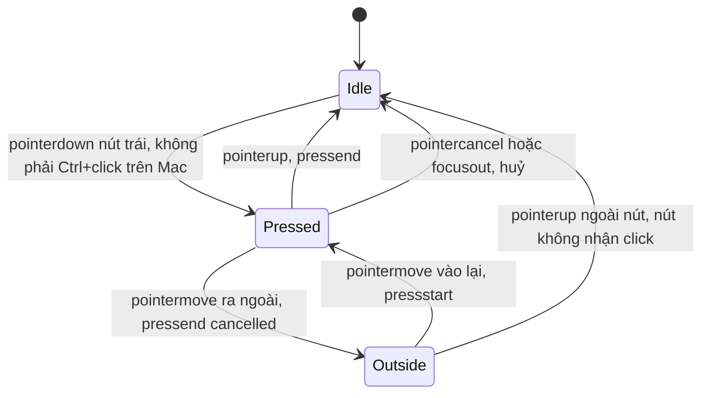
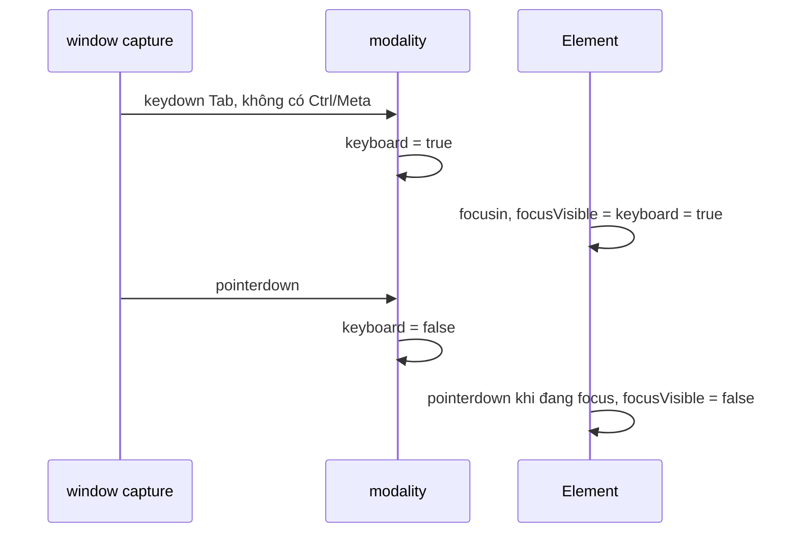

Trên Facebook, gần như mọi thứ đều bấm được: nút Thích, tên người dùng, cả card bài viết, từng ảnh trong album, từng item trong menu. Nếu mỗi chỗ tự viết `<div onClick>` với `:hover` và `:active` thì sẽ gặp những lỗi rất quen:

- Trên điện thoại, chạm vào nút xong, nút **giữ nguyên màu hover** tới khi chạm chỗ khác.
- Click chuột vào nút cũng hiện **vòng focus** (focus ring). Designer bảo "bỏ outline đi", thế là người dùng bàn phím không biết mình đang ở đâu.
- Nhấn giữ nút, đổi ý kéo ngón tay ra ngoài: nút vẫn sáng như đang nhấn, hoặc tệ hơn vẫn kích hoạt.
- Card bài viết bấm được, nút "Thích" bên trong cũng bấm được. Bấm "Thích" thì **cả card cũng mở ra**.
- Link điều hướng nội bộ dùng `preventDefault` để không tải lại trang, và vô tình làm hỏng Ctrl+click / Cmd+click để mở tab mới.
- `<div role="button">` không phản ứng với phím Enter, Space.

> [!TIP]
> **Tóm tắt**
> - Tách **trạng thái hiển thị** (hover, pressed, focus-visible: lấy từ pointer/focus) khỏi **hành động** (`onPress`: chỉ gắn vào `click`, nên bàn phím và trình đọc màn hình cũng kích hoạt được).
> - Focus-visible = "tương tác gần nhất là bàn phím", theo dõi bằng vài listener capture gắn một lần trên `window`.
> - Kéo ra ngoài thì huỷ nhấn. Trên cảm ứng phải so toạ độ với rect lúc bắt đầu nhấn, vì `target` luôn là phần tử ban đầu.
> - Lồng nhau: đánh dấu "đã xử lý" lên chính event thay vì `stopPropagation`, để listener ở `document` vẫn nhận được.
> - Dự án thật nên dùng `<button>` + `:focus-visible` cho nút đơn giản, và react-aria khi cần primitive đầy đủ.

## Facebook làm thế nào?

### 1. `Pressability`: ghép 4 hook

Module `Pressability` chỉ có một hàm `usePressability(ref, options)` gọi lần lượt:

```js
useHover(a, { disabled, onHoverChange, onHoverEnd, onHoverMove, onHoverStart });
usePress(a, { disabled, onPressChange, onPressEnd, onPressMove, onPressStart });
useFocus(a, { disabled, onBlur, onFocus, onFocusChange, onFocusVisibleChange });
useContextMenu(a, { disabled, onContextMenu, preventDefault: c || !1 });
```

Mỗi hook gắn listener **thẳng vào DOM node** qua `ReactUseEvent`, một lớp bọc mỏng quanh API thử nghiệm `ReactDOM.unstable_createEventHandle` của React. Không dùng `onPointerDown={…}` của JSX: hook cần nghe cả sự kiện trên `document` (pointermove, pointerup khi đang nhấn) và cần tắt/bật listener theo trạng thái.

### 2. Kiểu tương tác (modality) toàn cục: bàn phím hay con trỏ?

Trong `ReactFocusEvent`, một biến module `j` lưu "tương tác gần nhất là bàn phím". Listener được gắn **một lần** trên `window`, pha capture, passive:

```js
h = hasPointerEvents ? ["keydown","pointermove","pointerdown","pointerup"]
                     : ["keydown","mousedown","mousemove","mouseup","touchmove","touchstart","touchend"];
```

- `keydown` mà **không** kèm Meta, Ctrl (và Alt trên Windows/Linux) thì `j = true`. Cmd+Tab để đổi app không phải "đi bằng bàn phím trong trang".
- Mọi sự kiện con trỏ thì `j = false`, trừ khi target là `<html>` (chuột lướt ở vùng ngoài nội dung).
- Giá trị khởi đầu là `true`: focus đầu tiên của trang (autofocus) chưa có thao tác nào, coi như bàn phím.

Khi một element nhận focus, `isFocusVisible = j`. Đang focus mà người dùng bấm phím thì chuyển sang visible, **trừ khi** đang gõ trong `INPUT`, `TEXTAREA` hay `contentEditable` (Tab và Esc vẫn tính). Đang focus mà bấm chuột thì tắt.

Định nghĩa này gần giống heuristic của `:focus-visible` trong trình duyệt, với một khác biệt: trình duyệt **luôn** coi ô nhập chữ là focus-visible kể cả khi click chuột vào (vì người dùng cần thấy con trỏ gõ), còn modality của Facebook thì không. Có lẽ Facebook tự viết vì code này có từ trước khi `:focus-visible` phổ biến, và vì họ cần **giá trị trong JS** (React state) để đổi cả style của overlay, không chỉ outline.

### 3. `usePress`: nhấn, kéo ra, kéo vào

Đọc `ReactPressEvent.react` thấy:

- **Bỏ qua** chuột phải (`buttons === 2`), các nút phụ (`buttons > 4`) và **Ctrl+click trên Mac** (trên Mac đó là chuột phải). Chuột giữa được ghi lại `buttons = 4`.
- `pointerdown` trên element thì bắt đầu nhấn, rồi gắn `pointermove`/`pointerup`/`pointercancel` lên **`document`**. Nhả chuột ở bất kỳ đâu cũng được ghi nhận.
- Khi di chuyển:
  - Chuột: còn bên trong nếu `element.contains(event.target)`.
  - Cảm ứng/bút: lưu `getBoundingClientRect()` **lúc bắt đầu nhấn**, rồi so `clientX/clientY` với rect đó.
  - Ra ngoài thì "press end" (không còn pressed), vào lại thì "press start" lần nữa.
- `focusout` khỏi element trong lúc đang nhấn (một `alert()` bật lên, chuyển tab) thì huỷ.

### 4. `useHover`: không có hover trên cảm ứng

`ReactHoverEvent` nghe `pointerover` nhưng bỏ qua `pointerType === "touch"`. Trên trình duyệt không có Pointer Events, nó đánh dấu `isTouched` khi `touchstart` để bỏ qua `mouseover` giả lập sau đó. Đây chính là lỗi "hover bị dính" trên điện thoại: sau khi chạm, trình duyệt bắn một chuỗi `mouseover`/`mousemove` giả lập để tương thích với web cũ, và `:hover` giữ nguyên tới lần chạm sau.

Hover lồng nhau được tách ranh giới bằng cờ `_hoverEventTarget` trên DOM node: đi vào một vùng hover con thì hover của cha kết thúc.

### 5. Chặn lan truyền theo **từng loại** hook

`ReactEventHookPropagation` chỉ có hai hàm:

```js
function stopEventHookPropagation(a, b) { var c = a._stopEventHookPropagation; c || (c = a._stopEventHookPropagation = {}); c[b] = !0 }
function hasEventHookPropagationStopped(a, b) { a = a._stopEventHookPropagation; return a !== void 0 && a[b] }
```

Mỗi hook đánh dấu lên **chính đối tượng event** rằng "usePress đã xử lý". Pressable cha thấy cờ thì bỏ qua. Kết quả: bấm nút "Thích" trong card thì chỉ nút Thích có trạng thái pressed. Không gọi `stopPropagation()` thật nên các listener khác của app (analytics, đóng popover…) vẫn nhận sự kiện `pointerdown`.

### 6. `Pressable`: role, phím, link, và state là hàm

Trong `Pressable.react`:

- **Role quyết định thẻ HTML**: `link` → `<a>`, `navigation` → `<nav>`, `article` → `<article>`, `heading` → thẻ heading với cấp lấy từ context (`BaseHeadingContext`)…, còn lại là `<div>`. Viết `<Pressable accessibilityRole="link">` là có `<a href>` thật.
- **Bàn phím**: phần tử có `tabIndex === 0` mà **không phải** nút/link/input gốc thì Enter kích hoạt, Space kích hoạt với các role `button`, `checkbox`, `menuitem`, `option`, `radio`, `switch`… (và `preventDefault` để Space không cuộn trang).
- **Click vào link**:

  ```js
  function n(a, b) { var c = a.altKey || a.ctrlKey || a.metaKey || a.shiftKey; return b !== !1 && isInsideLink(a.target) && !c }
  // onClick: O && O(a); (O || D != null) && a.stopPropagation(); n(a, U) && a.nativeEvent.preventDefault()
  ```

  Click thường: gọi `onPress` (router của app tự chuyển trang), rồi `preventDefault` để trình duyệt không tải lại. Có Ctrl/Cmd/Shift/Alt: **không** `preventDefault`, trình duyệt tự mở tab mới, cửa sổ mới hoặc tải xuống như mọi link bình thường.

  Để ý vế giữa: ở `onClick`, Facebook **có** gọi `stopPropagation()` thật (khi có `onPress` hoặc link). Cờ theo từng hook ở mục 5 chỉ dùng cho press/hover/focus; còn click thì Facebook vẫn chặn lan truyền. Bản viết lại đi xa hơn một bước ở chỗ này (xem "Khác bản gốc").
- **Kích hoạt bằng `click`, không bằng `pointerup`.** `usePress` chỉ lo trạng thái *hiển thị* (pressed). Hành động `onPress` gắn vào `onClick`. Trình duyệt bắn `click` cả khi người dùng kích hoạt bằng bàn phím hay trình đọc màn hình, nên không phải tự lo những đường đó.
- **State là hàm**: `children`, `className`, `style`, `xstyle` đều có thể là `(state) => …` với `state = { disabled, focusVisible, focused, hovered, pressed }`.
- **Disabled**: `tabIndex = -1`, không gắn `onClick`/`onKeyDown`, có `aria-disabled`.

### 7. Overlay nhớ trạng thái cuối

`CometPressableOverlay` là lớp phủ màu khi hover/pressed/focus. Nó lưu trạng thái **cuối cùng** vào state ngay trong render:

```js
j ? o !== "pressed" && n("pressed") : c ? o !== "focused" && n("focused") : d && (o !== "hovered" && n("hovered"));
```

Khi hết hover, opacity của overlay mờ dần về 0, nhưng **màu** vẫn là màu của trạng thái trước đó. Không lưu thì giữa lúc mờ dần, overlay đổi màu đột ngột (vì không còn trạng thái nào). Overlay còn nhận `offset` âm để vùng sáng **to hơn** nút (nút icon tròn 20px có vùng sáng 36px).

> [!NOTE]
> Nguồn trong [facebook-codebase](https://github.com/hunghg255/facebook-codebase): thư mục `Pressable/`, `CometPressable/`, `CometPressableOverlay/`, `ReactEvents/`, `TetraButton/ReactPressEvent.js`, `FocusRegion/ReactFocusEvent.react.js`. Cách tiếp cận rất giống react-aria của Adobe.

## Bên trong trình duyệt

**Pointer capture ngầm trên cảm ứng.** Với `pointerType` là `touch`, trình duyệt tự "bắt" con trỏ vào element nhận `pointerdown` (implicit pointer capture). Mọi `pointermove` sau đó đều có `target` là element ban đầu, **kể cả khi ngón tay đã trượt ra xa**. Vì vậy `element.contains(event.target)` luôn đúng với cảm ứng và không dùng để phát hiện "kéo ra ngoài" được. Facebook lưu rect lúc bắt đầu và so toạ độ. Lưu rect một lần, không đo lại mỗi lần move, cũng tránh được việc ép trình duyệt tính layout liên tục (layout thrashing).

**Chuỗi sự kiện khi chạm.** Một cú chạm trên mobile bắn `pointerdown` → `touchstart` → `pointerup` → `touchend` → rồi các sự kiện chuột giả lập `mouseover` → `mousemove` → `mousedown` → `mouseup` → `click`. Các sự kiện chuột giả lập là nguyên nhân gây hover dính. Lọc theo `pointerType` ngay ở `pointerover` là cách gọn nhất.

**`click` bắn ở đâu?** Nhấn xuống ở phần tử A, nhả ở phần tử B: trình duyệt bắn `click` trên **tổ tiên chung gần nhất** của A và B (theo Pointer Events/UI Events hiện đại). Nhấn "Thích" rồi kéo sang thân card mới nhả thì nút Thích **không** nhận click, nhưng card (tổ tiên chung) thì **có**. Đây là lý do press-out chỉ lo phần hiển thị; còn ai nhận hành động là do `click` quyết định.

**`focusin`/`focusout` thay vì `focus`/`blur`.** `focus` và `blur` không nổi bọt, `focusin`/`focusout` thì có. Hook kiểm tra `event.target === element` để chỉ phản ứng với focus vào **chính** element, không phải con của nó.





## Viết lại

Hai file: các hook trong `pressable.ts`, component trong `pressableComponent.tsx`. Dưới đây là ba đoạn cốt lõi; toàn bộ file nằm trong các mục thu gọn.

**Modality toàn cục**: 4 listener gắn một lần, pha capture để chạy trước mọi handler khác (kể cả handler gọi `stopPropagation`). Hàm được gọi lười từ `useFocus`, nên trang không dùng Pressable thì không có listener nào.

```ts title=src/lib/pressable.ts
// ---------------- Focus modality (bàn phím hay con trỏ?) ----------------

/**
 * true = tương tác gần nhất là bàn phím. Mặc định true: focus đầu tiên của trang
 * (vd: autofocus) chưa có thao tác nào nên coi như bàn phím, giống Facebook.
 */
let keyboardModality = true;
let modalityListenersInstalled = false;

/** Phím "thật": bỏ qua tổ hợp Cmd/Ctrl (và Alt trên Windows/Linux) như Cmd+Tab đổi app. */
function isPlainKey(e: KeyboardEvent) {
  return !(e.metaKey || (!isMac && e.altKey) || e.ctrlKey);
}

function onModalityEvent(e: Event) {
  if (e.type === 'keydown') {
    if (isPlainKey(e as KeyboardEvent)) keyboardModality = true;
    return;
  }
  // pointermove trên <html> (chuột lướt ngoài nội dung) không tính
  if ((e.target as Element | null)?.nodeName === 'HTML') return;
  keyboardModality = false;
}

/** Gắn listener toàn cục MỘT lần, ở pha capture để chạy trước mọi handler khác. */
export function installModalityListeners() {
  if (modalityListenersInstalled || typeof window === 'undefined') return;
  modalityListenersInstalled = true;
  for (const type of ['keydown', 'pointermove', 'pointerdown', 'pointerup']) {
    window.addEventListener(type, onModalityEvent, { capture: true, passive: true });
  }
}

export function isKeyboardModality() {
  return keyboardModality;
}

/** Gõ chữ trong ô nhập không có nghĩa là người dùng đang "đi bằng bàn phím". */
function isTypingKey(e: KeyboardEvent) {
  if (e.key === 'Tab' || e.key === 'Escape') return false;
  const target = e.target as HTMLElement;
  return target.tagName === 'INPUT' || target.tagName === 'TEXTAREA' || target.isContentEditable;
}
```

**Nhấn, kéo ra, kéo vào** trong `usePress`. `pointermove`/`pointerup`/`pointercancel` chỉ được gắn lên `document` **khi bắt đầu nhấn** và gỡ khi kết thúc, nên lúc bình thường không có listener `pointermove` nào chạy:

```ts title=src/lib/pressable.ts
    const onDown = (e: PointerEvent) => {
      if (opts.current.disabled) return;
      if (isHandled(e, 'press')) return;
      markHandled(e, 'press');
      // chuột phải, nút phụ, và Ctrl+click trên Mac (= chuột phải) không phải "bấm"
      if (e.buttons === 2 || e.buttons > 4 || (isMac && e.pointerType === 'mouse' && e.ctrlKey)) return;
      state.active = true;
      state.pointerId = e.pointerId;
      state.pointerType = e.pointerType || 'mouse';
      // Cảm ứng/bút có "implicit pointer capture": mọi pointermove đều có target là element
      // ban đầu, nên không dùng target để biết ngón tay đã trượt ra ngoài được. Lưu rect lại.
      if (state.pointerType !== 'mouse') state.bounds = el.getBoundingClientRect();
      start(state.pointerType);
      document.addEventListener('pointermove', onMove, { passive: true });
      document.addEventListener('pointerup', onUp, { passive: true });
      document.addEventListener('pointercancel', onCancel, { passive: true });
    };

    const onMove = (e: PointerEvent) => {
      if (!state.active || e.pointerId !== state.pointerId) return;
      let inside: boolean;
      if (state.pointerType === 'mouse') {
        inside = el.contains(e.target as Node);
      } else {
        const b = state.bounds!;
        inside = e.clientX >= b.left && e.clientX <= b.right && e.clientY >= b.top && e.clientY <= b.bottom;
      }
      // trượt ra -> nhả (press out); trượt vào lại -> nhấn lại (press in)
      if (inside) start(state.pointerType);
      else end(true);
    };
    const onUp = (e: PointerEvent) => {
      if (e.pointerId === state.pointerId) stop(false);
    };
    const onCancel = () => stop(true);
```

**Click, phím và vòng Tab** trong `Pressable`:

```tsx title=src/lib/pressableComponent.tsx
  const ref = useRef<HTMLElement>(null);
  const state = usePressability(ref, { disabled, onPressStart, onPressEnd });
  const tag = role ? (ROLE_TO_TAG[role] ?? 'div') : link ? 'a' : 'div';
  const isLink = tag === 'a' && !disabled;
  // Chỉ thứ bấm được mới vào vòng Tab: role tương tác, hoặc có onPress/link. Thẻ <a href>
  // tự focus được, không cần tabIndex. nav/article/list… chỉ là container -> không tabIndex.
  const focusable = !!onPress || !!link || (role != null && INTERACTIVE_ROLES.has(role));
  const tabIndex = disabled ? -1 : focusable && !(isLink && link?.url) ? 0 : undefined;

  const onClick = (e: MouseEvent) => {
    // Pressable lồng nhau: cái trong cùng đã xử lý thì cái ngoài bỏ qua. Không stopPropagation:
    // event vẫn nổi lên document cho outside-click (bài #12), analytics…
    if (isHandled(e.nativeEvent, 'click')) return;
    if (!onPress) return; // không có hành vi riêng: link thường cứ để trình duyệt điều hướng
    markHandled(e.nativeEvent, 'click');
    const modified = e.altKey || e.ctrlKey || e.metaKey || e.shiftKey;
    if (isLink && modified) return; // Ctrl/Cmd/Shift/Alt+click: trình duyệt mở tab mới / tải xuống
    // Link + click thường: app tự điều hướng (client-side)
    if (isLink) e.preventDefault();
    onPress(e);
  };

  const onKeyDown = (e: KeyboardEvent) => {
    const el = e.target as HTMLElement;
    if (el !== ref.current || el.tabIndex < 0 || isNativelyActivatable(el)) return;
    const isSpace = e.key === ' ' || e.key === 'Spacebar';
    if (e.key === 'Enter' || (isSpace && SPACE_ROLES.has(el.getAttribute('role') ?? ''))) {
      if (isSpace) e.preventDefault(); // Space mặc định cuộn trang
      if (onPress && !isHandled(e.nativeEvent, 'click')) {
        markHandled(e.nativeEvent, 'click');
        onPress(e);
      }
    }
  };
```

::: spoiler Xem toàn bộ src/lib/pressable.ts

```ts title=src/lib/pressable.ts
import { useEffect, useLayoutEffect, useRef, useState, type RefObject } from 'react';

/**
 * Các "interaction hook" cho nút/link: hover, press, focus, focus-visible.
 * Ý tưởng từ ReactHoverEvent / ReactPressEvent / ReactFocusEvent / Pressability của Facebook.
 */

// navigator.platform đã deprecated; ưu tiên userAgentData (Chromium), fallback về platform.
const platform =
  typeof navigator === 'undefined'
    ? ''
    : ((navigator as Navigator & { userAgentData?: { platform?: string } }).userAgentData?.platform ??
      navigator.platform);
const isMac = /Mac|iPhone|iPad|macOS/i.test(platform);

// ---------------- Focus modality (bàn phím hay con trỏ?) ----------------

/**
 * true = tương tác gần nhất là bàn phím. Mặc định true: focus đầu tiên của trang
 * (vd: autofocus) chưa có thao tác nào nên coi như bàn phím, giống Facebook.
 */
let keyboardModality = true;
let modalityListenersInstalled = false;

/** Phím "thật": bỏ qua tổ hợp Cmd/Ctrl (và Alt trên Windows/Linux) như Cmd+Tab đổi app. */
function isPlainKey(e: KeyboardEvent) {
  return !(e.metaKey || (!isMac && e.altKey) || e.ctrlKey);
}

function onModalityEvent(e: Event) {
  if (e.type === 'keydown') {
    if (isPlainKey(e as KeyboardEvent)) keyboardModality = true;
    return;
  }
  // pointermove trên <html> (chuột lướt ngoài nội dung) không tính
  if ((e.target as Element | null)?.nodeName === 'HTML') return;
  keyboardModality = false;
}

/** Gắn listener toàn cục MỘT lần, ở pha capture để chạy trước mọi handler khác. */
export function installModalityListeners() {
  if (modalityListenersInstalled || typeof window === 'undefined') return;
  modalityListenersInstalled = true;
  for (const type of ['keydown', 'pointermove', 'pointerdown', 'pointerup']) {
    window.addEventListener(type, onModalityEvent, { capture: true, passive: true });
  }
}

export function isKeyboardModality() {
  return keyboardModality;
}

/** Gõ chữ trong ô nhập không có nghĩa là người dùng đang "đi bằng bàn phím". */
function isTypingKey(e: KeyboardEvent) {
  if (e.key === 'Tab' || e.key === 'Escape') return false;
  const target = e.target as HTMLElement;
  return target.tagName === 'INPUT' || target.tagName === 'TEXTAREA' || target.isContentEditable;
}

// ---------------- Chặn lan truyền theo TỪNG LOẠI hook ----------------

/**
 * Pressable lồng nhau (card bấm được chứa nút "Thích"): chỉ phần tử TRONG CÙNG nhận press/click.
 * Không gọi stopPropagation thật (sẽ phá handler khác của app, vd outside-click) mà đánh dấu
 * lên event: mỗi loại ("press", "click") có cờ riêng. Hover thì không chặn: cha vẫn hover.
 */
const HANDLED = Symbol('interactionHandled');
type MarkedEvent = Event & { [HANDLED]?: Record<string, true> };

export function isHandled(e: Event, hook: string) {
  return (e as MarkedEvent)[HANDLED]?.[hook] === true;
}
export function markHandled(e: Event, hook: string) {
  const marked = e as MarkedEvent;
  (marked[HANDLED] ??= {})[hook] = true;
}

function useLatest<T>(value: T) {
  const ref = useRef(value);
  useLayoutEffect(() => {
    ref.current = value;
  });
  return ref;
}

// ---------------- usePress ----------------

export interface PressEvent {
  type: 'pressstart' | 'pressend' | 'pressmove';
  pointerType: string;
  /** true nếu pressend vì con trỏ trượt ra ngoài / bị huỷ, không phải nhả bên trong */
  cancelled?: boolean;
}

export interface UsePressOptions {
  disabled?: boolean;
  onPressStart?: (e: PressEvent) => void;
  onPressEnd?: (e: PressEvent) => void;
  onPressChange?: (pressed: boolean) => void;
}

export function usePress(ref: RefObject<HTMLElement | null>, options: UsePressOptions) {
  const opts = useLatest(options);

  useEffect(() => {
    const el = ref.current;
    if (!el) return;
    const state = {
      pressed: false,
      active: false,
      pointerId: -1,
      pointerType: '',
      bounds: null as DOMRect | null,
    };

    const start = (pointerType: string) => {
      if (state.pressed) return;
      state.pressed = true;
      opts.current.onPressStart?.({ type: 'pressstart', pointerType });
      opts.current.onPressChange?.(true);
    };
    const end = (cancelled: boolean) => {
      if (!state.pressed) return;
      state.pressed = false;
      opts.current.onPressEnd?.({ type: 'pressend', pointerType: state.pointerType, cancelled });
      opts.current.onPressChange?.(false);
    };
    const stop = (cancelled: boolean) => {
      state.active = false;
      state.bounds = null;
      end(cancelled);
      document.removeEventListener('pointermove', onMove);
      document.removeEventListener('pointerup', onUp);
      document.removeEventListener('pointercancel', onCancel);
    };

    const onDown = (e: PointerEvent) => {
      if (opts.current.disabled) return;
      if (isHandled(e, 'press')) return;
      markHandled(e, 'press');
      // chuột phải, nút phụ, và Ctrl+click trên Mac (= chuột phải) không phải "bấm"
      if (e.buttons === 2 || e.buttons > 4 || (isMac && e.pointerType === 'mouse' && e.ctrlKey)) return;
      state.active = true;
      state.pointerId = e.pointerId;
      state.pointerType = e.pointerType || 'mouse';
      // Cảm ứng/bút có "implicit pointer capture": mọi pointermove đều có target là element
      // ban đầu, nên không dùng target để biết ngón tay đã trượt ra ngoài được. Lưu rect lại.
      if (state.pointerType !== 'mouse') state.bounds = el.getBoundingClientRect();
      start(state.pointerType);
      document.addEventListener('pointermove', onMove, { passive: true });
      document.addEventListener('pointerup', onUp, { passive: true });
      document.addEventListener('pointercancel', onCancel, { passive: true });
    };

    const onMove = (e: PointerEvent) => {
      if (!state.active || e.pointerId !== state.pointerId) return;
      let inside: boolean;
      if (state.pointerType === 'mouse') {
        inside = el.contains(e.target as Node);
      } else {
        const b = state.bounds!;
        inside = e.clientX >= b.left && e.clientX <= b.right && e.clientY >= b.top && e.clientY <= b.bottom;
      }
      // trượt ra -> nhả (press out); trượt vào lại -> nhấn lại (press in)
      if (inside) start(state.pointerType);
      else end(true);
    };
    const onUp = (e: PointerEvent) => {
      if (e.pointerId === state.pointerId) stop(false);
    };
    const onCancel = () => stop(true);
    // mất focus giữa chừng (alert(), chuyển tab…) -> huỷ
    const onFocusOut = (e: FocusEvent) => {
      if (e.target === el && state.active) stop(true);
    };

    el.addEventListener('pointerdown', onDown);
    el.addEventListener('focusout', onFocusOut);
    return () => {
      el.removeEventListener('pointerdown', onDown);
      el.removeEventListener('focusout', onFocusOut);
      stop(true);
    };
  }, [ref, opts]);
}

// ---------------- useHover ----------------

export function useHover(
  ref: RefObject<HTMLElement | null>,
  { disabled, onHoverChange }: { disabled?: boolean; onHoverChange?: (hovered: boolean) => void },
) {
  const onChange = useLatest(onHoverChange);
  const disabledRef = useLatest(disabled);

  useEffect(() => {
    const el = ref.current;
    if (!el) return;
    let hovered = false;
    const set = (next: boolean) => {
      if (hovered === next) return;
      hovered = next;
      onChange.current?.(next);
    };
    const onOver = (e: PointerEvent) => {
      // Cảm ứng không có hover: chạm xong, trình duyệt giả lập mouseover và "hover" bị dính
      // lại tới khi chạm chỗ khác. Bỏ qua hẳn pointerType touch.
      if (e.pointerType === 'touch' || disabledRef.current) return;
      // Không đánh dấu "đã xử lý" ở đây: cha vẫn hover khi chuột ở trong con, giống CSS :hover,
      // và không phụ thuộc chuột đi vào card trước hay đi thẳng vào nút con.
      set(true);
    };
    const onOut = (e: PointerEvent) => {
      const to = e.relatedTarget as Node | null;
      if (to && el.contains(to)) return; // chỉ đi sang con của chính nó
      set(false);
    };
    el.addEventListener('pointerover', onOver);
    el.addEventListener('pointerout', onOut);
    return () => {
      el.removeEventListener('pointerover', onOver);
      el.removeEventListener('pointerout', onOut);
      set(false);
    };
  }, [ref, onChange, disabledRef]);
}

// ---------------- useFocus (+ focus-visible) ----------------

export function useFocus(
  ref: RefObject<HTMLElement | null>,
  {
    onFocusChange,
    onFocusVisibleChange,
  }: { onFocusChange?: (f: boolean) => void; onFocusVisibleChange?: (f: boolean) => void },
) {
  const cbs = useLatest({ onFocusChange, onFocusVisibleChange });

  useEffect(() => {
    installModalityListeners();
    const el = ref.current;
    if (!el) return;
    let focused = false;
    let focusVisible = false;
    const setVisible = (next: boolean) => {
      if (focusVisible === next) return;
      focusVisible = next;
      cbs.current.onFocusVisibleChange?.(next);
    };
    const onFocusIn = (e: FocusEvent) => {
      if (e.target !== el || focused) return; // chỉ focus vào CHÍNH element, không phải con
      focused = true;
      cbs.current.onFocusChange?.(true);
      setVisible(keyboardModality);
    };
    const onFocusOut = (e: FocusEvent) => {
      if (e.target !== el || !focused) return;
      focused = false;
      cbs.current.onFocusChange?.(false);
      setVisible(false);
    };
    // Đang focus bằng chuột rồi bấm phím -> chuyển sang hiện focus ring; bấm chuột -> tắt.
    const onKeyDown = (e: KeyboardEvent) => {
      if (focused && isPlainKey(e) && !isTypingKey(e)) setVisible(true);
    };
    const onPointerDown = () => {
      if (focused) setVisible(false);
    };
    el.addEventListener('focusin', onFocusIn);
    el.addEventListener('focusout', onFocusOut);
    el.addEventListener('keydown', onKeyDown);
    el.addEventListener('pointerdown', onPointerDown);
    return () => {
      el.removeEventListener('focusin', onFocusIn);
      el.removeEventListener('focusout', onFocusOut);
      el.removeEventListener('keydown', onKeyDown);
      el.removeEventListener('pointerdown', onPointerDown);
    };
  }, [ref, cbs]);
}

// ---------------- Gộp lại: usePressability ----------------

export interface InteractionState {
  hovered: boolean;
  pressed: boolean;
  focused: boolean;
  focusVisible: boolean;
  disabled: boolean;
}

export function usePressability(
  ref: RefObject<HTMLElement | null>,
  { disabled = false, ...press }: UsePressOptions & { disabled?: boolean },
): InteractionState {
  const [hovered, setHovered] = useState(false);
  const [pressed, setPressed] = useState(false);
  const [focused, setFocused] = useState(false);
  const [focusVisible, setFocusVisible] = useState(false);
  useHover(ref, { disabled, onHoverChange: setHovered });
  usePress(ref, {
    ...press,
    disabled,
    onPressChange: (p) => {
      setPressed(p);
      press.onPressChange?.(p);
    },
  });
  useFocus(ref, { onFocusChange: setFocused, onFocusVisibleChange: setFocusVisible });
  return { hovered: hovered && !disabled, pressed, focused, focusVisible, disabled };
}
```

:::

::: spoiler Xem toàn bộ src/lib/pressableComponent.tsx

```tsx title=src/lib/pressableComponent.tsx
import {
  createElement,
  useRef,
  type CSSProperties,
  type KeyboardEvent,
  type MouseEvent,
  type ReactNode,
} from 'react';
import {
  isHandled,
  markHandled,
  usePressability,
  type InteractionState,
  type PressEvent,
} from './pressable';

/**
 * <Pressable>: một primitive cho mọi thứ "bấm được" (theo Pressable.react của Facebook).
 * - role quyết định thẻ HTML (link -> <a>, navigation -> <nav>…), mặc định <div>.
 * - Enter (mọi role) / Space (button, checkbox, menuitem…) kích hoạt phần tử không phải nút gốc.
 * - Link CÓ onPress: click thường -> preventDefault để app tự điều hướng; Ctrl/Cmd/Shift/Alt+click
 *   -> để trình duyệt tự mở tab mới / cửa sổ mới / tải xuống. Link KHÔNG có onPress: để yên.
 * - Lồng nhau: chỉ Pressable trong cùng nhận onPress, nhờ cờ "đã xử lý" gắn lên event thay vì
 *   stopPropagation (để listener ở document như outside-click vẫn nhận được click).
 * - children / className / style có thể là hàm nhận trạng thái tương tác.
 */

const ROLE_TO_TAG: Record<string, string> = {
  article: 'article',
  banner: 'header',
  complementary: 'aside',
  contentinfo: 'footer',
  figure: 'figure',
  form: 'form',
  // Facebook lấy cấp heading từ context (BaseHeadingContext); bản rút gọn này cố định h2.
  heading: 'h2',
  label: 'label',
  link: 'a',
  list: 'ul',
  listitem: 'li',
  main: 'main',
  navigation: 'nav',
  none: 'div',
  region: 'section',
};

/** Role "làm được gì đó": được vào vòng Tab. Container (nav, article, list…) thì không. */
const INTERACTIVE_ROLES = new Set([
  'button',
  'link',
  'checkbox',
  'menuitem',
  'menuitemcheckbox',
  'menuitemradio',
  'option',
  'radio',
  'switch',
  'tab',
]);

const SPACE_ROLES = new Set([
  'button',
  'checkbox',
  'menuitem',
  'menuitemcheckbox',
  'menuitemradio',
  'option',
  'radio',
  'switch',
]);

type StateFn<T> = T | ((state: InteractionState) => T);
const resolve = <T,>(value: StateFn<T>, state: InteractionState): T =>
  typeof value === 'function' ? (value as (s: InteractionState) => T)(state) : value;

export interface PressableProps {
  role?: string;
  link?: { url: string; target?: string; rel?: string };
  onPress?: (e: MouseEvent | KeyboardEvent) => void;
  onPressStart?: (e: PressEvent) => void;
  onPressEnd?: (e: PressEvent) => void;
  disabled?: boolean;
  label?: string;
  className?: StateFn<string | undefined>;
  style?: StateFn<CSSProperties | undefined>;
  children?: StateFn<ReactNode>;
}

/** Bản thân phần tử đã tự xử lý Enter/Space (nút gốc, ô nhập, link có href…) thì để yên. */
function isNativelyActivatable(el: HTMLElement) {
  return (
    el.isContentEditable ||
    (el.tagName === 'A' && (el as HTMLAnchorElement).hasAttribute('href')) ||
    ['BUTTON', 'INPUT', 'SELECT', 'TEXTAREA'].includes(el.tagName)
  );
}

export function Pressable({
  role,
  link,
  onPress,
  onPressStart,
  onPressEnd,
  disabled = false,
  label,
  className,
  style,
  children,
}: PressableProps) {
  const ref = useRef<HTMLElement>(null);
  const state = usePressability(ref, { disabled, onPressStart, onPressEnd });
  const tag = role ? (ROLE_TO_TAG[role] ?? 'div') : link ? 'a' : 'div';
  const isLink = tag === 'a' && !disabled;
  // Chỉ thứ bấm được mới vào vòng Tab: role tương tác, hoặc có onPress/link. Thẻ <a href>
  // tự focus được, không cần tabIndex. nav/article/list… chỉ là container -> không tabIndex.
  const focusable = !!onPress || !!link || (role != null && INTERACTIVE_ROLES.has(role));
  const tabIndex = disabled ? -1 : focusable && !(isLink && link?.url) ? 0 : undefined;

  const onClick = (e: MouseEvent) => {
    // Pressable lồng nhau: cái trong cùng đã xử lý thì cái ngoài bỏ qua. Không stopPropagation:
    // event vẫn nổi lên document cho outside-click (bài #12), analytics…
    if (isHandled(e.nativeEvent, 'click')) return;
    if (!onPress) return; // không có hành vi riêng: link thường cứ để trình duyệt điều hướng
    markHandled(e.nativeEvent, 'click');
    const modified = e.altKey || e.ctrlKey || e.metaKey || e.shiftKey;
    if (isLink && modified) return; // Ctrl/Cmd/Shift/Alt+click: trình duyệt mở tab mới / tải xuống
    // Link + click thường: app tự điều hướng (client-side)
    if (isLink) e.preventDefault();
    onPress(e);
  };

  const onKeyDown = (e: KeyboardEvent) => {
    const el = e.target as HTMLElement;
    if (el !== ref.current || el.tabIndex < 0 || isNativelyActivatable(el)) return;
    const isSpace = e.key === ' ' || e.key === 'Spacebar';
    if (e.key === 'Enter' || (isSpace && SPACE_ROLES.has(el.getAttribute('role') ?? ''))) {
      if (isSpace) e.preventDefault(); // Space mặc định cuộn trang
      if (onPress && !isHandled(e.nativeEvent, 'click')) {
        markHandled(e.nativeEvent, 'click');
        onPress(e);
      }
    }
  };

  return createElement(
    tag,
    {
      ref,
      role: role === 'none' ? 'presentation' : role === 'label' ? undefined : role,
      'aria-label': label,
      'aria-disabled': disabled || undefined,
      tabIndex,
      href: isLink ? link?.url : undefined,
      target: isLink ? link?.target : undefined,
      rel: isLink ? link?.rel : undefined,
      onClick: disabled ? undefined : onClick,
      onKeyDown: disabled ? undefined : onKeyDown,
      className: resolve(className, state),
      // tự quản lý vòng focus qua state.focusVisible, tắt outline mặc định khi không cần
      style: { outline: state.focusVisible ? undefined : 'none', ...resolve(style, state) },
      'data-hovered': state.hovered || undefined,
      'data-pressed': state.pressed || undefined,
      'data-focus-visible': state.focusVisible || undefined,
    },
    resolve(children, state),
  );
}

/**
 * Lớp phủ hover/pressed/focus (giống CometPressableOverlay): NHỚ trạng thái cuối cùng để khi
 * mờ dần (opacity -> 0) màu không bị nhảy sang màu khác giữa chừng.
 */
export function PressableOverlay({ state, offset = 0 }: { state: InteractionState; offset?: number }) {
  const last = useRef<'pressed' | 'focused' | 'hovered' | null>(null);
  if (state.pressed) last.current = 'pressed';
  else if (state.focusVisible) last.current = 'focused';
  else if (state.hovered) last.current = 'hovered';
  const visible = state.pressed || state.focusVisible || state.hovered;
  return (
    <span
      aria-hidden
      className={`pressable-overlay is-${last.current ?? 'none'}${visible ? ' is-visible' : ''}`}
      // offset âm: vùng highlight to hơn nút (nút icon tròn nhỏ)
      style={{ inset: -offset }}
    />
  );
}
```

:::

**Khác bản gốc:**

- **Click không `stopPropagation`.** Facebook gọi `stopPropagation()` thật trong `onClick`. Với React 17+, việc đó chặn luôn event gốc, nên listener `click` ở `document` (như `useOutsideClick` của [bài #12](/blogs/facebook-popover-tooltip)) không nhận được click trên Pressable. Bản viết lại dùng cùng kiểu cờ của mục 5 cho click (`markHandled(e.nativeEvent, 'click')`): Pressable cha bỏ qua, còn mọi listener khác vẫn nhận event.
- **Link không có `onPress` được để yên.** Chỉ khi có `onPress` (app tự điều hướng) thì click thường mới bị `preventDefault`. Link thuần `link={{ url }}` điều hướng như thẻ `<a>` bình thường.
- **Chỉ thứ bấm được mới vào vòng Tab.** Role tương tác (button, link, menuitem, checkbox…) hoặc có `onPress`/`link` thì `tabIndex = 0`; `nav`, `article`, `list`… chỉ là container thì không. `<a href>` vốn focus được nên không cần `tabIndex`.
- **Heading cố định `h2`.** Facebook lấy cấp heading từ context; bản rút gọn bỏ phần này.
- **Hover lồng nhau giống CSS `:hover`.** Cha vẫn hover khi chuột ở trong con, bất kể chuột đi vào card trước hay đi thẳng vào nút con. Facebook thì kết thúc hover của cha khi vào vùng hover con.
- **Cờ `cancelled`** trong `onPressEnd` cho biết lần nhả là "nhả bên trong" hay "kéo ra ngoài". Facebook không có cờ này; demo dùng nó để ghi log.
- **Chỉ Pointer Events**, bỏ nhánh fallback `mousedown`/`touchstart` vì mọi trình duyệt hiện đại đã hỗ trợ.

## Đi qua code

**`markHandled` / `isHandled`** dùng một `Symbol` thay vì thuộc tính `_stopEventHookPropagation` như Facebook để không đụng tên với code khác. Ý tưởng giữ nguyên: mỗi loại một cờ ("press", "click").

**`usePress`**: hàm `end(cancelled)` gọi `onPressEnd` với cờ `cancelled`; `start()` gọi lại khi con trỏ quay vào. Nhả (`pointerup`) hay huỷ (`pointercancel`, `focusout`) đều đi qua `stop()` để gỡ listener trên `document`.

**`useFocus`** giữ `focused` và `focusVisible` trong biến cục bộ của effect, chỉ báo ra ngoài khi đổi. Không có setState thừa.

**`usePressability`** gộp 3 hook thành một object trạng thái, và `Pressable` đưa object đó cho `className`/`style`/`children` nếu chúng là hàm.

**`Pressable.onKeyDown`** bỏ qua nếu `target` không phải chính element, hoặc là phần tử đã tự xử lý Enter/Space (`<button>`, `<a href>`, ô nhập). Bấm Enter trên `<button>` thì trình duyệt đã tự bắn `click`. Xử lý thêm sẽ gọi `onPress` hai lần.

**`PressableOverlay`** lưu trạng thái cuối vào một `ref` ngay trong render. React khuyên không đọc/ghi ref trong render; ở đây chấp nhận được vì giá trị chỉ phụ thuộc props hiện tại và việc ghi là idempotent (StrictMode render hai lần vẫn ra cùng kết quả), nhưng lint của React Compiler có thể cảnh báo. Muốn "sạch" thì chuyển sang `useState` + cập nhật trong render như Facebook.

## Tại sao không làm cách khác?

**"Dùng `<button>` và CSS `:hover :active :focus-visible` là đủ?"** Với nút đơn giản thì đúng, và đó là lựa chọn nên ưu tiên. Pressable cần khi: (1) phần tử không thể là `<button>` (card chứa nút khác, vì `<button>` không được chứa phần tử tương tác bên trong), (2) cần trạng thái trong JS (đổi icon khi pressed, overlay có offset), (3) cần press-out trên cảm ứng nhất quán giữa các trình duyệt (iOS Safari từ lâu nổi tiếng không áp `:active` nếu trang không có listener `touchstart`).

**"Gọi `onPress` ở `pointerup` cho nhanh?"** Mất kích hoạt bằng bàn phím và trình đọc màn hình (chúng bắn `click`, không bắn pointer), và phải tự xử lý nhả trên phần tử khác. Facebook tách rõ: pointer cho **trạng thái hiển thị**, `click` cho **hành động**.

**"`stopPropagation` thật cho Pressable lồng nhau?"** Phá các listener ở `document` của thư viện khác (click ra ngoài để đóng popover, analytics). Cờ trên event chỉ ảnh hưởng hệ thống Pressable.

**"Bỏ outline đi, dùng `:focus` thôi?"** Vòng focus khi click chuột là lý do mọi người xoá outline, và đó là một trong những lỗi accessibility phổ biến nhất. Focus-visible giải quyết đúng gốc: chỉ hiện khi người dùng thật sự cần.

## Edge case và cạm bẫy

- **Thiết bị lai.** Laptop màn hình cảm ứng: người dùng chạm rồi gõ phím. Modality đổi theo từng sự kiện nên vẫn đúng. Đừng quyết định "đây là thiết bị cảm ứng" một lần lúc tải trang.
- **Kéo để cuộn.** Trên cảm ứng, đặt ngón tay lên nút rồi vuốt để cuộn trang: trình duyệt bắn `pointercancel` khi nó quyết định đây là thao tác cuộn. Hook phải coi `pointercancel` là huỷ, nếu không nút giữ trạng thái pressed mãi.
- **`touch-action`.** Nếu đặt `touch-action: none` cho nút, trình duyệt không cuộn nữa và cũng không bắn `pointercancel`. Đừng đặt trừ khi đó là thanh trượt hay vùng kéo thả.
- **Nhấn con, nhả ở cha.** Nhấn "Thích", kéo sang thân card rồi nhả: nút Thích không nhận click, nhưng **card** nhận (tổ tiên chung). Nếu điều này không mong muốn, card có thể bỏ qua click khi `pointerdown` gần nhất bắt đầu trong một Pressable con.
- **Link không có `href`.** `<a>` thiếu `href` không được trình đọc màn hình coi là link. Pressable chỉ đặt `href` khi có `link.url`; không có url thì Pressable tự thêm `tabIndex=0` để phần tử vẫn focus được. Muốn "trông như link nhưng không điều hướng" thì dùng `role="button"`.
- **Middle click.** Click chuột giữa trên link bắn sự kiện `auxclick`, không phải `click`, và trình duyệt tự mở tab mới. Không cần xử lý gì, miễn là có `href` thật.
- **`disabled` mà vẫn cần tooltip.** `<button disabled>` không nhận click, và tuỳ trình duyệt có thể không nhận cả các sự kiện chuột khác, nên tooltip "Bạn không có quyền…" có thể không hiện. Pressable dùng `aria-disabled` + bỏ `onClick`/`onKeyDown` nên phần tử vẫn nhận sự kiện DOM, nhưng cả bản của Facebook lẫn bản viết lại đều tắt trạng thái hover khi disabled. Muốn tooltip cho nút disabled, bọc tooltip ở bên ngoài Pressable.
- **Space trên `<div role="button">`.** Phải `preventDefault`, nếu không trang cuộn xuống một màn hình.

## Demo

<iframe class="demo-frame" src="/demos/facebook-patterns/index.html?theme=dark#/pressable" title="Demo pressable" loading="lazy" style="height: 720px"></iframe>

<p class="demo-links">▶ <a href="/demos/facebook-patterns/index.html#/pressable" target="_blank" rel="noopener">Mở demo toàn màn hình ↗</a> · <a href="https://stackblitz.com/github/hunghg255/blog-hunghg/tree/master/examples/facebook-patterns?file=src/lib/pressable.ts" target="_blank" rel="noopener">Sửa code trên StackBlitz ↗</a> · <a href="https://github.com/hunghg255/blog-hunghg/blob/master/examples/facebook-patterns/src/lib/pressable.ts" target="_blank" rel="noopener">Xem source trên GitHub ↗</a></p>

Thử:

- Nhấn giữ "Đăng bài", kéo chuột ra ngoài rồi nhả: log ghi `pressend — huỷ` và không có `onPress`.
- Click chuột vào nút: badge `focused` sáng nhưng `focusVisible` không. Bấm Tab: cả hai sáng, có vòng focus.
- Click link: điều hướng nội bộ. Ctrl+click (Cmd+click trên Mac): tab mới mở ra.
- "Link thường (không onPress)": Pressable không chặn gì, trình duyệt tự mở link trong tab mới.
- Bấm "Thích" trong card: chỉ số Thích tăng, card không mở.
- Trên điện thoại: chạm nút xong, badge `hovered` không bị dính.

## Dùng trong dự án

```tsx
<Pressable
  role='link'
  link={{ url: `/profile/${user.id}` }}
  onPress={() => router.push(`/profile/${user.id}`)}
  className={({ pressed }) => (pressed ? 'scale-95' : undefined)}
>
  {(state) => (
    <>
      <PressableOverlay state={state} offset={4} />
      <Avatar user={user} />
    </>
  )}
</Pressable>
```

Router của bạn (Next.js `<Link>`, React Router `<Link>`) thường đã tự xử lý Ctrl/Cmd+click đúng cách. Phần đáng học ở đây là các hook trạng thái và cách chúng phối hợp, áp dụng được cho mọi component tự viết.

## Kiểm thử

::: spoiler Ví dụ test (bản phác, không có trong repo)

Ví dụ với Playwright, `baseURL` trỏ tới `/demos/facebook-patterns/index.html`:

```ts
import { expect, test } from '@playwright/test';

test('kéo ra ngoài thì không kích hoạt', async ({ page }) => {
  await page.goto('#/pressable');
  const btn = page.locator('.pr-btn').first();
  const box = (await btn.boundingBox())!;
  await page.mouse.move(box.x + 10, box.y + 10);
  await page.mouse.down();
  await page.mouse.move(box.x + 10, box.y + 200, { steps: 5 });
  await expect(btn).not.toHaveAttribute('data-pressed');
  await page.mouse.up();
  await expect(page.locator('.log')).not.toContainText('onPress: Đăng bài');
});

test('Ctrl/Cmd+click link mở tab mới', async ({ page, context }) => {
  await page.goto('#/pressable');
  const [popup] = await Promise.all([
    context.waitForEvent('page'),
    page.locator('.pr-link').click({ modifiers: ['ControlOrMeta'] }),
  ]);
  expect(popup).toBeTruthy();
});

test('click chuột không hiện focus ring, Tab thì có', async ({ page }) => {
  await page.goto('#/pressable');
  const btn = page.locator('.pr-btn').first();
  await btn.click();
  await expect(btn).not.toHaveAttribute('data-focus-visible');
  await page.keyboard.press('Shift+Tab');
  await page.keyboard.press('Tab');
  await expect(btn).toHaveAttribute('data-focus-visible');
});
```

Cảm ứng: tạo context với `hasTouch: true` rồi dùng CDP `Input.dispatchTouchEvent` (`touchStart`, `touchMove`, `touchEnd`) để mô phỏng ngón tay trượt ra ngoài.

:::

## So với thư viện và chuẩn web

- **`:focus-visible`** đã có ở mọi trình duyệt hiện đại, với heuristic gần giống modality của Facebook (khác ở ô nhập chữ, xem mục 2). Chỉ cần style thì dùng nó. Cần giá trị trong JS thì `element.matches(':focus-visible')` (bài [#12](/blogs/facebook-popover-tooltip) dùng cách này cho tooltip).
- **react-aria** (`usePress`, `useHover`, `useFocusRing`, `useInteractionModality` trong `@react-aria/interactions`) là bản trưởng thành nhất của cùng ý tưởng: press-out, hover không dính trên cảm ứng, focus-visible toàn cục, nested press. Nếu dự án cần primitive bấm được ở mức production, dùng thẳng react-aria thay vì tự viết.
- **`@media (hover: hover)`** cho phép chỉ áp `:hover` trên thiết bị có hover thật. Đây là cách sửa lỗi hover dính chỉ bằng CSS, nhưng không xử lý được thiết bị lai (vừa chuột vừa cảm ứng).
- **Pointer Events** đã có ở mọi trình duyệt, nên nhánh fallback `mousedown`/`touchstart` trong code Facebook giờ chỉ còn ý nghĩa lịch sử.

---

Bài này thuộc series **[Học từ mã nguồn Facebook](/series/facebook)** (38 bài, đọc theo thứ tự).

::: spoiler Xem nhanh danh sách bài trong series

*Phần 1*

- [Mở đầu: cách đọc code minify của Facebook](/blogs/learn-from-facebook-source-code)
- [#1 Dùng chung IntersectionObserver + infinite scroll](/blogs/facebook-shared-intersection-observer)
- [#2 useViewportDuration: đo thời gian thực sự được xem](/blogs/facebook-use-viewport-duration)
- [#3 Preload code + data khi hover](/blogs/facebook-preload-on-hover)
- [#4 Toast manager với external store](/blogs/facebook-toast-manager)
- [#5 Network status + heartbeat backoff](/blogs/facebook-network-status-heartbeat)
- [#6 ErrorGuard: bắt lỗi theo ngữ cảnh](/blogs/facebook-error-guard)
- [#7 Banzai: gom log theo lô + sendBeacon](/blogs/facebook-batch-logger)
- [#8 Focus trap + Esc theo layer](/blogs/facebook-focus-trap)

*Phần 2*

- [#9 Mẹo calc(… * 9999): container query, line-clamp, mũi tên carousel bằng CSS](/blogs/facebook-css-9999-trick)
- [#10 Thanh cuộn tuỳ biến bằng CSS 3D](/blogs/facebook-css-3d-scrollbar)
- [#11 Modal cuộn bằng window, giữ vị trí trang nền](/blogs/facebook-document-scroll-modal)
- [#12 Popover, tooltip group và hovercard](/blogs/facebook-popover-tooltip)
- **#13 Primitive Pressable + focus-visible** (bài này)
- [#14 Tab "Xem thêm" + sticky header bằng IntersectionObserver](/blogs/facebook-priority-tabs-sticky-header)
- [#15 Avatar khoét mask, gradient Messenger, skeleton steps()](/blogs/facebook-visual-tricks)
- [#16 Khung chat không giật](/blogs/facebook-chat-scroller)
- [#17 Thuật toán chọn bố cục collage ảnh](/blogs/facebook-photo-collage-layout)
- [#18 Keep-alive tab trong SPA](/blogs/facebook-keep-alive-tabs)
- [#19 Tự đo Visual Completion & interaction tracing](/blogs/facebook-visual-completion)
- [#20 Router SPA bền bỉ & tải chunk có retry](/blogs/facebook-spa-router-resilient-loading)

*Phần 3*

- [#21 Smart Compose: gợi ý chữ mờ khi gõ](/blogs/facebook-smart-compose-ghost-text)
- [#22 MQTT ngay trong trình duyệt, tự chuyển sang long-poll](/blogs/facebook-mqtt-in-browser)
- [#23 Đo thời gian dùng bằng bitmap 64 giây](/blogs/facebook-time-spent-bitmap)
- [#24 Bảng reaction nhấn giữ rồi trượt](/blogs/facebook-reaction-press-slide)
- [#25 Tìm kiếm gấp dấu, phiên âm và highlight đầu từ](/blogs/facebook-search-diacritics-tokenize)
- [#26 Ring buffer biết trace nào đã mất log](/blogs/facebook-trace-ring-buffer)
- [#27 Engine animation JS: một vòng rAF và solver cubic-bezier](/blogs/facebook-keyframes-loop-cubic-bezier)
- [#28 Bootloader: bitmap tài nguyên đã tải, chỉ reload khi cần](/blogs/facebook-bootloader-bitmap-consistency)
- [#29 Nhận biết click do screen reader tạo ra](/blogs/facebook-virtual-cursor-detection)
- [#30 Tải trước feed theo chất lượng mạng, đoán hạng thiết bị](/blogs/facebook-network-aware-prefetch)
- [#31 Hàng đợi gửi tin chat giữ đúng thứ tự](/blogs/facebook-ordered-send-queue)
- [#32 Gộp lời gọi API trong cùng một tick](/blogs/facebook-api-batcher)
- [#33 Resize ảnh trong pool Web Worker](/blogs/facebook-jpeg-resize-worker-pool)
- [#34 Crop ảnh theo nhiều khuôn mặt](/blogs/facebook-face-aware-crop)
- [#35 Kéo-thả sắp xếp và vùng thả file không nhấp nháy](/blogs/facebook-flicker-free-drag-drop)
- [#36 Tiện ích UI: fade-out, sticky event, hàm huỷ được](/blogs/facebook-ui-utility-hooks)
- [#37 Hạ tầng nhỏ: cookie, hash lỗi, prefetch khi chuột dừng](/blogs/facebook-small-infra-cookie-hash-idle)

:::

Code + demo: [`examples/facebook-patterns`](https://github.com/hunghg255/blog-hunghg/tree/master/examples/facebook-patterns) · [Mở trên StackBlitz](https://stackblitz.com/github/hunghg255/blog-hunghg/tree/master/examples/facebook-patterns)
