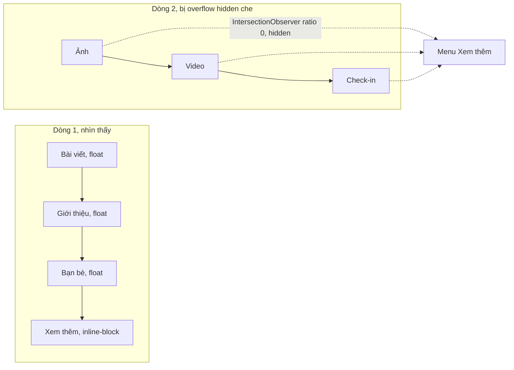
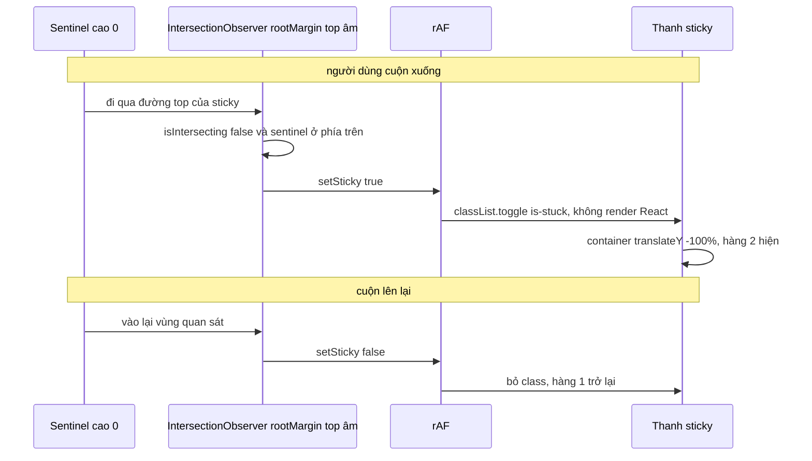

Mở trang cá nhân trên Facebook rồi thu hẹp cửa sổ. Thanh tab "Bài viết · Giới thiệu · Bạn bè · Ảnh · Video · Check-in…" không xuống dòng, không bị cắt chữ: tab nào không vừa thì biến mất, và một nút **"Xem thêm ▾"** đứng ngay sau tab cuối còn vừa, chứa các tab bị ẩn. Cuộn xuống, khi thanh tab chạm mép trên, nó trượt sang dạng gọn: avatar nhỏ + tên, bấm vào thì cuộn lên đầu.

Cả hai thứ này thường được làm bằng JS đo đạc:

- Tab: đo chiều rộng từng tab, cộng dồn, so với chiều rộng thanh, nghe `resize`. Tính lại khi font tải xong, khi đổi ngôn ngữ, khi nội dung tab đổi…
- Sticky: nghe `scroll`, so `getBoundingClientRect().top` với 0 ở mỗi frame cuộn, `setState` khi đổi.

Facebook làm cả hai mà gần như không đo gì. Code nằm trong `17.Tabs/` (`CometTabs`, `CometTab`), `0 000A/BaseStickyHeader/` và `4.TetraishEntityStickyHeader/` (`CometEntityHeaderStickyBar`) của [facebook-codebase](https://github.com/hunghg255/facebook-codebase).

> [!TIP]
> **Tóm tắt**
> - Tab là `float`, nút "Xem thêm" là `inline-block` đứng **trước** chúng trong DOM, thanh cao một dòng với `overflow: hidden`. Trình duyệt tự đẩy tab không vừa xuống dòng hai (bị che) và đặt nút ngay sau tab cuối còn vừa.
> - IntersectionObserver (root là thanh tab) chỉ **báo** tab nào đã bị che để đưa vào menu và tắt focus của nó.
> - Sticky header: một sentinel cao 0 đặt ngay trước thanh, observer với `rootMargin` top âm báo lúc thanh bắt đầu dính; đổi class trong `requestAnimationFrame`, không render lại React.
> - Hôm nay có thêm scroll-state container queries (`@container scroll-state(stuck: top)`) cho phần sticky, khi trình duyệt mục tiêu hỗ trợ.

## Phần 1: thanh tab "priority+"

### Facebook làm thế nào?

Style của `CometTabs` (đã dịch class atomic sang CSS thật):

```js
root:        { height: "60px", overflowX: "hidden", overflowY: "hidden", position: "relative" }
tab:         { display: "inline-flex", float: "left", height: "60px", verticalAlign: "top" }
moreWrapper: { display: "inline-block", height: "60px", position: "relative", verticalAlign: "top" }
```

Thứ tự trong DOM của vùng chứa tab là: **nút "Xem thêm" trước**, rồi mới tới danh sách tab:

```js
children: [jsx(CometDeferredPopoverTrigger, { …, children: renderMoreTab }), x.map(tab => jsx(CometTab, { …, onHidden }))]
```

Mỗi `CometTab` tự gắn một IntersectionObserver với **root là thanh tab** và `threshold: .5`:

```js
v = useCallback(function (a) {
  var c = a.intersectionRatio;
  JSScheduler.runWithPriority(UserBlocking, function () { var a = c < .5; x(a); onHiddenRef.current && onHiddenRef.current(a) })
}, []);
useIntersectionObserver(v, { root: () => containerRef.current, threshold: .5 });
```

Tab bị che quá nửa thì báo `onHidden(true)`. Cha (`CometTabs`) giữ một mảng index tab đang ẩn, **luôn sắp xếp tăng dần** (hàm thêm `[...a, b].sort()`, hàm bỏ `a.filter(x => x !== b)`), và đưa các tab đó vào menu "Xem thêm" (tải lười bằng `requireDeferred("CometTabMenu.react")`). Tab bị ẩn nhận `aria-hidden`, `disabled`, `focusable: false`. Nút "Xem thêm" có `selected` nếu tab đang được chọn là một tab bị ẩn.

Bàn phím: `CometFocusGroup` với `orientation: "horizontal"`, `wrap: true`, `preventScrollOnFocus: true`, kiểu roving focus (mũi tên đi giữa các tab, chỉ một tab nằm trong thứ tự Tab). Trên nút "Xem thêm", phím **↓** mở menu (`CometKeys.DOWN`).

### Bên trong: vì sao float + inline-block lại tự xếp đúng?

Đây là phần thông minh nhất, và hoàn toàn là CSS 2.1:

1. Nút "Xem thêm" là **inline** content (inline-block) nằm trên dòng đầu tiên.
2. Các tab là **float** xuất hiện **sau** nó trong DOM. Một float được đặt lên dòng hiện tại nếu còn đủ chỗ **bên cạnh nội dung inline đã có trên dòng**. Đặt được thì dòng đó bị "rút ngắn" lại, và nội dung inline (nút "Xem thêm") bị đẩy sang phải, ngay sau float.
3. Float tiếp theo không còn đủ chỗ (vì phải chừa chỗ cho nút "Xem thêm") thì bị đẩy **xuống dòng dưới**.
4. Thanh tab cao đúng một dòng và `overflow: hidden`, nên dòng thứ hai bị che.
5. Một quy tắc của float giữ đúng **thứ tự**: đỉnh của một float không được cao hơn đỉnh của float đứng trước nó. Khi tab thứ k đã rơi xuống dòng hai, mọi tab sau cũng ở dòng hai, kể cả tab ngắn đáng lẽ còn vừa chỗ trống trên dòng một. Nhờ vậy các tab hiện luôn là một **đoạn đầu** liên tục của danh sách.

Kết quả: trên dòng đầu luôn là "các tab vừa + nút Xem thêm ngay sau tab cuối", và trình duyệt tự tính lại mỗi khi bố cục đổi (resize, font tải xong, đổi ngôn ngữ) mà không có dòng JS nào đo đạc. IntersectionObserver chỉ có nhiệm vụ **báo** tab nào đã rơi xuống dòng hai (tỉ lệ hiển thị 0) để đưa vào menu và tắt khả năng focus của nó.



Vì sao threshold **0.5** chứ không phải 0? Trong bố cục float, một tab hoặc nằm trọn trên dòng một, hoặc rơi hẳn xuống dòng hai (ratio 0), nên ngưỡng nào cũng cho cùng kết quả. Có lẽ (suy đoán) 0.5 là để phòng thủ cho trường hợp hiếm: thanh hẹp hơn cả một tab, khi đó tab đầu tiên bị cắt dở ở cạnh phải mà không rơi xuống được.

Một chi tiết ở `CometTab`: callback của observer bọc trong `runWithPriority(UserBlocking)`. Cập nhật ẩn/hiện tab là thứ người dùng đang nhìn khi kéo cửa sổ, nên được ưu tiên hơn các cập nhật nền.

### Viết lại

Bản viết lại dùng **một** IntersectionObserver cho cả thanh tab (thay vì mỗi tab một cái như `CometTab`). Cùng root và cùng threshold nên kết quả như nhau, và một observer theo dõi 8 element rẻ hơn 8 observer theo dõi 8 element ([bài #1](/blogs/facebook-shared-intersection-observer) nói kỹ về chuyện này).

Phần observer:

```tsx title=src/lib/priorityTabs.tsx
  useEffect(() => {
    const container = containerRef.current;
    if (!container) return;
    const observer = new IntersectionObserver(
      (entries) => {
        setHidden((prev) => {
          let next = prev;
          for (const entry of entries) {
            const index = Number((entry.target as HTMLElement).dataset.index);
            const isHidden = entry.intersectionRatio < 0.5;
            if (isHidden && !next.includes(index)) next = [...next, index].sort((a, b) => a - b);
            if (!isHidden && next.includes(index)) next = next.filter((i) => i !== index);
          }
          return next;
        });
      },
      { root: container, threshold: 0.5 },
    );
    tabRefs.current.forEach((el) => observer.observe(el));
    return () => observer.disconnect();
  }, [tabs]);
```

Và khung JSX: vùng chứa, rồi nút "Xem thêm" bọc trong một `inline-block`, đứng **trước** danh sách tab:

```tsx title=src/lib/priorityTabs.tsx
  return (
    <>
      <div
        ref={containerRef}
        role='tablist'
        className={className}
        onKeyDown={onKeyDown}
        style={{ height, overflow: 'hidden', position: 'relative' }}
        // trình duyệt vẫn có thể tự cuộn vùng overflow:hidden (vd: Ctrl+F); kéo về 0
        onScroll={(e) => {
          e.currentTarget.scrollTop = 0;
          e.currentTarget.scrollLeft = 0;
        }}
      >
        {/* (2) inline-block, đứng trước các float trong DOM */}
        <span style={{ display: 'inline-block', height, verticalAlign: 'top', visibility: hasHidden ? 'visible' : 'hidden' }}>
          <button
            ref={moreRef}
            type='button'
            role='tab'
            data-ptab
            data-order={tabs.length}
            aria-haspopup='menu'
            aria-expanded={menuOpen}
            aria-selected={selectedHidden}
            aria-hidden={!hasHidden || undefined}
            tabIndex={selectedHidden ? 0 : -1}
            className={`${className}-tab ${className}-more${selectedHidden ? ' is-selected' : ''}`}
            style={{ height }}
            onClick={() => setMenuOpen((o) => !o)}
            onKeyDown={(e) => {
              if (e.key === 'ArrowDown') {
                e.preventDefault();
                setMenuOpen(true);
              }
            }}
          >
            {moreLabel} ▾
          </button>
        </span>
```

::: spoiler Xem toàn bộ src/lib/priorityTabs.tsx (thêm danh sách tab và menu "Xem thêm")

```tsx title=src/lib/priorityTabs.tsx
import {
  useEffect,
  useLayoutEffect,
  useRef,
  useState,
  type KeyboardEvent,
  type ReactNode,
  type RefObject,
} from 'react';
import { createPortal } from 'react-dom';
import { useContextualLayer, useOutsideClick } from './contextualLayer';

/**
 * Thanh tab "priority+": tab nào không đủ chỗ thì tự chui vào menu "Xem thêm".
 * Theo CometTabs / CometTab của Facebook, KHÔNG đo chiều rộng bằng JS:
 * 1. Thanh tab có chiều cao cố định + overflow: hidden.
 * 2. Nút "Xem thêm" là inline-block đứng TRƯỚC các tab trong DOM, các tab thì float.
 *    Float được xếp vào dòng đầu chỉ khi còn đủ chỗ CẠNH nút "Xem thêm"; không đủ thì rơi
 *    xuống dòng 2 (bị overflow che). Nút "Xem thêm" tự trôi tới ngay sau tab cuối còn vừa.
 * 3. Mỗi tab có IntersectionObserver (root = thanh tab, threshold 0.5): bị che quá nửa -> ẩn.
 */

export interface TabItem {
  key: string;
  label: ReactNode;
}

export interface PriorityTabsProps {
  tabs: TabItem[];
  selectedKey: string;
  onSelect: (key: string) => void;
  height?: number;
  moreLabel?: ReactNode;
  className?: string;
  /** báo ra ngoài danh sách tab đang bị ẩn (để debug/demo) */
  onHiddenChange?: (hiddenKeys: string[]) => void;
}

export function PriorityTabs({
  tabs,
  selectedKey,
  onSelect,
  height = 44,
  moreLabel = 'Xem thêm',
  className = 'ptabs',
  onHiddenChange,
}: PriorityTabsProps) {
  const containerRef = useRef<HTMLDivElement>(null);
  const moreRef = useRef<HTMLButtonElement>(null);
  const tabRefs = useRef(new Map<string, HTMLButtonElement>());
  // index các tab đang bị ẩn, luôn sắp xếp tăng dần (giống hàm add/remove của CometTabs)
  const [hidden, setHidden] = useState<number[]>([]);
  const [menuOpen, setMenuOpen] = useState(false);

  useEffect(() => {
    const container = containerRef.current;
    if (!container) return;
    const observer = new IntersectionObserver(
      (entries) => {
        setHidden((prev) => {
          let next = prev;
          for (const entry of entries) {
            const index = Number((entry.target as HTMLElement).dataset.index);
            const isHidden = entry.intersectionRatio < 0.5;
            if (isHidden && !next.includes(index)) next = [...next, index].sort((a, b) => a - b);
            if (!isHidden && next.includes(index)) next = next.filter((i) => i !== index);
          }
          return next;
        });
      },
      { root: container, threshold: 0.5 },
    );
    tabRefs.current.forEach((el) => observer.observe(el));
    return () => observer.disconnect();
  }, [tabs]);

  const hiddenKeys = hidden.map((i) => tabs[i]?.key).filter(Boolean) as string[];
  const hiddenKeyString = hiddenKeys.join('|');
  const onHiddenChangeRef = useRef(onHiddenChange);
  useLayoutEffect(() => {
    onHiddenChangeRef.current = onHiddenChange;
  });
  useEffect(() => {
    onHiddenChangeRef.current?.(hiddenKeyString ? hiddenKeyString.split('|') : []);
  }, [hiddenKeyString]);

  const selectedHidden = hiddenKeys.includes(selectedKey);
  const hasHidden = hidden.length > 0;

  // ---- roving focus: mũi tên trái/phải đi giữa các tab đang hiện + nút "Xem thêm" ----
  const onKeyDown = (e: KeyboardEvent<HTMLDivElement>) => {
    if (e.key !== 'ArrowLeft' && e.key !== 'ArrowRight' && e.key !== 'Home' && e.key !== 'End') return;
    const items = Array.from(
      containerRef.current!.querySelectorAll<HTMLElement>('[data-ptab]:not([aria-hidden="true"])'),
    ).sort((a, b) => Number(a.dataset.order) - Number(b.dataset.order));
    const current = items.indexOf(document.activeElement as HTMLElement);
    let next = current;
    if (e.key === 'ArrowRight') next = (current + 1) % items.length;
    if (e.key === 'ArrowLeft') next = (current - 1 + items.length) % items.length;
    if (e.key === 'Home') next = 0;
    if (e.key === 'End') next = items.length - 1;
    e.preventDefault();
    // preventScroll: focus vào phần tử trong vùng overflow:hidden có thể làm trình duyệt
    // tự cuộn vùng đó (scrollLeft/scrollTop) và phá bố cục float.
    items[next]?.focus({ preventScroll: true });
  };

  return (
    <>
      <div
        ref={containerRef}
        role='tablist'
        className={className}
        onKeyDown={onKeyDown}
        style={{ height, overflow: 'hidden', position: 'relative' }}
        // trình duyệt vẫn có thể tự cuộn vùng overflow:hidden (vd: Ctrl+F); kéo về 0
        onScroll={(e) => {
          e.currentTarget.scrollTop = 0;
          e.currentTarget.scrollLeft = 0;
        }}
      >
        {/* (2) inline-block, đứng trước các float trong DOM */}
        <span style={{ display: 'inline-block', height, verticalAlign: 'top', visibility: hasHidden ? 'visible' : 'hidden' }}>
          <button
            ref={moreRef}
            type='button'
            role='tab'
            data-ptab
            data-order={tabs.length}
            aria-haspopup='menu'
            aria-expanded={menuOpen}
            aria-selected={selectedHidden}
            aria-hidden={!hasHidden || undefined}
            tabIndex={selectedHidden ? 0 : -1}
            className={`${className}-tab ${className}-more${selectedHidden ? ' is-selected' : ''}`}
            style={{ height }}
            onClick={() => setMenuOpen((o) => !o)}
            onKeyDown={(e) => {
              if (e.key === 'ArrowDown') {
                e.preventDefault();
                setMenuOpen(true);
              }
            }}
          >
            {moreLabel} ▾
          </button>
        </span>
        {tabs.map((tab, index) => {
          const isHidden = hidden.includes(index);
          const selected = tab.key === selectedKey;
          return (
            <button
              key={tab.key}
              ref={(el) => {
                if (el) tabRefs.current.set(tab.key, el);
                else tabRefs.current.delete(tab.key);
              }}
              type='button'
              role='tab'
              data-ptab
              data-index={index}
              data-order={index}
              aria-selected={selected}
              // tab bị ẩn: không đọc, không bấm, không Tab tới được
              aria-hidden={isHidden || undefined}
              disabled={isHidden}
              tabIndex={selected && !isHidden ? 0 : -1}
              className={`${className}-tab${selected ? ' is-selected' : ''}`}
              style={{ float: 'left', height }}
              onClick={() => onSelect(tab.key)}
            >
              {tab.label}
            </button>
          );
        })}
      </div>
      {menuOpen && (
        <MoreMenu
          anchorRef={moreRef}
          className={className}
          items={hidden.map((i) => tabs[i]).filter(Boolean)}
          selectedKey={selectedKey}
          onSelect={(key) => {
            onSelect(key);
            setMenuOpen(false);
            moreRef.current?.focus({ preventScroll: true });
          }}
          onClose={() => {
            setMenuOpen(false);
            moreRef.current?.focus({ preventScroll: true });
          }}
          onOutside={() => setMenuOpen(false)}
        />
      )}
    </>
  );
}

function MoreMenu({
  anchorRef,
  items,
  selectedKey,
  className,
  onSelect,
  onClose,
  onOutside,
}: {
  anchorRef: RefObject<HTMLButtonElement | null>;
  items: TabItem[];
  selectedKey: string;
  className: string;
  onSelect: (key: string) => void;
  onClose: () => void;
  onOutside: () => void;
}) {
  const layerRef = useRef<HTMLDivElement>(null);
  useContextualLayer(anchorRef, layerRef, { position: 'below', align: 'end' });
  useOutsideClick([anchorRef, layerRef], onOutside, true);

  useEffect(() => {
    layerRef.current?.querySelector<HTMLElement>('[role="menuitem"]')?.focus({ preventScroll: true });
  }, []);

  const onKeyDown = (e: KeyboardEvent<HTMLDivElement>) => {
    const menuItems = Array.from(layerRef.current!.querySelectorAll<HTMLElement>('[role="menuitem"]'));
    const i = menuItems.indexOf(document.activeElement as HTMLElement);
    if (e.key === 'Escape') onClose();
    else if (e.key === 'ArrowDown') menuItems[(i + 1) % menuItems.length]?.focus();
    else if (e.key === 'ArrowUp') menuItems[(i - 1 + menuItems.length) % menuItems.length]?.focus();
    else return;
    e.preventDefault();
  };

  return createPortal(
    <div ref={layerRef} style={{ position: 'absolute', top: 0, left: 0, zIndex: 10 }}>
      <div role='menu' className={`${className}-menu`} onKeyDown={onKeyDown}>
        {items.map((item) => (
          <button
            key={item.key}
            type='button'
            role='menuitem'
            aria-current={item.key === selectedKey || undefined}
            onClick={() => onSelect(item.key)}
          >
            {item.label}
          </button>
        ))}
      </div>
    </div>,
    document.body,
  );
}
```

:::

Menu "Xem thêm" (`MoreMenu`) dùng lại `useContextualLayer` và `useOutsideClick` từ [bài #12](/blogs/facebook-popover-tooltip).

### Đi qua code

**Thứ tự DOM.** Nút "Xem thêm" bọc trong `<span style="display:inline-block">` đứng **trước** `tabs.map(…)`. Đổi thứ tự là mẹo hỏng.

**`visibility: hidden` khi không có tab nào ẩn.** Nút "Xem thêm" luôn **chiếm chỗ**, kể cả khi mọi tab đều vừa (Facebook cũng luôn render nút này). Nếu nút chỉ chiếm chỗ khi có tab ẩn, ta tạo ra một vòng phản hồi: hiện nút → tab cuối bị đẩy xuống → có tab ẩn → nút phải hiện. Ẩn nút → tab cuối lại vừa → hết tab ẩn → nút phải ẩn. Ở đúng ranh giới, kết quả phụ thuộc thứ tự observer báo và thanh có thể nhấp nháy. Luôn chừa chỗ cho nút cắt đứt vòng này; cái giá là mất khoảng 100px khi mọi tab đều vừa.

**`setHidden` nhận nhiều entry một lúc.** Resize một phát có thể làm 3 tab cùng rơi xuống. Observer gom chúng vào một lần gọi callback, và bản viết lại cập nhật state **một lần** cho cả lô.

**Roving focus.** Chỉ một phần tử có `tabIndex={0}`: tab đang chọn, hoặc nút "Xem thêm" nếu tab đang chọn bị ẩn. Mũi tên trái/phải, Home/End di chuyển focus giữa các tab đang hiện và nút "Xem thêm". `focus({ preventScroll: true })` giống `preventScrollOnFocus` của Facebook: focus một phần tử nằm trong vùng `overflow: hidden` có thể làm trình duyệt **tự cuộn vùng đó** (đúng, vùng `overflow: hidden` vẫn cuộn được bằng code) và phá bố cục. Thêm một lớp bảo vệ nữa: `onScroll` của thanh tab kéo `scrollLeft`/`scrollTop` về 0.

**Tab bị ẩn** có `aria-hidden`, `disabled` và `tabIndex={-1}`: trình đọc màn hình không đọc, không bấm được, không Tab tới được. Người dùng tới chúng qua menu.

## Phần 2: sticky header biết mình đang "dính"

### Facebook làm thế nào?

`BaseStickyHeader` render **hai** phần tử: một `BaseView` rỗng (sentinel) và ngay sau nó là phần tử sticky. Observer quan sát sentinel:

```js
useIntersectionObserver(callback, {
  root: () => scrollArea != null ? scrollArea.getDOMNode() : null,
  rootMargin: { bottom: 0, left: 0, right: 0, top: -s },   // s = topOffset + chiều cao thanh điều hướng
  threshold: 0,
});
// callback:
c = !intersectionObserverEntryIsIntersecting(a);   // sentinel không còn trong vùng -> đang dính
if (c !== n.current) { onStickyChange(c); …; el.style.zIndex = c ? "1" : "" }
```

- Phần tử sticky có `top: s`, nên nó "dính" đúng lúc sentinel (nằm ngay trên nó) đi qua đường `s` px tính từ mép trên. `rootMargin.top = -s` thu vùng quan sát lại đúng đường đó.
- Khi đang ẩn hoặc ở nền (`HiddenSubtreePassiveContext`, [bài #18](/blogs/facebook-keep-alive-tabs)), callback bỏ qua.
- Đang dính thì đặt `zIndex = 1` **trực tiếp** lên DOM, để thanh nằm trên nội dung cuộn bên dưới.
- Phần tử sticky có `overflow-anchor: none`. Scroll anchoring của trình duyệt có thể chọn chính thanh đang dính làm điểm neo, gây nhảy cuộn khi nội dung phía trên đổi cao.

`TetraishEntityStickyHeader` dùng `onStickyChange` để gọi `stickyBarRef.current.setSticky(stuck)`. `CometEntityHeaderStickyBar` là thanh hai hàng, và `setSticky` **không đi qua React**:

```js
setSticky: function (a) {
  l.current = a, q(), m.current = window.requestAnimationFrame(function () {
    m.current = null;
    toggleClasses(containerEl, a => stylex(a && styles.containerSticky), a);
    toggleClasses(primaryRowEl, a => stylex(a && styles.primaryRowSticky, a ? styles.fadeInTransition : styles.fadeOutTransition), a);
    toggleClasses(stickyRowEl, …);
  })
}
```

Trong đó (dịch class atomic):

- `containerSticky`: `transform: translateY(-100%)`, transition 100ms trên `transform`.
- Hàng thứ hai (`stickyRow`): `position: absolute; top: 100%`, mặc định `opacity: 0; visibility: hidden`.
- Hai hàng đổi `opacity` + `visibility` với `transition-property: opacity, visibility` và hai bộ thời gian: hàng **sắp ẩn** dùng `200ms, 0s`, hàng **sắp hiện** dùng `200ms, 1s` (đọc từ hàm `setSticky`: hàng đầu nhận `fadeInTransition` = `200ms, 0s` khi chuyển sang dính, hàng hai nhận `fadeOutTransition` = `200ms, 1s`, và đảo lại khi hết dính).

Hàng thứ hai nằm ngay dưới hàng đầu, bên ngoài khung (vùng nhìn có `overflow: hidden`). Đang dính thì cả container trượt lên đúng một hàng: hàng đầu ra khỏi khung, hàng hai vào khung. Opacity đổi cùng lúc.

### Bên trong: `visibility` cũng "transition" được

`visibility` là thuộc tính rời rạc nhưng vẫn tham gia transition theo một quy tắc đặc biệt: trong suốt thời gian chuyển, giá trị là `visible` nếu **một trong hai đầu** là `visible`. Hệ quả:

- Đi từ `hidden` sang `visible`: hiện **ngay lập tức** (vì đầu cuối là visible), thời lượng không ảnh hưởng.
- Đi từ `visible` sang `hidden`: giữ `visible` **suốt thời lượng/độ trễ**, hết mới ẩn.

Phía bị ẩn trong thanh của Facebook dùng thời lượng `0s` cho `visibility`: nó ẩn ngay, vì cả container đang trượt nó ra khỏi khung, không cần chờ mờ hẳn. Giá trị `1s` chỉ nằm ở phía **đang hiện ra**, nơi thời lượng của visibility không có tác dụng. Muốn một phần tử **mờ dần rồi mới ẩn** (tooltip, hovercard ở [bài #12](/blogs/facebook-popover-tooltip)) thì làm ngược lại: `transition: opacity 150ms, visibility 0s 150ms` cho trạng thái ẩn. `visibility: hidden` quan trọng hơn `opacity: 0` ở chỗ: phần tử không còn nhận click, không Tab tới được và trình đọc màn hình bỏ qua.



### Viết lại

```ts title=src/lib/useStickySentinel.ts
import { useCallback, useEffect, useLayoutEffect, useRef, useState } from 'react';
import { observeIntersection } from './observeIntersection';

/**
 * Biết khi nào một phần tử `position: sticky` đang "dính" mà không nghe sự kiện scroll
 * (theo BaseStickyHeader của Facebook):
 * - Đặt một sentinel rỗng (cao 0) NGAY TRƯỚC phần tử sticky.
 * - Quan sát sentinel với rootMargin top = -(top của sticky). Sentinel đi qua mép đó
 *   nghĩa là phần tử sticky đã chạm vị trí dính.
 */
export function useStickySentinel(
  onStickyChange: (stuck: boolean) => void,
  { topOffset = 0 }: { topOffset?: number } = {},
) {
  const [sentinel, setSentinel] = useState<HTMLElement | null>(null);
  const callbackRef = useRef(onStickyChange);
  useLayoutEffect(() => {
    callbackRef.current = onStickyChange;
  });

  useEffect(() => {
    if (!sentinel) return;
    let stuck: boolean | null = null;
    return observeIntersection(
      sentinel,
      (entry) => {
        // Facebook chỉ dùng "!isIntersecting". Thêm điều kiện sentinel nằm PHÍA TRÊN vùng
        // quan sát: nếu header còn ở dưới màn hình (chưa cuộn tới) thì cũng không intersect,
        // nhưng chắc chắn chưa "dính".
        const rootTop = entry.rootBounds?.top ?? topOffset;
        const next = !entry.isIntersecting && entry.boundingClientRect.top < rootTop;
        if (next === stuck) return;
        stuck = next;
        callbackRef.current(next);
      },
      { rootMargin: `${-topOffset}px 0px 0px 0px`, threshold: 0 },
    );
  }, [sentinel, topOffset]);

  return setSentinel;
}

/**
 * Bật/tắt class trực tiếp trên DOM trong requestAnimationFrame, KHÔNG re-render React
 * (giống imperative handle `setSticky` của CometEntityHeaderStickyBar).
 * Gọi liên tiếp trong cùng frame thì chỉ lần cuối có hiệu lực.
 */
export function useRafClassToggle<T extends HTMLElement>(className: string) {
  const ref = useRef<T>(null);
  const frame = useRef<number | null>(null);
  useEffect(
    () => () => {
      if (frame.current != null) cancelAnimationFrame(frame.current);
    },
    [],
  );
  const set = useCallback(
    (on: boolean) => {
      if (frame.current != null) cancelAnimationFrame(frame.current);
      frame.current = requestAnimationFrame(() => {
        frame.current = null;
        ref.current?.classList.toggle(className, on);
      });
    },
    [className],
  );
  return [ref, set] as const;
}
```

CSS của thanh trong demo (phần quan trọng), chép đúng cách Facebook phân thời lượng cho hai hàng:

```css
.sh-bar { position: sticky; top: 0; overflow-anchor: none; }
.sh-bar.is-stuck { z-index: 1; }
.sh-viewport { height: 52px; overflow: hidden; }
.sh-container { position: relative; height: 100%; transition: transform 100ms; }
.sh-bar.is-stuck .sh-container { transform: translateY(-100%); }
.sh-primary, .sh-sticky-row { transition-property: opacity, visibility; }
/* hàng sắp ẩn: 200ms, 0s (ẩn ngay); hàng sắp hiện: 200ms, 1s (visibility hiện ngay dù 1s) */
.sh-primary { transition-duration: 200ms, 1s; }
.sh-bar.is-stuck .sh-primary { transition-duration: 200ms, 0s; opacity: 0; visibility: hidden; }
.sh-sticky-row { position: absolute; top: 100%; left: 0; width: 100%; opacity: 0; visibility: hidden;
  transition-duration: 200ms, 0s; }
.sh-bar.is-stuck .sh-sticky-row { transition-duration: 200ms, 1s; opacity: 1; visibility: visible; }
```

Kết quả: hàng cũ biến mất **ngay** (không thấy nó mờ dần), hàng mới mờ dần vào trong 200ms, và chuyển động người dùng thấy chủ yếu là cả container trượt lên 100ms.

### Đi qua code

**Sentinel cao 0, đặt ngay trước thanh sticky.** Không đặt sentinel **bên trong** phần tử sticky: nó sẽ dính theo và không bao giờ rời vùng quan sát.

**Điều kiện "dính".** Facebook dùng `!isIntersecting`. Điều kiện đó cũng đúng khi sentinel còn ở **dưới** màn hình (header chưa cuộn tới), và lúc đó header bị đặt `zIndex: 1` dù chưa dính. Với Facebook không sao, vì thanh tab luôn nằm gần đầu trang. Bản viết lại thêm điều kiện sentinel nằm **phía trên** đường quan sát (`boundingClientRect.top < rootBounds.top`), nên dùng được cho sticky header ở bất kỳ đâu trên trang. Demo kiểm tra trường hợp này với viewport cao 250px.

**`observeIntersection` dùng chung** từ [bài #1](/blogs/facebook-shared-intersection-observer): trang có nhiều sticky header (tiêu đề từng ngày trong lịch sử chat) vẫn chỉ có một observer cho mỗi bộ option.

**`useRafClassToggle`** huỷ frame đang chờ trước khi hẹn frame mới, giống `q()` của Facebook. Cuộn lên xuống nhanh qua ranh giới chỉ áp trạng thái **cuối cùng** trong frame. Đổi class trong rAF thay vì ngay trong callback để gom các thay đổi DOM vào đúng một lần trước khi vẽ.

**Không re-render.** Demo đếm số lần component render và hiển thị nó. Cuộn lên xuống bao nhiêu lần con số cũng đứng yên, trong khi bộ đếm "lần đổi trạng thái" (cập nhật bằng `textContent`) tăng đều.

## Tại sao không làm cách khác?

**"ResizeObserver đo từng tab rồi tính?"** Chạy được và là cách của nhiều thư viện. Nhưng phải đo cả nút "Xem thêm", tính lại khi font web tải xong (chiều rộng chữ đổi), xử lý tab có badge số đổi liên tục. Cách float để trình duyệt làm việc nó giỏi nhất: xếp chữ. JS chỉ đọc kết quả.

**"Flexbox + `flex-wrap`?"** Cũng rơi xuống dòng được, nhưng flex item không "nhường chỗ" cho một phần tử inline như float. Nút "Xem thêm" sẽ không tự đứng ngay sau tab cuối còn vừa. Phải đặt nó tuyệt đối ở cuối thanh và chừa padding, khi đó nó luôn dính mép phải thay vì đi theo các tab.

**"Nghe `scroll` cho sticky header?"** Scroll bắn hàng chục lần mỗi giây, mỗi lần gọi `getBoundingClientRect` (có thể buộc trình duyệt tính layout). IntersectionObserver chỉ báo đúng **lúc vượt ngưỡng**, tính toán trong pipeline render của trình duyệt.

**"`setState(stuck)` rồi để React đổi class?"** Được, mỗi lần đổi trạng thái chỉ là một lần render. Có lẽ (suy đoán) Facebook vẫn chọn đổi DOM trực tiếp vì thanh header của trang cá nhân là một cây lớn (tab, nút, menu…) và việc đổi trạng thái xảy ra **giữa lúc người dùng cuộn**, đúng thời điểm nhạy cảm nhất với khựng frame.

## Edge case và cạm bẫy

- **Tab có độ cao khác nhau** (icon to, badge) làm float xếp lệch. Mọi tab phải cao đúng bằng thanh (`height` cố định như Facebook).
- **RTL.** Float phải đổi sang `right` cho tiếng Ả Rập, Do Thái. Bản CSS trích từ Facebook trong repo chỉ có `float: left`; dùng thuộc tính logic `float: inline-start` thì trình duyệt tự lật theo hướng chữ.
- **Font chưa tải.** Lúc đầu tab hiển thị bằng font dự phòng, rộng hẹp khác font thật. Không cần làm gì: font tải xong, bố cục float tự xếp lại, observer tự báo tab mới bị ẩn/hiện.
- **Tab đang chọn bị ẩn.** Người dùng chọn "Sự kiện" trong menu, tab đó vẫn ẩn (không đủ chỗ). Nút "Xem thêm" phải hiển thị trạng thái "đang chọn" (gạch chân) và nhận `tabIndex={0}`, nếu không người dùng không biết mình đang ở tab nào.
- **Sticky trong khung cuộn.** Nếu thanh sticky nằm trong một khung cuộn riêng, `root` của observer phải là khung đó, không phải viewport. Facebook lấy root từ `BaseScrollableAreaContext`. Bản viết lại dùng viewport, nên cần truyền thêm `root` nếu dùng trong khung cuộn.
- **Tổ tiên có `overflow: hidden`** làm `position: sticky` không hoạt động (sticky dính theo khung cuộn gần nhất, kể cả khung `overflow: hidden`). Đây là lỗi "sticky không chạy" phổ biến nhất. CSS mới có `overflow: clip` để cắt nội dung mà không tạo khung cuộn.
- **`prefers-reduced-motion`.** Thanh trượt 100ms rất nhẹ, nhưng nên tắt transition cho người dùng chọn giảm chuyển động.

## Demo

Thanh tab: kéo thanh trượt để đổi độ rộng.

<iframe class="demo-frame" src="/demos/facebook-patterns/index.html?theme=dark#/priority-tabs" title="Demo priority-tabs" loading="lazy" style="height: 420px"></iframe>

<p class="demo-links">▶ <a href="/demos/facebook-patterns/index.html#/priority-tabs" target="_blank" rel="noopener">Mở demo toàn màn hình ↗</a> · <a href="https://stackblitz.com/github/hunghg255/blog-hunghg/tree/master/examples/facebook-patterns?file=src/lib/priorityTabs.tsx" target="_blank" rel="noopener">Sửa code trên StackBlitz ↗</a> · <a href="https://github.com/hunghg255/blog-hunghg/blob/master/examples/facebook-patterns/src/lib/priorityTabs.tsx" target="_blank" rel="noopener">Xem source trên GitHub ↗</a></p>

Sticky header: cuộn trong khung bên dưới.

<iframe class="demo-frame" src="/demos/facebook-patterns/index.html?theme=dark#/sticky-header" title="Demo sticky-header" loading="lazy" style="height: 560px"></iframe>

<p class="demo-links">▶ <a href="/demos/facebook-patterns/index.html#/sticky-header" target="_blank" rel="noopener">Mở demo toàn màn hình ↗</a> · <a href="https://stackblitz.com/github/hunghg255/blog-hunghg/tree/master/examples/facebook-patterns?file=src/lib/useStickySentinel.ts" target="_blank" rel="noopener">Sửa code trên StackBlitz ↗</a> · <a href="https://github.com/hunghg255/blog-hunghg/blob/master/examples/facebook-patterns/src/lib/useStickySentinel.ts" target="_blank" rel="noopener">Xem source trên GitHub ↗</a></p>

## Dùng trong dự án

```tsx
function ProfileHeader() {
  const [tab, setTab] = useState('posts');
  const [barRef, setStuck] = useRafClassToggle<HTMLDivElement>('is-stuck');
  const sentinelRef = useStickySentinel(setStuck, { topOffset: 56 /* chiều cao nav cố định */ });
  return (
    <>
      <div ref={sentinelRef} />
      <div ref={barRef} className='profile-bar' style={{ position: 'sticky', top: 56 }}>
        <PriorityTabs tabs={TABS} selectedKey={tab} onSelect={setTab} />
      </div>
    </>
  );
}
```

Lưu ý khi tích hợp:

- **Thanh nằm trong khung cuộn riêng** (không phải cuộn cả trang): truyền `root` là khung đó cho observer; với root mặc định (viewport), `rootMargin` sẽ đo theo viewport chứ không theo khung.
- **Trang chạy trong iframe khác origin**: với root mặc định, `rootMargin` bị bỏ qua (đặc tả IntersectionObserver không áp margin cho viewport của iframe cross-origin), nên đường "dính" lệch đi đúng bằng `topOffset`. Khi đó dùng root là một phần tử trong chính iframe.

## Kiểm thử

::: spoiler Ví dụ test (bản phác, không có trong repo)

Ví dụ với Playwright, `baseURL` trỏ tới `/demos/facebook-patterns/index.html`:

```ts
import { expect, test } from '@playwright/test';

test('tab không vừa chui vào menu Xem thêm', async ({ page }) => {
  await page.goto('#/priority-tabs');
  await page.getByLabel('Độ rộng khung tab').fill('380');
  await expect(page.locator('.ptabs-tab[aria-hidden="true"]:not(.ptabs-more)')).toHaveCount(6);
  await page.locator('.ptabs-more').click();
  await expect(page.getByRole('menuitem')).toHaveCount(6);
  // nút Xem thêm nằm ngay sau tab cuối còn vừa
  const last = await page.locator('.ptabs-tab:not([aria-hidden])').filter({ hasNotText: 'Xem thêm' }).last().boundingBox();
  const more = await page.locator('.ptabs-more').boundingBox();
  expect(Math.abs(more!.x - (last!.x + last!.width))).toBeLessThan(2);
});

test('sticky header đổi trạng thái mà không render lại', async ({ page }) => {
  await page.goto('#/sticky-header');
  const renders = await page.locator('.stat b').first().innerText();
  await page.evaluate(() => window.scrollTo(0, 800));
  await expect(page.locator('.sh-bar')).toHaveClass(/is-stuck/);
  await page.evaluate(() => window.scrollTo(0, 0));
  await expect(page.locator('.sh-bar')).not.toHaveClass(/is-stuck/);
  await expect(page.locator('.stat b').first()).toHaveText(renders);
});
```

:::

## So với thư viện và chuẩn web

- **Priority+ navigation** là một pattern responsive có tên từ khoảng 2015, thường được làm bằng JS đo chiều rộng. Mẹo float + inline-block của Facebook là cách gọn nhất mình từng thấy.
- **CSS Container Queries** (`@container (width < 500px)`) cho phép đổi bố cục theo độ rộng thanh tab, nhưng chỉ theo các ngưỡng cố định do bạn viết. Chúng không biết "tab thứ mấy không vừa", vì vậy chưa thay được kỹ thuật này.
- **Scroll-state container queries** (`container-type: scroll-state` + `@container scroll-state(stuck: top)`) là chuẩn mới để biết phần tử sticky có đang dính không **chỉ bằng CSS**. Chromium hỗ trợ từ bản 133; với Safari và Firefox hãy kiểm tra caniuse (tính tới 10/2026). Khi hỗ trợ đủ rộng, phần sentinel + IntersectionObserver có thể thay bằng vài dòng CSS. Phần đổi giao diện bằng class vẫn giữ nguyên ý tưởng.
- **`overflow: clip`** giúp tránh lỗi "sticky không chạy" do tổ tiên có `overflow: hidden`.

---

Bài này thuộc series **[Học từ mã nguồn Facebook](/series/facebook)** (58 bài, đọc theo thứ tự).

::: spoiler Xem nhanh danh sách bài trong series

*Phần 1*

- [Mở đầu: cách đọc code minify của Facebook](/blogs/learn-from-facebook-source-code)
- [#1 Dùng chung IntersectionObserver + infinite scroll](/blogs/facebook-shared-intersection-observer)
- [#2 useViewportDuration: đo thời gian thực sự được xem](/blogs/facebook-use-viewport-duration)
- [#3 Preload code + data khi hover](/blogs/facebook-preload-on-hover)
- [#4 Toast manager với external store](/blogs/facebook-toast-manager)
- [#5 Network status + heartbeat backoff](/blogs/facebook-network-status-heartbeat)
- [#6 ErrorGuard: bắt lỗi theo ngữ cảnh](/blogs/facebook-error-guard)
- [#7 Banzai: gom log theo lô + sendBeacon](/blogs/facebook-batch-logger)
- [#8 Focus trap + Esc theo layer](/blogs/facebook-focus-trap)

*Phần 2*

- [#9 Mẹo calc(… * 9999): container query, line-clamp, mũi tên carousel bằng CSS](/blogs/facebook-css-9999-trick)
- [#10 Thanh cuộn tuỳ biến bằng CSS 3D](/blogs/facebook-css-3d-scrollbar)
- [#11 Modal cuộn bằng window, giữ vị trí trang nền](/blogs/facebook-document-scroll-modal)
- [#12 Popover, tooltip group và hovercard](/blogs/facebook-popover-tooltip)
- [#13 Primitive Pressable + focus-visible](/blogs/facebook-pressable)
- **#14 Tab "Xem thêm" + sticky header bằng IntersectionObserver** (bài này)
- [#15 Avatar khoét mask, gradient Messenger, skeleton steps()](/blogs/facebook-visual-tricks)
- [#16 Khung chat không giật](/blogs/facebook-chat-scroller)
- [#17 Thuật toán chọn bố cục collage ảnh](/blogs/facebook-photo-collage-layout)
- [#18 Keep-alive tab trong SPA](/blogs/facebook-keep-alive-tabs)
- [#19 Tự đo Visual Completion & interaction tracing](/blogs/facebook-visual-completion)
- [#20 Router SPA bền bỉ & tải chunk có retry](/blogs/facebook-spa-router-resilient-loading)

*Phần 3*

- [#21 Smart Compose: gợi ý chữ mờ khi gõ](/blogs/facebook-smart-compose-ghost-text)
- [#22 MQTT ngay trong trình duyệt, tự chuyển sang long-poll](/blogs/facebook-mqtt-in-browser)
- [#23 Đo thời gian dùng bằng bitmap 64 giây](/blogs/facebook-time-spent-bitmap)
- [#24 Bảng reaction nhấn giữ rồi trượt](/blogs/facebook-reaction-press-slide)
- [#25 Tìm kiếm gấp dấu, phiên âm và highlight đầu từ](/blogs/facebook-search-diacritics-tokenize)
- [#26 Ring buffer biết trace nào đã mất log](/blogs/facebook-trace-ring-buffer)
- [#27 Engine animation JS: một vòng rAF và solver cubic-bezier](/blogs/facebook-keyframes-loop-cubic-bezier)
- [#28 Bootloader: bitmap tài nguyên đã tải, chỉ reload khi cần](/blogs/facebook-bootloader-bitmap-consistency)
- [#29 Nhận biết click do screen reader tạo ra](/blogs/facebook-virtual-cursor-detection)
- [#30 Tải trước feed theo chất lượng mạng, đoán hạng thiết bị](/blogs/facebook-network-aware-prefetch)
- [#31 Hàng đợi gửi tin chat giữ đúng thứ tự](/blogs/facebook-ordered-send-queue)
- [#32 Gộp lời gọi API trong cùng một tick](/blogs/facebook-api-batcher)
- [#33 Resize ảnh trong pool Web Worker](/blogs/facebook-jpeg-resize-worker-pool)
- [#34 Crop ảnh theo nhiều khuôn mặt](/blogs/facebook-face-aware-crop)
- [#35 Kéo-thả sắp xếp và vùng thả file không nhấp nháy](/blogs/facebook-flicker-free-drag-drop)
- [#36 Tiện ích UI: fade-out, sticky event, hàm huỷ được](/blogs/facebook-ui-utility-hooks)
- [#37 Hạ tầng nhỏ: cookie, hash lỗi, prefetch khi chuột dừng](/blogs/facebook-small-infra-cookie-hash-idle)

*Phần 4–6*

- [#38 Đồng bộ tin nhắn: phát hiện lỗ seqID và fetch bù theo tầng](/blogs/facebook-messenger-sync-seqid-gaps)
- [#39 OTID: ID tin nhắn kiểu Snowflake sinh ở client](/blogs/facebook-otid-client-snowflake)
- [#40 QPL: lấy mẫu từ lúc bắt đầu, đo RTT gửi tin đầu-cuối](/blogs/facebook-qpl-send-rtt)
- [#41 Bộ điều phối request bảy chế độ gộp và chống trùng](/blogs/facebook-request-dispatcher-modes)
- [#42 Thread list theo mốc thời gian, cookie presence có version](/blogs/facebook-threadlist-ranged-presence)
- [#43 Composer dạng plugin: reducer, dirty checker, chuỗi kiểm tra](/blogs/facebook-plugin-composer)
- [#44 Thanh toán bất đồng bộ: subscribe trước, poll dự phòng](/blogs/facebook-async-checkout)
- [#45 Validate số thẻ: sửa lỗi gõ, dải BIN, Luhn](/blogs/facebook-card-validation)
- [#46 Lịch chọn khoảng ngày: bo góc dải chọn, phím đủ bộ, RTL](/blogs/facebook-range-calendar-a11y)
- [#47 Giờ mở cửa theo tuần: qua đêm, gộp khoảng, phần bù](/blogs/facebook-weekly-hours-intervals)
- [#48 Tiến độ đăng realtime: giữ event chờ snapshot, watchdog](/blogs/facebook-realtime-publish-snapshot)
- [#49 Tiền tệ theo đơn vị nhỏ nhất và ô nhập tiền](/blogs/facebook-currency-minor-units)
- [#50 Sửa hàng loạt Empty/Uniform/Mixed, seen/read bằng 2 bit](/blogs/facebook-bulk-edit-seen-bits)
- [#51 Phát hiện script lạ hook vào hàm native](/blogs/facebook-native-hook-detection)
- [#52 localStorage tự dọn khi đầy quota](/blogs/facebook-quota-aware-storage)
- [#53 Cache tuyến do server phân giải, chờ sẵn promise](/blogs/facebook-route-cache-prefetch)
- [#54 Lưới phím mũi tên 2D và focus không làm cuộn trang](/blogs/facebook-focus-table-grid)
- [#55 Tách emoji bằng máy trạng thái](/blogs/facebook-emoji-segmentation)
- [#56 Đọc trước ghi sau trong một frame, con tự biết vị trí](/blogs/facebook-read-then-write-dom)
- [#57 Hàng đợi lệnh cho video và stream sắp lại chunk](/blogs/facebook-video-command-queue)

:::

Code + demo: [`examples/facebook-patterns`](https://github.com/hunghg255/blog-hunghg/tree/master/examples/facebook-patterns) · [Mở trên StackBlitz](https://stackblitz.com/github/hunghg255/blog-hunghg/tree/master/examples/facebook-patterns)
