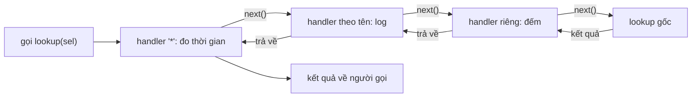

Hai câu hỏi hay gặp khi làm hiệu năng ở quy mô lớn. Thứ nhất: làm sao đo một hàm trong thư viện (ví dụ `store.lookup` của Relay) mà không sửa thư viện, và cho phép nhiều công cụ cùng đo một lúc? Thứ hai: memo một hàm dựa trên giả định "hàm này thuần" thì nhanh, nhưng nếu giả định sai thì UI hiện dữ liệu cũ. Làm sao biết giả định còn đúng, khi hàng nghìn selector được nhiều đội viết?

Trong bundle của Facebook có hai module trả lời hai câu đó: `RelayProfiler` (phần cuối của loạt bài về Relay) và `adsMemoizeSelectorGetStores` của Ads Manager.

> [!TIP]
> **Tóm tắt**
> - `RelayProfiler.instrument(name, fn)` trả về hàm bọc. Mỗi lần gọi, các handler `(name, next)` được xâu thành chuỗi: handler chung `"*"` ngoài cùng, rồi handler theo tên, rồi handler gắn riêng, cuối cùng là hàm gốc. Không ai gắn handler thì hàm bọc gọi thẳng hàm gốc, gần như không tốn gì.
> - Bản gốc dùng một ngăn xếp frame và các bộ đếm thay cho closure. Ba lỗi đã kiểm bằng node: handler gọi `next()` hai lần thì hàm gốc chạy hai lần, hàm gốc ném lỗi thì frame (giữ `this` và đối số) không bao giờ được gỡ, và handler quên `next()` chỉ bị phát hiện sau khi mọi handler khác đã chạy xong.
> - `adsMemoizeSelectorGetStores` memo selector được khai báo là thuần, rồi với xác suất `CANARY_SAMPLE_RATE = 0.001` vẫn chạy lại hàm gốc và so nông với kết quả memo. Khác nhau thì log lỗi "mustfix". Selector không thuần thì không memo, chỉ đếm số lần gọi và gửi báo cáo mỗi 5 phút.
> - Quy tắc mang về: giả định về hiệu năng (thuần, bất biến, không trùng) nên được **kiểm chứng bằng lấy mẫu trên production**, vì test không bao phủ hết dữ liệu thật.

<iframe class="demo-frame" src="/demos/facebook-patterns/index.html?theme=dark#/profiler-middleware-memo-check" title="Demo profiler-middleware-memo-check" loading="lazy" style="height: 1000px"></iframe>

<p class="demo-links">▶ <a href="/demos/facebook-patterns/index.html#/profiler-middleware-memo-check" target="_blank" rel="noopener">Mở demo toàn màn hình ↗</a> · <a href="https://stackblitz.com/github/hunghg255/blog-hunghg/tree/master/examples/facebook-patterns?file=src/lib/profilerChain.ts" target="_blank" rel="noopener">Sửa code trên StackBlitz ↗</a> · <a href="https://github.com/hunghg255/blog-hunghg/blob/master/examples/facebook-patterns/src/lib/profilerChain.ts" target="_blank" rel="noopener">Xem source trên GitHub ↗</a></p>

## Facebook làm thế nào?

### RelayProfiler: ba nhóm handler, một ngăn xếp

`relay-runtime/util/RelayProfiler` (trong `99 ChatComposer/all.js` và `31.js`, giống hệt). Relay là mã nguồn mở (MIT). Hàm `instrument`, đổi tên biến:

```js
instrument(name, fn) {
  if (!shouldInstrument(name)) {           // tên bắt đầu bằng "@": không bọc
    fn.attachHandler = noop; fn.detachHandler = noop;
    return fn;
  }
  aggregateHandlers[name] ??= [];
  const all = aggregateHandlers['*'], named = aggregateHandlers[name], local = [], stack = [];
  const next = function next() {
    const f = stack[stack.length - 1];
    if (f[0]) { f[0]--; all[f[0]](name, next); }
    else if (f[1]) { f[1]--; named[f[1]](name, next); }
    else if (f[2]) { f[2]--; local[f[2]](name, next); }
    else f[5] = fn.apply(f[3], f[4]);
  };
  const instrumented = function () {
    if (named.length === 0 && local.length === 0 && all.length === 0) return fn.apply(this, arguments);
    stack.push([all.length, named.length, local.length, this, arguments, NOT_INVOKED]);
    next();
    const f = stack.pop();
    if (f[5] === NOT_INVOKED) throw new Error('RelayProfiler: Handler did not invoke original function.');
    return f[5];
  };
  instrumented.attachHandler = (h) => local.push(h);
  instrumented.detachHandler = (h) => removeFromArray(local, h);
  instrumented.displayName = '(instrumented ' + name + ')';
  return instrumented;
}
```

Mỗi lần gọi đẩy một frame `[số handler "*", số handler theo tên, số handler riêng, this, arguments, kết quả]`. Hàm `next` dùng chung cho mọi handler: nó đọc frame trên đỉnh, giảm bộ đếm của nhóm ngoài cùng còn handler, và gọi handler đó. Khi cả ba bộ đếm về 0, nó gọi hàm gốc và ghi kết quả vào ô cuối frame.

Cách này không tạo closure nào mỗi lần gọi: một `next` duy nhất, một mảng frame. Ngăn xếp (thay vì một biến) cho phép hàm được instrument gọi lồng nhau hoặc đệ quy: lời gọi trong đẩy frame mới, xong thì pop, frame ngoài vẫn nằm đó.

Hệ quả về thứ tự: vì bộ đếm giảm từ cuối mảng, **handler gắn sau cùng chạy ngoài cùng** trong mỗi nhóm. Nhóm `"*"` luôn bọc ngoài nhóm theo tên, nhóm theo tên bọc ngoài nhóm riêng.

Trong bundle, `RelayModernStore` gọi `RelayProfiler.instrumentMethods(prototype, { lookup: 'RelayModernStore.prototype.lookup' })` và `RelayResponseNormalizer.normalize` cũng được instrument. Bất kỳ công cụ nào (DevTools nội bộ, logger) có thể `attachAggregateHandler('RelayModernStore.prototype.lookup', …)` để đo mà không đụng vào Relay.

### profile(): đo một khoảng thời gian

Phần thứ hai của module là `profile(name, state)`: không bọc hàm, chỉ gọi các handler "bắt đầu", mỗi handler trả về một hàm "kết thúc":

```js
profile(name, state) {
  const handlers = /* profileHandlers[name] nối với profileHandlers['*'] */;
  const stops = [];
  for (let i = handlers.length - 1; i >= 0; i--) stops.unshift(handlers[i](name, state));
  return { stop(error) { stops.forEach((s) => s(error)); } };
}
```

Handler bắt đầu theo thứ tự ngược, hàm kết thúc chạy theo thứ tự xuôi: handler bắt đầu sau cùng thì dừng trước tiên, đúng kiểu lồng nhau. Không có handler nào thì `profile` trả về một object `{stop: noop}` dùng chung, không cấp phát.

Ai dùng? `createRelayFBNetworkFetch` gọi `RelayProfiler.profile('fetchRelayQuery', params)` khi request bắt đầu, và `stop()` khi có payload hoặc lỗi. `CometRelayQueryProfiler` gắn một profile handler: lúc bắt đầu thì thêm một marker `Relay_<tên query>_start` vào interaction trace đang chạy, lúc kết thúc thì gỡ marker và thêm một subspan `Relay_<tên query>` kèm `usedCache`, `usedPrefetcher`. Mỗi lần mở trang, trace của Facebook biết query nào chạy bao lâu, có dùng cache không.

Đọc code `createRelayFBNetworkFetch` thấy `stop()` nằm trong callback `next` của Observable. Query có `@defer` hoặc `@stream` trả nhiều payload, nên `stop()` có lẽ bị gọi nhiều lần và trace nhận nhiều subspan cho một query. Ngược lại, request bị huỷ (unsubscribe trước payload đầu) thì `stop()` không bao giờ được gọi và marker nằm lại trong trace.

### Ba lỗi trong instrument

Mình nạp module vào node (giả lập `__d`) và chạy từng ca:

1. **Handler gọi `next()` hai lần thì hàm gốc chạy hai lần.** Ví dụ một handler "thử lại khi lỗi" viết sai. Lần gọi `next()` thứ hai thấy cả ba bộ đếm đã về 0 và gọi thẳng `fn.apply`. Kết quả trong node: thứ tự `agg> named> local> fn <local fn <named <agg`, hàm gốc chạy hai lần, không có cảnh báo nào. Nếu hàm gốc là `commitPayload`, dữ liệu được ghi hai lần.
2. **Hàm gốc ném lỗi thì frame kẹt lại.** `stack.pop()` không nằm trong `finally`. Lỗi bay ra ngoài, frame (giữ `this` và `arguments`) nằm trên stack mãi mãi. Kiểm bằng node với `--expose-gc`: truyền một object lớn vào hàm được instrument và cho hàm ném lỗi, sau khi GC thì `WeakRef` vẫn trỏ được tới object. Cùng thử nghiệm nhưng hàm không ném lỗi thì object được thu hồi. Các lần gọi sau vẫn chạy đúng vì chỉ đọc frame đỉnh, nên đây là rò bộ nhớ chậm chứ không phải lỗi logic.
3. **Handler quên `next()` bị phát hiện muộn.** Lỗi chỉ được ném sau khi `next()` của handler ngoài cùng trả về. Mọi handler bên ngoài đã chạy hết phần "sau" (ghi log "xong", đo thời gian), trong khi hàm gốc chưa hề chạy. Thông báo lỗi cũng không nói handler nào quên.

Nhắc lại: chỉ khi có handler được gắn thì mới đi vào nhánh có stack, nên trên production (thường không gắn gì) cả ba lỗi đều không xảy ra. Chúng cắn công cụ đo, đúng lúc bạn đang cố tìm lỗi.

### adsMemoizeSelectorGetStores: memo rồi kiểm chứng ngẫu nhiên

Ads Manager có hàng nghìn selector kiểu Flux. Mỗi selector khai báo `getStores(props)`: danh sách store nó phụ thuộc, để biết khi nào cần tính lại. `getStores` được gọi rất nhiều lần, và nếu nó **thuần** (cùng props thì cùng danh sách store) thì có thể memo. Module `adsMemoizeSelectorGetStores` (trong `106.js`) quyết định:

```js
function adsMemoizeSelectorGetStores(isGetStoresPure, getStores, name) {
  const memoOn = gkx('1709087'), canaryOn = gkx('1724844'), countOn = gkx('1727621');
  if (isGetStoresPure && memoOn && canaryOn) return memoizeWithCanary(getStores, name);
  if (isGetStoresPure && memoOn) return memoizeByIdentity(getStores);
  return !isGetStoresPure && countOn ? countCalls(getStores, name) : getStores;
}

function memoizeWithCanary(getStores, name) {
  const memoized = memoizeByIdentity(getStores);
  return function (props) {
    const result = memoized.call(this, props);
    if (Math.random() <= AdsPureGetStoresConfig.CANARY_SAMPLE_RATE) {
      const fresh = getStores.call(this, props);
      if (!shallowEqual(result, fresh))
        FBLogger('ads_selectors_pure_get_stores').mustfix(
          'Selector "%s" getStores was determined to be pure, but is not! …', name);
    }
    return result;
  };
}
```

`CANARY_SAMPLE_RATE` nằm trong cấu hình server gửi xuống (`000.siteData`): `0.001`. Cứ 1.000 lần gọi thì một lần selector chạy hai lần, và nếu kết quả khác, đội sở hữu nhận lỗi "mustfix". Chi phí thêm 0,1%, đổi lại có bằng chứng từ dữ liệu thật rằng giả định "thuần" vẫn đúng.

Selector không thuần thì không memo, nhưng được đếm:

```js
function countCalls(getStores, name) {
  return function (props) {
    counts.set(name, (counts.get(name) ?? 0) + 1);
    return getStores.call(this, props);
  };
}
// cứ 5 phút và khi beforeunload: gửi các selector có count > 1 cùng thời lượng lên QPL, rồi counts.clear()
```

Báo cáo này cho biết selector nào không thuần mà bị gọi nhiều nhất, tức là đáng làm cho thuần nhất. Cả ba nhánh đều sau gatekeeper, nên có thể bật tắt từng phần cho từng nhóm người dùng.

Hai điểm đọc code thấy:

- **`memoizeByIdentity` dùng `Map` mạnh, không giới hạn**: `function (c) { b.has(c) || b.set(c, a.call(this, c)); return b.get(c) }`. Nếu `props` là object mới mỗi lần render (thường gặp), Map giữ mọi object props từng thấy cho tới khi trang đóng, và memo không bao giờ trúng ở lần render sau. Demo ở tab thứ hai đếm kích thước Map này.
- **`this` bị chụp lúc tạo**: `memoizeWithCanary` lưu `const d = this` khi được gọi để tạo selector, rồi dùng `d` cho mọi lần gọi sau. Với cách module được dùng (`this` không quan trọng) thì không sao, nhưng nó khác với cái tên gợi ý.

## Bên trong: thứ tự trong chuỗi handler



Đây là mô hình middleware quen thuộc của Express hay Koa, nhưng đồng bộ và không truyền đối số: handler chỉ quyết định **chạy trước và sau** hàm gốc, không sửa đối số, không sửa kết quả. Muốn đo thời gian hay đếm số lần gọi thì như vậy là đủ, và handler không thể vô tình làm thay đổi hành vi của Relay. Trừ khi gọi `next()` hai lần.

## Viết lại

File `src/lib/profilerChain.ts`. Phần `instrument`, chuỗi handler được chụp thành một mảng lúc gọi, mỗi bước có cờ `called` riêng:

```ts title=src/lib/profilerChain.ts
  function instrument<F extends (...args: any[]) => any>(name: string, fn: F): Instrumented<F> {
    if (!enabled(name)) {
      return Object.assign(fn, { attachHandler() {}, detachHandler() {}, displayName: name });
    }
    if (!aggregate[name]) aggregate[name] = [];
    const local: Handler[] = [];

    const wrapper = function (this: unknown, ...args: unknown[]) {
      // chụp danh sách lúc gọi; handler gắn sau cùng chạy ngoài cùng trong mỗi nhóm (giống bản gốc)
      const chain = [...aggregate['*']]
        .reverse()
        .concat([...aggregate[name]].reverse(), [...local].reverse());
      if (chain.length === 0) return fn.apply(this, args);
      let result: unknown;
      let ran = false;
      const step = (i: number) => {
        if (i === chain.length) {
          ran = true;
          result = fn.apply(this, args);
          return;
        }
        let called = false;
        chain[i](name, () => {
          if (called) throw new Error(`Profiler: handler #${i} của "${name}" gọi next() hai lần`);
          called = true;
          step(i + 1);
        });
        if (!called) throw new Error(`Profiler: handler #${i} của "${name}" không gọi next()`);
      };
      step(0); // lỗi từ fn hay từ handler đều đi thẳng ra ngoài, không để lại trạng thái
      if (!ran) throw new Error('Profiler: hàm gốc không được gọi');
      return result;
    } as unknown as Instrumented<F>;

    wrapper.attachHandler = (h) => void local.push(h);
    wrapper.detachHandler = (h) => remove(local, h);
    wrapper.displayName = `(instrumented ${name})`;
    return wrapper;
  }
```

Memo selector có canary. Object đi vào `WeakMap`, giá trị nguyên thuỷ vào một `Map` giới hạn 100 mục:

```ts title=src/lib/profilerChain.ts
export function memoizeSelector<A, R>(fn: (arg: A) => R, opts: MemoOptions) {
  const { name, isPure, sampleRate, random = Math.random, onImpure, callCounter } = opts;
  const stats: SelectorStats = { calls: 0, computed: 0, canaryChecks: 0, impureDetected: 0 };
  const weak = new WeakMap<object, R>();
  const strong = new Map<unknown, R>();
  let reported = false;

  const compute = (arg: A) => {
    stats.computed++;
    return fn(arg);
  };
  const selector = (arg: A): R => {
    stats.calls++;
    if (!isPure) {
      callCounter?.set(name, (callCounter.get(name) ?? 0) + 1);
      return compute(arg);
    }
    const isObj = (typeof arg === 'object' && arg !== null) || typeof arg === 'function';
    const cache = isObj ? weak : strong;
    const key = arg as unknown as object;
    if (!cache.has(key)) {
      if (!isObj && strong.size >= 100) strong.delete(strong.keys().next().value);
      cache.set(key, compute(arg));
      return cache.get(key)!;
    }
    const memo = cache.get(key)!;
    if (sampleRate > 0 && random() < sampleRate) {
      stats.canaryChecks++;
      if (!shallowEqual(memo, compute(arg))) {
        stats.impureDetected++;
        if (!reported) {
          reported = true; // báo một lần cho mỗi selector, tránh spam log
          onImpure?.(name);
        }
      }
    }
    return memo;
  };
  return Object.assign(selector, { stats });
}
```

::: spoiler Xem toàn bộ src/lib/profilerChain.ts

```ts title=src/lib/profilerChain.ts
/**
 * Profiler kiểu middleware, ý tưởng từ RelayProfiler (viết lại):
 * - instrument(name, fn) trả về wrapper; mỗi lần gọi, các handler được xâu thành chuỗi
 *   "*" (aggregate chung) → handler theo tên → handler gắn riêng cho wrapper, cuối cùng mới tới fn gốc,
 * - mỗi handler nhận (name, next) và phải gọi next() đúng một lần,
 * - tên bắt đầu bằng "@" thì không instrument (trả lại fn gốc).
 * Khác bản gốc: chặn next() gọi hai lần, dọn frame khi fn ném lỗi, chụp danh sách handler lúc gọi.
 */

export type Handler = (name: string, next: () => void) => void;
export type ProfileHandler = (name: string, state?: unknown) => ((error?: unknown) => void) | void;

export type Instrumented<F extends (...args: any[]) => any> = F & {
  attachHandler(h: Handler): void;
  detachHandler(h: Handler): void;
  displayName: string;
};

function remove<T>(list: T[], item: T) {
  const i = list.indexOf(item);
  if (i !== -1) list.splice(i, 1);
}

export function createProfiler() {
  const aggregate: Record<string, Handler[]> = { '*': [] };
  const profileHandlers: Record<string, ProfileHandler[]> = { '*': [] };
  const enabled = (name: string) => name.charAt(0) !== '@';

  function instrument<F extends (...args: any[]) => any>(name: string, fn: F): Instrumented<F> {
    if (!enabled(name)) {
      return Object.assign(fn, { attachHandler() {}, detachHandler() {}, displayName: name });
    }
    if (!aggregate[name]) aggregate[name] = [];
    const local: Handler[] = [];

    const wrapper = function (this: unknown, ...args: unknown[]) {
      // chụp danh sách lúc gọi; handler gắn sau cùng chạy ngoài cùng trong mỗi nhóm (giống bản gốc)
      const chain = [...aggregate['*']]
        .reverse()
        .concat([...aggregate[name]].reverse(), [...local].reverse());
      if (chain.length === 0) return fn.apply(this, args);
      let result: unknown;
      let ran = false;
      const step = (i: number) => {
        if (i === chain.length) {
          ran = true;
          result = fn.apply(this, args);
          return;
        }
        let called = false;
        chain[i](name, () => {
          if (called) throw new Error(`Profiler: handler #${i} của "${name}" gọi next() hai lần`);
          called = true;
          step(i + 1);
        });
        if (!called) throw new Error(`Profiler: handler #${i} của "${name}" không gọi next()`);
      };
      step(0); // lỗi từ fn hay từ handler đều đi thẳng ra ngoài, không để lại trạng thái
      if (!ran) throw new Error('Profiler: hàm gốc không được gọi');
      return result;
    } as unknown as Instrumented<F>;

    wrapper.attachHandler = (h) => void local.push(h);
    wrapper.detachHandler = (h) => remove(local, h);
    wrapper.displayName = `(instrumented ${name})`;
    return wrapper;
  }

  return {
    instrument,
    /** Bọc mọi method trong `names` của object. */
    instrumentMethods<T extends Record<string, any>>(obj: T, names: Record<string, string>) {
      for (const key of Object.keys(names)) {
        if (typeof obj[key] === 'function')
          (obj as Record<string, unknown>)[key] = instrument(names[key], obj[key]);
      }
    },
    attachAggregateHandler(name: string, h: Handler) {
      if (!enabled(name)) return;
      (aggregate[name] ??= []).push(h);
    },
    detachAggregateHandler(name: string, h: Handler) {
      if (aggregate[name]) remove(aggregate[name], h);
    },
    /** Đo một khoảng không gắn với hàm: start ngay, trả về stop(). Handler bắt đầu sau thì dừng trước. */
    profile(name: string, state?: unknown) {
      const list = [...(profileHandlers[name] ?? []), ...profileHandlers['*']];
      const stops: ((error?: unknown) => void)[] = [];
      for (let i = list.length - 1; i >= 0; i--) {
        const stop = list[i](name, state);
        if (typeof stop === 'function') stops.unshift(stop);
      }
      return { stop: (error?: unknown) => stops.forEach((s) => s(error)) };
    },
    attachProfileHandler(name: string, h: ProfileHandler) {
      if (!enabled(name)) return;
      (profileHandlers[name] ??= []).push(h);
    },
    detachProfileHandler(name: string, h: ProfileHandler) {
      if (profileHandlers[name]) remove(profileHandlers[name], h);
    },
  };
}

/* ------------------------------------------------------------------ */
/* Memo selector có canary lấy mẫu (ý tưởng từ adsMemoizeSelectorGetStores) */

export function shallowEqual(a: unknown, b: unknown): boolean {
  if (Object.is(a, b)) return true;
  if (typeof a !== 'object' || typeof b !== 'object' || !a || !b) return false;
  const ka = Object.keys(a);
  const kb = Object.keys(b);
  if (ka.length !== kb.length) return false;
  return ka.every(
    (k) => Object.prototype.hasOwnProperty.call(b, k) && Object.is((a as any)[k], (b as any)[k]),
  );
}

export interface SelectorStats {
  calls: number;
  computed: number;
  canaryChecks: number;
  impureDetected: number;
}

export interface MemoOptions {
  name: string;
  /** người viết khẳng định hàm thuần (cùng đối số → cùng kết quả) */
  isPure: boolean;
  /** xác suất chạy lại hàm gốc để kiểm chứng, vd 0.001 */
  sampleRate: number;
  random?: () => number;
  onImpure?: (name: string) => void;
  /** đếm số lần gọi của selector không thuần, để báo cáo định kỳ */
  callCounter?: Map<string, number>;
}

/**
 * Selector thuần: memo theo identity của đối số (WeakMap cho object, nên không giữ object chết),
 * và thỉnh thoảng chạy lại hàm gốc để kiểm chứng. Selector không thuần: không memo, chỉ đếm lời gọi.
 */
export function memoizeSelector<A, R>(fn: (arg: A) => R, opts: MemoOptions) {
  const { name, isPure, sampleRate, random = Math.random, onImpure, callCounter } = opts;
  const stats: SelectorStats = { calls: 0, computed: 0, canaryChecks: 0, impureDetected: 0 };
  const weak = new WeakMap<object, R>();
  const strong = new Map<unknown, R>();
  let reported = false;

  const compute = (arg: A) => {
    stats.computed++;
    return fn(arg);
  };
  const selector = (arg: A): R => {
    stats.calls++;
    if (!isPure) {
      callCounter?.set(name, (callCounter.get(name) ?? 0) + 1);
      return compute(arg);
    }
    const isObj = (typeof arg === 'object' && arg !== null) || typeof arg === 'function';
    const cache = isObj ? weak : strong;
    const key = arg as unknown as object;
    if (!cache.has(key)) {
      if (!isObj && strong.size >= 100) strong.delete(strong.keys().next().value);
      cache.set(key, compute(arg));
      return cache.get(key)!;
    }
    const memo = cache.get(key)!;
    if (sampleRate > 0 && random() < sampleRate) {
      stats.canaryChecks++;
      if (!shallowEqual(memo, compute(arg))) {
        stats.impureDetected++;
        if (!reported) {
          reported = true; // báo một lần cho mỗi selector, tránh spam log
          onImpure?.(name);
        }
      }
    }
    return memo;
  };
  return Object.assign(selector, { stats });
}

/** Lấy các selector bị gọi > 1 lần kể từ lần trước rồi xoá bộ đếm (bản gốc gửi lên QPL mỗi 5 phút). */
export function flushImpureCounts(counter: Map<string, number>) {
  const out: Record<string, number> = {};
  counter.forEach((n, k) => {
    if (n > 1) out[k] = n;
  });
  counter.clear();
  return out;
}
```

:::

**Khác bản gốc:**

- Mỗi bước trong chuỗi có cờ `called`: gọi `next()` lần hai thì ném lỗi nêu rõ handler số mấy. Quên gọi thì lỗi được ném ngay tại handler đó, trước khi handler bên ngoài chạy phần "sau".
- Không có stack frame dùng chung, nên hàm gốc ném lỗi thì không còn gì kẹt lại. Đổi lại, mỗi lần gọi (khi có handler) tạo vài closure. Với công cụ đo, đánh đổi này chấp nhận được.
- Danh sách handler được chụp lúc gọi. Gắn hay gỡ handler giữa chừng (từ trong một handler) không làm lệch chỉ số của lời gọi đang chạy.
- Memo dùng `WeakMap` cho đối số object và chỉ báo "không thuần" một lần cho mỗi selector. Bộ đếm selector không thuần là `Map` truyền vào, `flushImpureCounts` trả kết quả và xoá, việc gửi đi đâu là của bạn.
- `random() < sampleRate` thay cho `<=`, để `sampleRate = 0` tắt hẳn canary.

## Đi qua code

- `instrument` với tên `@…` trả lại chính `fn` kèm `attachHandler` rỗng, giống bản gốc. Code gọi không cần biết hàm có được instrument hay không.
- `chain` nối ba nhóm theo thứ tự `"*"`, theo tên, riêng, mỗi nhóm đảo ngược để handler gắn sau cùng ở ngoài cùng.
- `step(i)` gọi handler thứ `i` với một `next` mới. `next` kiểm `called`, đặt cờ, rồi `step(i + 1)`. Tới cuối chuỗi thì gọi `fn` và ghi `result`.
- `profile` chạy handler bắt đầu từ cuối về đầu và `unshift` hàm kết thúc, nên `stop()` chạy theo thứ tự xuôi, lồng nhau đúng.
- `memoizeSelector`: lần đầu gặp đối số thì tính và lưu, không chạy canary (vừa tính xong, so với chính nó là thừa). Các lần sau trả kết quả memo, và với xác suất `sampleRate` thì tính lại để so.
- `shallowEqual` so số khoá rồi `Object.is` từng khoá. Với mảng store, nghĩa là cùng độ dài và cùng từng store theo thứ tự.

## Tại sao không làm cách khác?

- **Monkey-patch mỗi lần cần đo** (`store.lookup = wrap(store.lookup)`): hai công cụ cùng patch thì gỡ sai thứ tự sẽ làm mất của nhau. Profiler tập trung giữ danh sách handler, gỡ handler nào chỉ ảnh hưởng handler đó.
- **`performance.mark`/`measure` trực tiếp trong thư viện**: cố định một cách đo, và luôn tốn chi phí. Handler chỉ tốn khi có người gắn.
- **Proxy của ES**: bọc được cả object, nhưng mỗi truy cập thuộc tính đều qua trap, chậm hơn nhiều so với một hàm bọc.
- **Tin khai báo `isGetStoresPure` mà không kiểm**: một selector đổi từ thuần sang không thuần sau một lần sửa code, memo trả danh sách store cũ, UI không cập nhật khi store mới thay đổi. Lỗi kiểu này rất khó tái hiện. Canary biến nó thành một dòng log có tên selector.
- **Kiểm chứng trong test**: test chỉ chạy với props bạn nghĩ ra. Canary chạy với props thật của hàng triệu người dùng.

## Edge case và cạm bẫy

- **Handler phải dùng `try/finally`** nếu muốn chạy phần "sau" khi hàm gốc ném lỗi. Cả bản gốc lẫn bản viết lại đều để lỗi đi thẳng qua handler.
- **Hàm async**: `next()` trả về ngay khi Promise được tạo. Handler đo thời gian sẽ đo thời gian tạo Promise, không phải thời gian chờ. Với hàm async, dùng `profile()` và gọi `stop()` khi Promise xong.
- **Canary làm hàm chạy hai lần**: nếu "selector" có tác dụng phụ (gửi log, tăng bộ đếm), 0,1% số lần tác dụng phụ xảy ra hai lần. Chỉ dùng canary cho hàm thật sự chỉ đọc.
- **So nông có thể bỏ sót**: selector trả `[storeA, {filter}]` với object mới mỗi lần nhưng nội dung giống nhau sẽ bị báo không thuần, dù có lẽ vô hại. Ngược lại, hai mảng chứa cùng store theo thứ tự khác nhau cũng bị coi là khác.
- **Tỉ lệ lấy mẫu và độ phủ**: 0,001 với một selector gọi 10 lần mỗi phiên thì gần như không bao giờ được kiểm trên một máy. Nhưng nhân với hàng triệu phiên thì đủ. Canary là công cụ thống kê, không thay thế test.

## Dùng trong dự án

Đo các hàm của một thư viện nội bộ mà không sửa code gọi:

```ts
import { createProfiler } from './lib/profilerChain';

export const profiler = createProfiler();
export const lookup = profiler.instrument('Store.lookup', rawLookup);

// ở công cụ dev, bật khi cần:
profiler.attachAggregateHandler('*', (name, next) => {
  const t = performance.now();
  try {
    next();
  } finally {
    performance.measure(name, { start: t, end: performance.now() });
  }
});
```

Memo selector của Redux/Zustand có canary:

```ts
const selectVisibleTodos = memoizeSelector((state: State) => state.todos.filter((t) => !t.done), {
  name: 'visibleTodos',
  isPure: true,
  sampleRate: import.meta.env.DEV ? 1 : 0.001, // dev kiểm mọi lần, production lấy mẫu
  onImpure: (name) => reportError(new Error(`Selector ${name} không thuần`)),
});
```

## Kiểm thử

::: spoiler Ví dụ test (bản phác, không có trong repo)

```ts
import { describe, expect, it, vi } from 'vitest';
import { createProfiler, flushImpureCounts, memoizeSelector } from '../src/lib/profilerChain';

describe('createProfiler', () => {
  it('lồng handler theo thứ tự "*" → tên → riêng', () => {
    const P = createProfiler();
    const order: string[] = [];
    const f = P.instrument('f', (x: number) => (order.push('fn'), x * 2));
    P.attachAggregateHandler('*', (_n, next) => (order.push('*>'), next(), order.push('<*')));
    P.attachAggregateHandler('f', (_n, next) => (order.push('f>'), next(), order.push('<f')));
    f.attachHandler((_n, next) => (order.push('l>'), next(), order.push('<l')));
    expect(f(21)).toBe(42);
    expect(order.join(' ')).toBe('*> f> l> fn <l <f <*');
  });

  it('next() hai lần thì ném lỗi, hàm gốc chỉ chạy một lần', () => {
    const P = createProfiler();
    const fn = vi.fn(() => 1);
    const f = P.instrument('f', fn);
    f.attachHandler((_n, next) => (next(), next()));
    expect(() => f()).toThrow('hai lần');
    expect(fn).toHaveBeenCalledOnce();
  });

  it('quên next() thì ném lỗi trước khi handler ngoài chạy phần sau', () => {
    const P = createProfiler();
    const after = vi.fn();
    const f = P.instrument('f', () => 1);
    P.attachAggregateHandler('*', (_n, next) => (next(), after()));
    f.attachHandler(() => {});
    expect(() => f()).toThrow('không gọi next');
    expect(after).not.toHaveBeenCalled();
  });

  it('tên @ không được instrument; profile dừng theo thứ tự lồng nhau', () => {
    const P = createProfiler();
    const raw = (x: number) => x;
    expect(P.instrument('@raw', raw)).toBe(raw);
    const log: string[] = [];
    P.attachProfileHandler('*', () => (log.push('A>'), () => log.push('<A')));
    P.attachProfileHandler('*', () => (log.push('B>'), () => log.push('<B')));
    P.profile('q').stop();
    expect(log).toEqual(['B>', 'A>', '<A', '<B']);
  });
});

describe('memoizeSelector', () => {
  it('memo theo identity, canary bắt selector khai báo sai', () => {
    const onImpure = vi.fn();
    const store = {};
    const props = { id: 1 };
    const lying = memoizeSelector(() => [store, {}], { name: 'x', isPure: true, sampleRate: 1, onImpure });
    lying(props);
    lying(props);
    lying(props);
    expect(lying.stats).toMatchObject({ calls: 3, canaryChecks: 2, impureDetected: 2 });
    expect(onImpure).toHaveBeenCalledOnce();
  });

  it('sampleRate 0 tắt canary', () => {
    const fn = vi.fn(() => [1]);
    const s = memoizeSelector(fn, { name: 'p', isPure: true, sampleRate: 0, random: () => 0 });
    const props = {};
    s(props);
    s(props);
    expect(fn).toHaveBeenCalledOnce();
  });

  it('selector không thuần được đếm và báo cáo', () => {
    const counter = new Map<string, number>();
    const s = memoizeSelector(() => [Date.now()], { name: 'live', isPure: false, sampleRate: 0, callCounter: counter });
    s({});
    s({});
    expect(flushImpureCounts(counter)).toEqual({ live: 2 });
    expect(counter.size).toBe(0);
  });
});
```

:::

## So với thư viện và chuẩn web

- **React `<Profiler>`** đo thời gian render của một cây component (`onRender`), không đo hàm tuỳ ý. **User Timing** (`performance.mark`, `performance.measure`) là chuẩn web để ghi khoảng thời gian, hiện trong tab Performance của DevTools. Handler của profiler kiểu này thường chỉ là lớp mỏng gọi User Timing.
- **OpenTelemetry JS** có instrumentation tự động bằng cách bọc hàm (patch module), cùng ý tưởng nhưng xuất span theo chuẩn để gửi lên backend tracing.
- **Reselect 5** có `inputStabilityCheck` và `identityFunctionCheck` ở chế độ dev: chạy selector đầu vào hai lần để cảnh báo khi kết quả không ổn định. Cùng tinh thần với canary, nhưng chỉ ở dev và chạy lần đầu, không lấy mẫu trên production.
- **React StrictMode** gọi render và một số hàm hai lần ở dev để lộ tác dụng phụ, là "canary 100%" chỉ dành cho môi trường phát triển.
- Bài #87 ([recycleNodesInto](/blogs/facebook-relay-recycle-nodes)) và bài #68 ([memo nhiều đối số](/blogs/facebook-multikey-memo-interning)) là hai cách khác để giữ `===` ổn định mà không cần tin vào khai báo "thuần".

---

Bài này thuộc series **[Học từ mã nguồn Facebook](/series/facebook)** (106 bài, đọc theo thứ tự).

::: spoiler Xem nhanh danh sách bài trong series

*Phần 1*

- [Mở đầu: cách đọc code minify của Facebook](/blogs/learn-from-facebook-source-code)
- [#1 Dùng chung IntersectionObserver + infinite scroll](/blogs/facebook-shared-intersection-observer)
- [#2 useViewportDuration: đo thời gian thực sự được xem](/blogs/facebook-use-viewport-duration)
- [#3 Preload code + data khi hover](/blogs/facebook-preload-on-hover)
- [#4 Toast manager với external store](/blogs/facebook-toast-manager)
- [#5 Network status + heartbeat backoff](/blogs/facebook-network-status-heartbeat)
- [#6 ErrorGuard: bắt lỗi theo ngữ cảnh](/blogs/facebook-error-guard)
- [#7 Banzai: gom log theo lô + sendBeacon](/blogs/facebook-batch-logger)
- [#8 Focus trap + Esc theo layer](/blogs/facebook-focus-trap)

*Phần 2*

- [#9 Mẹo calc(… * 9999): container query, line-clamp, mũi tên carousel bằng CSS](/blogs/facebook-css-9999-trick)
- [#10 Thanh cuộn tuỳ biến bằng CSS 3D](/blogs/facebook-css-3d-scrollbar)
- [#11 Modal cuộn bằng window, giữ vị trí trang nền](/blogs/facebook-document-scroll-modal)
- [#12 Popover, tooltip group và hovercard](/blogs/facebook-popover-tooltip)
- [#13 Primitive Pressable + focus-visible](/blogs/facebook-pressable)
- [#14 Tab "Xem thêm" + sticky header bằng IntersectionObserver](/blogs/facebook-priority-tabs-sticky-header)
- [#15 Avatar khoét mask, gradient Messenger, skeleton steps()](/blogs/facebook-visual-tricks)
- [#16 Khung chat không giật](/blogs/facebook-chat-scroller)
- [#17 Thuật toán chọn bố cục collage ảnh](/blogs/facebook-photo-collage-layout)
- [#18 Keep-alive tab trong SPA](/blogs/facebook-keep-alive-tabs)
- [#19 Tự đo Visual Completion & interaction tracing](/blogs/facebook-visual-completion)
- [#20 Router SPA bền bỉ & tải chunk có retry](/blogs/facebook-spa-router-resilient-loading)

*Phần 3*

- [#21 Smart Compose: gợi ý chữ mờ khi gõ](/blogs/facebook-smart-compose-ghost-text)
- [#22 MQTT ngay trong trình duyệt, tự chuyển sang long-poll](/blogs/facebook-mqtt-in-browser)
- [#23 Đo thời gian dùng bằng bitmap 64 giây](/blogs/facebook-time-spent-bitmap)
- [#24 Bảng reaction nhấn giữ rồi trượt](/blogs/facebook-reaction-press-slide)
- [#25 Tìm kiếm gấp dấu, phiên âm và highlight đầu từ](/blogs/facebook-search-diacritics-tokenize)
- [#26 Ring buffer biết trace nào đã mất log](/blogs/facebook-trace-ring-buffer)
- [#27 Engine animation JS: một vòng rAF và solver cubic-bezier](/blogs/facebook-keyframes-loop-cubic-bezier)
- [#28 Bootloader: bitmap tài nguyên đã tải, chỉ reload khi cần](/blogs/facebook-bootloader-bitmap-consistency)
- [#29 Nhận biết click do screen reader tạo ra](/blogs/facebook-virtual-cursor-detection)
- [#30 Tải trước feed theo chất lượng mạng, đoán hạng thiết bị](/blogs/facebook-network-aware-prefetch)
- [#31 Hàng đợi gửi tin chat giữ đúng thứ tự](/blogs/facebook-ordered-send-queue)
- [#32 Gộp lời gọi API trong cùng một tick](/blogs/facebook-api-batcher)
- [#33 Resize ảnh trong pool Web Worker](/blogs/facebook-jpeg-resize-worker-pool)
- [#34 Crop ảnh theo nhiều khuôn mặt](/blogs/facebook-face-aware-crop)
- [#35 Kéo-thả sắp xếp và vùng thả file không nhấp nháy](/blogs/facebook-flicker-free-drag-drop)
- [#36 Tiện ích UI: fade-out, sticky event, hàm huỷ được](/blogs/facebook-ui-utility-hooks)
- [#37 Hạ tầng nhỏ: cookie, hash lỗi, prefetch khi chuột dừng](/blogs/facebook-small-infra-cookie-hash-idle)

*Phần 4–6*

- [#38 Đồng bộ tin nhắn: phát hiện lỗ seqID và fetch bù theo tầng](/blogs/facebook-messenger-sync-seqid-gaps)
- [#39 OTID: ID tin nhắn kiểu Snowflake sinh ở client](/blogs/facebook-otid-client-snowflake)
- [#40 QPL: lấy mẫu từ lúc bắt đầu, đo RTT gửi tin đầu-cuối](/blogs/facebook-qpl-send-rtt)
- [#41 Bộ điều phối request bảy chế độ gộp và chống trùng](/blogs/facebook-request-dispatcher-modes)
- [#42 Thread list theo mốc thời gian, cookie presence có version](/blogs/facebook-threadlist-ranged-presence)
- [#43 Composer dạng plugin: reducer, dirty checker, chuỗi kiểm tra](/blogs/facebook-plugin-composer)
- [#44 Thanh toán bất đồng bộ: subscribe trước, poll dự phòng](/blogs/facebook-async-checkout)
- [#45 Validate số thẻ: sửa lỗi gõ, dải BIN, Luhn](/blogs/facebook-card-validation)
- [#46 Lịch chọn khoảng ngày: bo góc dải chọn, phím đủ bộ, RTL](/blogs/facebook-range-calendar-a11y)
- [#47 Giờ mở cửa theo tuần: qua đêm, gộp khoảng, phần bù](/blogs/facebook-weekly-hours-intervals)
- [#48 Tiến độ đăng realtime: giữ event chờ snapshot, watchdog](/blogs/facebook-realtime-publish-snapshot)
- [#49 Tiền tệ theo đơn vị nhỏ nhất và ô nhập tiền](/blogs/facebook-currency-minor-units)
- [#50 Sửa hàng loạt Empty/Uniform/Mixed, seen/read bằng 2 bit](/blogs/facebook-bulk-edit-seen-bits)
- [#51 Phát hiện script lạ hook vào hàm native](/blogs/facebook-native-hook-detection)
- [#52 localStorage tự dọn khi đầy quota](/blogs/facebook-quota-aware-storage)
- [#53 Cache tuyến do server phân giải, chờ sẵn promise](/blogs/facebook-route-cache-prefetch)
- [#54 Lưới phím mũi tên 2D và focus không làm cuộn trang](/blogs/facebook-focus-table-grid)
- [#55 Tách emoji bằng máy trạng thái](/blogs/facebook-emoji-segmentation)
- [#56 Đọc trước ghi sau trong một frame, con tự biết vị trí](/blogs/facebook-read-then-write-dom)
- [#57 Hàng đợi lệnh cho video và stream sắp lại chunk](/blogs/facebook-video-command-queue)

*Phần 7–10*

- [#58 Ước lượng băng thông EWMA: loại outlier, nhớ qua phiên](/blogs/facebook-bandwidth-ewma-estimator)
- [#59 ABR theo độ tự tin phát và cắt bậc bitrate theo MOS](/blogs/facebook-abr-playback-confidence)
- [#60 Prefetch segment dự đoán từ manifest, parse hộp sidx](/blogs/facebook-dash-predicted-segments)
- [#61 Đọc metadata MP4/MOV ngay trên client](/blogs/facebook-mp4-metadata-client)
- [#62 Upload tiếp tục được: offset, hash dedupe, phát hiện treo](/blogs/facebook-resumable-upload)
- [#63 Fenwick tree: chọn ngẫu nhiên có trọng số và offset dòng](/blogs/facebook-fenwick-weighted-random)
- [#64 Vạch trục số và trục thời gian "đẹp"](/blogs/facebook-nice-axis-ticks)
- [#65 Damerau-Levenshtein theo dải chéo và tự sửa tên gõ sai](/blogs/facebook-damerau-levenshtein)
- [#66 PRNG có seed, shuffle tái lập và lấy mẫu trace](/blogs/facebook-seeded-prng-sampling)
- [#67 Cặp min/max-heap tái dùng vị trí trong danh sách ảo](/blogs/facebook-dual-heap-buffer-set)
- [#68 Memo nhiều đối số bằng Map/WeakMap và interning object](/blogs/facebook-multikey-memo-interning)
- [#69 Thống kê cửa sổ trượt và đại số khoảng thời gian](/blogs/facebook-moving-stat-intervals)
- [#70 Int64 từ hai số 32-bit, decode UTF, offset theo code point](/blogs/facebook-int64-utf-codepoints)
- [#71 Engine múi giờ IANA trên client, phát hiện lệch giờ](/blogs/facebook-client-iana-timezone)
- [#72 Tự cài semver range](/blogs/facebook-semver-range)
- [#73 Auto-link URL, cắt chữ an toàn, giới hạn LaTeX](/blogs/facebook-autolink-safe-truncate)
- [#74 Parser query kiểu PHP chống prototype pollution](/blogs/facebook-php-query-serializer)
- [#75 Popover tự lật theo phần tràn nhỏ nhất](/blogs/facebook-popover-auto-flip)
- [#76 Tiền tố for(;;) chống JSON hijacking, đọc stream](/blogs/facebook-csrf-prefix-streaming)
- [#77 Chống lộ Referer, linkshim, xoá token trên URL](/blogs/facebook-referrer-linkshim-url-scrub)
- [#78 setImmediate bằng postMessage, gom delta chuột theo frame](/blogs/facebook-setimmediate-mouse-batching)
- [#79 Phát hiện crash qua heartbeat, dò proxy cache hỏng](/blogs/facebook-crash-heartbeat-proxy-check)
- [#80 DPR vào cookie cho ảnh @2x, che khoá trong log](/blogs/facebook-dpr-cookie-secret-redaction)
- [#81 Flux waitFor tự viết và proxy có đệm](/blogs/facebook-flux-dispatch-buffered-proxy)
- [#82 Crop đúng tỉ lệ, xoay sticker bằng ma trận](/blogs/facebook-image-crop-rotation-geometry)

*Phần 11–15*

- [#83 Chia subdomain giữa các tab bằng lease, long-poll theo bảng trạng thái](/blogs/facebook-tab-subdomain-lease-longpoll)
- [#84 MQTT QoS1: giữ publish chờ ack, gửi lại khi kết nối lại](/blogs/facebook-mqtt-qos1-republish)
- [#85 Cache Promise gộp request, cache lỗi ngắn, đua dữ liệu nhúng sẵn](/blogs/facebook-promise-cache-preload-race)
- [#86 Lịch retry: backoff có trần, Fibonacci, báo lỗi CDN mỗi N ngày](/blogs/facebook-retry-backoff-schedules)
- [#87 Giữ nguyên tham chiếu nhánh dữ liệu không đổi](/blogs/facebook-relay-recycle-nodes)
- [#88 Store optimistic: copy-on-write, rollback rồi áp lại](/blogs/facebook-relay-optimistic-store)
- [#89 Chỉ mục subscription theo record, hàng đợi task theo chiều sâu](/blogs/facebook-relay-subscription-index)
- [#90 Phân trang connection: cursor khớp đầu, edge không trùng](/blogs/facebook-relay-connection-pagination)
- **#91 Profiler kiểu middleware và memo selector có lấy mẫu kiểm tra** (bài này)
- [#92 Đọc EBML/WebM Cues để tìm byte range của segment](/blogs/facebook-webm-ebml-cues)
- [#93 Stream HTTP Range tạm dừng được, tải tiếp đúng byte](/blogs/facebook-pausable-range-stream)
- [#94 Bảng khoảng thời gian gắn nhãn và nhảy qua lỗ buffer](/blogs/facebook-tagged-time-ranges-gaps)
- [#95 Gom chunk cho SourceBuffer, đồng bộ video bằng playbackRate](/blogs/facebook-sourcebuffer-video-sync)
- [#96 Gom tin nhắn thành cụm, vạch ngày và avatar đã xem](/blogs/facebook-message-grouping)
- [#97 Bao nhiêu tab chat vừa màn hình, chuỗi luật mở tab](/blogs/facebook-chat-tab-policy)
- [#98 Phím tắt Markdown trong editor, Backspace để hoàn tác](/blogs/facebook-markdown-shortcuts-editor)
- [#99 Offset theo code point hay UTF-16: bốn bug cùng một gốc](/blogs/facebook-codepoint-offset-bugs)
- [#100 Typeahead không nhảy: cache tiền tố, chặn reflow, khoá hover](/blogs/facebook-typeahead-stable-results)
- [#101 Hit-test trên canvas bằng phát lại path, nét đứt và cung Bézier](/blogs/facebook-canvas-hit-regions)
- [#102 Vòng tròn theo mét trên bản đồ Mercator](/blogs/facebook-mercator-meter-circles)
- [#103 Dò tính năng trình duyệt: ảnh EXIF 2×1, getter bẫy, scrollbar](/blogs/facebook-feature-probe-tricks)
- [#104 Bug định dạng số và kiểm tra dữ liệu theo locale](/blogs/facebook-locale-validation-bugs)
- [#105 Dispose cho đúng: idle callback, splice(-1), xoá nhầm key](/blogs/facebook-dispose-leak-bugs)

:::

Code + demo: [`examples/facebook-patterns`](https://github.com/hunghg255/blog-hunghg/tree/master/examples/facebook-patterns) · [Mở trên StackBlitz](https://stackblitz.com/github/hunghg255/blog-hunghg/tree/master/examples/facebook-patterns)
