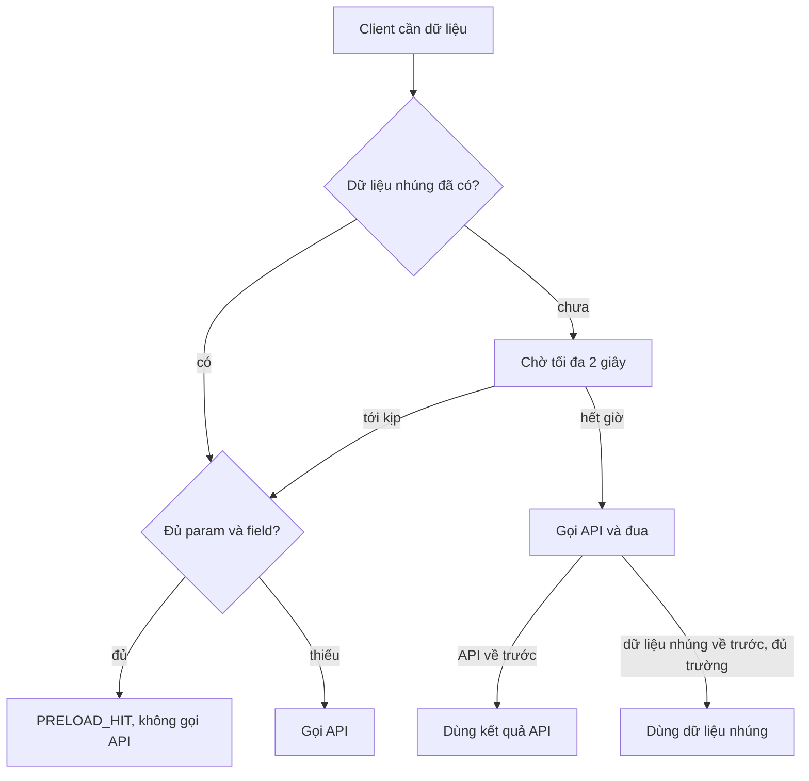

Trang Ads Manager mở ra, header cần tên tài khoản, sidebar cần tên tài khoản, bảng chiến dịch cũng cần. Ba component, ba lần gọi cùng một endpoint Graph API, trong cùng một khung hình. Nếu API đang trả 503, ba component cùng thấy lỗi, cùng có nút "thử lại", người dùng bấm, và server đang ốm nhận thêm ba request nữa.

Bài này gom ba mẩu code của Facebook cùng xoay quanh một câu hỏi: **khi nhiều nơi cần cùng một dữ liệu, gọi mạng mấy lần?**

> [!TIP]
> **Tóm tắt**
> - `cachedGraphAPI` (bundle `233.js`) cache chính Promise theo khoá `name:path:JSON(params)`. Request đang bay được dùng chung; request lỗi thì Promise bị reject vẫn được giữ thêm `0,15` phút (9 giây) để chặn bão retry.
> - `MessengerPaymentFriendsLocalCache` (bundle `85.js`) tải danh sách bạn một lần cho typeahead nhưng giữ cả Promise lỗi. Lỗi mạng một lần là typeahead câm tới khi tải lại trang.
> - `preloadedGraphAPI` (bundle `99.js`) cho server nhúng sẵn kết quả Graph API vào trang. Client chờ tối đa 2 giây; dữ liệu nhúng tới kịp và đủ trường thì dùng, không thì gọi API và để hai bên đua.
> - Quy tắc mang về: cache Promise thay vì cache giá trị; lỗi cũng cache nhưng hạn ngắn; loader "chỉ tải một lần" phải quên lỗi.

<iframe class="demo-frame" src="/demos/facebook-patterns/index.html?theme=dark#/promise-cache-preload-race" title="Demo promise-cache-preload-race" loading="lazy" style="height: 1000px"></iframe>

<p class="demo-links">▶ <a href="/demos/facebook-patterns/index.html#/promise-cache-preload-race" target="_blank" rel="noopener">Mở demo toàn màn hình ↗</a> · <a href="https://stackblitz.com/github/hunghg255/blog-hunghg/tree/master/examples/facebook-patterns?file=src/lib/promiseCache.ts" target="_blank" rel="noopener">Sửa code trên StackBlitz ↗</a> · <a href="https://github.com/hunghg255/blog-hunghg/blob/master/examples/facebook-patterns/src/lib/promiseCache.ts" target="_blank" rel="noopener">Xem source trên GitHub ↗</a></p>

## Mẹo 1: cache Promise, kể cả Promise lỗi

### Facebook làm thế nào?

Toàn bộ `cachedGraphAPI` là một builder bọc quanh một `requestSpec` (một endpoint Graph API). Lõi của `get`:

```js
const hit = cache.get(key);
if (hit) return hit;                                    // Promise: đang bay hoặc đã xong
const p = spec.get(params).catch((e) => { cache.set(key, p, null, 0.15); throw e; }); // lỗi: TTL 0,15 phút
cache.set(key, p, null, this.cacheMinutes);             // đặt vào cache NGAY, trước khi có kết quả
return p;
```

::: spoiler Code gốc đã đổi tên biến: cachedGraphAPI.get đầy đủ

```js
const CACHE_ERROR_FOR = 0.15;                 // phút → 9 giây
const cache = new LFUCache();                 // TTL của Cache tính bằng phút

get(params, namespace) {
  const key = createCacheKey(spec.name, spec.path, { ...spec.params, ...params }, this.ignoredParams);
  if (!this.skipCache) {
    const hit = namespace ? groups[namespace]?.[key] : cache.get(key);
    if (hit) return hit;                      // Promise: đang bay hoặc đã xong
  }
  const p = spec.get(params).catch((error) => {
    if (namespace) { const g = groups[namespace]; g[key] = p; setTimeout(() => delete g[key], 9000); }
    else cache.set(key, p, null, CACHE_ERROR_FOR);   // ghi đè TTL: lỗi chỉ sống 9 giây
    throw error;
  });
  namespace ? (groups[namespace][key] = p) : cache.set(key, p, null, this.cacheMinutes);
  return p;
}
```

:::

- **Cache Promise chứ không cache giá trị.** Promise được đặt vào cache **ngay lúc gửi request**, trước khi có kết quả. Component thứ hai gọi `get` một mili giây sau nhận đúng Promise đó. Ba component, một request.
- **Lỗi được cache với hạn riêng.** Khi request lỗi, `catch` ghi lại chính Promise bị reject với TTL 9 giây. Trong 9 giây đó mọi `get` trả về ngay lỗi cũ, không chạm mạng. Đây là negative cache (cache kết quả âm), cùng ý với cách DNS cache cả câu trả lời "không tồn tại".
- **Namespace** cho phép xoá cả nhóm (`clearTopLevelCache(ns)`), ví dụ mọi dữ liệu của một tài khoản quảng cáo khi người dùng chuyển tài khoản.

### Kiểm lại bằng node: và một bug nhỏ

Tôi nạp nguyên văn module, thay `LFUCache` bằng một Map có hẹn giờ:

- Hai `get` liền nhau trả cùng một Promise (`p1 === p2`).
- API lỗi: `get` lần hai trong 9 giây trả lỗi cũ, số request vẫn là 1. Sau 9 giây, request mới được gửi.
- Gọi `clearCache()` một lần trên builder, rồi `get` ba lần: **ba request**. `clearCache` chỉ đặt `this.skipCache = true` và không bao giờ đặt lại, nên builder đó bỏ qua cache vĩnh viễn, đúng ra chỉ nên bỏ qua một lần.

Hai chi tiết khác: khoá dùng `JSON.stringify(params)`, nên `{a:1, b:2}` và `{b:2, a:1}` là hai khoá khác nhau; và `LFUCache` chạy dọn dẹp mỗi 15 phút, xoá entry không được đọc lần nào kể từ lần dọn trước.

## Mẹo 2 (bug): loader một lần nhớ lỗi mãi mãi

### Facebook làm thế nào?

Typeahead chọn bạn để chuyển tiền trong Messenger tải 50 người bạn **một lần**, rồi tìm tại chỗ. Code (`MessengerPaymentFriendsLocalCache`, đổi tên biến):

```js
let promise = null, entries = null;
function onEntriesLoaded(callback) {
  if (entries) return callback(entries);
  if (!promise) {
    promise = new AsyncRequest(uri({ first: 50 })).exec()
      .then((r) => r.getPayload())
      .then((data) => { entries = data.viewer.all_friends.edges.map(toEntry); index.add(entries); });
  }
  promiseDone(promise, () => callback(entries), emptyFunction);   // lỗi: không làm gì
}
```

Request đầu lỗi (mạng chập chờn lúc mở hộp thoại): `promise` là một Promise bị reject, và nó **không bao giờ bị xoá**. Mọi lần gõ sau đi vào `promiseDone`, nhánh lỗi là `emptyFunction`, callback không chạy. Typeahead không báo lỗi, không có kết quả, không thử lại, tới khi người dùng tải lại trang. `MessengerRoomWithAssocObjectAudienceLocalCacheManager` (cùng bundle) có đúng mẫu này cho danh sách thành viên phòng.

Tôi đã chạy lại module thật với `AsyncRequest` giả lỗi lần đầu, thành công từ lần hai: sau lần lỗi đầu, ba lần `search` tiếp theo gọi callback **0 lần**, số request vẫn là 1, `isBootstrapped()` vẫn `false`.

Chi tiết phụ: dòng `a.data.viewer.all_friends.page_info.end_cursor` là một biểu thức đứng một mình, không làm gì. Có lẽ đã định phân trang mà chưa viết, nên typeahead chỉ tìm được trong 50 người bạn đầu tiên.

So với `cachedGraphAPI`: cùng là "giữ Promise để dùng chung", nhưng một bên cho lỗi hạn 9 giây, một bên cho lỗi hạn vô cùng.

## Mẹo 3: dữ liệu server nhúng sẵn đua với request của client

### Facebook làm thế nào?

Ads Manager là ứng dụng lớn. Từ lúc trình duyệt nhận HTML tới lúc JavaScript chạy tới chỗ gọi API có thể mất vài giây. Trong khoảng đó server đã biết trang sẽ cần gì, nên nó **tự chạy trước** các truy vấn Graph API đó và đẩy kết quả vào trang khi xong (`window.__preloaderData[tên]`, kèm một callback `__onAdd` để báo khi có dữ liệu mới).

`preloadedGraphAPI` đứng trước mọi request Graph API của client. Có sẵn dữ liệu nhúng thì đối chiếu ngay. Chưa có thì chờ tối đa 2000 ms (0 ms cho GET nếu cờ `gk 1688272` bật). Hết giờ thì gọi API thật và `Promise.race` giữa API với "dữ liệu nhúng tới", ghi lại ai thắng (`winner = server | client`) cùng các mốc `apiStart`, `apiEnd`, `serverEnd`.

::: spoiler Code gốc đã đổi tên biến: chờ, đua, khớp request

```js
function preloadedGraphAPI(request) {
  const preloaded = findPreloaded(request);           // đã có trong __preloaderData?
  if (preloaded) return useIfMatches(request, preloaded);
  const waitMs = gk('1688272') && request.method === 'get' ? 0 : 2000;
  return waitThenRace(request, waitMs);               // log SERVER_DIDNT_BEAT_JS_EXECUTION
}

function race(request) {                              // sau khi hết waitMs
  const api = request.go();                           // gọi API thật
  return Promise.race([
    whenPreloadArrives().then((data) => { request.winner ??= 'server'; return useIfMatches(request, data, api); }),
    api.then((data) => { request.winner ??= 'client'; return data; }),
  ]);
}
```

```js
function useIfMatches(request, preloaded, pendingApi) {
  const data = match(request, preloaded);
  if (data) { log('PRELOAD_HIT'); return Promise.resolve({ ...data, __preloaded: true }); }
  if (!request.ignoreMismatches && !preloaded?.intentionally_empty) {
    log('SERVER_DIDNT_SEND_ALL_NECESSARY_DATA');
    logMismatchDeltas(request, preloaded);             // ghi lại lệch ở param/field nào
  }
  return pendingApi ?? request.go();
}

function match(request, preloaded) {
  for (const serverKey of Object.keys(preloaded)) {
    const server = parseServerKey(serverKey);          // path, method, params
    if (server.path !== request.path || server.method !== request.method) continue;
    // params của client phải là TẬP CON của params server; riêng `fields` so như tập hợp,
    // mỗi field có thể có comparator riêng (request.preloadInfo.fieldComparators)
    if (isSubsetOf(request.params, server.params, request.fields, comparators)) return preloaded[serverKey];
    // request chia shard (__sharding__): trừ các id đã có trong preload, ghép mảng rows lại;
    // hết id thì trả luôn phần ghép, còn id thì chỉ gọi API cho phần thiếu
  }
}
```

:::

Bốn tình huống, mỗi cái có một mã log riêng để đội Ads đo:

| Tình huống | Mã log | Có gọi API? |
| --- | --- | --- |
| Dữ liệu nhúng đã có hoặc tới trong 2 giây, đủ trường | `PRELOAD_HIT` | không |
| Dữ liệu nhúng tới nhưng thiếu param/field client cần | `SERVER_DIDNT_SEND_ALL_NECESSARY_DATA` | có |
| Hết 2 giây chưa tới, đua, API về trước | `SERVER_DIDNT_BEAT_API` | có |
| Hết 2 giây, đua, dữ liệu nhúng về trước | `winner = server` | có (thừa) |

Ngoài ra `UNNECESSARY_SERVER_PRELOADING` được log khi request tới lúc kịch bản tải trang đã kết thúc: server đã chạy truy vấn mà client không bao giờ dùng.



## Bên trong trình duyệt

- **Promise là giá trị tương lai dùng chung được.** Gọi `.then` trên cùng một Promise bao nhiêu lần cũng được, mỗi người nhận cùng kết quả. Đó là lý do cache Promise gộp được request đang bay mà không cần hàng đợi riêng.
- **Promise bị reject mà không ai `.catch`** sinh sự kiện `unhandledrejection` ("Uncaught (in promise)" trên console). Cache giữ Promise lỗi thì phải tự gắn một `.catch` rỗng, nếu không mỗi lỗi in ra console dù component đã xử lý ở chỗ khác.
- **HTML được stream.** Server có thể gửi phần đầu trang ngay, giữ kết nối, rồi đẩy thêm `<script>window.__preloaderData[…] = …</script>` khi truy vấn xong. Script chạy ngay khi parser đọc tới, dù bundle chính đã chạy từ trước. Đó là cơ chế để dữ liệu "tới sau" trong cùng một response.
- **Trình duyệt không tự gộp `fetch` giống nhau.** Hai `fetch('/me')` liên tiếp là hai request (HTTP cache chỉ giúp khi response đầu đã về và cho phép cache). Gộp request đang bay là việc của ứng dụng.

## Viết lại

Cache Promise. Hết hạn tính lười khi đọc, không cần hẹn giờ; entry đang bay không bao giờ hết hạn:

```ts title=src/lib/promiseCache.ts
  const expiresIn = (e: Entry<T>) => {
    if (e.status === 'pending') return Infinity; // đang bay: luôn dùng chung
    const ttl = e.status === 'rejected' ? errorTtlMs : ttlMs;
    return ttl == null ? Infinity : e.settledAt + ttl - now();
  };

  const cache: PromiseCache<T> = {
    get(key, fetcher, opts = {}) {
      const hit = map.get(key);
      if (hit && !opts.bypass && expiresIn(hit) > 0) {
        // chạm vào thì đưa về cuối Map: Map giữ thứ tự chèn nên đầu Map là entry cũ nhất
        map.delete(key);
        map.set(key, hit);
        return hit.promise;
      }
      const entry = { status: 'pending', settledAt: 0, group: opts.group } as Entry<T>;
      entry.promise = fetcher().then(
        (value) => {
          entry.status = 'fulfilled';
          entry.settledAt = now();
          return value;
        },
        (error: unknown) => {
          entry.status = 'rejected';
          entry.settledAt = now();
          throw error;
        },
      );
      // ai không bắt lỗi thì cũng không làm hiện "Uncaught (in promise)"
      entry.promise.catch(() => {});
      map.set(key, entry);
      if (map.size > maxEntries) map.delete(map.keys().next().value!);
      return entry.promise;
    },
```

Loader một lần (`createLazyLoader`) khác bản Messenger đúng một dòng: nhánh lỗi đặt `promise = null` rồi ném lại lỗi.

Đua dữ liệu nhúng. Pha chờ đăng ký `slot.onReady` và một hẹn giờ `waitMs`; ai tới trước thì huỷ người kia. Pha đua sau khi hết giờ:

```ts title=src/lib/promiseCache.ts
    const timer = setTimer(() => {
      cancel();
      // 3. hết giờ: gọi API, nhưng dữ liệu nhúng tới trước (và khớp) thì vẫn dùng
      const api = fetch();
      let apiDone = false;
      api.then(
        (data) => {
          apiDone = true;
          finish({ data, outcome: 'CLIENT_WON_RACE', fetched: true });
        },
        (e) => finish(Promise.reject(e)),
      );
      slot.onReady((data) => {
        if (!apiDone && matches(data)) finish({ data, outcome: 'PRELOAD_WON_RACE', fetched: true });
      });
    }, waitMs);
```

::: spoiler Xem toàn bộ src/lib/promiseCache.ts

```ts title=src/lib/promiseCache.ts
/**
 * Ba mẹo quanh "gọi API một lần cho nhiều nơi cần", học từ cachedGraphAPI, preloadedGraphAPI
 * và một bug của MessengerPaymentFriendsLocalCache:
 * 1. Cache chính Promise: request đang bay được dùng chung; lỗi cũng được cache nhưng chỉ vài giây
 *    (negative cache) để nhiều component không cùng retry dồn dập.
 * 2. Loader lười kiểu single-flight phải bỏ Promise khi lỗi, không thì lỗi bị nhớ vĩnh viễn.
 * 3. Dữ liệu server nhúng sẵn vào HTML đua với request của client: chờ một chút, khớp thì dùng,
 *    không khớp hoặc tới muộn thì gọi API.
 * Khác bản gốc: hết hạn tính lười theo đồng hồ tiêm vào, khoá ổn định không phụ thuộc thứ tự thuộc tính,
 * invalidate chỉ có tác dụng một lần, giới hạn số entry.
 */

// ───────────────────────── 1. Cache Promise ─────────────────────────

export type EntryStatus = 'pending' | 'fulfilled' | 'rejected';

export interface PromiseCacheOptions {
  /** giữ kết quả thành công bao lâu; undefined = tới khi bị đẩy ra hoặc invalidate */
  ttlMs?: number;
  /** giữ lỗi bao lâu (bản gốc: 0,15 phút = 9 giây) */
  errorTtlMs?: number;
  /** số entry tối đa, đẩy entry dùng lâu nhất ra trước */
  maxEntries?: number;
  now?: () => number;
}

interface Entry<T> {
  promise: Promise<T>;
  status: EntryStatus;
  settledAt: number;
  group?: string;
}

export interface CacheInfo {
  key: string;
  status: EntryStatus;
  /** còn bao lâu thì hết hạn, Infinity nếu không hết hạn */
  expiresInMs: number;
  group?: string;
}

export interface PromiseCache<T> {
  get(key: string, fetcher: () => Promise<T>, options?: { group?: string; bypass?: boolean }): Promise<T>;
  /** xoá một key (hoặc tất cả nếu không truyền); chỉ ảnh hưởng lần get kế tiếp */
  invalidate(key?: string): void;
  invalidateGroup(group: string): void;
  entries(): CacheInfo[];
}

export function createPromiseCache<T>(options: PromiseCacheOptions = {}): PromiseCache<T> {
  const { ttlMs, errorTtlMs = 9_000, maxEntries = 500, now = Date.now } = options;
  const map = new Map<string, Entry<T>>();

  const expiresIn = (e: Entry<T>) => {
    if (e.status === 'pending') return Infinity; // đang bay: luôn dùng chung
    const ttl = e.status === 'rejected' ? errorTtlMs : ttlMs;
    return ttl == null ? Infinity : e.settledAt + ttl - now();
  };

  const cache: PromiseCache<T> = {
    get(key, fetcher, opts = {}) {
      const hit = map.get(key);
      if (hit && !opts.bypass && expiresIn(hit) > 0) {
        // chạm vào thì đưa về cuối Map: Map giữ thứ tự chèn nên đầu Map là entry cũ nhất
        map.delete(key);
        map.set(key, hit);
        return hit.promise;
      }
      const entry = { status: 'pending', settledAt: 0, group: opts.group } as Entry<T>;
      entry.promise = fetcher().then(
        (value) => {
          entry.status = 'fulfilled';
          entry.settledAt = now();
          return value;
        },
        (error: unknown) => {
          entry.status = 'rejected';
          entry.settledAt = now();
          throw error;
        },
      );
      // ai không bắt lỗi thì cũng không làm hiện "Uncaught (in promise)"
      entry.promise.catch(() => {});
      map.set(key, entry);
      if (map.size > maxEntries) map.delete(map.keys().next().value!);
      return entry.promise;
    },
    invalidate(key) {
      if (key == null) map.clear();
      else map.delete(key);
    },
    invalidateGroup(group) {
      for (const [k, e] of map) if (e.group === group) map.delete(k);
    },
    entries() {
      return [...map].map(([key, e]) => ({ key, status: e.status, expiresInMs: expiresIn(e), group: e.group }));
    },
  };
  return cache;
}

/** Khoá ổn định: cùng tham số khác thứ tự thuộc tính vẫn ra cùng khoá; bỏ các tham số không ảnh hưởng kết quả. */
export function stableKey(name: string, path: string, params: Record<string, unknown> = {}, ignore: string[] = []) {
  const sorted = (v: unknown): unknown =>
    Array.isArray(v)
      ? v.map(sorted)
      : v && typeof v === 'object'
        ? Object.fromEntries(Object.keys(v).sort().map((k) => [k, sorted((v as Record<string, unknown>)[k])]))
        : v;
  const kept = Object.fromEntries(Object.entries(params).filter(([k]) => !ignore.includes(k)));
  return `${name}:${path}:${JSON.stringify(sorted(kept))}`;
}

// ───────────────────────── 2. Loader lười single-flight ─────────────────────────

/**
 * Tải một lần, dùng nhiều lần. Đang tải thì mọi người chờ chung một Promise.
 * Lỗi thì bỏ Promise để lần gọi sau thử lại (bản gốc giữ Promise lỗi mãi).
 */
export function createLazyLoader<T>(load: () => Promise<T>) {
  let promise: Promise<T> | null = null;
  let value: { v: T } | null = null;
  return {
    get(): Promise<T> {
      if (value) return Promise.resolve(value.v);
      if (!promise) {
        promise = load().then(
          (v) => {
            value = { v };
            return v;
          },
          (error: unknown) => {
            promise = null; // chỗ khác biệt với bản gốc
            throw error;
          },
        );
      }
      return promise;
    },
    get loaded() {
      return value != null;
    },
    reset() {
      promise = null;
      value = null;
    },
  };
}

// ───────────────────────── 3. Đua dữ liệu nhúng sẵn ─────────────────────────

/** Chỗ chứa dữ liệu server sẽ đẩy vào (vd từ một thẻ <script> cuối HTML), có thể tới trước hoặc sau. */
export interface PreloadSlot<T> {
  readonly state: 'waiting' | 'ready' | 'error';
  readonly value: T | undefined;
  /** gọi cb khi có dữ liệu (ngay nếu đã có); trả hàm huỷ */
  onReady(cb: (value: T) => void, onError?: (error: unknown) => void): () => void;
  resolve(value: T): void;
  reject(error: unknown): void;
}

export function createPreloadSlot<T>(): PreloadSlot<T> {
  let state: PreloadSlot<T>['state'] = 'waiting';
  let value: T | undefined;
  let error: unknown;
  const listeners = new Set<{ ok: (v: T) => void; err?: (e: unknown) => void }>();
  return {
    get state() {
      return state;
    },
    get value() {
      return value;
    },
    onReady(ok, err) {
      if (state === 'ready') ok(value as T);
      else if (state === 'error') err?.(error);
      else {
        const l = { ok, err };
        listeners.add(l);
        return () => listeners.delete(l);
      }
      return () => {};
    },
    resolve(v) {
      if (state !== 'waiting') return;
      state = 'ready';
      value = v;
      for (const l of listeners) l.ok(v);
      listeners.clear();
    },
    reject(e) {
      if (state !== 'waiting') return;
      state = 'error';
      error = e;
      for (const l of listeners) l.err?.(e);
      listeners.clear();
    },
  };
}

export type PreloadOutcome =
  | 'PRELOAD_HIT' // dữ liệu nhúng có sẵn hoặc tới trong lúc chờ, khớp request
  | 'PRELOAD_WON_RACE' // hết giờ chờ, đã gọi API, nhưng dữ liệu nhúng vẫn tới trước
  | 'CLIENT_WON_RACE' // API trả trước dữ liệu nhúng
  | 'MISMATCH' // dữ liệu nhúng tới nhưng thiếu thứ client cần
  | 'PRELOAD_ERROR';

export interface PreloadResult<T> {
  data: T;
  outcome: PreloadOutcome;
  /** có gọi API không (để đo request thừa) */
  fetched: boolean;
}

export interface PreloadOptions<T> {
  slot: PreloadSlot<T>;
  fetch: () => Promise<T>;
  /** chờ dữ liệu nhúng tối đa bao lâu trước khi tự gọi API (bản gốc: 2000 ms, GET có thể là 0) */
  waitMs?: number;
  /** dữ liệu nhúng có đủ cho request này không */
  matches?: (data: T) => boolean;
  setTimer?: (fn: () => void, ms: number) => unknown;
  clearTimer?: (h: unknown) => void;
}

export function preloadOrFetch<T>(opts: PreloadOptions<T>): Promise<PreloadResult<T>> {
  const {
    slot,
    fetch,
    waitMs = 2000,
    matches = () => true,
    setTimer = (fn, ms) => setTimeout(fn, ms),
    clearTimer = (h) => clearTimeout(h as ReturnType<typeof setTimeout>),
  } = opts;

  const viaApi = (outcome: PreloadOutcome) => fetch().then((data) => ({ data, outcome, fetched: true }));

  // 1. đã có sẵn
  if (slot.state === 'ready') return matches(slot.value as T) ? Promise.resolve({ data: slot.value as T, outcome: 'PRELOAD_HIT', fetched: false }) : viaApi('MISMATCH');
  if (slot.state === 'error') return viaApi('PRELOAD_ERROR');

  return new Promise<PreloadResult<T>>((resolve, reject) => {
    let done = false;
    const finish = (p: Promise<PreloadResult<T>> | PreloadResult<T>) => {
      if (done) return;
      done = true;
      Promise.resolve(p).then(resolve, reject);
    };
    // 2. chờ trong cửa sổ waitMs
    const cancel = slot.onReady(
      (data) => {
        clearTimer(timer);
        finish(matches(data) ? { data, outcome: 'PRELOAD_HIT', fetched: false } : viaApi('MISMATCH'));
      },
      () => {
        clearTimer(timer);
        finish(viaApi('PRELOAD_ERROR'));
      },
    );
    const timer = setTimer(() => {
      cancel();
      // 3. hết giờ: gọi API, nhưng dữ liệu nhúng tới trước (và khớp) thì vẫn dùng
      const api = fetch();
      let apiDone = false;
      api.then(
        (data) => {
          apiDone = true;
          finish({ data, outcome: 'CLIENT_WON_RACE', fetched: true });
        },
        (e) => finish(Promise.reject(e)),
      );
      slot.onReady((data) => {
        if (!apiDone && matches(data)) finish({ data, outcome: 'PRELOAD_WON_RACE', fetched: true });
      });
    }, waitMs);
  });
}

export interface RequestShape {
  path: string;
  method?: string;
  params?: Record<string, unknown>;
  fields?: string[];
}

/**
 * Request của client có được dữ liệu nhúng phục vụ không: cùng path, method, các tham số khác bằng nhau,
 * còn `fields` của client là tập con của `fields` server đã lấy. Trả danh sách chỗ lệch (rỗng = khớp).
 */
export function requestDeltas(client: RequestShape, server: RequestShape): string[] {
  const out: string[] = [];
  if (client.path !== server.path) out.push(`path ${client.path} ≠ ${server.path}`);
  if ((client.method ?? 'get') !== (server.method ?? 'get')) out.push('method');
  const sp = server.params ?? {};
  for (const [k, v] of Object.entries(client.params ?? {})) {
    if (JSON.stringify(v) !== JSON.stringify(sp[k])) out.push(`param ${k}`);
  }
  const have = new Set(server.fields ?? []);
  for (const f of client.fields ?? []) if (!have.has(f)) out.push(`field ${f}`);
  return out;
}
```

:::

## Đi qua code

- `expiresIn` trả `Infinity` cho entry đang bay: không bao giờ gửi request thứ hai cho cùng khoá khi request đầu chưa xong, dù TTL rất ngắn.
- TTL tính từ lúc **xong** (`settledAt`), không phải lúc gửi. Request mất 8 giây mà TTL lỗi 9 giây tính từ lúc gửi thì lỗi chỉ được cache 1 giây.
- `invalidate` xoá entry khỏi Map. Nếu request của entry đó vẫn đang bay, khi xong nó ghi trạng thái vào một entry đã bị tách ra, không đè lên entry mới. Đây là cách sửa bug `clearCache` dính: bỏ qua cache đúng một lần là xoá entry, không phải bật cờ.
- `stableKey` sắp thứ tự khoá đệ quy trước khi `JSON.stringify`, và bỏ các tham số không ảnh hưởng kết quả (như id phiên log).
- `createLazyLoader` đặt `promise = null` trong nhánh lỗi rồi ném lại lỗi: người gọi hiện tại vẫn thấy lỗi, người gọi sau được thử lại.
- `preloadOrFetch` dùng cờ `done` để chỉ kết thúc một lần. Trong pha đua, dữ liệu nhúng tới trước nhưng không khớp thì không kết thúc, chờ API.
- `requestDeltas` trả danh sách chỗ lệch thay vì chỉ `true/false`, để log như `logMismatchDeltas` của bản gốc: biết server thiếu field nào thì sửa preloader.

**Khác bản gốc:**

- Hết hạn theo đồng hồ tiêm vào, kiểm tra lười, không dùng `setTimeout` cho từng entry.
- `invalidate` một lần thay cho cờ dính; khoá không phụ thuộc thứ tự thuộc tính; giới hạn số entry kiểu LRU.
- Loader một lần quên lỗi; lỗi được ném ra cho người gọi thay vì bị nuốt.
- `preloadOrFetch` tách khỏi Graph API: nguồn dữ liệu nhúng là một `PreloadSlot`, điều kiện khớp là hàm `matches`.
- Không làm phần shard (trừ id đã có, ghép `rows`); đó là chi tiết riêng của API Ads.

## Tại sao không làm cách khác?

- **Cache giá trị thay vì Promise:** không gộp được request đang bay. Ba component cùng gọi trước khi request đầu xong thì cả ba thấy "chưa có trong cache".
- **Không cache lỗi:** khi API sập, mỗi component, mỗi lần render, mỗi lần bấm "thử lại" đều chạm server. Cache lỗi vài giây là cầu chì rẻ nhất.
- **Cache lỗi lâu:** người dùng sửa mạng xong vẫn thấy lỗi. 9 giây đủ ngắn để không ai nhận ra.
- **Chỉ dùng dữ liệu nhúng, không gọi API:** server không biết hết mọi tham số client sẽ dùng (bộ lọc đã lưu, cột người dùng chọn). Đối chiếu tập con rồi rơi về API là cách an toàn.
- **Gọi API ngay, không chờ dữ liệu nhúng:** mỗi trang mở là hai lần truy vấn cùng một dữ liệu. 2 giây chờ là đánh đổi giữa độ trễ và tải server; Facebook có cờ để đặt 0 cho GET, có lẽ vì GET rẻ và có cache.

## Edge case và cạm bẫy

- **Mutation:** cache Promise trả **cùng object** cho mọi người gọi. Một component sửa object đó là mọi component khác thấy. Trả bản sao, hoặc đóng băng (`Object.freeze`) ở chế độ phát triển.
- **Hủy request:** một component huỷ (`AbortController`) thì Promise chung bị reject cho mọi người. Không nên truyền `signal` của từng người gọi vào request dùng chung.
- **Lỗi 4xx và 5xx:** lỗi 401 (hết phiên) cache 9 giây là hợp lý; lỗi 404 có thể cache lâu hơn; lỗi mạng thì có lẽ ngắn hơn. Có thể truyền TTL lỗi theo loại lỗi.
- **Dữ liệu nhúng quá cũ:** server chạy truy vấn lúc render HTML. Trang để trong tab nền vài giờ rồi mới tới đoạn cần dữ liệu thì dữ liệu nhúng đã cũ. Bản gốc chỉ dùng dữ liệu nhúng khi "kịch bản tải trang" còn diễn ra (`isScenarioOngoing()`); ngoài kịch bản thì gọi API thẳng.
- **Typeahead và lỗi im lặng:** lỗi bị nuốt khó phát hiện vì không có gì hiện ra. Ít nhất hãy log; tốt hơn là hiện "Không tải được danh sách, thử lại".

## Dùng trong dự án

```ts
import { createLazyLoader, createPromiseCache, stableKey } from './promiseCache';

const graph = createPromiseCache<unknown>({ ttlMs: 60_000, errorTtlMs: 9_000 });
export const getAccount = (id: string, fields: string[]) =>
  graph.get(stableKey('account', `/act_${id}`, { fields: [...fields].sort() }),
    () => fetch(`/api/act_${id}?fields=${fields}`).then((r) => (r.ok ? r.json() : Promise.reject(r.status))),
    { group: id }); // đổi tài khoản: graph.invalidateGroup(oldId)

export const friends = createLazyLoader(() => fetch('/api/friends?first=50').then((r) => r.json()));
// typeahead: (await friends.get()).filter(…); lỗi thì lần gõ sau tự thử lại
```

## Kiểm thử

::: spoiler Ví dụ test (bản phác, không có trong repo)

```ts
import { describe, expect, it, vi } from 'vitest';
import { createLazyLoader, createPreloadSlot, createPromiseCache, preloadOrFetch, requestDeltas, stableKey } from './promiseCache';

describe('createPromiseCache', () => {
  it('gộp request đang bay và cache lỗi trong errorTtlMs', async () => {
    let t = 0;
    const cache = createPromiseCache<number>({ errorTtlMs: 9000, now: () => t });
    const fetcher = vi.fn().mockRejectedValue(new Error('503'));
    const [a, b] = [cache.get('k', fetcher), cache.get('k', fetcher)];
    expect(a).toBe(b);
    await expect(a).rejects.toThrow('503');
    t = 8999;
    await expect(cache.get('k', fetcher)).rejects.toThrow();
    expect(fetcher).toHaveBeenCalledTimes(1);
    t = 9000;
    cache.get('k', fetcher).catch(() => {});
    expect(fetcher).toHaveBeenCalledTimes(2);
  });

  it('invalidate chỉ bỏ qua cache một lần', async () => {
    const cache = createPromiseCache<number>();
    const fetcher = vi.fn().mockResolvedValue(1);
    await cache.get('k', fetcher);
    cache.invalidate('k');
    await cache.get('k', fetcher);
    await cache.get('k', fetcher);
    expect(fetcher).toHaveBeenCalledTimes(2);
  });
});

it('stableKey không phụ thuộc thứ tự thuộc tính', () => {
  expect(stableKey('n', '/p', { a: 1, b: { y: 2, x: 1 } })).toBe(stableKey('n', '/p', { b: { x: 1, y: 2 }, a: 1 }));
});

it('createLazyLoader thử lại sau lỗi', async () => {
  const load = vi.fn().mockRejectedValueOnce(new Error('net')).mockResolvedValue(['An']);
  const l = createLazyLoader(load);
  await expect(l.get()).rejects.toThrow();
  await expect(l.get()).resolves.toEqual(['An']);
  await l.get();
  expect(load).toHaveBeenCalledTimes(2);
});

describe('preloadOrFetch', () => {
  it('dữ liệu nhúng tới trong lúc chờ thì không gọi API', async () => {
    vi.useFakeTimers();
    const slot = createPreloadSlot<string>();
    const fetch = vi.fn().mockResolvedValue('api');
    const p = preloadOrFetch({ slot, fetch, waitMs: 2000 });
    vi.advanceTimersByTime(500);
    slot.resolve('server');
    await expect(p).resolves.toEqual({ data: 'server', outcome: 'PRELOAD_HIT', fetched: false });
    expect(fetch).not.toHaveBeenCalled();
    vi.useRealTimers();
  });

  it('không khớp thì gọi API', async () => {
    const slot = createPreloadSlot<string>();
    slot.resolve('server');
    const r = await preloadOrFetch({ slot, fetch: async () => 'api', matches: () => false });
    expect(r.outcome).toBe('MISMATCH');
  });
});

it('requestDeltas: field của client phải là tập con', () => {
  expect(requestDeltas({ path: '/a', fields: ['id'] }, { path: '/a', fields: ['id', 'name'] })).toEqual([]);
  expect(requestDeltas({ path: '/a', fields: ['spend'] }, { path: '/a', fields: ['id'] })).toEqual(['field spend']);
});
```

:::

## So với thư viện và chuẩn web

- **TanStack Query, SWR:** gộp request đang bay theo khoá (deduping) là tính năng mặc định. Cả hai đều retry lỗi với backoff thay vì cache lỗi; muốn hành vi "lỗi giữ vài giây" thì đặt `retry: false` và tự quản lý thời gian.
- **React `cache()` (React Server Components):** gộp lời gọi trong cùng một lần render phía server, không phải cache giữa các lần điều hướng.
- **`<link rel="preload" as="fetch">` hoặc `fetchpriority`:** bảo trình duyệt gọi API sớm từ HTML, kết quả vào HTTP cache. Khác dữ liệu nhúng ở chỗ vẫn là một request riêng, nhưng không cần server render đặc biệt.
- **Streaming SSR (React 18 trở lên, Next.js):** server stream HTML và dữ liệu theo từng phần, client "hydrate" khi phần đó tới. Cùng ý tưởng với `__preloaderData`, có sẵn trong framework.
- **Negative caching** có trong chuẩn DNS (RFC 2308): câu trả lời "không tồn tại" được cache theo TTL riêng, thường ngắn hơn câu trả lời dương.

---

Bài này thuộc series **[Học từ mã nguồn Facebook](/series/facebook)** (106 bài, đọc theo thứ tự).

::: spoiler Xem nhanh danh sách bài trong series

*Phần 1*

- [Mở đầu: cách đọc code minify của Facebook](/blogs/learn-from-facebook-source-code)
- [#1 Dùng chung IntersectionObserver + infinite scroll](/blogs/facebook-shared-intersection-observer)
- [#2 useViewportDuration: đo thời gian thực sự được xem](/blogs/facebook-use-viewport-duration)
- [#3 Preload code + data khi hover](/blogs/facebook-preload-on-hover)
- [#4 Toast manager với external store](/blogs/facebook-toast-manager)
- [#5 Network status + heartbeat backoff](/blogs/facebook-network-status-heartbeat)
- [#6 ErrorGuard: bắt lỗi theo ngữ cảnh](/blogs/facebook-error-guard)
- [#7 Banzai: gom log theo lô + sendBeacon](/blogs/facebook-batch-logger)
- [#8 Focus trap + Esc theo layer](/blogs/facebook-focus-trap)

*Phần 2*

- [#9 Mẹo calc(… * 9999): container query, line-clamp, mũi tên carousel bằng CSS](/blogs/facebook-css-9999-trick)
- [#10 Thanh cuộn tuỳ biến bằng CSS 3D](/blogs/facebook-css-3d-scrollbar)
- [#11 Modal cuộn bằng window, giữ vị trí trang nền](/blogs/facebook-document-scroll-modal)
- [#12 Popover, tooltip group và hovercard](/blogs/facebook-popover-tooltip)
- [#13 Primitive Pressable + focus-visible](/blogs/facebook-pressable)
- [#14 Tab "Xem thêm" + sticky header bằng IntersectionObserver](/blogs/facebook-priority-tabs-sticky-header)
- [#15 Avatar khoét mask, gradient Messenger, skeleton steps()](/blogs/facebook-visual-tricks)
- [#16 Khung chat không giật](/blogs/facebook-chat-scroller)
- [#17 Thuật toán chọn bố cục collage ảnh](/blogs/facebook-photo-collage-layout)
- [#18 Keep-alive tab trong SPA](/blogs/facebook-keep-alive-tabs)
- [#19 Tự đo Visual Completion & interaction tracing](/blogs/facebook-visual-completion)
- [#20 Router SPA bền bỉ & tải chunk có retry](/blogs/facebook-spa-router-resilient-loading)

*Phần 3*

- [#21 Smart Compose: gợi ý chữ mờ khi gõ](/blogs/facebook-smart-compose-ghost-text)
- [#22 MQTT ngay trong trình duyệt, tự chuyển sang long-poll](/blogs/facebook-mqtt-in-browser)
- [#23 Đo thời gian dùng bằng bitmap 64 giây](/blogs/facebook-time-spent-bitmap)
- [#24 Bảng reaction nhấn giữ rồi trượt](/blogs/facebook-reaction-press-slide)
- [#25 Tìm kiếm gấp dấu, phiên âm và highlight đầu từ](/blogs/facebook-search-diacritics-tokenize)
- [#26 Ring buffer biết trace nào đã mất log](/blogs/facebook-trace-ring-buffer)
- [#27 Engine animation JS: một vòng rAF và solver cubic-bezier](/blogs/facebook-keyframes-loop-cubic-bezier)
- [#28 Bootloader: bitmap tài nguyên đã tải, chỉ reload khi cần](/blogs/facebook-bootloader-bitmap-consistency)
- [#29 Nhận biết click do screen reader tạo ra](/blogs/facebook-virtual-cursor-detection)
- [#30 Tải trước feed theo chất lượng mạng, đoán hạng thiết bị](/blogs/facebook-network-aware-prefetch)
- [#31 Hàng đợi gửi tin chat giữ đúng thứ tự](/blogs/facebook-ordered-send-queue)
- [#32 Gộp lời gọi API trong cùng một tick](/blogs/facebook-api-batcher)
- [#33 Resize ảnh trong pool Web Worker](/blogs/facebook-jpeg-resize-worker-pool)
- [#34 Crop ảnh theo nhiều khuôn mặt](/blogs/facebook-face-aware-crop)
- [#35 Kéo-thả sắp xếp và vùng thả file không nhấp nháy](/blogs/facebook-flicker-free-drag-drop)
- [#36 Tiện ích UI: fade-out, sticky event, hàm huỷ được](/blogs/facebook-ui-utility-hooks)
- [#37 Hạ tầng nhỏ: cookie, hash lỗi, prefetch khi chuột dừng](/blogs/facebook-small-infra-cookie-hash-idle)

*Phần 4–6*

- [#38 Đồng bộ tin nhắn: phát hiện lỗ seqID và fetch bù theo tầng](/blogs/facebook-messenger-sync-seqid-gaps)
- [#39 OTID: ID tin nhắn kiểu Snowflake sinh ở client](/blogs/facebook-otid-client-snowflake)
- [#40 QPL: lấy mẫu từ lúc bắt đầu, đo RTT gửi tin đầu-cuối](/blogs/facebook-qpl-send-rtt)
- [#41 Bộ điều phối request bảy chế độ gộp và chống trùng](/blogs/facebook-request-dispatcher-modes)
- [#42 Thread list theo mốc thời gian, cookie presence có version](/blogs/facebook-threadlist-ranged-presence)
- [#43 Composer dạng plugin: reducer, dirty checker, chuỗi kiểm tra](/blogs/facebook-plugin-composer)
- [#44 Thanh toán bất đồng bộ: subscribe trước, poll dự phòng](/blogs/facebook-async-checkout)
- [#45 Validate số thẻ: sửa lỗi gõ, dải BIN, Luhn](/blogs/facebook-card-validation)
- [#46 Lịch chọn khoảng ngày: bo góc dải chọn, phím đủ bộ, RTL](/blogs/facebook-range-calendar-a11y)
- [#47 Giờ mở cửa theo tuần: qua đêm, gộp khoảng, phần bù](/blogs/facebook-weekly-hours-intervals)
- [#48 Tiến độ đăng realtime: giữ event chờ snapshot, watchdog](/blogs/facebook-realtime-publish-snapshot)
- [#49 Tiền tệ theo đơn vị nhỏ nhất và ô nhập tiền](/blogs/facebook-currency-minor-units)
- [#50 Sửa hàng loạt Empty/Uniform/Mixed, seen/read bằng 2 bit](/blogs/facebook-bulk-edit-seen-bits)
- [#51 Phát hiện script lạ hook vào hàm native](/blogs/facebook-native-hook-detection)
- [#52 localStorage tự dọn khi đầy quota](/blogs/facebook-quota-aware-storage)
- [#53 Cache tuyến do server phân giải, chờ sẵn promise](/blogs/facebook-route-cache-prefetch)
- [#54 Lưới phím mũi tên 2D và focus không làm cuộn trang](/blogs/facebook-focus-table-grid)
- [#55 Tách emoji bằng máy trạng thái](/blogs/facebook-emoji-segmentation)
- [#56 Đọc trước ghi sau trong một frame, con tự biết vị trí](/blogs/facebook-read-then-write-dom)
- [#57 Hàng đợi lệnh cho video và stream sắp lại chunk](/blogs/facebook-video-command-queue)

*Phần 7–10*

- [#58 Ước lượng băng thông EWMA: loại outlier, nhớ qua phiên](/blogs/facebook-bandwidth-ewma-estimator)
- [#59 ABR theo độ tự tin phát và cắt bậc bitrate theo MOS](/blogs/facebook-abr-playback-confidence)
- [#60 Prefetch segment dự đoán từ manifest, parse hộp sidx](/blogs/facebook-dash-predicted-segments)
- [#61 Đọc metadata MP4/MOV ngay trên client](/blogs/facebook-mp4-metadata-client)
- [#62 Upload tiếp tục được: offset, hash dedupe, phát hiện treo](/blogs/facebook-resumable-upload)
- [#63 Fenwick tree: chọn ngẫu nhiên có trọng số và offset dòng](/blogs/facebook-fenwick-weighted-random)
- [#64 Vạch trục số và trục thời gian "đẹp"](/blogs/facebook-nice-axis-ticks)
- [#65 Damerau-Levenshtein theo dải chéo và tự sửa tên gõ sai](/blogs/facebook-damerau-levenshtein)
- [#66 PRNG có seed, shuffle tái lập và lấy mẫu trace](/blogs/facebook-seeded-prng-sampling)
- [#67 Cặp min/max-heap tái dùng vị trí trong danh sách ảo](/blogs/facebook-dual-heap-buffer-set)
- [#68 Memo nhiều đối số bằng Map/WeakMap và interning object](/blogs/facebook-multikey-memo-interning)
- [#69 Thống kê cửa sổ trượt và đại số khoảng thời gian](/blogs/facebook-moving-stat-intervals)
- [#70 Int64 từ hai số 32-bit, decode UTF, offset theo code point](/blogs/facebook-int64-utf-codepoints)
- [#71 Engine múi giờ IANA trên client, phát hiện lệch giờ](/blogs/facebook-client-iana-timezone)
- [#72 Tự cài semver range](/blogs/facebook-semver-range)
- [#73 Auto-link URL, cắt chữ an toàn, giới hạn LaTeX](/blogs/facebook-autolink-safe-truncate)
- [#74 Parser query kiểu PHP chống prototype pollution](/blogs/facebook-php-query-serializer)
- [#75 Popover tự lật theo phần tràn nhỏ nhất](/blogs/facebook-popover-auto-flip)
- [#76 Tiền tố for(;;) chống JSON hijacking, đọc stream](/blogs/facebook-csrf-prefix-streaming)
- [#77 Chống lộ Referer, linkshim, xoá token trên URL](/blogs/facebook-referrer-linkshim-url-scrub)
- [#78 setImmediate bằng postMessage, gom delta chuột theo frame](/blogs/facebook-setimmediate-mouse-batching)
- [#79 Phát hiện crash qua heartbeat, dò proxy cache hỏng](/blogs/facebook-crash-heartbeat-proxy-check)
- [#80 DPR vào cookie cho ảnh @2x, che khoá trong log](/blogs/facebook-dpr-cookie-secret-redaction)
- [#81 Flux waitFor tự viết và proxy có đệm](/blogs/facebook-flux-dispatch-buffered-proxy)
- [#82 Crop đúng tỉ lệ, xoay sticker bằng ma trận](/blogs/facebook-image-crop-rotation-geometry)

*Phần 11–15*

- [#83 Chia subdomain giữa các tab bằng lease, long-poll theo bảng trạng thái](/blogs/facebook-tab-subdomain-lease-longpoll)
- [#84 MQTT QoS1: giữ publish chờ ack, gửi lại khi kết nối lại](/blogs/facebook-mqtt-qos1-republish)
- **#85 Cache Promise gộp request, cache lỗi ngắn, đua dữ liệu nhúng sẵn** (bài này)
- [#86 Lịch retry: backoff có trần, Fibonacci, báo lỗi CDN mỗi N ngày](/blogs/facebook-retry-backoff-schedules)
- [#87 Giữ nguyên tham chiếu nhánh dữ liệu không đổi](/blogs/facebook-relay-recycle-nodes)
- [#88 Store optimistic: copy-on-write, rollback rồi áp lại](/blogs/facebook-relay-optimistic-store)
- [#89 Chỉ mục subscription theo record, hàng đợi task theo chiều sâu](/blogs/facebook-relay-subscription-index)
- [#90 Phân trang connection: cursor khớp đầu, edge không trùng](/blogs/facebook-relay-connection-pagination)
- [#91 Profiler kiểu middleware và memo selector có lấy mẫu kiểm tra](/blogs/facebook-profiler-middleware-memo-check)
- [#92 Đọc EBML/WebM Cues để tìm byte range của segment](/blogs/facebook-webm-ebml-cues)
- [#93 Stream HTTP Range tạm dừng được, tải tiếp đúng byte](/blogs/facebook-pausable-range-stream)
- [#94 Bảng khoảng thời gian gắn nhãn và nhảy qua lỗ buffer](/blogs/facebook-tagged-time-ranges-gaps)
- [#95 Gom chunk cho SourceBuffer, đồng bộ video bằng playbackRate](/blogs/facebook-sourcebuffer-video-sync)
- [#96 Gom tin nhắn thành cụm, vạch ngày và avatar đã xem](/blogs/facebook-message-grouping)
- [#97 Bao nhiêu tab chat vừa màn hình, chuỗi luật mở tab](/blogs/facebook-chat-tab-policy)
- [#98 Phím tắt Markdown trong editor, Backspace để hoàn tác](/blogs/facebook-markdown-shortcuts-editor)
- [#99 Offset theo code point hay UTF-16: bốn bug cùng một gốc](/blogs/facebook-codepoint-offset-bugs)
- [#100 Typeahead không nhảy: cache tiền tố, chặn reflow, khoá hover](/blogs/facebook-typeahead-stable-results)
- [#101 Hit-test trên canvas bằng phát lại path, nét đứt và cung Bézier](/blogs/facebook-canvas-hit-regions)
- [#102 Vòng tròn theo mét trên bản đồ Mercator](/blogs/facebook-mercator-meter-circles)
- [#103 Dò tính năng trình duyệt: ảnh EXIF 2×1, getter bẫy, scrollbar](/blogs/facebook-feature-probe-tricks)
- [#104 Bug định dạng số và kiểm tra dữ liệu theo locale](/blogs/facebook-locale-validation-bugs)
- [#105 Dispose cho đúng: idle callback, splice(-1), xoá nhầm key](/blogs/facebook-dispose-leak-bugs)

:::

Code + demo: [`examples/facebook-patterns`](https://github.com/hunghg255/blog-hunghg/tree/master/examples/facebook-patterns) · [Mở trên StackBlitz](https://stackblitz.com/github/hunghg255/blog-hunghg/tree/master/examples/facebook-patterns)
