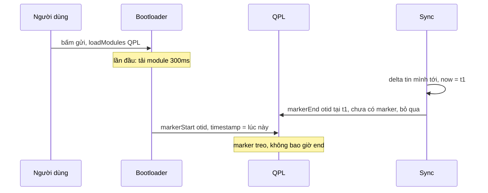

Bạn muốn biết: người dùng bấm "Gửi" thì sau bao lâu tin của họ thật sự tới server và quay về? Đó là con số quyết định cảm giác "chat có nhanh không". Nó không đo được bằng `fetch` timing, vì đường đi gồm request HTTP (hoặc MQTT), xử lý ở server, rồi delta dội về qua kênh realtime, hai đường khác nhau.

Đo trên hàng tỷ lượt gửi còn thêm hai câu hỏi:

- Không thể gửi một event cho **mỗi** lượt gửi. Lấy mẫu thế nào để rẻ?
- Một phần phép đo không bao giờ kết thúc (tab đóng, mạng rớt, lỗi code). Bao nhiêu phần trăm? Nếu không biết, số liệu bị lệch về phía "nhanh" mà không ai hay.

Facebook có một thư viện đo nội bộ, QPL (*Quick Performance Logger*), trả lời cả ba.

> [!TIP]
> **Tóm tắt**
> - QPL đo theo **marker**: `markerStart(id, instanceKey)` … `markerEnd(id, action, instanceKey)`. `instanceKey` cho phép đo nhiều phiên song song, ví dụ mỗi tin đang gửi một marker.
> - Lấy mẫu 1/N quyết định **ngay lúc start**. Marker không trúng mẫu thì không lưu gì; point, annotation, end sau đó gần như miễn phí.
> - `trackedForLoss`: lúc start gửi thêm một event riêng. Server so số start với số end để biết tỷ lệ phép đo bị rơi.
> - Messenger đo RTT gửi tin bằng `markerStart(SEND_MESSAGE, otid)` khi bấm gửi và `markerEnd` khi delta tin của chính mình dội về; hai đầu khớp nhau nhờ cùng OTID. Bản gốc lấy timestamp lúc start **sau** một lần tải module bất đồng bộ, nên lần đo đầu có thể sai hoặc mất.

<iframe class="demo-frame" src="/demos/facebook-patterns/index.html?theme=dark#/qpl-send-rtt" title="Demo qpl-send-rtt" loading="lazy" style="height: 900px"></iframe>

<p class="demo-links">▶ <a href="/demos/facebook-patterns/index.html#/qpl-send-rtt" target="_blank" rel="noopener">Mở demo toàn màn hình ↗</a> · <a href="https://stackblitz.com/github/hunghg255/blog-hunghg/tree/master/examples/facebook-patterns?file=src/lib/qpl.ts" target="_blank" rel="noopener">Sửa code trên StackBlitz ↗</a> · <a href="https://github.com/hunghg255/blog-hunghg/blob/master/examples/facebook-patterns/src/lib/qpl.ts" target="_blank" rel="noopener">Xem source trên GitHub ↗</a></p>

## Facebook làm thế nào?

### Lõi đo: `QuickPerformanceLoggerCore` (bundle `26.js`)

Marker đang chạy lưu trong `Map<markerId, Map<instanceKey, marker>>`. Quyết định lấy mẫu nằm ở một hàm nhỏ (đổi tên biến):

```js
shouldSample(markerId) {
  if (this.unsampleAllEvents?.() || this.debugMarkerId === markerId) return [true, 1];
  const config = this.quickLogConfigHelper?.getEventDetails(markerId) ?? { sampleRate: 0 };
  const rate = this.alwaysOnRates[markerId] ?? config.sampleRate ?? this.defaultRate;
  return [rate !== 0 && (rate <= 1 || Math.random() * rate <= 1), rate];
}
```

`Math.random() * rate <= 1` đúng với xác suất `1/rate`. Tỷ lệ lấy mẫu của từng marker do server cấu hình. `enableDebug(id)` ép một marker luôn được đo, để kỹ sư xem số của chính mình.

`markerStart` gọi hàm này đúng một lần:

```js
markerStart(markerId, instanceKey = 0, timestamp = this.now(), { trackedForLoss = false } = {}) {
  const [passesSampling, sampleRate] = this.shouldSample(markerId);
  if (passesSampling) this.addMarker(markerId, instanceKey, { timestamp, sampleRate, points: [], … });
  if (passesSampling && trackedForLoss) this.send({ marker_id: 27787271, annotations_int: { tracked_marker_id: markerId } });
}
```

Marker không trúng mẫu thì không vào `Map`. `markerPoint`, `markerAnnotate`, `markerEnd` đều bắt đầu bằng `getMarker(...)` và trả về ngay nếu không thấy, nên phần lớn lời gọi trong production là no-op.

`markerEnd` tính `value = round(end − start)`, gom point (trùng tên chỉ giữ lần đầu, trừ marker loại 2), đổi annotation theo kiểu thành các trường `annotations_int`, `annotations_double`… rồi gửi. Annotation kiểu `int` bị `Math.trunc` ngay khi ghi.

Event `27787271` là một marker riêng với tỷ lệ lấy mẫu 1, chỉ mang `tracked_marker_id`. Ở server, đếm số event này so với số lần marker `tracked_marker_id` kết thúc là ra tỷ lệ phép đo bị rơi.

### Đo RTT gửi tin (bundle `55.js`)

Đầu bắt đầu, trong `MercuryServerRequests.sendNewMessage`:

```js
Bootloader.loadModules(['QuickPerformanceLogger', 'MessengerWebQuickLogModule'], (QPL, M) => {
  QPL.markerStart(M.SEND_MESSAGE, message.offline_threading_id);
});
```

Đầu kết thúc, trong `MercurySyncDeltaHandler`, khi delta `NewMessage` tới:

```js
case DeltaTypes.NewMessage:
  const now = performanceAbsoluteNow();              // chụp NGAY khi delta tới
  Bootloader.loadModules(['QuickPerformanceLogger', 'MessengerWebQuickLogModule'], (QPL, M) => {
    const tags = delta.messageMetadata.tags;
    if (Array.isArray(tags) && tags.includes('app_id:219994525426954')) {
      QPL.markerEnd(M.SEND_MESSAGE, 'SUCCESS', delta.messageMetadata.offlineThreadingId, now);
    }
  });
```

Mấu chốt là `instanceKey` = OTID ([bài #39](/blogs/facebook-otid-client-snowflake)). Mỗi tin đang gửi là một marker riêng; delta dội về mang lại OTID nên kết thúc đúng marker. Tag `app_id:…` có lẽ là ID của ứng dụng web: chỉ tin gửi từ web client mới được tính (tin bạn gửi từ điện thoại cũng dội về tab này, nhưng tab không có marker cho nó).

Ngoài ra còn hai chỗ gọi `markerEnd`: khi response HTTP của lệnh gửi về (`server_send_message`, kết thúc với `SUCCESS`) và khi gửi lỗi (`FAIL`). Cả hai dùng `client_message_id` làm khoá. Mình không xác định được trong bản dump `client_message_id` ở hai nhánh đó có luôn bằng OTID hay không. Nếu không, marker của tin gửi lỗi sẽ không bao giờ được kết thúc; QPL lõi cũng không có cơ chế dọn marker treo.

### Chỗ lệch: timestamp lúc start

Đầu kết thúc chụp `now` **trước** khi tải module. Đầu bắt đầu thì không: `markerStart` không truyền timestamp, nên dùng mặc định `this.now()` tại lúc callback chạy, tức là **sau** khi `loadModules` xong.

- Nếu module đã tải sẵn: callback chạy gần như ngay, lệch không đáng kể.
- Nếu đây là lần gửi đầu trong phiên và module chưa tải: phép đo bắt đầu trễ đúng bằng thời gian tải module. Kết quả: RTT bị **đo thiếu**; hoặc nếu delta dội về trước khi module tải xong, `markerEnd` không tìm thấy marker (bị bỏ qua), còn `markerStart` chạy sau đó tạo ra một marker không bao giờ kết thúc.

Demo mô phỏng module tải mất 300ms ở lần gửi đầu, độ trễ gửi tin 120–420ms. Ở chế độ "kiểu Facebook", lần gửi đầu cho kết quả "mất" (trong lần chạy thử: RTT thật 256ms, marker chưa kịp bắt đầu) và để lại 1 marker treo. Các lần sau khớp với RTT thật.

Đây là suy luận từ thứ tự lời gọi trong code; mình không có số liệu thật của Facebook về tần suất module chưa tải lúc gửi tin đầu.



## Viết lại

Lõi đo giữ đúng ngữ nghĩa của bản gốc: lấy mẫu lúc start, nhiều instance, point trùng tên giữ lần đầu, `trackedForLoss`. Phần quyết định nằm ở `markerStart`:

```ts title=src/lib/qpl.ts
    markerStart(
      markerId: number,
      instanceKey: string | number = 0,
      { timestamp = now(), trackedForLoss = false }: { timestamp?: number; trackedForLoss?: boolean } = {},
    ) {
      const rate = sampleRate(markerId);
      // xác suất 1/rate; rate ≤ 1 nghĩa là luôn đo
      const sampled = rate !== 0 && (rate <= 1 || random() * rate <= 1);
      if (!sampled) return false;
      if (!active.has(markerId)) active.set(markerId, new Map());
      active.get(markerId)!.set(instanceKey, {
        start: timestamp,
        sampleRate: rate,
        points: [],
        annotations: {},
        trackedForLoss,
      });
      if (trackedForLoss) send({ kind: 'loss-start', markerId, instanceKey, sampleRate: rate });
      return true;
    },
```

`markerEnd` xoá marker rồi gửi `value = round(end − start)`; `sweep(maxAgeMs)` gọi `markerEnd(…, 'TIMEOUT')` cho marker quá hạn. Tracker RTT chỉ là hai hàm bọc, nhưng timestamp được chụp đồng bộ ở cả hai đầu:

```ts title=src/lib/qpl.ts
export const SEND_MESSAGE = 25_100_001;

/**
 * Đo RTT gửi tin đầu-cuối: start khi bấm gửi, end khi tin của chính mình dội về qua sync.
 * Hai đầu khớp nhau nhờ cùng instanceKey là OTID của tin.
 *
 * Mấu chốt: chụp timestamp ĐỒNG BỘ tại lúc sự kiện xảy ra, rồi mới làm việc async.
 */
export function createSendRttTracker(qpl: Qpl, now: () => number = () => performance.now()) {
  return {
    onSend(otid: string) {
      return qpl.markerStart(SEND_MESSAGE, otid, { timestamp: now(), trackedForLoss: true });
    },
    onEcho(otid: string) {
      return qpl.markerEnd(SEND_MESSAGE, 'SUCCESS', otid, now());
    },
    onError(otid: string) {
      return qpl.markerEnd(SEND_MESSAGE, 'FAIL', otid, now());
    },
  };
}
```

::: spoiler Xem toàn bộ src/lib/qpl.ts

```ts title=src/lib/qpl.ts
/**
 * Mini QPL (Quick Performance Logger) theo ý tưởng QuickPerformanceLoggerCore của Facebook:
 *
 * - "Marker" đo một đoạn thời gian: markerStart(id, instanceKey) … markerEnd(id, action, instanceKey).
 *   instanceKey cho phép đo nhiều phiên cùng loại song song (vd mỗi tin nhắn đang gửi một marker).
 * - Lấy mẫu 1/N quyết định NGAY lúc start. Marker không trúng mẫu thì không lưu gì,
 *   point/annotation/end sau đó gần như không tốn gì.
 * - trackedForLoss: lúc start gửi thêm một event riêng; server so số start với số end
 *   để biết bao nhiêu phần trăm phép đo bị rơi (tab đóng, crash, lỗi code).
 * - Annotation có kiểu (string/int/double/bool), int bị cắt phần thập phân.
 */

export type QplAction = 'SUCCESS' | 'FAIL' | 'CANCEL' | 'TIMEOUT';

export interface QplPoint {
  name: string;
  timeSinceStart: number;
}

export interface QplAnnotations {
  string?: Record<string, string>;
  int?: Record<string, number>;
  double?: Record<string, number>;
  bool?: Record<string, boolean>;
}

export interface QplEvent {
  kind: 'marker' | 'loss-start';
  markerId: number;
  instanceKey: string | number;
  action?: QplAction;
  /** thời lượng (ms) */
  value?: number;
  sampleRate: number;
  points?: QplPoint[];
  annotations?: QplAnnotations;
}

interface ActiveMarker {
  start: number;
  sampleRate: number;
  points: QplPoint[];
  annotations: QplAnnotations;
  trackedForLoss: boolean;
}

export interface QplOptions {
  /** N trong "1/N"; 0 = tắt, 1 = luôn đo */
  sampleRate: (markerId: number) => number;
  send: (event: QplEvent) => void;
  now?: () => number;
  random?: () => number;
}

export function createQpl({ sampleRate, send, now = () => performance.now(), random = Math.random }: QplOptions) {
  const active = new Map<number, Map<string | number, ActiveMarker>>();

  const get = (markerId: number, key: string | number) => active.get(markerId)?.get(key);
  const remove = (markerId: number, key: string | number) => {
    const byKey = active.get(markerId);
    byKey?.delete(key);
    if (byKey && byKey.size === 0) active.delete(markerId);
  };

  return {
    markerStart(
      markerId: number,
      instanceKey: string | number = 0,
      { timestamp = now(), trackedForLoss = false }: { timestamp?: number; trackedForLoss?: boolean } = {},
    ) {
      const rate = sampleRate(markerId);
      // xác suất 1/rate; rate ≤ 1 nghĩa là luôn đo
      const sampled = rate !== 0 && (rate <= 1 || random() * rate <= 1);
      if (!sampled) return false;
      if (!active.has(markerId)) active.set(markerId, new Map());
      active.get(markerId)!.set(instanceKey, {
        start: timestamp,
        sampleRate: rate,
        points: [],
        annotations: {},
        trackedForLoss,
      });
      if (trackedForLoss) send({ kind: 'loss-start', markerId, instanceKey, sampleRate: rate });
      return true;
    },

    markerPoint(markerId: number, name: string, instanceKey: string | number = 0, timestamp = now()) {
      const marker = get(markerId, instanceKey);
      if (!marker) return;
      // point trùng tên chỉ giữ lần đầu (giống bản gốc)
      if (marker.points.some((p) => p.name === name)) return;
      marker.points.push({ name, timeSinceStart: Math.trunc(timestamp - marker.start) });
    },

    markerAnnotate(markerId: number, annotations: QplAnnotations, instanceKey: string | number = 0) {
      const marker = get(markerId, instanceKey);
      if (!marker) return;
      const int = annotations.int && Object.fromEntries(Object.entries(annotations.int).map(([k, v]) => [k, Math.trunc(v)]));
      marker.annotations = {
        string: { ...marker.annotations.string, ...annotations.string },
        int: { ...marker.annotations.int, ...int },
        double: { ...marker.annotations.double, ...annotations.double },
        bool: { ...marker.annotations.bool, ...annotations.bool },
      };
    },

    markerEnd(markerId: number, action: QplAction, instanceKey: string | number = 0, timestamp = now()) {
      const marker = get(markerId, instanceKey);
      if (!marker) return undefined; // không trúng mẫu, hoặc đã kết thúc rồi
      remove(markerId, instanceKey);
      const value = Math.round(timestamp - marker.start);
      send({
        kind: 'marker',
        markerId,
        instanceKey,
        action,
        value,
        sampleRate: marker.sampleRate,
        points: marker.points,
        annotations: marker.annotations,
      });
      return value;
    },

    markerDrop(markerId: number, instanceKey: string | number = 0) {
      remove(markerId, instanceKey);
    },

    /**
     * Bổ sung so với bản gốc: kết thúc các marker treo quá lâu bằng TIMEOUT.
     * Bản gốc không có bước này nên marker không bao giờ end sẽ nằm mãi trong bộ nhớ.
     */
    sweep(maxAgeMs: number, timestamp = now()) {
      let swept = 0;
      for (const [markerId, byKey] of [...active]) {
        for (const [key, marker] of [...byKey]) {
          if (timestamp - marker.start > maxAgeMs) {
            this.markerEnd(markerId, 'TIMEOUT', key, timestamp);
            swept++;
          }
        }
      }
      return swept;
    },

    get activeCount() {
      let n = 0;
      for (const byKey of active.values()) n += byKey.size;
      return n;
    },
  };
}

export type Qpl = ReturnType<typeof createQpl>;

export const SEND_MESSAGE = 25_100_001;

/**
 * Đo RTT gửi tin đầu-cuối: start khi bấm gửi, end khi tin của chính mình dội về qua sync.
 * Hai đầu khớp nhau nhờ cùng instanceKey là OTID của tin.
 *
 * Mấu chốt: chụp timestamp ĐỒNG BỘ tại lúc sự kiện xảy ra, rồi mới làm việc async.
 */
export function createSendRttTracker(qpl: Qpl, now: () => number = () => performance.now()) {
  return {
    onSend(otid: string) {
      return qpl.markerStart(SEND_MESSAGE, otid, { timestamp: now(), trackedForLoss: true });
    },
    onEcho(otid: string) {
      return qpl.markerEnd(SEND_MESSAGE, 'SUCCESS', otid, now());
    },
    onError(otid: string) {
      return qpl.markerEnd(SEND_MESSAGE, 'FAIL', otid, now());
    },
  };
}
```

:::

**Khác bản gốc:**

- Không có killswitch, listener, cấu hình từ server.
- Thêm `sweep(maxAgeMs)` để kết thúc marker treo bằng `TIMEOUT`.
- Tracker RTT nhận timestamp ngay lúc bấm gửi.
- Không có tầng gửi theo lô; `send` do bạn cấp, có thể là batch logger ở [bài #7](/blogs/facebook-batch-logger).

## Đi qua code

- **`markerStart`** trả về `true/false` cho biết có trúng mẫu không. Không trúng thì không đụng tới `Map`.
- **`random() * rate <= 1`** với `rate ≤ 1` luôn đúng (luôn đo), `rate = 0` là tắt. Demo chạy 1.000 lượt với 1/10 ra khoảng 100 marker được gửi.
- **`markerPoint`** lưu `timeSinceStart`, không lưu thời gian tuyệt đối, nên payload nhỏ và không lệ thuộc đồng hồ.
- **`markerEnd`** xoá marker trước khi gửi: gọi `markerEnd` lần hai (HTTP response tới sau delta) là no-op. Đây là lý do bản gốc có thể kết thúc cùng một marker từ hai nơi mà không đếm trùng.
- **`trackedForLoss`** gửi event `loss-start`. Demo cho 7% lượt gửi "đóng tab" trước khi tin dội về; tỷ lệ mất đo được khoảng 7%.
- **`createSendRttTracker`** chỉ là hai hàm bọc. Giá trị nằm ở chỗ `now()` được gọi ngay trong `onSend`, trước mọi `await`.

## Tại sao không làm cách khác?

- **Gửi event cho mọi lượt rồi lấy mẫu ở server**: tốn băng thông và tiền lưu trữ. Lấy mẫu ở client giảm chi phí theo đúng tỷ lệ N.
- **Lấy mẫu lúc end**: phải giữ marker cho mọi lượt, tốn bộ nhớ, và vẫn phải quyết định trước khi biết kết quả để không thiên lệch (ví dụ chỉ giữ lượt chậm).
- **Dùng `performance.mark/measure`** ([bài web #11](/blogs/web-performance-spans-long-tasks)): tốt cho đo trong một trang, có sẵn trong DevTools. Nhưng nó không có khái niệm lấy mẫu, instance song song theo khoá, hay đo tỷ lệ mất; vẫn phải tự viết lớp gửi đi.
- **Đo bằng thời gian response HTTP**: chỉ đo được nửa đường. Tin chưa tới người nhận cho tới khi server đẩy nó vào kênh realtime.

## Edge case và cạm bẫy

- **Timestamp phải chụp ở chỗ sự kiện xảy ra**, rồi mới làm việc async (tải module, đợi Promise). Truyền timestamp vào `markerStart/markerEnd` thay vì để hàm tự lấy.
- **Đồng hồ**: dùng `performance.now()` (đơn điệu tăng). `Date.now()` có thể nhảy khi máy đồng bộ giờ.
- **Tab chuyển nền**: trình duyệt hãm timer và có thể đóng băng tab. Nếu delta dội về trong lúc tab ẩn, RTT sẽ gồm cả thời gian bị đóng băng. Cân nhắc đánh dấu annotation `visibility` để lọc.
- **Marker treo**: tin gửi lỗi mà không gọi `markerEnd(FAIL)`, hoặc khoá không khớp. Dọn định kỳ bằng `sweep`, và đếm số `TIMEOUT` như một chỉ số riêng.
- **Lấy mẫu phải đồng nhất trong một phiên đo**: point và annotation chỉ có nghĩa nếu marker trúng mẫu từ đầu. Đừng quyết định lấy mẫu lại ở giữa.

## Dùng trong dự án

```ts
import { createQpl, createSendRttTracker } from './qpl';
import { createBatchLogger } from './batchLogger';

const logger = createBatchLogger({ endpoint: '/metrics' });
const qpl = createQpl({
  sampleRate: (id) => remoteConfig.qplRates[id] ?? 100, // mặc định 1/100
  send: (event) => logger.log('qpl', { ...event }, 'basic'),
});
const rtt = createSendRttTracker(qpl);

async function send(text: string) {
  const otid = generateOtid();
  rtt.onSend(otid); // chụp thời gian ngay lúc bấm
  await api.send({ text, offline_threading_id: otid }).catch(() => rtt.onError(otid));
}

realtime.on('new_message', (m) => m.offline_threading_id && rtt.onEcho(m.offline_threading_id));
setInterval(() => qpl.sweep(60_000), 30_000);
```

Khi phân tích ở server, nhân mỗi giá trị với `sampleRate` của nó nếu cần ước lượng tổng.

## Kiểm thử

::: spoiler Ví dụ test (bản phác, không có trong repo)

```ts
import { describe, expect, it, vi } from 'vitest';
import { createQpl, createSendRttTracker, SEND_MESSAGE, type QplEvent } from './qpl';

describe('createQpl', () => {
  it('lấy mẫu 1/N quyết định lúc start; không trúng thì end không gửi gì', () => {
    const send = vi.fn();
    const qpl = createQpl({ sampleRate: () => 10, send, now: () => 0, random: () => 0.5 }); // 0.5*10 = 5 > 1
    expect(qpl.markerStart(1, 'a')).toBe(false);
    expect(qpl.markerEnd(1, 'SUCCESS', 'a')).toBeUndefined();
    expect(send).not.toHaveBeenCalled();
  });

  it('nhiều instance song song, point trùng tên giữ lần đầu, int bị cắt', () => {
    const events: QplEvent[] = [];
    let t = 0;
    const qpl = createQpl({ sampleRate: () => 1, send: (e) => events.push(e), now: () => t });
    qpl.markerStart(7, 'x');
    qpl.markerStart(7, 'y');
    t = 40;
    qpl.markerPoint(7, 'render', 'x');
    t = 55;
    qpl.markerPoint(7, 'render', 'x');
    qpl.markerAnnotate(7, { int: { items: 12.9 } }, 'x');
    t = 100;
    expect(qpl.markerEnd(7, 'SUCCESS', 'x')).toBe(100);
    expect(events[0].points).toEqual([{ name: 'render', timeSinceStart: 40 }]);
    expect(events[0].annotations?.int).toEqual({ items: 12 });
    expect(qpl.activeCount).toBe(1);
  });

  it('trackedForLoss gửi event start riêng để server tính tỷ lệ mất', () => {
    const kinds: string[] = [];
    const qpl = createQpl({ sampleRate: () => 1, send: (e) => kinds.push(e.kind), now: () => 0 });
    qpl.markerStart(1, 'a', { trackedForLoss: true });
    qpl.markerStart(1, 'b', { trackedForLoss: true });
    qpl.markerEnd(1, 'SUCCESS', 'a');
    expect(kinds).toEqual(['loss-start', 'loss-start', 'marker']);
  });

  it('RTT gửi tin: start và end khớp nhau theo OTID, end lần hai là no-op', () => {
    let t = 1000;
    const values: number[] = [];
    const qpl = createQpl({ sampleRate: () => 1, send: (e) => e.kind === 'marker' && values.push(e.value!) });
    const tracker = createSendRttTracker(qpl, () => t);
    tracker.onSend('111');
    tracker.onSend('222');
    t = 1180;
    tracker.onEcho('222');
    t = 1300;
    tracker.onEcho('111');
    expect(values).toEqual([180, 300]);
    expect(qpl.markerEnd(SEND_MESSAGE, 'SUCCESS', '111')).toBeUndefined();
  });
});
```

:::

## So với thư viện và chuẩn web

- **OpenTelemetry JS**: span có `startTime/endTime`, attribute có kiểu, và sampler (ví dụ `TraceIdRatioBasedSampler`) quyết định lúc tạo span, cùng ý tưởng với QPL. Thiếu "tracked for loss"; span không kết thúc đơn giản là không được export.
- **User Timing (`performance.mark/measure`)**: chuẩn web, hiện trong tab Performance. Không có lấy mẫu hay gửi đi; thường làm nguồn dữ liệu cho một lớp như QPL.
- **web-vitals / RUM** ([bài web #41](/blogs/web-rum-adaptive-loading)): đo chỉ số trang (LCP, INP…), không đo luồng nghiệp vụ như "gửi tin". QPL lấp đúng khoảng đó.
- **Visual Completion** ([bài #19](/blogs/facebook-visual-completion)) là một hệ đo khác của chính Facebook: đo lúc màn hình "vẽ xong" bằng MutationObserver. QPL đo luồng nghiệp vụ do code tự đánh dấu; hai hệ bổ sung cho nhau.

---

Bài này thuộc series **[Học từ mã nguồn Facebook](/series/facebook)** (58 bài, đọc theo thứ tự).

::: spoiler Xem nhanh danh sách bài trong series

*Phần 1*

- [Mở đầu: cách đọc code minify của Facebook](/blogs/learn-from-facebook-source-code)
- [#1 Dùng chung IntersectionObserver + infinite scroll](/blogs/facebook-shared-intersection-observer)
- [#2 useViewportDuration: đo thời gian thực sự được xem](/blogs/facebook-use-viewport-duration)
- [#3 Preload code + data khi hover](/blogs/facebook-preload-on-hover)
- [#4 Toast manager với external store](/blogs/facebook-toast-manager)
- [#5 Network status + heartbeat backoff](/blogs/facebook-network-status-heartbeat)
- [#6 ErrorGuard: bắt lỗi theo ngữ cảnh](/blogs/facebook-error-guard)
- [#7 Banzai: gom log theo lô + sendBeacon](/blogs/facebook-batch-logger)
- [#8 Focus trap + Esc theo layer](/blogs/facebook-focus-trap)

*Phần 2*

- [#9 Mẹo calc(… * 9999): container query, line-clamp, mũi tên carousel bằng CSS](/blogs/facebook-css-9999-trick)
- [#10 Thanh cuộn tuỳ biến bằng CSS 3D](/blogs/facebook-css-3d-scrollbar)
- [#11 Modal cuộn bằng window, giữ vị trí trang nền](/blogs/facebook-document-scroll-modal)
- [#12 Popover, tooltip group và hovercard](/blogs/facebook-popover-tooltip)
- [#13 Primitive Pressable + focus-visible](/blogs/facebook-pressable)
- [#14 Tab "Xem thêm" + sticky header bằng IntersectionObserver](/blogs/facebook-priority-tabs-sticky-header)
- [#15 Avatar khoét mask, gradient Messenger, skeleton steps()](/blogs/facebook-visual-tricks)
- [#16 Khung chat không giật](/blogs/facebook-chat-scroller)
- [#17 Thuật toán chọn bố cục collage ảnh](/blogs/facebook-photo-collage-layout)
- [#18 Keep-alive tab trong SPA](/blogs/facebook-keep-alive-tabs)
- [#19 Tự đo Visual Completion & interaction tracing](/blogs/facebook-visual-completion)
- [#20 Router SPA bền bỉ & tải chunk có retry](/blogs/facebook-spa-router-resilient-loading)

*Phần 3*

- [#21 Smart Compose: gợi ý chữ mờ khi gõ](/blogs/facebook-smart-compose-ghost-text)
- [#22 MQTT ngay trong trình duyệt, tự chuyển sang long-poll](/blogs/facebook-mqtt-in-browser)
- [#23 Đo thời gian dùng bằng bitmap 64 giây](/blogs/facebook-time-spent-bitmap)
- [#24 Bảng reaction nhấn giữ rồi trượt](/blogs/facebook-reaction-press-slide)
- [#25 Tìm kiếm gấp dấu, phiên âm và highlight đầu từ](/blogs/facebook-search-diacritics-tokenize)
- [#26 Ring buffer biết trace nào đã mất log](/blogs/facebook-trace-ring-buffer)
- [#27 Engine animation JS: một vòng rAF và solver cubic-bezier](/blogs/facebook-keyframes-loop-cubic-bezier)
- [#28 Bootloader: bitmap tài nguyên đã tải, chỉ reload khi cần](/blogs/facebook-bootloader-bitmap-consistency)
- [#29 Nhận biết click do screen reader tạo ra](/blogs/facebook-virtual-cursor-detection)
- [#30 Tải trước feed theo chất lượng mạng, đoán hạng thiết bị](/blogs/facebook-network-aware-prefetch)
- [#31 Hàng đợi gửi tin chat giữ đúng thứ tự](/blogs/facebook-ordered-send-queue)
- [#32 Gộp lời gọi API trong cùng một tick](/blogs/facebook-api-batcher)
- [#33 Resize ảnh trong pool Web Worker](/blogs/facebook-jpeg-resize-worker-pool)
- [#34 Crop ảnh theo nhiều khuôn mặt](/blogs/facebook-face-aware-crop)
- [#35 Kéo-thả sắp xếp và vùng thả file không nhấp nháy](/blogs/facebook-flicker-free-drag-drop)
- [#36 Tiện ích UI: fade-out, sticky event, hàm huỷ được](/blogs/facebook-ui-utility-hooks)
- [#37 Hạ tầng nhỏ: cookie, hash lỗi, prefetch khi chuột dừng](/blogs/facebook-small-infra-cookie-hash-idle)

*Phần 4–6*

- [#38 Đồng bộ tin nhắn: phát hiện lỗ seqID và fetch bù theo tầng](/blogs/facebook-messenger-sync-seqid-gaps)
- [#39 OTID: ID tin nhắn kiểu Snowflake sinh ở client](/blogs/facebook-otid-client-snowflake)
- **#40 QPL: lấy mẫu từ lúc bắt đầu, đo RTT gửi tin đầu-cuối** (bài này)
- [#41 Bộ điều phối request bảy chế độ gộp và chống trùng](/blogs/facebook-request-dispatcher-modes)
- [#42 Thread list theo mốc thời gian, cookie presence có version](/blogs/facebook-threadlist-ranged-presence)
- [#43 Composer dạng plugin: reducer, dirty checker, chuỗi kiểm tra](/blogs/facebook-plugin-composer)
- [#44 Thanh toán bất đồng bộ: subscribe trước, poll dự phòng](/blogs/facebook-async-checkout)
- [#45 Validate số thẻ: sửa lỗi gõ, dải BIN, Luhn](/blogs/facebook-card-validation)
- [#46 Lịch chọn khoảng ngày: bo góc dải chọn, phím đủ bộ, RTL](/blogs/facebook-range-calendar-a11y)
- [#47 Giờ mở cửa theo tuần: qua đêm, gộp khoảng, phần bù](/blogs/facebook-weekly-hours-intervals)
- [#48 Tiến độ đăng realtime: giữ event chờ snapshot, watchdog](/blogs/facebook-realtime-publish-snapshot)
- [#49 Tiền tệ theo đơn vị nhỏ nhất và ô nhập tiền](/blogs/facebook-currency-minor-units)
- [#50 Sửa hàng loạt Empty/Uniform/Mixed, seen/read bằng 2 bit](/blogs/facebook-bulk-edit-seen-bits)
- [#51 Phát hiện script lạ hook vào hàm native](/blogs/facebook-native-hook-detection)
- [#52 localStorage tự dọn khi đầy quota](/blogs/facebook-quota-aware-storage)
- [#53 Cache tuyến do server phân giải, chờ sẵn promise](/blogs/facebook-route-cache-prefetch)
- [#54 Lưới phím mũi tên 2D và focus không làm cuộn trang](/blogs/facebook-focus-table-grid)
- [#55 Tách emoji bằng máy trạng thái](/blogs/facebook-emoji-segmentation)
- [#56 Đọc trước ghi sau trong một frame, con tự biết vị trí](/blogs/facebook-read-then-write-dom)
- [#57 Hàng đợi lệnh cho video và stream sắp lại chunk](/blogs/facebook-video-command-queue)

:::

Code + demo: [`examples/facebook-patterns`](https://github.com/hunghg255/blog-hunghg/tree/master/examples/facebook-patterns) · [Mở trên StackBlitz](https://stackblitz.com/github/hunghg255/blog-hunghg/tree/master/examples/facebook-patterns)
