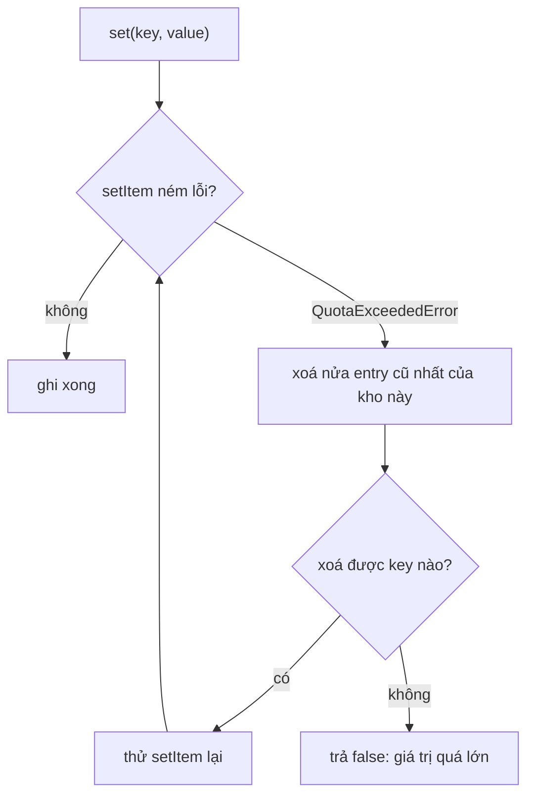

`localStorage` có giới hạn, thường khoảng 5MB cho mỗi origin. Ứng dụng dùng nó làm cache (bản nháp, danh sách gần đây, cấu hình đã tải) sớm muộn sẽ chạm trần. Khi đó `setItem` ném `QuotaExceededError`, và đa số code xử lý theo một trong hai cách: bỏ qua lỗi (cache ngừng hoạt động mà không ai biết), hoặc `localStorage.clear()` (xoá luôn dữ liệu của mọi thư viện khác cùng origin).

Facebook có một module nhỏ làm việc này cẩn thận hơn: mỗi giá trị lưu kèm thời điểm ghi, và khi đầy thì xoá **nửa số entry cũ nhất** rồi thử lại. Bài này đọc module đó, chỉ ra hai lỗi trong bản gốc, và viết lại.

> [!TIP]
> **Tóm tắt**
> - `CacheStorage` (`9.js`) bọc mỗi giá trị thành `{"__t": Date.now(), "__v": giá trị}`. `setItem` ném lỗi thì xoá `ceil(n/2)` entry có `__t` nhỏ nhất, lặp tới khi ghi được hoặc không xoá thêm được gì.
> - Key có tiền tố riêng (`_cs_`); đổi version thì chỉ xoá key có tiền tố của mình.
> - Lỗi 1: khi dọn, module quét **mọi key** trong storage và xoá luôn giá trị nào không parse được JSON, kể cả key của code khác (ví dụ `theme = "dark"`).
> - Lỗi 2: `remove()` của callback gọi `slice` thay vì `splice`, nên không gỡ được callback.

<iframe class="demo-frame" src="/demos/facebook-patterns/index.html?theme=dark#/quota-storage" title="Demo quota-storage" loading="lazy" style="height: 820px"></iframe>

<p class="demo-links">▶ <a href="/demos/facebook-patterns/index.html#/quota-storage" target="_blank" rel="noopener">Mở demo toàn màn hình ↗</a> · <a href="https://stackblitz.com/github/hunghg255/blog-hunghg/tree/master/examples/facebook-patterns?file=src/lib/quotaStorage.ts" target="_blank" rel="noopener">Sửa code trên StackBlitz ↗</a> · <a href="https://github.com/hunghg255/blog-hunghg/blob/master/examples/facebook-patterns/src/lib/quotaStorage.ts" target="_blank" rel="noopener">Xem source trên GitHub ↗</a></p>

## Facebook làm thế nào?

### Ba backend, một interface

Module định nghĩa ba lớp cùng interface `get/set/remove/keys/clear/clearWithPrefix`: bộ nhớ (`memory`), `localstorage`, `sessionstorage`. Tạo `new CacheStorage("AUTO", prefix)` thì module thử lần lượt và chọn backend đầu tiên khả dụng. Nếu không lấy được `localStorage` (bị chặn trong iframe bên thứ ba, cài đặt quyền riêng tư…), backend rơi về một object rỗng không làm gì (`emptyFunction`), nên code gọi không phải kiểm tra.

### Gói giá trị kèm thời điểm

```js
set(key, value, raw) {
  const payload = typeof value === 'string' ? '_@_' + value       // chuỗi: tiền tố "ma thuật", không qua JSON
    : raw ? JSON.stringify(value) : JSON.stringify({ __t: Date.now(), __v: value });
  // vòng lặp: try backend.set(prefix + key, payload)
  //   catch → đếm số key, _evictCacheEntries(), thử lại nếu số key giảm
}
```

Vòng lặp không kiểm tra loại lỗi: mọi lỗi từ `setItem` đều kích hoạt dọn dẹp. Nó dừng khi lần dọn không làm số key giảm đi.

### Dọn nửa cũ nhất

```js
_evictCacheEntries() {
  const aged = [];
  backend.keys().forEach((key) => {                   // MỌI key, không lọc theo tiền tố
    if (key === 'CacheStorageVersion') return;
    const raw = backend.get(key);
    if (raw === undefined) { backend.remove(key); return; }
    if (raw.startsWith('_@_')) return;                // chuỗi thô: không bao giờ bị dọn
    let value;
    try { value = JSON.parse(raw); }
    catch (e) { backend.remove(key); return; }       // không phải JSON: xoá
    if (value && value.__t !== undefined && value.__v !== undefined) aged.push([key, value.__t]);
  });
  aged.sort((a, b) => a[1] - b[1]);
  for (let i = 0; i < Math.ceil(aged.length / 2); i++) backend.remove(aged[i][0]);
}
```

Xoá một nửa thay vì từng entry một là lựa chọn hợp lý: mỗi lần dọn phải parse toàn bộ storage, nên dọn nhiều một lần để lần ghi sau khỏi phải dọn tiếp.

### Version và tiền tố

Lúc khởi tạo, module đọc key toàn cục `CacheStorageVersion`. Nếu khác `"3b"` thì gọi `clearOwnKeys()`: chỉ xoá key bắt đầu bằng tiền tố của instance này, rồi ghi version mới. Nếu killswitch `CACHE_STORAGE_MODULE_CLEAR_OWN_KEYS` đang bật thì gọi `clear()`, tức xoá toàn bộ storage của origin. Có lẽ đây là đường lui khi cần dọn sạch dữ liệu cũ một cách khẩn cấp.

Module còn nghe sự kiện `storage` để báo cho callback khi một tab khác ghi vào key có tiền tố của mình, và có `disablePersistentWrites()` để tắt mọi lần ghi vào storage thật (có lẽ dùng khi người dùng chưa đồng ý lưu dữ liệu).

### Hai lỗi

**Dọn nhầm key của code khác.** `_evictCacheEntries` quét `backend.keys()`, tức mọi key trong `localStorage`, không chỉ key của instance. Giá trị nào không parse được JSON thì bị xoá. Thư viện khác lưu `theme = "dark"` hay `locale = "vi-VN"` (chuỗi thường, không phải JSON) sẽ mất dữ liệu ngay lần đầu `CacheStorage` gặp quota. Demo tái hiện: sau vài lần ghi, 2 trên 3 key của "code khác" biến mất.

**Không gỡ được callback.**

```js
addValueChangeCallback(cb) {
  this._changeCallbacks.push(cb);
  return {
    remove: () => {
      this._changeCallbacks.slice(this._changeCallbacks.indexOf(cb), 1); // slice trả mảng mới, mảng cũ không đổi
    },
  };
}
```

`slice` không sửa mảng; phải là `splice`. Component gỡ callback khi unmount vẫn bị gọi về sau, và mảng callback cứ dài thêm theo số lần mount.

Một giới hạn nữa: giá trị chuỗi lưu dạng `_@_…` không có `__t`, nên không bao giờ bị dọn. Kho toàn chuỗi thì đầy là ghi thất bại luôn.

## Bên trong trình duyệt: quota được tính thế nào



- Trình duyệt tính dung lượng `localStorage` theo tổng độ dài key và value của origin. Con số cụ thể và cách đếm (theo ký tự hay theo byte) khác nhau giữa các trình duyệt, thường quanh mức 5MB. Đừng code cứng giới hạn; chỉ dựa vào lỗi `setItem` ném ra.
- Tên lỗi không đồng nhất giữa các trình duyệt cũ: `QuotaExceededError` (code 22) là chuẩn, Firefox đời cũ dùng `NS_ERROR_DOM_QUOTA_REACHED` (code 1014). Hàm `isQuotaError` trong bài kiểm cả hai.
- `localStorage` là API đồng bộ: mỗi lần `getItem`/`setItem` chạy trên main thread. Dọn dẹp phải parse từng giá trị, nên với vài nghìn key, một lần dọn có thể mất vài chục ms.

## Viết lại

```ts title=src/lib/quotaStorage.ts
  /** Xoá nửa cũ nhất của các entry thuộc kho này. Trả về số key đã xoá. */
  function evictOldestHalf(): number {
    const entries: Array<[string, number]> = [];
    for (const key of ownKeys()) {
      const raw = backend.getItem(key);
      try {
        const parsed = JSON.parse(raw ?? '') as Envelope;
        entries.push([key, typeof parsed.__t === 'number' ? parsed.__t : 0]);
      } catch {
        entries.push([key, 0]); // hỏng thì coi là cũ nhất
      }
    }
    entries.sort((a, b) => a[1] - b[1]);
    const count = Math.ceil(entries.length / 2);
    entries.slice(0, count).forEach(([key]) => backend.removeItem(key));
    return count;
  }

  return {
    /** Trả về false nếu dọn hết vẫn không ghi được (giá trị quá lớn so với quota). */
    set(key: string, value: unknown): boolean {
      const payload = JSON.stringify({ __t: now(), __v: value } satisfies Envelope);
      for (;;) {
        try {
          backend.setItem(prefix + key, payload);
          callbacks.forEach((cb) => cb(key));
          return true;
        } catch (error) {
          if (!isQuotaError(error)) throw error;
          if (evictOldestHalf() === 0) return false;
        }
      }
    },
```

::: spoiler Xem toàn bộ src/lib/quotaStorage.ts

```ts title=src/lib/quotaStorage.ts
/**
 * localStorage tự dọn khi đầy quota (ý tưởng từ CacheStorage của Facebook).
 *
 * - Mỗi giá trị lưu kèm thời điểm ghi: {"__t": 1730000000000, "__v": …}.
 * - setItem ném QuotaExceededError → xoá NỬA số entry cũ nhất rồi thử lại, lặp tới khi
 *   ghi được hoặc không còn gì để xoá.
 * - Key có tiền tố riêng; đổi version thì chỉ xoá key của mình.
 *
 * Khác bản gốc: chỉ dọn key mang tiền tố của chính kho này (bản gốc quét mọi key trong
 * localStorage và xoá luôn giá trị không phải JSON của code khác), chuỗi thô cũng có
 * timestamp để dọn được, và `remove()` của callback dùng splice.
 */

export interface StorageLike {
  readonly length: number;
  key(index: number): string | null;
  getItem(key: string): string | null;
  setItem(key: string, value: string): void;
  removeItem(key: string): void;
}

export function isQuotaError(error: unknown): boolean {
  if (!(error instanceof DOMException)) return false;
  return (
    error.name === 'QuotaExceededError' ||
    error.name === 'NS_ERROR_DOM_QUOTA_REACHED' || // Firefox cũ
    error.code === 22 ||
    error.code === 1014
  );
}

interface Envelope {
  __t: number;
  __v: unknown;
}

export interface QuotaStorageOptions {
  backend: StorageLike;
  prefix?: string;
  version?: string;
  now?: () => number;
}

export function createQuotaStorage({ backend, prefix = '_qs_', version = '1', now = Date.now }: QuotaStorageOptions) {
  // tiền tố rỗng = mọi key trong storage đều bị coi là "của mình", kể cả key của code khác
  if (!prefix) throw new Error('prefix không được rỗng');
  const versionKey = `${prefix}version`;
  const callbacks: Array<(key: string) => void> = [];
  const ownKeys = () => {
    const keys: string[] = [];
    for (let i = 0; i < backend.length; i++) {
      const k = backend.key(i);
      if (k && k.startsWith(prefix) && k !== versionKey) keys.push(k);
    }
    return keys;
  };

  if (backend.getItem(versionKey) !== version) {
    ownKeys().forEach((k) => backend.removeItem(k));
    try {
      backend.setItem(versionKey, version);
    } catch {
      /* đầy ngay từ đầu: lần ghi sau sẽ dọn */
    }
  }

  /** Xoá nửa cũ nhất của các entry thuộc kho này. Trả về số key đã xoá. */
  function evictOldestHalf(): number {
    const entries: Array<[string, number]> = [];
    for (const key of ownKeys()) {
      const raw = backend.getItem(key);
      try {
        const parsed = JSON.parse(raw ?? '') as Envelope;
        entries.push([key, typeof parsed.__t === 'number' ? parsed.__t : 0]);
      } catch {
        entries.push([key, 0]); // hỏng thì coi là cũ nhất
      }
    }
    entries.sort((a, b) => a[1] - b[1]);
    const count = Math.ceil(entries.length / 2);
    entries.slice(0, count).forEach(([key]) => backend.removeItem(key));
    return count;
  }

  return {
    /** Trả về false nếu dọn hết vẫn không ghi được (giá trị quá lớn so với quota). */
    set(key: string, value: unknown): boolean {
      const payload = JSON.stringify({ __t: now(), __v: value } satisfies Envelope);
      for (;;) {
        try {
          backend.setItem(prefix + key, payload);
          callbacks.forEach((cb) => cb(key));
          return true;
        } catch (error) {
          if (!isQuotaError(error)) throw error;
          if (evictOldestHalf() === 0) return false;
        }
      }
    },
    get<T = unknown>(key: string): T | undefined {
      const raw = backend.getItem(prefix + key);
      if (raw == null) return undefined;
      try {
        return (JSON.parse(raw) as Envelope).__v as T;
      } catch {
        return undefined;
      }
    },
    remove(key: string) {
      backend.removeItem(prefix + key);
    },
    keys: () => ownKeys().map((k) => k.slice(prefix.length)),
    onChange(cb: (key: string) => void) {
      callbacks.push(cb);
      return {
        remove() {
          const i = callbacks.indexOf(cb);
          if (i !== -1) callbacks.splice(i, 1);
        },
      };
    },
    evictOldestHalf,
  };
}

/**
 * Storage giả có dung lượng nhỏ (tính theo số ký tự key + value, giống cách trình duyệt
 * đếm UTF-16), để demo đầy quota trong vài cú bấm thay vì phải ghi 5MB.
 */
export function createLimitedStorage(capacityChars: number): StorageLike & { used(): number; dump(): Array<[string, string]> } {
  const map = new Map<string, string>();
  const used = () => [...map].reduce((sum, [k, v]) => sum + k.length + v.length, 0);
  return {
    get length() {
      return map.size;
    },
    key: (i) => [...map.keys()][i] ?? null,
    getItem: (k) => map.get(k) ?? null,
    setItem(k, v) {
      const before = map.get(k);
      const next = used() - (before ? k.length + before.length : 0) + k.length + v.length;
      if (next > capacityChars) throw new DOMException('Quota exceeded', 'QuotaExceededError');
      map.set(k, v);
    },
    removeItem: (k) => void map.delete(k),
    used,
    dump: () => [...map],
  };
}
```

:::

## Đi qua code

- `ownKeys()` chỉ lấy key bắt đầu bằng tiền tố của kho, và tiền tố rỗng bị từ chối ngay. Đây là điểm sửa chính: dọn dẹp không bao giờ đụng tới key của code khác.
- Entry hỏng (không parse được) của chính kho được coi là cũ nhất (`__t = 0`), nên bị dọn trước, thay vì bị xoá ngay như bản gốc.
- Mọi giá trị, kể cả chuỗi, đều được gói `{__t, __v}`. Tốn thêm vài chục byte mỗi entry nhưng không còn loại dữ liệu nào "không bao giờ bị dọn".
- `set` chỉ dọn khi lỗi đúng là lỗi quota. Lỗi khác (ví dụ `SecurityError` khi storage bị chặn) được ném ra cho code gọi xử lý.
- `evictOldestHalf()` trả về số key đã xoá; bằng 0 nghĩa là không còn gì để dọn, `set` trả `false` thay vì lặp vô hạn.
- `onChange().remove()` dùng `splice`.
- `createLimitedStorage` là storage giả có dung lượng nhỏ, ném `DOMException` tên `QuotaExceededError` giống trình duyệt, để demo và test không phải ghi 5MB thật.

**Khác bản gốc:** chỉ một backend truyền vào (không tự chọn memory/local/session); không nghe sự kiện `storage` giữa các tab (thêm được bằng `window.addEventListener('storage', …)` lọc theo tiền tố); không có tham số `raw`.

## Tại sao không làm cách khác?

**LRU theo lần đọc thay vì theo lần ghi?** Muốn vậy phải ghi lại `__t` mỗi lần đọc, tức mỗi `get` biến thành một `setItem`. Với `localStorage` đồng bộ, đó là chi phí đáng kể. Theo thời điểm ghi đủ tốt cho cache dạng "dữ liệu tải từ server".

**Xoá từng entry cũ nhất một?** Mỗi lần xoá lại phải thử `setItem`, và nếu giá trị mới lớn thì phải lặp nhiều vòng, mỗi vòng parse lại toàn bộ storage. Xoá một nửa mỗi lần giới hạn số vòng ở mức log₂(n).

**IndexedDB?** IndexedDB có quota lớn hơn nhiều, bất đồng bộ, lưu được Blob. Nếu dữ liệu lớn hay nhiều, nên dùng IndexedDB (xem [bài cache theo version](/blogs/web-client-cache-versioned)). `localStorage` vẫn tiện cho dữ liệu nhỏ cần đọc đồng bộ lúc khởi động, ví dụ theme hay cờ tính năng.

## Edge case và cạm bẫy

- **Giá trị lớn hơn cả quota.** Dọn sạch rồi vẫn không ghi được. Bản viết lại trả `false` sau khi không còn gì để xoá.
- **Hai tab cùng ghi.** Tab A dọn dẹp có thể xoá entry mà tab B vừa ghi. Với dữ liệu cache thì chấp nhận được, vì đọc không thấy thì tải lại.
- **Storage bị chặn hoàn toàn.** Trong một số chế độ riêng tư hoặc iframe bên thứ ba, chỉ truy cập `window.localStorage` cũng ném lỗi. Bọc phần tạo backend trong `try` và rơi về một Map trong bộ nhớ, như bản gốc làm.
- **Đồng hồ nhảy.** `__t` lấy từ `Date.now()`. Người dùng chỉnh giờ máy về quá khứ thì entry mới có `__t` nhỏ hơn entry cũ và bị dọn trước. Ảnh hưởng nhỏ với cache.
- **Đổi version.** Chỉ xoá key của kho. Nếu dữ liệu cũ được lưu bằng tiền tố khác (đổi tên tiền tố giữa các phiên bản), nó sẽ nằm đó mãi; nên có một bước dọn dẹp riêng cho tiền tố cũ.

## Dùng trong dự án

```ts
import { createQuotaStorage } from './quotaStorage';

// safeLocalStorage(): trả localStorage, hoặc một Map bọc theo interface StorageLike nếu bị chặn
export const feedCache = createQuotaStorage({ backend: safeLocalStorage(), prefix: 'app:feed:', version: '4' });

feedCache.set('home', posts);           // đầy thì tự dọn nửa cũ nhất
const cached = feedCache.get<Post[]>('home');
```

## Kiểm thử

::: spoiler Ví dụ test (bản phác, không có trong repo)

```ts
import { describe, expect, it, vi } from 'vitest';
import { createLimitedStorage, createQuotaStorage } from './quotaStorage';

describe('createQuotaStorage', () => {
  it('đầy thì xoá nửa entry cũ nhất, không đụng key của code khác', () => {
    const backend = createLimitedStorage(600);
    backend.setItem('theme', 'dark');
    let t = 0;
    const store = createQuotaStorage({ backend, prefix: '_q_', now: () => ++t });
    for (let i = 0; i < 20; i++) expect(store.set('k' + i, 'x'.repeat(40))).toBe(true);
    expect(store.keys()).toContain('k19');
    expect(store.keys()).not.toContain('k0');
    expect(backend.getItem('theme')).toBe('dark');
  });

  it('giá trị quá lớn thì trả false thay vì lặp mãi', () => {
    const store = createQuotaStorage({ backend: createLimitedStorage(100), prefix: '_q_' });
    expect(store.set('big', 'x'.repeat(500))).toBe(false);
  });

  it('remove() gỡ được callback', () => {
    const store = createQuotaStorage({ backend: createLimitedStorage(1000) });
    const cb = vi.fn();
    store.onChange(cb).remove();
    store.set('a', 1);
    expect(cb).not.toHaveBeenCalled();
  });
});
```

:::

## So với chuẩn web và thư viện

- **Storage API** (`navigator.storage.estimate()`) cho biết dung lượng đã dùng và quota ước tính của origin, gồm cả IndexedDB và Cache Storage. Nó không áp dụng riêng cho giới hạn của `localStorage`.
- **`navigator.storage.persist()`** xin trình duyệt không tự xoá dữ liệu của origin khi thiết bị thiếu dung lượng. Không làm tăng giới hạn của `localStorage`.
- Thư viện như `localforage` hay `idb-keyval` chuyển sang IndexedDB và có API bất đồng bộ. Chúng không tự dọn khi đầy; cơ chế "xoá nửa cũ nhất" vẫn phải tự viết nếu cần.

---

Bài này thuộc series **[Học từ mã nguồn Facebook](/series/facebook)** (83 bài, đọc theo thứ tự).

::: spoiler Xem nhanh danh sách bài trong series

*Phần 1*

- [Mở đầu: cách đọc code minify của Facebook](/blogs/learn-from-facebook-source-code)
- [#1 Dùng chung IntersectionObserver + infinite scroll](/blogs/facebook-shared-intersection-observer)
- [#2 useViewportDuration: đo thời gian thực sự được xem](/blogs/facebook-use-viewport-duration)
- [#3 Preload code + data khi hover](/blogs/facebook-preload-on-hover)
- [#4 Toast manager với external store](/blogs/facebook-toast-manager)
- [#5 Network status + heartbeat backoff](/blogs/facebook-network-status-heartbeat)
- [#6 ErrorGuard: bắt lỗi theo ngữ cảnh](/blogs/facebook-error-guard)
- [#7 Banzai: gom log theo lô + sendBeacon](/blogs/facebook-batch-logger)
- [#8 Focus trap + Esc theo layer](/blogs/facebook-focus-trap)

*Phần 2*

- [#9 Mẹo calc(… * 9999): container query, line-clamp, mũi tên carousel bằng CSS](/blogs/facebook-css-9999-trick)
- [#10 Thanh cuộn tuỳ biến bằng CSS 3D](/blogs/facebook-css-3d-scrollbar)
- [#11 Modal cuộn bằng window, giữ vị trí trang nền](/blogs/facebook-document-scroll-modal)
- [#12 Popover, tooltip group và hovercard](/blogs/facebook-popover-tooltip)
- [#13 Primitive Pressable + focus-visible](/blogs/facebook-pressable)
- [#14 Tab "Xem thêm" + sticky header bằng IntersectionObserver](/blogs/facebook-priority-tabs-sticky-header)
- [#15 Avatar khoét mask, gradient Messenger, skeleton steps()](/blogs/facebook-visual-tricks)
- [#16 Khung chat không giật](/blogs/facebook-chat-scroller)
- [#17 Thuật toán chọn bố cục collage ảnh](/blogs/facebook-photo-collage-layout)
- [#18 Keep-alive tab trong SPA](/blogs/facebook-keep-alive-tabs)
- [#19 Tự đo Visual Completion & interaction tracing](/blogs/facebook-visual-completion)
- [#20 Router SPA bền bỉ & tải chunk có retry](/blogs/facebook-spa-router-resilient-loading)

*Phần 3*

- [#21 Smart Compose: gợi ý chữ mờ khi gõ](/blogs/facebook-smart-compose-ghost-text)
- [#22 MQTT ngay trong trình duyệt, tự chuyển sang long-poll](/blogs/facebook-mqtt-in-browser)
- [#23 Đo thời gian dùng bằng bitmap 64 giây](/blogs/facebook-time-spent-bitmap)
- [#24 Bảng reaction nhấn giữ rồi trượt](/blogs/facebook-reaction-press-slide)
- [#25 Tìm kiếm gấp dấu, phiên âm và highlight đầu từ](/blogs/facebook-search-diacritics-tokenize)
- [#26 Ring buffer biết trace nào đã mất log](/blogs/facebook-trace-ring-buffer)
- [#27 Engine animation JS: một vòng rAF và solver cubic-bezier](/blogs/facebook-keyframes-loop-cubic-bezier)
- [#28 Bootloader: bitmap tài nguyên đã tải, chỉ reload khi cần](/blogs/facebook-bootloader-bitmap-consistency)
- [#29 Nhận biết click do screen reader tạo ra](/blogs/facebook-virtual-cursor-detection)
- [#30 Tải trước feed theo chất lượng mạng, đoán hạng thiết bị](/blogs/facebook-network-aware-prefetch)
- [#31 Hàng đợi gửi tin chat giữ đúng thứ tự](/blogs/facebook-ordered-send-queue)
- [#32 Gộp lời gọi API trong cùng một tick](/blogs/facebook-api-batcher)
- [#33 Resize ảnh trong pool Web Worker](/blogs/facebook-jpeg-resize-worker-pool)
- [#34 Crop ảnh theo nhiều khuôn mặt](/blogs/facebook-face-aware-crop)
- [#35 Kéo-thả sắp xếp và vùng thả file không nhấp nháy](/blogs/facebook-flicker-free-drag-drop)
- [#36 Tiện ích UI: fade-out, sticky event, hàm huỷ được](/blogs/facebook-ui-utility-hooks)
- [#37 Hạ tầng nhỏ: cookie, hash lỗi, prefetch khi chuột dừng](/blogs/facebook-small-infra-cookie-hash-idle)

*Phần 4–6*

- [#38 Đồng bộ tin nhắn: phát hiện lỗ seqID và fetch bù theo tầng](/blogs/facebook-messenger-sync-seqid-gaps)
- [#39 OTID: ID tin nhắn kiểu Snowflake sinh ở client](/blogs/facebook-otid-client-snowflake)
- [#40 QPL: lấy mẫu từ lúc bắt đầu, đo RTT gửi tin đầu-cuối](/blogs/facebook-qpl-send-rtt)
- [#41 Bộ điều phối request bảy chế độ gộp và chống trùng](/blogs/facebook-request-dispatcher-modes)
- [#42 Thread list theo mốc thời gian, cookie presence có version](/blogs/facebook-threadlist-ranged-presence)
- [#43 Composer dạng plugin: reducer, dirty checker, chuỗi kiểm tra](/blogs/facebook-plugin-composer)
- [#44 Thanh toán bất đồng bộ: subscribe trước, poll dự phòng](/blogs/facebook-async-checkout)
- [#45 Validate số thẻ: sửa lỗi gõ, dải BIN, Luhn](/blogs/facebook-card-validation)
- [#46 Lịch chọn khoảng ngày: bo góc dải chọn, phím đủ bộ, RTL](/blogs/facebook-range-calendar-a11y)
- [#47 Giờ mở cửa theo tuần: qua đêm, gộp khoảng, phần bù](/blogs/facebook-weekly-hours-intervals)
- [#48 Tiến độ đăng realtime: giữ event chờ snapshot, watchdog](/blogs/facebook-realtime-publish-snapshot)
- [#49 Tiền tệ theo đơn vị nhỏ nhất và ô nhập tiền](/blogs/facebook-currency-minor-units)
- [#50 Sửa hàng loạt Empty/Uniform/Mixed, seen/read bằng 2 bit](/blogs/facebook-bulk-edit-seen-bits)
- [#51 Phát hiện script lạ hook vào hàm native](/blogs/facebook-native-hook-detection)
- **#52 localStorage tự dọn khi đầy quota** (bài này)
- [#53 Cache tuyến do server phân giải, chờ sẵn promise](/blogs/facebook-route-cache-prefetch)
- [#54 Lưới phím mũi tên 2D và focus không làm cuộn trang](/blogs/facebook-focus-table-grid)
- [#55 Tách emoji bằng máy trạng thái](/blogs/facebook-emoji-segmentation)
- [#56 Đọc trước ghi sau trong một frame, con tự biết vị trí](/blogs/facebook-read-then-write-dom)
- [#57 Hàng đợi lệnh cho video và stream sắp lại chunk](/blogs/facebook-video-command-queue)

*Phần 7–10*

- [#58 Ước lượng băng thông EWMA: loại outlier, nhớ qua phiên](/blogs/facebook-bandwidth-ewma-estimator)
- [#59 ABR theo độ tự tin phát và cắt bậc bitrate theo MOS](/blogs/facebook-abr-playback-confidence)
- [#60 Prefetch segment dự đoán từ manifest, parse hộp sidx](/blogs/facebook-dash-predicted-segments)
- [#61 Đọc metadata MP4/MOV ngay trên client](/blogs/facebook-mp4-metadata-client)
- [#62 Upload tiếp tục được: offset, hash dedupe, phát hiện treo](/blogs/facebook-resumable-upload)
- [#63 Fenwick tree: chọn ngẫu nhiên có trọng số và offset dòng](/blogs/facebook-fenwick-weighted-random)
- [#64 Vạch trục số và trục thời gian "đẹp"](/blogs/facebook-nice-axis-ticks)
- [#65 Damerau-Levenshtein theo dải chéo và tự sửa tên gõ sai](/blogs/facebook-damerau-levenshtein)
- [#66 PRNG có seed, shuffle tái lập và lấy mẫu trace](/blogs/facebook-seeded-prng-sampling)
- [#67 Cặp min/max-heap tái dùng vị trí trong danh sách ảo](/blogs/facebook-dual-heap-buffer-set)
- [#68 Memo nhiều đối số bằng Map/WeakMap và interning object](/blogs/facebook-multikey-memo-interning)
- [#69 Thống kê cửa sổ trượt và đại số khoảng thời gian](/blogs/facebook-moving-stat-intervals)
- [#70 Int64 từ hai số 32-bit, decode UTF, offset theo code point](/blogs/facebook-int64-utf-codepoints)
- [#71 Engine múi giờ IANA trên client, phát hiện lệch giờ](/blogs/facebook-client-iana-timezone)
- [#72 Tự cài semver range](/blogs/facebook-semver-range)
- [#73 Auto-link URL, cắt chữ an toàn, giới hạn LaTeX](/blogs/facebook-autolink-safe-truncate)
- [#74 Parser query kiểu PHP chống prototype pollution](/blogs/facebook-php-query-serializer)
- [#75 Popover tự lật theo phần tràn nhỏ nhất](/blogs/facebook-popover-auto-flip)
- [#76 Tiền tố for(;;) chống JSON hijacking, đọc stream](/blogs/facebook-csrf-prefix-streaming)
- [#77 Chống lộ Referer, linkshim, xoá token trên URL](/blogs/facebook-referrer-linkshim-url-scrub)
- [#78 setImmediate bằng postMessage, gom delta chuột theo frame](/blogs/facebook-setimmediate-mouse-batching)
- [#79 Phát hiện crash qua heartbeat, dò proxy cache hỏng](/blogs/facebook-crash-heartbeat-proxy-check)
- [#80 DPR vào cookie cho ảnh @2x, che khoá trong log](/blogs/facebook-dpr-cookie-secret-redaction)
- [#81 Flux waitFor tự viết và proxy có đệm](/blogs/facebook-flux-dispatch-buffered-proxy)
- [#82 Crop đúng tỉ lệ, xoay sticker bằng ma trận](/blogs/facebook-image-crop-rotation-geometry)

:::

Code + demo: [`examples/facebook-patterns`](https://github.com/hunghg255/blog-hunghg/tree/master/examples/facebook-patterns) · [Mở trên StackBlitz](https://stackblitz.com/github/hunghg255/blog-hunghg/tree/master/examples/facebook-patterns)
