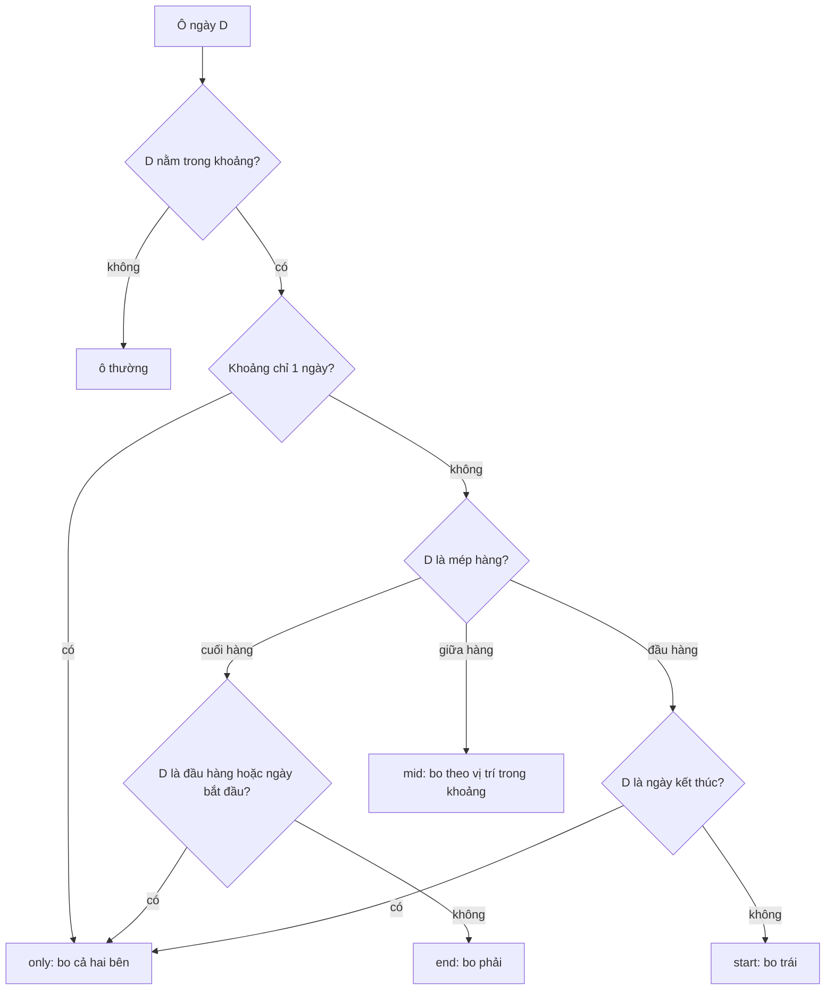

Bộ chọn khoảng ngày trông đơn giản: bấm ngày bắt đầu, bấm ngày kết thúc, tô màu ở giữa. Làm rồi mới thấy mấy chỗ khó:

1. Khoảng chọn kéo qua nhiều tuần thì dải màu phải **gãy ở mép mỗi hàng** và bo tròn ở đó, chứ không phải chỉ bo hai đầu khoảng. Nếu chỉ bo hai đầu, hàng giữa trông như một thanh vuông bị cắt cụt.
2. Người dùng bàn phím cần đi được bằng mũi tên, Home/End, PageUp/PageDown, và chỉ một ô trong lưới nhận Tab.
3. Ở giao diện phải-sang-trái (RTL), mũi tên trái phải đi tới ngày **sau** chứ không phải ngày trước.
4. Cột số tuần phải đúng chuẩn ISO, kể cả khi tuần bắt đầu từ Chủ nhật hay thứ Hai.

Các lịch trong bundle của Facebook (`Calendar.react`, `BUICalendar.react`, `GeoCalendar.react`) dùng chung một component cho phần lưới: `AbstractCalendar.react`. Bài này đọc lại cách nó giải bốn chuyện trên, và một lỗi nhỏ ở chuyện thứ tư.

> [!TIP]
> **Tóm tắt**
> - Mỗi ô ngày mang **hai** thông tin: vị trí trong khoảng chọn (`start/mid/end`) và vị trí trong hàng tuần (`start/mid/end/only`). CSS ghép hai thứ này để quyết định bo góc trái, phải hay cả hai.
> - Ngày 1 và ngày cuối tháng cũng được tính là mép hàng, nên dải chọn qua hai tháng bị cắt gọn ở cuối tháng.
> - Roving tabindex: chỉ ô con trỏ có `tabIndex=0`; mũi tên trái/phải đảo chiều khi RTL; PageUp/PageDown đổi tháng, giữ Ctrl/Alt thì đổi năm.
> - Số tuần của Facebook lấy **ngày cuối hàng** rồi mới chỉnh, nên lệch +1 khi tuần bắt đầu từ thứ Hai. Bản viết lại tính từ thứ Hai của hàng.

<iframe class="demo-frame" src="/demos/facebook-patterns/index.html?theme=dark#/range-calendar" title="Demo range-calendar" loading="lazy" style="height: 900px"></iframe>

<p class="demo-links">▶ <a href="/demos/facebook-patterns/index.html#/range-calendar" target="_blank" rel="noopener">Mở demo toàn màn hình ↗</a> · <a href="https://stackblitz.com/github/hunghg255/blog-hunghg/tree/master/examples/facebook-patterns?file=src/lib/rangeCalendar.ts" target="_blank" rel="noopener">Sửa code trên StackBlitz ↗</a> · <a href="https://github.com/hunghg255/blog-hunghg/blob/master/examples/facebook-patterns/src/lib/rangeCalendar.ts" target="_blank" rel="noopener">Xem source trên GitHub ↗</a></p>

## Facebook làm thế nào?

`AbstractCalendar.react` nằm trong `237.js` của [facebook-codebase](https://github.com/hunghg255/codebase/tree/main/facebook-codebase). Thư mục `7.AbstractCalendar/` có thêm bản đã format kèm các module nó dùng: `LocalDate`, `DateHelpers`, `DateFormatConfig`. Đây là component lớp (class component) cũ, chỉ lo phần lưới; trạng thái "đang chọn ngày nào" do component cha giữ và truyền xuống qua `selectDate`, `rangeSelectDate`, `focusDate`, `defaultCursor`.

### Ngày không dùng Date

Facebook không đưa `Date` vào lịch. `LocalDate` là một object `{year, month, day}` thuần, so sánh bằng từng trường:

```js
c.compare = function (a) {
  var b = this.year - a.year; if (b) return b;
  b = this.month - a.month;   if (b) return b;
  return this.day - a.day;
};
c.getDayOfWeek = function () { return this.toUTCDate().getUTCDay() };
```

Không có giờ, không có múi giờ, nên "ngày 8/3" ở New York vào hôm đổi giờ mùa hè vẫn chỉ là ngày 8/3. Một điểm cần nhớ: `month` của `LocalDate` đánh số **1–12**, khác `Date#getMonth()` (0–11). Chi tiết này sẽ quay lại ở dưới.

### Mỗi ô có hai vị trí

Vòng lặp vẽ lưới, đổi tên biến cho dễ đọc:

```js
const min = selectDate.min(rangeSelectDate);   // chọn ngược chiều vẫn đúng
const max = selectDate.max(rangeSelectDate);
const hasDuration = !min.equals(max);

while (cursor.isBefore(endOfMonth)) {
  const day = cursor;
  cursor = cursor.addDays(1);
  const monthChanged = cursor.getMonth() > day.getMonth()
    || (day.getMonth() === 12 && cursor.getMonth() === 1);
  const column = (cells.length + 1) % 7;
  const isRowStart = column === 1 || day.getDayOfMonth() === 1;
  const isRowEnd   = column === 0 || monthChanged;

  let range = null;
  if (day.isAfter(min) && day.isBefore(max)) range = 'mid';
  else if (day.equals(min)) range = 'start';
  else if (day.equals(max)) range = 'end';

  let row;
  if (!hasDuration) row = 'only';
  else if (isRowEnd) row = isRowStart || range === 'start' ? 'only' : 'end';
  else if (isRowStart) row = range === 'end' ? 'only' : 'start';
  else row = 'mid';
  // …push <Day rangePosition={range} rowPosition={row} />
}
```

Component `Day` biến hai giá trị thành class CSS:

```js
const roundLeft  = range === 'start' || (range === 'mid' && row === 'start');
const roundRight = range === 'end'   || (range === 'mid' && row === 'end');
const roundBoth  = row === 'only';
```

Đọc bảng này theo từng trường hợp:

- Ô **giữa khoảng** nằm ở đầu hàng thì bo trái, nằm ở cuối hàng thì bo phải. Dải chọn vì thế "gãy" và bo tròn ở mỗi lần xuống dòng.
- Ô **bắt đầu khoảng** nằm ở cuối hàng (ví dụ khoảng bắt đầu Chủ nhật, tuần bắt đầu thứ Hai) thì trên hàng đó dải chỉ có một ô, nên bo cả hai bên (`only`).
- Khoảng chỉ có một ngày cũng là `only`.

`isRowStart`/`isRowEnd` coi ngày 1 và ngày cuối tháng là mép hàng. Nhờ vậy khoảng 25/10 tới 5/11 hiển thị trên lịch tháng 10 sẽ bo phải ở ô 31/10, không chạy dài sang ô đệm trống.

### Bàn phím

Mỗi ô là một `span role="button"`. Chỉ ô `defaultCursor` có `tabIndex=0`, các ô khác `-1`: Tab vào lưới đúng một lần, rồi đi bằng mũi tên (mẫu roving tabindex).

```js
switch (event.keyCode) {
  case RETURN: case SPACE:   select(); break;
  case RTLKeys.getLeft():    moveDays(-1); break;   // RTL thì getLeft() trả về mã phím mũi tên phải
  case RTLKeys.getRight():   moveDays(1); break;
  case UP:                   moveDays(-7); break;
  case DOWN:                 moveDays(7); break;
  case HOME:                 setCursor(date.startOfMonth()); break;
  case END:                  setCursor(date.startOfMonth().addMonths(1).subtractDays(1)); break;
  case PAGE_UP:              moveMonths(event.ctrlKey || event.altKey ? -12 : -1); break;
  case PAGE_DOWN:            moveMonths(event.ctrlKey || event.altKey ? 12 : 1); break;
}
```

Bảng phím này gần với mẫu "Date Picker Dialog" trong WAI-ARIA Authoring Practices, với hai khác biệt: APG dùng Shift+PageUp/PageDown để đổi năm (Facebook dùng Ctrl/Alt), và Home/End của APG về đầu/cuối **tuần** (Facebook về đầu/cuối **tháng**). Cách đảo trái/phải nằm ở module `RTLKeys`: `getLeft()` trả mã phím mũi tên phải khi trang đang RTL (giá trị `Locale.isRTL()` được đọc một lần rồi nhớ), nên handler không cần biết chiều.

Ngoài ra còn hai chi tiết nhỏ:

- `onMouseDown={e => e.preventDefault()}` trên mỗi ô: click chuột không làm ô đó nhận focus. Focus vẫn ở ô con trỏ, tránh viền focus nhảy lung tung khi dùng chuột.
- `dateRestraints` là mảng hàm, ngày hợp lệ khi **mọi** hàm trả `true`. Ví dụ "không trước hôm nay" và "không quá 37 tháng" là hai hàm riêng, ghép bằng `every`.

### Số tuần và một lỗi lệch một

Khi bật `showWeekNumbers`, mỗi hàng có một ô tiêu đề hàng:

```js
renderWeekNumber(day) {
  if (day.getDayOfWeek() === 0) day = day.addDays(1);  // Chủ nhật thì lấy thứ Hai
  return DateHelpers.getISOWeekNumber(day);
}
// gọi khi kết thúc một hàng:
pushRow(rows, cells, day /* ← ngày CUỐI của hàng */);
```

Ý tưởng đúng: tuần ISO bắt đầu từ thứ Hai, nên Chủ nhật đầu hàng (lịch Mỹ) nên đẩy sang thứ Hai. Nhưng hàm được gọi với **ngày cuối hàng**, không phải ngày đầu hàng:

- Tuần bắt đầu Chủ nhật: ngày cuối hàng là thứ Bảy, số tuần ISO của thứ Bảy đúng là tuần chứa 6/7 ngày của hàng. Kết quả đúng.
- Tuần bắt đầu thứ Hai: ngày cuối hàng là **Chủ nhật**, bị cộng một ngày thành thứ Hai **tuần sau**. Mọi hàng lệch +1.

Trong bản dump tiếng Việt, `DateFormatConfig` đặt `weekStart: 6` (Chủ nhật, theo chỉ số của mảng `shortDayNames` bắt đầu từ T2), nên lỗi không lộ ra. Với locale có tuần bắt đầu thứ Hai thì có (suy ra từ code, mình chưa thử trên facebook.com). Demo dựng lại đúng phép tính đó: chọn "Tuần bắt đầu: thứ Hai" và nhìn cột FB đỏ.

### Một cái bẫy khi chép sang Date

Điều kiện `day.getMonth() === 12 && cursor.getMonth() === 1` đúng với `LocalDate` (tháng 1–12). Nếu chép nguyên văn sang code dùng `Date` (tháng 0–11), vế đó không bao giờ đúng. Vế còn lại (`cursor.getMonth() > day.getMonth()`) vẫn bắt được mọi lần sang tháng, **trừ** tháng 12 sang tháng 1. Hậu quả: lịch tháng 12 không đánh dấu ngày 31 là mép hàng. Đây không phải lỗi của Facebook, nhưng là lý do bản viết lại không dò "sang tháng" mà dùng thẳng chỉ số ngày.

## Bên trong trình duyệt: lưới, focus và CSS logic



Ba thứ trình duyệt lo giúp, nếu dùng đúng:

- **ARIA grid**: `role="grid"` → `row` → `gridcell`, kèm `aria-selected` cho ô trong khoảng. Trình đọc màn hình đọc được "hàng 3, cột 5" và trạng thái chọn.
- **Roving tabindex**: chỉ một phần tử có `tabIndex=0`, nên Tab vào/ra lưới chỉ tốn một lần bấm. Khi con trỏ đổi, phải gọi `.focus()` lên ô mới **sau khi** React render xong (ô mới có thể chưa tồn tại nếu vừa đổi tháng).
- **Thuộc tính logic của CSS**: `border-start-start-radius` thay cho `border-top-left-radius`. Đặt `dir="rtl"` là bo góc tự đổi phía, không phải viết thêm CSS cho RTL.

## Viết lại

Bản viết lại biểu diễn ngày bằng **số ngày kể từ 1970-01-01** (epoch day). Cộng một ngày là `+1`, khoảng cách hai ngày là phép trừ, so sánh là `<`. Muốn hiển thị thì đổi qua `Date.UTC`. Các hàm nhỏ `fromYMD`, `dayOfWeek`, `addMonths`, `isoWeek` nằm trong file đầy đủ ở dưới.

Phần phân loại ô giữ nguyên bảng chân trị của Facebook:

```ts title=src/lib/rangeCalendar.ts
export function getRangePosition(day: EpochDay, min: EpochDay, max: EpochDay): RangePosition {
  if (day === min) return 'start';
  if (day === max) return 'end';
  if (day > min && day < max) return 'mid';
  return null;
}

/**
 * Vị trí trong hàng dùng để bo góc. Cùng bảng chân trị với bản gốc:
 * - khoảng chỉ có 1 ngày → only
 * - ô cuối hàng: only nếu nó cũng là đầu hàng hoặc là ngày bắt đầu khoảng, ngược lại end
 * - ô đầu hàng: only nếu nó là ngày kết thúc khoảng, ngược lại start
 */
export function getRowPosition(
  isRowStart: boolean,
  isRowEnd: boolean,
  rangePosition: RangePosition,
  hasDuration: boolean,
): RowPosition {
  if (rangePosition === null) return null;
  if (!hasDuration) return 'only';
  if (isRowEnd) return isRowStart || rangePosition === 'start' ? 'only' : 'end';
  if (isRowStart) return rangePosition === 'end' ? 'only' : 'start';
  return 'mid';
}

/** Mép nào của ô được bo tròn, giống cách CSS của bản gốc ghép class dayRangeLeft/Right/Only. */
export function roundedEdges(cell: DayCell) {
  const { rangePosition: range, rowPosition: row } = cell;
  return {
    left: range === 'start' || (range === 'mid' && row === 'start'),
    right: range === 'end' || (range === 'mid' && row === 'end'),
    only: row === 'only',
  };
}
```

Dựng lưới. Mép hàng tính bằng **cột** (0 hoặc 6) và **chỉ số ngày** (ngày đầu, ngày cuối tháng), không dò "sang tháng":

```ts title=src/lib/rangeCalendar.ts
export function buildMonthGrid({ year, month, weekStart, range = null, fixedRows = true }: GridOptions): MonthGrid {
  const first = fromYMD(year, month, 1);
  const total = daysInMonth(year, month);
  // chọn ngược chiều (bấm ngày sau trước) vẫn đúng nhờ min/max
  const min = range ? Math.min(range.a, range.b) : 0;
  const max = range ? Math.max(range.a, range.b) : 0;
  const hasDuration = !!range && min !== max;

  const padding = (dayOfWeek(first) - weekStart + 7) % 7;
  const rows: Cell[][] = [];
  let row: Cell[] = Array.from({ length: padding }, () => null);

  for (let i = 0; i < total; i++) {
    const day = first + i;
    const column = row.length;
    // ngày 1 và ngày cuối tháng cũng tính là mép hàng: dải chọn kéo qua tháng sau bị cắt ở đó
    const isRowStart = column === 0 || i === 0;
    const isRowEnd = column === 6 || i === total - 1;
    const rangePosition = range ? getRangePosition(day, min, max) : null;
    row.push({
      day,
      dayOfMonth: i + 1,
      isRowStart,
      isRowEnd,
      rangePosition,
      rowPosition: getRowPosition(isRowStart, isRowEnd, rangePosition, hasDuration),
    });
    if (row.length === 7) {
      rows.push(row);
      row = [];
    }
  }
  if (row.length) rows.push([...row, ...Array.from({ length: 7 - row.length }, () => null)]);
  while (fixedRows && rows.length < 6) rows.push(Array.from({ length: 7 }, () => null));

  const weekNumbers = rows.map((r, index) => {
    // ngày ở cột 0 của hàng (kể cả khi là ô đệm) = ngày đầu tháng lùi về đầu tuần + 7 * index
    const rowStart = first - padding + index * 7;
    // hàng bắt đầu từ Chủ nhật: lấy thứ Hai ngay sau đó, vì 6/7 ngày của hàng thuộc tuần ISO đó
    const monday = rowStart + ((8 - dayOfWeek(rowStart)) % 7);
    return r.some(Boolean) ? isoWeek(monday) : 0;
  });

  return { rows, weekNumbers };
}
```

Bàn phím là một hàm thuần `moveCursor(ngày, phím, rtl)` trả về ngày mới (hoặc `null` nếu phím không liên quan), xem trong file đầy đủ.

::: spoiler Xem toàn bộ src/lib/rangeCalendar.ts

```ts title=src/lib/rangeCalendar.ts
/**
 * Lịch chọn khoảng ngày (ý tưởng từ AbstractCalendar.react của Facebook).
 *
 * - Ngày được biểu diễn bằng "số ngày kể từ 1970-01-01" (epoch day): cộng trừ ngày chỉ là
 *   cộng trừ số nguyên, không dính múi giờ hay giờ mùa hè như khi dùng Date.
 * - Mỗi ô có hai thuộc tính: vị trí trong khoảng chọn (start/mid/end) và vị trí trong hàng
 *   (start/mid/end/only). CSS dựa vào cặp này để bo góc dải chọn ở mép mỗi hàng.
 * - Đi phím đủ bộ: mũi tên (đảo trái/phải khi RTL), Home/End, PageUp/PageDown (±1 tháng,
 *   giữ Ctrl/Alt thì ±12 tháng).
 */

/** Số ngày kể từ 1970-01-01 (UTC). */
export type EpochDay = number;

const MS_PER_DAY = 86_400_000;

export function fromYMD(year: number, month: number, day: number): EpochDay {
  // month: 1–12, giống LocalDate của Facebook (Date.UTC nhận 0–11)
  return Math.round(Date.UTC(year, month - 1, day) / MS_PER_DAY);
}

export function toYMD(day: EpochDay) {
  const d = new Date(day * MS_PER_DAY);
  return { year: d.getUTCFullYear(), month: d.getUTCMonth() + 1, day: d.getUTCDate() };
}

/** 0 = Chủ nhật … 6 = thứ Bảy (cùng quy ước với Date#getDay). 1970-01-01 là thứ Năm. */
export function dayOfWeek(day: EpochDay) {
  return (((day + 4) % 7) + 7) % 7;
}

export function daysInMonth(year: number, month: number) {
  return new Date(Date.UTC(year, month, 0)).getUTCDate();
}

export function addMonths(day: EpochDay, delta: number): EpochDay {
  const { year, month, day: dom } = toYMD(day);
  const index = year * 12 + (month - 1) + delta;
  const y = Math.floor(index / 12);
  const m = (index % 12) + 1;
  // 31/1 + 1 tháng = 28 hoặc 29/2, không nhảy sang tháng 3
  return fromYMD(y, m, Math.min(dom, daysInMonth(y, m)));
}

/** Số tuần ISO 8601: tuần bắt đầu từ thứ Hai, tuần 1 là tuần chứa thứ Năm đầu tiên của năm. */
export function isoWeek(day: EpochDay) {
  const thursday = day - ((dayOfWeek(day) + 6) % 7) + 3;
  const { year } = toYMD(thursday);
  return Math.floor((thursday - fromYMD(year, 1, 1)) / 7) + 1;
}

export type RangePosition = 'start' | 'mid' | 'end' | null;
export type RowPosition = 'start' | 'mid' | 'end' | 'only' | null;

export interface DayCell {
  day: EpochDay;
  dayOfMonth: number;
  isRowStart: boolean;
  isRowEnd: boolean;
  rangePosition: RangePosition;
  rowPosition: RowPosition;
}

export type Cell = DayCell | null; // null = ô đệm

export interface MonthGrid {
  rows: Cell[][];
  /** số tuần ISO của từng hàng (tính từ thứ Hai của hàng) */
  weekNumbers: number[];
}

export interface GridOptions {
  year: number;
  month: number; // 1–12
  /** ngày đầu tuần, theo quy ước Date#getDay: 1 = thứ Hai, 0 = Chủ nhật */
  weekStart: number;
  range?: { a: EpochDay; b: EpochDay } | null;
  /** luôn vẽ đủ 6 hàng để chiều cao không nhảy khi đổi tháng */
  fixedRows?: boolean;
}

export function getRangePosition(day: EpochDay, min: EpochDay, max: EpochDay): RangePosition {
  if (day === min) return 'start';
  if (day === max) return 'end';
  if (day > min && day < max) return 'mid';
  return null;
}

/**
 * Vị trí trong hàng dùng để bo góc. Cùng bảng chân trị với bản gốc:
 * - khoảng chỉ có 1 ngày → only
 * - ô cuối hàng: only nếu nó cũng là đầu hàng hoặc là ngày bắt đầu khoảng, ngược lại end
 * - ô đầu hàng: only nếu nó là ngày kết thúc khoảng, ngược lại start
 */
export function getRowPosition(
  isRowStart: boolean,
  isRowEnd: boolean,
  rangePosition: RangePosition,
  hasDuration: boolean,
): RowPosition {
  if (rangePosition === null) return null;
  if (!hasDuration) return 'only';
  if (isRowEnd) return isRowStart || rangePosition === 'start' ? 'only' : 'end';
  if (isRowStart) return rangePosition === 'end' ? 'only' : 'start';
  return 'mid';
}

/** Mép nào của ô được bo tròn, giống cách CSS của bản gốc ghép class dayRangeLeft/Right/Only. */
export function roundedEdges(cell: DayCell) {
  const { rangePosition: range, rowPosition: row } = cell;
  return {
    left: range === 'start' || (range === 'mid' && row === 'start'),
    right: range === 'end' || (range === 'mid' && row === 'end'),
    only: row === 'only',
  };
}

export function buildMonthGrid({ year, month, weekStart, range = null, fixedRows = true }: GridOptions): MonthGrid {
  const first = fromYMD(year, month, 1);
  const total = daysInMonth(year, month);
  // chọn ngược chiều (bấm ngày sau trước) vẫn đúng nhờ min/max
  const min = range ? Math.min(range.a, range.b) : 0;
  const max = range ? Math.max(range.a, range.b) : 0;
  const hasDuration = !!range && min !== max;

  const padding = (dayOfWeek(first) - weekStart + 7) % 7;
  const rows: Cell[][] = [];
  let row: Cell[] = Array.from({ length: padding }, () => null);

  for (let i = 0; i < total; i++) {
    const day = first + i;
    const column = row.length;
    // ngày 1 và ngày cuối tháng cũng tính là mép hàng: dải chọn kéo qua tháng sau bị cắt ở đó
    const isRowStart = column === 0 || i === 0;
    const isRowEnd = column === 6 || i === total - 1;
    const rangePosition = range ? getRangePosition(day, min, max) : null;
    row.push({
      day,
      dayOfMonth: i + 1,
      isRowStart,
      isRowEnd,
      rangePosition,
      rowPosition: getRowPosition(isRowStart, isRowEnd, rangePosition, hasDuration),
    });
    if (row.length === 7) {
      rows.push(row);
      row = [];
    }
  }
  if (row.length) rows.push([...row, ...Array.from({ length: 7 - row.length }, () => null)]);
  while (fixedRows && rows.length < 6) rows.push(Array.from({ length: 7 }, () => null));

  const weekNumbers = rows.map((r, index) => {
    // ngày ở cột 0 của hàng (kể cả khi là ô đệm) = ngày đầu tháng lùi về đầu tuần + 7 * index
    const rowStart = first - padding + index * 7;
    // hàng bắt đầu từ Chủ nhật: lấy thứ Hai ngay sau đó, vì 6/7 ngày của hàng thuộc tuần ISO đó
    const monday = rowStart + ((8 - dayOfWeek(rowStart)) % 7);
    return r.some(Boolean) ? isoWeek(monday) : 0;
  });

  return { rows, weekNumbers };
}

/**
 * Cách Facebook tính số tuần cho một hàng: lấy NGÀY CUỐI HÀNG, nếu là Chủ nhật thì +1 ngày
 * rồi mới hỏi số tuần ISO. Đúng khi tuần bắt đầu từ Chủ nhật (ngày cuối hàng là thứ Bảy),
 * nhưng lệch +1 khi tuần bắt đầu từ thứ Hai (ngày cuối hàng là Chủ nhật → nhảy sang tuần sau).
 */
export function fbStyleWeekNumber(rowEnd: EpochDay) {
  const day = dayOfWeek(rowEnd) === 0 ? rowEnd + 1 : rowEnd;
  return isoWeek(day);
}

export interface CursorKey {
  key: string;
  ctrlKey?: boolean;
  altKey?: boolean;
}

/** Ngày con trỏ mới sau một phím, hoặc null nếu phím không liên quan. */
export function moveCursor(cursor: EpochDay, { key, ctrlKey, altKey }: CursorKey, rtl = false): EpochDay | null {
  const { year, month } = toYMD(cursor);
  switch (key) {
    case 'ArrowLeft':
      return cursor + (rtl ? 1 : -1);
    case 'ArrowRight':
      return cursor + (rtl ? -1 : 1);
    case 'ArrowUp':
      return cursor - 7;
    case 'ArrowDown':
      return cursor + 7;
    case 'Home':
      return fromYMD(year, month, 1);
    case 'End':
      return fromYMD(year, month, daysInMonth(year, month));
    case 'PageUp':
      return addMonths(cursor, ctrlKey || altKey ? -12 : -1);
    case 'PageDown':
      return addMonths(cursor, ctrlKey || altKey ? 12 : 1);
    default:
      return null;
  }
}
```

:::

**Khác bản gốc:**

- Ngày là số nguyên (epoch day) thay cho `LocalDate`; `weekStart` dùng quy ước của `Date#getDay` (1 = thứ Hai, 0 = Chủ nhật) thay cho chỉ số trong mảng tên thứ.
- Số tuần tính từ **thứ Hai của hàng**: lấy ngày ở cột đầu (kể cả khi là ô đệm), nếu là Chủ nhật thì sang thứ Hai kế tiếp. Đúng cho cả hai kiểu đầu tuần.
- `addMonths` kẹp ngày về cuối tháng: 31/1 + 1 tháng là 28/2 (hoặc 29/2), không nhảy sang 3/3.
- Lưới luôn vẽ đủ 6 hàng nếu `fixedRows` (mặc định bật), để chiều cao không nhảy khi đổi tháng. Facebook để mặc định `allowVariableRowCount: true`, tức là không đệm.

## Đi qua code

- `fromYMD`/`toYMD` đi qua `Date.UTC` và `getUTC*`, nên không dính giờ địa phương. `Math.round` ở `fromYMD` chỉ để chắc chắn ra số nguyên.
- `dayOfWeek` dựa vào việc 1/1/1970 là thứ Năm (`+4`). Hai lần `% 7` để số âm (trước 1970) vẫn ra 0–6.
- `isoWeek` dùng quy tắc "tuần chứa thứ Năm": lấy thứ Năm của tuần chứa ngày đó, năm của thứ Năm chính là năm ISO, rồi đếm tuần từ 1/1 của năm đó.
- `buildMonthGrid` tính số ô đệm `(dayOfWeek(ngày 1) − weekStart + 7) % 7`. Tháng 10/2026 bắt đầu thứ Năm, tuần bắt đầu thứ Hai, nên có 3 ô đệm.
- `roundedEdges` là bản sao của cách `Day` ghép class: component chỉ cần đọc `left/right/only` rồi đặt `data-*`, CSS lo phần còn lại.
- Trong demo, sau mỗi phím di chuyển, component bật cờ `focusAfterRender` rồi gọi `.focus()` trong `useEffect`. Không làm vậy thì PageDown sang tháng mới, ô con trỏ mới chưa có trong DOM lúc handler chạy.

## Tại sao không làm cách khác?

**Dùng `<input type="date">` hai lần?** Được cho form đơn giản, nhưng không có dải chọn liền mạch, không hover xem trước, giao diện do trình duyệt quyết định.

**Chỉ bo góc hai đầu khoảng?** Chọn "Dải chọn: chỉ bo hai đầu khoảng" trong demo. Hàng giữa thành một thanh vuông vức, mép trái của nó dính sát lề lưới trông như bị cắt. Đó chính là thứ hai thuộc tính vị trí giải quyết.

**Dùng `Date` cho từng ô?** `new Date(2026, 2, 8)` ở máy đặt múi giờ New York, cộng `24 * 3600 * 1000` ms sẽ ra 9/3 lúc 1:00 chứ không phải 0:00, vì ngày đó chỉ có 23 giờ. Cộng dồn qua nhiều ngày rồi so sánh bằng `getTime()` là sai lệch. Ngày lịch không có giờ thì nên biểu diễn không có giờ.

## Edge case và cạm bẫy

- **Chọn ngược chiều**: bấm 20/10 trước rồi 2/10. `min/max` xử lý, không cần đổi chỗ trong state.
- **Khoảng qua hai tháng**: trên lịch tháng 10, khoảng 25/10–5/11 kết thúc ở ô 31/10 (bo phải nhờ `isRowEnd` của ngày cuối tháng). Chuyển sang tháng 11, ô 1/11 bo trái.
- **Tuần 53**: 31/12/2026 và 1/1/2027 đều thuộc tuần 53 của năm ISO 2026. Ai tính "tuần = ngày trong năm / 7" sẽ ra tuần 1 cho 1/1.
- **Focus khi đổi tháng**: ô cũ bị gỡ khỏi DOM, focus rơi về `body` nếu không chủ động đặt lại.
- **Mũi tên trong RTL**: chỉ trái/phải đảo; lên/xuống, Home/End giữ nguyên.
- **Ô đệm**: phải có `role="gridcell"` (rỗng) để trình đọc màn hình đếm cột đúng.

## Dùng trong dự án

```tsx
function DateRangeField() {
  const [range, setRange] = useState<{ a: EpochDay; b: EpochDay | null } | null>(null);
  const [cursor, setCursor] = useState(() => fromYMD(2026, 10, 27));
  const { year, month } = toYMD(cursor);
  const grid = buildMonthGrid({
    year, month, weekStart: 1,
    range: range && { a: range.a, b: range.b ?? range.a },
  });
  // render grid.rows: mỗi DayCell → <button data-left data-right … tabIndex={cell.day === cursor ? 0 : -1}>
  // onKeyDown: const next = moveCursor(cell.day, event, isRtl); if (next !== null) setCursor(next)
}
```

Phần CSS cho dải chọn chỉ cần vài dòng: nền màu nhạt cho `[data-in-range]`, và `border-start-start-radius`/`border-end-start-radius` cho `[data-left]` (tương tự cho `[data-right]`).

## Kiểm thử

::: spoiler Ví dụ test (bản phác, không có trong repo)

```ts
import { describe, expect, it } from 'vitest';
import { addMonths, buildMonthGrid, fbStyleWeekNumber, fromYMD, isoWeek, moveCursor, roundedEdges, toYMD } from './rangeCalendar';

describe('rangeCalendar', () => {
  it('số tuần ISO ở các mốc khó', () => {
    expect(isoWeek(fromYMD(2026, 1, 1))).toBe(1);
    expect(isoWeek(fromYMD(2026, 12, 31))).toBe(53);
    expect(isoWeek(fromYMD(2027, 1, 1))).toBe(53);
    expect(isoWeek(fromYMD(2021, 1, 3))).toBe(53);
  });

  it('tuần bắt đầu thứ Hai: bản viết lại đúng, cách Facebook lệch +1', () => {
    const grid = buildMonthGrid({ year: 2026, month: 10, weekStart: 1 });
    expect(grid.weekNumbers.slice(0, 5)).toEqual([40, 41, 42, 43, 44]);
    const firstRowEnd = fromYMD(2026, 10, 4); // Chủ nhật
    expect(fbStyleWeekNumber(firstRowEnd)).toBe(41);
  });

  it('dải chọn gãy và bo tròn ở mép hàng', () => {
    const { rows } = buildMonthGrid({
      year: 2026, month: 10, weekStart: 1,
      range: { a: fromYMD(2026, 10, 20), b: fromYMD(2026, 10, 2) }, // chọn ngược chiều
    });
    const cells = rows.flat().filter((c) => c && c.rangePosition);
    const edge = (d: number) => roundedEdges(cells.find((c) => c!.dayOfMonth === d)!);
    expect(edge(2)).toMatchObject({ left: true });   // ngày bắt đầu
    expect(edge(4)).toMatchObject({ right: true });  // Chủ nhật, cuối hàng
    expect(edge(5)).toMatchObject({ left: true });   // thứ Hai, đầu hàng
    expect(edge(7)).toEqual({ left: false, right: false, only: false });
    expect(edge(20)).toMatchObject({ right: true }); // ngày kết thúc
  });

  it('phím: RTL đảo trái phải, PageDown kẹp cuối tháng', () => {
    const d = fromYMD(2026, 1, 31);
    expect(moveCursor(d, { key: 'ArrowLeft' }, true)).toBe(d + 1);
    expect(toYMD(moveCursor(d, { key: 'PageDown' })!)).toEqual({ year: 2026, month: 2, day: 28 });
    expect(toYMD(addMonths(fromYMD(2024, 1, 31), 1))).toEqual({ year: 2024, month: 2, day: 29 });
    expect(moveCursor(d, { key: 'a' })).toBeNull();
  });
});
```

:::

## So với thư viện và chuẩn web

- **React Aria** (`useRangeCalendar` của Adobe) làm trọn gói: lưới ARIA, phím, chọn khoảng, nhiều hệ lịch, lấy ngày đầu tuần theo locale. Nếu dự án đã dùng React Aria thì nên dùng nó thay vì tự viết.
- **`Intl.Locale#getWeekInfo()`** trả ngày đầu tuần theo locale (`firstDay`). API này chưa có ở mọi trình duyệt (tính tới 10/2026), nên kiểm tra trên [MDN](https://developer.mozilla.org/en-US/docs/Web/JavaScript/Reference/Global_Objects/Intl/Locale/getWeekInfo) trước khi dựa vào.
- **Temporal** có `Temporal.PlainDate` (ngày không giờ, không múi giờ) và `weekOfYear`, đúng loại dữ liệu `LocalDate` mô phỏng. Khi Temporal có sẵn ở các trình duyệt bạn hỗ trợ, có thể thay epoch day bằng `PlainDate`.

Bài liên quan: [Học từ Facebook #8: Focus trap và Esc theo layer](/blogs/facebook-focus-trap), [Học từ web lớn #49: xử lý giờ mùa hè không cần thư viện](/blogs/web-dst-without-library).

---

Bài này thuộc series **[Học từ mã nguồn Facebook](/series/facebook)** (83 bài, đọc theo thứ tự).

::: spoiler Xem nhanh danh sách bài trong series

*Phần 1*

- [Mở đầu: cách đọc code minify của Facebook](/blogs/learn-from-facebook-source-code)
- [#1 Dùng chung IntersectionObserver + infinite scroll](/blogs/facebook-shared-intersection-observer)
- [#2 useViewportDuration: đo thời gian thực sự được xem](/blogs/facebook-use-viewport-duration)
- [#3 Preload code + data khi hover](/blogs/facebook-preload-on-hover)
- [#4 Toast manager với external store](/blogs/facebook-toast-manager)
- [#5 Network status + heartbeat backoff](/blogs/facebook-network-status-heartbeat)
- [#6 ErrorGuard: bắt lỗi theo ngữ cảnh](/blogs/facebook-error-guard)
- [#7 Banzai: gom log theo lô + sendBeacon](/blogs/facebook-batch-logger)
- [#8 Focus trap + Esc theo layer](/blogs/facebook-focus-trap)

*Phần 2*

- [#9 Mẹo calc(… * 9999): container query, line-clamp, mũi tên carousel bằng CSS](/blogs/facebook-css-9999-trick)
- [#10 Thanh cuộn tuỳ biến bằng CSS 3D](/blogs/facebook-css-3d-scrollbar)
- [#11 Modal cuộn bằng window, giữ vị trí trang nền](/blogs/facebook-document-scroll-modal)
- [#12 Popover, tooltip group và hovercard](/blogs/facebook-popover-tooltip)
- [#13 Primitive Pressable + focus-visible](/blogs/facebook-pressable)
- [#14 Tab "Xem thêm" + sticky header bằng IntersectionObserver](/blogs/facebook-priority-tabs-sticky-header)
- [#15 Avatar khoét mask, gradient Messenger, skeleton steps()](/blogs/facebook-visual-tricks)
- [#16 Khung chat không giật](/blogs/facebook-chat-scroller)
- [#17 Thuật toán chọn bố cục collage ảnh](/blogs/facebook-photo-collage-layout)
- [#18 Keep-alive tab trong SPA](/blogs/facebook-keep-alive-tabs)
- [#19 Tự đo Visual Completion & interaction tracing](/blogs/facebook-visual-completion)
- [#20 Router SPA bền bỉ & tải chunk có retry](/blogs/facebook-spa-router-resilient-loading)

*Phần 3*

- [#21 Smart Compose: gợi ý chữ mờ khi gõ](/blogs/facebook-smart-compose-ghost-text)
- [#22 MQTT ngay trong trình duyệt, tự chuyển sang long-poll](/blogs/facebook-mqtt-in-browser)
- [#23 Đo thời gian dùng bằng bitmap 64 giây](/blogs/facebook-time-spent-bitmap)
- [#24 Bảng reaction nhấn giữ rồi trượt](/blogs/facebook-reaction-press-slide)
- [#25 Tìm kiếm gấp dấu, phiên âm và highlight đầu từ](/blogs/facebook-search-diacritics-tokenize)
- [#26 Ring buffer biết trace nào đã mất log](/blogs/facebook-trace-ring-buffer)
- [#27 Engine animation JS: một vòng rAF và solver cubic-bezier](/blogs/facebook-keyframes-loop-cubic-bezier)
- [#28 Bootloader: bitmap tài nguyên đã tải, chỉ reload khi cần](/blogs/facebook-bootloader-bitmap-consistency)
- [#29 Nhận biết click do screen reader tạo ra](/blogs/facebook-virtual-cursor-detection)
- [#30 Tải trước feed theo chất lượng mạng, đoán hạng thiết bị](/blogs/facebook-network-aware-prefetch)
- [#31 Hàng đợi gửi tin chat giữ đúng thứ tự](/blogs/facebook-ordered-send-queue)
- [#32 Gộp lời gọi API trong cùng một tick](/blogs/facebook-api-batcher)
- [#33 Resize ảnh trong pool Web Worker](/blogs/facebook-jpeg-resize-worker-pool)
- [#34 Crop ảnh theo nhiều khuôn mặt](/blogs/facebook-face-aware-crop)
- [#35 Kéo-thả sắp xếp và vùng thả file không nhấp nháy](/blogs/facebook-flicker-free-drag-drop)
- [#36 Tiện ích UI: fade-out, sticky event, hàm huỷ được](/blogs/facebook-ui-utility-hooks)
- [#37 Hạ tầng nhỏ: cookie, hash lỗi, prefetch khi chuột dừng](/blogs/facebook-small-infra-cookie-hash-idle)

*Phần 4–6*

- [#38 Đồng bộ tin nhắn: phát hiện lỗ seqID và fetch bù theo tầng](/blogs/facebook-messenger-sync-seqid-gaps)
- [#39 OTID: ID tin nhắn kiểu Snowflake sinh ở client](/blogs/facebook-otid-client-snowflake)
- [#40 QPL: lấy mẫu từ lúc bắt đầu, đo RTT gửi tin đầu-cuối](/blogs/facebook-qpl-send-rtt)
- [#41 Bộ điều phối request bảy chế độ gộp và chống trùng](/blogs/facebook-request-dispatcher-modes)
- [#42 Thread list theo mốc thời gian, cookie presence có version](/blogs/facebook-threadlist-ranged-presence)
- [#43 Composer dạng plugin: reducer, dirty checker, chuỗi kiểm tra](/blogs/facebook-plugin-composer)
- [#44 Thanh toán bất đồng bộ: subscribe trước, poll dự phòng](/blogs/facebook-async-checkout)
- [#45 Validate số thẻ: sửa lỗi gõ, dải BIN, Luhn](/blogs/facebook-card-validation)
- **#46 Lịch chọn khoảng ngày: bo góc dải chọn, phím đủ bộ, RTL** (bài này)
- [#47 Giờ mở cửa theo tuần: qua đêm, gộp khoảng, phần bù](/blogs/facebook-weekly-hours-intervals)
- [#48 Tiến độ đăng realtime: giữ event chờ snapshot, watchdog](/blogs/facebook-realtime-publish-snapshot)
- [#49 Tiền tệ theo đơn vị nhỏ nhất và ô nhập tiền](/blogs/facebook-currency-minor-units)
- [#50 Sửa hàng loạt Empty/Uniform/Mixed, seen/read bằng 2 bit](/blogs/facebook-bulk-edit-seen-bits)
- [#51 Phát hiện script lạ hook vào hàm native](/blogs/facebook-native-hook-detection)
- [#52 localStorage tự dọn khi đầy quota](/blogs/facebook-quota-aware-storage)
- [#53 Cache tuyến do server phân giải, chờ sẵn promise](/blogs/facebook-route-cache-prefetch)
- [#54 Lưới phím mũi tên 2D và focus không làm cuộn trang](/blogs/facebook-focus-table-grid)
- [#55 Tách emoji bằng máy trạng thái](/blogs/facebook-emoji-segmentation)
- [#56 Đọc trước ghi sau trong một frame, con tự biết vị trí](/blogs/facebook-read-then-write-dom)
- [#57 Hàng đợi lệnh cho video và stream sắp lại chunk](/blogs/facebook-video-command-queue)

*Phần 7–10*

- [#58 Ước lượng băng thông EWMA: loại outlier, nhớ qua phiên](/blogs/facebook-bandwidth-ewma-estimator)
- [#59 ABR theo độ tự tin phát và cắt bậc bitrate theo MOS](/blogs/facebook-abr-playback-confidence)
- [#60 Prefetch segment dự đoán từ manifest, parse hộp sidx](/blogs/facebook-dash-predicted-segments)
- [#61 Đọc metadata MP4/MOV ngay trên client](/blogs/facebook-mp4-metadata-client)
- [#62 Upload tiếp tục được: offset, hash dedupe, phát hiện treo](/blogs/facebook-resumable-upload)
- [#63 Fenwick tree: chọn ngẫu nhiên có trọng số và offset dòng](/blogs/facebook-fenwick-weighted-random)
- [#64 Vạch trục số và trục thời gian "đẹp"](/blogs/facebook-nice-axis-ticks)
- [#65 Damerau-Levenshtein theo dải chéo và tự sửa tên gõ sai](/blogs/facebook-damerau-levenshtein)
- [#66 PRNG có seed, shuffle tái lập và lấy mẫu trace](/blogs/facebook-seeded-prng-sampling)
- [#67 Cặp min/max-heap tái dùng vị trí trong danh sách ảo](/blogs/facebook-dual-heap-buffer-set)
- [#68 Memo nhiều đối số bằng Map/WeakMap và interning object](/blogs/facebook-multikey-memo-interning)
- [#69 Thống kê cửa sổ trượt và đại số khoảng thời gian](/blogs/facebook-moving-stat-intervals)
- [#70 Int64 từ hai số 32-bit, decode UTF, offset theo code point](/blogs/facebook-int64-utf-codepoints)
- [#71 Engine múi giờ IANA trên client, phát hiện lệch giờ](/blogs/facebook-client-iana-timezone)
- [#72 Tự cài semver range](/blogs/facebook-semver-range)
- [#73 Auto-link URL, cắt chữ an toàn, giới hạn LaTeX](/blogs/facebook-autolink-safe-truncate)
- [#74 Parser query kiểu PHP chống prototype pollution](/blogs/facebook-php-query-serializer)
- [#75 Popover tự lật theo phần tràn nhỏ nhất](/blogs/facebook-popover-auto-flip)
- [#76 Tiền tố for(;;) chống JSON hijacking, đọc stream](/blogs/facebook-csrf-prefix-streaming)
- [#77 Chống lộ Referer, linkshim, xoá token trên URL](/blogs/facebook-referrer-linkshim-url-scrub)
- [#78 setImmediate bằng postMessage, gom delta chuột theo frame](/blogs/facebook-setimmediate-mouse-batching)
- [#79 Phát hiện crash qua heartbeat, dò proxy cache hỏng](/blogs/facebook-crash-heartbeat-proxy-check)
- [#80 DPR vào cookie cho ảnh @2x, che khoá trong log](/blogs/facebook-dpr-cookie-secret-redaction)
- [#81 Flux waitFor tự viết và proxy có đệm](/blogs/facebook-flux-dispatch-buffered-proxy)
- [#82 Crop đúng tỉ lệ, xoay sticker bằng ma trận](/blogs/facebook-image-crop-rotation-geometry)

:::

Code + demo: [`examples/facebook-patterns`](https://github.com/hunghg255/blog-hunghg/tree/master/examples/facebook-patterns) · [Mở trên StackBlitz](https://stackblitz.com/github/hunghg255/blog-hunghg/tree/master/examples/facebook-patterns)
