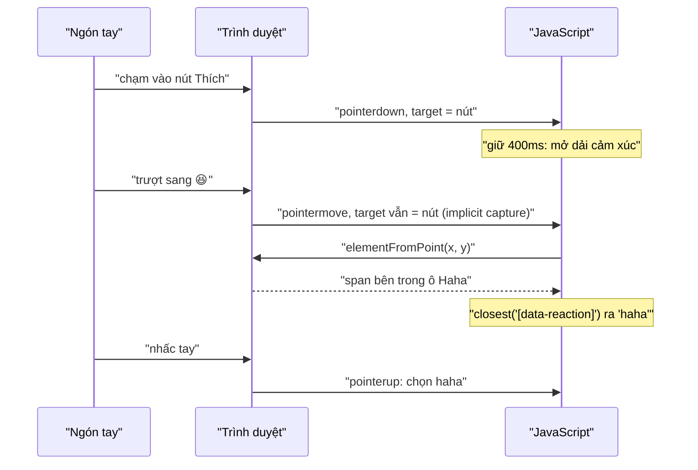

Nút "Thích" của Facebook có hai cách dùng. Bấm nhanh là Thích. Nhấn giữ thì một dải cảm xúc bật lên, người dùng **không nhấc tay**, trượt ngón tay sang 😆 rồi thả ra để chọn. Một thao tác, không cần chạm hai lần.

Làm thao tác này cho đúng khó hơn vẻ ngoài:

- Khi ngón tay trượt, mọi sự kiện chạm vẫn báo về **nút Thích** (nơi bắt đầu chạm), không phải biểu tượng đang nằm dưới ngón tay.
- Dải cảm xúc bật lên ngay dưới con trỏ. Một cú click vừa đúng lúc đó sẽ chọn nhầm cảm xúc.
- Bài viết nằm sát thanh điều hướng thì dải cảm xúc phía trên bị che mất.
- Bàn phím và trình đọc màn hình cũng phải dùng được.

> [!TIP]
> **Tóm tắt**
> - Trong lúc trượt, nghe `move` trên `document` và hỏi `document.elementFromPoint(x, y)` xem ngón tay đang ở ô nào. Tìm ô bằng `closest('[data-reaction]')`, đừng chỉ thử một cấp cha như bản gốc.
> - Chặn click trong 200ms dải cảm xúc đang bật lên.
> - Đỉnh dải cảm xúc lọt dưới vùng bị header che thì lật xuống dưới nút.
> - Bàn phím: roving tabindex, mũi tên trái/phải đảo chiều khi RTL, Enter trên cảm xúc đang chọn là bỏ chọn. Ngày nay dùng `touch-action: none` + Pointer Events thay cho `preventDefault` trên `touchmove`.

<iframe class="demo-frame" src="/demos/facebook-patterns/index.html?theme=dark#/reaction-dock" title="Demo reaction-dock" loading="lazy" style="height: 900px"></iframe>

<p class="demo-links">▶ <a href="/demos/facebook-patterns/index.html#/reaction-dock" target="_blank" rel="noopener">Mở demo toàn màn hình ↗</a> · <a href="https://stackblitz.com/github/hunghg255/blog-hunghg/tree/master/examples/facebook-patterns?file=src/lib/reactionDock.ts" target="_blank" rel="noopener">Sửa code trên StackBlitz ↗</a> · <a href="https://github.com/hunghg255/blog-hunghg/blob/master/examples/facebook-patterns/src/lib/reactionDock.ts" target="_blank" rel="noopener">Xem source trên GitHub ↗</a></p>

## Facebook làm thế nào?

Thành phần là `UFIReactionsMenuImpl.react` và lớp hiển thị `UFIReactionsDialogLayerImpl.react` (file bundle cùng tên trong [facebook-codebase](https://github.com/hunghg255/facebook-codebase)). Bản dump này lấy ở giao diện tiếng Việt, nên chuỗi `fbt` trong code là `"Cảm xúc"` và `"Đóng menu cảm xúc"`.

### Trượt ngón tay: elementFromPoint

Khi component cha báo `isLongPressing`, menu đăng ký 5 listener trên `document.documentElement` (đã đổi tên biến):

```js
listen(document.documentElement, "touchmove", e => {
  e.preventDefault();
  const t = e.touches[0];
  let el = document.elementFromPoint(t.clientX, t.clientY);
  el && !el.getAttribute("data-reaction") && el.parentElement && (el = el.parentElement);
  const r = el ? parseInt(el.getAttribute("data-reaction"), 10) || null : null;
  if (r !== hovered) { hovered && onLeave(hovered); r && onEnter(r); hovered = r; }
});
listen(document.documentElement, "mousemove", /* giống hệt, dùng e.clientX/Y */);
listen(document.documentElement, "touchcancel", stop);
listen(document.documentElement, "touchend", e => { stop(); hovered && onReactionClick(hovered, e); });
listen(document.documentElement, "mouseup",  e => { stop(); hovered && props.shown && onReactionClick(hovered, e); });
```

Vì sao phải `elementFromPoint`? Với Touch Events, `touchmove` luôn có `target` là phần tử nơi ngón tay **bắt đầu** chạm, dù ngón tay đã đi đâu. Không có sự kiện `touchenter` nào cho phần tử bên dưới. Cách duy nhất biết ngón tay đang ở trên ô nào là hỏi trình duyệt "phần tử nào ở toạ độ này".

Hai điểm yếu trong đoạn trên:

1. **Chỉ thử thêm đúng một cấp cha.** `data-reaction` nằm trên một `div` bọc ngoài. Bên trong là `div._39n` chứa biểu tượng (`CometReactionIcon`) và nhãn. Nếu điểm chạm rơi vào phần tử nằm sâu hơn một cấp (thường là chính biểu tượng), `parentElement` vẫn chưa phải `div` có thuộc tính, `parseInt(null)` ra `NaN`, coi như ngón tay đang ở ngoài. Có lẽ CSS của Facebook đặt `pointer-events: none` cho phần bên trong để tránh chuyện này, nhưng bản dump không có CSS nên không kiểm chứng được. Bật "Dò ô kiểu bản gốc" trong demo, trượt vào giữa biểu tượng: ô không sáng lên, thả tay cũng không chọn được gì.
2. **`preventDefault()` trên `touchmove` ở cấp document.** Chrome mặc định coi listener `touchmove` gắn trên `window`, `document`, `body` là passive, và bỏ qua `preventDefault()` trong đó. Nếu `Event.listen` của Facebook không truyền `{ passive: false }` (bản dump không cho thấy rõ), trình duyệt vẫn cuộn trang khi trượt.

### Chặn click 200ms

```js
onReactionClick(reaction, e) {
  e.preventDefault();
  !this.state.isAnimatingDock && this.props.onReactionClick && this.props.onReactionClick(reaction, e);
}
```

`UFIReactionsDialogLayerImpl` bật `isAnimatingDock` trong `beforeShow`, thêm class animation, và tắt sau `setTimeout(…, 200)` trong `afterShow`. Trên desktop, dải cảm xúc mở khi rê chuột lên nút Thích. Người dùng định bấm Thích, đúng lúc đó dải cảm xúc bật lên ngay dưới con trỏ, và cú click rơi vào một cảm xúc. 200ms đủ để bỏ qua cú click "trễ" đó.

### Lật xuống dưới khi bị header che

```js
afterShow() {
  const y = getElementPosition(contentRoot).y, top = ViewportBounds.getTop();
  CSS.conditionClass(contentRoot, BELOW_CLASS, !!(y && y < top));
  ...
}
```

`ViewportBounds.getTop()` là chiều cao vùng bị thanh xanh cố định che. Đỉnh dải cảm xúc nằm trên ranh giới đó thì thêm class để đặt nó xuống dưới nút.

### Bàn phím và trình đọc màn hình

- Mỗi ô có `role="button"`, `aria-pressed` cho cảm xúc đang chọn, `aria-label` là tên cảm xúc. Dải cảm xúc là `role="toolbar"` (hoặc `dialog` ở chế độ khác) với nhãn "Cảm xúc".
- `tabIndex` theo kiểu roving: chỉ ô đang chọn (hoặc cảm xúc hiện tại của người dùng) có `tabIndex=0`, các ô khác `-1`. Tab đi qua dải cảm xúc chỉ dừng một lần.
- `RTLKeys.getLeft()`/`getRight()` đảo phím mũi tên khi giao diện viết từ phải sang trái.
- Enter/Space trên đúng cảm xúc đang chọn thì gửi `UFIReactionTypes.NONE`: bỏ cảm xúc.
- Tab ra khỏi dải cảm xúc: layer tự tìm phần tử tabbable **kế tiếp sau nút** bằng `compareDocumentPosition(el) & 4` (DOCUMENT_POSITION_FOLLOWING), vì dải cảm xúc nằm trong một layer khác chỗ trong DOM, Tab tự nhiên sẽ nhảy lung tung.
- Khi ẩn, menu không bị gỡ khỏi DOM mà mang class `accessible_elem` (ẩn khỏi màn hình nhưng trình đọc màn hình vẫn đọc được).

## Bên trong trình duyệt: Touch Events, Pointer Events và capture



Với Pointer Events, trình duyệt "capture" ngầm pointer cảm ứng vào phần tử nhận `pointerdown`. Hệ quả giống Touch Events: mọi `pointermove` sau đó có `target` là nút. Có thể gọi `releasePointerCapture` để các sự kiện sau mang target đúng phần tử dưới ngón tay, nhưng `elementFromPoint` vẫn là cách chắc chắn nhất và chạy giống nhau với chuột lẫn cảm ứng.

Muốn trình duyệt **không cuộn trang** khi ngón tay trượt từ nút, cách hiện đại là CSS `touch-action: none` trên nút. Trình duyệt biết ngay từ lúc chạm là không được cuộn, không cần JavaScript `preventDefault()`, nên không đụng tới chuyện listener passive.

## Viết lại

Bản viết lại là một hook `usePressSlide`. Tìm ô từ toạ độ, hỗ trợ cả hai chế độ để so sánh:

```ts title=src/lib/reactionDock.ts
const ATTR = 'data-reaction';

function itemAt<T extends string>(x: number, y: number, mode: 'closest' | 'parent', items: readonly T[]): T | null {
  let el = document.elementFromPoint(x, y) as HTMLElement | null;
  if (!el) return null;
  if (mode === 'closest') {
    el = el.closest<HTMLElement>(`[${ATTR}]`);
  } else if (!el.hasAttribute(ATTR) && el.parentElement) {
    el = el.parentElement; // bản gốc: thử thêm đúng một cấp
  }
  const value = el?.getAttribute(ATTR) as T | null | undefined;
  return value && items.includes(value) ? value : null;
}
```

Trong lúc trượt:

```ts title=src/lib/reactionDock.ts
  // trong lúc trượt: nghe trên document, hỏi elementFromPoint xem đang ở ô nào
  useEffect(() => {
    if (!open) return;
    const onMove = (e: globalThis.PointerEvent) => {
      if (!sliding.current) return;
      setHovered(itemAt(e.clientX, e.clientY, hitTest, items));
    };
    const onUp = (e: globalThis.PointerEvent) => {
      if (!sliding.current) return;
      sliding.current = false;
      const item = itemAt(e.clientX, e.clientY, hitTest, items);
      if (item) {
        onSelectRef.current(item, 'release');
        close();
      } else {
        setHovered(null); // thả tay ở ngoài: dock vẫn mở để chạm chọn
      }
    };
    const onCancel = () => {
      sliding.current = false;
      setHovered(null);
    };
    const onOutside = (e: globalThis.PointerEvent) => {
      const t = e.target as Node;
      if (!dockRef.current?.contains(t) && !triggerRef.current?.contains(t)) close();
    };
    document.addEventListener('pointermove', onMove);
    document.addEventListener('pointerup', onUp);
    document.addEventListener('pointercancel', onCancel);
    document.addEventListener('pointerdown', onOutside);
    return () => {
      document.removeEventListener('pointermove', onMove);
      document.removeEventListener('pointerup', onUp);
      document.removeEventListener('pointercancel', onCancel);
      document.removeEventListener('pointerdown', onOutside);
    };
  }, [open, hitTest, items, close, dockRef, triggerRef]);
```

Props cho từng ô (chặn click khi đang bật lên, Enter bỏ chọn):

```ts title=src/lib/reactionDock.ts
  const itemProps = (item: T, index: number) => ({
    [ATTR]: item,
    'aria-pressed': current === item,
    tabIndex: index === (focusIndex < 0 ? Math.max(0, current ? items.indexOf(current) : 0) : focusIndex) ? 0 : -1,
    onClick(e: { detail: number }) {
      if (blockClicksWhileAnimating && animatingRef.current) return; // dock vừa mọc dưới con trỏ
      // Enter/Space trên reaction đang chọn = bỏ chọn (FB: NONE)
      const how = e.detail === 0 ? 'keyboard' : 'click';
      onSelectRef.current(how === 'keyboard' && current === item ? null : item, how);
      close(how === 'keyboard');
    },
    onFocus() {
      setFocusIndex(index);
    },
  });
```

::: spoiler Xem toàn bộ src/lib/reactionDock.ts

```ts title=src/lib/reactionDock.ts
import { useCallback, useEffect, useLayoutEffect, useRef, useState, type KeyboardEvent, type PointerEvent, type RefObject } from 'react';

/**
 * Bảng reaction "nhấn giữ rồi trượt" (ý tưởng từ UFIReactionsMenuImpl / UFIReactionsDialogLayerImpl của Facebook).
 *
 * - Khi kéo, sự kiện chạm (touch) và pointer có capture luôn bắn về phần tử bắt đầu chạm,
 *   nên phải tự hỏi "ngón tay đang ở trên ô nào" bằng document.elementFromPoint.
 * - Dock vừa bật lên (animation 200ms) thì chặn click: dock mọc ngay dưới con trỏ, không được chọn nhầm.
 * - Dock không đủ chỗ phía trên (bị header che) thì lật xuống dưới nút.
 * - Bàn phím: roving tabindex, mũi tên trái/phải đảo theo RTL, Enter trên reaction đang chọn = bỏ chọn.
 */

export interface PressSlideOptions<T extends string> {
  items: readonly T[];
  /** reaction người dùng đang chọn (null = chưa thả cảm xúc) */
  current: T | null;
  onSelect: (item: T | null, how: 'release' | 'click' | 'keyboard' | 'quick') => void;
  /** giữ bao lâu thì mở dock (ms) */
  longPressMs?: number;
  /** thời gian animation mở dock; click trong khoảng này bị bỏ qua (FB: 200) */
  dockAnimationMs?: number;
  blockClicksWhileAnimating?: boolean;
  /**
   * Cách tìm ô reaction từ phần tử dưới ngón tay:
   * 'closest' (bản viết lại) hoặc 'parent' (bản gốc: chỉ thử thêm đúng 1 cấp cha)
   */
  hitTest?: 'closest' | 'parent';
  /** chiều cao vùng bị che ở đỉnh viewport (header cố định) */
  topInset?: number;
  /** chuột (không phải cảm ứng) dừng trên nút bấy nhiêu ms thì mở dock; null = tắt */
  openOnHoverMs?: number | null;
  dockRef: RefObject<HTMLElement | null>;
  triggerRef: RefObject<HTMLElement | null>;
}

const ATTR = 'data-reaction';

function itemAt<T extends string>(x: number, y: number, mode: 'closest' | 'parent', items: readonly T[]): T | null {
  let el = document.elementFromPoint(x, y) as HTMLElement | null;
  if (!el) return null;
  if (mode === 'closest') {
    el = el.closest<HTMLElement>(`[${ATTR}]`);
  } else if (!el.hasAttribute(ATTR) && el.parentElement) {
    el = el.parentElement; // bản gốc: thử thêm đúng một cấp
  }
  const value = el?.getAttribute(ATTR) as T | null | undefined;
  return value && items.includes(value) ? value : null;
}

export function usePressSlide<T extends string>(options: PressSlideOptions<T>) {
  const {
    items,
    current,
    longPressMs = 400,
    dockAnimationMs = 200,
    blockClicksWhileAnimating = true,
    hitTest = 'closest',
    topInset = 0,
    openOnHoverMs = null,
    dockRef,
    triggerRef,
  } = options;
  const onSelectRef = useRef(options.onSelect);
  onSelectRef.current = options.onSelect;

  const [open, setOpen] = useState(false);
  const [animating, setAnimating] = useState(false);
  const [placement, setPlacement] = useState<'above' | 'below'>('above');
  const [hovered, setHovered] = useState<T | null>(null);
  const [focusIndex, setFocusIndex] = useState(-1);
  const sliding = useRef(false);
  const pressTimer = useRef<ReturnType<typeof setTimeout> | null>(null);
  const openedByPress = useRef(false);
  const animatingRef = useRef(false);

  const close = useCallback((restoreFocus = false) => {
    setOpen(false);
    setHovered(null);
    setFocusIndex(-1);
    sliding.current = false;
    if (restoreFocus) triggerRef.current?.focus();
  }, [triggerRef]);

  const openDock = useCallback(
    (focusFirst: boolean) => {
      const trigger = triggerRef.current;
      // đủ chỗ phía trên (sau khi trừ header) thì đặt trên, không thì lật xuống dưới
      const dockHeight = 64;
      if (trigger) setPlacement(trigger.getBoundingClientRect().top - dockHeight - 8 < topInset ? 'below' : 'above');
      setOpen(true);
      animatingRef.current = true;
      setAnimating(true);
      setTimeout(() => {
        animatingRef.current = false;
        setAnimating(false);
      }, dockAnimationMs);
      const start = Math.max(0, current ? items.indexOf(current) : 0);
      setFocusIndex(focusFirst ? start : -1);
    },
    [current, dockAnimationMs, items, topInset, triggerRef],
  );

  // trong lúc trượt: nghe trên document, hỏi elementFromPoint xem đang ở ô nào
  useEffect(() => {
    if (!open) return;
    const onMove = (e: globalThis.PointerEvent) => {
      if (!sliding.current) return;
      setHovered(itemAt(e.clientX, e.clientY, hitTest, items));
    };
    const onUp = (e: globalThis.PointerEvent) => {
      if (!sliding.current) return;
      sliding.current = false;
      const item = itemAt(e.clientX, e.clientY, hitTest, items);
      if (item) {
        onSelectRef.current(item, 'release');
        close();
      } else {
        setHovered(null); // thả tay ở ngoài: dock vẫn mở để chạm chọn
      }
    };
    const onCancel = () => {
      sliding.current = false;
      setHovered(null);
    };
    const onOutside = (e: globalThis.PointerEvent) => {
      const t = e.target as Node;
      if (!dockRef.current?.contains(t) && !triggerRef.current?.contains(t)) close();
    };
    document.addEventListener('pointermove', onMove);
    document.addEventListener('pointerup', onUp);
    document.addEventListener('pointercancel', onCancel);
    document.addEventListener('pointerdown', onOutside);
    return () => {
      document.removeEventListener('pointermove', onMove);
      document.removeEventListener('pointerup', onUp);
      document.removeEventListener('pointercancel', onCancel);
      document.removeEventListener('pointerdown', onOutside);
    };
  }, [open, hitTest, items, close, dockRef, triggerRef]);

  // roving tabindex: đưa focus tới ô đang chọn
  useLayoutEffect(() => {
    if (!open || focusIndex < 0) return;
    dockRef.current?.querySelectorAll<HTMLElement>(`[${ATTR}]`)[focusIndex]?.focus();
  }, [open, focusIndex, dockRef]);

  useEffect(() => () => {
    if (pressTimer.current) clearTimeout(pressTimer.current);
  }, []);

  const cancelPress = () => {
    if (pressTimer.current) clearTimeout(pressTimer.current);
    pressTimer.current = null;
  };

  const triggerProps = {
    'aria-haspopup': 'true' as const,
    'aria-expanded': open,
    onPointerDown(e: PointerEvent<HTMLElement>) {
      if (e.button !== 0) return;
      openedByPress.current = false;
      cancelPress();
      // cảm ứng tự "capture" pointer vào nút: mọi pointermove/pointerup sau đó đều có target là nút.
      // Nhả capture cho target khớp phần tử dưới ngón tay (logic chính vẫn dùng elementFromPoint).
      (e.target as Element).releasePointerCapture?.(e.pointerId);
      pressTimer.current = setTimeout(() => {
        openedByPress.current = true;
        sliding.current = true;
        openDock(false);
      }, longPressMs);
    },
    onPointerUp() {
      cancelPress();
    },
    onPointerEnter(e: PointerEvent<HTMLElement>) {
      if (openOnHoverMs == null || e.pointerType !== 'mouse' || open) return;
      cancelPress();
      pressTimer.current = setTimeout(() => openDock(false), openOnHoverMs);
    },
    onPointerLeave() {
      // rời nút trước khi đủ thời gian giữ/hover: huỷ (trừ khi dock đã mở và đang trượt)
      if (!sliding.current) cancelPress();
    },
    onClick() {
      if (openedByPress.current) return; // click sinh ra sau cú giữ: không tính là "like nhanh"
      onSelectRef.current(current ? null : items[0], 'quick');
    },
    onContextMenu(e: { preventDefault(): void }) {
      e.preventDefault(); // giữ lâu trên mobile mở menu ngữ cảnh
    },
    onKeyDown(e: KeyboardEvent<HTMLElement>) {
      if (e.key === 'ArrowUp' || (e.key === 'Enter' && e.altKey)) {
        e.preventDefault();
        openDock(true);
      }
    },
  };

  const dockProps = {
    role: 'toolbar' as const,
    'aria-label': 'Cảm xúc',
    onKeyDown(e: KeyboardEvent<HTMLElement>) {
      const rtl = dockRef.current ? getComputedStyle(dockRef.current).direction === 'rtl' : false;
      const back = rtl ? 'ArrowRight' : 'ArrowLeft';
      const forward = rtl ? 'ArrowLeft' : 'ArrowRight';
      if (e.key === back || e.key === forward) {
        e.preventDefault();
        setFocusIndex((i) => Math.max(0, Math.min(items.length - 1, (i < 0 ? 0 : i) + (e.key === back ? -1 : 1))));
      } else if (e.key === 'Escape') {
        e.preventDefault();
        close(true);
      } else if (e.key === 'Tab') {
        close(); // để Tab tự đi tiếp tới phần tử kế sau nút
      }
    },
  };

  const itemProps = (item: T, index: number) => ({
    [ATTR]: item,
    'aria-pressed': current === item,
    tabIndex: index === (focusIndex < 0 ? Math.max(0, current ? items.indexOf(current) : 0) : focusIndex) ? 0 : -1,
    onClick(e: { detail: number }) {
      if (blockClicksWhileAnimating && animatingRef.current) return; // dock vừa mọc dưới con trỏ
      // Enter/Space trên reaction đang chọn = bỏ chọn (FB: NONE)
      const how = e.detail === 0 ? 'keyboard' : 'click';
      onSelectRef.current(how === 'keyboard' && current === item ? null : item, how);
      close(how === 'keyboard');
    },
    onFocus() {
      setFocusIndex(index);
    },
  });

  return { open, animating, placement, hovered, triggerProps, dockProps, itemProps, close };
}
```

:::

**Khác bản gốc:**

- Pointer Events cho cả chuột lẫn cảm ứng, thay cho hai bộ listener `touch*` và `mouse*` riêng.
- `touch-action: none` trên nút thay cho `preventDefault()` trong `touchmove`.
- Tìm ô bằng `closest()`, không giới hạn số cấp.
- Bản gốc nhận lựa chọn khi `touchend` mà không kiểm tra menu còn hiện (`mouseup` thì có). Bản viết lại xử lý chuột và cảm ứng cùng một đường.
- Phím mở dải cảm xúc từ nút (`↑` hoặc `Alt+Enter`) là lựa chọn của bài viết; bản gốc mở bằng một thành phần khác không có trong đoạn này.

## Đi qua code

- `onPointerDown` trên nút hẹn giờ `longPressMs`. Hết giờ mà ngón tay chưa nhấc thì mở dải cảm xúc và đặt `sliding = true`. Nhấc tay sớm thì `onClick` chạy như một cú "Thích nhanh".
- Khi đang mở, `useEffect` gắn `pointermove`, `pointerup`, `pointercancel`, `pointerdown` lên `document`. `pointermove` cập nhật ô đang hover. `pointerup` trên một ô thì chọn và đóng; thả tay ngoài mọi ô thì giữ dải cảm xúc mở để người dùng chạm chọn (giống FB).
- `openedByPress` chặn cú `click` mà trình duyệt bắn sau `pointerup` trên nút, để một cú giữ không bị tính thêm thành "Thích nhanh".
- `openDock` đo vị trí nút: `top − chiều cao dải − 8px < topInset` thì đặt `placement = 'below'`.
- `itemProps.onClick` bỏ qua click khi `animatingRef` còn bật. `event.detail === 0` nghĩa là click sinh ra từ bàn phím (Enter/Space trên `<button>`), lúc đó chọn lại cảm xúc hiện tại nghĩa là bỏ chọn.
- `dockProps.onKeyDown` đọc `direction` từ CSS đã tính để biết đang RTL, rồi đảo phím mũi tên. `Esc` đóng và trả focus về nút; `Tab` đóng dải cảm xúc để focus đi tiếp tự nhiên (dải cảm xúc ở đây nằm ngay cạnh nút trong DOM nên không cần tự tìm phần tử kế tiếp như FB).

## Tại sao không làm cách khác?

- **Nghe `pointerenter`/`mouseenter` trên từng ô.** Chạy với chuột, nhưng với cảm ứng (hoặc khi pointer bị capture) các sự kiện này không bắn đúng ô. `elementFromPoint` chạy giống nhau ở mọi loại con trỏ.
- **Tự tính ô theo toạ độ** (`index = floor((x − left) / 46)`). Nhanh, nhưng vỡ khi ô phóng to lúc hover, khi RTL, khi đổi kích thước. Hỏi trình duyệt luôn đúng với layout thật.
- **Debounce click thay vì chặn theo animation.** Cùng hiệu quả nhưng tách rời khỏi thời điểm thật sự nguy hiểm. Gắn với trạng thái "đang bật lên" thì rõ nghĩa hơn.
- **`<select>` hoặc menu thả xuống.** Tiếp cận tốt cho bàn phím nhưng mất thao tác một chạm. Bản này giữ cả hai: trượt cho cảm ứng, roving tabindex cho bàn phím.

## Edge case và cạm bẫy

- **Nhấn giữ trên mobile mở menu ngữ cảnh** (copy, chia sẻ link) hoặc chọn chữ. Chặn `contextmenu` trên nút, thêm `user-select: none` và `-webkit-touch-callout: none`.
- **Ô phóng to khi hover** có thể đè lên ô bên cạnh. `elementFromPoint` trả về phần tử trên cùng, nên ô đang phóng to sẽ "thắng" vùng giao. Đây thường là hành vi mong muốn.
- **`elementFromPoint` trả `null`** khi toạ độ ra ngoài viewport (ngón tay trượt ra mép màn hình). Luôn kiểm tra trước khi dùng.
- **Iframe.** Toạ độ `clientX/Y` là theo viewport của iframe, và `elementFromPoint` cũng vậy, nên khớp nhau. Đừng trộn với `pageX/pageY`.
- **`prefers-reduced-motion`.** Animation bật lên nên tắt khi người dùng yêu cầu giảm chuyển động. Thời gian chặn click 200ms thì vẫn có thể giữ.

## Dùng trong dự án

```tsx
const triggerRef = useRef<HTMLButtonElement>(null);
const dockRef = useRef<HTMLDivElement>(null);
const { open, placement, hovered, triggerProps, dockProps, itemProps } = usePressSlide({
  items: ['like', 'love', 'haha', 'wow', 'sad', 'angry'] as const,
  current: myReaction,
  onSelect: (r) => mutateReaction(postId, r),
  topInset: headerHeight,
  dockRef,
  triggerRef,
});

return (
  <div className='anchor'>
    {open && (
      <div ref={dockRef} className={`dock ${placement}`} {...dockProps}>
        {REACTIONS.map((r, i) => (
          <button key={r} {...itemProps(r, i)} className={hovered === r ? 'hover' : ''}>{EMOJI[r]}</button>
        ))}
      </div>
    )}
    <button ref={triggerRef} style={{ touchAction: 'none' }} {...triggerProps}>Thích</button>
  </div>
);
```

## Kiểm thử

`elementFromPoint` cần layout thật, nên phần trượt nên test bằng trình duyệt (Playwright) thay vì jsdom.

::: spoiler Ví dụ test Playwright (bản phác, không có trong repo)

```ts
import { expect, test, type Locator } from '@playwright/test';

const center = async (loc: Locator) => {
  const b = (await loc.boundingBox())!;
  return { x: b.x + b.width / 2, y: b.y + b.height / 2 };
};

test('nhấn giữ rồi trượt sang Yêu thích', async ({ page }) => {
  await page.goto('/#/reaction-dock');
  const post = page.locator('.rd-post').first();
  const trigger = post.getByTestId('trigger');
  const c = await center(trigger);
  await page.mouse.move(c.x, c.y);
  await page.mouse.down();
  await page.waitForTimeout(500); // quá ngưỡng giữ 400ms
  const love = await center(post.getByTestId('dock').locator('[data-reaction=love] .rd-glyph'));
  await page.mouse.move(love.x, love.y, { steps: 8 });
  await page.mouse.up();
  await expect(trigger).toHaveText(/Yêu thích/);
});

test('click trong 200ms đầu bị bỏ qua', async ({ page }) => {
  await page.goto('/#/reaction-dock');
  await page.getByLabel(/rê chuột/).check();
  const post = page.locator('.rd-post').first();
  const trigger = post.getByTestId('trigger');
  const c = await center(trigger);
  await page.mouse.move(c.x, c.y);
  const dock = post.getByTestId('dock');
  await dock.waitFor();
  const wow = await center(dock.locator('[data-reaction=wow]'));
  await page.mouse.click(wow.x, wow.y);
  await expect(trigger).toHaveText(/Thích/);
  await page.waitForTimeout(250);
  await page.mouse.click(wow.x, wow.y);
  await expect(trigger).toHaveText(/Wow/);
});

test('bàn phím: ↑ mở, → chọn ô kế, Enter xác nhận', async ({ page }) => {
  await page.goto('/#/reaction-dock');
  const trigger = page.locator('.rd-post').first().getByTestId('trigger');
  await trigger.focus();
  await page.keyboard.press('ArrowUp');
  await page.keyboard.press('ArrowRight');
  await page.keyboard.press('Enter');
  await expect(trigger).toHaveText(/Yêu thích/);
  await expect(trigger).toBeFocused();
});
```

:::

## So với thư viện và chuẩn web

- [Pointer Events](https://developer.mozilla.org/docs/Web/API/Pointer_events) và `touch-action` có ở mọi trình duyệt hiện đại, đủ để bỏ hẳn bộ listener `touch*` riêng.
- [WAI-ARIA Toolbar pattern](https://www.w3.org/WAI/ARIA/apg/patterns/toolbar/) mô tả đúng mô hình roving tabindex mà Facebook dùng: một điểm dừng Tab, mũi tên để di chuyển trong nhóm.
- Thư viện gesture như `@use-gesture/react` lo phần kéo/trượt chung, nhưng vẫn không biết "ô nào nằm dưới ngón tay". Phần `elementFromPoint` vẫn phải tự viết.

---

Bài này thuộc series **[Học từ mã nguồn Facebook](/series/facebook)** (38 bài, đọc theo thứ tự).

::: spoiler Xem nhanh danh sách bài trong series

*Phần 1*

- [Mở đầu: cách đọc code minify của Facebook](/blogs/learn-from-facebook-source-code)
- [#1 Dùng chung IntersectionObserver + infinite scroll](/blogs/facebook-shared-intersection-observer)
- [#2 useViewportDuration: đo thời gian thực sự được xem](/blogs/facebook-use-viewport-duration)
- [#3 Preload code + data khi hover](/blogs/facebook-preload-on-hover)
- [#4 Toast manager với external store](/blogs/facebook-toast-manager)
- [#5 Network status + heartbeat backoff](/blogs/facebook-network-status-heartbeat)
- [#6 ErrorGuard: bắt lỗi theo ngữ cảnh](/blogs/facebook-error-guard)
- [#7 Banzai: gom log theo lô + sendBeacon](/blogs/facebook-batch-logger)
- [#8 Focus trap + Esc theo layer](/blogs/facebook-focus-trap)

*Phần 2*

- [#9 Mẹo calc(… * 9999): container query, line-clamp, mũi tên carousel bằng CSS](/blogs/facebook-css-9999-trick)
- [#10 Thanh cuộn tuỳ biến bằng CSS 3D](/blogs/facebook-css-3d-scrollbar)
- [#11 Modal cuộn bằng window, giữ vị trí trang nền](/blogs/facebook-document-scroll-modal)
- [#12 Popover, tooltip group và hovercard](/blogs/facebook-popover-tooltip)
- [#13 Primitive Pressable + focus-visible](/blogs/facebook-pressable)
- [#14 Tab "Xem thêm" + sticky header bằng IntersectionObserver](/blogs/facebook-priority-tabs-sticky-header)
- [#15 Avatar khoét mask, gradient Messenger, skeleton steps()](/blogs/facebook-visual-tricks)
- [#16 Khung chat không giật](/blogs/facebook-chat-scroller)
- [#17 Thuật toán chọn bố cục collage ảnh](/blogs/facebook-photo-collage-layout)
- [#18 Keep-alive tab trong SPA](/blogs/facebook-keep-alive-tabs)
- [#19 Tự đo Visual Completion & interaction tracing](/blogs/facebook-visual-completion)
- [#20 Router SPA bền bỉ & tải chunk có retry](/blogs/facebook-spa-router-resilient-loading)

*Phần 3*

- [#21 Smart Compose: gợi ý chữ mờ khi gõ](/blogs/facebook-smart-compose-ghost-text)
- [#22 MQTT ngay trong trình duyệt, tự chuyển sang long-poll](/blogs/facebook-mqtt-in-browser)
- [#23 Đo thời gian dùng bằng bitmap 64 giây](/blogs/facebook-time-spent-bitmap)
- **#24 Bảng reaction nhấn giữ rồi trượt** (bài này)
- [#25 Tìm kiếm gấp dấu, phiên âm và highlight đầu từ](/blogs/facebook-search-diacritics-tokenize)
- [#26 Ring buffer biết trace nào đã mất log](/blogs/facebook-trace-ring-buffer)
- [#27 Engine animation JS: một vòng rAF và solver cubic-bezier](/blogs/facebook-keyframes-loop-cubic-bezier)
- [#28 Bootloader: bitmap tài nguyên đã tải, chỉ reload khi cần](/blogs/facebook-bootloader-bitmap-consistency)
- [#29 Nhận biết click do screen reader tạo ra](/blogs/facebook-virtual-cursor-detection)
- [#30 Tải trước feed theo chất lượng mạng, đoán hạng thiết bị](/blogs/facebook-network-aware-prefetch)
- [#31 Hàng đợi gửi tin chat giữ đúng thứ tự](/blogs/facebook-ordered-send-queue)
- [#32 Gộp lời gọi API trong cùng một tick](/blogs/facebook-api-batcher)
- [#33 Resize ảnh trong pool Web Worker](/blogs/facebook-jpeg-resize-worker-pool)
- [#34 Crop ảnh theo nhiều khuôn mặt](/blogs/facebook-face-aware-crop)
- [#35 Kéo-thả sắp xếp và vùng thả file không nhấp nháy](/blogs/facebook-flicker-free-drag-drop)
- [#36 Tiện ích UI: fade-out, sticky event, hàm huỷ được](/blogs/facebook-ui-utility-hooks)
- [#37 Hạ tầng nhỏ: cookie, hash lỗi, prefetch khi chuột dừng](/blogs/facebook-small-infra-cookie-hash-idle)

:::

Code + demo: [`examples/facebook-patterns`](https://github.com/hunghg255/blog-hunghg/tree/master/examples/facebook-patterns) · [Mở trên StackBlitz](https://stackblitz.com/github/hunghg255/blog-hunghg/tree/master/examples/facebook-patterns)
