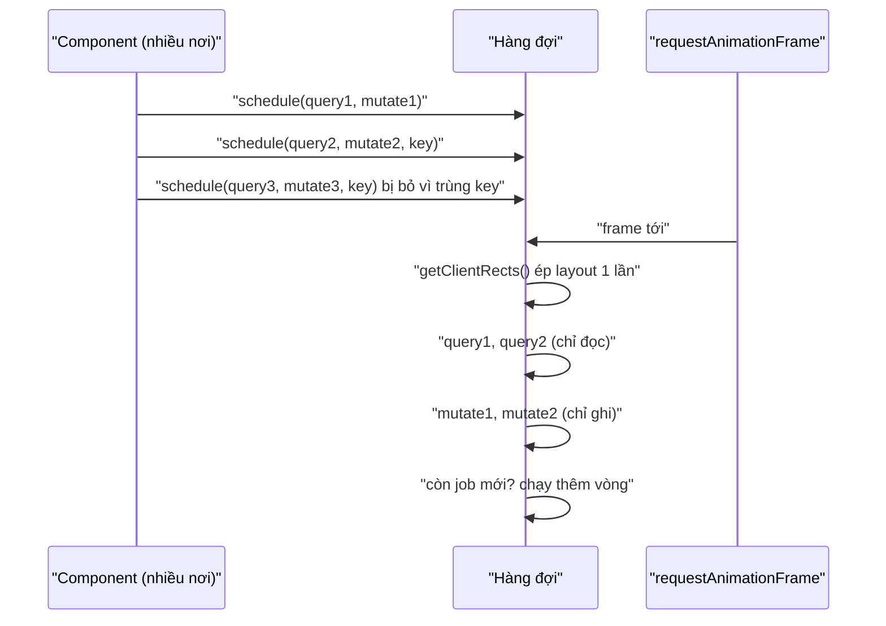

Đoạn code này trông vô hại:

```js
for (const card of cards) {
  const w = card.offsetWidth;          // đọc layout
  card.style.height = `${w / 6}px`;    // ghi style
}
```

Mỗi lần **ghi** style làm layout "bẩn". Lần **đọc** `offsetWidth` tiếp theo buộc trình duyệt tính lại layout **ngay lập tức** (layout đồng bộ, forced synchronous layout) để trả về con số đúng. 400 thẻ là 400 lần tính layout trong một vòng lặp. Đó là **layout thrashing**. Trong demo bên dưới, với bảng 400 hàng, cách này mất khoảng 240–350ms; đọc hết rồi ghi hết mất khoảng 8ms.

Bài này có hai kỹ thuật cùng chủ đề "đừng bắt DOM làm việc thừa": `queryThenMutateDOM` gom đọc/ghi theo frame, và `createLayoutContext` cho mỗi phần tử con tự biết mình đứng đầu, đứng cuối, thứ mấy, mà cha không phải đếm.

> [!TIP]
> **Tóm tắt**
> - Gom việc DOM thành cặp `(query, mutate)`. Trong một `requestAnimationFrame`: chạy **tất cả** query, rồi **tất cả** mutate. Một lần layout thay vì N lần.
> - Mutate xếp thêm việc thì chạy thêm vòng ngay trong frame đó; có `key` để chống trùng trong một frame; lỗi của một callback không làm hỏng cả frame.
> - Facebook giữ job **đầu tiên** cùng key. Nếu dữ liệu nằm trong closure thì bị cũ; bản viết lại cho chọn giữ job **cuối**.
> - `createLayoutContext`: con đăng ký node qua ref callback, cha sắp node theo `compareDocumentPosition`, con nhận `{ isFirst, isLast, index, total }`.

<iframe class="demo-frame" src="/demos/facebook-patterns/index.html?theme=dark#/dom-batch" title="Demo dom-batch" loading="lazy" style="height: 1100px"></iframe>

<p class="demo-links">▶ <a href="/demos/facebook-patterns/index.html#/dom-batch" target="_blank" rel="noopener">Mở demo toàn màn hình ↗</a> · <a href="https://stackblitz.com/github/hunghg255/blog-hunghg/tree/master/examples/facebook-patterns?file=src/lib/domBatch.ts" target="_blank" rel="noopener">Sửa code trên StackBlitz ↗</a> · <a href="https://github.com/hunghg255/blog-hunghg/blob/master/examples/facebook-patterns/src/lib/domBatch.ts" target="_blank" rel="noopener">Xem source trên GitHub ↗</a></p>

## Facebook làm thế nào?

### queryThenMutateDOM

Module `queryThenMutateDOM` (bundle `26.js`, được dùng ở nhiều bundle khác, ví dụ `Toggler` và nhóm module tính viewport cho thanh chat) giữ một hàng đợi `j` và một object `k` để chống trùng theo key. Giải mã:

```js
function queryThenMutateDOM(query, mutate, key) {
  if (!query && !mutate) return { cancel: emptyFunction };
  if (key && hasOwn(seenKeys, key)) return { cancel: emptyFunction }; // đã có job cùng key trong frame
  if (key) seenKeys[key] = 1;
  const job = { queryFunction: guard(query), mutateFunction: guard(mutate), output: null, deleted: false };
  queue.push(job);
  scheduleFrame();                         // requestAnimationFrame(run) nếu chưa hẹn
  Run.onLeave(() => { /* rời trang: xoá hàng đợi, xoá key */ });
  return { cancel() { job.deleted = true; key && delete seenKeys[key]; } };
}

function run() {                           // chạy trong requestAnimationFrame
  while (queue.length) {
    seenKeys = {};
    const done = [];
    document.body.getClientRects();        // ép layout một lần ở đầu
    while (queue.length) {
      const job = queue.shift();
      if (!job.deleted) { job.output = applyWithGuard(job.queryFunction); done.push(job); }
    }
    while (done.length) {
      const job = done.shift();
      if (!job.deleted) applyWithGuard(job.mutateFunction, null, [job.output]);
    }
  }
  scheduled = false;
}
```

Những điểm đáng chú ý:

- **`document.body.getClientRects()` ở đầu frame.** Gọi một API đọc layout để ép trình duyệt tính layout ngay, một lần. Các query sau đó đọc giá trị đã tính sẵn.
- **Vòng `while` bên ngoài.** Mutate có thể xếp thêm job (ví dụ đo xong một panel thì cần đo panel con). Các job mới chạy ngay trong frame hiện tại, tránh trễ thêm một frame.
- **`key` chống trùng trong một frame.** Hai component cùng muốn "đo lại chiều cao thanh chat" trong một frame thì chỉ chạy một lần. Lưu ý: job **đầu tiên** được giữ, các lần gọi sau bị bỏ.
- **`ErrorUtils.applyWithGuard`.** Mỗi callback chạy trong guard: một callback ném lỗi được ghi log, các job khác vẫn chạy.
- **`TimeSlice.guard`.** Callback được gắn vào interaction trace (xem [Học từ Facebook #19](/blogs/facebook-visual-completion)), nên việc đo/ghi DOM vẫn được tính vào đúng tương tác đã gây ra nó.
- `prepare(query, mutate, key)` tạo sẵn một hàm (ví dụ dùng làm handler cho `resize`) mà mỗi lần gọi là xếp một cặp job.

### createLayoutContext

Module `createLayoutContext` (bundle `91.js`) là một factory, được dùng cho nhóm nút (`FDSPrivateButtonLayoutContext`), menu, card, form của hệ thống design Geo. Cha (`Provider`) giữ danh sách `{ node, value }` trong `useReducer`; con gọi `useLayoutContext(value)` và nhận `[layout, ref]`:

```js
function reducer(list, { add, remove, value }) {
  const next = list.filter((e) => e.node !== add && e.node !== remove);
  if (add) next.push({ node: add, value });
  return next.sort((a, b) =>
    a.node.compareDocumentPosition(b.node) & Node.DOCUMENT_POSITION_FOLLOWING ? -1 : 1);
}
// trong con:
const ref = useCallback((node) => { dispatch({ add: node, remove: nodeRef.current, value }); nodeRef.current = node; }, [dispatch, value]);
const layout = useMemo(() => {
  const i = nodeRef.current && nodes.get(nodeRef.current);
  return i != null ? getLayout({ isFirst: i === 0, isLast: i === nodes.size - 1, index: i, total: nodes.size, values }) : defaultLayout;
}, [getLayout, nodes, values]);
```

`compareDocumentPosition` cho biết node A đứng trước hay sau node B trong cây DOM, bất kể chúng nằm sâu bao nhiêu tầng. Nhờ vậy nút trong nhóm tự bo góc trái nếu là nút đầu, góc phải nếu là nút cuối, kể cả khi bị bọc trong `<span>` hay render có điều kiện.



## Bên trong trình duyệt: vì sao đọc xen ghi lại chậm?

Trình duyệt dồn việc tính style/layout tới trước khi vẽ frame: bạn ghi 100 thuộc tính, nó chỉ tính layout một lần. Nhưng khi JavaScript **đọc** một giá trị phụ thuộc layout (`offsetWidth`, `getBoundingClientRect`, `scrollTop`, `getComputedStyle` với vài thuộc tính…) trong lúc layout đang bẩn, trình duyệt buộc phải tính ngay để trả lời. Danh sách đầy đủ các API gây ra việc này có trong [ghi chú "What forces layout"](https://gist.github.com/paulirish/5d52fb081b3570c81e3a) của Paul Irish.

Chi phí một lần layout phụ thuộc phạm vi bị ảnh hưởng. Demo dùng `<table>` vì đổi chiều cao một ô có thể làm thay đổi cả bảng; lưới đơn giản thì mỗi lần layout rẻ hơn nhiều và chênh lệch nhỏ hơn. Đo trên Chromium headless trong demo: bảng 400 hàng, đọc/ghi xen kẽ khoảng 240–350ms, đọc trước ghi sau khoảng 8ms.

## Viết lại

```ts title=src/lib/domBatch.ts
  function flush() {
    scheduled = false;
    stats.frames++;
    // mutate có thể xếp thêm job: chạy thêm vòng ngay trong frame này
    while (queue.length) {
      stats.rounds++;
      const jobs = queue;
      queue = [];
      byKey = new Map();
      forceLayout(); // ép layout một lần, mọi query sau đó đọc giá trị đã tính sẵn
      for (const job of jobs) if (!job.deleted) guard(() => (job.output = job.query()));
      for (const job of jobs) if (!job.deleted) guard(() => job.mutate(job.output));
      stats.jobs += jobs.length;
    }
  }

  function schedule<T>(query: Query<T> | null, mutate: Mutate<T> | null, key?: string): Scheduled {
    if (!query && !mutate) return { cancel() {} };
    if (key !== undefined && byKey.has(key)) {
      const existing = byKey.get(key)!;
      if (keyPolicy === 'first') return { cancel() {} };
      existing.deleted = true; // 'last': bỏ job cũ, giữ job mới
    }
    const job: Job = {
      query: (query ?? (() => undefined)) as Query<unknown>,
      mutate: (mutate ?? (() => {})) as Mutate<unknown>,
      key,
      deleted: false,
    };
    queue.push(job);
    if (key !== undefined) byKey.set(key, job);
    if (!scheduled) {
      scheduled = true;
      raf(flush);
    }
```

Context cho con tự biết vị trí: reducer sắp theo thứ tự DOM, và phần kiểm tra lại thứ tự sau mỗi lần render (khác bản gốc, xem bên dưới).

```tsx title=src/lib/layoutContext.tsx
function byDocumentOrder<V>(a: Entry<V>, b: Entry<V>) {
  return a.node.compareDocumentPosition(b.node) & Node.DOCUMENT_POSITION_FOLLOWING ? -1 : 1;
}

function reducer<V>(state: Entry<V>[], action: Action<V>) {
  if ('resort' in action) return [...state].sort(byDocumentOrder);
  const { add, remove, value } = action;
  const next = state.filter((e) => e.node !== add && e.node !== remove);
  if (add) next.push({ node: add, value });
  return next.sort(byDocumentOrder);
}
```

```tsx title=src/lib/layoutContext.tsx
  function Provider({ children }: { children: ReactNode }) {
    const [entries, dispatch] = useReducer(reducer<V>, []);
    // Khác bản gốc: con đổi chỗ (key giữ nguyên) thì React chỉ dời node, ref callback không
    // chạy lại, danh sách sẽ sai thứ tự. Sau mỗi lần render, kiểm tra lại và sắp lại nếu cần.
    useLayoutEffect(() => {
      for (let i = 1; i < entries.length; i++) {
        if (byDocumentOrder(entries[i - 1], entries[i]) > 0) {
          dispatch({ resort: true });
          return;
        }
      }
    });
```

::: spoiler Xem toàn bộ src/lib/layoutContext.tsx

```tsx title=src/lib/layoutContext.tsx
import { createContext, useCallback, useContext, useLayoutEffect, useMemo, useReducer, useRef, type ReactNode } from 'react';

/**
 * Con tự biết vị trí của mình (isFirst/isLast/index) mà cha không phải truyền prop
 * (ý tưởng từ createLayoutContext của Facebook, cùng họ với "descendants" của Reach UI).
 *
 * Mỗi con đăng ký DOM node của nó qua ref callback. Provider giữ danh sách node,
 * sắp theo thứ tự trong DOM bằng compareDocumentPosition. Đúng cả khi con nằm sâu
 * trong wrapper, render có điều kiện hay đổi thứ tự.
 */

export interface Layout<V> {
  isFirst: boolean;
  isLast: boolean;
  index: number;
  total: number;
  values: V[];
}

type Entry<V> = { node: Element; value: V };
type Action<V> = { add: Element | null; remove: Element | null; value: V } | { resort: true };

function byDocumentOrder<V>(a: Entry<V>, b: Entry<V>) {
  return a.node.compareDocumentPosition(b.node) & Node.DOCUMENT_POSITION_FOLLOWING ? -1 : 1;
}

function reducer<V>(state: Entry<V>[], action: Action<V>) {
  if ('resort' in action) return [...state].sort(byDocumentOrder);
  const { add, remove, value } = action;
  const next = state.filter((e) => e.node !== add && e.node !== remove);
  if (add) next.push({ node: add, value });
  return next.sort(byDocumentOrder);
}

export function createLayoutContext<V = undefined>() {
  const Ctx = createContext<{
    dispatch: (a: Action<V>) => void;
    indexOf: Map<Element, number>;
    values: V[];
  } | null>(null);

  function Provider({ children }: { children: ReactNode }) {
    const [entries, dispatch] = useReducer(reducer<V>, []);
    // Khác bản gốc: con đổi chỗ (key giữ nguyên) thì React chỉ dời node, ref callback không
    // chạy lại, danh sách sẽ sai thứ tự. Sau mỗi lần render, kiểm tra lại và sắp lại nếu cần.
    useLayoutEffect(() => {
      for (let i = 1; i < entries.length; i++) {
        if (byDocumentOrder(entries[i - 1], entries[i]) > 0) {
          dispatch({ resort: true });
          return;
        }
      }
    });
    const value = useMemo(() => {
      const indexOf = new Map<Element, number>();
      entries.forEach((e, i) => indexOf.set(e.node, i));
      return { dispatch, indexOf, values: entries.map((e) => e.value) };
    }, [entries]);
    return <Ctx.Provider value={value}>{children}</Ctx.Provider>;
  }

  /** Trả về [layout của mình (null ở lần render đầu), ref callback gắn vào phần tử gốc]. */
  function useLayout(value: V): [Layout<V> | null, (node: Element | null) => void] {
    const ctx = useContext(Ctx);
    if (!ctx) throw new Error('useLayout phải nằm trong Provider');
    const nodeRef = useRef<Element | null>(null);
    const { dispatch, indexOf, values } = ctx;
    const index = nodeRef.current ? indexOf.get(nodeRef.current) : undefined;
    const layout =
      index === undefined
        ? null
        : { isFirst: index === 0, isLast: index === values.length - 1, index, total: values.length, values };
    const ref = useCallback(
      (node: Element | null) => {
        // đổi node (hoặc value) thì gỡ node cũ, thêm node mới trong một action
        dispatch({ add: node, remove: nodeRef.current, value });
        nodeRef.current = node;
      },
      [dispatch, value],
    );
    return [layout, ref];
  }

  return { Provider, useLayout };
}
```

:::

::: spoiler Xem toàn bộ src/lib/domBatch.ts

```ts title=src/lib/domBatch.ts
/**
 * Đọc trước, ghi sau trong cùng một frame (ý tưởng từ queryThenMutateDOM của Facebook,
 * cùng họ với thư viện fastdom).
 *
 * Đọc layout (offsetWidth, getBoundingClientRect…) ngay sau khi vừa ghi style buộc trình duyệt
 * tính lại layout đồng bộ. Xen kẽ đọc-ghi-đọc-ghi trong một vòng lặp thì mỗi lần đọc là một lần
 * layout: "layout thrashing". Gom lại: trong một requestAnimationFrame, chạy TẤT CẢ query trước,
 * rồi TẤT CẢ mutate, nên chỉ cần một lần layout.
 */

export type Query<T> = () => T;
export type Mutate<T> = (value: T) => void;

export interface Scheduled {
  cancel(): void;
}

/** Facebook giữ job ĐẦU TIÊN cùng key; 'last' giữ job mới nhất (dữ liệu mới hơn). */
export type KeyPolicy = 'first' | 'last';

interface Job {
  query: Query<unknown>;
  mutate: Mutate<unknown>;
  key?: string;
  output?: unknown;
  deleted: boolean;
}

export interface DomBatcher {
  schedule<T>(query: Query<T> | null, mutate: Mutate<T> | null, key?: string): Scheduled;
  /** chạy ngay (dùng trong test hoặc khi cần đồng bộ) */
  flush(): void;
  /** số lần layout bị ép trong lần flush gần nhất (để demo) */
  readonly stats: { frames: number; rounds: number; jobs: number; errors: number };
}

export function createDomBatcher({
  keyPolicy = 'first',
  raf = (cb: () => void) => requestAnimationFrame(cb),
  onError = (e: unknown) => console.error(e),
  forceLayout = () => document.body.getClientRects(),
}: {
  keyPolicy?: KeyPolicy;
  raf?: (cb: () => void) => void;
  onError?: (e: unknown) => void;
  forceLayout?: () => void;
} = {}): DomBatcher {
  let queue: Job[] = [];
  let byKey = new Map<string, Job>();
  let scheduled = false;
  const stats = { frames: 0, rounds: 0, jobs: 0, errors: 0 };

  const guard = (fn: () => void) => {
    try {
      fn();
    } catch (e) {
      // một callback lỗi không được làm hỏng cả frame (bản gốc dùng ErrorUtils.applyWithGuard)
      stats.errors++;
      onError(e);
    }
  };

  function flush() {
    scheduled = false;
    stats.frames++;
    // mutate có thể xếp thêm job: chạy thêm vòng ngay trong frame này
    while (queue.length) {
      stats.rounds++;
      const jobs = queue;
      queue = [];
      byKey = new Map();
      forceLayout(); // ép layout một lần, mọi query sau đó đọc giá trị đã tính sẵn
      for (const job of jobs) if (!job.deleted) guard(() => (job.output = job.query()));
      for (const job of jobs) if (!job.deleted) guard(() => job.mutate(job.output));
      stats.jobs += jobs.length;
    }
  }

  function schedule<T>(query: Query<T> | null, mutate: Mutate<T> | null, key?: string): Scheduled {
    if (!query && !mutate) return { cancel() {} };
    if (key !== undefined && byKey.has(key)) {
      const existing = byKey.get(key)!;
      if (keyPolicy === 'first') return { cancel() {} };
      existing.deleted = true; // 'last': bỏ job cũ, giữ job mới
    }
    const job: Job = {
      query: (query ?? (() => undefined)) as Query<unknown>,
      mutate: (mutate ?? (() => {})) as Mutate<unknown>,
      key,
      deleted: false,
    };
    queue.push(job);
    if (key !== undefined) byKey.set(key, job);
    if (!scheduled) {
      scheduled = true;
      raf(flush);
    }
    return {
      cancel() {
        job.deleted = true;
        if (key !== undefined && byKey.get(key) === job) byKey.delete(key);
      },
    };
  }

  return { schedule, flush, stats };
}

/** Dùng chung một batcher cho cả trang, giống module singleton của Facebook. */
export const domBatcher = typeof window !== 'undefined' ? createDomBatcher() : null;
```

:::

## Đi qua code

- `flush()` lấy cả hàng đợi ra (`jobs = queue; queue = []`) trước khi chạy, nên job mới do mutate xếp vào sẽ thuộc **vòng sau** của `while`. Mỗi vòng ép layout một lần.
- `byKey` được làm mới ở đầu mỗi vòng, giống `k = {}` của bản gốc: key chỉ chống trùng **trong một frame/vòng**.
- `keyPolicy`: `'first'` giống Facebook; `'last'` đánh dấu job cũ là `deleted` và giữ job mới. Chọn `'last'` khi query/mutate đóng gói dữ liệu mới nhất trong closure.
- `raf` và `forceLayout` là tham số, để test chạy đồng bộ không cần trình duyệt, và để demo đo thời gian trong cùng một tick.
- Trong `useLayout`, `index` đọc từ `nodeRef.current` lúc render. Lần render đầu chưa có node nên `layout` là `null`; sau khi ref callback `dispatch`, Provider render lại và con nhận vị trí.

**Khác bản gốc:**
- Thêm lựa chọn `keyPolicy: 'last'`. Demo: gọi ba lần cùng key với giá trị 1, 2, 3 trong một frame; cách Facebook áp giá trị **1**, cách "giữ cuối" áp **3**.
- `createLayoutContext` của Facebook chỉ sắp lại danh sách khi có con thêm/bớt (ref callback chạy). Khi các con **đổi chỗ** mà giữ nguyên `key`, React chỉ dời node DOM, ref callback không chạy lại, nên danh sách giữ thứ tự cũ (suy ra từ code; demo không tái hiện bản gốc). Bản viết lại kiểm tra thứ tự trong `useLayoutEffect` của Provider và sắp lại khi lệch. Demo "Đảo thứ tự": nút "Tháng" chuyển lên đầu và nhận góc bo trái đúng.

## Tại sao không làm cách khác?

**Đọc hết vào mảng rồi ghi hết, ngay trong vòng lặp của mình?** Đúng là cách nhanh nhất cho **một** đoạn code. Vấn đề là ứng dụng lớn có hàng chục component độc lập cùng đo/ghi trong một frame: mỗi component tự "đọc rồi ghi" vẫn xen kẽ với nhau. Hàng đợi dùng chung gom được việc của **mọi** component.

**Dùng `ResizeObserver`?** Hợp khi cần biết kích thước **thay đổi**: callback chạy sau layout, trước khi vẽ, và trình duyệt đã gom sẵn. `queryThenMutateDOM` tổng quát hơn: đọc bất cứ thứ gì (vị trí cuộn, kích thước viewport), vào bất cứ lúc nào.

**Đánh số index ở cha (`children.map((c, i) => cloneElement(c, { index: i }))`)?** Chỉ đúng khi con là con **trực tiếp**. Bọc qua một wrapper, render có điều kiện, hay con là Fragment là hỏng. `compareDocumentPosition` hỏi thẳng DOM nên luôn đúng thứ tự hiển thị.

**CSS `:first-child`/`:last-child`?** Dùng được cho bo góc nếu các nút là anh em trực tiếp. Khi nút nằm trong wrapper (tooltip, portal…) thì selector không còn đúng; cần index để làm việc khác (ARIA `aria-posinset`, phím tắt số) thì CSS không giúp được.

## Edge case và cạm bẫy

- **Query không được ghi DOM.** Một query ghi style sẽ làm bẩn layout cho các query sau, mất hết lợi ích. Giữ query thuần đọc.
- **Mutate không nên đọc layout.** Đọc trong mutate là lại ép layout. Cần đọc tiếp thì xếp job mới (sẽ chạy ở vòng sau).
- **Vòng lặp vô hạn.** Mutate nào luôn xếp job mới sẽ treo frame. Bản gốc và bản viết lại đều không giới hạn số vòng; thêm giới hạn nếu bạn lo.
- **Giữ job đầu tiên cùng key:** nếu job dùng giá trị trong closure (ví dụ `width` mới), lần gọi sau bị bỏ và job cũ chạy với dữ liệu cũ. Lý do Facebook chọn giữ job đầu có lẽ vì job của họ thường đọc lại trạng thái ngay lúc chạy, không phụ thuộc closure (suy đoán).
- **Tab ẩn.** `requestAnimationFrame` không chạy khi tab ẩn, nên mutate cũng chờ. Việc nào bắt buộc phải xong ngay thì đừng đưa vào hàng đợi.
- **createLayoutContext render hai lần.** Lần đầu con chưa có vị trí (`layout = null`). Muốn tránh chớp góc bo, vẽ kiểu trung tính khi `layout` chưa có.

## Dùng trong dự án

```ts
import { domBatcher } from './domBatch';

// Nhiều component cùng đo panel: mỗi component tự schedule, hàng đợi gom lại
function syncHeight(panel: HTMLElement, target: HTMLElement) {
  domBatcher!.schedule(
    () => panel.getBoundingClientRect().height,
    (h) => { target.style.height = `${h}px`; },
    `sync-height:${panel.id}`,
  );
}
window.addEventListener('resize', () => panels.forEach((p) => syncHeight(p, p.nextElementSibling as HTMLElement)));
```

```tsx
const Group = createLayoutContext<string>();
function Segment({ label }: { label: string }) {
  const [layout, ref] = Group.useLayout(label);
  return <button ref={ref} aria-posinset={layout ? layout.index + 1 : undefined} aria-setsize={layout?.total}
    className={layout?.isFirst ? 'first' : layout?.isLast ? 'last' : ''}>{label}</button>;
}
```

## Kiểm thử

::: spoiler Ví dụ test (bản phác, không có trong repo)

```ts
import { describe, expect, it } from 'vitest';
import { createDomBatcher } from './domBatch';

describe('createDomBatcher', () => {
  const make = (keyPolicy: 'first' | 'last' = 'first') => {
    const order: string[] = [];
    const b = createDomBatcher({ keyPolicy, raf: () => {}, forceLayout: () => order.push('layout') });
    return { b, order };
  };

  it('chạy mọi query trước mọi mutate, ép layout một lần mỗi vòng', () => {
    const { b, order } = make();
    for (const n of [1, 2]) b.schedule(() => order.push(`q${n}`), () => order.push(`m${n}`));
    b.flush();
    expect(order).toEqual(['layout', 'q1', 'q2', 'm1', 'm2']);
  });

  it('job do mutate xếp thêm chạy ở vòng sau, trong cùng flush', () => {
    const { b, order } = make();
    b.schedule(null, () => b.schedule(() => order.push('q-late'), null));
    b.flush();
    expect(order).toEqual(['layout', 'layout', 'q-late']);
    expect(b.stats.rounds).toBe(2);
  });

  it('chống trùng key: first giữ job đầu, last giữ job cuối', () => {
    for (const policy of ['first', 'last'] as const) {
      const { b } = make(policy);
      let applied = 0;
      for (const n of [1, 2, 3]) b.schedule(() => n, (v) => (applied = v), 'k');
      b.flush();
      expect(applied).toBe(policy === 'first' ? 1 : 3);
    }
  });

  it('một callback lỗi không chặn các job khác', () => {
    const errors: unknown[] = [];
    const b = createDomBatcher({ raf: () => {}, forceLayout: () => {}, onError: (e) => errors.push(e) });
    let ran = false;
    b.schedule(() => { throw new Error('x'); }, null);
    b.schedule(null, () => (ran = true));
    b.flush();
    expect(ran).toBe(true);
    expect(errors).toHaveLength(1);
  });
});
```

:::

## So với thư viện và chuẩn web

- Thư viện [fastdom](https://github.com/wilsonpage/fastdom) có đúng API `measure`/`mutate` theo frame. `queryThenMutateDOM` khác ở chỗ ghép cặp query với mutate (output của query đi thẳng vào mutate).
- `ResizeObserver` và `IntersectionObserver` là cách chuẩn để nhận kích thước/vị trí mà không ép layout đồng bộ.
- Mẫu "descendants" (Reach UI, Radix) giải quyết cùng bài toán với `createLayoutContext`: con tự biết index của mình theo thứ tự DOM.

---

Bài này thuộc series **[Học từ mã nguồn Facebook](/series/facebook)** (58 bài, đọc theo thứ tự).

::: spoiler Xem nhanh danh sách bài trong series

*Phần 1*

- [Mở đầu: cách đọc code minify của Facebook](/blogs/learn-from-facebook-source-code)
- [#1 Dùng chung IntersectionObserver + infinite scroll](/blogs/facebook-shared-intersection-observer)
- [#2 useViewportDuration: đo thời gian thực sự được xem](/blogs/facebook-use-viewport-duration)
- [#3 Preload code + data khi hover](/blogs/facebook-preload-on-hover)
- [#4 Toast manager với external store](/blogs/facebook-toast-manager)
- [#5 Network status + heartbeat backoff](/blogs/facebook-network-status-heartbeat)
- [#6 ErrorGuard: bắt lỗi theo ngữ cảnh](/blogs/facebook-error-guard)
- [#7 Banzai: gom log theo lô + sendBeacon](/blogs/facebook-batch-logger)
- [#8 Focus trap + Esc theo layer](/blogs/facebook-focus-trap)

*Phần 2*

- [#9 Mẹo calc(… * 9999): container query, line-clamp, mũi tên carousel bằng CSS](/blogs/facebook-css-9999-trick)
- [#10 Thanh cuộn tuỳ biến bằng CSS 3D](/blogs/facebook-css-3d-scrollbar)
- [#11 Modal cuộn bằng window, giữ vị trí trang nền](/blogs/facebook-document-scroll-modal)
- [#12 Popover, tooltip group và hovercard](/blogs/facebook-popover-tooltip)
- [#13 Primitive Pressable + focus-visible](/blogs/facebook-pressable)
- [#14 Tab "Xem thêm" + sticky header bằng IntersectionObserver](/blogs/facebook-priority-tabs-sticky-header)
- [#15 Avatar khoét mask, gradient Messenger, skeleton steps()](/blogs/facebook-visual-tricks)
- [#16 Khung chat không giật](/blogs/facebook-chat-scroller)
- [#17 Thuật toán chọn bố cục collage ảnh](/blogs/facebook-photo-collage-layout)
- [#18 Keep-alive tab trong SPA](/blogs/facebook-keep-alive-tabs)
- [#19 Tự đo Visual Completion & interaction tracing](/blogs/facebook-visual-completion)
- [#20 Router SPA bền bỉ & tải chunk có retry](/blogs/facebook-spa-router-resilient-loading)

*Phần 3*

- [#21 Smart Compose: gợi ý chữ mờ khi gõ](/blogs/facebook-smart-compose-ghost-text)
- [#22 MQTT ngay trong trình duyệt, tự chuyển sang long-poll](/blogs/facebook-mqtt-in-browser)
- [#23 Đo thời gian dùng bằng bitmap 64 giây](/blogs/facebook-time-spent-bitmap)
- [#24 Bảng reaction nhấn giữ rồi trượt](/blogs/facebook-reaction-press-slide)
- [#25 Tìm kiếm gấp dấu, phiên âm và highlight đầu từ](/blogs/facebook-search-diacritics-tokenize)
- [#26 Ring buffer biết trace nào đã mất log](/blogs/facebook-trace-ring-buffer)
- [#27 Engine animation JS: một vòng rAF và solver cubic-bezier](/blogs/facebook-keyframes-loop-cubic-bezier)
- [#28 Bootloader: bitmap tài nguyên đã tải, chỉ reload khi cần](/blogs/facebook-bootloader-bitmap-consistency)
- [#29 Nhận biết click do screen reader tạo ra](/blogs/facebook-virtual-cursor-detection)
- [#30 Tải trước feed theo chất lượng mạng, đoán hạng thiết bị](/blogs/facebook-network-aware-prefetch)
- [#31 Hàng đợi gửi tin chat giữ đúng thứ tự](/blogs/facebook-ordered-send-queue)
- [#32 Gộp lời gọi API trong cùng một tick](/blogs/facebook-api-batcher)
- [#33 Resize ảnh trong pool Web Worker](/blogs/facebook-jpeg-resize-worker-pool)
- [#34 Crop ảnh theo nhiều khuôn mặt](/blogs/facebook-face-aware-crop)
- [#35 Kéo-thả sắp xếp và vùng thả file không nhấp nháy](/blogs/facebook-flicker-free-drag-drop)
- [#36 Tiện ích UI: fade-out, sticky event, hàm huỷ được](/blogs/facebook-ui-utility-hooks)
- [#37 Hạ tầng nhỏ: cookie, hash lỗi, prefetch khi chuột dừng](/blogs/facebook-small-infra-cookie-hash-idle)

*Phần 4–6*

- [#38 Đồng bộ tin nhắn: phát hiện lỗ seqID và fetch bù theo tầng](/blogs/facebook-messenger-sync-seqid-gaps)
- [#39 OTID: ID tin nhắn kiểu Snowflake sinh ở client](/blogs/facebook-otid-client-snowflake)
- [#40 QPL: lấy mẫu từ lúc bắt đầu, đo RTT gửi tin đầu-cuối](/blogs/facebook-qpl-send-rtt)
- [#41 Bộ điều phối request bảy chế độ gộp và chống trùng](/blogs/facebook-request-dispatcher-modes)
- [#42 Thread list theo mốc thời gian, cookie presence có version](/blogs/facebook-threadlist-ranged-presence)
- [#43 Composer dạng plugin: reducer, dirty checker, chuỗi kiểm tra](/blogs/facebook-plugin-composer)
- [#44 Thanh toán bất đồng bộ: subscribe trước, poll dự phòng](/blogs/facebook-async-checkout)
- [#45 Validate số thẻ: sửa lỗi gõ, dải BIN, Luhn](/blogs/facebook-card-validation)
- [#46 Lịch chọn khoảng ngày: bo góc dải chọn, phím đủ bộ, RTL](/blogs/facebook-range-calendar-a11y)
- [#47 Giờ mở cửa theo tuần: qua đêm, gộp khoảng, phần bù](/blogs/facebook-weekly-hours-intervals)
- [#48 Tiến độ đăng realtime: giữ event chờ snapshot, watchdog](/blogs/facebook-realtime-publish-snapshot)
- [#49 Tiền tệ theo đơn vị nhỏ nhất và ô nhập tiền](/blogs/facebook-currency-minor-units)
- [#50 Sửa hàng loạt Empty/Uniform/Mixed, seen/read bằng 2 bit](/blogs/facebook-bulk-edit-seen-bits)
- [#51 Phát hiện script lạ hook vào hàm native](/blogs/facebook-native-hook-detection)
- [#52 localStorage tự dọn khi đầy quota](/blogs/facebook-quota-aware-storage)
- [#53 Cache tuyến do server phân giải, chờ sẵn promise](/blogs/facebook-route-cache-prefetch)
- [#54 Lưới phím mũi tên 2D và focus không làm cuộn trang](/blogs/facebook-focus-table-grid)
- [#55 Tách emoji bằng máy trạng thái](/blogs/facebook-emoji-segmentation)
- **#56 Đọc trước ghi sau trong một frame, con tự biết vị trí** (bài này)
- [#57 Hàng đợi lệnh cho video và stream sắp lại chunk](/blogs/facebook-video-command-queue)

:::

Code + demo: [`examples/facebook-patterns`](https://github.com/hunghg255/blog-hunghg/tree/master/examples/facebook-patterns) · [Mở trên StackBlitz](https://stackblitz.com/github/hunghg255/blog-hunghg/tree/master/examples/facebook-patterns)
