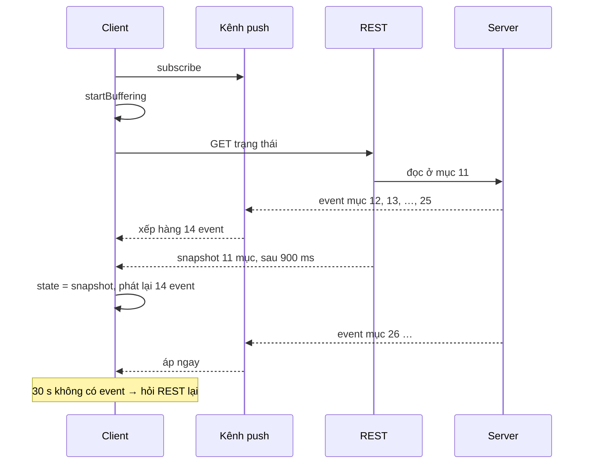

Bạn bấm "Đăng" 50 quảng cáo trong Ads Manager. Server xử lý từng cái, mỗi cái xong lại đẩy một event qua kênh realtime để thanh tiến độ chạy. Rồi bạn tải lại trang khi đã xong 10 cái. Trang mới phải làm hai việc:

1. **Subscribe** kênh push để nhận các event tiếp theo.
2. Gọi **REST** lấy trạng thái hiện tại (snapshot): đã xong những cái nào.

Hai việc chạy song song, và đây là chỗ dễ sai. REST mất 900 ms mới về, nhưng server **đọc** trạng thái ngay lúc request tới (ví dụ ở mục thứ 11). Trong 900 ms đó, push đã kịp báo mục 12, 13… 25 xong. Nếu client áp các event đó ngay, rồi snapshot về **ghi đè** lên, thì 12–25 biến mất khỏi màn hình. Thanh tiến độ đứng ở 36/50 mãi mãi.

> [!TIP]
> **Tóm tắt**
> - Gọi `startBuffering()` **trước** khi gọi REST: từ đó mọi event push được xếp hàng thay vì áp ngay.
> - Snapshot về thì lấy làm state, rồi **phát lại** hàng đợi theo thứ tự. Bước áp event phải idempotent vì nhiều event đã nằm sẵn trong snapshot.
> - Watchdog: mỗi event đặt lại hẹn giờ 30 giây; im lặng quá lâu thì coi push bị kẹt và hỏi lại REST.
> - Event "đã xoá" tới dồn dập được gom vào `Map` và dispatch một lần sau 100 ms.

<iframe class="demo-frame" src="/demos/facebook-patterns/index.html?theme=dark#/realtime-publish" title="Demo realtime-publish" loading="lazy" style="height: 980px"></iframe>

<p class="demo-links">▶ <a href="/demos/facebook-patterns/index.html#/realtime-publish" target="_blank" rel="noopener">Mở demo toàn màn hình ↗</a> · <a href="https://stackblitz.com/github/hunghg255/blog-hunghg/tree/master/examples/facebook-patterns?file=src/lib/realtimeSnapshot.ts" target="_blank" rel="noopener">Sửa code trên StackBlitz ↗</a> · <a href="https://github.com/hunghg255/blog-hunghg/blob/master/examples/facebook-patterns/src/lib/realtimeSnapshot.ts" target="_blank" rel="noopener">Xem source trên GitHub ↗</a></p>

## Facebook làm thế nào?

Hai module trong `64.js`: `AdsDraftPublishRealtimeConnection` (lớp kênh push) và `AdsDraftPublishRealtimeClient` (lớp nghe event, cập nhật store Flux của Ads Manager). Bên dưới là `AdsDraftRealtimeSubscription`: một Relay GraphQL subscription theo topic `gqls/ad_draft_publish_subscribe/ad_draft_id_<id>`, mỗi message là một chuỗi JSON.

### Hàng đợi nằm ở lớp kết nối

```js
let pending = null;  // null = không buffer

function onMessage(message, accountID, draftID) {
  const { event, ...payload } = message;
  const emit = () => {
    connection.emit(event, payload, accountID, draftID);
    connection.emit('all', event, payload, accountID, draftID);
  };
  pending ? pending.push(emit) : emit();   // đang buffer thì giữ lại cả closure
}

function startBuffering() { pending = []; }
function stopBuffering()  { pending && pending.forEach((f) => f()); pending = null; }
function discardBuffer()  { if (pending) pending = []; }
```

Mỗi event được gói thành một closure. Phát lại là gọi lần lượt các closure, nên listener nhận đúng như thể event vừa tới.

### Lớp client quyết định khi nào buffer

```js
export function bufferUntilPublishStatusFetched() {
  Connection.startBuffering();
  isBuffering = true;
}

function handleDispatch({ action }) {
  switch (action.type) {
    case CurrentDraftLoaded: case SetCurrentDraftSuccess:
      Connection.subscribe(action.accountID, action.draftID);
      break;
    case PublishInProgress:
      if (isBuffering && action.response) {    // snapshot đã về
        Connection.stopBuffering();
        isBuffering = false;
      }
      resetWatchdog();
      break;
    case PublishCompleted: case PublishFailed:
      clearWatchdog();
      break;
  }
}
```

Module export hàm `bufferUntilPublishStatusFetched`; nơi gọi nó không có trong bản dump, nhưng đúng như tên, nó phải được gọi trước khi gửi request lấy trạng thái publish. Khi action `PublishInProgress` mang theo `response` (tức snapshot), client mở van cho hàng đợi chảy ra.

### Áp event: idempotent theo `ad_object_id`

Event `FRAGMENT_COMPLETED` (một mục đã đăng xong) được trộn vào snapshot:

```js
const statuses = getByPath(publishStatus, FRAGMENT_STATUSES.DATA);
const index = statuses.findIndex((s) => s.ad_object_id === event.fragment.ad_object_id);
index === -1 ? statuses.push(event.fragment) : Object.assign(statuses[index], event.fragment);
```

Tìm theo id rồi ghi đè, không có thì thêm. Áp cùng một event hai lần cho ra cùng kết quả. Đây là lý do phát lại hàng đợi an toàn: event nào đã có trong snapshot thì áp lại cũng không sao.

### Watchdog 30 giây

```js
const STALL_MS = 3e4;
function resetWatchdog() {
  clearWatchdog();
  timer = setTimeout(() => {
    debugLog('Push might be stalled, getting status from ads API');
    const draftID = PublishUIStore.getState().publishingDraftID;
    draftID && RealtimePublishStalledAction.dispatch({ draftID, ancestorIDs });
  }, STALL_MS);
}
```

Mỗi action `PublishInProgress` đặt lại đồng hồ (event `FRAGMENT_COMPLETED` cũng dispatch một action tiến độ sau khi trộn vào snapshot). Kênh push có thể "chết êm": socket vẫn mở nhưng không còn message nào, hoặc proxy giữa đường cắt kết nối mà client không biết. 30 giây không nghe gì thì client tự hỏi REST.

### Gom event xoá

```js
let deleted = new Map();
const flushDeleted = debounce(() => {
  FragmentBatchDeletedAction.dispatch({ fragments: deleted });
  deleted = new Map();
}, 100);

function handleFragmentDeleted(fragment) {
  deleted.set(fragment.id, fragment);
  flushDeleted();
}
```

Xoá 200 mục thì server đẩy 200 event gần như cùng lúc. Mỗi event một lần dispatch là 200 lần store đổi, 200 lần re-render bảng. Gom vào `Map` (theo id, nên event trùng tự gộp) và dispatch một lần sau 100 ms im lặng.

### Vài chi tiết phòng thủ

- **Đúng thứ tự**: nhận `FRAGMENT_COMPLETED` trước `PUBLISH_STARTED` hoặc trước `FRAGMENT_STARTED` thì log cảnh báo. Không chặn, chỉ ghi để biết server có gửi lệch thứ tự không.
- **Tab khác đang đăng**: event của một draft không phải draft tab này đang đăng (`publishingDraftID !== draftID`) thì chỉ đồng bộ phần xoá, không đụng UI tiến độ. Comment trong code: "This could happen if the publish is taking place in a different session / browser tab."
- **Một subscription mỗi tài khoản**: subscribe sang draft khác thì tự huỷ subscription cũ.

### Chỗ còn hở

`stopBuffering` chỉ chạy khi `PublishInProgress` có `response`. Mình không thấy nhánh nào xử lý trường hợp request lấy trạng thái bị lỗi: khi đó cờ `isBuffering` có lẽ bật mãi và event cứ dồn vào mảng. `discardBuffer()` có sẵn ở lớp kết nối nhưng không có chỗ gọi trong bản dump. Bản viết lại thêm nhánh lỗi: giữ hàng đợi, hẹn giờ thử lại REST.

## Bên trong: thứ tự sự kiện



Mấu chốt là **subscribe trước, đọc snapshot sau**. Làm ngược lại (đọc snapshot rồi mới subscribe) thì event phát ra giữa hai bước rơi mất, không có cách nào lấy lại. Subscribe trước thì event có thể tới sớm hơn snapshot, nhưng hàng đợi giữ được chúng.

Cách này giống mẫu "snapshot + replay" của các hệ thống sự kiện: đọc trạng thái tại một mốc, rồi phát lại các thay đổi sau mốc đó. Khác ở chỗ Facebook không biết chính xác mốc của snapshot, nên phát lại **mọi** event đã giữ và dựa vào tính idempotent.

## Viết lại

Bản viết lại gói toàn bộ vào một hàm `createSnapshotSync({ fetchSnapshot, apply, onState, watchdogMs })`, không phụ thuộc Flux hay GraphQL. Phần lõi: watchdog, áp event, lấy snapshot và phát lại.

```ts title=src/lib/realtimeSnapshot.ts
  const armWatchdog = () => {
    if (watchdog) clearTimeout(watchdog);
    watchdog = null;
    if (!watchdogMs || stopped) return;
    watchdog = setTimeout(() => {
      onLog(`Không có push trong ${watchdogMs} ms, lấy trạng thái qua REST`);
      onStall?.();
      void refresh();
    }, watchdogMs);
  };

  const applyOne = (event: E) => {
    if (!state) return;
    // event cũ hơn snapshot thì đã nằm trong snapshot rồi. Chỉ so với mốc của SNAPSHOT,
    // không so với event vừa áp: push có thể tới lệch thứ tự (#12 tới sau #13) mà vẫn là event mới.
    if (event.seq <= snapshotSeq) {
      onLog(`Bỏ event #${event.seq} (snapshot đã có tới #${snapshotSeq})`);
      return;
    }
    state = apply(state, event);
    onState(state);
  };

  async function refresh() {
    const id = ++fetchId;
    buffer ??= [];
    try {
      const snapshot = await fetchSnapshot();
      if (id !== fetchId || stopped) return; // đã có lần refresh mới hơn
      state = snapshot;
      snapshotSeq = snapshot.seq;
      onState(state);
      const pending = buffer;
      buffer = null;
      onLog(`Snapshot #${snapshot.seq} về, phát lại ${pending.length} event đã giữ`);
      pending.forEach(applyOne);
      armWatchdog();
    } catch (error) {
      if (id !== fetchId || stopped) return;
      // bản gốc không có nhánh này: REST lỗi thì cờ buffering bật mãi, không ai lấy lại snapshot
      onLog(`Lấy snapshot lỗi: ${(error as Error).message}. Vẫn giữ ${buffer?.length ?? 0} event, thử lại sau ${retryMs} ms`);
      if (retry) clearTimeout(retry);
      retry = setTimeout(() => void refresh(), retryMs);
    }
  }
```

Gom event xoá là `createBatchedMap(ms, flush)`: một debounce mang theo `Map`, xem trong file đầy đủ.

::: spoiler Xem toàn bộ src/lib/realtimeSnapshot.ts

```ts title=src/lib/realtimeSnapshot.ts
/**
 * Snapshot + delta qua kênh push (ý tưởng từ AdsDraftPublishRealtimeClient/Connection của
 * Facebook Ads Manager).
 *
 * Vấn đề: client vừa subscribe kênh push vừa gọi REST lấy trạng thái hiện tại (snapshot).
 * Event push nào tới TRƯỚC snapshot mà áp vào ngay thì sẽ bị snapshot ghi đè và mất.
 *
 * Cách làm:
 * - startBuffering() trước khi gọi REST: mọi event push đi vào hàng đợi.
 * - Snapshot về: lấy làm trạng thái, rồi phát lại hàng đợi theo thứ tự (stopBuffering).
 * - Bước áp event phải idempotent: event đã nằm trong snapshot thì áp lại không đổi gì.
 * - Watchdog: mỗi event đặt lại hẹn giờ; im lặng quá lâu thì coi như push bị kẹt và hỏi REST.
 */

export interface Versioned {
  /** số thứ tự tăng dần do server gán: snapshot mang seq của event cuối nó đã gộp vào */
  seq: number;
}

export interface SnapshotSyncOptions<S extends Versioned, E extends Versioned> {
  fetchSnapshot: () => Promise<S>;
  /** áp một event vào state, PHẢI idempotent */
  apply: (state: S, event: E) => S;
  onState: (state: S) => void;
  /** im lặng quá lâu thì gọi onStall rồi tự lấy lại snapshot qua REST; 0 = tắt */
  watchdogMs?: number;
  onStall?: () => void;
  /** REST lỗi thì thử lại sau bao lâu (event push vẫn được giữ trong lúc chờ) */
  retryMs?: number;
  onLog?: (message: string) => void;
}

export function createSnapshotSync<S extends Versioned, E extends Versioned>({
  fetchSnapshot,
  apply,
  onState,
  watchdogMs = 30_000,
  onStall,
  retryMs = 1000,
  onLog = () => {},
}: SnapshotSyncOptions<S, E>) {
  let state: S | null = null;
  /** seq của snapshot gần nhất: event có seq <= mốc này đã nằm sẵn trong snapshot */
  let snapshotSeq = -Infinity;
  let buffer: E[] | null = null;
  let watchdog: ReturnType<typeof setTimeout> | null = null;
  let retry: ReturnType<typeof setTimeout> | null = null;
  let fetchId = 0;
  let stopped = false;

  const armWatchdog = () => {
    if (watchdog) clearTimeout(watchdog);
    watchdog = null;
    if (!watchdogMs || stopped) return;
    watchdog = setTimeout(() => {
      onLog(`Không có push trong ${watchdogMs} ms, lấy trạng thái qua REST`);
      onStall?.();
      void refresh();
    }, watchdogMs);
  };

  const applyOne = (event: E) => {
    if (!state) return;
    // event cũ hơn snapshot thì đã nằm trong snapshot rồi. Chỉ so với mốc của SNAPSHOT,
    // không so với event vừa áp: push có thể tới lệch thứ tự (#12 tới sau #13) mà vẫn là event mới.
    if (event.seq <= snapshotSeq) {
      onLog(`Bỏ event #${event.seq} (snapshot đã có tới #${snapshotSeq})`);
      return;
    }
    state = apply(state, event);
    onState(state);
  };

  async function refresh() {
    const id = ++fetchId;
    buffer ??= [];
    try {
      const snapshot = await fetchSnapshot();
      if (id !== fetchId || stopped) return; // đã có lần refresh mới hơn
      state = snapshot;
      snapshotSeq = snapshot.seq;
      onState(state);
      const pending = buffer;
      buffer = null;
      onLog(`Snapshot #${snapshot.seq} về, phát lại ${pending.length} event đã giữ`);
      pending.forEach(applyOne);
      armWatchdog();
    } catch (error) {
      if (id !== fetchId || stopped) return;
      // bản gốc không có nhánh này: REST lỗi thì cờ buffering bật mãi, không ai lấy lại snapshot
      onLog(`Lấy snapshot lỗi: ${(error as Error).message}. Vẫn giữ ${buffer?.length ?? 0} event, thử lại sau ${retryMs} ms`);
      if (retry) clearTimeout(retry);
      retry = setTimeout(() => void refresh(), retryMs);
    }
  }

  return {
    /** gọi khi subscribe xong (hoặc cùng lúc): bắt đầu giữ event rồi lấy snapshot */
    start: () => refresh(),
    /** nơi kênh push đưa event vào */
    receive(event: E) {
      if (stopped) return;
      armWatchdog();
      if (buffer) {
        buffer.push(event);
        return;
      }
      applyOne(event);
    },
    refresh,
    getState: () => state,
    isBuffering: () => buffer !== null,
    stop() {
      stopped = true;
      if (watchdog) clearTimeout(watchdog);
      if (retry) clearTimeout(retry);
    },
  };
}

/**
 * Gom nhiều lần gọi trong `ms` thành một lần, dữ liệu dồn vào Map theo id (bản gốc dùng cho
 * các event "đã xoá fragment" để dispatch một lần thay vì mỗi event một lần re-render).
 */
export function createBatchedMap<K, V>(ms: number, flush: (items: Map<K, V>) => void) {
  let items = new Map<K, V>();
  let timer: ReturnType<typeof setTimeout> | null = null;
  return {
    add(key: K, value: V) {
      items.set(key, value);
      if (timer) clearTimeout(timer);
      timer = setTimeout(() => {
        timer = null;
        const batch = items;
        items = new Map();
        flush(batch);
      }, ms);
    },
    cancel() {
      if (timer) clearTimeout(timer);
      timer = null;
      items = new Map();
    },
  };
}
```

:::

**Khác bản gốc:**

- Có **số thứ tự** (`seq`): snapshot mang seq của event cuối nó đã gộp. Event có `seq` nhỏ hơn hoặc bằng mốc đó bị bỏ, không áp lại. Vẫn cần `apply` idempotent, vì push có thể tới lệch thứ tự.
- REST lỗi thì **giữ** hàng đợi và thử lại sau `retryMs`, thay vì kẹt ở trạng thái buffer.
- Watchdog đặt lại theo **event push**, không theo action của store; tắt hẳn khi `stop()`.
- Mỗi lần `refresh` có một id; response của lần refresh cũ về muộn thì bị bỏ.

## Đi qua code

- `buffer ??= []` ở đầu `refresh`: lần đầu bật buffer; lần refresh do watchdog thì tiếp tục giữ event mới cho tới khi snapshot mới về.
- `applyOne` so `event.seq <= snapshotSeq`, **không** so với `state.seq`. Lần đầu viết mình so với `state.seq` và demo mất 2 mục: event #13 tới trước #12, áp #13 xong thì #12 bị coi là cũ. Chỉ mốc của snapshot mới cho biết "đã có sẵn".
- `apply` trong demo thêm id vào mảng nếu chưa có và lấy `max` cho seq, nên áp hai lần hay áp lệch thứ tự đều ra cùng state.
- `createBatchedMap` là debounce có dữ liệu: mỗi `add` đặt lại hẹn giờ, flush trả về cả `Map` rồi tạo `Map` mới.

## Tại sao không làm cách khác?

**Không buffer, chỉ lấy snapshot rồi mới subscribe?** Event giữa hai bước mất hẳn. Thử "Ngây thơ" trong demo: 12 ô đỏ là các mục client không bao giờ biết đã xong.

**Bỏ event cho tới khi snapshot về?** Cũng mất các event trong khoảng thời gian REST chạy, chỉ khác là mất trước thay vì bị ghi đè.

**Chỉ poll REST, bỏ push?** Đúng nhưng chậm và tốn: poll mỗi giây với 50 mục là 50 request cho một lần đăng. Push cho cập nhật gần như tức thì; REST chỉ dùng lúc mở trang và lúc push kẹt.

**Server gửi kèm số thứ tự để client tự xin event còn thiếu?** Tốt hơn nữa (Facebook làm vậy cho tin nhắn Messenger, với `seqID`), nhưng đòi server lưu lịch sử event. Cho thanh tiến độ vài phút thì snapshot + replay là đủ.

## Edge case và cạm bẫy

- **Snapshot về chậm hơn watchdog**: watchdog chỉ được bật sau khi có snapshot, nên không gọi REST chồng lên REST.
- **Push kẹt hẳn**: bật "push kẹt từ mục #31" và tắt watchdog, thanh tiến độ đứng ở 30/50. Bật watchdog lại thì sau 2 giây (bản gốc 30 giây) client lấy snapshot mới và đủ 50/50.
- **Hàng đợi phình to**: nếu REST lỗi kéo dài, hàng đợi tăng theo số event. Với tiến độ đăng thì vài trăm phần tử là cùng; với luồng event lớn hơn nên đặt giới hạn và bỏ hàng đợi (lấy snapshot mới là đủ).
- **Đăng xong rồi vẫn còn watchdog**: phải tắt khi nhận trạng thái hoàn tất, không thì cứ 30 giây lại hỏi REST cho một việc đã xong.
- **Nhiều tab**: tab không phải tab bấm "Đăng" vẫn nhận event. Quyết định tab nào được cập nhật UI nào là logic riêng của ứng dụng, bản gốc dựa vào `publishingDraftID`.

## Dùng trong dự án

```ts
const sync = createSnapshotSync<JobState, JobEvent>({
  fetchSnapshot: () => fetch(`/api/jobs/${id}`).then((r) => r.json()),
  apply: (state, e) => ({ seq: Math.max(state.seq, e.seq), done: union(state.done, [e.itemId]) }),
  onState: (state) => store.setJob(id, state),
  watchdogMs: 30_000,
});

const socket = new WebSocket(`wss://example.com/jobs/${id}`);
socket.addEventListener('message', (m) => sync.receive(JSON.parse(m.data)));
socket.addEventListener('open', () => void sync.start()); // subscribe xong mới lấy snapshot
```

Với Server-Sent Events thì header `Last-Event-ID` cho phép trình duyệt tự xin lại event bị lỡ sau khi kết nối lại, nếu server hỗ trợ. Nó giải quyết chuyện mất event khi rớt mạng, còn chuyện "event tới trước snapshot lúc mở trang" vẫn cần hàng đợi như trên.

## Kiểm thử

::: spoiler Ví dụ test (bản phác, không có trong repo)

```ts
import { describe, expect, it, vi } from 'vitest';
import { createBatchedMap, createSnapshotSync } from './realtimeSnapshot';

type S = { seq: number; done: number[] };
type E = { seq: number; id: number };
const apply = (s: S, e: E): S => ({ seq: Math.max(s.seq, e.seq), done: s.done.includes(e.id) ? s.done : [...s.done, e.id] });

describe('createSnapshotSync', () => {
  it('giữ event tới trước snapshot rồi phát lại, bỏ event đã có', async () => {
    let resolve!: (s: S) => void;
    const states: S[] = [];
    const sync = createSnapshotSync<S, E>({
      fetchSnapshot: () => new Promise((r) => (resolve = r)),
      apply, onState: (s) => states.push(s), watchdogMs: 0,
    });
    const started = sync.start();
    sync.receive({ seq: 2, id: 2 });  // đã có trong snapshot
    sync.receive({ seq: 4, id: 4 });  // tới lệch thứ tự
    sync.receive({ seq: 3, id: 3 });
    expect(sync.isBuffering()).toBe(true);
    resolve({ seq: 2, done: [1, 2] });
    await started;
    expect(sync.getState()).toEqual({ seq: 4, done: [1, 2, 4, 3] });
  });

  it('REST lỗi thì giữ hàng đợi và thử lại', async () => {
    vi.useFakeTimers();
    let calls = 0;
    const sync = createSnapshotSync<S, E>({
      fetchSnapshot: async () => { if (++calls === 1) throw new Error('503'); return { seq: 0, done: [] }; },
      apply, onState: () => {}, watchdogMs: 0, retryMs: 1000,
    });
    await sync.start();
    sync.receive({ seq: 1, id: 1 });
    expect(sync.isBuffering()).toBe(true);
    await vi.advanceTimersByTimeAsync(1000);
    expect(sync.getState()).toEqual({ seq: 1, done: [1] });
    vi.useRealTimers();
  });

  it('watchdog hỏi lại REST khi im lặng', async () => {
    vi.useFakeTimers();
    const fetchSnapshot = vi.fn(async () => ({ seq: 0, done: [] }));
    const onStall = vi.fn();
    const sync = createSnapshotSync<S, E>({ fetchSnapshot, apply, onState: () => {}, watchdogMs: 30_000, onStall });
    await sync.start();
    await vi.advanceTimersByTimeAsync(29_000);
    sync.receive({ seq: 1, id: 1 });          // đặt lại đồng hồ
    await vi.advanceTimersByTimeAsync(29_000);
    expect(onStall).not.toHaveBeenCalled();
    await vi.advanceTimersByTimeAsync(1_000);
    expect(onStall).toHaveBeenCalledOnce();
    expect(fetchSnapshot).toHaveBeenCalledTimes(2);
    sync.stop();
    vi.useRealTimers();
  });
});

describe('createBatchedMap', () => {
  it('12 lần add sát nhau thành 1 lần flush', () => {
    vi.useFakeTimers();
    const flush = vi.fn();
    const batch = createBatchedMap<number, number>(100, flush);
    for (let i = 0; i < 12; i++) { batch.add(i, i); vi.advanceTimersByTime(8); }
    vi.advanceTimersByTime(100);
    expect(flush).toHaveBeenCalledOnce();
    expect(flush.mock.calls[0][0].size).toBe(12);
    vi.useRealTimers();
  });
});
```

:::

## So với thư viện và chuẩn web

- **Apollo Client / Relay subscriptions** không tự giải quyết chuyện "event tới trước query": bạn tự quyết thứ tự query và subscribe. Mẫu `subscribeToMore` của Apollo áp event lên kết quả query đã có; event tới trước khi query xong thì tuỳ cách bạn viết `updateQuery`.
- **Server-Sent Events** có `Last-Event-ID` để nối lại đúng chỗ khi kết nối lại; WebSocket thì không có cơ chế tương tự, phải tự làm ở tầng ứng dụng.
- **Firebase/Firestore `onSnapshot`** gộp cả snapshot lẫn thay đổi vào một luồng, nên client không phải tự ghép. Nếu backend của bạn tự viết, hàm ở trên là phần ghép tối thiểu.

Bài liên quan: [Học từ Facebook #38: đồng bộ tin nhắn, phát hiện lỗ seqID](/blogs/facebook-messenger-sync-seqid-gaps), [Học từ Facebook #5: network status và heartbeat](/blogs/facebook-network-status-heartbeat), [Học từ Telegram #4: gom update realtime](/blogs/telegram-realtime-update-batching).

---

Bài này thuộc series **[Học từ mã nguồn Facebook](/series/facebook)** (106 bài, đọc theo thứ tự).

::: spoiler Xem nhanh danh sách bài trong series

*Phần 1*

- [Mở đầu: cách đọc code minify của Facebook](/blogs/learn-from-facebook-source-code)
- [#1 Dùng chung IntersectionObserver + infinite scroll](/blogs/facebook-shared-intersection-observer)
- [#2 useViewportDuration: đo thời gian thực sự được xem](/blogs/facebook-use-viewport-duration)
- [#3 Preload code + data khi hover](/blogs/facebook-preload-on-hover)
- [#4 Toast manager với external store](/blogs/facebook-toast-manager)
- [#5 Network status + heartbeat backoff](/blogs/facebook-network-status-heartbeat)
- [#6 ErrorGuard: bắt lỗi theo ngữ cảnh](/blogs/facebook-error-guard)
- [#7 Banzai: gom log theo lô + sendBeacon](/blogs/facebook-batch-logger)
- [#8 Focus trap + Esc theo layer](/blogs/facebook-focus-trap)

*Phần 2*

- [#9 Mẹo calc(… * 9999): container query, line-clamp, mũi tên carousel bằng CSS](/blogs/facebook-css-9999-trick)
- [#10 Thanh cuộn tuỳ biến bằng CSS 3D](/blogs/facebook-css-3d-scrollbar)
- [#11 Modal cuộn bằng window, giữ vị trí trang nền](/blogs/facebook-document-scroll-modal)
- [#12 Popover, tooltip group và hovercard](/blogs/facebook-popover-tooltip)
- [#13 Primitive Pressable + focus-visible](/blogs/facebook-pressable)
- [#14 Tab "Xem thêm" + sticky header bằng IntersectionObserver](/blogs/facebook-priority-tabs-sticky-header)
- [#15 Avatar khoét mask, gradient Messenger, skeleton steps()](/blogs/facebook-visual-tricks)
- [#16 Khung chat không giật](/blogs/facebook-chat-scroller)
- [#17 Thuật toán chọn bố cục collage ảnh](/blogs/facebook-photo-collage-layout)
- [#18 Keep-alive tab trong SPA](/blogs/facebook-keep-alive-tabs)
- [#19 Tự đo Visual Completion & interaction tracing](/blogs/facebook-visual-completion)
- [#20 Router SPA bền bỉ & tải chunk có retry](/blogs/facebook-spa-router-resilient-loading)

*Phần 3*

- [#21 Smart Compose: gợi ý chữ mờ khi gõ](/blogs/facebook-smart-compose-ghost-text)
- [#22 MQTT ngay trong trình duyệt, tự chuyển sang long-poll](/blogs/facebook-mqtt-in-browser)
- [#23 Đo thời gian dùng bằng bitmap 64 giây](/blogs/facebook-time-spent-bitmap)
- [#24 Bảng reaction nhấn giữ rồi trượt](/blogs/facebook-reaction-press-slide)
- [#25 Tìm kiếm gấp dấu, phiên âm và highlight đầu từ](/blogs/facebook-search-diacritics-tokenize)
- [#26 Ring buffer biết trace nào đã mất log](/blogs/facebook-trace-ring-buffer)
- [#27 Engine animation JS: một vòng rAF và solver cubic-bezier](/blogs/facebook-keyframes-loop-cubic-bezier)
- [#28 Bootloader: bitmap tài nguyên đã tải, chỉ reload khi cần](/blogs/facebook-bootloader-bitmap-consistency)
- [#29 Nhận biết click do screen reader tạo ra](/blogs/facebook-virtual-cursor-detection)
- [#30 Tải trước feed theo chất lượng mạng, đoán hạng thiết bị](/blogs/facebook-network-aware-prefetch)
- [#31 Hàng đợi gửi tin chat giữ đúng thứ tự](/blogs/facebook-ordered-send-queue)
- [#32 Gộp lời gọi API trong cùng một tick](/blogs/facebook-api-batcher)
- [#33 Resize ảnh trong pool Web Worker](/blogs/facebook-jpeg-resize-worker-pool)
- [#34 Crop ảnh theo nhiều khuôn mặt](/blogs/facebook-face-aware-crop)
- [#35 Kéo-thả sắp xếp và vùng thả file không nhấp nháy](/blogs/facebook-flicker-free-drag-drop)
- [#36 Tiện ích UI: fade-out, sticky event, hàm huỷ được](/blogs/facebook-ui-utility-hooks)
- [#37 Hạ tầng nhỏ: cookie, hash lỗi, prefetch khi chuột dừng](/blogs/facebook-small-infra-cookie-hash-idle)

*Phần 4–6*

- [#38 Đồng bộ tin nhắn: phát hiện lỗ seqID và fetch bù theo tầng](/blogs/facebook-messenger-sync-seqid-gaps)
- [#39 OTID: ID tin nhắn kiểu Snowflake sinh ở client](/blogs/facebook-otid-client-snowflake)
- [#40 QPL: lấy mẫu từ lúc bắt đầu, đo RTT gửi tin đầu-cuối](/blogs/facebook-qpl-send-rtt)
- [#41 Bộ điều phối request bảy chế độ gộp và chống trùng](/blogs/facebook-request-dispatcher-modes)
- [#42 Thread list theo mốc thời gian, cookie presence có version](/blogs/facebook-threadlist-ranged-presence)
- [#43 Composer dạng plugin: reducer, dirty checker, chuỗi kiểm tra](/blogs/facebook-plugin-composer)
- [#44 Thanh toán bất đồng bộ: subscribe trước, poll dự phòng](/blogs/facebook-async-checkout)
- [#45 Validate số thẻ: sửa lỗi gõ, dải BIN, Luhn](/blogs/facebook-card-validation)
- [#46 Lịch chọn khoảng ngày: bo góc dải chọn, phím đủ bộ, RTL](/blogs/facebook-range-calendar-a11y)
- [#47 Giờ mở cửa theo tuần: qua đêm, gộp khoảng, phần bù](/blogs/facebook-weekly-hours-intervals)
- **#48 Tiến độ đăng realtime: giữ event chờ snapshot, watchdog** (bài này)
- [#49 Tiền tệ theo đơn vị nhỏ nhất và ô nhập tiền](/blogs/facebook-currency-minor-units)
- [#50 Sửa hàng loạt Empty/Uniform/Mixed, seen/read bằng 2 bit](/blogs/facebook-bulk-edit-seen-bits)
- [#51 Phát hiện script lạ hook vào hàm native](/blogs/facebook-native-hook-detection)
- [#52 localStorage tự dọn khi đầy quota](/blogs/facebook-quota-aware-storage)
- [#53 Cache tuyến do server phân giải, chờ sẵn promise](/blogs/facebook-route-cache-prefetch)
- [#54 Lưới phím mũi tên 2D và focus không làm cuộn trang](/blogs/facebook-focus-table-grid)
- [#55 Tách emoji bằng máy trạng thái](/blogs/facebook-emoji-segmentation)
- [#56 Đọc trước ghi sau trong một frame, con tự biết vị trí](/blogs/facebook-read-then-write-dom)
- [#57 Hàng đợi lệnh cho video và stream sắp lại chunk](/blogs/facebook-video-command-queue)

*Phần 7–10*

- [#58 Ước lượng băng thông EWMA: loại outlier, nhớ qua phiên](/blogs/facebook-bandwidth-ewma-estimator)
- [#59 ABR theo độ tự tin phát và cắt bậc bitrate theo MOS](/blogs/facebook-abr-playback-confidence)
- [#60 Prefetch segment dự đoán từ manifest, parse hộp sidx](/blogs/facebook-dash-predicted-segments)
- [#61 Đọc metadata MP4/MOV ngay trên client](/blogs/facebook-mp4-metadata-client)
- [#62 Upload tiếp tục được: offset, hash dedupe, phát hiện treo](/blogs/facebook-resumable-upload)
- [#63 Fenwick tree: chọn ngẫu nhiên có trọng số và offset dòng](/blogs/facebook-fenwick-weighted-random)
- [#64 Vạch trục số và trục thời gian "đẹp"](/blogs/facebook-nice-axis-ticks)
- [#65 Damerau-Levenshtein theo dải chéo và tự sửa tên gõ sai](/blogs/facebook-damerau-levenshtein)
- [#66 PRNG có seed, shuffle tái lập và lấy mẫu trace](/blogs/facebook-seeded-prng-sampling)
- [#67 Cặp min/max-heap tái dùng vị trí trong danh sách ảo](/blogs/facebook-dual-heap-buffer-set)
- [#68 Memo nhiều đối số bằng Map/WeakMap và interning object](/blogs/facebook-multikey-memo-interning)
- [#69 Thống kê cửa sổ trượt và đại số khoảng thời gian](/blogs/facebook-moving-stat-intervals)
- [#70 Int64 từ hai số 32-bit, decode UTF, offset theo code point](/blogs/facebook-int64-utf-codepoints)
- [#71 Engine múi giờ IANA trên client, phát hiện lệch giờ](/blogs/facebook-client-iana-timezone)
- [#72 Tự cài semver range](/blogs/facebook-semver-range)
- [#73 Auto-link URL, cắt chữ an toàn, giới hạn LaTeX](/blogs/facebook-autolink-safe-truncate)
- [#74 Parser query kiểu PHP chống prototype pollution](/blogs/facebook-php-query-serializer)
- [#75 Popover tự lật theo phần tràn nhỏ nhất](/blogs/facebook-popover-auto-flip)
- [#76 Tiền tố for(;;) chống JSON hijacking, đọc stream](/blogs/facebook-csrf-prefix-streaming)
- [#77 Chống lộ Referer, linkshim, xoá token trên URL](/blogs/facebook-referrer-linkshim-url-scrub)
- [#78 setImmediate bằng postMessage, gom delta chuột theo frame](/blogs/facebook-setimmediate-mouse-batching)
- [#79 Phát hiện crash qua heartbeat, dò proxy cache hỏng](/blogs/facebook-crash-heartbeat-proxy-check)
- [#80 DPR vào cookie cho ảnh @2x, che khoá trong log](/blogs/facebook-dpr-cookie-secret-redaction)
- [#81 Flux waitFor tự viết và proxy có đệm](/blogs/facebook-flux-dispatch-buffered-proxy)
- [#82 Crop đúng tỉ lệ, xoay sticker bằng ma trận](/blogs/facebook-image-crop-rotation-geometry)

*Phần 11–15*

- [#83 Chia subdomain giữa các tab bằng lease, long-poll theo bảng trạng thái](/blogs/facebook-tab-subdomain-lease-longpoll)
- [#84 MQTT QoS1: giữ publish chờ ack, gửi lại khi kết nối lại](/blogs/facebook-mqtt-qos1-republish)
- [#85 Cache Promise gộp request, cache lỗi ngắn, đua dữ liệu nhúng sẵn](/blogs/facebook-promise-cache-preload-race)
- [#86 Lịch retry: backoff có trần, Fibonacci, báo lỗi CDN mỗi N ngày](/blogs/facebook-retry-backoff-schedules)
- [#87 Giữ nguyên tham chiếu nhánh dữ liệu không đổi](/blogs/facebook-relay-recycle-nodes)
- [#88 Store optimistic: copy-on-write, rollback rồi áp lại](/blogs/facebook-relay-optimistic-store)
- [#89 Chỉ mục subscription theo record, hàng đợi task theo chiều sâu](/blogs/facebook-relay-subscription-index)
- [#90 Phân trang connection: cursor khớp đầu, edge không trùng](/blogs/facebook-relay-connection-pagination)
- [#91 Profiler kiểu middleware và memo selector có lấy mẫu kiểm tra](/blogs/facebook-profiler-middleware-memo-check)
- [#92 Đọc EBML/WebM Cues để tìm byte range của segment](/blogs/facebook-webm-ebml-cues)
- [#93 Stream HTTP Range tạm dừng được, tải tiếp đúng byte](/blogs/facebook-pausable-range-stream)
- [#94 Bảng khoảng thời gian gắn nhãn và nhảy qua lỗ buffer](/blogs/facebook-tagged-time-ranges-gaps)
- [#95 Gom chunk cho SourceBuffer, đồng bộ video bằng playbackRate](/blogs/facebook-sourcebuffer-video-sync)
- [#96 Gom tin nhắn thành cụm, vạch ngày và avatar đã xem](/blogs/facebook-message-grouping)
- [#97 Bao nhiêu tab chat vừa màn hình, chuỗi luật mở tab](/blogs/facebook-chat-tab-policy)
- [#98 Phím tắt Markdown trong editor, Backspace để hoàn tác](/blogs/facebook-markdown-shortcuts-editor)
- [#99 Offset theo code point hay UTF-16: bốn bug cùng một gốc](/blogs/facebook-codepoint-offset-bugs)
- [#100 Typeahead không nhảy: cache tiền tố, chặn reflow, khoá hover](/blogs/facebook-typeahead-stable-results)
- [#101 Hit-test trên canvas bằng phát lại path, nét đứt và cung Bézier](/blogs/facebook-canvas-hit-regions)
- [#102 Vòng tròn theo mét trên bản đồ Mercator](/blogs/facebook-mercator-meter-circles)
- [#103 Dò tính năng trình duyệt: ảnh EXIF 2×1, getter bẫy, scrollbar](/blogs/facebook-feature-probe-tricks)
- [#104 Bug định dạng số và kiểm tra dữ liệu theo locale](/blogs/facebook-locale-validation-bugs)
- [#105 Dispose cho đúng: idle callback, splice(-1), xoá nhầm key](/blogs/facebook-dispose-leak-bugs)

:::

Code + demo: [`examples/facebook-patterns`](https://github.com/hunghg255/blog-hunghg/tree/master/examples/facebook-patterns) · [Mở trên StackBlitz](https://stackblitz.com/github/hunghg255/blog-hunghg/tree/master/examples/facebook-patterns)
