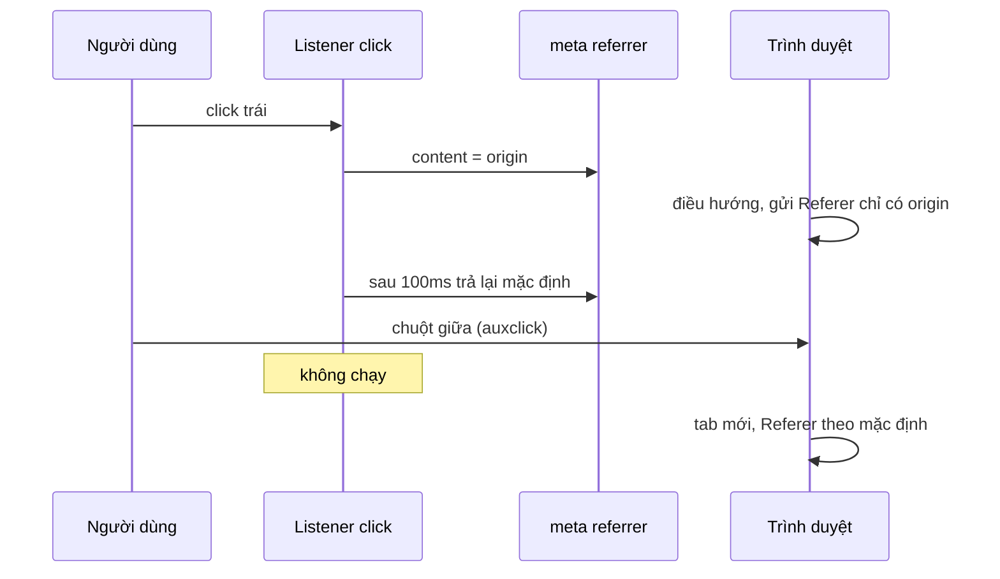

URL là thứ rò rỉ nhiều nhất trên web. Nó nằm trong lịch sử trình duyệt, trong log của proxy công ty, trong ảnh chụp màn hình người dùng gửi cho bạn bè, và theo header `Referer` sang mọi trang mà người dùng bấm link tới. Một token đăng nhập trên thanh địa chỉ, hay đường dẫn `/groups/nhom-kin-cua-toi/` trong Referer, là đủ để lộ thông tin.

facebook.com có bốn lớp nhỏ quanh URL. Bài này đi qua từng lớp từ góc nhìn **quyền riêng tư và bảo mật của người dùng**, và nói thẳng một lớp phục vụ đo lường quảng cáo (`fbclid`), để bạn tự cân nhắc khi mang sang dự án của mình.

> [!TIP]
> **Tóm tắt**
> - `HistoryManager` dùng `replaceState` xoá các tham số nhạy cảm (`fb_dtsg_ag`, `__md__`, `__xts__`…) khỏi thanh địa chỉ ngay khi trang tải.
> - `CometLinkShimUtils` cho link ra ngoài đi qua `l.facebook.com` kèm hash `h`: trang trung gian kiểm tra link, chặn link độc, và cắt Referer. Hash ngăn kẻ xấu dùng trang trung gian làm open redirect.
> - `NonFBLinkReferrerProtector` đổi tạm `<meta name="referrer">` trong 100ms khi bấm link. Nó chỉ nghe `click`, nên mở tab bằng chuột giữa lọt qua.
> - `ClickIDParameterUtils` gắn `fbclid` vào link ra ngoài (trừ link nội bộ, link không phải http(s), và domain trong blocklist). So khớp domain bằng `endsWith` không có dấu chấm.

<iframe class="demo-frame" src="/demos/facebook-patterns/index.html?theme=dark#/url-privacy" title="Demo url-privacy" loading="lazy" style="height: 1100px"></iframe>

<p class="demo-links">▶ <a href="/demos/facebook-patterns/index.html#/url-privacy" target="_blank" rel="noopener">Mở demo toàn màn hình ↗</a> · <a href="https://stackblitz.com/github/hunghg255/blog-hunghg/tree/master/examples/facebook-patterns?file=src/lib/urlPrivacy.ts" target="_blank" rel="noopener">Sửa code trên StackBlitz ↗</a> · <a href="https://github.com/hunghg255/blog-hunghg/blob/master/examples/facebook-patterns/src/lib/urlPrivacy.ts" target="_blank" rel="noopener">Xem source trên GitHub ↗</a></p>

## Lớp 1: xoá token khỏi thanh địa chỉ

### Facebook làm thế nào?

Có những lúc server buộc phải đặt dữ liệu nhạy cảm lên URL: chuyển hướng sau đăng nhập, link trong email, trang tải lại kèm token chống CSRF (`fb_dtsg_ag`). Khi trang đã tải, dữ liệu đó không còn cần trên thanh địa chỉ nữa.

`HistoryManager` (bundle `30.js`) khi khởi tạo gọi `history.replaceState` với URL đã bỏ `__md__`, `__xts__`, `fb_dtsg_ag` và tham số mà `SprinkleConfig` khai báo. `replaceState` đổi URL mà **không** tạo mục lịch sử mới và không tải lại trang. Hàm `go()` (điều hướng trong ứng dụng) cũng bỏ `ref`, `messaging_source`, `ajaxpipe_fetch_stream`, `fb_dtsg_ag` và tham số sprinkle trước khi đẩy URL mới vào lịch sử.

Phần còn lại của module là dấu vết lịch sử web:

- Polling 42ms cho WebKit cũ (< 534) và Chrome ≤ 13, vì `popstate` thời đó không đáng tin.
- Bắt lỗi `-2147467259` của IE khi truy cập `location`.
- Chặn khi `history.length == 200` (giới hạn của một số trình duyệt).
- `popstate` chỉ được xử lý khi `state` là **chuỗi**; state dạng object (của thư viện khác đẩy vào) bị bỏ qua.
- `notify` nuốt lỗi của callback, nên một listener lỗi không làm hỏng điều hướng, nhưng cũng không ai biết nó lỗi.

### Tại sao cần?

- Người dùng chụp màn hình hoặc copy URL gửi cho người khác.
- Lịch sử trình duyệt và tính năng đồng bộ lịch sử giữa các máy.
- Tiện ích trình duyệt đọc được URL của tab.
- Header `Referer` khi người dùng bấm link ra ngoài (nếu chính sách cho phép gửi đường dẫn đầy đủ).

Token vẫn đã đi qua mạng và có trong log của server, nên đây là lớp **giảm thiểu**, không thay cho việc không đặt token lên URL ngay từ đầu.

```ts title=src/lib/urlPrivacy.ts
export function scrubParams(href: string, params: readonly string[]): { url: string; removed: string[] } {
  const url = new URL(href);
  const removed: string[] = [];
  for (const p of params) {
    if (url.searchParams.has(p)) {
      removed.push(p);
      url.searchParams.delete(p);
    }
  }
  return { url: url.toString(), removed };
}
```

## Lớp 2: link shim có chữ ký

### Facebook làm thế nào?

Mọi link ra ngoài trong bài viết (http/https, không phải domain của Facebook) được viết lại thành `https://l.facebook.com/l.php?u=<đích>&h=<hash>`. `CometLinkShimUtils` làm việc đó ở client:

- Link đã là link shim (`l.facebook.com/l.php?u=…`) thì bóc lấy đích gốc trước, để không bọc hai lớp.
- Link tới chính Facebook được nâng `http` lên `https`, trừ các subdomain `l.`, `lm.`, `h.` (chính là các trang trung gian).
- Link ngoài được bọc qua "Lynx" (tên nội bộ của hệ thống link shim) với hash `h` lấy từ cấu hình server; thẻ `<a>` giữ `unshimmedHref` để hiện đúng địa chỉ khi rê chuột, và dùng `rel="noopener"`.
- Có thể gắn thêm một click id chọn ngẫu nhiên trong danh sách `click_ids` của cấu hình.

Trang trung gian làm ba việc cho người dùng: kiểm tra đích với danh sách link độc (phishing, malware) và hiện cảnh báo nếu cần; cắt Referer, để trang đích chỉ thấy người dùng tới từ `l.facebook.com` chứ không thấy họ đang ở nhóm hay trang cá nhân nào; và cho phép chặn một link sau khi nó đã được đăng (link trong bài cũ vẫn đi qua shim).

### Tại sao phải có hash?

Không có hash, `l.facebook.com/l.php?u=https://phishing.example` là một **open redirect**: kẻ xấu gửi link mang domain facebook.com, nạn nhân tin tưởng bấm vào. Hash là chữ ký của server trên URL đích (có lẽ gắn thêm với phiên người dùng và thời gian; client chỉ nhận `h` từ server và chép lại, kể cả khi bóc một link shim có sẵn); sửa `u` mà không có khoá bí mật thì hash không khớp, trang trung gian từ chối chuyển hướng thẳng.

### Một chỗ đáng sửa

Khi bóc link shim có sẵn, code lấy tham số `u` bằng một API trả `null` nếu không có, rồi đưa qua `String(...)`. `String(null)` là chuỗi `"null"`, nên một link shim thiếu `u` có lẽ sẽ thành link tới đích `"null"` thay vì bị bỏ qua.

```ts title=src/lib/urlPrivacy.ts
export async function shimLink(href: string, config: ShimConfig): Promise<string> {
  const target = unwrapShim(href, config.endpoint) ?? href;
  const url = new URL(config.endpoint);
  url.searchParams.set('u', target);
  url.searchParams.set('h', await hmac(config.secret, target));
  return url.toString();
}

/** Phía server (ở đây mô phỏng): chỉ chuyển hướng khi chữ ký khớp với đích. */
export async function verifyShim(href: string, config: ShimConfig): Promise<string | null> {
  const url = new URL(href);
  const target = url.searchParams.get('u');
  const sig = url.searchParams.get('h');
  if (!target || !sig) return null;
  return (await hmac(config.secret, target)) === sig ? target : null;
}
```

## Lớp 3: Referer khi rời trang

### Facebook làm thế nào?

Trang đặt chính sách Referer chung bằng `<meta name="referrer" id="meta_referrer" content="…">`. Với một số link ra ngoài không đi qua shim, `NonFBLinkReferrerProtector` (bundle `31.js`) nghe sự kiện `click` trên `document.body`, tìm phần tử cha có `data-lnfb-mode`:

- Chế độ `origin`: đổi `content` của thẻ meta sang `switched_meta_referrer_policy` của cấu hình, sau 100ms trả về `default_meta_referrer_policy`. Trình duyệt đọc chính sách tại thời điểm điều hướng, nên request tới trang đích chỉ mang origin.
- Chế độ `ie`: trình duyệt cũ không hiểu thẻ meta, nên mở cửa sổ trống bằng `window.open('')` rồi điều hướng cửa sổ đó; trang trống không có Referer để gửi.

Nếu `document.body` chưa có lúc gắn listener, module thử lại một lần sau 100ms.

### Chỗ lọt: chuột giữa

Chrome và Firefox **không** phát `click` cho nút chuột giữa; chúng phát `auxclick`. Bấm chuột giữa để mở tab mới thì listener không chạy, thẻ meta không đổi, tab mới gửi Referer theo chính sách mặc định của trang. Trong demo, bỏ chọn "nghe cả auxclick" rồi bấm chuột giữa vào link: log có `auxclick` nhưng không có dòng `meta referrer = origin`.



Ngày nay không cần mẹo đổi thẻ meta: thuộc tính `referrerpolicy` trên từng thẻ `<a>` có trong mọi trình duyệt lớn (tính tới 10/2026), và áp dụng cho mọi cách mở link, kể cả chuột giữa và menu chuột phải.

```ts title=src/lib/urlPrivacy.ts
export function installReferrerSwitch(
  root: HTMLElement,
  meta: HTMLMetaElement,
  options: { switched: ReferrerPolicyValue; restoreMs?: number; events?: readonly ('click' | 'auxclick')[] },
): () => void {
  const original = meta.content;
  const events = options.events ?? ['click', 'auxclick'];
  const onEvent = (e: Event) => {
    const link = (e.target as Element | null)?.closest?.('a[data-ref-mode="origin"]');
    if (!link) return;
    meta.content = options.switched;
    setTimeout(() => {
      meta.content = original;
    }, options.restoreMs ?? 100);
  };
  for (const type of events) root.addEventListener(type, onEvent);
  return () => {
    for (const type of events) root.removeEventListener(type, onEvent);
  };
}
```

## Lớp 4: click id (fbclid)

Lớp này khác ba lớp trên: nó không bảo vệ người dùng mà phục vụ **đo lường**. Khi người dùng bấm một link ra ngoài, Facebook gắn `fbclid=<giá trị>` vào URL đích. Trang đích (thường là nhà quảng cáo có cài Meta Pixel) đọc tham số này để nối lượt truy cập với lượt bấm quảng cáo. Người dùng thấy nó trong URL, và nhiều trình duyệt (Firefox, Safari, Brave) có chế độ tự xoá `fbclid` cùng các tham số theo dõi khác.

`ClickIDParameterUtils.appendClickIDQueryParam` (bundle `31.js`) quyết định có gắn hay không:

- Không gắn cho link tới Facebook, domain phụ của Facebook, CDN, `fb.com`.
- Chỉ gắn cho URL tuyệt đối, giao thức `http`/`https`.
- Không gắn nếu domain nằm trong blocklist (`isClickIDBlacklistSVDomainURI`), tức các trang đã yêu cầu không nhận tham số này.
- Với link qua `doubleclick.net` (dịch vụ chuyển hướng quảng cáo của Google), query string là URL đích bên trong. Code bóc lớp này **đệ quy** để kiểm tra blocklist trên đích thật, và khi gắn thì gắn vào URL bên trong.

Chỗ đáng sửa: domain chuyển hướng được so bằng `getDomain().endsWith("doubleclick.net")`, không có dấu chấm ở ranh giới. `notdoubleclick.net` cũng khớp, và query string của nó bị coi là URL đích. Hậu quả ở đây nhỏ (chỉ ảnh hưởng quyết định gắn tham số), nhưng đây là lỗi kinh điển: cùng kiểu `endsWith` ấy trong kiểm tra CORS hay whitelist chuyển hướng là lỗ hổng thật.

```ts title=src/lib/urlPrivacy.ts
export function decideClickId(href: string, value: string, policy: ClickIdPolicy): ClickIdDecision {
  let url: URL;
  try {
    url = new URL(href);
  } catch {
    return { decorate: false, reason: 'không phải URL tuyệt đối' };
  }
  if (url.protocol !== 'http:' && url.protocol !== 'https:') return { decorate: false, reason: `giao thức ${url.protocol}` };
  if (matchAny(url.hostname, policy.ownDomains)) return { decorate: false, reason: 'link nội bộ' };

  // bóc từng lớp chuyển hướng: đích cuối nằm trong blocklist thì cũng không gắn
  let current: URL | null = url;
  for (let depth = 0; current && depth <= (policy.maxDepth ?? 3); depth++) {
    if (matchAny(current.hostname, policy.blocklist)) return { decorate: false, reason: `đích ${current.hostname} trong blocklist` };
    const host: string = current.hostname;
    const redirector: Redirector | undefined = policy.redirectors.find((r) => isDomainOrSubdomain(host, r.domain));
    const inner: string | null | undefined = redirector?.extract(current);
    current = inner ? safeUrl(inner) : null;
  }
  const out = new URL(url);
  out.searchParams.set(policy.param, value);
  return { decorate: true, url: out.toString() };
}
```

::: spoiler Xem toàn bộ src/lib/urlPrivacy.ts

```ts title=src/lib/urlPrivacy.ts
/**
 * Mấy lớp bảo vệ quanh URL và link ra ngoài (ý tưởng từ HistoryManager, CometLinkShimUtils,
 * ClickIDParameterUtils và NonFBLinkReferrerProtector của Facebook):
 *  1. Xoá token nhạy cảm khỏi thanh địa chỉ ngay khi trang tải (replaceState)
 *  2. Link ra ngoài đi qua trang chuyển hướng có chữ ký (link shim), chống open redirect
 *  3. Quyết định có gắn tham số đo lường (click id) vào link ra ngoài hay không
 *  4. Giới hạn Referer gửi sang trang khác
 */

// ---- 1. Làm sạch URL ----

export function scrubParams(href: string, params: readonly string[]): { url: string; removed: string[] } {
  const url = new URL(href);
  const removed: string[] = [];
  for (const p of params) {
    if (url.searchParams.has(p)) {
      removed.push(p);
      url.searchParams.delete(p);
    }
  }
  return { url: url.toString(), removed };
}

/**
 * Gọi một lần lúc khởi động: thay URL hiện tại bằng bản đã bỏ token, giữ nguyên
 * history.state (khác bản gốc ở nhánh cũ: ghi đè state bằng chuỗi URL).
 */
export function scrubCurrentLocation(params: readonly string[]): string[] {
  const { url, removed } = scrubParams(location.href, params);
  if (removed.length) history.replaceState(history.state, '', url);
  return removed;
}

// ---- 2. Link shim có chữ ký ----

const encoder = new TextEncoder();

async function hmac(secret: string, message: string): Promise<string> {
  const key = await crypto.subtle.importKey('raw', encoder.encode(secret), { name: 'HMAC', hash: 'SHA-256' }, false, [
    'sign',
  ]);
  const sig = new Uint8Array(await crypto.subtle.sign('HMAC', key, encoder.encode(message)));
  // 16 byte đầu là đủ cho mục đích chống sửa link; mã hoá base64url cho gọn
  return btoa(String.fromCharCode(...sig.slice(0, 16)))
    .replace(/\+/g, '-')
    .replace(/\//g, '_')
    .replace(/=+$/, '');
}

export interface ShimConfig {
  /** trang trung gian, ví dụ https://l.example.com/l.php */
  endpoint: string;
  /** bí mật phía server; demo để ở client chỉ để minh hoạ */
  secret: string;
}

/** Link đã đi qua shim chưa? Nếu rồi thì lấy lại đích gốc để không bọc hai lần. */
export function unwrapShim(href: string, endpoint: string): string | null {
  const url = new URL(href);
  const shim = new URL(endpoint);
  if (url.origin !== shim.origin || url.pathname !== shim.pathname) return null;
  const target = url.searchParams.get('u');
  return target; // khác bản gốc: thiếu `u` thì trả null chứ không biến thành chuỗi "null"
}

export async function shimLink(href: string, config: ShimConfig): Promise<string> {
  const target = unwrapShim(href, config.endpoint) ?? href;
  const url = new URL(config.endpoint);
  url.searchParams.set('u', target);
  url.searchParams.set('h', await hmac(config.secret, target));
  return url.toString();
}

/** Phía server (ở đây mô phỏng): chỉ chuyển hướng khi chữ ký khớp với đích. */
export async function verifyShim(href: string, config: ShimConfig): Promise<string | null> {
  const url = new URL(href);
  const target = url.searchParams.get('u');
  const sig = url.searchParams.get('h');
  if (!target || !sig) return null;
  return (await hmac(config.secret, target)) === sig ? target : null;
}

// ---- 3. Có gắn click id không? ----

/** `host` có phải `domain` hoặc subdomain của nó không (có ranh giới dấu chấm). */
export function isDomainOrSubdomain(host: string, domain: string): boolean {
  host = host.toLowerCase();
  domain = domain.toLowerCase();
  return host === domain || host.endsWith(`.${domain}`);
}

export interface Redirector {
  /** domain của dịch vụ chuyển hướng (ad server…) */
  domain: string;
  /** lấy URL đích nằm bên trong, null nếu không có */
  extract: (url: URL) => string | null;
}

export interface ClickIdPolicy {
  param: string;
  /** domain của chính mình: không gắn */
  ownDomains: readonly string[];
  /** domain đối tác yêu cầu không gắn */
  blocklist: readonly string[];
  redirectors: readonly Redirector[];
  /** giới hạn số lớp chuyển hướng lồng nhau được bóc */
  maxDepth?: number;
}

export type ClickIdDecision = { decorate: true; url: string } | { decorate: false; reason: string };

function matchAny(host: string, domains: readonly string[]) {
  return domains.some((d) => isDomainOrSubdomain(host, d));
}

export function decideClickId(href: string, value: string, policy: ClickIdPolicy): ClickIdDecision {
  let url: URL;
  try {
    url = new URL(href);
  } catch {
    return { decorate: false, reason: 'không phải URL tuyệt đối' };
  }
  if (url.protocol !== 'http:' && url.protocol !== 'https:') return { decorate: false, reason: `giao thức ${url.protocol}` };
  if (matchAny(url.hostname, policy.ownDomains)) return { decorate: false, reason: 'link nội bộ' };

  // bóc từng lớp chuyển hướng: đích cuối nằm trong blocklist thì cũng không gắn
  let current: URL | null = url;
  for (let depth = 0; current && depth <= (policy.maxDepth ?? 3); depth++) {
    if (matchAny(current.hostname, policy.blocklist)) return { decorate: false, reason: `đích ${current.hostname} trong blocklist` };
    const host: string = current.hostname;
    const redirector: Redirector | undefined = policy.redirectors.find((r) => isDomainOrSubdomain(host, r.domain));
    const inner: string | null | undefined = redirector?.extract(current);
    current = inner ? safeUrl(inner) : null;
  }
  const out = new URL(url);
  out.searchParams.set(policy.param, value);
  return { decorate: true, url: out.toString() };
}

function safeUrl(s: string): URL | null {
  try {
    return new URL(s);
  } catch {
    return null;
  }
}

// ---- 4. Referer ----

export type ReferrerPolicyValue = 'no-referrer' | 'origin' | 'strict-origin-when-cross-origin' | 'unsafe-url';

/**
 * Cách hiện đại: đặt `referrerpolicy` ngay trên thẻ <a> thay vì đổi thẻ meta toàn trang.
 * Trả về các thuộc tính nên gắn cho link ra ngoài.
 */
export function externalLinkAttributes(policy: ReferrerPolicyValue = 'origin') {
  return { rel: 'noopener', referrerPolicy: policy, target: '_blank' } as const;
}

/**
 * Cách của bản gốc cho trình duyệt cũ: trước khi điều hướng, đổi tạm <meta name=referrer>
 * rồi trả lại sau 100ms. Khác bản gốc: nghe cả `auxclick` (chuột giữa), vì Chrome/Firefox
 * không phát `click` cho nút giữa, nên mở tab mới bằng chuột giữa sẽ lọt qua.
 */
export function installReferrerSwitch(
  root: HTMLElement,
  meta: HTMLMetaElement,
  options: { switched: ReferrerPolicyValue; restoreMs?: number; events?: readonly ('click' | 'auxclick')[] },
): () => void {
  const original = meta.content;
  const events = options.events ?? ['click', 'auxclick'];
  const onEvent = (e: Event) => {
    const link = (e.target as Element | null)?.closest?.('a[data-ref-mode="origin"]');
    if (!link) return;
    meta.content = options.switched;
    setTimeout(() => {
      meta.content = original;
    }, options.restoreMs ?? 100);
  };
  for (const type of events) root.addEventListener(type, onEvent);
  return () => {
    for (const type of events) root.removeEventListener(type, onEvent);
  };
}
```

:::

## Đi qua code

- **`scrubParams`** dùng `URL` + `searchParams.delete`, không tự viết regex trên chuỗi: giữ nguyên hash, thứ tự các tham số còn lại và mã hoá. **`scrubCurrentLocation`** truyền lại `history.state` hiện có, để router của ứng dụng không mất state.
- **`hmac`** dùng Web Crypto (HMAC-SHA256), lấy 16 byte đầu, mã hoá base64url. Trong demo khoá nằm ở client chỉ để minh hoạ; ở hệ thống thật, ký và kiểm tra đều ở server.
- **`unwrapShim`** chỉ bóc khi origin **và** path khớp trang trung gian, và trả `null` khi thiếu `u`.
- **`verifyShim`** tính lại chữ ký trên `u` và so. Khớp thì trả đích, không thì `null` (trang trung gian nên hiện trang cảnh báo kèm link, để người dùng tự quyết).
- **`isDomainOrSubdomain`** so `host === domain || host.endsWith('.' + domain)`: có dấu chấm ở ranh giới.
- **`decideClickId`** trả cả lý do không gắn, để log hoặc hiện trong công cụ debug. Vòng bóc chuyển hướng có `maxDepth`.
- **`installReferrerSwitch`** nghe cả `click` và `auxclick`, và trả lại giá trị gốc của thẻ meta thay vì một giá trị cấu hình.

**Khác bản gốc:**

- Chữ ký HMAC trên đích, không gắn với phiên.
- Thiếu `u` thì không bóc.
- So domain có ranh giới, giới hạn độ sâu bóc chuyển hướng.
- Click id gắn vào URL ngoài cùng, không chèn vào URL bên trong lớp chuyển hướng.
- Nghe cả `auxclick`; không có chế độ `ie`.

## Tại sao không làm cách khác?

- **Chỉ dùng `Referrer-Policy` header cho cả trang**: đơn giản và nên làm (`strict-origin-when-cross-origin` là mặc định của trình duyệt hiện đại). Link shim vẫn có giá trị riêng: kiểm tra link độc tại thời điểm bấm, và chặn được link đã đăng từ lâu.
- **`rel="noreferrer"`**: bỏ hẳn Referer, kèm luôn `noopener`. Nếu trang đích không cần biết bạn tới từ đâu, đây là cách gọn nhất.
- **Kiểm tra link độc lúc đăng bài thay vì lúc bấm**: domain sạch hôm nay có thể bị chiếm hoặc đổi nội dung ngày mai. Kiểm tra lúc bấm (qua shim) bắt được cả trường hợp đó.
- **Đặt token trong cookie hay header thay vì URL**: đúng là cách tốt nhất. Xoá khỏi thanh địa chỉ chỉ dành cho trường hợp bắt buộc phải qua URL (link trong email, chuyển hướng OAuth).

## Edge case và cạm bẫy

- **`replaceState` trước khi router đọc URL**: chạy scrub sớm nhất có thể, nhưng sau khi code cần token đã đọc xong nó.
- **Analytics đọc URL**: nếu script phân tích chạy trước khi scrub, token đã nằm trong dữ liệu phân tích. Scrub trong script inline đầu trang.
- **Link shim và SEO**: công cụ tìm kiếm không theo được link qua shim. Facebook không cần SEO cho link trong bài; trang công khai của bạn thì có thể cần.
- **Hash so sánh không theo thời gian hằng**: ở server, dùng hàm so sánh chống timing attack (`crypto.timingSafeEqual` trong Node).
- **`auxclick` và menu chuột phải**: "Mở trong tab mới" từ menu chuột phải không phát sự kiện nào cho trang. Chỉ `referrerpolicy` trên thẻ `<a>` (hoặc header) bao được trường hợp đó.
- **Tham số đo lường và quyền riêng tư**: nếu bạn tự gắn click id vào link ra ngoài, hãy cân nhắc quy định về đồng ý theo dõi (GDPR, ePrivacy) ở thị trường của bạn, và tôn trọng blocklist của các trang không muốn nhận.

## Dùng trong dự án

```tsx
// Chạy sớm, trong script đầu trang
scrubCurrentLocation(['token', 'code', 'state', 'magic_link']);

// Link do người dùng đăng: Referer chỉ có origin, không cho trang đích điều khiển window.opener
function ExternalLink({ href, children }: { href: string; children: React.ReactNode }) {
  return <a href={href} {...externalLinkAttributes('origin')}>{children}</a>;
}
```

Phía server, trang trung gian (Express):

```ts
app.get('/l', async (req, res) => {
  const target = await verifyShim(req.originalUrl, shimConfig); // URL đầy đủ của request
  if (!target) return res.status(400).render('link-warning', { url: req.query.u });
  res.setHeader('Referrer-Policy', 'no-referrer');
  res.redirect(302, target);
});
```

## Kiểm thử

::: spoiler Ví dụ test (bản phác, không có trong repo)

```ts
import { expect, it } from 'vitest';
import { decideClickId, isDomainOrSubdomain, scrubParams, shimLink, unwrapShim, verifyShim } from './urlPrivacy';

const cfg = { endpoint: 'https://l.example.com/l.php', secret: 's3cret' };
const policy = {
  param: 'clid',
  ownDomains: ['example.com'],
  blocklist: ['partner.com'],
  redirectors: [{ domain: 'ads.net', extract: (u: URL) => u.searchParams.get('dest') }],
};

it('bỏ token khỏi URL, giữ tham số khác', () => {
  const r = scrubParams('https://example.com/p?id=1&fb_dtsg_ag=abc&__md__=x', ['fb_dtsg_ag', '__md__']);
  expect(r.url).toBe('https://example.com/p?id=1');
  expect(r.removed).toEqual(['fb_dtsg_ag', '__md__']);
});

it('shim có chữ ký, sửa đích là bị từ chối, không bọc hai lần', async () => {
  const s = await shimLink('https://news.site/a', cfg);
  expect(await verifyShim(s, cfg)).toBe('https://news.site/a');
  const tampered = new URL(s);
  tampered.searchParams.set('u', 'https://evil.site');
  expect(await verifyShim(tampered.toString(), cfg)).toBeNull();
  expect(await shimLink(s, cfg)).toBe(s);
  expect(unwrapShim('https://l.example.com/l.php?h=x', cfg.endpoint)).toBeNull();
});

it('ranh giới domain', () => {
  expect(isDomainOrSubdomain('cdn.ads.net', 'ads.net')).toBe(true);
  expect(isDomainOrSubdomain('evilads.net', 'ads.net')).toBe(false);
});

it('quyết định click id', () => {
  expect(decideClickId('https://shop.vn/x', 'c1', policy)).toEqual({ decorate: true, url: 'https://shop.vn/x?clid=c1' });
  expect(decideClickId('https://m.example.com/x', 'c1', policy).decorate).toBe(false);
  expect(decideClickId('mailto:a@b.c', 'c1', policy).decorate).toBe(false);
  const nested = 'https://ads.net/r?dest=' + encodeURIComponent('https://www.partner.com/p');
  expect(decideClickId(nested, 'c1', policy)).toMatchObject({ decorate: false });
});
```

:::

## So với thư viện và chuẩn web

- **`Referrer-Policy`** (header, thẻ meta, thuộc tính `referrerpolicy` trên `<a>`, ``, `<iframe>`, và option `referrerPolicy` của `fetch`): mặc định `strict-origin-when-cross-origin` trong Chrome, Firefox, Safari (tính tới 10/2026). Chỉ cần đặt chặt hơn khi đường dẫn của bạn tự nó đã nhạy cảm.
- **`rel="noopener"`** là mặc định cho `target="_blank"` ở trình duyệt hiện đại; vẫn nên ghi rõ cho trình duyệt cũ.
- **Link shim ở nơi khác**: Google Search (`/url?q=`), Slack, Gmail, Outlook Safe Links đều có trang trung gian tương tự, với mục đích kiểm tra link và đo lượt bấm.
- **Chống tham số theo dõi ở phía trình duyệt**: Firefox "Query Parameter Stripping", Safari "Link Tracking Protection", Brave "Debouncing" xoá `fbclid`, `gclid` và các tham số tương tự. Nếu sản phẩm của bạn dựa vào click id, hãy chuẩn bị cho việc nó không có mặt.
- **Open redirect**: OWASP xếp vào nhóm lỗi chuyển hướng không được kiểm tra. Cách phòng chuẩn là danh sách đích cho phép, hoặc chữ ký như link shim.

---

Bài này thuộc series **[Học từ mã nguồn Facebook](/series/facebook)** (106 bài, đọc theo thứ tự).

::: spoiler Xem nhanh danh sách bài trong series

*Phần 1*

- [Mở đầu: cách đọc code minify của Facebook](/blogs/learn-from-facebook-source-code)
- [#1 Dùng chung IntersectionObserver + infinite scroll](/blogs/facebook-shared-intersection-observer)
- [#2 useViewportDuration: đo thời gian thực sự được xem](/blogs/facebook-use-viewport-duration)
- [#3 Preload code + data khi hover](/blogs/facebook-preload-on-hover)
- [#4 Toast manager với external store](/blogs/facebook-toast-manager)
- [#5 Network status + heartbeat backoff](/blogs/facebook-network-status-heartbeat)
- [#6 ErrorGuard: bắt lỗi theo ngữ cảnh](/blogs/facebook-error-guard)
- [#7 Banzai: gom log theo lô + sendBeacon](/blogs/facebook-batch-logger)
- [#8 Focus trap + Esc theo layer](/blogs/facebook-focus-trap)

*Phần 2*

- [#9 Mẹo calc(… * 9999): container query, line-clamp, mũi tên carousel bằng CSS](/blogs/facebook-css-9999-trick)
- [#10 Thanh cuộn tuỳ biến bằng CSS 3D](/blogs/facebook-css-3d-scrollbar)
- [#11 Modal cuộn bằng window, giữ vị trí trang nền](/blogs/facebook-document-scroll-modal)
- [#12 Popover, tooltip group và hovercard](/blogs/facebook-popover-tooltip)
- [#13 Primitive Pressable + focus-visible](/blogs/facebook-pressable)
- [#14 Tab "Xem thêm" + sticky header bằng IntersectionObserver](/blogs/facebook-priority-tabs-sticky-header)
- [#15 Avatar khoét mask, gradient Messenger, skeleton steps()](/blogs/facebook-visual-tricks)
- [#16 Khung chat không giật](/blogs/facebook-chat-scroller)
- [#17 Thuật toán chọn bố cục collage ảnh](/blogs/facebook-photo-collage-layout)
- [#18 Keep-alive tab trong SPA](/blogs/facebook-keep-alive-tabs)
- [#19 Tự đo Visual Completion & interaction tracing](/blogs/facebook-visual-completion)
- [#20 Router SPA bền bỉ & tải chunk có retry](/blogs/facebook-spa-router-resilient-loading)

*Phần 3*

- [#21 Smart Compose: gợi ý chữ mờ khi gõ](/blogs/facebook-smart-compose-ghost-text)
- [#22 MQTT ngay trong trình duyệt, tự chuyển sang long-poll](/blogs/facebook-mqtt-in-browser)
- [#23 Đo thời gian dùng bằng bitmap 64 giây](/blogs/facebook-time-spent-bitmap)
- [#24 Bảng reaction nhấn giữ rồi trượt](/blogs/facebook-reaction-press-slide)
- [#25 Tìm kiếm gấp dấu, phiên âm và highlight đầu từ](/blogs/facebook-search-diacritics-tokenize)
- [#26 Ring buffer biết trace nào đã mất log](/blogs/facebook-trace-ring-buffer)
- [#27 Engine animation JS: một vòng rAF và solver cubic-bezier](/blogs/facebook-keyframes-loop-cubic-bezier)
- [#28 Bootloader: bitmap tài nguyên đã tải, chỉ reload khi cần](/blogs/facebook-bootloader-bitmap-consistency)
- [#29 Nhận biết click do screen reader tạo ra](/blogs/facebook-virtual-cursor-detection)
- [#30 Tải trước feed theo chất lượng mạng, đoán hạng thiết bị](/blogs/facebook-network-aware-prefetch)
- [#31 Hàng đợi gửi tin chat giữ đúng thứ tự](/blogs/facebook-ordered-send-queue)
- [#32 Gộp lời gọi API trong cùng một tick](/blogs/facebook-api-batcher)
- [#33 Resize ảnh trong pool Web Worker](/blogs/facebook-jpeg-resize-worker-pool)
- [#34 Crop ảnh theo nhiều khuôn mặt](/blogs/facebook-face-aware-crop)
- [#35 Kéo-thả sắp xếp và vùng thả file không nhấp nháy](/blogs/facebook-flicker-free-drag-drop)
- [#36 Tiện ích UI: fade-out, sticky event, hàm huỷ được](/blogs/facebook-ui-utility-hooks)
- [#37 Hạ tầng nhỏ: cookie, hash lỗi, prefetch khi chuột dừng](/blogs/facebook-small-infra-cookie-hash-idle)

*Phần 4–6*

- [#38 Đồng bộ tin nhắn: phát hiện lỗ seqID và fetch bù theo tầng](/blogs/facebook-messenger-sync-seqid-gaps)
- [#39 OTID: ID tin nhắn kiểu Snowflake sinh ở client](/blogs/facebook-otid-client-snowflake)
- [#40 QPL: lấy mẫu từ lúc bắt đầu, đo RTT gửi tin đầu-cuối](/blogs/facebook-qpl-send-rtt)
- [#41 Bộ điều phối request bảy chế độ gộp và chống trùng](/blogs/facebook-request-dispatcher-modes)
- [#42 Thread list theo mốc thời gian, cookie presence có version](/blogs/facebook-threadlist-ranged-presence)
- [#43 Composer dạng plugin: reducer, dirty checker, chuỗi kiểm tra](/blogs/facebook-plugin-composer)
- [#44 Thanh toán bất đồng bộ: subscribe trước, poll dự phòng](/blogs/facebook-async-checkout)
- [#45 Validate số thẻ: sửa lỗi gõ, dải BIN, Luhn](/blogs/facebook-card-validation)
- [#46 Lịch chọn khoảng ngày: bo góc dải chọn, phím đủ bộ, RTL](/blogs/facebook-range-calendar-a11y)
- [#47 Giờ mở cửa theo tuần: qua đêm, gộp khoảng, phần bù](/blogs/facebook-weekly-hours-intervals)
- [#48 Tiến độ đăng realtime: giữ event chờ snapshot, watchdog](/blogs/facebook-realtime-publish-snapshot)
- [#49 Tiền tệ theo đơn vị nhỏ nhất và ô nhập tiền](/blogs/facebook-currency-minor-units)
- [#50 Sửa hàng loạt Empty/Uniform/Mixed, seen/read bằng 2 bit](/blogs/facebook-bulk-edit-seen-bits)
- [#51 Phát hiện script lạ hook vào hàm native](/blogs/facebook-native-hook-detection)
- [#52 localStorage tự dọn khi đầy quota](/blogs/facebook-quota-aware-storage)
- [#53 Cache tuyến do server phân giải, chờ sẵn promise](/blogs/facebook-route-cache-prefetch)
- [#54 Lưới phím mũi tên 2D và focus không làm cuộn trang](/blogs/facebook-focus-table-grid)
- [#55 Tách emoji bằng máy trạng thái](/blogs/facebook-emoji-segmentation)
- [#56 Đọc trước ghi sau trong một frame, con tự biết vị trí](/blogs/facebook-read-then-write-dom)
- [#57 Hàng đợi lệnh cho video và stream sắp lại chunk](/blogs/facebook-video-command-queue)

*Phần 7–10*

- [#58 Ước lượng băng thông EWMA: loại outlier, nhớ qua phiên](/blogs/facebook-bandwidth-ewma-estimator)
- [#59 ABR theo độ tự tin phát và cắt bậc bitrate theo MOS](/blogs/facebook-abr-playback-confidence)
- [#60 Prefetch segment dự đoán từ manifest, parse hộp sidx](/blogs/facebook-dash-predicted-segments)
- [#61 Đọc metadata MP4/MOV ngay trên client](/blogs/facebook-mp4-metadata-client)
- [#62 Upload tiếp tục được: offset, hash dedupe, phát hiện treo](/blogs/facebook-resumable-upload)
- [#63 Fenwick tree: chọn ngẫu nhiên có trọng số và offset dòng](/blogs/facebook-fenwick-weighted-random)
- [#64 Vạch trục số và trục thời gian "đẹp"](/blogs/facebook-nice-axis-ticks)
- [#65 Damerau-Levenshtein theo dải chéo và tự sửa tên gõ sai](/blogs/facebook-damerau-levenshtein)
- [#66 PRNG có seed, shuffle tái lập và lấy mẫu trace](/blogs/facebook-seeded-prng-sampling)
- [#67 Cặp min/max-heap tái dùng vị trí trong danh sách ảo](/blogs/facebook-dual-heap-buffer-set)
- [#68 Memo nhiều đối số bằng Map/WeakMap và interning object](/blogs/facebook-multikey-memo-interning)
- [#69 Thống kê cửa sổ trượt và đại số khoảng thời gian](/blogs/facebook-moving-stat-intervals)
- [#70 Int64 từ hai số 32-bit, decode UTF, offset theo code point](/blogs/facebook-int64-utf-codepoints)
- [#71 Engine múi giờ IANA trên client, phát hiện lệch giờ](/blogs/facebook-client-iana-timezone)
- [#72 Tự cài semver range](/blogs/facebook-semver-range)
- [#73 Auto-link URL, cắt chữ an toàn, giới hạn LaTeX](/blogs/facebook-autolink-safe-truncate)
- [#74 Parser query kiểu PHP chống prototype pollution](/blogs/facebook-php-query-serializer)
- [#75 Popover tự lật theo phần tràn nhỏ nhất](/blogs/facebook-popover-auto-flip)
- [#76 Tiền tố for(;;) chống JSON hijacking, đọc stream](/blogs/facebook-csrf-prefix-streaming)
- **#77 Chống lộ Referer, linkshim, xoá token trên URL** (bài này)
- [#78 setImmediate bằng postMessage, gom delta chuột theo frame](/blogs/facebook-setimmediate-mouse-batching)
- [#79 Phát hiện crash qua heartbeat, dò proxy cache hỏng](/blogs/facebook-crash-heartbeat-proxy-check)
- [#80 DPR vào cookie cho ảnh @2x, che khoá trong log](/blogs/facebook-dpr-cookie-secret-redaction)
- [#81 Flux waitFor tự viết và proxy có đệm](/blogs/facebook-flux-dispatch-buffered-proxy)
- [#82 Crop đúng tỉ lệ, xoay sticker bằng ma trận](/blogs/facebook-image-crop-rotation-geometry)

*Phần 11–15*

- [#83 Chia subdomain giữa các tab bằng lease, long-poll theo bảng trạng thái](/blogs/facebook-tab-subdomain-lease-longpoll)
- [#84 MQTT QoS1: giữ publish chờ ack, gửi lại khi kết nối lại](/blogs/facebook-mqtt-qos1-republish)
- [#85 Cache Promise gộp request, cache lỗi ngắn, đua dữ liệu nhúng sẵn](/blogs/facebook-promise-cache-preload-race)
- [#86 Lịch retry: backoff có trần, Fibonacci, báo lỗi CDN mỗi N ngày](/blogs/facebook-retry-backoff-schedules)
- [#87 Giữ nguyên tham chiếu nhánh dữ liệu không đổi](/blogs/facebook-relay-recycle-nodes)
- [#88 Store optimistic: copy-on-write, rollback rồi áp lại](/blogs/facebook-relay-optimistic-store)
- [#89 Chỉ mục subscription theo record, hàng đợi task theo chiều sâu](/blogs/facebook-relay-subscription-index)
- [#90 Phân trang connection: cursor khớp đầu, edge không trùng](/blogs/facebook-relay-connection-pagination)
- [#91 Profiler kiểu middleware và memo selector có lấy mẫu kiểm tra](/blogs/facebook-profiler-middleware-memo-check)
- [#92 Đọc EBML/WebM Cues để tìm byte range của segment](/blogs/facebook-webm-ebml-cues)
- [#93 Stream HTTP Range tạm dừng được, tải tiếp đúng byte](/blogs/facebook-pausable-range-stream)
- [#94 Bảng khoảng thời gian gắn nhãn và nhảy qua lỗ buffer](/blogs/facebook-tagged-time-ranges-gaps)
- [#95 Gom chunk cho SourceBuffer, đồng bộ video bằng playbackRate](/blogs/facebook-sourcebuffer-video-sync)
- [#96 Gom tin nhắn thành cụm, vạch ngày và avatar đã xem](/blogs/facebook-message-grouping)
- [#97 Bao nhiêu tab chat vừa màn hình, chuỗi luật mở tab](/blogs/facebook-chat-tab-policy)
- [#98 Phím tắt Markdown trong editor, Backspace để hoàn tác](/blogs/facebook-markdown-shortcuts-editor)
- [#99 Offset theo code point hay UTF-16: bốn bug cùng một gốc](/blogs/facebook-codepoint-offset-bugs)
- [#100 Typeahead không nhảy: cache tiền tố, chặn reflow, khoá hover](/blogs/facebook-typeahead-stable-results)
- [#101 Hit-test trên canvas bằng phát lại path, nét đứt và cung Bézier](/blogs/facebook-canvas-hit-regions)
- [#102 Vòng tròn theo mét trên bản đồ Mercator](/blogs/facebook-mercator-meter-circles)
- [#103 Dò tính năng trình duyệt: ảnh EXIF 2×1, getter bẫy, scrollbar](/blogs/facebook-feature-probe-tricks)
- [#104 Bug định dạng số và kiểm tra dữ liệu theo locale](/blogs/facebook-locale-validation-bugs)
- [#105 Dispose cho đúng: idle callback, splice(-1), xoá nhầm key](/blogs/facebook-dispose-leak-bugs)

:::

Code + demo: [`examples/facebook-patterns`](https://github.com/hunghg255/blog-hunghg/tree/master/examples/facebook-patterns) · [Mở trên StackBlitz](https://stackblitz.com/github/hunghg255/blog-hunghg/tree/master/examples/facebook-patterns)
