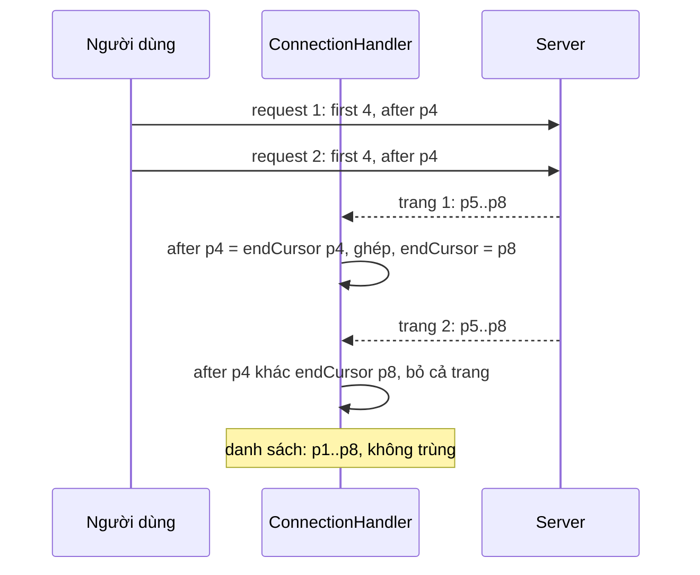

Infinite scroll trông đơn giản: cuộn tới cuối thì gọi trang tiếp và `setItems([...items, ...page])`. Rồi bug bắt đầu tới. Người dùng cuộn nhanh, hai request "trang tiếp" cùng bay với cùng một cursor, và bốn bài xuất hiện hai lần. Feed xếp hạng lại giữa hai lần tải, trang sau lẫn hai bài đã xem. React báo `Encountered two children with the same key`. Một bài vừa đăng hiện hai lần vì realtime báo lại đúng bài đó.

Relay giải quyết các ca này ở một chỗ: `ConnectionHandler`, đoạn code chạy mỗi khi một field có `@connection` nhận dữ liệu mới. Facebook còn có handler riêng cho News Feed với luật khác. Bài này đọc cả hai.

> [!TIP]
> **Tóm tắt**
> - Trang `after: X` chỉ được ghép khi `X` đúng bằng `endCursor` hiện tại. Lệch thì **bỏ cả trang**: request đến muộn của một lần bấm đúp không làm hỏng danh sách.
> - Ghép bằng một `Set` node id theo thứ tự `[cũ…, mới…]` (hoặc `[mới…, cũ…]` khi tải ngược). Edge đến trước thắng, trang chồng lấn không sinh bản trùng.
> - Mỗi edge nhận một ID phía client `client:<connection>:edges:<n>` với `n` lấy từ bộ đếm `__connection_next_edge_index` chỉ tăng. ID không bao giờ dùng lại, kể cả khi edge bị xoá rồi thêm lại.
> - Handler của News Feed bỏ kiểm tra cursor, cấm phân trang ngược và coi "còn trang tiếp" là "trang vừa nhận không rỗng", vì feed xếp hạng không có điểm kết thúc.

<iframe class="demo-frame" src="/demos/facebook-patterns/index.html?theme=dark#/relay-connection-pagination" title="Demo relay-connection-pagination" loading="lazy" style="height: 1150px"></iframe>

<p class="demo-links">▶ <a href="/demos/facebook-patterns/index.html#/relay-connection-pagination" target="_blank" rel="noopener">Mở demo toàn màn hình ↗</a> · <a href="https://stackblitz.com/github/hunghg255/blog-hunghg/tree/master/examples/facebook-patterns?file=src/lib/connection.ts" target="_blank" rel="noopener">Sửa code trên StackBlitz ↗</a> · <a href="https://github.com/hunghg255/blog-hunghg/blob/master/examples/facebook-patterns/src/lib/connection.ts" target="_blank" rel="noopener">Xem source trên GitHub ↗</a></p>

## Facebook làm thế nào?

### ConnectionHandler.update

`relay-runtime/handlers/connection/ConnectionHandler` (trong `99 ChatComposer/all.js` và `31.js`, hai bản giống hệt). Relay là mã nguồn mở (MIT). Tên trường lấy từ `ConnectionInterface` (`edges`, `node`, `cursor`, `pageInfo`, `endCursor`…), và có thể đổi qua `ConnectionInterface.inject`.

Một field `@connection` có hai bản trong store: bản server (`friends(first:10,after:"abc")`, mỗi trang một bản) và bản client (`__friends_connection`, một bản duy nhất, gộp mọi trang). Handler chép từ bản server sang bản client. Lần đầu:

```js
if (!clientConnection) {
  const conn = store.create(generateClientID(record.getDataID(), handleKey), serverConnection.getType());
  conn.setValue(0, '__connection_next_edge_index');
  conn.copyFieldsFrom(serverConnection);
  conn.setLinkedRecords(serverEdges.map((e) => buildConnectionEdge(store, conn, e)), 'edges');
  // pageInfo mới, mặc định false/null, rồi chép từ server
}
```

Những lần sau, phần quan trọng (đổi tên biến):

```js
const prevEdges = conn.getLinkedRecords('edges');
const nextEdges = serverEdges.map((e) => buildConnectionEdge(store, conn, e));
let edges = [];
if (prevEdges && nextEdges) {
  if (args.after != null) {
    if (clientPageInfo && args.after === clientPageInfo.getValue('endCursor')) {
      const seen = new Set();
      mergeEdges(prevEdges, edges, seen);
      mergeEdges(nextEdges, edges, seen);
    } else {
      warning(false, 'Relay: Unexpected after cursor `%s`, edges must be fetched from the end of the list (`%s`).', args.after, clientPageInfo && clientPageInfo.getValue('endCursor'));
      return;
    }
  } else if (args.before != null) {
    /* tương tự với startCursor, thứ tự [mới…, cũ…] */
  } else {
    edges = nextEdges; // không có after/before: tải lại từ đầu, thay toàn bộ
  }
}
```

Và `mergeEdges` (tên gốc `n`):

```js
function mergeEdges(source, target, seen) {
  for (const edge of source) {
    if (!edge) continue;
    const nodeID = edge.getLinkedRecord('node')?.getDataID();
    if (nodeID) {
      if (seen.has(nodeID)) continue; // node đã có: bỏ edge này
      seen.add(nodeID);
    }
    target.push(edge);
  }
}
```

Sau khi ghép, `pageInfo` chỉ cập nhật **đầu tương ứng**. Tải xuôi (`after`, hoặc `first` không có `before`) thì chỉ chép `hasNextPage` và `endCursor`. Tải ngược thì chỉ `hasPreviousPage` và `startCursor`. Nếu chép cả `pageInfo` từ trang mới, `startCursor` sẽ nhảy xuống giữa danh sách và nút "tải bài mới hơn" hỏng.

### ID của edge: bộ đếm chỉ tăng

```js
function buildConnectionEdge(store, connection, edge) {
  if (edge == null) return edge;
  const index = connection.getValue('__connection_next_edge_index');
  invariant(typeof index === 'number', /* … */);
  const edgeID = generateClientID(connection.getDataID(), 'edges', index); // client:<conn>:edges:<n>
  const clone = store.create(edgeID, edge.getType());
  clone.copyFieldsFrom(edge);
  connection.setValue(index + 1, '__connection_next_edge_index');
  return clone;
}
```

Edge của server thường không có ID ổn định (ID của edge server phụ thuộc vào trang chứa nó). Relay clone mỗi edge sang một ID mới theo bộ đếm của connection. Bộ đếm không bao giờ giảm, nên một edge bị xoá rồi được tải lại sẽ có ID khác, và một record edge cũ không bao giờ bị ghi đè nhầm. Edge bị bỏ do trùng vẫn đã tiêu một số, nên dãy ID có lỗ. Trong demo, cột phải hiện `edges:<n>` cho từng dòng: bấm "Trang sau lẫn bài cũ" rồi xem số nhảy cóc.

### Chèn và xoá thủ công

Các hàm dành cho updater của mutation:

- `createEdge(store, record, node, edgeType)`: ID là `client:<connection>:<nodeID>`, theo **node** chứ không theo bộ đếm. Nếu record đó đã có thì dùng lại.
- `insertEdgeAfter(record, newEdge, cursor?)`: không có `cursor` thì nối vào cuối. Có `cursor` thì chèn sau edge có cursor đó, **không tìm thấy thì cũng nối vào cuối**. `insertEdgeBefore` đối xứng, nối vào đầu.
- `deleteNode(record, nodeID)`: duyệt edges, chỉ `slice` mảng ở lần đầu gặp node cần xoá, sau đó `push` phần còn lại. Không có node cần xoá thì không tạo mảng mới.

Hai hàm insert **không kiểm tra trùng**. Gọi `createEdge` cho cùng một node hai lần (mutation trả về, rồi subscription realtime báo lại đúng bài đó) thì cùng một record edge xuất hiện hai lần trong danh sách, hai dòng giống nhau và cùng ID. Đây là cạm bẫy quen thuộc khi dùng Relay. Bản viết lại thêm tuỳ chọn `dedupe` (bật mặc định).

### Hai điểm cần biết khi trang bị bỏ

Đọc code thấy:

1. **Cảnh báo chỉ có ở dev.** Trang bị bỏ chỉ đi kèm một lời gọi `warning(...)`. Trong bundle, `warning` trỏ tới `warningComet` (hoặc `warningBlue` ở giao diện cũ), và cả hai ở bản production là hàm rỗng `function (a, b) {}`. Trên production, trang bị bỏ trong im lặng. Đó là hành vi đúng cho request đến muộn, nhưng nếu cursor lệch vì bug thật (server đổi định dạng cursor chẳng hạn), bạn sẽ chỉ thấy "cuộn mãi không tải thêm".
2. **Field khác của connection vẫn bị ghi.** Trước khi so cursor, handler đã gọi `conn.copyFieldsFrom(serverConnection)` rồi đặt lại `edges` và `pageInfo` cũ. Các field khác trên connection (ví dụ `count`) lấy giá trị từ trang bị bỏ.

### Handler riêng của News Feed

`CometNewsFeedConnectionHandler` (cũng trong `99 ChatComposer/all.js`) viết lại hàm `update` cho feed, dùng lại `buildConnectionEdge` của Relay:

```js
if (args.before != null)
  throw unrecoverableViolation('The newsfeed connection does not support backward pagination by design', 'comet_feed');
// …
const edges = [], seen = new Set();
if (args.after != null || (nextEdges?.length ?? 0) === 0) mergeEdges(prevEdges ?? [], edges, seen);
mergeEdges(nextEdges ?? [], edges, seen);
conn.setLinkedRecords(edges, 'edges');
conn.setValue(nextEdges.length, 'received_edges_count');
```

Khác ConnectionHandler ở bốn chỗ:

- **Không so cursor.** Trang nào tới cũng được ghép, và `Set` node id lo phần trùng. Feed xếp hạng có thể trả lại bài đã thấy, nên lọc trùng quan trọng hơn kiểm cursor.
- **Làm mới mà server trả rỗng thì giữ danh sách cũ** (`nextEdges.length === 0` cũng giữ `prevEdges`). Người dùng kéo để làm mới mà mạng trả về rỗng thì feed không bị xoá trắng.
- **`hasNextPage` = trang vừa nhận không rỗng.** Sau gatekeeper `1631636` thì thêm điều kiện "hoặc server nói còn". `hasPreviousPage` luôn `false`.
- **`endCursor` = cursor của server, thiếu thì cursor của edge cuối.** Không có cả hai thì ghi log `"Unable to set end_cursor…"` và giữ nguyên.

Bài #50 ([seen/read bằng 2 bit](/blogs/facebook-bulk-edit-seen-bits)) có một handler khác của Facebook cho danh sách thông báo: thay node rút gọn từ cache server bằng record đầy đủ đã có.

## Bên trong: hai request cùng cursor



Cách nối thẳng mảng nhận cả hai trang: p5..p8 xuất hiện hai lần. Đó là bước đầu tiên trong demo ("Bấm Tải tiếp 2 lần liền"). Kiểm cursor là một dạng **optimistic concurrency** (đồng thời lạc quan): request mang theo "phiên bản" nó dựa vào, và kết quả chỉ được ghi nếu phiên bản đó vẫn còn đúng.

## Viết lại

File `src/lib/connection.ts`, bất biến: mỗi lần ghép trả về object `Connection` mới, không cần store. Ghép qua `Set`:

```ts title=src/lib/connection.ts
/** Nối các danh sách theo thứ tự, bỏ edge có node id đã gặp (edge đến trước thắng). */
function mergeEdges<N extends NodeLike>(lists: readonly (readonly Edge<N>[])[]) {
  const seen = new Set<string>();
  const out: Edge<N>[] = [];
  let dropped = 0;
  for (const list of lists) {
    for (const edge of list) {
      const id = edge.node?.id;
      if (id != null) {
        if (seen.has(id)) {
          dropped++;
          continue;
        }
        seen.add(id);
      }
      out.push(edge); // edge không có node (null) vẫn được giữ, giống Relay
    }
  }
  return { edges: out, dropped };
}
```

Phần thân của `mergePage` sau nhánh khởi tạo: kiểm cursor, ghép theo chiều, cập nhật đúng đầu của `pageInfo`:

```ts title=src/lib/connection.ts
  const { pageInfo } = current;
  if (args.after != null && args.after !== pageInfo.endCursor) {
    return {
      connection: current,
      result: 'rejected',
      dropped: 0,
      warning: `after "${args.after}" khác endCursor "${pageInfo.endCursor}": bỏ cả trang`,
    };
  }
  if (args.before != null && args.before !== pageInfo.startCursor) {
    return {
      connection: current,
      result: 'rejected',
      dropped: 0,
      warning: `before "${args.before}" khác startCursor "${pageInfo.startCursor}": bỏ cả trang`,
    };
  }

  const built = buildEdges(connId, current.nextEdgeIndex, page);
  const server = page.pageInfo;
  let result: MergeResult;
  let merged: { edges: Edge<N>[]; dropped: number };
  let nextInfo: PageInfo;

  if (args.after != null) {
    result = 'append';
    merged = mergeEdges([current.edges, built.edges]);
    nextInfo = {
      ...pageInfo,
      hasNextPage: !!server.hasNextPage,
      endCursor: typeof server.endCursor === 'string' ? server.endCursor : pageInfo.endCursor,
    };
  } else if (args.before != null) {
    result = 'prepend';
    merged = mergeEdges([built.edges, current.edges]);
    nextInfo = {
      ...pageInfo,
      hasPreviousPage: !!server.hasPreviousPage,
      startCursor:
        typeof server.startCursor === 'string' ? server.startCursor : pageInfo.startCursor,
    };
  } else {
    // không có after/before: tải lại từ đầu, thay toàn bộ
    result = 'refetch';
    merged = { edges: built.edges, dropped: 0 };
    nextInfo = { ...EMPTY_PAGE_INFO, ...server };
  }
  return {
    connection: { id: connId, edges: merged.edges, pageInfo: nextInfo, nextEdgeIndex: built.next },
    result,
    dropped: merged.dropped,
  };
}
```

Biến thể News Feed:

```ts title=src/lib/connection.ts
export function mergeFeedPage<N extends NodeLike>(
  current: Connection<N> | null,
  connId: string,
  page: ServerPage<N>,
  args: PageArgs,
): MergeOutcome<N> {
  if (args.before != null) throw new Error('Feed không hỗ trợ phân trang ngược');
  const start = current?.nextEdgeIndex ?? 0;
  const built = buildEdges(connId, start, page);
  const keepOld = current && (args.after != null || built.edges.length === 0);
  const merged = mergeEdges(keepOld ? [current!.edges, built.edges] : [built.edges]);
  const last = merged.edges[merged.edges.length - 1];
  const pageInfo: PageInfo = {
    hasPreviousPage: false,
    hasNextPage: built.edges.length > 0 || page.pageInfo.hasNextPage === true,
    startCursor: null,
    endCursor: page.pageInfo.endCursor ?? last?.cursor ?? null,
  };
  return {
    connection: { id: connId, edges: merged.edges, pageInfo, nextEdgeIndex: built.next },
    result: current ? (args.after != null ? 'append' : 'refetch') : 'init',
    dropped: merged.dropped,
  };
}
```

::: spoiler Xem toàn bộ src/lib/connection.ts

```ts title=src/lib/connection.ts
/**
 * Ghép trang cho danh sách phân trang kiểu GraphQL connection, ý tưởng từ ConnectionHandler của Relay
 * (viết lại, bất biến, không cần store):
 * - mỗi edge nhận được có ID riêng `client:<conn>:edges:<n>` với n tăng đơn điệu, không bao giờ dùng lại,
 * - trang `after` chỉ được ghép khi cursor khớp endCursor hiện tại; trang `before` khớp startCursor,
 * - ghép qua một Set node id: edge đến trước thắng, nên trang chồng lấn không sinh bản trùng.
 */

export interface NodeLike {
  id: string;
}
export interface PageInfo {
  hasNextPage: boolean;
  hasPreviousPage: boolean;
  startCursor: string | null;
  endCursor: string | null;
}
export interface Edge<N extends NodeLike> {
  /** ID phía client, ổn định suốt đời edge, dùng làm React key */
  id: string;
  cursor: string | null;
  node: N | null;
}
export interface Connection<N extends NodeLike> {
  id: string;
  edges: readonly Edge<N>[];
  pageInfo: PageInfo;
  nextEdgeIndex: number;
}
export interface ServerPage<N extends NodeLike> {
  edges: { cursor: string | null; node: N | null }[];
  pageInfo: Partial<PageInfo>;
}
export interface PageArgs {
  first?: number;
  after?: string | null;
  last?: number;
  before?: string | null;
}
export type MergeResult = 'init' | 'refetch' | 'append' | 'prepend' | 'rejected';

const EMPTY_PAGE_INFO: PageInfo = {
  hasNextPage: false,
  hasPreviousPage: false,
  startCursor: null,
  endCursor: null,
};

/** Gán ID client cho các edge server, trả về edge mới và chỉ số kế tiếp. */
function buildEdges<N extends NodeLike>(connId: string, start: number, page: ServerPage<N>) {
  let n = start;
  const edges = page.edges.map((e) => ({
    id: `client:${connId}:edges:${n++}`,
    cursor: e.cursor,
    node: e.node,
  }));
  return { edges, next: n };
}

/** Nối các danh sách theo thứ tự, bỏ edge có node id đã gặp (edge đến trước thắng). */
function mergeEdges<N extends NodeLike>(lists: readonly (readonly Edge<N>[])[]) {
  const seen = new Set<string>();
  const out: Edge<N>[] = [];
  let dropped = 0;
  for (const list of lists) {
    for (const edge of list) {
      const id = edge.node?.id;
      if (id != null) {
        if (seen.has(id)) {
          dropped++;
          continue;
        }
        seen.add(id);
      }
      out.push(edge); // edge không có node (null) vẫn được giữ, giống Relay
    }
  }
  return { edges: out, dropped };
}

export interface MergeOutcome<N extends NodeLike> {
  connection: Connection<N>;
  result: MergeResult;
  /** số edge bị bỏ vì trùng node */
  dropped: number;
  warning?: string;
}

export function mergePage<N extends NodeLike>(
  current: Connection<N> | null,
  connId: string,
  page: ServerPage<N>,
  args: PageArgs,
): MergeOutcome<N> {
  if (!current) {
    const { edges, next } = buildEdges(connId, 0, page);
    return {
      connection: {
        id: connId,
        edges,
        nextEdgeIndex: next,
        pageInfo: { ...EMPTY_PAGE_INFO, ...page.pageInfo },
      },
      result: 'init',
      dropped: 0,
    };
  }
  const { pageInfo } = current;
  if (args.after != null && args.after !== pageInfo.endCursor) {
    return {
      connection: current,
      result: 'rejected',
      dropped: 0,
      warning: `after "${args.after}" khác endCursor "${pageInfo.endCursor}": bỏ cả trang`,
    };
  }
  if (args.before != null && args.before !== pageInfo.startCursor) {
    return {
      connection: current,
      result: 'rejected',
      dropped: 0,
      warning: `before "${args.before}" khác startCursor "${pageInfo.startCursor}": bỏ cả trang`,
    };
  }

  const built = buildEdges(connId, current.nextEdgeIndex, page);
  const server = page.pageInfo;
  let result: MergeResult;
  let merged: { edges: Edge<N>[]; dropped: number };
  let nextInfo: PageInfo;

  if (args.after != null) {
    result = 'append';
    merged = mergeEdges([current.edges, built.edges]);
    nextInfo = {
      ...pageInfo,
      hasNextPage: !!server.hasNextPage,
      endCursor: typeof server.endCursor === 'string' ? server.endCursor : pageInfo.endCursor,
    };
  } else if (args.before != null) {
    result = 'prepend';
    merged = mergeEdges([built.edges, current.edges]);
    nextInfo = {
      ...pageInfo,
      hasPreviousPage: !!server.hasPreviousPage,
      startCursor:
        typeof server.startCursor === 'string' ? server.startCursor : pageInfo.startCursor,
    };
  } else {
    // không có after/before: tải lại từ đầu, thay toàn bộ
    result = 'refetch';
    merged = { edges: built.edges, dropped: 0 };
    nextInfo = { ...EMPTY_PAGE_INFO, ...server };
  }
  return {
    connection: { id: connId, edges: merged.edges, pageInfo: nextInfo, nextEdgeIndex: built.next },
    result,
    dropped: merged.dropped,
  };
}

/**
 * Tạo edge cho node mới (vd vừa đăng bài). ID theo node như Relay createEdge,
 * nên chèn cùng node hai lần sẽ ra hai edge cùng ID: dùng insertEdge với `dedupe`.
 */
export function createEdge<N extends NodeLike>(connId: string, node: N): Edge<N> {
  return { id: `client:${connId}:${node.id}`, cursor: null, node };
}

export interface InsertOptions {
  /** chèn sau/trước edge có cursor này; không tìm thấy thì chèn ở cuối/đầu */
  cursor?: string | null;
  /** bỏ qua nếu node đã có trong danh sách (Relay không làm bước này) */
  dedupe?: boolean;
}

function insertEdge<N extends NodeLike>(
  conn: Connection<N>,
  edge: Edge<N>,
  where: 'after' | 'before',
  { cursor = null, dedupe = true }: InsertOptions = {},
): Connection<N> {
  if (dedupe && edge.node && conn.edges.some((e) => e.node?.id === edge.node!.id)) return conn;
  const edges = [...conn.edges];
  const at = cursor == null ? -1 : edges.findIndex((e) => e.cursor === cursor);
  if (at === -1) {
    if (where === 'after') edges.push(edge);
    else edges.unshift(edge);
  } else {
    edges.splice(where === 'after' ? at + 1 : at, 0, edge);
  }
  return { ...conn, edges };
}

export const insertEdgeAfter = <N extends NodeLike>(
  c: Connection<N>,
  e: Edge<N>,
  o?: InsertOptions,
) => insertEdge(c, e, 'after', o);
export const insertEdgeBefore = <N extends NodeLike>(
  c: Connection<N>,
  e: Edge<N>,
  o?: InsertOptions,
) => insertEdge(c, e, 'before', o);

/** Xoá mọi edge trỏ tới node; chỉ sao chép mảng khi thật sự có edge cần xoá. */
export function deleteNode<N extends NodeLike>(conn: Connection<N>, nodeId: string): Connection<N> {
  let out: Edge<N>[] | undefined;
  conn.edges.forEach((edge, i) => {
    if (edge.node?.id === nodeId) {
      if (out === undefined) out = conn.edges.slice(0, i);
    } else if (out !== undefined) {
      out.push(edge);
    }
  });
  return out === undefined ? conn : { ...conn, edges: out };
}

/**
 * Biến thể cho feed vô tận (theo CometNewsFeedConnectionHandler): không kiểm cursor,
 * không có chiều ngược, còn trang tiếp khi trang vừa nhận không rỗng,
 * endCursor lấy của server, thiếu thì lấy cursor của edge cuối.
 */
export function mergeFeedPage<N extends NodeLike>(
  current: Connection<N> | null,
  connId: string,
  page: ServerPage<N>,
  args: PageArgs,
): MergeOutcome<N> {
  if (args.before != null) throw new Error('Feed không hỗ trợ phân trang ngược');
  const start = current?.nextEdgeIndex ?? 0;
  const built = buildEdges(connId, start, page);
  const keepOld = current && (args.after != null || built.edges.length === 0);
  const merged = mergeEdges(keepOld ? [current!.edges, built.edges] : [built.edges]);
  const last = merged.edges[merged.edges.length - 1];
  const pageInfo: PageInfo = {
    hasPreviousPage: false,
    hasNextPage: built.edges.length > 0 || page.pageInfo.hasNextPage === true,
    startCursor: null,
    endCursor: page.pageInfo.endCursor ?? last?.cursor ?? null,
  };
  return {
    connection: { id: connId, edges: merged.edges, pageInfo, nextEdgeIndex: built.next },
    result: current ? (args.after != null ? 'append' : 'refetch') : 'init',
    dropped: merged.dropped,
  };
}
```

:::

**Khác bản gốc:**

- Không có store chuẩn hoá: edge là object `{id, cursor, node}`, connection là một object bất biến. Kết hợp với `recycleNodesInto` (bài #87) nếu cần giữ tham chiếu.
- Trang bị bỏ trả về `result: 'rejected'` kèm `warning`, để UI tự quyết định ghi log hay thử lại. Không ghi field nào từ trang bị bỏ.
- `insertEdgeAfter`/`insertEdgeBefore` có `dedupe` mặc định bật.
- `mergeFeedPage` gộp luật của News Feed vào một hàm, ném lỗi thường thay vì `unrecoverableViolation`.

## Đi qua code

- `buildEdges` gán ID theo bộ đếm bắt đầu từ `nextEdgeIndex` và trả về giá trị kế tiếp. Mọi edge của trang đều tiêu một số, kể cả edge sau đó bị bỏ vì trùng.
- `mergeEdges` nhận danh sách các mảng theo thứ tự ưu tiên. Edge có `node` rỗng (server trả `null` cho bài đã bị xoá) vẫn được giữ như Relay, để vị trí trong danh sách không lệch.
- `mergePage` kiểm `after` trước, rồi `before`. Không có cả hai thì là làm mới: thay toàn bộ edges và `pageInfo`.
- `insertEdge` tìm vị trí theo `cursor`. Không thấy thì đưa về cuối (after) hoặc đầu (before), như Relay.
- `deleteNode` chỉ sao chép khi gặp node cần xoá lần đầu. Không có gì để xoá thì trả lại chính `conn`, nên `===` vẫn đúng và React không render lại.

## Tại sao không làm cách khác?

- **Dedupe khi render (`uniqBy(items, 'id')`)**: che được bản trùng nhưng không sửa được cursor. Request đến muộn vẫn ghi đè `endCursor` cũ, và lần tải tiếp theo lại lấy trùng một trang.
- **Chặn request đang bay** (`if (loading) return`): cần thiết và nên có, nhưng không đủ. Refetch, subscription và tải ngược vẫn có thể chạy song song với "tải tiếp".
- **Huỷ request cũ bằng `AbortController`**: tốt cho tìm kiếm (chỉ kết quả mới nhất có nghĩa). Với phân trang, request cũ thường vẫn đúng, chỉ là không còn khớp vị trí.
- **Offset (`page=3`) thay cho cursor**: có bài mới ở đầu thì mọi offset trượt, trang sau lẫn bài của trang trước. Cursor theo vị trí bài (ID, thời gian) ổn định hơn, và kiểm "cursor khớp đầu" chỉ có nghĩa với cursor.
- **Dùng cursor của edge làm React key**: hai lần tải cùng một bài thì cursor có thể khác, và edge tạo ở client thì không có cursor. ID client riêng ổn định hơn.

## Edge case và cạm bẫy

- **Trang lệch cursor bị bỏ hẳn.** Nếu server đổi cursor của cùng vị trí (cursor có chữ ký thời gian chẳng hạn), mọi trang sau đều bị bỏ. Kiểm tra bằng cách log `result === 'rejected'` ở production.
- **Lọc trùng theo node id ẩn đi bài bị "đẩy lên".** Feed đưa một bài cũ lên lại đầu (vì có bình luận mới), edge cũ thắng nên bài vẫn nằm ở vị trí cũ. Muốn đưa lên đầu thì phải `deleteNode` rồi `insertEdgeBefore`.
- **`hasNextPage` của feed không bao giờ `false`** khi server còn trả bài. Cần một điều kiện dừng khác (giới hạn số trang, hoặc server trả trang rỗng).
- **Edge `null`**: không bị lọc trùng, nên hai edge `null` liên tiếp đều được giữ. Khi render, bỏ qua edge không có node.
- **Bộ đếm edge** chỉ tăng: một connection sống rất lâu (chat mở cả ngày) vẫn an toàn vì `Number.MAX_SAFE_INTEGER` lớn hơn nhiều so với số edge thực tế.

## Dùng trong dự án

```tsx
import { mergePage, insertEdgeBefore, createEdge, type Connection } from './lib/connection';

function useFeed() {
  const [conn, setConn] = useState<Connection<Post> | null>(null);
  const connRef = useRef(conn);
  connRef.current = conn;

  const loadMore = async () => {
    const args = { first: 10, after: connRef.current?.pageInfo.endCursor ?? null }; // chụp cursor lúc gửi
    const page = await api.feed(args);
    setConn((cur) => {
      const out = mergePage(cur, 'feed', page, args);
      if (out.result === 'rejected') console.warn(out.warning);
      return out.connection;
    });
  };
  const onNewPost = (post: Post) => setConn((cur) => cur && insertEdgeBefore(cur, createEdge('feed', post)));
  return { conn, loadMore, onNewPost };
}

// render: key là edge.id, không phải index hay cursor
conn?.edges.map((e) => e.node && <PostCard key={e.id} post={e.node} />);
```

## Kiểm thử

::: spoiler Ví dụ test (bản phác, không có trong repo)

```ts
import { describe, expect, it } from 'vitest';
import { createEdge, deleteNode, insertEdgeBefore, mergeFeedPage, mergePage } from '../src/lib/connection';

const page = (ids: string[], info = {}) => ({
  edges: ids.map((id) => ({ cursor: id, node: { id } })),
  pageInfo: { startCursor: ids[0] ?? null, endCursor: ids.at(-1) ?? null, hasNextPage: true, ...info },
});

describe('mergePage', () => {
  const first = mergePage(null, 'c', page(['a', 'b']), { first: 2 }).connection;

  it('ghép trang after khớp endCursor, bỏ node trùng', () => {
    const out = mergePage(first, 'c', page(['b', 'c']), { first: 2, after: 'b' });
    expect(out.result).toBe('append');
    expect(out.connection.edges.map((e) => e.node!.id)).toEqual(['a', 'b', 'c']);
    expect(out.dropped).toBe(1);
    expect(out.connection.pageInfo.endCursor).toBe('c');
    expect(out.connection.pageInfo.startCursor).toBe('a'); // đầu kia giữ nguyên
  });

  it('bỏ cả trang khi cursor lệch', () => {
    const second = mergePage(first, 'c', page(['c', 'd']), { first: 2, after: 'b' }).connection;
    const late = mergePage(second, 'c', page(['c', 'd']), { first: 2, after: 'b' });
    expect(late.result).toBe('rejected');
    expect(late.connection).toBe(second);
  });

  it('tải ngược đặt trang mới lên đầu', () => {
    const out = mergePage(first, 'c', page(['y', 'z'], { hasPreviousPage: false }), { last: 2, before: 'a' });
    expect(out.connection.edges.map((e) => e.node!.id)).toEqual(['y', 'z', 'a', 'b']);
    expect(out.connection.pageInfo.startCursor).toBe('y');
  });

  it('ID edge tăng đơn điệu', () => {
    const out = mergePage(first, 'c', page(['b', 'c']), { first: 2, after: 'b' });
    expect(out.connection.edges.map((e) => e.id)).toEqual(['client:c:edges:0', 'client:c:edges:1', 'client:c:edges:3']);
    expect(out.connection.nextEdgeIndex).toBe(4);
  });
});

describe('insert/delete', () => {
  const conn = mergePage(null, 'c', page(['a', 'b']), { first: 2 }).connection;

  it('insertEdgeBefore bỏ qua node đã có', () => {
    const once = insertEdgeBefore(conn, createEdge('c', { id: 'n' }));
    expect(insertEdgeBefore(once, createEdge('c', { id: 'n' }))).toBe(once);
    expect(insertEdgeBefore(once, createEdge('c', { id: 'n' }), { dedupe: false }).edges).toHaveLength(4);
  });

  it('deleteNode không tạo object mới khi không có gì để xoá', () => {
    expect(deleteNode(conn, 'zzz')).toBe(conn);
    expect(deleteNode(conn, 'a').edges.map((e) => e.node!.id)).toEqual(['b']);
  });
});

describe('mergeFeedPage', () => {
  it('không kiểm cursor, refetch rỗng giữ danh sách cũ', () => {
    const a = mergeFeedPage(null, 'f', page(['a', 'b']), { first: 2 }).connection;
    const b = mergeFeedPage(a, 'f', page(['b', 'c']), { first: 2, after: 'zzz' }).connection;
    expect(b.edges.map((e) => e.node!.id)).toEqual(['a', 'b', 'c']);
    const c = mergeFeedPage(b, 'f', page([]), { first: 2 }).connection;
    expect(c.edges).toHaveLength(3);
    expect(c.pageInfo.hasNextPage).toBe(true); // server vẫn nói còn
    expect(() => mergeFeedPage(c, 'f', page([]), { last: 2, before: 'a' })).toThrow();
  });
});
```

:::

## So với thư viện và chuẩn web

- **GraphQL Cursor Connections Specification** (đặc tả gốc của Relay) định nghĩa `edges`, `node`, `cursor`, `pageInfo` và các đối số `first/after/last/before`. Nó không nói gì về cách client ghép trang: phần đó là việc của từng thư viện.
- **Relay hooks** (`usePaginationFragment`) chạy trên chính `ConnectionHandler` này, và còn chặn gọi `loadNext` khi đang có request cùng chiều.
- **Apollo Client**: `relayStylePagination()` trong `@apollo/client/utilities` là field policy cho connection kiểu Relay, ghép theo cursor. Với danh sách thường, bạn tự viết `merge` trong `typePolicies`, và lọc trùng là việc của bạn.
- **TanStack Query `useInfiniteQuery`** giữ mảng các trang riêng biệt (`pages`) thay vì gộp edges. Không có bản trùng trong một trang, nhưng trùng giữa các trang thì bạn tự lọc khi render.

---

Bài này thuộc series **[Học từ mã nguồn Facebook](/series/facebook)** (106 bài, đọc theo thứ tự).

::: spoiler Xem nhanh danh sách bài trong series

*Phần 1*

- [Mở đầu: cách đọc code minify của Facebook](/blogs/learn-from-facebook-source-code)
- [#1 Dùng chung IntersectionObserver + infinite scroll](/blogs/facebook-shared-intersection-observer)
- [#2 useViewportDuration: đo thời gian thực sự được xem](/blogs/facebook-use-viewport-duration)
- [#3 Preload code + data khi hover](/blogs/facebook-preload-on-hover)
- [#4 Toast manager với external store](/blogs/facebook-toast-manager)
- [#5 Network status + heartbeat backoff](/blogs/facebook-network-status-heartbeat)
- [#6 ErrorGuard: bắt lỗi theo ngữ cảnh](/blogs/facebook-error-guard)
- [#7 Banzai: gom log theo lô + sendBeacon](/blogs/facebook-batch-logger)
- [#8 Focus trap + Esc theo layer](/blogs/facebook-focus-trap)

*Phần 2*

- [#9 Mẹo calc(… * 9999): container query, line-clamp, mũi tên carousel bằng CSS](/blogs/facebook-css-9999-trick)
- [#10 Thanh cuộn tuỳ biến bằng CSS 3D](/blogs/facebook-css-3d-scrollbar)
- [#11 Modal cuộn bằng window, giữ vị trí trang nền](/blogs/facebook-document-scroll-modal)
- [#12 Popover, tooltip group và hovercard](/blogs/facebook-popover-tooltip)
- [#13 Primitive Pressable + focus-visible](/blogs/facebook-pressable)
- [#14 Tab "Xem thêm" + sticky header bằng IntersectionObserver](/blogs/facebook-priority-tabs-sticky-header)
- [#15 Avatar khoét mask, gradient Messenger, skeleton steps()](/blogs/facebook-visual-tricks)
- [#16 Khung chat không giật](/blogs/facebook-chat-scroller)
- [#17 Thuật toán chọn bố cục collage ảnh](/blogs/facebook-photo-collage-layout)
- [#18 Keep-alive tab trong SPA](/blogs/facebook-keep-alive-tabs)
- [#19 Tự đo Visual Completion & interaction tracing](/blogs/facebook-visual-completion)
- [#20 Router SPA bền bỉ & tải chunk có retry](/blogs/facebook-spa-router-resilient-loading)

*Phần 3*

- [#21 Smart Compose: gợi ý chữ mờ khi gõ](/blogs/facebook-smart-compose-ghost-text)
- [#22 MQTT ngay trong trình duyệt, tự chuyển sang long-poll](/blogs/facebook-mqtt-in-browser)
- [#23 Đo thời gian dùng bằng bitmap 64 giây](/blogs/facebook-time-spent-bitmap)
- [#24 Bảng reaction nhấn giữ rồi trượt](/blogs/facebook-reaction-press-slide)
- [#25 Tìm kiếm gấp dấu, phiên âm và highlight đầu từ](/blogs/facebook-search-diacritics-tokenize)
- [#26 Ring buffer biết trace nào đã mất log](/blogs/facebook-trace-ring-buffer)
- [#27 Engine animation JS: một vòng rAF và solver cubic-bezier](/blogs/facebook-keyframes-loop-cubic-bezier)
- [#28 Bootloader: bitmap tài nguyên đã tải, chỉ reload khi cần](/blogs/facebook-bootloader-bitmap-consistency)
- [#29 Nhận biết click do screen reader tạo ra](/blogs/facebook-virtual-cursor-detection)
- [#30 Tải trước feed theo chất lượng mạng, đoán hạng thiết bị](/blogs/facebook-network-aware-prefetch)
- [#31 Hàng đợi gửi tin chat giữ đúng thứ tự](/blogs/facebook-ordered-send-queue)
- [#32 Gộp lời gọi API trong cùng một tick](/blogs/facebook-api-batcher)
- [#33 Resize ảnh trong pool Web Worker](/blogs/facebook-jpeg-resize-worker-pool)
- [#34 Crop ảnh theo nhiều khuôn mặt](/blogs/facebook-face-aware-crop)
- [#35 Kéo-thả sắp xếp và vùng thả file không nhấp nháy](/blogs/facebook-flicker-free-drag-drop)
- [#36 Tiện ích UI: fade-out, sticky event, hàm huỷ được](/blogs/facebook-ui-utility-hooks)
- [#37 Hạ tầng nhỏ: cookie, hash lỗi, prefetch khi chuột dừng](/blogs/facebook-small-infra-cookie-hash-idle)

*Phần 4–6*

- [#38 Đồng bộ tin nhắn: phát hiện lỗ seqID và fetch bù theo tầng](/blogs/facebook-messenger-sync-seqid-gaps)
- [#39 OTID: ID tin nhắn kiểu Snowflake sinh ở client](/blogs/facebook-otid-client-snowflake)
- [#40 QPL: lấy mẫu từ lúc bắt đầu, đo RTT gửi tin đầu-cuối](/blogs/facebook-qpl-send-rtt)
- [#41 Bộ điều phối request bảy chế độ gộp và chống trùng](/blogs/facebook-request-dispatcher-modes)
- [#42 Thread list theo mốc thời gian, cookie presence có version](/blogs/facebook-threadlist-ranged-presence)
- [#43 Composer dạng plugin: reducer, dirty checker, chuỗi kiểm tra](/blogs/facebook-plugin-composer)
- [#44 Thanh toán bất đồng bộ: subscribe trước, poll dự phòng](/blogs/facebook-async-checkout)
- [#45 Validate số thẻ: sửa lỗi gõ, dải BIN, Luhn](/blogs/facebook-card-validation)
- [#46 Lịch chọn khoảng ngày: bo góc dải chọn, phím đủ bộ, RTL](/blogs/facebook-range-calendar-a11y)
- [#47 Giờ mở cửa theo tuần: qua đêm, gộp khoảng, phần bù](/blogs/facebook-weekly-hours-intervals)
- [#48 Tiến độ đăng realtime: giữ event chờ snapshot, watchdog](/blogs/facebook-realtime-publish-snapshot)
- [#49 Tiền tệ theo đơn vị nhỏ nhất và ô nhập tiền](/blogs/facebook-currency-minor-units)
- [#50 Sửa hàng loạt Empty/Uniform/Mixed, seen/read bằng 2 bit](/blogs/facebook-bulk-edit-seen-bits)
- [#51 Phát hiện script lạ hook vào hàm native](/blogs/facebook-native-hook-detection)
- [#52 localStorage tự dọn khi đầy quota](/blogs/facebook-quota-aware-storage)
- [#53 Cache tuyến do server phân giải, chờ sẵn promise](/blogs/facebook-route-cache-prefetch)
- [#54 Lưới phím mũi tên 2D và focus không làm cuộn trang](/blogs/facebook-focus-table-grid)
- [#55 Tách emoji bằng máy trạng thái](/blogs/facebook-emoji-segmentation)
- [#56 Đọc trước ghi sau trong một frame, con tự biết vị trí](/blogs/facebook-read-then-write-dom)
- [#57 Hàng đợi lệnh cho video và stream sắp lại chunk](/blogs/facebook-video-command-queue)

*Phần 7–10*

- [#58 Ước lượng băng thông EWMA: loại outlier, nhớ qua phiên](/blogs/facebook-bandwidth-ewma-estimator)
- [#59 ABR theo độ tự tin phát và cắt bậc bitrate theo MOS](/blogs/facebook-abr-playback-confidence)
- [#60 Prefetch segment dự đoán từ manifest, parse hộp sidx](/blogs/facebook-dash-predicted-segments)
- [#61 Đọc metadata MP4/MOV ngay trên client](/blogs/facebook-mp4-metadata-client)
- [#62 Upload tiếp tục được: offset, hash dedupe, phát hiện treo](/blogs/facebook-resumable-upload)
- [#63 Fenwick tree: chọn ngẫu nhiên có trọng số và offset dòng](/blogs/facebook-fenwick-weighted-random)
- [#64 Vạch trục số và trục thời gian "đẹp"](/blogs/facebook-nice-axis-ticks)
- [#65 Damerau-Levenshtein theo dải chéo và tự sửa tên gõ sai](/blogs/facebook-damerau-levenshtein)
- [#66 PRNG có seed, shuffle tái lập và lấy mẫu trace](/blogs/facebook-seeded-prng-sampling)
- [#67 Cặp min/max-heap tái dùng vị trí trong danh sách ảo](/blogs/facebook-dual-heap-buffer-set)
- [#68 Memo nhiều đối số bằng Map/WeakMap và interning object](/blogs/facebook-multikey-memo-interning)
- [#69 Thống kê cửa sổ trượt và đại số khoảng thời gian](/blogs/facebook-moving-stat-intervals)
- [#70 Int64 từ hai số 32-bit, decode UTF, offset theo code point](/blogs/facebook-int64-utf-codepoints)
- [#71 Engine múi giờ IANA trên client, phát hiện lệch giờ](/blogs/facebook-client-iana-timezone)
- [#72 Tự cài semver range](/blogs/facebook-semver-range)
- [#73 Auto-link URL, cắt chữ an toàn, giới hạn LaTeX](/blogs/facebook-autolink-safe-truncate)
- [#74 Parser query kiểu PHP chống prototype pollution](/blogs/facebook-php-query-serializer)
- [#75 Popover tự lật theo phần tràn nhỏ nhất](/blogs/facebook-popover-auto-flip)
- [#76 Tiền tố for(;;) chống JSON hijacking, đọc stream](/blogs/facebook-csrf-prefix-streaming)
- [#77 Chống lộ Referer, linkshim, xoá token trên URL](/blogs/facebook-referrer-linkshim-url-scrub)
- [#78 setImmediate bằng postMessage, gom delta chuột theo frame](/blogs/facebook-setimmediate-mouse-batching)
- [#79 Phát hiện crash qua heartbeat, dò proxy cache hỏng](/blogs/facebook-crash-heartbeat-proxy-check)
- [#80 DPR vào cookie cho ảnh @2x, che khoá trong log](/blogs/facebook-dpr-cookie-secret-redaction)
- [#81 Flux waitFor tự viết và proxy có đệm](/blogs/facebook-flux-dispatch-buffered-proxy)
- [#82 Crop đúng tỉ lệ, xoay sticker bằng ma trận](/blogs/facebook-image-crop-rotation-geometry)

*Phần 11–15*

- [#83 Chia subdomain giữa các tab bằng lease, long-poll theo bảng trạng thái](/blogs/facebook-tab-subdomain-lease-longpoll)
- [#84 MQTT QoS1: giữ publish chờ ack, gửi lại khi kết nối lại](/blogs/facebook-mqtt-qos1-republish)
- [#85 Cache Promise gộp request, cache lỗi ngắn, đua dữ liệu nhúng sẵn](/blogs/facebook-promise-cache-preload-race)
- [#86 Lịch retry: backoff có trần, Fibonacci, báo lỗi CDN mỗi N ngày](/blogs/facebook-retry-backoff-schedules)
- [#87 Giữ nguyên tham chiếu nhánh dữ liệu không đổi](/blogs/facebook-relay-recycle-nodes)
- [#88 Store optimistic: copy-on-write, rollback rồi áp lại](/blogs/facebook-relay-optimistic-store)
- [#89 Chỉ mục subscription theo record, hàng đợi task theo chiều sâu](/blogs/facebook-relay-subscription-index)
- **#90 Phân trang connection: cursor khớp đầu, edge không trùng** (bài này)
- [#91 Profiler kiểu middleware và memo selector có lấy mẫu kiểm tra](/blogs/facebook-profiler-middleware-memo-check)
- [#92 Đọc EBML/WebM Cues để tìm byte range của segment](/blogs/facebook-webm-ebml-cues)
- [#93 Stream HTTP Range tạm dừng được, tải tiếp đúng byte](/blogs/facebook-pausable-range-stream)
- [#94 Bảng khoảng thời gian gắn nhãn và nhảy qua lỗ buffer](/blogs/facebook-tagged-time-ranges-gaps)
- [#95 Gom chunk cho SourceBuffer, đồng bộ video bằng playbackRate](/blogs/facebook-sourcebuffer-video-sync)
- [#96 Gom tin nhắn thành cụm, vạch ngày và avatar đã xem](/blogs/facebook-message-grouping)
- [#97 Bao nhiêu tab chat vừa màn hình, chuỗi luật mở tab](/blogs/facebook-chat-tab-policy)
- [#98 Phím tắt Markdown trong editor, Backspace để hoàn tác](/blogs/facebook-markdown-shortcuts-editor)
- [#99 Offset theo code point hay UTF-16: bốn bug cùng một gốc](/blogs/facebook-codepoint-offset-bugs)
- [#100 Typeahead không nhảy: cache tiền tố, chặn reflow, khoá hover](/blogs/facebook-typeahead-stable-results)
- [#101 Hit-test trên canvas bằng phát lại path, nét đứt và cung Bézier](/blogs/facebook-canvas-hit-regions)
- [#102 Vòng tròn theo mét trên bản đồ Mercator](/blogs/facebook-mercator-meter-circles)
- [#103 Dò tính năng trình duyệt: ảnh EXIF 2×1, getter bẫy, scrollbar](/blogs/facebook-feature-probe-tricks)
- [#104 Bug định dạng số và kiểm tra dữ liệu theo locale](/blogs/facebook-locale-validation-bugs)
- [#105 Dispose cho đúng: idle callback, splice(-1), xoá nhầm key](/blogs/facebook-dispose-leak-bugs)

:::

Code + demo: [`examples/facebook-patterns`](https://github.com/hunghg255/blog-hunghg/tree/master/examples/facebook-patterns) · [Mở trên StackBlitz](https://stackblitz.com/github/hunghg255/blog-hunghg/tree/master/examples/facebook-patterns)
