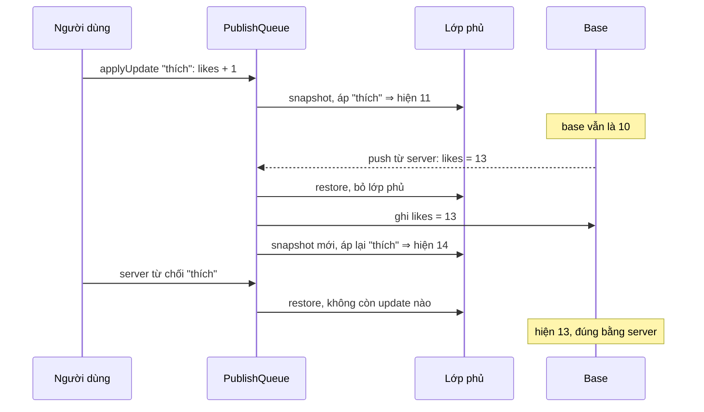

Bấm "Thích" thì trái tim đỏ ngay, số like tăng ngay, request đi sau. Đó là **optimistic update** (cập nhật lạc quan). Cái khó không nằm ở lúc áp mà ở lúc gỡ: request thất bại thì phải quay lại trạng thái cũ. Nhưng "trạng thái cũ" là lúc nào? Trong 800 ms chờ server, có thể đã có ba người khác like (qua push realtime), một bình luận mới tới, và chính bạn đã bấm thêm hai thao tác optimistic khác.

Cách phổ biến là chụp lại state trước khi áp rồi khôi phục khi lỗi. Cách này **làm mất mọi thứ xảy ra sau lúc chụp**. Relay dùng một cách khác: dữ liệu server và dữ liệu optimistic nằm ở hai lớp riêng. Bài này đọc ba module trong store của Relay và viết lại cơ chế đó.

> [!TIP]
> **Tóm tắt**
> - Dữ liệu server nằm ở `base`. Khi có update optimistic, Relay đặt một **lớp phủ** (overlay) lên trên. Mọi update optimistic chỉ ghi vào lớp phủ. Xoá một record ở lớp phủ thì ghi một **sentinel** để che bản ở dưới.
> - Updater không ghi thẳng vào store mà vào một **sổ nháp** (sink): đọc thì xem sổ nháp trước, rồi tới nguồn. Lần đầu ghi một record thì tạo bản sao chỉ chứa field bị ghi (copy-on-write).
> - Có payload server, hoặc vừa gỡ một update đã áp: **bỏ cả lớp phủ, ghi payload vào base, rồi áp lại mọi update còn sống** (rebase). Không ai phải viết hàm "hoàn tác".
> - Quy tắc mang về: updater optimistic phải là hàm thuần của state hiện tại (`likes + 1`, không phải `likes = 11`), vì nó sẽ được chạy lại nhiều lần.

<iframe class="demo-frame" src="/demos/facebook-patterns/index.html?theme=dark#/relay-optimistic-store" title="Demo relay-optimistic-store" loading="lazy" style="height: 1250px"></iframe>

<p class="demo-links">▶ <a href="/demos/facebook-patterns/index.html#/relay-optimistic-store" target="_blank" rel="noopener">Mở demo toàn màn hình ↗</a> · <a href="https://stackblitz.com/github/hunghg255/blog-hunghg/tree/master/examples/facebook-patterns?file=src/lib/optimisticStore.ts" target="_blank" rel="noopener">Sửa code trên StackBlitz ↗</a> · <a href="https://github.com/hunghg255/blog-hunghg/blob/master/examples/facebook-patterns/src/lib/optimisticStore.ts" target="_blank" rel="noopener">Xem source trên GitHub ↗</a></p>

## Facebook làm thế nào?

Ba module trong `99 ChatComposer/all.js` (cũng có trong `31.js`, giống hệt): `relay-runtime/store/RelayOptimisticRecordSource`, `relay-runtime/mutations/RelayRecordSourceMutator` và `relay-runtime/store/RelayPublishQueue`. Relay là mã nguồn mở (MIT). Đoạn trích dưới đây đã đổi tên biến cho dễ đọc.

### Lớp phủ và sentinel xoá

```js
const UNPUBLISH_RECORD_SENTINEL = Object.freeze({ __UNPUBLISH_RECORD_SENTINEL: true });

class RelayOptimisticRecordSource {
  constructor(base) { this._base = base; this._sink = RelayRecordSource.create(); }
  get(id) {
    if (this._sink.has(id)) {
      const r = this._sink.get(id);
      return r === UNPUBLISH_RECORD_SENTINEL ? undefined : r;
    }
    return this._base.get(id);
  }
  remove(id) { this._sink.set(id, UNPUBLISH_RECORD_SENTINEL); } // che bản ở base
  delete(id) { this._sink.delete(id); }                         // bỏ lớp phủ, lộ lại base
}
```

Có ba trạng thái khác nhau cho một ID trong lớp phủ: không có mục nào (đọc xuống base), có record (đè lên base), và sentinel (record coi như chưa từng có, trạng thái `UNKNOWN`). Thêm vào đó, giá trị `null` trong record source của Relay nghĩa là "biết chắc không tồn tại" (`NONEXISTENT`). Phân biệt `remove` và `delete` là điểm tinh tế: một cái thêm thông tin "đã xoá", cái kia gỡ thông tin.

`RelayModernStore.snapshot()` tạo lớp phủ, `restore()` vứt nó đi:

```js
snapshot() { /* … */ this._optimisticSource = RelayOptimisticRecordSource.create(this.getSource()); }
restore()  { /* … */ this._optimisticSource = null; }
publish(source) {
  const target = this._optimisticSource ?? this._recordSource; // có lớp phủ thì ghi vào lớp phủ
  updateTargetFromSource(target, source, /* … */);
}
```

### Sổ nháp copy-on-write

`RelayRecordSourceMutator` nhận hai nguồn: `base` (chỉ đọc) và `sink` (sổ nháp). Đọc một field thì duyệt `[sink, base]`:

```js
getValue(id, field) {
  for (const source of [this._sink, this._base]) {
    const record = source.get(id);
    if (record) {
      const v = RelayModernRecord.getValue(record, field);
      if (v !== undefined) return v;
    } else if (record === null) return null; // null ở lớp trên chặn lớp dưới
  }
}
setValue(id, field, value) {
  const draft = this._getSinkRecord(id); // lần đầu: tạo record rỗng cùng kiểu trong sink
  RelayModernRecord.setValue(draft, field, value);
}
```

`_getSinkRecord` (tên gốc `$3`) chỉ tạo một record **rỗng** với cùng ID và kiểu. Không chép field nào cả. Khi publish, record trong sink được trộn vào record ở đích. Kết quả: một updater chỉ đổi `likes` thì sổ nháp chỉ chứa `{likes}`, và mọi record khác không bị đụng tới.

### Hàng đợi publish và rebase

`RelayPublishQueue` giữ ba tập: `pendingData` (payload server và `commitUpdate` chờ ghi), `pendingOptimisticUpdates` (update optimistic mới), `appliedOptimisticUpdates` (đang sống trên lớp phủ). Thêm một cờ `pendingBackupRebase`. Hàm `run()`:

```js
run(sourceOperation) {
  if (this._pendingBackupRebase && this._hasStoreSnapshot) {
    this._store.restore();                // 1. bỏ lớp phủ
    this._hasStoreSnapshot = false;
  }
  const invalidated = this._commitData(); // 2. ghi dữ liệu server vào base
  if (this._pendingOptimisticUpdates.size ||
      (this._pendingBackupRebase && this._appliedOptimisticUpdates.size)) {
    if (!this._hasStoreSnapshot) { this._store.snapshot(); this._hasStoreSnapshot = true; }
    this._applyUpdates();                 // 3. áp lại update cũ + update mới lên lớp phủ mới
  }
  this._pendingBackupRebase = false;
  if (this._appliedOptimisticUpdates.size > 0) {
    this._gcHold ??= this._store.holdGC(); // còn optimistic thì không cho GC dọn record
  } else { this._gcHold?.dispose(); this._gcHold = null; }
  return this._store.notify(sourceOperation, invalidated);
}
```

Cờ `pendingBackupRebase` bật khi `commitPayload`, `commitUpdate`, `commitSource`, `revertAll`, hoặc khi `revertUpdate` gỡ một update **đã áp**. Gỡ một update chưa áp thì chỉ cần bỏ khỏi `pendingOptimisticUpdates`, không cần rebase.

Không có hàm "hoàn tác" nào. Muốn gỡ update A trong ba update A, B, C: vứt lớp phủ, dựng lớp phủ mới, áp B và C. Đó là ý tưởng giống `git rebase`: base thay đổi thì phát lại các commit của mình lên trên.

Hai chi tiết nữa:

- **`holdGC()`**: khi còn update optimistic, store không được thu gom record. Có lẽ vì update optimistic có thể trỏ tới record mà không query nào đang giữ, và GC dọn mất thì lần áp lại sẽ thiếu dữ liệu.
- **`ErrorUtils.applyWithGuard`**: mỗi updater (cả optimistic lẫn `commitUpdate`) chạy trong guard. Updater ném lỗi thì lỗi được báo lên, hàng đợi vẫn chạy tiếp.

### Một điểm cần biết: updater lỗi để lại nửa chừng

Đọc code `_applyUpdates` (tên gốc `$12`) thấy mọi update optimistic dùng **chung một sổ nháp** và chung một `RelayRecordSourceProxy`:

```js
const sink = RelayRecordSource.create();
const mutator = new RelayRecordSourceMutator(this._store.getSource(), sink);
const proxy = new RelayRecordSourceProxy(mutator, /* … */);
this._appliedOptimisticUpdates.forEach((u) => applyWithGuard(u.storeUpdater, null, [proxy], /* … */));
this._store.publish(sink);
```

Guard bắt lỗi nhưng không gỡ những gì updater đã ghi vào `sink` trước khi ném. Updater ghi `likes = 9999` rồi ném lỗi thì `9999` vẫn được publish. Mình chưa dựng lại được toàn bộ store của Relay để chạy thử ca này, nên đây là kết luận từ việc đọc code.

## Bên trong: dòng thời gian của một lần rebase



So với cách chụp state: khi server từ chối, bản chụp có `likes = 10` (trước khi push tới), và khôi phục bản chụp làm UI hiện 10 trong khi server đang là 13. Đó chính là ca demo ở trên: bấm "Thích", "Server push", rồi "Server lỗi" ở dòng "thích".

## Viết lại

File `src/lib/optimisticStore.ts`. Lớp phủ với sentinel là một `Symbol` thay vì object đóng băng:

```ts title=src/lib/optimisticStore.ts
export class OverlaySource implements ReadableSource {
  readonly layer = new Map<string, StoreRecord | null | typeof REMOVED>();
  constructor(readonly base: ReadableSource) {}
  get(id: string): RecordValue {
    if (this.layer.has(id)) {
      const v = this.layer.get(id)!;
      return v === REMOVED ? undefined : v;
    }
    return this.base.get(id);
  }
  set(id: string, record: StoreRecord | null) {
    this.layer.set(id, record);
  }
  /** Xoá record ở lớp phủ: đặt sentinel để che bản ở base. */
  remove(id: string) {
    this.layer.set(id, REMOVED);
  }
  ids() {
    const out = new Set(this.base.ids());
    this.layer.forEach((v, id) => (v === REMOVED ? out.delete(id) : out.add(id)));
    return [...out];
  }
}
```

Sổ nháp: đọc qua `[sink, source]`, ghi lần đầu thì tạo bản nháp chỉ có `id`:

```ts title=src/lib/optimisticStore.ts
/** Sổ nháp của một updater: chỉ chứa record bị sửa, đọc thì xem sổ nháp trước rồi tới nguồn. */
export class Mutator {
  readonly sink = new Map<string, Record<string, unknown> | null>();
  constructor(private source: ReadableSource) {}

  get(id: string, field: string): unknown {
    for (const layer of [this.sink, this.source]) {
      const rec = layer.get(id);
      if (rec === null) return null; // record bị xoá ở lớp trên che lớp dưới
      if (rec && field in rec) return rec[field];
    }
    return undefined;
  }
  exists(id: string) {
    const s = this.sink.get(id);
    if (s !== undefined) return s !== null;
    return this.source.get(id) != null;
  }
  set(id: string, field: string, value: unknown) {
    let draft = this.sink.get(id);
    if (draft == null) {
      if (draft === null || this.source.get(id) == null)
        throw new Error(`Record ${id} không tồn tại`);
      draft = { id }; // copy-on-write: chỉ chép field nào bị ghi
      this.sink.set(id, draft);
    }
    draft[field] = value;
  }
  create(id: string, fields: Record<string, unknown> = {}) {
    if (this.exists(id)) throw new Error(`Record ${id} đã tồn tại`);
    this.sink.set(id, { ...fields, id });
  }
  remove(id: string) {
    this.sink.set(id, null);
  }
}
```

Hàng đợi: ba bước của `run()`, mỗi updater có sổ nháp riêng:

```ts title=src/lib/optimisticStore.ts
  run(): RunStats {
    const stats: RunStats = { committed: 0, reapplied: 0, applied: 0, rebased: false, errors: [] };
    const guard = (label: string, fn: Updater, source: ReadableSource) => {
      const m = new Mutator(source);
      try {
        fn(m);
        return m.sink;
      } catch (e) {
        stats.errors.push(label);
        this.onError(label, e);
        return null; // updater lỗi: bỏ cả sổ nháp, không để ghi dở
      }
    };

    // 1. Có dữ liệu server mới hoặc vừa gỡ một update đã áp: bỏ lớp phủ
    if (this.needsRebase && this.store.overlay) {
      this.store.restore();
      stats.rebased = true;
    }
    // 2. Ghi dữ liệu server vào base
    for (const updater of this.pendingData) {
      const sink = guard('commit', updater, this.store.base);
      if (sink) this.store.publish(sink);
      stats.committed++;
    }
    this.pendingData = [];
    // 3. Dựng lại lớp phủ: áp lại update cũ (nếu vừa bỏ lớp phủ) rồi update mới
    if (this.pendingOptimistic.size || (stats.rebased && this.applied.size)) {
      if (!this.store.overlay) this.store.snapshot();
      if (stats.rebased) {
        this.applied.forEach((u) => {
          const sink = guard(u.label, u.apply, this.store.source());
          if (sink) this.store.publish(sink);
          stats.reapplied++;
        });
      }
      this.pendingOptimistic.forEach((u) => {
        const sink = guard(u.label, u.apply, this.store.source());
        if (sink) this.store.publish(sink);
        this.applied.add(u);
        stats.applied++;
      });
      this.pendingOptimistic.clear();
    }
    this.needsRebase = false;
    this.store.notify();
    return stats;
  }
```

::: spoiler Xem toàn bộ src/lib/optimisticStore.ts

```ts title=src/lib/optimisticStore.ts
/**
 * Store optimistic theo lớp, ý tưởng từ RelayOptimisticRecordSource + RelayRecordSourceMutator +
 * RelayPublishQueue (viết lại từ đầu, rút gọn):
 * - dữ liệu server nằm ở `base`; khi có update optimistic, một lớp phủ (overlay) được đặt lên trên,
 * - update ghi vào một "sổ nháp" (sink) theo kiểu copy-on-write rồi mới publish vào lớp đang hoạt động,
 * - có dữ liệu server mới: bỏ lớp phủ, ghi vào base, rồi áp lại mọi update optimistic còn sống (rebase).
 */

export type StoreRecord = { readonly id: string; readonly [field: string]: unknown };
/** null = biết chắc record không tồn tại; undefined = không biết. */
export type RecordValue = StoreRecord | null | undefined;

export interface ReadableSource {
  get(id: string): RecordValue;
  ids(): string[];
}

/** Đánh dấu "record đã bị xoá ở lớp này", khác với "lớp này không đụng tới record". */
export const REMOVED: unique symbol = Symbol('removed');

export class BaseSource implements ReadableSource {
  private map = new Map<string, StoreRecord | null>();
  constructor(initial: StoreRecord[] = []) {
    initial.forEach((r) => this.map.set(r.id, Object.freeze({ ...r })));
  }
  get(id: string): RecordValue {
    return this.map.get(id);
  }
  set(id: string, record: StoreRecord | null) {
    this.map.set(id, record);
  }
  ids() {
    return [...this.map.keys()];
  }
}

export class OverlaySource implements ReadableSource {
  readonly layer = new Map<string, StoreRecord | null | typeof REMOVED>();
  constructor(readonly base: ReadableSource) {}
  get(id: string): RecordValue {
    if (this.layer.has(id)) {
      const v = this.layer.get(id)!;
      return v === REMOVED ? undefined : v;
    }
    return this.base.get(id);
  }
  set(id: string, record: StoreRecord | null) {
    this.layer.set(id, record);
  }
  /** Xoá record ở lớp phủ: đặt sentinel để che bản ở base. */
  remove(id: string) {
    this.layer.set(id, REMOVED);
  }
  ids() {
    const out = new Set(this.base.ids());
    this.layer.forEach((v, id) => (v === REMOVED ? out.delete(id) : out.add(id)));
    return [...out];
  }
}

/** Sổ nháp của một updater: chỉ chứa record bị sửa, đọc thì xem sổ nháp trước rồi tới nguồn. */
export class Mutator {
  readonly sink = new Map<string, Record<string, unknown> | null>();
  constructor(private source: ReadableSource) {}

  get(id: string, field: string): unknown {
    for (const layer of [this.sink, this.source]) {
      const rec = layer.get(id);
      if (rec === null) return null; // record bị xoá ở lớp trên che lớp dưới
      if (rec && field in rec) return rec[field];
    }
    return undefined;
  }
  exists(id: string) {
    const s = this.sink.get(id);
    if (s !== undefined) return s !== null;
    return this.source.get(id) != null;
  }
  set(id: string, field: string, value: unknown) {
    let draft = this.sink.get(id);
    if (draft == null) {
      if (draft === null || this.source.get(id) == null)
        throw new Error(`Record ${id} không tồn tại`);
      draft = { id }; // copy-on-write: chỉ chép field nào bị ghi
      this.sink.set(id, draft);
    }
    draft[field] = value;
  }
  create(id: string, fields: Record<string, unknown> = {}) {
    if (this.exists(id)) throw new Error(`Record ${id} đã tồn tại`);
    this.sink.set(id, { ...fields, id });
  }
  remove(id: string) {
    this.sink.set(id, null);
  }
}

export type Updater = (m: Mutator) => void;
export interface OptimisticUpdate {
  readonly label: string;
  readonly apply: Updater;
}

export class LayeredStore {
  readonly base: BaseSource;
  overlay: OverlaySource | null = null;
  private listeners = new Set<() => void>();
  version = 0;

  constructor(initial: StoreRecord[]) {
    this.base = new BaseSource(initial);
  }
  source(): ReadableSource {
    return this.overlay ?? this.base;
  }
  snapshot() {
    if (this.overlay) throw new Error('Đã có snapshot');
    this.overlay = new OverlaySource(this.base);
  }
  restore() {
    this.overlay = null;
  }
  /** Ghi sổ nháp vào lớp đang hoạt động; mỗi record bị sửa là một object mới (bất biến). */
  publish(sink: Mutator['sink']) {
    const target = this.overlay ?? this.base;
    sink.forEach((draft, id) => {
      if (draft === null) {
        if (target instanceof OverlaySource) target.remove(id);
        else target.set(id, null);
        return;
      }
      const current = target.get(id);
      target.set(id, Object.freeze({ ...(current ?? {}), ...draft, id }));
    });
  }
  subscribe(fn: () => void) {
    this.listeners.add(fn);
    return () => void this.listeners.delete(fn);
  }
  notify() {
    this.version++;
    this.listeners.forEach((fn) => fn());
  }
}

export interface RunStats {
  committed: number;
  reapplied: number;
  applied: number;
  rebased: boolean;
  errors: string[];
}

export class PublishQueue {
  private pendingData: Updater[] = [];
  private pendingOptimistic = new Set<OptimisticUpdate>();
  private applied = new Set<OptimisticUpdate>();
  private needsRebase = false;
  onError: (label: string, error: unknown) => void = () => {};

  constructor(private store: LayeredStore) {}

  get appliedUpdates(): OptimisticUpdate[] {
    return [...this.applied, ...this.pendingOptimistic];
  }

  applyUpdate(update: OptimisticUpdate) {
    if (this.applied.has(update) || this.pendingOptimistic.has(update))
      throw new Error('Update đã được áp');
    this.pendingOptimistic.add(update);
  }
  revertUpdate(update: OptimisticUpdate) {
    if (this.pendingOptimistic.delete(update)) return;
    if (this.applied.delete(update)) this.needsRebase = true;
  }
  revertAll() {
    this.pendingOptimistic.clear();
    if (this.applied.size) this.needsRebase = true;
    this.applied.clear();
  }
  /** Dữ liệu thật từ server (hoặc commitUpdate): luôn ghi vào base, nên phải rebase. */
  commit(updater: Updater) {
    this.pendingData.push(updater);
    this.needsRebase = true;
  }

  run(): RunStats {
    const stats: RunStats = { committed: 0, reapplied: 0, applied: 0, rebased: false, errors: [] };
    const guard = (label: string, fn: Updater, source: ReadableSource) => {
      const m = new Mutator(source);
      try {
        fn(m);
        return m.sink;
      } catch (e) {
        stats.errors.push(label);
        this.onError(label, e);
        return null; // updater lỗi: bỏ cả sổ nháp, không để ghi dở
      }
    };

    // 1. Có dữ liệu server mới hoặc vừa gỡ một update đã áp: bỏ lớp phủ
    if (this.needsRebase && this.store.overlay) {
      this.store.restore();
      stats.rebased = true;
    }
    // 2. Ghi dữ liệu server vào base
    for (const updater of this.pendingData) {
      const sink = guard('commit', updater, this.store.base);
      if (sink) this.store.publish(sink);
      stats.committed++;
    }
    this.pendingData = [];
    // 3. Dựng lại lớp phủ: áp lại update cũ (nếu vừa bỏ lớp phủ) rồi update mới
    if (this.pendingOptimistic.size || (stats.rebased && this.applied.size)) {
      if (!this.store.overlay) this.store.snapshot();
      if (stats.rebased) {
        this.applied.forEach((u) => {
          const sink = guard(u.label, u.apply, this.store.source());
          if (sink) this.store.publish(sink);
          stats.reapplied++;
        });
      }
      this.pendingOptimistic.forEach((u) => {
        const sink = guard(u.label, u.apply, this.store.source());
        if (sink) this.store.publish(sink);
        this.applied.add(u);
        stats.applied++;
      });
      this.pendingOptimistic.clear();
    }
    this.needsRebase = false;
    this.store.notify();
    return stats;
  }
}
```

:::

**Khác bản gốc:**

- Mỗi updater có **sổ nháp riêng**, chỉ được publish khi updater chạy xong không lỗi. Updater ném lỗi thì bỏ cả sổ nháp, không còn ghi nửa chừng.
- Record trong store là object đóng băng. `publish` tạo object mới cho record bị sửa, nên tham chiếu cũ không bao giờ đổi dưới chân component (kết hợp tốt với bài #87).
- Không có GC, không có `fieldPayloads`/handler, không có selector proxy. Updater nhận một `Mutator` với `get`/`set`/`create`/`remove`.
- `run()` trả về số payload đã ghi, số update áp lại, có rebase hay không, để demo hiển thị.

## Đi qua code

- `OverlaySource.get`: có mục trong `layer` thì dùng mục đó (sentinel đổi thành `undefined`), không thì đọc `base`. `ids()` cộng ID của base với lớp phủ rồi trừ các ID mang sentinel.
- `Mutator.get` duyệt hai lớp. Gặp `null` (record bị xoá ở lớp trên) thì trả `null` ngay, không đọc xuống lớp dưới. Bản nháp chỉ có vài field, nên `field in rec` sai thì đi xuống lớp dưới đọc tiếp.
- `Mutator.set` kiểm tra record có tồn tại trước khi tạo bản nháp. Ghi vào record đã bị `remove` trong cùng updater là lỗi.
- `LayeredStore.publish` ghi vào lớp phủ nếu có, không thì vào base. Trộn `{...current, ...draft}` rồi `Object.freeze`.
- `PublishQueue.run`: bước 1 chỉ chạy khi có lớp phủ, vì không có lớp phủ thì không có gì để bỏ. Bước 3 dựng lại lớp phủ khi có update mới, hoặc khi vừa bỏ lớp phủ mà vẫn còn update đang sống.
- `revertUpdate` với update còn ở `pendingOptimistic` (chưa `run`) chỉ xoá nó khỏi tập, không đánh dấu rebase.

## Tại sao không làm cách khác?

- **Chụp state rồi khôi phục**: mất dữ liệu đến sau lúc chụp, như demo cho thấy. Muốn đúng phải tự "trộn" bản chụp với dữ liệu mới, mà việc đó chính là rebase.
- **Viết hàm hoàn tác cho từng thao tác** (`like` thì `unlike`): mỗi thao tác cần hai hàm, và hàm hoàn tác chạy trên state đã đổi nên dễ sai (trừ 1 like khi server đã đặt lại số like). Với thao tác thêm/xoá phần tử ở giữa danh sách, hoàn tác đúng rất khó.
- **Giữ danh sách update rồi tính lại toàn bộ state từ base mỗi lần render** (kiểu `useOptimistic` của React): đúng về ngữ nghĩa và đơn giản. Relay làm cùng việc nhưng chỉ tính lại khi có thay đổi, và kết quả nằm trong store chung để mọi component đọc.
- **Ghi optimistic thẳng vào base và đánh dấu record "chưa xác nhận"**: đơn giản khi chỉ có một update mỗi record. Hai update chồng lên cùng một record thì không biết gỡ cái nào.

## Edge case và cạm bẫy

- **Updater phải thuần**: `likes = likes + 1` đúng, `likes = 11` sai, vì lần áp lại base đã là 13. Updater cũng không được gọi API hay đọc `Date.now()` nếu kết quả phải ổn định giữa các lần áp lại.
- **Update optimistic sau khi server đã xác nhận**: payload thật thường đã chứa thay đổi. Trong demo, updater "thích" kiểm tra `liked` trước, nên áp lại trên base đã `liked = true` không cộng thêm lần nữa. Relay làm việc này bằng cách gỡ update optimistic và commit payload thật trong **cùng một `run()`** (trong `RelayModernQueryExecutor`, hàm xử lý payload gọi `revertUpdate` cho mọi update optimistic của operation rồi mới `commitPayload`).
- **Chi phí rebase**: mỗi payload server làm mọi update đang sống chạy lại. Có 50 tin nhắn đang gửi trong một cuộc chat chậm thì mỗi tin nhắn đến làm 50 updater chạy lại. Thường vẫn rẻ, nhưng đừng để updater làm việc nặng.
- **ID tạm**: record tạo optimistic dùng ID `client:...`. Server trả về ID thật thì record tạm biến mất cùng lớp phủ, và component dùng `key={id}` sẽ unmount rồi mount lại. Muốn mượt thì giữ một khoá ổn định riêng (Messenger dùng `offline_threading_id` sinh ở client, xem [bài #39](/blogs/facebook-otid-client-snowflake)).
- **Updater lỗi được giữ lại**: update có updater ném lỗi vẫn nằm trong tập đang sống, và mỗi lần rebase lại ném lỗi. Nên gỡ nó khi request tương ứng kết thúc.

## Dùng trong dự án

```ts
import { LayeredStore, PublishQueue } from './lib/optimisticStore';

const store = new LayeredStore(initialRecords);
const queue = new PublishQueue(store);

async function like(postId: string) {
  const update = {
    label: 'like',
    apply: (m) => {
      if (m.get(postId, 'liked')) return;
      m.set(postId, 'liked', true);
      m.set(postId, 'likes', (m.get(postId, 'likes') as number) + 1);
    },
  };
  queue.applyUpdate(update);
  queue.run();
  try {
    const real = await api.like(postId);
    queue.revertUpdate(update);
    queue.commit((m) => m.set(postId, 'likes', real.likes)); // gỡ optimistic + ghi thật trong cùng một run
    queue.commit((m) => m.set(postId, 'liked', true));
  } catch {
    queue.revertUpdate(update);
  }
  queue.run();
}

// realtime push ở bất kỳ lúc nào
socket.on('post_likes', ({ id, likes }) => {
  queue.commit((m) => m.set(id, 'likes', likes));
  queue.run();
});
```

Đọc trong React bằng `useSyncExternalStore(store.subscribe, () => store.version)` rồi lấy dữ liệu qua `store.source().get(id)`.

## Kiểm thử

::: spoiler Ví dụ test (bản phác, không có trong repo)

```ts
import { describe, expect, it, vi } from 'vitest';
import { LayeredStore, PublishQueue, type Mutator } from '../src/lib/optimisticStore';

const setup = () => {
  const store = new LayeredStore([
    { id: 'p', likes: 10, liked: false, commentIds: ['c1'] },
    { id: 'c1', text: 'hi' },
  ]);
  return { store, queue: new PublishQueue(store) };
};
const like = {
  label: 'like',
  apply: (m: Mutator) => {
    m.set('p', 'liked', true);
    m.set('p', 'likes', (m.get('p', 'likes') as number) + 1);
  },
};

describe('PublishQueue', () => {
  it('update optimistic chỉ nằm ở lớp phủ', () => {
    const { store, queue } = setup();
    queue.applyUpdate(like);
    queue.run();
    expect(store.source().get('p')!.likes).toBe(11);
    expect(store.base.get('p')!.likes).toBe(10);
  });

  it('dữ liệu server mới thì rebase update đang sống', () => {
    const { store, queue } = setup();
    queue.applyUpdate(like);
    queue.run();
    queue.commit((m) => m.set('p', 'likes', 15));
    const stats = queue.run();
    expect(stats).toMatchObject({ rebased: true, reapplied: 1 });
    expect(store.source().get('p')!.likes).toBe(16);
  });

  it('gỡ update thì giữ dữ liệu server đến sau', () => {
    const { store, queue } = setup();
    queue.applyUpdate(like);
    queue.run();
    queue.commit((m) => m.set('p', 'likes', 13));
    queue.run();
    queue.revertUpdate(like);
    queue.run();
    expect(store.source().get('p')!.likes).toBe(13);
    expect(store.overlay).toBeNull();
  });

  it('xoá ở lớp phủ dùng sentinel, base không đổi', () => {
    const { store, queue } = setup();
    queue.applyUpdate({ label: 'del', apply: (m) => m.remove('c1') });
    queue.run();
    expect(store.source().get('c1')).toBeUndefined();
    expect(store.source().ids()).not.toContain('c1');
    expect(store.base.get('c1')).toBeDefined();
  });

  it('updater lỗi không để lại ghi dở', () => {
    const { store, queue } = setup();
    const onError = vi.fn();
    queue.onError = onError;
    queue.applyUpdate({
      label: 'bad',
      apply: (m) => {
        m.set('p', 'likes', 9999);
        throw new Error('x');
      },
    });
    expect(queue.run().errors).toEqual(['bad']);
    expect(store.source().get('p')!.likes).toBe(10);
    expect(onError).toHaveBeenCalledOnce();
  });

  it('record bị sửa là object mới, record khác giữ tham chiếu', () => {
    const { store, queue } = setup();
    const c1 = store.source().get('c1');
    queue.commit((m) => m.set('p', 'likes', 11));
    queue.run();
    expect(store.source().get('c1')).toBe(c1);
  });
});
```

:::

## So với thư viện và chuẩn web

- **React `useOptimistic`** (React 19): giữ danh sách action optimistic trong một transition và tính lại state từ giá trị thật mỗi lần render. Khi transition kết thúc, mọi action optimistic của nó biến mất. Cùng tinh thần "áp lại lên base mới", nhưng phạm vi là một component.
- **Apollo Client** đặt kết quả optimistic của mỗi mutation vào một lớp riêng trong `InMemoryCache` (các `Layer` xếp chồng lên root). Gỡ một lớp thì cache được tính lại từ các lớp còn lại, gần giống Relay.
- **TanStack Query**: `onMutate` chụp dữ liệu cũ, `onError` khôi phục. Đây là cách "chụp rồi khôi phục" với đúng nhược điểm ở trên, và tài liệu của họ khuyên gọi `cancelQueries` trước để tránh refetch chen vào. Bản v5 có thêm cách hiển thị optimistic qua `variables` của mutation đang chạy, không đụng cache.
- **Replicache, Zero, các thư viện local-first**: dùng đúng mô hình rebase: mutation chờ xác nhận được phát lại trên snapshot mới nhất từ server.
- Bài #48 ([snapshot và push](/blogs/facebook-realtime-publish-snapshot)) nói về chuyện ngược lại: push đến trước snapshot.

---

Bài này thuộc series **[Học từ mã nguồn Facebook](/series/facebook)** (106 bài, đọc theo thứ tự).

::: spoiler Xem nhanh danh sách bài trong series

*Phần 1*

- [Mở đầu: cách đọc code minify của Facebook](/blogs/learn-from-facebook-source-code)
- [#1 Dùng chung IntersectionObserver + infinite scroll](/blogs/facebook-shared-intersection-observer)
- [#2 useViewportDuration: đo thời gian thực sự được xem](/blogs/facebook-use-viewport-duration)
- [#3 Preload code + data khi hover](/blogs/facebook-preload-on-hover)
- [#4 Toast manager với external store](/blogs/facebook-toast-manager)
- [#5 Network status + heartbeat backoff](/blogs/facebook-network-status-heartbeat)
- [#6 ErrorGuard: bắt lỗi theo ngữ cảnh](/blogs/facebook-error-guard)
- [#7 Banzai: gom log theo lô + sendBeacon](/blogs/facebook-batch-logger)
- [#8 Focus trap + Esc theo layer](/blogs/facebook-focus-trap)

*Phần 2*

- [#9 Mẹo calc(… * 9999): container query, line-clamp, mũi tên carousel bằng CSS](/blogs/facebook-css-9999-trick)
- [#10 Thanh cuộn tuỳ biến bằng CSS 3D](/blogs/facebook-css-3d-scrollbar)
- [#11 Modal cuộn bằng window, giữ vị trí trang nền](/blogs/facebook-document-scroll-modal)
- [#12 Popover, tooltip group và hovercard](/blogs/facebook-popover-tooltip)
- [#13 Primitive Pressable + focus-visible](/blogs/facebook-pressable)
- [#14 Tab "Xem thêm" + sticky header bằng IntersectionObserver](/blogs/facebook-priority-tabs-sticky-header)
- [#15 Avatar khoét mask, gradient Messenger, skeleton steps()](/blogs/facebook-visual-tricks)
- [#16 Khung chat không giật](/blogs/facebook-chat-scroller)
- [#17 Thuật toán chọn bố cục collage ảnh](/blogs/facebook-photo-collage-layout)
- [#18 Keep-alive tab trong SPA](/blogs/facebook-keep-alive-tabs)
- [#19 Tự đo Visual Completion & interaction tracing](/blogs/facebook-visual-completion)
- [#20 Router SPA bền bỉ & tải chunk có retry](/blogs/facebook-spa-router-resilient-loading)

*Phần 3*

- [#21 Smart Compose: gợi ý chữ mờ khi gõ](/blogs/facebook-smart-compose-ghost-text)
- [#22 MQTT ngay trong trình duyệt, tự chuyển sang long-poll](/blogs/facebook-mqtt-in-browser)
- [#23 Đo thời gian dùng bằng bitmap 64 giây](/blogs/facebook-time-spent-bitmap)
- [#24 Bảng reaction nhấn giữ rồi trượt](/blogs/facebook-reaction-press-slide)
- [#25 Tìm kiếm gấp dấu, phiên âm và highlight đầu từ](/blogs/facebook-search-diacritics-tokenize)
- [#26 Ring buffer biết trace nào đã mất log](/blogs/facebook-trace-ring-buffer)
- [#27 Engine animation JS: một vòng rAF và solver cubic-bezier](/blogs/facebook-keyframes-loop-cubic-bezier)
- [#28 Bootloader: bitmap tài nguyên đã tải, chỉ reload khi cần](/blogs/facebook-bootloader-bitmap-consistency)
- [#29 Nhận biết click do screen reader tạo ra](/blogs/facebook-virtual-cursor-detection)
- [#30 Tải trước feed theo chất lượng mạng, đoán hạng thiết bị](/blogs/facebook-network-aware-prefetch)
- [#31 Hàng đợi gửi tin chat giữ đúng thứ tự](/blogs/facebook-ordered-send-queue)
- [#32 Gộp lời gọi API trong cùng một tick](/blogs/facebook-api-batcher)
- [#33 Resize ảnh trong pool Web Worker](/blogs/facebook-jpeg-resize-worker-pool)
- [#34 Crop ảnh theo nhiều khuôn mặt](/blogs/facebook-face-aware-crop)
- [#35 Kéo-thả sắp xếp và vùng thả file không nhấp nháy](/blogs/facebook-flicker-free-drag-drop)
- [#36 Tiện ích UI: fade-out, sticky event, hàm huỷ được](/blogs/facebook-ui-utility-hooks)
- [#37 Hạ tầng nhỏ: cookie, hash lỗi, prefetch khi chuột dừng](/blogs/facebook-small-infra-cookie-hash-idle)

*Phần 4–6*

- [#38 Đồng bộ tin nhắn: phát hiện lỗ seqID và fetch bù theo tầng](/blogs/facebook-messenger-sync-seqid-gaps)
- [#39 OTID: ID tin nhắn kiểu Snowflake sinh ở client](/blogs/facebook-otid-client-snowflake)
- [#40 QPL: lấy mẫu từ lúc bắt đầu, đo RTT gửi tin đầu-cuối](/blogs/facebook-qpl-send-rtt)
- [#41 Bộ điều phối request bảy chế độ gộp và chống trùng](/blogs/facebook-request-dispatcher-modes)
- [#42 Thread list theo mốc thời gian, cookie presence có version](/blogs/facebook-threadlist-ranged-presence)
- [#43 Composer dạng plugin: reducer, dirty checker, chuỗi kiểm tra](/blogs/facebook-plugin-composer)
- [#44 Thanh toán bất đồng bộ: subscribe trước, poll dự phòng](/blogs/facebook-async-checkout)
- [#45 Validate số thẻ: sửa lỗi gõ, dải BIN, Luhn](/blogs/facebook-card-validation)
- [#46 Lịch chọn khoảng ngày: bo góc dải chọn, phím đủ bộ, RTL](/blogs/facebook-range-calendar-a11y)
- [#47 Giờ mở cửa theo tuần: qua đêm, gộp khoảng, phần bù](/blogs/facebook-weekly-hours-intervals)
- [#48 Tiến độ đăng realtime: giữ event chờ snapshot, watchdog](/blogs/facebook-realtime-publish-snapshot)
- [#49 Tiền tệ theo đơn vị nhỏ nhất và ô nhập tiền](/blogs/facebook-currency-minor-units)
- [#50 Sửa hàng loạt Empty/Uniform/Mixed, seen/read bằng 2 bit](/blogs/facebook-bulk-edit-seen-bits)
- [#51 Phát hiện script lạ hook vào hàm native](/blogs/facebook-native-hook-detection)
- [#52 localStorage tự dọn khi đầy quota](/blogs/facebook-quota-aware-storage)
- [#53 Cache tuyến do server phân giải, chờ sẵn promise](/blogs/facebook-route-cache-prefetch)
- [#54 Lưới phím mũi tên 2D và focus không làm cuộn trang](/blogs/facebook-focus-table-grid)
- [#55 Tách emoji bằng máy trạng thái](/blogs/facebook-emoji-segmentation)
- [#56 Đọc trước ghi sau trong một frame, con tự biết vị trí](/blogs/facebook-read-then-write-dom)
- [#57 Hàng đợi lệnh cho video và stream sắp lại chunk](/blogs/facebook-video-command-queue)

*Phần 7–10*

- [#58 Ước lượng băng thông EWMA: loại outlier, nhớ qua phiên](/blogs/facebook-bandwidth-ewma-estimator)
- [#59 ABR theo độ tự tin phát và cắt bậc bitrate theo MOS](/blogs/facebook-abr-playback-confidence)
- [#60 Prefetch segment dự đoán từ manifest, parse hộp sidx](/blogs/facebook-dash-predicted-segments)
- [#61 Đọc metadata MP4/MOV ngay trên client](/blogs/facebook-mp4-metadata-client)
- [#62 Upload tiếp tục được: offset, hash dedupe, phát hiện treo](/blogs/facebook-resumable-upload)
- [#63 Fenwick tree: chọn ngẫu nhiên có trọng số và offset dòng](/blogs/facebook-fenwick-weighted-random)
- [#64 Vạch trục số và trục thời gian "đẹp"](/blogs/facebook-nice-axis-ticks)
- [#65 Damerau-Levenshtein theo dải chéo và tự sửa tên gõ sai](/blogs/facebook-damerau-levenshtein)
- [#66 PRNG có seed, shuffle tái lập và lấy mẫu trace](/blogs/facebook-seeded-prng-sampling)
- [#67 Cặp min/max-heap tái dùng vị trí trong danh sách ảo](/blogs/facebook-dual-heap-buffer-set)
- [#68 Memo nhiều đối số bằng Map/WeakMap và interning object](/blogs/facebook-multikey-memo-interning)
- [#69 Thống kê cửa sổ trượt và đại số khoảng thời gian](/blogs/facebook-moving-stat-intervals)
- [#70 Int64 từ hai số 32-bit, decode UTF, offset theo code point](/blogs/facebook-int64-utf-codepoints)
- [#71 Engine múi giờ IANA trên client, phát hiện lệch giờ](/blogs/facebook-client-iana-timezone)
- [#72 Tự cài semver range](/blogs/facebook-semver-range)
- [#73 Auto-link URL, cắt chữ an toàn, giới hạn LaTeX](/blogs/facebook-autolink-safe-truncate)
- [#74 Parser query kiểu PHP chống prototype pollution](/blogs/facebook-php-query-serializer)
- [#75 Popover tự lật theo phần tràn nhỏ nhất](/blogs/facebook-popover-auto-flip)
- [#76 Tiền tố for(;;) chống JSON hijacking, đọc stream](/blogs/facebook-csrf-prefix-streaming)
- [#77 Chống lộ Referer, linkshim, xoá token trên URL](/blogs/facebook-referrer-linkshim-url-scrub)
- [#78 setImmediate bằng postMessage, gom delta chuột theo frame](/blogs/facebook-setimmediate-mouse-batching)
- [#79 Phát hiện crash qua heartbeat, dò proxy cache hỏng](/blogs/facebook-crash-heartbeat-proxy-check)
- [#80 DPR vào cookie cho ảnh @2x, che khoá trong log](/blogs/facebook-dpr-cookie-secret-redaction)
- [#81 Flux waitFor tự viết và proxy có đệm](/blogs/facebook-flux-dispatch-buffered-proxy)
- [#82 Crop đúng tỉ lệ, xoay sticker bằng ma trận](/blogs/facebook-image-crop-rotation-geometry)

*Phần 11–15*

- [#83 Chia subdomain giữa các tab bằng lease, long-poll theo bảng trạng thái](/blogs/facebook-tab-subdomain-lease-longpoll)
- [#84 MQTT QoS1: giữ publish chờ ack, gửi lại khi kết nối lại](/blogs/facebook-mqtt-qos1-republish)
- [#85 Cache Promise gộp request, cache lỗi ngắn, đua dữ liệu nhúng sẵn](/blogs/facebook-promise-cache-preload-race)
- [#86 Lịch retry: backoff có trần, Fibonacci, báo lỗi CDN mỗi N ngày](/blogs/facebook-retry-backoff-schedules)
- [#87 Giữ nguyên tham chiếu nhánh dữ liệu không đổi](/blogs/facebook-relay-recycle-nodes)
- **#88 Store optimistic: copy-on-write, rollback rồi áp lại** (bài này)
- [#89 Chỉ mục subscription theo record, hàng đợi task theo chiều sâu](/blogs/facebook-relay-subscription-index)
- [#90 Phân trang connection: cursor khớp đầu, edge không trùng](/blogs/facebook-relay-connection-pagination)
- [#91 Profiler kiểu middleware và memo selector có lấy mẫu kiểm tra](/blogs/facebook-profiler-middleware-memo-check)
- [#92 Đọc EBML/WebM Cues để tìm byte range của segment](/blogs/facebook-webm-ebml-cues)
- [#93 Stream HTTP Range tạm dừng được, tải tiếp đúng byte](/blogs/facebook-pausable-range-stream)
- [#94 Bảng khoảng thời gian gắn nhãn và nhảy qua lỗ buffer](/blogs/facebook-tagged-time-ranges-gaps)
- [#95 Gom chunk cho SourceBuffer, đồng bộ video bằng playbackRate](/blogs/facebook-sourcebuffer-video-sync)
- [#96 Gom tin nhắn thành cụm, vạch ngày và avatar đã xem](/blogs/facebook-message-grouping)
- [#97 Bao nhiêu tab chat vừa màn hình, chuỗi luật mở tab](/blogs/facebook-chat-tab-policy)
- [#98 Phím tắt Markdown trong editor, Backspace để hoàn tác](/blogs/facebook-markdown-shortcuts-editor)
- [#99 Offset theo code point hay UTF-16: bốn bug cùng một gốc](/blogs/facebook-codepoint-offset-bugs)
- [#100 Typeahead không nhảy: cache tiền tố, chặn reflow, khoá hover](/blogs/facebook-typeahead-stable-results)
- [#101 Hit-test trên canvas bằng phát lại path, nét đứt và cung Bézier](/blogs/facebook-canvas-hit-regions)
- [#102 Vòng tròn theo mét trên bản đồ Mercator](/blogs/facebook-mercator-meter-circles)
- [#103 Dò tính năng trình duyệt: ảnh EXIF 2×1, getter bẫy, scrollbar](/blogs/facebook-feature-probe-tricks)
- [#104 Bug định dạng số và kiểm tra dữ liệu theo locale](/blogs/facebook-locale-validation-bugs)
- [#105 Dispose cho đúng: idle callback, splice(-1), xoá nhầm key](/blogs/facebook-dispose-leak-bugs)

:::

Code + demo: [`examples/facebook-patterns`](https://github.com/hunghg255/blog-hunghg/tree/master/examples/facebook-patterns) · [Mở trên StackBlitz](https://stackblitz.com/github/hunghg255/blog-hunghg/tree/master/examples/facebook-patterns)
