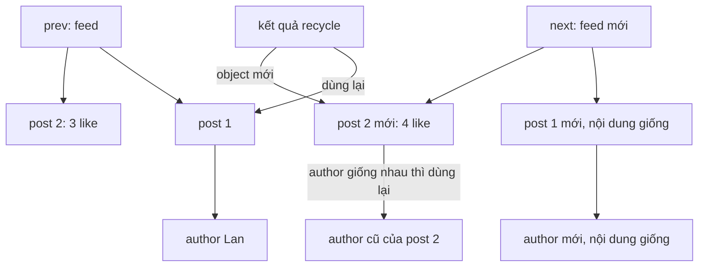

Feed tải lại 20 bài viết, server trả về JSON mới. Chỉ một bài có thêm một lượt thích, nhưng sau `JSON.parse` thì **mọi object đều là object mới**. `React.memo` so `prev.post === next.post`, thấy khác, và cả 20 dòng render lại. Thêm `useMemo`, `useEffect` phụ thuộc vào `post.author`… tất cả đều chạy lại.

Relay gặp chuyện này ở mọi lần đọc store: mỗi lần store đổi, Relay đọc lại fragment và tạo ra một cây dữ liệu mới. Cách nó giữ cho UI không render thừa nằm trong một hàm 30 dòng: `recycleNodesInto`. Phần 12 của series mở đầu bằng hàm này, vì các bài sau (store optimistic, subscription, connection) đều dựa vào nó.

> [!TIP]
> **Tóm tắt**
> - **Structural sharing** (dùng chung cấu trúc): so cây cũ với cây mới, nhánh nào bằng nhau về nội dung thì trả về **chính object cũ**. Nếu cả cây bằng nhau thì trả về gốc cũ, và `setState` không làm gì.
> - Bản trong bundle chỉ so **số lượng** khoá, nên `{x: 1}` và `{y: undefined}` bị coi là bằng nhau và dữ liệu mới bị bỏ. Nó cũng ghi thẳng vào object mới, nên ném lỗi nếu object đó đã bị `Object.freeze`.
> - Một bản cũ hơn trong cùng bundle còn đi vào cả `Map`, `Set`: hai `Map` khác nội dung đều có `Object.keys` rỗng nên bị coi là bằng nhau. Bản mới thêm guard cho riêng bốn kiểu này, còn `Date` vẫn bị giữ bản cũ.
> - Quy tắc mang về: chỉ tái dùng object thường và mảng, so khoá ở cả hai phía, và đừng sửa dữ liệu người khác đưa vào.

<iframe class="demo-frame" src="/demos/facebook-patterns/index.html?theme=dark#/relay-recycle-nodes" title="Demo relay-recycle-nodes" loading="lazy" style="height: 1500px"></iframe>

<p class="demo-links">▶ <a href="/demos/facebook-patterns/index.html#/relay-recycle-nodes" target="_blank" rel="noopener">Mở demo toàn màn hình ↗</a> · <a href="https://stackblitz.com/github/hunghg255/blog-hunghg/tree/master/examples/facebook-patterns?file=src/lib/recycleNodes.ts" target="_blank" rel="noopener">Sửa code trên StackBlitz ↗</a> · <a href="https://github.com/hunghg255/blog-hunghg/blob/master/examples/facebook-patterns/src/lib/recycleNodes.ts" target="_blank" rel="noopener">Xem source trên GitHub ↗</a></p>

## Facebook làm thế nào?

Module `relay-runtime/util/recycleNodesInto` có trong ba bundle: `99 ChatComposer/all.js`, `31.js` và `3.js`. Relay là thư viện mã nguồn mở (MIT), nên đây là code vendored được đóng gói lại. Điểm đáng chú ý là hai bản trong bundle **không giống nhau**.

Bản trong `99 ChatComposer/all.js`, đổi tên biến cho dễ đọc:

```js
function recycle(prev, next) {
  if (prev === next || typeof prev !== 'object' || prev instanceof Set || prev instanceof Map
      || prev instanceof WeakSet || prev instanceof WeakMap || !prev
      || typeof next !== 'object' /* …kiểm tra y hệt cho next… */ || !next) return next;
  let same = false;
  const pa = Array.isArray(prev) ? prev : null, na = Array.isArray(next) ? next : null;
  if (pa && na) {
    same = na.reduce((acc, item, i) => {
      const r = recycle(pa[i], item);
      if (r !== na[i]) na[i] = r;          // ghi tham chiếu cũ vào next
      return acc && r === pa[i];
    }, true) && pa.length === na.length;
  } else if (!pa && !na) {
    const pk = Object.keys(prev), nk = Object.keys(next);
    same = nk.reduce((acc, k) => {
      const r = recycle(prev[k], next[k]);
      if (r !== next[k]) next[k] = r;
      return acc && r === prev[k];
    }, true) && pk.length === nk.length;
  }
  return same ? prev : next;
}
```

Ba ý chính:

1. **Đệ quy từ dưới lên.** Mỗi nhánh con được "tái chế" trước. Nếu nhánh con bằng nhau thì hàm trả về object cũ của nhánh đó, và object cũ được **ghi đè vào `next`** (`next[k] = r`). Vậy là dù cha khác nhau, các con giống nhau vẫn được dùng lại.
2. **Cả cây bằng nhau thì trả về gốc cũ.** Điều kiện: mọi con đều `===` con cũ, và số phần tử hoặc số khoá bằng nhau.
3. **Không cấp phát thêm.** Hàm sửa `next` tại chỗ thay vì tạo bản sao. Trong Relay, `next` là dữ liệu vừa đọc ra từ store, chưa ai giữ, nên sửa được.

Bản trong `31.js` (cùng tên module) thiếu dòng kiểm tra `Set`/`Map`/`WeakSet`/`WeakMap`:

```js
function recycle(prev, next) {
  if (prev === next || typeof prev !== 'object' || !prev || typeof next !== 'object' || !next) return next;
  // …phần còn lại giống hệt
}
```

Có lẽ guard được thêm sau khi ai đó gặp lỗi. Hai bundle khác nhau có thể được build từ hai phiên bản Relay khác nhau, và cả hai đang được tải trên cùng một trang.

### Hàm này được gọi ở đâu?

`RelayStoreSubscriptionsUsingMapByID` (bài #89) gọi nó mỗi lần một subscription phải đọc lại dữ liệu:

```js
const nextSnapshot = RelayReader.read(source, snapshot.selector);
const nextData = recycleNodesInto(snapshot.data, nextSnapshot.data);
// …
if (nextData !== snapshot.data) callback(nextSnapshot); // chỉ báo khi thật sự khác
```

Đây là chỗ hàm có giá trị nhất. Nếu record đổi nhưng phần fragment đọc được vẫn y nguyên (ví dụ field đổi không nằm trong fragment), `recycleNodesInto` trả về đúng `snapshot.data` cũ, và **component không hề được báo**. Nếu có khác, chỉ những nhánh đổi là object mới, nên các component con nhận props từ nhánh không đổi vẫn được `React.memo` chặn lại.

## Ba lỗi trong bản gốc

Mình chạy hai bản của module bằng node (giả lập `__d`, nạp đúng đoạn code trong bundle) để kiểm từng ca.

**1. Lệch khoá.** Hàm chỉ duyệt khoá của `next` và so sánh **số** khoá:

```js
recycle({ x: 1 }, { y: undefined }) // → { x: 1 }  (dữ liệu mới bị mất)
```

Với khoá `y`: `prev.y` là `undefined`, `next.y` cũng là `undefined`, nên "bằng nhau". Số khoá đều là 1. Kết luận sai: cả object bằng nhau, trả về `{x: 1}`.

Trong Relay, hai lần đọc **cùng một fragment** gần như luôn cho cùng một tập khoá, nên lỗi hiếm khi lộ. Nó cắn khi bạn mang hàm này ra dùng cho dữ liệu tự do: state Redux, JSON từ REST, object có field tuỳ chọn. Demo ở trên có nút "Bài 4 bỏ/ghim lại": server đổi `extra` từ `{label: 'Đã ghim'}` sang `{note: undefined}`, và cột dùng bản kiểu bundle vẫn hiện nhãn "Đã ghim".

**2. `Map`, `Set`, `Date` và mọi object có prototype riêng.** `Object.keys(new Map([[k, 1]]))` là `[]`. Bản trong `31.js` thấy hai `Map` đều rỗng khoá và trả về `Map` cũ. Bản mới chặn được `Map`/`Set` nhưng `Date`, `URL`, instance của class vẫn bị đối xử như object rỗng:

```js
recycle({ d: new Date(0) }, { d: new Date(86400000) }).d // → Date(0), ngày cũ
```

Relay không trả `Date` trong dữ liệu đọc từ store (scalar là chuỗi hoặc số), nên lỗi này cũng chỉ cắn khi dùng ngoài Relay.

**3. Sửa `next` tại chỗ.** Gọi `recycle(prev, next)` xong thì `next.a === prev.a`. Nếu `next` đã bị `Object.freeze` (Relay có `deepFreeze` cho snapshot, module subscription khai báo phụ thuộc vào nó nhưng bản production không gọi, có lẽ chỉ bật ở dev), phép gán `next[k] = r` ném `TypeError: Cannot assign to read only property` vì module chạy ở strict mode. Nếu `next` là object người gọi còn dùng ở chỗ khác, nó bị thay đổi ngầm.

## Bên trong: vì sao tham chiếu quan trọng với React



React không so sánh sâu. `React.memo`, `useMemo`, `useEffect`, `useSyncExternalStore` đều dựa vào `Object.is`. Một cây dữ liệu được tái chế đúng có hai tính chất:

- Nhánh không đổi thì `===` nhánh cũ, nên mọi thứ phụ thuộc vào nhánh đó đứng yên.
- Nhánh có đổi thì **mọi tổ tiên của nó** đều là object mới (vì một con khác thì cha cũng khác). Component ở trên vẫn nhận được props mới để truyền xuống.

Đây cũng là tính chất mà Immer, Redux Toolkit hay React Query có được. Immer làm từ phía *ghi* (chỉ sao chép đường đi tới chỗ bị sửa). `recycleNodesInto` và `replaceEqualDeep` của TanStack Query làm từ phía *đọc*: dữ liệu đã là cây mới hoàn toàn, nên phải so sánh để tìm lại phần chung.

## Viết lại

File `src/lib/recycleNodes.ts`. Đầu tiên là phép thử "có nên đi vào object này không":

```ts title=src/lib/recycleNodes.ts
function isPlainObject(value: unknown): value is Record<string, unknown> {
  if (value === null || typeof value !== 'object') return false;
  const proto = Object.getPrototypeOf(value);
  return proto === Object.prototype || proto === null;
}

function hasOwn(obj: object, key: string) {
  return Object.prototype.hasOwnProperty.call(obj, key);
}

export function recycleNodesInto<T>(prev: unknown, next: T, options: RecycleOptions = {}): T {
  return recycle(prev, next, options.mutate === true) as T;
}
```

Chỉ object có prototype là `Object.prototype` hoặc `null` (object thường) và mảng mới được so sánh từng phần. `Map`, `Set`, `Date`, instance class… luôn lấy bản mới, vì ta không biết cách so nội dung của chúng.

Phần chính:

```ts title=src/lib/recycleNodes.ts
function recycle(prev: unknown, next: unknown, mutate: boolean): unknown {
  if (prev === next) return next;
  const bothArrays = Array.isArray(prev) && Array.isArray(next);
  const bothPlain = isPlainObject(prev) && isPlainObject(next);
  if (!bothArrays && !bothPlain) return next;

  const canWrite = mutate && !Object.isFrozen(next);
  const src = next as Record<string, unknown>;
  const old = prev as Record<string, unknown>;
  // out: nơi ghi tham chiếu đã tái dùng; chỉ sao chép khi có ít nhất một nhánh con đổi tham chiếu
  let out: Record<string, unknown> | null = canWrite ? src : null;
  let allSame = true;

  const keys = bothArrays ? null : Object.keys(src);
  const len = bothArrays ? (next as unknown[]).length : keys!.length;
  for (let i = 0; i < len; i++) {
    const key = bothArrays ? String(i) : keys![i];
    const inPrev = bothArrays ? i < (prev as unknown[]).length : hasOwn(old, key);
    const child = recycle(inPrev ? old[key] : undefined, src[key], mutate);
    if (child !== src[key]) {
      if (out === null)
        out = (bothArrays ? [...(next as unknown[])] : { ...src }) as Record<string, unknown>;
      out[key] = child;
    }
    if (!inPrev || child !== old[key]) allSame = false;
  }
  const prevLen = bothArrays ? (prev as unknown[]).length : Object.keys(old).length;
  if (allSame && prevLen === len) return prev;
  return out ?? next;
}
```

::: spoiler Xem toàn bộ src/lib/recycleNodes.ts

```ts title=src/lib/recycleNodes.ts
/**
 * Structural sharing: so cây dữ liệu cũ (prev) với cây mới (next), nhánh nào có nội dung
 * bằng nhau thì dùng lại tham chiếu cũ. Ý tưởng từ recycleNodesInto của Relay, viết lại:
 * - so khoá cả hai phía (bản trong bundle chỉ đếm số khoá nên {x:1} và {y:undefined} bị coi là bằng),
 * - chỉ đi vào object thường và mảng (Map, Set, Date, class… luôn lấy bản mới),
 * - không sửa `next` đã bị freeze; mặc định cũng không sửa `next`, chỉ tạo bản sao khi cần.
 */

export interface RecycleOptions {
  /**
   * true: ghi tham chiếu cũ thẳng vào `next` như Relay (nhanh, không cấp phát thêm).
   * false (mặc định): `next` giữ nguyên, nhánh nào cần ghép thì sao chép nông nhánh đó.
   */
  mutate?: boolean;
}

function isPlainObject(value: unknown): value is Record<string, unknown> {
  if (value === null || typeof value !== 'object') return false;
  const proto = Object.getPrototypeOf(value);
  return proto === Object.prototype || proto === null;
}

function hasOwn(obj: object, key: string) {
  return Object.prototype.hasOwnProperty.call(obj, key);
}

export function recycleNodesInto<T>(prev: unknown, next: T, options: RecycleOptions = {}): T {
  return recycle(prev, next, options.mutate === true) as T;
}

function recycle(prev: unknown, next: unknown, mutate: boolean): unknown {
  if (prev === next) return next;
  const bothArrays = Array.isArray(prev) && Array.isArray(next);
  const bothPlain = isPlainObject(prev) && isPlainObject(next);
  if (!bothArrays && !bothPlain) return next;

  const canWrite = mutate && !Object.isFrozen(next);
  const src = next as Record<string, unknown>;
  const old = prev as Record<string, unknown>;
  // out: nơi ghi tham chiếu đã tái dùng; chỉ sao chép khi có ít nhất một nhánh con đổi tham chiếu
  let out: Record<string, unknown> | null = canWrite ? src : null;
  let allSame = true;

  const keys = bothArrays ? null : Object.keys(src);
  const len = bothArrays ? (next as unknown[]).length : keys!.length;
  for (let i = 0; i < len; i++) {
    const key = bothArrays ? String(i) : keys![i];
    const inPrev = bothArrays ? i < (prev as unknown[]).length : hasOwn(old, key);
    const child = recycle(inPrev ? old[key] : undefined, src[key], mutate);
    if (child !== src[key]) {
      if (out === null)
        out = (bothArrays ? [...(next as unknown[])] : { ...src }) as Record<string, unknown>;
      out[key] = child;
    }
    if (!inPrev || child !== old[key]) allSame = false;
  }
  const prevLen = bothArrays ? (prev as unknown[]).length : Object.keys(old).length;
  if (allSame && prevLen === len) return prev;
  return out ?? next;
}

/** Đếm số nút (object/mảng) của `result` còn là chính tham chiếu trong `prev`, để demo và test. */
export function countShared(prev: unknown, result: unknown): { shared: number; fresh: number } {
  const prevNodes = new Set<unknown>();
  const collect = (v: unknown) => {
    if (v === null || typeof v !== 'object' || prevNodes.has(v)) return;
    prevNodes.add(v);
    Object.values(v as object).forEach(collect);
  };
  collect(prev);
  let shared = 0;
  let fresh = 0;
  const seen = new Set<unknown>();
  const walk = (v: unknown) => {
    if (v === null || typeof v !== 'object' || seen.has(v)) return;
    seen.add(v);
    if (prevNodes.has(v)) {
      shared++;
      return; // cả nhánh con cũng là của prev, không cần đi tiếp
    }
    fresh++;
    Object.values(v as object).forEach(walk);
  };
  walk(result);
  return { shared, fresh };
}
```

:::

**Khác bản gốc:**

- So khoá ở **cả hai phía**: một khoá của `next` mà `prev` không có (`hasOwn`) thì cây không thể bằng nhau, dù giá trị là `undefined`.
- Chỉ đi vào object thường và mảng.
- Mặc định **không sửa `next`**. Khi một nhánh con được tái dùng, hàm sao chép nông object cha (một lần) rồi ghi vào bản sao. Muốn hành vi giống Relay (không cấp phát) thì truyền `{ mutate: true }`. Kể cả khi đó, object đã bị freeze vẫn không bị ghi.
- Có thêm `countShared(prev, result)` để đếm số nút được dùng lại, dùng trong demo và test.

## Đi qua code

- `if (prev === next) return next`: nhánh đã giống hệt tham chiếu thì không cần đi tiếp. Đây là lối tắt quan trọng khi `next` vốn đã dùng lại một phần của `prev`.
- `out` bắt đầu bằng `null` ở chế độ không sửa. Lần đầu có một con được thay bằng tham chiếu cũ, ta mới sao chép `next` thành `out`. Nếu không con nào cần thay (tất cả đều mới) thì không có bản sao nào được tạo.
- `allSame` chỉ còn `true` khi mọi khoá của `next` đều có trong `prev` và con tương ứng `===` con cũ. Thêm điều kiện `prevLen === len` để bắt trường hợp `prev` có khoá mà `next` không có.
- Với mảng, `inPrev` là `i < prev.length`. Mảng mới dài hơn thì phần tử thừa không có gì để so, `allSame` thành `false`.
- `countShared` gom mọi nút của `prev` vào một `Set`, rồi đi cây kết quả: gặp nút có trong `Set` thì đếm là "dùng lại" và không đi xuống nữa.

## Tại sao không làm cách khác?

- **So sánh sâu trong `React.memo(Component, isEqual)`**: mỗi component tự so sánh lại phần của nó, và công việc lặp lại ở mỗi tầng. Tái chế một lần ở gốc rồi để mọi tầng dùng `===` rẻ hơn nhiều.
- **`JSON.stringify(prev) === JSON.stringify(next)`**: chỉ trả lời "cả cây có bằng nhau không", không giữ được nhánh con khi có một chỗ khác. Thứ tự khoá khác nhau cũng cho kết quả sai.
- **Normalize rồi chọn bằng selector có memo** (kiểu Redux + Reselect): đúng hướng, và chính Relay cũng có store chuẩn hoá. Nhưng mỗi lần *đọc* fragment ra vẫn tạo cây mới, nên vẫn cần bước tái chế ở cuối.
- **Tạo object trực tiếp từ record trong store mà không sao chép**: nhanh, nhưng ai giữ tham chiếu cũng thấy dữ liệu đổi dưới chân mình, và React không biết mà render lại.

## Edge case và cạm bẫy

- **Chi phí là O(kích thước cây mới)** cho mỗi lần gọi. Với danh sách 5.000 dòng, mỗi lần đọc lại vẫn phải đi hết cây. Relay chấp nhận điều này vì nó chỉ đọc lại subscription bị ảnh hưởng (bài #89).
- **`NaN`**: `NaN !== NaN`, nên một field `NaN` làm cả cây bị coi là khác. Bản viết lại giữ hành vi này (giống Relay). Muốn khác thì đổi `prev === next` thành `Object.is`.
- **Thứ tự mảng**: so theo chỉ số. Chèn một phần tử vào đầu danh sách làm mọi phần tử phía sau lệch chỉ số, nên không phần tử nào được tái dùng ở cấp mảng (chúng vẫn được tái dùng ở cấp con nếu nội dung trùng khớp với phần tử cùng chỉ số, mà thường là không). Muốn giữ được, phải so theo `id` trước, như cách Relay làm ở cấp record.
- **Chu trình**: dữ liệu có vòng tham chiếu làm hàm đệ quy vô hạn. Dữ liệu JSON không có vòng, nhưng state tự tạo thì có thể.
- **Khoá `Symbol` và thuộc tính không liệt kê được** bị bỏ qua vì `Object.keys` không trả về chúng.

## Dùng trong dự án

Bọc fetcher để mỗi lần refetch giữ lại phần không đổi:

```ts
import { recycleNodesInto } from './lib/recycleNodes';

function useFeed() {
  const [feed, setFeed] = useState<Feed | null>(null);
  const refetch = useCallback(async () => {
    const next = await api.feed();
    setFeed((prev) => (prev ? recycleNodesInto(prev, next) : next)); // y hệt thì React bỏ qua render
  }, []);
  return { feed, refetch };
}
```

Kết hợp với store ngoài (`useSyncExternalStore`): selector trả về object mới mỗi lần thì React render vô tận. Tái chế kết quả selector với lần trước là một cách sửa:

```ts
function useStoreSelector<T>(store: Store, select: (s: State) => T) {
  const last = useRef<T>();
  return useSyncExternalStore(store.subscribe, () => (last.current = recycleNodesInto(last.current, select(store.get()))));
}
```

## Kiểm thử

::: spoiler Ví dụ test (bản phác, không có trong repo)

```ts
import { describe, expect, it } from 'vitest';
import { countShared, recycleNodesInto } from '../src/lib/recycleNodes';

describe('recycleNodesInto', () => {
  const prev = { a: { n: 1 }, b: { n: 2 }, list: [{ id: 1 }, { id: 2 }] };

  it('trả về gốc cũ khi nội dung giống hệt', () => {
    expect(recycleNodesInto(prev, structuredClone(prev))).toBe(prev);
  });

  it('dùng lại nhánh không đổi, nhánh đổi là object mới', () => {
    const next = { a: { n: 1 }, b: { n: 3 }, list: [{ id: 1 }, { id: 2 }] };
    const r = recycleNodesInto(prev, next);
    expect(r).not.toBe(prev);
    expect(r.a).toBe(prev.a);
    expect(r.list).toBe(prev.list);
    expect(r.b).toBe(next.b);
    expect(countShared(prev, r)).toEqual({ shared: 2, fresh: 2 });
  });

  it('không sửa next khi không bật mutate', () => {
    const next = { a: { n: 1 }, b: { n: 3 } };
    recycleNodesInto(prev, next);
    expect(next.a).not.toBe(prev.a);
  });

  it('lệch khoá không bị coi là bằng nhau', () => {
    expect(recycleNodesInto({ x: 1 }, { y: undefined })).toEqual({ y: undefined });
  });

  it('không đi vào Map và Date', () => {
    const m = new Map([[1, 2]]);
    expect(recycleNodesInto({ m: new Map([[1, 1]]) }, { m }).m).toBe(m);
    const d = new Date(1);
    expect(recycleNodesInto({ d: new Date(0) }, { d }).d).toBe(d);
  });

  it('mutate: true không ném lỗi với object bị freeze', () => {
    const next = Object.freeze({ a: Object.freeze({ n: 1 }), b: 2 });
    const r = recycleNodesInto({ a: { n: 1 }, b: 1 }, next, { mutate: true });
    expect(r.b).toBe(2);
  });

  it('mảng ngắn đi thì là mảng mới', () => {
    const p = [1, 2, 3];
    expect(recycleNodesInto(p, [1, 2])).toEqual([1, 2]);
  });
});
```

:::

## So với thư viện và chuẩn web

- **TanStack Query `replaceEqualDeep`** làm đúng việc này cho kết quả query (bật mặc định qua `structuralSharing`). Nó chỉ đi vào object thường và mảng, và so khoá cả hai phía.
- **Immer** đạt structural sharing từ phía ghi: `produce` chỉ sao chép đường đi tới chỗ bị sửa. Nếu bạn tự sửa dữ liệu thì Immer là đủ. `recycleNodesInto` dành cho dữ liệu đến từ ngoài (mạng, đọc lại store).
- **Apollo Client 3** từng có tuỳ chọn `canonizeResults`: kết quả bằng nhau về nội dung dùng chung một instance, cùng mục tiêu giữ `===` ổn định.
- **Bài #68** ([memo nhiều đối số và interning](/blogs/facebook-multikey-memo-interning)) đi theo hướng ngược lại: thay vì so cây để tìm phần chung, intern để mọi giá trị giống nhau là cùng một object ngay từ đầu.
- Không có API chuẩn web cho việc này. Đề xuất Records & Tuples (so sánh theo giá trị) đã bị rút khỏi TC39 (tính tới 10/2026).

---

Bài này thuộc series **[Học từ mã nguồn Facebook](/series/facebook)** (106 bài, đọc theo thứ tự).

::: spoiler Xem nhanh danh sách bài trong series

*Phần 1*

- [Mở đầu: cách đọc code minify của Facebook](/blogs/learn-from-facebook-source-code)
- [#1 Dùng chung IntersectionObserver + infinite scroll](/blogs/facebook-shared-intersection-observer)
- [#2 useViewportDuration: đo thời gian thực sự được xem](/blogs/facebook-use-viewport-duration)
- [#3 Preload code + data khi hover](/blogs/facebook-preload-on-hover)
- [#4 Toast manager với external store](/blogs/facebook-toast-manager)
- [#5 Network status + heartbeat backoff](/blogs/facebook-network-status-heartbeat)
- [#6 ErrorGuard: bắt lỗi theo ngữ cảnh](/blogs/facebook-error-guard)
- [#7 Banzai: gom log theo lô + sendBeacon](/blogs/facebook-batch-logger)
- [#8 Focus trap + Esc theo layer](/blogs/facebook-focus-trap)

*Phần 2*

- [#9 Mẹo calc(… * 9999): container query, line-clamp, mũi tên carousel bằng CSS](/blogs/facebook-css-9999-trick)
- [#10 Thanh cuộn tuỳ biến bằng CSS 3D](/blogs/facebook-css-3d-scrollbar)
- [#11 Modal cuộn bằng window, giữ vị trí trang nền](/blogs/facebook-document-scroll-modal)
- [#12 Popover, tooltip group và hovercard](/blogs/facebook-popover-tooltip)
- [#13 Primitive Pressable + focus-visible](/blogs/facebook-pressable)
- [#14 Tab "Xem thêm" + sticky header bằng IntersectionObserver](/blogs/facebook-priority-tabs-sticky-header)
- [#15 Avatar khoét mask, gradient Messenger, skeleton steps()](/blogs/facebook-visual-tricks)
- [#16 Khung chat không giật](/blogs/facebook-chat-scroller)
- [#17 Thuật toán chọn bố cục collage ảnh](/blogs/facebook-photo-collage-layout)
- [#18 Keep-alive tab trong SPA](/blogs/facebook-keep-alive-tabs)
- [#19 Tự đo Visual Completion & interaction tracing](/blogs/facebook-visual-completion)
- [#20 Router SPA bền bỉ & tải chunk có retry](/blogs/facebook-spa-router-resilient-loading)

*Phần 3*

- [#21 Smart Compose: gợi ý chữ mờ khi gõ](/blogs/facebook-smart-compose-ghost-text)
- [#22 MQTT ngay trong trình duyệt, tự chuyển sang long-poll](/blogs/facebook-mqtt-in-browser)
- [#23 Đo thời gian dùng bằng bitmap 64 giây](/blogs/facebook-time-spent-bitmap)
- [#24 Bảng reaction nhấn giữ rồi trượt](/blogs/facebook-reaction-press-slide)
- [#25 Tìm kiếm gấp dấu, phiên âm và highlight đầu từ](/blogs/facebook-search-diacritics-tokenize)
- [#26 Ring buffer biết trace nào đã mất log](/blogs/facebook-trace-ring-buffer)
- [#27 Engine animation JS: một vòng rAF và solver cubic-bezier](/blogs/facebook-keyframes-loop-cubic-bezier)
- [#28 Bootloader: bitmap tài nguyên đã tải, chỉ reload khi cần](/blogs/facebook-bootloader-bitmap-consistency)
- [#29 Nhận biết click do screen reader tạo ra](/blogs/facebook-virtual-cursor-detection)
- [#30 Tải trước feed theo chất lượng mạng, đoán hạng thiết bị](/blogs/facebook-network-aware-prefetch)
- [#31 Hàng đợi gửi tin chat giữ đúng thứ tự](/blogs/facebook-ordered-send-queue)
- [#32 Gộp lời gọi API trong cùng một tick](/blogs/facebook-api-batcher)
- [#33 Resize ảnh trong pool Web Worker](/blogs/facebook-jpeg-resize-worker-pool)
- [#34 Crop ảnh theo nhiều khuôn mặt](/blogs/facebook-face-aware-crop)
- [#35 Kéo-thả sắp xếp và vùng thả file không nhấp nháy](/blogs/facebook-flicker-free-drag-drop)
- [#36 Tiện ích UI: fade-out, sticky event, hàm huỷ được](/blogs/facebook-ui-utility-hooks)
- [#37 Hạ tầng nhỏ: cookie, hash lỗi, prefetch khi chuột dừng](/blogs/facebook-small-infra-cookie-hash-idle)

*Phần 4–6*

- [#38 Đồng bộ tin nhắn: phát hiện lỗ seqID và fetch bù theo tầng](/blogs/facebook-messenger-sync-seqid-gaps)
- [#39 OTID: ID tin nhắn kiểu Snowflake sinh ở client](/blogs/facebook-otid-client-snowflake)
- [#40 QPL: lấy mẫu từ lúc bắt đầu, đo RTT gửi tin đầu-cuối](/blogs/facebook-qpl-send-rtt)
- [#41 Bộ điều phối request bảy chế độ gộp và chống trùng](/blogs/facebook-request-dispatcher-modes)
- [#42 Thread list theo mốc thời gian, cookie presence có version](/blogs/facebook-threadlist-ranged-presence)
- [#43 Composer dạng plugin: reducer, dirty checker, chuỗi kiểm tra](/blogs/facebook-plugin-composer)
- [#44 Thanh toán bất đồng bộ: subscribe trước, poll dự phòng](/blogs/facebook-async-checkout)
- [#45 Validate số thẻ: sửa lỗi gõ, dải BIN, Luhn](/blogs/facebook-card-validation)
- [#46 Lịch chọn khoảng ngày: bo góc dải chọn, phím đủ bộ, RTL](/blogs/facebook-range-calendar-a11y)
- [#47 Giờ mở cửa theo tuần: qua đêm, gộp khoảng, phần bù](/blogs/facebook-weekly-hours-intervals)
- [#48 Tiến độ đăng realtime: giữ event chờ snapshot, watchdog](/blogs/facebook-realtime-publish-snapshot)
- [#49 Tiền tệ theo đơn vị nhỏ nhất và ô nhập tiền](/blogs/facebook-currency-minor-units)
- [#50 Sửa hàng loạt Empty/Uniform/Mixed, seen/read bằng 2 bit](/blogs/facebook-bulk-edit-seen-bits)
- [#51 Phát hiện script lạ hook vào hàm native](/blogs/facebook-native-hook-detection)
- [#52 localStorage tự dọn khi đầy quota](/blogs/facebook-quota-aware-storage)
- [#53 Cache tuyến do server phân giải, chờ sẵn promise](/blogs/facebook-route-cache-prefetch)
- [#54 Lưới phím mũi tên 2D và focus không làm cuộn trang](/blogs/facebook-focus-table-grid)
- [#55 Tách emoji bằng máy trạng thái](/blogs/facebook-emoji-segmentation)
- [#56 Đọc trước ghi sau trong một frame, con tự biết vị trí](/blogs/facebook-read-then-write-dom)
- [#57 Hàng đợi lệnh cho video và stream sắp lại chunk](/blogs/facebook-video-command-queue)

*Phần 7–10*

- [#58 Ước lượng băng thông EWMA: loại outlier, nhớ qua phiên](/blogs/facebook-bandwidth-ewma-estimator)
- [#59 ABR theo độ tự tin phát và cắt bậc bitrate theo MOS](/blogs/facebook-abr-playback-confidence)
- [#60 Prefetch segment dự đoán từ manifest, parse hộp sidx](/blogs/facebook-dash-predicted-segments)
- [#61 Đọc metadata MP4/MOV ngay trên client](/blogs/facebook-mp4-metadata-client)
- [#62 Upload tiếp tục được: offset, hash dedupe, phát hiện treo](/blogs/facebook-resumable-upload)
- [#63 Fenwick tree: chọn ngẫu nhiên có trọng số và offset dòng](/blogs/facebook-fenwick-weighted-random)
- [#64 Vạch trục số và trục thời gian "đẹp"](/blogs/facebook-nice-axis-ticks)
- [#65 Damerau-Levenshtein theo dải chéo và tự sửa tên gõ sai](/blogs/facebook-damerau-levenshtein)
- [#66 PRNG có seed, shuffle tái lập và lấy mẫu trace](/blogs/facebook-seeded-prng-sampling)
- [#67 Cặp min/max-heap tái dùng vị trí trong danh sách ảo](/blogs/facebook-dual-heap-buffer-set)
- [#68 Memo nhiều đối số bằng Map/WeakMap và interning object](/blogs/facebook-multikey-memo-interning)
- [#69 Thống kê cửa sổ trượt và đại số khoảng thời gian](/blogs/facebook-moving-stat-intervals)
- [#70 Int64 từ hai số 32-bit, decode UTF, offset theo code point](/blogs/facebook-int64-utf-codepoints)
- [#71 Engine múi giờ IANA trên client, phát hiện lệch giờ](/blogs/facebook-client-iana-timezone)
- [#72 Tự cài semver range](/blogs/facebook-semver-range)
- [#73 Auto-link URL, cắt chữ an toàn, giới hạn LaTeX](/blogs/facebook-autolink-safe-truncate)
- [#74 Parser query kiểu PHP chống prototype pollution](/blogs/facebook-php-query-serializer)
- [#75 Popover tự lật theo phần tràn nhỏ nhất](/blogs/facebook-popover-auto-flip)
- [#76 Tiền tố for(;;) chống JSON hijacking, đọc stream](/blogs/facebook-csrf-prefix-streaming)
- [#77 Chống lộ Referer, linkshim, xoá token trên URL](/blogs/facebook-referrer-linkshim-url-scrub)
- [#78 setImmediate bằng postMessage, gom delta chuột theo frame](/blogs/facebook-setimmediate-mouse-batching)
- [#79 Phát hiện crash qua heartbeat, dò proxy cache hỏng](/blogs/facebook-crash-heartbeat-proxy-check)
- [#80 DPR vào cookie cho ảnh @2x, che khoá trong log](/blogs/facebook-dpr-cookie-secret-redaction)
- [#81 Flux waitFor tự viết và proxy có đệm](/blogs/facebook-flux-dispatch-buffered-proxy)
- [#82 Crop đúng tỉ lệ, xoay sticker bằng ma trận](/blogs/facebook-image-crop-rotation-geometry)

*Phần 11–15*

- [#83 Chia subdomain giữa các tab bằng lease, long-poll theo bảng trạng thái](/blogs/facebook-tab-subdomain-lease-longpoll)
- [#84 MQTT QoS1: giữ publish chờ ack, gửi lại khi kết nối lại](/blogs/facebook-mqtt-qos1-republish)
- [#85 Cache Promise gộp request, cache lỗi ngắn, đua dữ liệu nhúng sẵn](/blogs/facebook-promise-cache-preload-race)
- [#86 Lịch retry: backoff có trần, Fibonacci, báo lỗi CDN mỗi N ngày](/blogs/facebook-retry-backoff-schedules)
- **#87 Giữ nguyên tham chiếu nhánh dữ liệu không đổi** (bài này)
- [#88 Store optimistic: copy-on-write, rollback rồi áp lại](/blogs/facebook-relay-optimistic-store)
- [#89 Chỉ mục subscription theo record, hàng đợi task theo chiều sâu](/blogs/facebook-relay-subscription-index)
- [#90 Phân trang connection: cursor khớp đầu, edge không trùng](/blogs/facebook-relay-connection-pagination)
- [#91 Profiler kiểu middleware và memo selector có lấy mẫu kiểm tra](/blogs/facebook-profiler-middleware-memo-check)
- [#92 Đọc EBML/WebM Cues để tìm byte range của segment](/blogs/facebook-webm-ebml-cues)
- [#93 Stream HTTP Range tạm dừng được, tải tiếp đúng byte](/blogs/facebook-pausable-range-stream)
- [#94 Bảng khoảng thời gian gắn nhãn và nhảy qua lỗ buffer](/blogs/facebook-tagged-time-ranges-gaps)
- [#95 Gom chunk cho SourceBuffer, đồng bộ video bằng playbackRate](/blogs/facebook-sourcebuffer-video-sync)
- [#96 Gom tin nhắn thành cụm, vạch ngày và avatar đã xem](/blogs/facebook-message-grouping)
- [#97 Bao nhiêu tab chat vừa màn hình, chuỗi luật mở tab](/blogs/facebook-chat-tab-policy)
- [#98 Phím tắt Markdown trong editor, Backspace để hoàn tác](/blogs/facebook-markdown-shortcuts-editor)
- [#99 Offset theo code point hay UTF-16: bốn bug cùng một gốc](/blogs/facebook-codepoint-offset-bugs)
- [#100 Typeahead không nhảy: cache tiền tố, chặn reflow, khoá hover](/blogs/facebook-typeahead-stable-results)
- [#101 Hit-test trên canvas bằng phát lại path, nét đứt và cung Bézier](/blogs/facebook-canvas-hit-regions)
- [#102 Vòng tròn theo mét trên bản đồ Mercator](/blogs/facebook-mercator-meter-circles)
- [#103 Dò tính năng trình duyệt: ảnh EXIF 2×1, getter bẫy, scrollbar](/blogs/facebook-feature-probe-tricks)
- [#104 Bug định dạng số và kiểm tra dữ liệu theo locale](/blogs/facebook-locale-validation-bugs)
- [#105 Dispose cho đúng: idle callback, splice(-1), xoá nhầm key](/blogs/facebook-dispose-leak-bugs)

:::

Code + demo: [`examples/facebook-patterns`](https://github.com/hunghg255/blog-hunghg/tree/master/examples/facebook-patterns) · [Mở trên StackBlitz](https://stackblitz.com/github/hunghg255/blog-hunghg/tree/master/examples/facebook-patterns)
