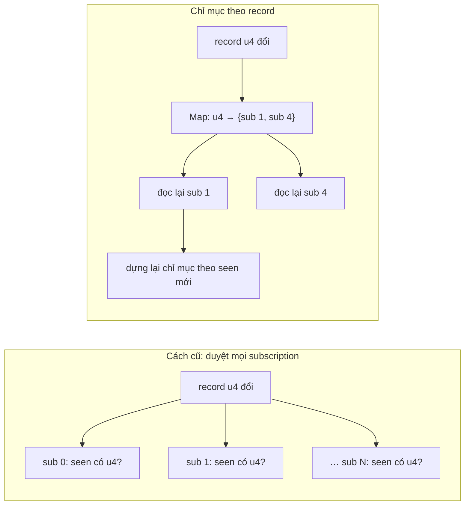

Một trang Facebook có thể có hàng nghìn fragment Relay đang sống: mỗi bài trong feed, mỗi bình luận, mỗi avatar trong thanh chat là một subscription vào store. Khi một payload nhỏ tới (một lượt thích), store phải trả lời câu hỏi: **những subscription nào cần đọc lại?**

Cách đơn giản là duyệt hết. Relay có sẵn cách đó, và đang thử một cách khác sau một feature flag: chỉ mục theo ID record. Bài này đọc cả hai, rồi thêm hai mảnh hạ tầng nhỏ khác trong cùng bundle: hàng đợi task của Relay classic và cache response của Relay.

> [!TIP]
> **Tóm tắt**
> - `RelayStoreSubscriptionsUsingMapByID` giữ `Map<recordID, Set<subscription>>` dựng từ các record mà mỗi snapshot đã đọc. Store đổi record nào thì chỉ đọc lại subscription dưới record đó. Một bộ đếm revision đảm bảo mỗi subscription chỉ đọc lại một lần mỗi vòng.
> - Bug trong bản gốc (đã chạy bằng node): `dispose` gỡ subscription theo tập record **lúc subscribe**, không phải tập hiện tại. Subscription đọc thêm record sau đó sẽ sống lại sau khi đã dispose.
> - `RelayTaskQueue` chạy mỗi tick một bước. Việc sinh ra trong lúc chạy được **chèn lên đầu hàng**, nên một task và các task con của nó chạy xong trước task khác.
> - `RelayQueryResponseCache` có giới hạn kích thước nhưng `get` không làm mới thứ tự, nên thực chất là FIFO. Mỗi `get` còn quét cả `Map` để dọn mục hết hạn.

<iframe class="demo-frame" src="/demos/facebook-patterns/index.html?theme=dark#/relay-subscription-index" title="Demo relay-subscription-index" loading="lazy" style="height: 1300px"></iframe>

<p class="demo-links">▶ <a href="/demos/facebook-patterns/index.html#/relay-subscription-index" target="_blank" rel="noopener">Mở demo toàn màn hình ↗</a> · <a href="https://stackblitz.com/github/hunghg255/blog-hunghg/tree/master/examples/facebook-patterns?file=src/lib/subscriptionIndex.ts" target="_blank" rel="noopener">Sửa code trên StackBlitz ↗</a> · <a href="https://github.com/hunghg255/blog-hunghg/blob/master/examples/facebook-patterns/src/lib/subscriptionIndex.ts" target="_blank" rel="noopener">Xem source trên GitHub ↗</a></p>

## Facebook làm thế nào?

### Cách cũ: duyệt mọi subscription

Store của Relay (`relay-runtime/store/RelayModernStore`) chọn một trong hai lớp quản lý subscription, tuỳ feature flag:

```js
this._storeSubscriptions = RelayFeatureFlags.ENABLE_STORE_SUBSCRIPTIONS_REFACTOR === true
  ? new RelayStoreSubscriptionsUsingMapByID()
  : new RelayStoreSubscriptions();
```

Trên facebook.com, flag này được bật theo gatekeeper trong `configureRelayFeatureFlagsForWWW` (`ENABLE_STORE_SUBSCRIPTIONS_REFACTOR = gkx("1839774")`), tức là một thử nghiệm A/B. Lớp mặc định `RelayStoreSubscriptions` giữ một `Set` mọi subscription và duyệt hết mỗi lần store `notify`:

```js
updateSubscriptions(source, updatedRecordIDs, owners) {
  const hasUpdatedRecords = !isEmptyObject(updatedRecordIDs);
  this._subscriptions.forEach((sub) => {
    const owner = this._updateSubscription(source, sub, updatedRecordIDs, hasUpdatedRecords);
    if (owner != null) owners.push(owner);
  });
}
// trong _updateSubscription:
const overlaps = hasUpdatedRecords && hasOverlappingIDs(snapshot.seenRecords, updatedRecordIDs);
if (!stale && !overlaps) return;
```

`hasOverlappingIDs` là một vòng `for…in` trên `seenRecords` của snapshot, kiểm tra từng ID có trong tập vừa đổi không. Mỗi lần store đổi, chi phí là tổng số record đã đọc của **mọi** subscription, kể cả khi chỉ một record đổi.

### Cách mới: chỉ mục theo record

`relay-runtime/store/RelayStoreSubscriptionsUsingMapByID` (trong `99 ChatComposer/all.js`) đảo chiều: thay vì hỏi từng subscription "bạn có dính record nào đổi không", nó hỏi từng record đổi "ai đang đọc bạn":

```js
updateSubscriptions(source, updatedRecordIDs, owners) {
  this._notifiedRevision++;
  Object.keys(updatedRecordIDs).forEach((id) => {
    const subs = this._subscriptionsByDataId.get(id);
    if (subs == null) return;
    subs.forEach((sub) => {
      if (sub.notifiedRevision === this._notifiedRevision) return; // đã đọc lại trong vòng này
      const owner = this._updateSubscription(source, sub, false);
      if (owner != null) owners.push(owner);
    });
  });
  this._staleSubscriptions.forEach(/* subscription bị đánh dấu cũ sau restore optimistic */);
  this._staleSubscriptions.clear();
}
```

Ba chi tiết đáng học:

1. **Revision thay cho Set "đã xử lý".** Một subscription đọc 5 record, cả 5 đều đổi thì nó nằm trong 5 tập. Thay vì tạo một `Set` mới mỗi vòng để nhớ ai đã được đọc lại, mỗi subscription mang một số `notifiedRevision`. Bằng số vòng hiện tại thì bỏ qua. Không cấp phát gì cả.
2. **Dựng lại chỉ mục sau mỗi lần đọc.** Đọc lại có thể chạm vào record khác (ví dụ `bestFriend` vừa trỏ sang người khác). Hàm `_updateSubscriptionIndex` gỡ subscription khỏi mọi ID cũ rồi thêm vào mọi ID mới.
3. **Chỉ báo khi khác.** Dữ liệu mới đi qua `recycleNodesInto` (bài #87). Nếu kết quả `===` dữ liệu cũ, callback không được gọi. Đổi một field không nằm trong fragment thì subscription bị đọc lại nhưng component không render.

Phần optimistic (bài #88) có thêm hai hàm: `snapshotSubscriptions` lưu `backup` cho từng subscription trước khi đặt lớp phủ, và `restoreSubscriptions` so `backup` với dữ liệu hiện tại để đưa subscription nào lệch vào tập `_staleSubscriptions`. Một bộ đếm thứ hai (`snapshotRevision`) chống xử lý một subscription hai lần khi nó nằm dưới nhiều ID.

### Bug: subscription sống lại sau `dispose`

Hàm `subscribe`:

```js
subscribe(snapshot, callback) {
  const subscription = { backup: null, callback, notifiedRevision: this._notifiedRevision,
                         snapshotRevision: this._snapshotRevision, snapshot };
  const dispose = () => {
    for (const id in snapshot.seenRecords) {        // ← snapshot của lúc subscribe
      const subs = this._subscriptionsByDataId.get(id);
      if (subs != null) { subs.delete(subscription); if (subs.size === 0) this._subscriptionsByDataId.delete(id); }
    }
  };
  for (const id in snapshot.seenRecords) { /* thêm vào chỉ mục */ }
  return { dispose };
}
```

`dispose` đóng gói biến `snapshot` của lúc gọi `subscribe`. Sau mỗi lần đọc lại, `subscription.snapshot` được thay bằng snapshot mới và chỉ mục được dựng theo `seenRecords` mới, nhưng `dispose` vẫn duyệt `seenRecords` cũ.

Mình nạp đúng đoạn module trong bundle vào node (giả lập `__d`, `RelayReader` là hàm đọc đơn giản) và chạy kịch bản:

1. Subscribe một selector đọc record A.
2. A đổi và trỏ sang B. Đọc lại, giờ subscription nằm dưới A và B. Callback: 1 lần.
3. `dispose()`. Chỉ gỡ khỏi A.
4. B đổi. Subscription vẫn nằm dưới B, bị đọc lại, **callback chạy lần 2**. Tệ hơn, lần đọc lại này thêm nó trở lại dưới A.

Kết quả node: `calls after dispose + B update 2`, chỉ mục còn cả hai khoá `A` và `B`. Trong React, callback này gọi `setState` lên component đã unmount, giữ component đó trong bộ nhớ, và đọc lại dữ liệu vô ích mỗi lần B đổi. Phần "Subscription ma" trong demo chạy cùng kịch bản. Cách sửa: `dispose` duyệt `subscription.snapshot.seenRecords` (tập hiện tại), và đánh dấu subscription đã huỷ để vòng `update` đang chạy bỏ qua nó.

### RelayTaskQueue: một bước mỗi tick, task con chen lên đầu

`react-relay-deprecated/classic/tools/RelayTaskQueue` (trong `155.js`) là di sản của Relay classic. `enqueue(f1, f2, f3)` trả về Promise. Mỗi bước là một mục riêng trong hàng đợi, và bước sau chỉ được đẩy vào khi bước trước chạy xong:

```js
enqueue(...steps) {
  const promise = new Promise((resolve, reject) => {
    let i = 0, error = null;
    const next = (value) => {
      if (error) { reject(error); return; }
      if (i >= steps.length) resolve(value);
      else this._queue.push(() => {
        next((() => { try { return steps[i++](value); } catch (e) { error = e; } })());
      });
    };
    next(undefined);
  });
  this._scheduleIfNecessary();
  return promise;
}
```

Mẹo nằm ở hàm chạy một mục (tên gốc `$6`):

```js
_invokeWithinScopedQueue(item) {
  const outer = this._queue;
  this._queue = [];                          // mục mới sinh ra trong lúc chạy vào mảng rỗng này
  try { item(); }
  finally {
    Array.prototype.unshift.apply(outer, this._queue); // rồi được đặt lên ĐẦU hàng cũ
    this._queue = outer;
  }
}
```

Bước tiếp theo của chính task đó, và mọi task con mà bước này `enqueue`, đều chạy trước các task đã xếp hàng từ trước. Chạy bằng node với task A (bước A1 sinh task con 2 bước, sau đó A2), task B: thứ tự là `A1 child1 child2 A2 B1`. Đó là duyệt theo chiều sâu. Có lẽ Relay classic cần điều này để một lần ghi dữ liệu (gồm các bước con) hoàn tất trước khi lần khác bắt đầu, trong khi vẫn nhường trình duyệt giữa các bước nhờ scheduler.

Scheduler được inject (`injectScheduler`). Callback scheduler nhận có guard: gọi lại lần hai thì `invariant` ném lỗi. Không có scheduler thì mọi thứ chạy đồng bộ, nhưng theo kiểu **đệ quy**: chạy xong một mục thì gọi lại hàm lên lịch, hàm này chạy mục tiếp theo. Chạy bằng node, một chuỗi 20.000 bước không có scheduler báo `Maximum call stack size exceeded`. Thực tế không ai tạo chuỗi dài như vậy, nhưng đó là lý do bản viết lại dùng vòng lặp.

### RelayQueryResponseCache: "LRU" là FIFO

`relay-runtime/network/RelayQueryResponseCache` dùng để cache response của network layer:

```js
get(queryID, variables) {
  const key = getCacheKey(queryID, variables); // JSON.stringify(stableCopy({queryID, variables}))
  this._responses.forEach((resp, k) => {        // quét toàn bộ để xoá mục hết hạn
    if (!isCurrent(resp.fetchTime, this._ttl)) this._responses.delete(k);
  });
  const resp = this._responses.get(key);
  return resp != null ? { ...resp.payload, extensions: { ...resp.payload.extensions, cacheTimestamp: resp.fetchTime } } : null;
}
set(queryID, variables, payload) {
  const key = getCacheKey(queryID, variables);
  this._responses.delete(key);                 // đưa xuống cuối thứ tự chèn
  this._responses.set(key, { fetchTime: Date.now(), payload });
  if (this._responses.size > this._size) {
    const first = this._responses.keys().next();
    if (!first.done) this._responses.delete(first.value); // đuổi mục đầu
  }
}
```

`set` dùng mẹo `delete` + `set` của `Map` để đưa khoá xuống cuối, đúng kiểu LRU. Nhưng `get` không làm vậy. Chạy bằng node với cache 2 mục: đặt A, đặt B, đọc A hai lần, đặt C. Kết quả: **A bị đuổi**, còn lại `[B, C]`. Mục được đọc nhiều nhất bị đuổi theo thứ tự chèn. Ngoài ra mỗi `get` tốn O(n) vì vòng quét TTL.

Có lẽ đây là lựa chọn có chủ ý: cache này thường nhỏ (vài chục mục), và việc dọn TTL mỗi lần đọc giữ code đơn giản. Nhưng tên gọi và cách dùng `delete`+`set` dễ làm người đọc nghĩ đây là LRU.

Khoá cache dùng `stableCopy`: sao chép object với khoá được sắp xếp đệ quy, để `{a: 1, b: 2}` và `{b: 2, a: 1}` cho cùng một chuỗi JSON.

## Bên trong: hai cách tìm subscription bị ảnh hưởng



Chi phí cách cũ tỉ lệ với tổng số record mà mọi subscription đã đọc. Chi phí chỉ mục tỉ lệ với số subscription thật sự dính tới record đổi, cộng chi phí cập nhật chỉ mục cho các subscription đó. Đánh đổi: bộ nhớ cho `Map` và các `Set`, cùng một ít việc mỗi lần đọc lại.

## Viết lại

Ba file. `src/lib/subscriptionIndex.ts` dùng `recycleNodesInto` của bài #87. Selector nhận một hàm `read(id)`. Index tự ghi lại mọi ID đã đọc, nên không cần reader riêng như `RelayReader`:

```ts title=src/lib/subscriptionIndex.ts
  update(changedIds: Iterable<string>): UpdateStats {
    this.revision++;
    const stats: UpdateStats = { reads: 0, notified: 0 };
    for (const id of changedIds) {
      const subs = this.byRecord.get(id);
      if (!subs) continue;
      // sao chép: callback có thể subscribe/dispose làm đổi Set đang duyệt
      for (const sub of [...subs]) {
        if (sub.disposed || sub.notifiedRevision === this.revision) continue;
        sub.notifiedRevision = this.revision;
        stats.reads++;
        const { data, seen } = this.read(sub.selector);
        const next = recycleNodesInto(sub.data, data);
        const oldSeen = sub.seen;
        sub.seen = seen;
        this.index(sub, oldSeen, seen);
        if (next !== sub.data) {
          sub.data = next;
          stats.notified++;
          sub.callback(next);
        }
      }
    }
    return stats;
  }

  private index(sub: Subscription<unknown>, oldSeen: Set<string>, newSeen: Set<string>) {
    oldSeen.forEach((id) => {
      if (newSeen.has(id)) return;
      const set = this.byRecord.get(id);
      if (!set) return;
      set.delete(sub);
      if (set.size === 0) this.byRecord.delete(id);
    });
    newSeen.forEach((id) => {
      if (oldSeen.has(id)) return;
      let set = this.byRecord.get(id);
      if (!set) this.byRecord.set(id, (set = new Set()));
      set.add(sub);
    });
  }
```

`src/lib/relayTaskQueue.ts`: vòng lặp thay cho đệ quy, và trong lúc một mục đang chạy thì `scheduled` vẫn là `true` để `enqueue` lồng không hẹn thêm lần nữa:

```ts title=src/lib/relayTaskQueue.ts
  /** Chạy một mục: mục mới sinh ra trong lúc chạy được đặt lên ĐẦU hàng. */
  private runOne(item: Item) {
    const rest = this.queue;
    this.queue = [];
    try {
      item();
    } finally {
      this.queue = this.queue.concat(rest);
    }
  }

  private schedule() {
    if (this.scheduled || this.draining || this.queue.length === 0) return;
    if (!this.scheduler) {
      // không có scheduler: chạy hết ngay bằng vòng lặp, không đệ quy
      this.draining = true;
      try {
        while (this.queue.length) this.runOne(this.queue.shift()!);
      } finally {
        this.draining = false;
      }
      return;
    }
    this.scheduled = true;
    let called = false;
    this.scheduler(() => {
      if (called) throw new Error('Scheduler gọi lại cùng một callback hai lần');
      called = true;
      const item = this.queue.shift();
      if (item) this.runOne(item); // trong lúc chạy, scheduled vẫn true nên enqueue lồng không hẹn thêm
      this.scheduled = false;
      this.schedule();
    });
  }
}
```

::: spoiler Xem toàn bộ src/lib/subscriptionIndex.ts

```ts title=src/lib/subscriptionIndex.ts
/**
 * Chỉ mục subscription theo record, ý tưởng từ RelayStoreSubscriptionsUsingMapByID (viết lại):
 * - mỗi subscription nhớ tập record nó đã đọc (seen); chỉ mục là Map recordId → Set<subscription>,
 * - store đổi một số record thì chỉ đọc lại subscription dính tới chúng, mỗi subscription tối đa một lần/vòng,
 * - đọc lại xong thì dựng lại chỉ mục theo tập record mới, và chỉ báo khi dữ liệu thật sự khác (structural sharing).
 */
import { recycleNodesInto } from './recycleNodes';

export type Reader = (id: string) => unknown;
export type Selector<T> = (read: Reader) => T;

interface Subscription<T> {
  selector: Selector<T>;
  callback: (data: T) => void;
  data: T;
  seen: Set<string>;
  notifiedRevision: number;
  disposed: boolean;
}

export interface UpdateStats {
  /** số subscription bị đọc lại */
  reads: number;
  /** số callback được gọi (dữ liệu thật sự khác) */
  notified: number;
}

export class SubscriptionIndex {
  private byRecord = new Map<string, Set<Subscription<unknown>>>();
  private revision = 0;
  totalReads = 0;

  constructor(private getRecord: (id: string) => unknown) {}

  /** Chạy selector qua một reader có ghi lại mọi ID đã đọc. */
  private read<T>(selector: Selector<T>) {
    const seen = new Set<string>();
    const data = selector((id) => {
      seen.add(id);
      return this.getRecord(id);
    });
    this.totalReads++;
    return { data, seen };
  }

  subscribe<T>(
    selector: Selector<T>,
    callback: (data: T) => void,
  ): { data: T; dispose: () => void } {
    const { data, seen } = this.read(selector);
    const sub: Subscription<T> = {
      selector,
      callback,
      data,
      seen,
      notifiedRevision: this.revision,
      disposed: false,
    };
    this.index(sub as Subscription<unknown>, new Set(), seen);
    return {
      data,
      dispose: () => {
        if (sub.disposed) return;
        sub.disposed = true;
        // gỡ theo tập seen HIỆN TẠI, không phải tập lúc subscribe
        this.index(sub as Subscription<unknown>, sub.seen, new Set());
      },
    };
  }

  /** Báo cho index biết các record vừa đổi. */
  update(changedIds: Iterable<string>): UpdateStats {
    this.revision++;
    const stats: UpdateStats = { reads: 0, notified: 0 };
    for (const id of changedIds) {
      const subs = this.byRecord.get(id);
      if (!subs) continue;
      // sao chép: callback có thể subscribe/dispose làm đổi Set đang duyệt
      for (const sub of [...subs]) {
        if (sub.disposed || sub.notifiedRevision === this.revision) continue;
        sub.notifiedRevision = this.revision;
        stats.reads++;
        const { data, seen } = this.read(sub.selector);
        const next = recycleNodesInto(sub.data, data);
        const oldSeen = sub.seen;
        sub.seen = seen;
        this.index(sub, oldSeen, seen);
        if (next !== sub.data) {
          sub.data = next;
          stats.notified++;
          sub.callback(next);
        }
      }
    }
    return stats;
  }

  private index(sub: Subscription<unknown>, oldSeen: Set<string>, newSeen: Set<string>) {
    oldSeen.forEach((id) => {
      if (newSeen.has(id)) return;
      const set = this.byRecord.get(id);
      if (!set) return;
      set.delete(sub);
      if (set.size === 0) this.byRecord.delete(id);
    });
    newSeen.forEach((id) => {
      if (oldSeen.has(id)) return;
      let set = this.byRecord.get(id);
      if (!set) this.byRecord.set(id, (set = new Set()));
      set.add(sub);
    });
  }

  /** Số subscription đang được chỉ mục dưới một record (cho demo/test). */
  countFor(id: string) {
    return this.byRecord.get(id)?.size ?? 0;
  }
  get indexedRecordCount() {
    return this.byRecord.size;
  }
}
```

:::

::: spoiler Xem toàn bộ src/lib/relayTaskQueue.ts

```ts title=src/lib/relayTaskQueue.ts
/**
 * Hàng đợi task chạy từng bước, task con chen lên đầu (theo chiều sâu).
 * Ý tưởng từ RelayTaskQueue (react-relay classic), viết lại: vòng lặp thay cho đệ quy, scheduler tuỳ chọn.
 */

export type Step = (input: any) => any;
/** Scheduler nhận một hàm "chạy một bước" và quyết định khi nào gọi nó (rAF, setTimeout, idle…). */
export type Scheduler = (runOne: () => void) => void;

type Item = () => void;

export class TaskQueue {
  private queue: Item[] = [];
  private scheduled = false;
  private draining = false;

  constructor(private scheduler: Scheduler | null = null) {}

  injectScheduler(scheduler: Scheduler | null) {
    this.scheduler = scheduler;
  }

  get size() {
    return this.queue.length;
  }

  /** Mỗi bước nhận kết quả bước trước; bước sau chỉ được xếp hàng khi bước trước xong. */
  enqueue(...steps: Step[]): Promise<unknown> {
    const promise = new Promise<unknown>((resolve, reject) => {
      let i = 0;
      const pushNext = (value: unknown) => {
        if (i >= steps.length) return resolve(value);
        this.queue.push(() => {
          let out: unknown;
          try {
            out = steps[i++](value);
          } catch (e) {
            return reject(e); // bước lỗi: bỏ các bước còn lại
          }
          pushNext(out);
        });
      };
      pushNext(undefined);
    });
    this.schedule();
    return promise;
  }

  /** Chạy một mục: mục mới sinh ra trong lúc chạy được đặt lên ĐẦU hàng. */
  private runOne(item: Item) {
    const rest = this.queue;
    this.queue = [];
    try {
      item();
    } finally {
      this.queue = this.queue.concat(rest);
    }
  }

  private schedule() {
    if (this.scheduled || this.draining || this.queue.length === 0) return;
    if (!this.scheduler) {
      // không có scheduler: chạy hết ngay bằng vòng lặp, không đệ quy
      this.draining = true;
      try {
        while (this.queue.length) this.runOne(this.queue.shift()!);
      } finally {
        this.draining = false;
      }
      return;
    }
    this.scheduled = true;
    let called = false;
    this.scheduler(() => {
      if (called) throw new Error('Scheduler gọi lại cùng một callback hai lần');
      called = true;
      const item = this.queue.shift();
      if (item) this.runOne(item); // trong lúc chạy, scheduled vẫn true nên enqueue lồng không hẹn thêm
      this.scheduled = false;
      this.schedule();
    });
  }
}
```

:::

::: spoiler Xem toàn bộ src/lib/relayResponseCache.ts

```ts title=src/lib/relayResponseCache.ts
/**
 * Cache kết quả query theo (queryId, biến), có TTL và giới hạn kích thước.
 * Ý tưởng từ RelayQueryResponseCache, viết lại thành LRU thật: get cũng làm mới thứ tự,
 * và chỉ kiểm tra hạn của đúng mục đang đọc thay vì quét cả Map.
 */

/** JSON với khoá object được sắp xếp, để {a,b} và {b,a} cho cùng một chuỗi. */
export function stableStringify(value: unknown): string {
  return JSON.stringify(value, (_key, v) =>
    v && typeof v === 'object' && !Array.isArray(v)
      ? Object.fromEntries(
          Object.keys(v)
            .sort()
            .map((k) => [k, (v as Record<string, unknown>)[k]]),
        )
      : v,
  );
}

interface Entry<T> {
  fetchTime: number;
  payload: T;
}

export interface CacheOptions {
  size: number;
  ttl: number;
  /** đổi được để test/demo */
  now?: () => number;
}

export class ResponseCache<T> {
  private map = new Map<string, Entry<T>>();
  private size: number;
  private ttl: number;
  private now: () => number;

  constructor({ size, ttl, now = Date.now }: CacheOptions) {
    if (!(size > 0) || !(ttl > 0)) throw new Error('size và ttl phải > 0');
    this.size = size;
    this.ttl = ttl;
    this.now = now;
  }

  static key(queryId: string, variables: Record<string, unknown>) {
    return stableStringify({ queryId, variables });
  }

  get(
    queryId: string,
    variables: Record<string, unknown>,
  ): (T & { cacheTimestamp: number }) | null {
    const key = ResponseCache.key(queryId, variables);
    const entry = this.map.get(key);
    if (!entry) return null;
    if (entry.fetchTime + this.ttl < this.now()) {
      this.map.delete(key);
      return null;
    }
    // LRU: đưa xuống cuối thứ tự chèn
    this.map.delete(key);
    this.map.set(key, entry);
    return { ...entry.payload, cacheTimestamp: entry.fetchTime };
  }

  set(queryId: string, variables: Record<string, unknown>, payload: T) {
    const key = ResponseCache.key(queryId, variables);
    this.map.delete(key);
    this.map.set(key, { fetchTime: this.now(), payload });
    while (this.map.size > this.size) {
      // mục cũ nhất (ít được dùng gần đây nhất) nằm đầu Map
      this.map.delete(this.map.keys().next().value!);
    }
  }

  /** Dọn mục hết hạn, gọi định kỳ nếu cần (không phải mỗi lần get). */
  prune() {
    const now = this.now();
    for (const [k, e] of this.map) if (e.fetchTime + this.ttl < now) this.map.delete(k);
  }

  clear() {
    this.map.clear();
  }

  keys() {
    return [...this.map.keys()];
  }
}
```

:::

**Khác bản gốc:**

- `dispose` gỡ theo `sub.seen` hiện tại và đặt cờ `disposed`. Vòng `update` duyệt một **bản sao** của `Set`, nên callback nào subscribe hoặc dispose giữa chừng cũng không làm hỏng vòng lặp.
- `index(sub, oldSeen, newSeen)` chỉ đụng tới ID có trong một tập mà không có trong tập kia, thay vì gỡ hết rồi thêm lại.
- Không có phần optimistic (`backup`, `stale`). Bài #88 đã có store theo lớp. Ghép hai phần thì thêm `snapshot/restore` như bản gốc.
- `TaskQueue` không đệ quy, và một bước ném lỗi thì Promise reject ngay, các bước còn lại không được xếp hàng.
- `ResponseCache.get` làm mới thứ tự (LRU thật) và chỉ kiểm tra hạn của mục đang đọc. Dọn toàn bộ mục hết hạn là việc của `prune()`, gọi khi cần.

## Đi qua code

- `SubscriptionIndex.read` bọc `getRecord` bằng một hàm ghi ID vào `seen`. Selector đọc record nào thì record đó vào chỉ mục, không cần khai báo trước.
- `update` tăng `revision` một lần. Với mỗi ID đổi, lấy tập subscription, bỏ qua cái đã đọc trong vòng này, đọc lại, `recycleNodesInto` với dữ liệu cũ, dựng lại chỉ mục, rồi gọi callback nếu tham chiếu khác.
- `TaskQueue.enqueue` không đẩy mọi bước vào hàng ngay. `pushNext` đẩy bước đầu. Bước chạy xong mới gọi `pushNext` cho bước sau, và vì lúc đó `this.queue` đang là mảng tạm của `runOne`, bước sau sẽ được nối lên đầu.
- `runOne` tráo `this.queue` sang mảng rỗng, chạy mục, rồi `this.queue = mới.concat(cũ)`.
- `ResponseCache.set` dùng vòng `while` để đuổi mục đầu cho tới khi đủ kích thước, phòng trường hợp ai đó giảm `size`.

## Tại sao không làm cách khác?

- **Mỗi component tự so dữ liệu khi store đổi** (kiểu `useSelector` của Redux): mọi selector đều chạy lại mỗi lần dispatch. Ổn với vài trăm component, nhưng Relay có store chuẩn hoá nên biết chính xác record nào đổi, và nên tận dụng.
- **Đăng ký theo field thay vì theo record**: chính xác hơn nhưng chỉ mục lớn hơn nhiều lần. Đọc lại theo record rồi lọc bằng `recycleNodesInto` là điểm cân bằng tốt.
- **Proxy theo dõi truy cập** (kiểu MobX, Valtio): theo dõi ở mức thuộc tính một cách tự động. Relay không cần vì đã có `seenRecords` từ reader.
- **`queueMicrotask` cho hàng đợi task**: không nhường trình duyệt render giữa các bước, và microtask lồng nhau có thể chặn khung hình. Scheduler inject được cho phép chọn `requestIdleCallback`, `setTimeout` hay `scheduler.postTask`.

## Edge case và cạm bẫy

- **Subscription dưới nhiều ID đổi cùng lúc** chỉ đọc lại một lần nhờ `revision`. Nếu bỏ cơ chế này, một bình luận đổi cả `author` lẫn `body` sẽ làm component đọc lại hai lần.
- **Callback gọi `update` lồng nhau**: `revision` tăng ở vòng trong, nên vòng ngoài có thể đọc lại một subscription lần nữa. Nên gom thay đổi và gọi `update` một lần sau khi callback xong, giống `notify` của Relay chạy sau `publish`.
- **Thứ tự callback** theo thứ tự ID trong danh sách đổi và thứ tự chèn trong `Set`, không theo thứ tự cây React. React gom `setState` trong cùng một tick nên thường không thành vấn đề.
- **Task lỗi giữa chừng**: bản gốc ghi lỗi vào biến và reject khi bước tiếp theo được gọi. Bản viết lại reject ngay. Cả hai đều không chạy bước còn lại.
- **Khoá cache**: `stableStringify` không phân biệt `undefined` với khoá thiếu, và `Date` thành chuỗi ISO. Biến của GraphQL là JSON nên không sao.

## Dùng trong dự án

Store nhỏ có subscription theo ID:

```ts
import { SubscriptionIndex } from './lib/subscriptionIndex';

const records = new Map<string, unknown>();
const index = new SubscriptionIndex((id) => records.get(id));

export function useRecordSelector<T>(selector: Selector<T>) {
  const [data, setData] = useState(() => selector((id) => records.get(id)) as T);
  useEffect(() => {
    const sub = index.subscribe(selector, setData);
    setData(sub.data);
    return sub.dispose;
  }, [selector]);
  return data;
}

export function write(changes: Record<string, unknown>) {
  Object.entries(changes).forEach(([id, rec]) => records.set(id, rec));
  index.update(Object.keys(changes));
}
```

Hàng đợi chạy việc nền theo từng khung hình:

```ts
const queue = new TaskQueue((run) => requestAnimationFrame(() => run()));
await queue.enqueue(parsePayload, normalize, (records) => write(records));
```

## Kiểm thử

::: spoiler Ví dụ test (bản phác, không có trong repo)

```ts
import { describe, expect, it, vi } from 'vitest';
import { SubscriptionIndex } from '../src/lib/subscriptionIndex';
import { TaskQueue } from '../src/lib/relayTaskQueue';
import { ResponseCache } from '../src/lib/relayResponseCache';

describe('SubscriptionIndex', () => {
  const setup = () => {
    const src: Record<string, any> = { A: { name: 'a', link: null }, B: { name: 'b' } };
    const idx = new SubscriptionIndex((id) => src[id]);
    const sel = (read: (id: string) => any) => {
      const a = read('A');
      return a.link ? { a: a.name, b: read(a.link).name } : { a: a.name };
    };
    return { src, idx, sel };
  };

  it('chỉ đọc lại subscription dính record đổi', () => {
    const { src, idx, sel } = setup();
    const cb = vi.fn();
    idx.subscribe(sel, cb);
    src.B = { name: 'b2' };
    expect(idx.update(['B'])).toEqual({ reads: 0, notified: 0 });
    src.A = { name: 'a2', link: null };
    expect(idx.update(['A', 'A'])).toEqual({ reads: 1, notified: 1 });
  });

  it('đọc lại mà dữ liệu không đổi thì không báo', () => {
    const { src, idx, sel } = setup();
    const cb = vi.fn();
    idx.subscribe(sel, cb);
    src.A = { ...src.A };
    expect(idx.update(['A']).notified).toBe(0);
    expect(cb).not.toHaveBeenCalled();
  });

  it('dispose gỡ theo tập record hiện tại', () => {
    const { src, idx, sel } = setup();
    const cb = vi.fn();
    const sub = idx.subscribe(sel, cb);
    src.A = { name: 'a', link: 'B' };
    idx.update(['A']);
    sub.dispose();
    src.B = { name: 'b2' };
    idx.update(['B']);
    expect(cb).toHaveBeenCalledTimes(1);
    expect(idx.indexedRecordCount).toBe(0);
  });
});

describe('TaskQueue', () => {
  it('task con chen lên đầu hàng', () => {
    const order: string[] = [];
    const ticks: (() => void)[] = [];
    const q = new TaskQueue((run) => ticks.push(run));
    q.enqueue(
      () => {
        order.push('A1');
        q.enqueue(() => order.push('c1'), () => order.push('c2'));
      },
      () => order.push('A2'),
    );
    q.enqueue(() => order.push('B1'));
    while (ticks.length) ticks.shift()!();
    expect(order).toEqual(['A1', 'c1', 'c2', 'A2', 'B1']);
  });

  it('không tràn stack khi chạy đồng bộ chuỗi dài', async () => {
    const q = new TaskQueue();
    const steps = Array.from({ length: 50_000 }, () => (x: number) => (x ?? 0) + 1);
    await expect(q.enqueue(...steps)).resolves.toBe(50_000);
  });

  it('bước lỗi thì reject', async () => {
    const q = new TaskQueue();
    const after = vi.fn();
    await expect(q.enqueue(() => { throw new Error('x'); }, after)).rejects.toThrow('x');
    expect(after).not.toHaveBeenCalled();
  });
});

describe('ResponseCache', () => {
  it('get làm mới thứ tự (LRU)', () => {
    const c = new ResponseCache<{ v: number }>({ size: 2, ttl: 1000, now: () => 0 });
    c.set('A', {}, { v: 1 });
    c.set('B', {}, { v: 2 });
    c.get('A', {});
    c.set('C', {}, { v: 3 });
    expect(c.get('A', { })).not.toBeNull();
    expect(c.get('B', {})).toBeNull();
  });

  it('khoá không phụ thuộc thứ tự biến, hết hạn thì trả null', () => {
    let t = 0;
    const c = new ResponseCache<{ v: number }>({ size: 5, ttl: 100, now: () => t });
    c.set('Q', { a: 1, b: 2 }, { v: 1 });
    expect(c.get('Q', { b: 2, a: 1 })).toMatchObject({ v: 1, cacheTimestamp: 0 });
    t = 101;
    expect(c.get('Q', { a: 1, b: 2 })).toBeNull();
  });
});
```

:::

## So với thư viện và chuẩn web

- **Relay mã nguồn mở**: cả hai lớp đều xuất phát từ Relay trên GitHub. Bundle này cho thấy Facebook chạy thử lớp chỉ mục sau một gatekeeper, còn mặc định vẫn là lớp duyệt toàn bộ. Nếu dùng Relay, hãy xem bản bạn cài đặt đang dùng lớp nào trước khi dựa vào hành vi ở đây.
- **Apollo Client** theo dõi phụ thuộc ở mức field qua thư viện `optimism` (cache kết quả đọc theo các field đã chạm), nên cũng chỉ tính lại query bị ảnh hưởng.
- **`useSyncExternalStore`** của React không lo phần "ai cần đọc lại". Nó gọi `getSnapshot` của mọi subscriber mỗi lần store báo đổi. Chỉ mục kiểu này đặt phía trước nó để giảm số lần báo.
- **LRU**: `lru-cache` (npm) là lựa chọn chuẩn, có TTL theo từng mục và dọn lười. `Map` với `delete`+`set` ở cả `get` lẫn `set` là đủ cho cache nhỏ.
- **Scheduler**: `scheduler.postTask` (có ưu tiên) chưa có trên mọi trình duyệt, Safari là trường hợp điển hình (tính tới 10/2026, xem [caniuse](https://caniuse.com/mdn-api_scheduler_posttask)), nên vẫn cần fallback `setTimeout` khi inject scheduler.

---

Bài này thuộc series **[Học từ mã nguồn Facebook](/series/facebook)** (106 bài, đọc theo thứ tự).

::: spoiler Xem nhanh danh sách bài trong series

*Phần 1*

- [Mở đầu: cách đọc code minify của Facebook](/blogs/learn-from-facebook-source-code)
- [#1 Dùng chung IntersectionObserver + infinite scroll](/blogs/facebook-shared-intersection-observer)
- [#2 useViewportDuration: đo thời gian thực sự được xem](/blogs/facebook-use-viewport-duration)
- [#3 Preload code + data khi hover](/blogs/facebook-preload-on-hover)
- [#4 Toast manager với external store](/blogs/facebook-toast-manager)
- [#5 Network status + heartbeat backoff](/blogs/facebook-network-status-heartbeat)
- [#6 ErrorGuard: bắt lỗi theo ngữ cảnh](/blogs/facebook-error-guard)
- [#7 Banzai: gom log theo lô + sendBeacon](/blogs/facebook-batch-logger)
- [#8 Focus trap + Esc theo layer](/blogs/facebook-focus-trap)

*Phần 2*

- [#9 Mẹo calc(… * 9999): container query, line-clamp, mũi tên carousel bằng CSS](/blogs/facebook-css-9999-trick)
- [#10 Thanh cuộn tuỳ biến bằng CSS 3D](/blogs/facebook-css-3d-scrollbar)
- [#11 Modal cuộn bằng window, giữ vị trí trang nền](/blogs/facebook-document-scroll-modal)
- [#12 Popover, tooltip group và hovercard](/blogs/facebook-popover-tooltip)
- [#13 Primitive Pressable + focus-visible](/blogs/facebook-pressable)
- [#14 Tab "Xem thêm" + sticky header bằng IntersectionObserver](/blogs/facebook-priority-tabs-sticky-header)
- [#15 Avatar khoét mask, gradient Messenger, skeleton steps()](/blogs/facebook-visual-tricks)
- [#16 Khung chat không giật](/blogs/facebook-chat-scroller)
- [#17 Thuật toán chọn bố cục collage ảnh](/blogs/facebook-photo-collage-layout)
- [#18 Keep-alive tab trong SPA](/blogs/facebook-keep-alive-tabs)
- [#19 Tự đo Visual Completion & interaction tracing](/blogs/facebook-visual-completion)
- [#20 Router SPA bền bỉ & tải chunk có retry](/blogs/facebook-spa-router-resilient-loading)

*Phần 3*

- [#21 Smart Compose: gợi ý chữ mờ khi gõ](/blogs/facebook-smart-compose-ghost-text)
- [#22 MQTT ngay trong trình duyệt, tự chuyển sang long-poll](/blogs/facebook-mqtt-in-browser)
- [#23 Đo thời gian dùng bằng bitmap 64 giây](/blogs/facebook-time-spent-bitmap)
- [#24 Bảng reaction nhấn giữ rồi trượt](/blogs/facebook-reaction-press-slide)
- [#25 Tìm kiếm gấp dấu, phiên âm và highlight đầu từ](/blogs/facebook-search-diacritics-tokenize)
- [#26 Ring buffer biết trace nào đã mất log](/blogs/facebook-trace-ring-buffer)
- [#27 Engine animation JS: một vòng rAF và solver cubic-bezier](/blogs/facebook-keyframes-loop-cubic-bezier)
- [#28 Bootloader: bitmap tài nguyên đã tải, chỉ reload khi cần](/blogs/facebook-bootloader-bitmap-consistency)
- [#29 Nhận biết click do screen reader tạo ra](/blogs/facebook-virtual-cursor-detection)
- [#30 Tải trước feed theo chất lượng mạng, đoán hạng thiết bị](/blogs/facebook-network-aware-prefetch)
- [#31 Hàng đợi gửi tin chat giữ đúng thứ tự](/blogs/facebook-ordered-send-queue)
- [#32 Gộp lời gọi API trong cùng một tick](/blogs/facebook-api-batcher)
- [#33 Resize ảnh trong pool Web Worker](/blogs/facebook-jpeg-resize-worker-pool)
- [#34 Crop ảnh theo nhiều khuôn mặt](/blogs/facebook-face-aware-crop)
- [#35 Kéo-thả sắp xếp và vùng thả file không nhấp nháy](/blogs/facebook-flicker-free-drag-drop)
- [#36 Tiện ích UI: fade-out, sticky event, hàm huỷ được](/blogs/facebook-ui-utility-hooks)
- [#37 Hạ tầng nhỏ: cookie, hash lỗi, prefetch khi chuột dừng](/blogs/facebook-small-infra-cookie-hash-idle)

*Phần 4–6*

- [#38 Đồng bộ tin nhắn: phát hiện lỗ seqID và fetch bù theo tầng](/blogs/facebook-messenger-sync-seqid-gaps)
- [#39 OTID: ID tin nhắn kiểu Snowflake sinh ở client](/blogs/facebook-otid-client-snowflake)
- [#40 QPL: lấy mẫu từ lúc bắt đầu, đo RTT gửi tin đầu-cuối](/blogs/facebook-qpl-send-rtt)
- [#41 Bộ điều phối request bảy chế độ gộp và chống trùng](/blogs/facebook-request-dispatcher-modes)
- [#42 Thread list theo mốc thời gian, cookie presence có version](/blogs/facebook-threadlist-ranged-presence)
- [#43 Composer dạng plugin: reducer, dirty checker, chuỗi kiểm tra](/blogs/facebook-plugin-composer)
- [#44 Thanh toán bất đồng bộ: subscribe trước, poll dự phòng](/blogs/facebook-async-checkout)
- [#45 Validate số thẻ: sửa lỗi gõ, dải BIN, Luhn](/blogs/facebook-card-validation)
- [#46 Lịch chọn khoảng ngày: bo góc dải chọn, phím đủ bộ, RTL](/blogs/facebook-range-calendar-a11y)
- [#47 Giờ mở cửa theo tuần: qua đêm, gộp khoảng, phần bù](/blogs/facebook-weekly-hours-intervals)
- [#48 Tiến độ đăng realtime: giữ event chờ snapshot, watchdog](/blogs/facebook-realtime-publish-snapshot)
- [#49 Tiền tệ theo đơn vị nhỏ nhất và ô nhập tiền](/blogs/facebook-currency-minor-units)
- [#50 Sửa hàng loạt Empty/Uniform/Mixed, seen/read bằng 2 bit](/blogs/facebook-bulk-edit-seen-bits)
- [#51 Phát hiện script lạ hook vào hàm native](/blogs/facebook-native-hook-detection)
- [#52 localStorage tự dọn khi đầy quota](/blogs/facebook-quota-aware-storage)
- [#53 Cache tuyến do server phân giải, chờ sẵn promise](/blogs/facebook-route-cache-prefetch)
- [#54 Lưới phím mũi tên 2D và focus không làm cuộn trang](/blogs/facebook-focus-table-grid)
- [#55 Tách emoji bằng máy trạng thái](/blogs/facebook-emoji-segmentation)
- [#56 Đọc trước ghi sau trong một frame, con tự biết vị trí](/blogs/facebook-read-then-write-dom)
- [#57 Hàng đợi lệnh cho video và stream sắp lại chunk](/blogs/facebook-video-command-queue)

*Phần 7–10*

- [#58 Ước lượng băng thông EWMA: loại outlier, nhớ qua phiên](/blogs/facebook-bandwidth-ewma-estimator)
- [#59 ABR theo độ tự tin phát và cắt bậc bitrate theo MOS](/blogs/facebook-abr-playback-confidence)
- [#60 Prefetch segment dự đoán từ manifest, parse hộp sidx](/blogs/facebook-dash-predicted-segments)
- [#61 Đọc metadata MP4/MOV ngay trên client](/blogs/facebook-mp4-metadata-client)
- [#62 Upload tiếp tục được: offset, hash dedupe, phát hiện treo](/blogs/facebook-resumable-upload)
- [#63 Fenwick tree: chọn ngẫu nhiên có trọng số và offset dòng](/blogs/facebook-fenwick-weighted-random)
- [#64 Vạch trục số và trục thời gian "đẹp"](/blogs/facebook-nice-axis-ticks)
- [#65 Damerau-Levenshtein theo dải chéo và tự sửa tên gõ sai](/blogs/facebook-damerau-levenshtein)
- [#66 PRNG có seed, shuffle tái lập và lấy mẫu trace](/blogs/facebook-seeded-prng-sampling)
- [#67 Cặp min/max-heap tái dùng vị trí trong danh sách ảo](/blogs/facebook-dual-heap-buffer-set)
- [#68 Memo nhiều đối số bằng Map/WeakMap và interning object](/blogs/facebook-multikey-memo-interning)
- [#69 Thống kê cửa sổ trượt và đại số khoảng thời gian](/blogs/facebook-moving-stat-intervals)
- [#70 Int64 từ hai số 32-bit, decode UTF, offset theo code point](/blogs/facebook-int64-utf-codepoints)
- [#71 Engine múi giờ IANA trên client, phát hiện lệch giờ](/blogs/facebook-client-iana-timezone)
- [#72 Tự cài semver range](/blogs/facebook-semver-range)
- [#73 Auto-link URL, cắt chữ an toàn, giới hạn LaTeX](/blogs/facebook-autolink-safe-truncate)
- [#74 Parser query kiểu PHP chống prototype pollution](/blogs/facebook-php-query-serializer)
- [#75 Popover tự lật theo phần tràn nhỏ nhất](/blogs/facebook-popover-auto-flip)
- [#76 Tiền tố for(;;) chống JSON hijacking, đọc stream](/blogs/facebook-csrf-prefix-streaming)
- [#77 Chống lộ Referer, linkshim, xoá token trên URL](/blogs/facebook-referrer-linkshim-url-scrub)
- [#78 setImmediate bằng postMessage, gom delta chuột theo frame](/blogs/facebook-setimmediate-mouse-batching)
- [#79 Phát hiện crash qua heartbeat, dò proxy cache hỏng](/blogs/facebook-crash-heartbeat-proxy-check)
- [#80 DPR vào cookie cho ảnh @2x, che khoá trong log](/blogs/facebook-dpr-cookie-secret-redaction)
- [#81 Flux waitFor tự viết và proxy có đệm](/blogs/facebook-flux-dispatch-buffered-proxy)
- [#82 Crop đúng tỉ lệ, xoay sticker bằng ma trận](/blogs/facebook-image-crop-rotation-geometry)

*Phần 11–15*

- [#83 Chia subdomain giữa các tab bằng lease, long-poll theo bảng trạng thái](/blogs/facebook-tab-subdomain-lease-longpoll)
- [#84 MQTT QoS1: giữ publish chờ ack, gửi lại khi kết nối lại](/blogs/facebook-mqtt-qos1-republish)
- [#85 Cache Promise gộp request, cache lỗi ngắn, đua dữ liệu nhúng sẵn](/blogs/facebook-promise-cache-preload-race)
- [#86 Lịch retry: backoff có trần, Fibonacci, báo lỗi CDN mỗi N ngày](/blogs/facebook-retry-backoff-schedules)
- [#87 Giữ nguyên tham chiếu nhánh dữ liệu không đổi](/blogs/facebook-relay-recycle-nodes)
- [#88 Store optimistic: copy-on-write, rollback rồi áp lại](/blogs/facebook-relay-optimistic-store)
- **#89 Chỉ mục subscription theo record, hàng đợi task theo chiều sâu** (bài này)
- [#90 Phân trang connection: cursor khớp đầu, edge không trùng](/blogs/facebook-relay-connection-pagination)
- [#91 Profiler kiểu middleware và memo selector có lấy mẫu kiểm tra](/blogs/facebook-profiler-middleware-memo-check)
- [#92 Đọc EBML/WebM Cues để tìm byte range của segment](/blogs/facebook-webm-ebml-cues)
- [#93 Stream HTTP Range tạm dừng được, tải tiếp đúng byte](/blogs/facebook-pausable-range-stream)
- [#94 Bảng khoảng thời gian gắn nhãn và nhảy qua lỗ buffer](/blogs/facebook-tagged-time-ranges-gaps)
- [#95 Gom chunk cho SourceBuffer, đồng bộ video bằng playbackRate](/blogs/facebook-sourcebuffer-video-sync)
- [#96 Gom tin nhắn thành cụm, vạch ngày và avatar đã xem](/blogs/facebook-message-grouping)
- [#97 Bao nhiêu tab chat vừa màn hình, chuỗi luật mở tab](/blogs/facebook-chat-tab-policy)
- [#98 Phím tắt Markdown trong editor, Backspace để hoàn tác](/blogs/facebook-markdown-shortcuts-editor)
- [#99 Offset theo code point hay UTF-16: bốn bug cùng một gốc](/blogs/facebook-codepoint-offset-bugs)
- [#100 Typeahead không nhảy: cache tiền tố, chặn reflow, khoá hover](/blogs/facebook-typeahead-stable-results)
- [#101 Hit-test trên canvas bằng phát lại path, nét đứt và cung Bézier](/blogs/facebook-canvas-hit-regions)
- [#102 Vòng tròn theo mét trên bản đồ Mercator](/blogs/facebook-mercator-meter-circles)
- [#103 Dò tính năng trình duyệt: ảnh EXIF 2×1, getter bẫy, scrollbar](/blogs/facebook-feature-probe-tricks)
- [#104 Bug định dạng số và kiểm tra dữ liệu theo locale](/blogs/facebook-locale-validation-bugs)
- [#105 Dispose cho đúng: idle callback, splice(-1), xoá nhầm key](/blogs/facebook-dispose-leak-bugs)

:::

Code + demo: [`examples/facebook-patterns`](https://github.com/hunghg255/blog-hunghg/tree/master/examples/facebook-patterns) · [Mở trên StackBlitz](https://stackblitz.com/github/hunghg255/blog-hunghg/tree/master/examples/facebook-patterns)
