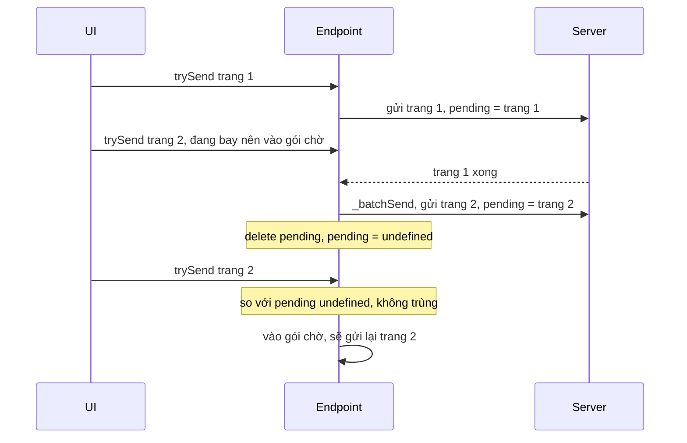

Trong một ứng dụng chat, người dùng bấm liên tục: lưu trữ năm cuộc trò chuyện liền nhau, đánh dấu đã đọc, mở thread rồi mở thread khác, kéo danh sách xuống. Mỗi thao tác là một lệnh gửi lên server. Gửi thẳng từng lệnh thì:

- "Lưu trữ thread 1", "lưu trữ thread 2"… thành năm request, trong khi server nhận được cả danh sách trong một lần.
- "Đánh dấu đã xem" bấm năm lần chỉ cần lần cuối cùng.
- "Tải danh sách thread trang 2" bấm hai lần (double click, effect chạy lại) thành hai request y hệt nhau.
- Lệnh lỗi vì mạng chập chờn thì mất luôn, trừ khi ai đó nhớ gửi lại.

Mỗi loại lệnh cần một cách gộp khác nhau. Messenger web gom chúng vào một chỗ: `MercuryServerDispatcher`.

> [!TIP]
> **Tóm tắt**
> - Mỗi endpoint đăng ký một **chế độ** và một hàm `batch_function` để trộn payload. Endpoint giữ số request đang bay, dữ liệu request đang bay, và tối đa một gói chờ.
> - Bảy chế độ: `IMMEDIATE`, `IDEMPOTENT` (đang bay thì bỏ), `BATCH_SUCCESSIVE` (đang bay thì gộp, xong mới gửi), `…_UNIQUE` (thêm bỏ trùng), `BATCH_CONDITIONAL` (gộp nếu hàm điều kiện cho phép), `BATCH_DEFERRED_MULTI` (gom cuối tick), `…_PIGGYBACK_ON_ERROR` (lỗi thì đi nhờ chuyến sau).
> - Bản gốc xoá "dữ liệu request đang bay" **sau** khi đã gửi gói chờ, nên xoá nhầm dữ liệu của request mới. Chế độ bỏ trùng thôi hoạt động đúng sau lần gộp đầu tiên.
> - Mang về: một hàm `createEndpoint({ mode, send, combine })` khoảng 100 dòng, thay cho debounce/throttle rải rác ở từng nút bấm.

<iframe class="demo-frame" src="/demos/facebook-patterns/index.html?theme=dark#/request-dispatcher" title="Demo request-dispatcher" loading="lazy" style="height: 980px"></iframe>

<p class="demo-links">▶ <a href="/demos/facebook-patterns/index.html#/request-dispatcher" target="_blank" rel="noopener">Mở demo toàn màn hình ↗</a> · <a href="https://stackblitz.com/github/hunghg255/blog-hunghg/tree/master/examples/facebook-patterns?file=src/lib/requestDispatcher.ts" target="_blank" rel="noopener">Sửa code trên StackBlitz ↗</a> · <a href="https://github.com/hunghg255/blog-hunghg/blob/master/examples/facebook-patterns/src/lib/requestDispatcher.ts" target="_blank" rel="noopener">Xem source trên GitHub ↗</a></p>

## Facebook làm thế nào?

`MercuryServerDispatcher` nằm trong bundle `55.js`. `MercuryServerRequests` đăng ký các endpoint một lần qua `registerEndpoints({ [uri]: { mode, batch_function, handler, … } })`. Một số cặp thật:

| Endpoint | Chế độ | `batch_function` |
|---|---|---|
| `MARK_SEEN` | `BATCH_SUCCESSIVE` | `(older, newer) => newer` |
| `CHANGE_ARCHIVED_STATUS`, `CHANGE_PINNED_STATUS` | `BATCH_SUCCESSIVE` | hợp các map `ids` |
| `MOVE_THREAD` | `BATCH_SUCCESSIVE` | gộp map thread → folder |
| `THREADLIST_INFO`, `UNREAD_THREADS` | `BATCH_SUCCESSIVE_UNIQUE` | trộn tham số trang |
| `THREAD_INFO` | `BATCH_DEFERRED_MULTI` | trộn danh sách thread |
| `DELETE_MESSAGES`, `DELIVERY_RECEIPTS`, `CHANGE_MUTE_THREAD` | `IMMEDIATE` | không |
 "Đã xem" giữ bản mới nhất (`(a, b) => b`). Lưu trữ thread trộn tập ID của các lệnh lại. Tải danh sách thread thì bỏ trùng. Tải thông tin thread gom mọi lệnh phát ra trong cùng một tick. Ba chế độ `IDEMPOTENT`, `BATCH_CONDITIONAL`, `BATCH_SUCCESSIVE_PIGGYBACK_ON_ERROR` có trong dispatcher nhưng mình không tìm thấy endpoint nào dùng chúng trong bản dump.

Endpoint được lưu theo ba tầng: URL → user ID → `endpoint_id`. Facebook cho một tab quản lý cả tài khoản cá nhân lẫn Page, nên cùng một URL có thể có nhiều hàng đợi riêng. Hàng đợi gửi tin ([bài #31](/blogs/facebook-ordered-send-queue)) cũng đăng ký qua đây, ở chế độ `IMMEDIATE`, với `endpoint_id` là ID hàng đợi.

### Một endpoint

Mỗi endpoint giữ `_mode`, `_combineData` (`batch_function`), `_combineDataIf` (`batch_if`), `_inFlight`, mảng `_batches` (thực tế tối đa 1 phần tử) và `_deferredSend = debounce(_batchSend, 0)`. Phần quyết định:

```js
trySend(data, mode = this._mode) {
  if (killedByServer) return;             // server trả kill_chat: tắt mọi request chat
  if (mode == IMMEDIATE) this._send(data);
  else if (mode == IDEMPOTENT) this._inFlight || this._send(data);
  else if (mode == BATCH_SUCCESSIVE || mode == BATCH_SUCCESSIVE_UNIQUE)
    this._inFlight ? this._batchData(data) : this._send(data);
  else if (mode == BATCH_CONDITIONAL) {
    const queued = this._batches[0]?.getData();
    this._inFlight && (this._combineDataIf(this._pendingRequestData, data) || this._combineDataIf(queued, data))
      ? this._batchData(data) : this._send(data);
  } else if (mode == BATCH_DEFERRED_MULTI) { this._batchData(data); this._deferredSend(); }
  else if (mode == BATCH_SUCCESSIVE_PIGGYBACK_ON_ERROR) { this._batchData(data); this._inFlight || this._batchSend(); }
}
```

`_batchData` trộn dữ liệu mới vào gói chờ cuối cùng bằng `combineWith` (hoặc `combineWithOlder` khi cần đặt dữ liệu cũ lên trước). Ở chế độ `_UNIQUE`, nó bỏ qua nếu dữ liệu mới giống hệt `_pendingRequestData`. Phép so sánh là `JSON.stringify(a) == JSON.stringify(b)` (module `areJSONRepresentationsEqual`), nên phụ thuộc thứ tự key.

### Khi request kết thúc

```js
_handleResponse(response) {
  this._inFlight--;
  killedByServer = response.getPayload()?.kill_chat;
  payload?.error_payload ? this._errorHandler?.(response) : this._handler?.(payload, request);
  if (mode is one of BATCH_SUCCESSIVE, _UNIQUE, _PIGGYBACK_ON_ERROR, BATCH_CONDITIONAL) this._batchSend();
  delete this._pendingRequestData;          // ← sau _batchSend
}

_postErrorHandler(error) {                  // lỗi mạng, lỗi server, timeout
  this._inFlight--;
  recentErrors.push(record(error)); recentErrors = recentErrors.slice(-50);
  if (mode is BATCH_SUCCESSIVE, _UNIQUE, BATCH_CONDITIONAL) this._batchSend();
  else if (mode == BATCH_SUCCESSIVE_PIGGYBACK_ON_ERROR) {
    this._batchData(this._pendingRequestData, /* older */ true);
    if (had a queued batch) this._batchSend();       // không thì nằm chờ lệnh kế tiếp
  }
  delete this._pendingRequestData;          // ← cũng sau _batchSend
}
```

Chế độ "piggyback" có một ý hay: lệnh lỗi không tự thử lại (có thể lỗi tiếp ngay), mà được trộn **trước** dữ liệu của lệnh kế tiếp và đi cùng chuyến đó. Mạng hỏng hẳn thì không có vòng retry nào chạy vô ích; người dùng thao tác tiếp thì lệnh cũ được gửi lại kèm.

Mọi lỗi được giữ trong một mảng 50 phần tử gần nhất (`getRequestErrors()`), có lẽ để đính kèm vào báo cáo lỗi.

## Lỗi: xoá nhầm dữ liệu request đang bay

Nhìn hai dòng cuối của `_handleResponse`: `_batchSend()` gọi `_send(gói chờ)`, mà `_send` đặt `this._pendingRequestData = gói chờ`. Ngay sau đó `delete this._pendingRequestData` xoá đúng giá trị vừa đặt. Request gói chờ đang bay mà endpoint "quên" nó chứa gì.

Hệ quả:

- **`BATCH_SUCCESSIVE_UNIQUE`**: chỉ bỏ trùng được với request đầu tiên của một chuỗi. Từ request thứ hai (gửi từ gói chờ) trở đi, yêu cầu trùng không còn bị bỏ. Demo: tải trang 1, xếp trang 2, trang 1 xong thì trang 2 đi, rồi yêu cầu trang 2 lần nữa. Kiểu Facebook gửi 3 request (trang 1, trang 2, trang 2), bản viết lại gửi 2.
- **`BATCH_CONDITIONAL`**: mất một nửa điều kiện so sánh với request đang bay.
- **`PIGGYBACK_ON_ERROR`**: nếu request đi từ gói chờ bị lỗi, `this._pendingRequestData` là `undefined`, và `undefined` bị trộn vào gói chờ.

Với endpoint thật đang dùng `_UNIQUE` (danh sách thread, thread chưa đọc), hậu quả chỉ là thỉnh thoảng có request thừa. Nhưng đây đúng loại lỗi khiến một cơ chế "bỏ trùng" trông như vẫn chạy trong test đơn giản và hỏng âm thầm trong thực tế.



## Viết lại

Phần quyết định theo chế độ:

```ts title=src/lib/requestDispatcher.ts
    trySend(data: D) {
      switch (mode) {
        case 'immediate':
          return doSend(data);
        case 'idempotent':
          if (inFlight) return onEvent({ type: 'skipped', data, reason: 'in-flight' });
          return doSend(data);
        case 'successive':
          return inFlight ? addToBatch(data) : doSend(data);
        case 'successiveUnique':
          if (!inFlight) return doSend(data);
          if (pending !== undefined && isEqual(pending, data)) {
            return onEvent({ type: 'skipped', data, reason: 'duplicate' });
          }
          return addToBatch(data);
        case 'conditional':
          if (inFlight && ((pending !== undefined && combineIf(pending, data)) || (batch && combineIf(batch.data, data)))) {
            return addToBatch(data);
          }
          return doSend(data);
        case 'deferredMulti':
          addToBatch(data);
          clearTimeout(deferTimer);
          deferTimer = setTimeout(flushBatch, 0);
          return;
        case 'piggyback':
          addToBatch(data);
          if (!inFlight) flushBatch();
          return;
      }
    },
```

Phần kết thúc request, xoá `pending` của **request vừa xong** trước khi gửi gói chờ:

```ts title=src/lib/requestDispatcher.ts
  function finish(data: D, failed: boolean) {
    inFlight--;
    onEvent({ type: failed ? 'error' : 'done', data });
    // Xoá pending của request VỪA XONG trước khi gửi gói kế tiếp.
    // Bản gốc làm ngược lại (gửi gói chờ rồi mới delete), nên xoá mất pending của request mới.
    if (!legacyClearPendingAfterFlush && pending === data) pending = undefined;
    if (failed && mode === 'piggyback') {
      // dữ liệu lỗi được xếp trước dữ liệu mới; có sẵn gói chờ thì gửi luôn,
      // không thì đợi lệnh kế tiếp rồi đi nhờ chuyến đó
      const hadBatch = batch !== undefined;
      addToBatch(data, true);
      if (hadBatch) flushBatch();
    } else if (mode === 'successive' || mode === 'successiveUnique' || mode === 'conditional' || mode === 'piggyback') {
      flushBatch();
    }
    if (legacyClearPendingAfterFlush) pending = undefined;
  }
```

::: spoiler Xem toàn bộ src/lib/requestDispatcher.ts

```ts title=src/lib/requestDispatcher.ts
/**
 * Bộ điều phối request theo endpoint với nhiều chế độ gộp / chống trùng
 * (ý tưởng từ MercuryServerDispatcher của Messenger web).
 *
 * Mỗi endpoint có: số request đang bay, dữ liệu của request đang bay (pending),
 * và tối đa MỘT gói chờ (batch) được trộn dần bằng hàm combine.
 *
 *  immediate        luôn gửi ngay
 *  idempotent       đang có request bay thì bỏ qua (lệnh lặp lại vô nghĩa)
 *  successive       đang bay thì gộp vào gói chờ, xong request cũ mới gửi gói chờ
 *  successiveUnique như successive nhưng bỏ dữ liệu y hệt request đang bay
 *  conditional      chỉ gộp khi combineIf cho phép, không thì gửi riêng ngay
 *  deferredMulti    luôn gộp, gửi ở cuối tick (gom mọi lệnh phát ra cùng lúc)
 *  piggyback        gộp; lỗi thì dữ liệu lỗi đi nhờ chuyến kế tiếp
 */

export type DispatchMode =
  | 'immediate'
  | 'idempotent'
  | 'successive'
  | 'successiveUnique'
  | 'conditional'
  | 'deferredMulti'
  | 'piggyback';

export interface EndpointConfig<D> {
  mode: DispatchMode;
  send: (data: D) => Promise<void>;
  /** trộn dữ liệu mới vào gói chờ: combine(cũ, mới) */
  combine?: (older: D, newer: D) => D;
  /** chế độ conditional: có được gộp `next` vào `current` không */
  combineIf?: (current: D, next: D) => boolean;
  /** so dữ liệu trùng cho successiveUnique (mặc định so JSON với key đã sắp) */
  isEqual?: (a: D, b: D) => boolean;
  onEvent?: (event: DispatchEvent<D>) => void;
  /** CHỈ để demo tái hiện lỗi của bản gốc: xoá pending SAU khi đã gửi gói chờ */
  legacyClearPendingAfterFlush?: boolean;
}

export type DispatchEvent<D> =
  | { type: 'send'; data: D }
  | { type: 'queued'; data: D }
  | { type: 'skipped'; data: D; reason: 'in-flight' | 'duplicate' }
  | { type: 'done'; data: D }
  | { type: 'error'; data: D };

/** JSON có sắp key, để {a,b} và {b,a} được coi là bằng nhau (bản gốc so JSON.stringify thô). */
export function stableJson(value: unknown): string {
  return JSON.stringify(value, (_key, v) =>
    v && typeof v === 'object' && !Array.isArray(v)
      ? Object.fromEntries(Object.keys(v).sort().map((k) => [k, (v as Record<string, unknown>)[k]]))
      : v,
  );
}

const defaultCombine = <D>(_older: D, newer: D) => newer;

export function createEndpoint<D>(config: EndpointConfig<D>) {
  const {
    mode,
    send,
    combine = defaultCombine,
    combineIf = () => true,
    isEqual = (a, b) => stableJson(a) === stableJson(b),
    onEvent = () => {},
    legacyClearPendingAfterFlush = false,
  } = config;
  let inFlight = 0;
  let pending: D | undefined;
  let batch: { data: D } | undefined;
  let deferTimer: ReturnType<typeof setTimeout> | undefined;

  function addToBatch(data: D, asOlder = false) {
    if (!batch) batch = { data };
    else batch.data = asOlder ? combine(data, batch.data) : combine(batch.data, data);
    onEvent({ type: 'queued', data });
  }

  function flushBatch() {
    if (!batch) return;
    const { data } = batch;
    batch = undefined;
    doSend(data);
  }

  function doSend(data: D) {
    inFlight++;
    pending = data;
    onEvent({ type: 'send', data });
    send(data).then(
      () => finish(data, false),
      () => finish(data, true),
    );
  }

  function finish(data: D, failed: boolean) {
    inFlight--;
    onEvent({ type: failed ? 'error' : 'done', data });
    // Xoá pending của request VỪA XONG trước khi gửi gói kế tiếp.
    // Bản gốc làm ngược lại (gửi gói chờ rồi mới delete), nên xoá mất pending của request mới.
    if (!legacyClearPendingAfterFlush && pending === data) pending = undefined;
    if (failed && mode === 'piggyback') {
      // dữ liệu lỗi được xếp trước dữ liệu mới; có sẵn gói chờ thì gửi luôn,
      // không thì đợi lệnh kế tiếp rồi đi nhờ chuyến đó
      const hadBatch = batch !== undefined;
      addToBatch(data, true);
      if (hadBatch) flushBatch();
    } else if (mode === 'successive' || mode === 'successiveUnique' || mode === 'conditional' || mode === 'piggyback') {
      flushBatch();
    }
    if (legacyClearPendingAfterFlush) pending = undefined;
  }

  return {
    trySend(data: D) {
      switch (mode) {
        case 'immediate':
          return doSend(data);
        case 'idempotent':
          if (inFlight) return onEvent({ type: 'skipped', data, reason: 'in-flight' });
          return doSend(data);
        case 'successive':
          return inFlight ? addToBatch(data) : doSend(data);
        case 'successiveUnique':
          if (!inFlight) return doSend(data);
          if (pending !== undefined && isEqual(pending, data)) {
            return onEvent({ type: 'skipped', data, reason: 'duplicate' });
          }
          return addToBatch(data);
        case 'conditional':
          if (inFlight && ((pending !== undefined && combineIf(pending, data)) || (batch && combineIf(batch.data, data)))) {
            return addToBatch(data);
          }
          return doSend(data);
        case 'deferredMulti':
          addToBatch(data);
          clearTimeout(deferTimer);
          deferTimer = setTimeout(flushBatch, 0);
          return;
        case 'piggyback':
          addToBatch(data);
          if (!inFlight) flushBatch();
          return;
      }
    },
    get inFlight() {
      return inFlight;
    },
    get hasBatch() {
      return batch !== undefined;
    },
  };
}

export type Endpoint<D> = ReturnType<typeof createEndpoint<D>>;
```

:::

**Khác bản gốc:**

- Xoá `pending` đúng lúc.
- So trùng bằng JSON đã sắp key (`stableJson`).
- Trả `Promise` thay cho callback.
- Không có killswitch, sổ lỗi, hay đường riêng cho GraphQL (bản gốc có nhánh đặc biệt cho `THREADLIST_INFO`/`THREAD_INFO` chuyển request sang các fetcher GraphQL).
- Cờ `legacyClearPendingAfterFlush` chỉ để demo và test tái hiện lỗi.

## Đi qua code

- **Một gói chờ duy nhất**: dữ liệu tới khi đang có request bay được trộn vào gói đó bằng `combine(cũ, mới)`. Chỉ khi request bay xong mới gửi gói chờ. Kết quả là luôn có tối đa một request đang bay và một gói chờ cho mỗi endpoint (trừ `immediate`).
- **`deferredMulti`** dùng `setTimeout(flush, 0)` đặt lại ở mỗi lệnh, giống `debounce(_, 0)` của bản gốc. Sáu lệnh trong cùng một tick thành một request. Cách nhau 70ms thì thành sáu request, đúng như bảng trong demo.
- **`conditional`** chỉ gộp khi `combineIf` trả `true` với request đang bay hoặc gói chờ. Demo dùng điều kiện "cùng folder": lệnh `inbox:t4` chen giữa các lệnh `archive` được gửi riêng ngay.
- **`piggyback`** khi lỗi: dữ liệu lỗi được trộn **trước** dữ liệu mới (`asOlder`). Bật "request đầu lỗi 500" trong demo: chuyến sau mang `archive:t1+t2+t3+t4+t5`.

## Tại sao không làm cách khác?

- **Debounce ở từng nút bấm**: mỗi nơi tự quyết khoảng chờ, không biết request trước đã xong chưa, và không trộn được payload của hai nơi khác nhau cùng gọi một endpoint. Dispatcher đặt quyết định ở cấp endpoint, nơi biết rõ ngữ nghĩa.
- **Throttle theo thời gian**: gửi đều đặn kể cả khi server đang chậm. Chế độ "successive" tự điều tiết theo tốc độ server: server chậm thì gói chờ lớn hơn, số request ít đi.
- **Hàng đợi tuần tự gửi từng lệnh**: đúng thứ tự nhưng chậm nhất. Chỉ cần cho lệnh mà thứ tự và từng lệnh đều quan trọng (gửi tin nhắn); với "đánh dấu đã xem" thì lãng phí.
- **Gộp ở server** (ví dụ GraphQL batching): giảm số kết nối nhưng không bỏ được lệnh vô nghĩa (năm lần "đã xem"). Hai cách bổ sung cho nhau.

## Edge case và cạm bẫy

- **Hàm `combine` phải giữ ngữ nghĩa**: "đã xem tới T" thì giữ bản mới nhất; "lưu trữ các ID" thì hợp tập; "chuyển thread sang folder" thì thread nào xuất hiện nhiều lần phải lấy folder **cuối cùng**. Bản gốc `mergeFolders` dựng map thread → folder rồi đảo lại, nên lệnh sau đè lệnh trước.
- **Lỗi của gói đã gộp** ảnh hưởng tới mọi lệnh trong gói. Nếu UI hiện trạng thái từng lệnh, phải trải lỗi ra cho từng phần.
- **So trùng bằng `JSON.stringify` thô** phụ thuộc thứ tự key: `{a, b}` và `{b, a}` bị coi là khác.
- **`IDEMPOTENT` bỏ lệnh khi đang bay**: chỉ dùng khi lệnh sau không mang thông tin mới. "Đã xem tới T2" sau "đã xem tới T1" thì mang thông tin mới; vì thế Messenger dùng `BATCH_SUCCESSIVE` + "giữ bản mới nhất" cho `MARK_SEEN`, không dùng `IDEMPOTENT`.
- **Killswitch**: bản gốc có cờ toàn cục `kill_chat`. Biến này được gán lại sau **mỗi** response, nên một response mang cờ sẽ làm mọi `trySend` sau đó bị bỏ. Vì không còn request mới nào được gửi, chỉ response của request còn đang bay dở mới có thể tắt cờ; nếu không có thì phải tải lại trang. Hữu ích khi server quá tải, nhưng nên có đường bật lại rõ ràng.

## Dùng trong dự án

```ts
import { createEndpoint } from './requestDispatcher';

const markSeen = createEndpoint<{ threadId: string; seenAt: number }>({
  mode: 'successive',
  combine: (_older, newer) => newer, // chỉ cần mốc mới nhất
  send: (d) => api.post('/threads/seen', d),
});

const archive = createEndpoint<{ ids: string[] }>({
  mode: 'successive',
  combine: (a, b) => ({ ids: [...new Set([...a.ids, ...b.ids])] }),
  send: (d) => api.post('/threads/archive', d),
});

const syncSettings = createEndpoint<Partial<Settings>>({
  mode: 'piggyback',
  combine: (older, newer) => ({ ...older, ...newer }), // lệnh mới đè lệnh cũ cùng key
  send: (d) => api.patch('/settings', d),
});
```

## Kiểm thử

::: spoiler Ví dụ test (bản phác, không có trong repo)

```ts
import { afterEach, beforeEach, describe, expect, it, vi } from 'vitest';
import { createEndpoint, type DispatchMode } from './requestDispatcher';

type P = { ids: string[] };
const combine = (a: P, b: P): P => ({ ids: [...a.ids, ...b.ids] });

function setup(mode: DispatchMode, extra: { fail?: (n: number) => boolean; legacy?: boolean } = {}) {
  const sent: string[] = [];
  let n = 0;
  const ep = createEndpoint<P>({
    mode,
    combine,
    combineIf: (a, b) => a.ids[0][0] === b.ids[0][0],
    legacyClearPendingAfterFlush: extra.legacy,
    send: (d) =>
      new Promise((resolve, reject) => {
        const i = ++n;
        sent.push(d.ids.join('+'));
        setTimeout(() => (extra.fail?.(i) ? reject(new Error('500')) : resolve()), 100);
      }),
  });
  return { ep, sent };
}

describe('createEndpoint', () => {
  beforeEach(() => vi.useFakeTimers());
  afterEach(() => vi.useRealTimers());

  it('successive: đang bay thì gộp, xong mới gửi gói chờ', async () => {
    const { ep, sent } = setup('successive');
    ['a', 'b', 'c'].forEach((x) => ep.trySend({ ids: [x] }));
    await vi.runAllTimersAsync();
    expect(sent).toEqual(['a', 'b+c']);
  });

  it('deferredMulti: gom mọi lệnh trong cùng tick thành một request', async () => {
    const { ep, sent } = setup('deferredMulti');
    ['a', 'b', 'c'].forEach((x) => ep.trySend({ ids: [x] }));
    await vi.runAllTimersAsync();
    expect(sent).toEqual(['a+b+c']);
  });

  it('conditional: chỉ gộp khi combineIf cho phép', async () => {
    const { ep, sent } = setup('conditional');
    ['a1', 'a2', 'b1'].forEach((x) => ep.trySend({ ids: [x] }));
    await vi.runAllTimersAsync();
    expect(sent).toEqual(['a1', 'b1', 'a2']);
  });

  it('piggyback: dữ liệu lỗi đi cùng chuyến sau, đứng trước dữ liệu mới', async () => {
    const { ep, sent } = setup('piggyback', { fail: (n) => n === 1 });
    ep.trySend({ ids: ['a'] });
    await vi.advanceTimersByTimeAsync(150);
    ep.trySend({ ids: ['b'] });
    await vi.runAllTimersAsync();
    expect(sent).toEqual(['a', 'a+b']);
  });

  it('successiveUnique: bỏ yêu cầu trùng request đang bay, kể cả request vừa đi từ gói chờ', async () => {
    for (const legacy of [true, false]) {
      const { ep, sent } = setup('successiveUnique', { legacy });
      ep.trySend({ ids: ['p1'] });
      ep.trySend({ ids: ['p2'] });
      await vi.advanceTimersByTimeAsync(120); // p1 xong → p2 bay
      ep.trySend({ ids: ['p2'] });
      await vi.runAllTimersAsync();
      expect(sent).toEqual(legacy ? ['p1', 'p2', 'p2'] : ['p1', 'p2']);
    }
  });
});
```

:::

## So với thư viện và chuẩn web

- **TanStack Query / SWR** bỏ trùng request **đọc** cùng khoá (dedupe khi đang bay), gần với `successiveUnique` cho GET. Với mutation, chúng không gộp; có `scope` để xếp mutation chạy tuần tự (TanStack Query v5), gần với `successive` nhưng không trộn payload.
- **DataLoader** gom theo tick như `deferredMulti`, dành cho đọc theo khoá; xem [bài #32](/blogs/facebook-api-batcher) về `ApiBatcher`, một biến thể của Facebook cho Graph API.
- **Background Sync** (service worker, `sync` event) cho phép thử lại request khi có mạng, kể cả sau khi đóng tab. Chỉ có trên trình duyệt dựa Chromium (tính tới 10/2026); không trộn payload.
- Không có API trình duyệt nào làm thay phần "gộp theo ngữ nghĩa endpoint". Đó là kiến thức nghiệp vụ, nên nó nằm trong code của bạn.

---

Bài này thuộc series **[Học từ mã nguồn Facebook](/series/facebook)** (83 bài, đọc theo thứ tự).

::: spoiler Xem nhanh danh sách bài trong series

*Phần 1*

- [Mở đầu: cách đọc code minify của Facebook](/blogs/learn-from-facebook-source-code)
- [#1 Dùng chung IntersectionObserver + infinite scroll](/blogs/facebook-shared-intersection-observer)
- [#2 useViewportDuration: đo thời gian thực sự được xem](/blogs/facebook-use-viewport-duration)
- [#3 Preload code + data khi hover](/blogs/facebook-preload-on-hover)
- [#4 Toast manager với external store](/blogs/facebook-toast-manager)
- [#5 Network status + heartbeat backoff](/blogs/facebook-network-status-heartbeat)
- [#6 ErrorGuard: bắt lỗi theo ngữ cảnh](/blogs/facebook-error-guard)
- [#7 Banzai: gom log theo lô + sendBeacon](/blogs/facebook-batch-logger)
- [#8 Focus trap + Esc theo layer](/blogs/facebook-focus-trap)

*Phần 2*

- [#9 Mẹo calc(… * 9999): container query, line-clamp, mũi tên carousel bằng CSS](/blogs/facebook-css-9999-trick)
- [#10 Thanh cuộn tuỳ biến bằng CSS 3D](/blogs/facebook-css-3d-scrollbar)
- [#11 Modal cuộn bằng window, giữ vị trí trang nền](/blogs/facebook-document-scroll-modal)
- [#12 Popover, tooltip group và hovercard](/blogs/facebook-popover-tooltip)
- [#13 Primitive Pressable + focus-visible](/blogs/facebook-pressable)
- [#14 Tab "Xem thêm" + sticky header bằng IntersectionObserver](/blogs/facebook-priority-tabs-sticky-header)
- [#15 Avatar khoét mask, gradient Messenger, skeleton steps()](/blogs/facebook-visual-tricks)
- [#16 Khung chat không giật](/blogs/facebook-chat-scroller)
- [#17 Thuật toán chọn bố cục collage ảnh](/blogs/facebook-photo-collage-layout)
- [#18 Keep-alive tab trong SPA](/blogs/facebook-keep-alive-tabs)
- [#19 Tự đo Visual Completion & interaction tracing](/blogs/facebook-visual-completion)
- [#20 Router SPA bền bỉ & tải chunk có retry](/blogs/facebook-spa-router-resilient-loading)

*Phần 3*

- [#21 Smart Compose: gợi ý chữ mờ khi gõ](/blogs/facebook-smart-compose-ghost-text)
- [#22 MQTT ngay trong trình duyệt, tự chuyển sang long-poll](/blogs/facebook-mqtt-in-browser)
- [#23 Đo thời gian dùng bằng bitmap 64 giây](/blogs/facebook-time-spent-bitmap)
- [#24 Bảng reaction nhấn giữ rồi trượt](/blogs/facebook-reaction-press-slide)
- [#25 Tìm kiếm gấp dấu, phiên âm và highlight đầu từ](/blogs/facebook-search-diacritics-tokenize)
- [#26 Ring buffer biết trace nào đã mất log](/blogs/facebook-trace-ring-buffer)
- [#27 Engine animation JS: một vòng rAF và solver cubic-bezier](/blogs/facebook-keyframes-loop-cubic-bezier)
- [#28 Bootloader: bitmap tài nguyên đã tải, chỉ reload khi cần](/blogs/facebook-bootloader-bitmap-consistency)
- [#29 Nhận biết click do screen reader tạo ra](/blogs/facebook-virtual-cursor-detection)
- [#30 Tải trước feed theo chất lượng mạng, đoán hạng thiết bị](/blogs/facebook-network-aware-prefetch)
- [#31 Hàng đợi gửi tin chat giữ đúng thứ tự](/blogs/facebook-ordered-send-queue)
- [#32 Gộp lời gọi API trong cùng một tick](/blogs/facebook-api-batcher)
- [#33 Resize ảnh trong pool Web Worker](/blogs/facebook-jpeg-resize-worker-pool)
- [#34 Crop ảnh theo nhiều khuôn mặt](/blogs/facebook-face-aware-crop)
- [#35 Kéo-thả sắp xếp và vùng thả file không nhấp nháy](/blogs/facebook-flicker-free-drag-drop)
- [#36 Tiện ích UI: fade-out, sticky event, hàm huỷ được](/blogs/facebook-ui-utility-hooks)
- [#37 Hạ tầng nhỏ: cookie, hash lỗi, prefetch khi chuột dừng](/blogs/facebook-small-infra-cookie-hash-idle)

*Phần 4–6*

- [#38 Đồng bộ tin nhắn: phát hiện lỗ seqID và fetch bù theo tầng](/blogs/facebook-messenger-sync-seqid-gaps)
- [#39 OTID: ID tin nhắn kiểu Snowflake sinh ở client](/blogs/facebook-otid-client-snowflake)
- [#40 QPL: lấy mẫu từ lúc bắt đầu, đo RTT gửi tin đầu-cuối](/blogs/facebook-qpl-send-rtt)
- **#41 Bộ điều phối request bảy chế độ gộp và chống trùng** (bài này)
- [#42 Thread list theo mốc thời gian, cookie presence có version](/blogs/facebook-threadlist-ranged-presence)
- [#43 Composer dạng plugin: reducer, dirty checker, chuỗi kiểm tra](/blogs/facebook-plugin-composer)
- [#44 Thanh toán bất đồng bộ: subscribe trước, poll dự phòng](/blogs/facebook-async-checkout)
- [#45 Validate số thẻ: sửa lỗi gõ, dải BIN, Luhn](/blogs/facebook-card-validation)
- [#46 Lịch chọn khoảng ngày: bo góc dải chọn, phím đủ bộ, RTL](/blogs/facebook-range-calendar-a11y)
- [#47 Giờ mở cửa theo tuần: qua đêm, gộp khoảng, phần bù](/blogs/facebook-weekly-hours-intervals)
- [#48 Tiến độ đăng realtime: giữ event chờ snapshot, watchdog](/blogs/facebook-realtime-publish-snapshot)
- [#49 Tiền tệ theo đơn vị nhỏ nhất và ô nhập tiền](/blogs/facebook-currency-minor-units)
- [#50 Sửa hàng loạt Empty/Uniform/Mixed, seen/read bằng 2 bit](/blogs/facebook-bulk-edit-seen-bits)
- [#51 Phát hiện script lạ hook vào hàm native](/blogs/facebook-native-hook-detection)
- [#52 localStorage tự dọn khi đầy quota](/blogs/facebook-quota-aware-storage)
- [#53 Cache tuyến do server phân giải, chờ sẵn promise](/blogs/facebook-route-cache-prefetch)
- [#54 Lưới phím mũi tên 2D và focus không làm cuộn trang](/blogs/facebook-focus-table-grid)
- [#55 Tách emoji bằng máy trạng thái](/blogs/facebook-emoji-segmentation)
- [#56 Đọc trước ghi sau trong một frame, con tự biết vị trí](/blogs/facebook-read-then-write-dom)
- [#57 Hàng đợi lệnh cho video và stream sắp lại chunk](/blogs/facebook-video-command-queue)

*Phần 7–10*

- [#58 Ước lượng băng thông EWMA: loại outlier, nhớ qua phiên](/blogs/facebook-bandwidth-ewma-estimator)
- [#59 ABR theo độ tự tin phát và cắt bậc bitrate theo MOS](/blogs/facebook-abr-playback-confidence)
- [#60 Prefetch segment dự đoán từ manifest, parse hộp sidx](/blogs/facebook-dash-predicted-segments)
- [#61 Đọc metadata MP4/MOV ngay trên client](/blogs/facebook-mp4-metadata-client)
- [#62 Upload tiếp tục được: offset, hash dedupe, phát hiện treo](/blogs/facebook-resumable-upload)
- [#63 Fenwick tree: chọn ngẫu nhiên có trọng số và offset dòng](/blogs/facebook-fenwick-weighted-random)
- [#64 Vạch trục số và trục thời gian "đẹp"](/blogs/facebook-nice-axis-ticks)
- [#65 Damerau-Levenshtein theo dải chéo và tự sửa tên gõ sai](/blogs/facebook-damerau-levenshtein)
- [#66 PRNG có seed, shuffle tái lập và lấy mẫu trace](/blogs/facebook-seeded-prng-sampling)
- [#67 Cặp min/max-heap tái dùng vị trí trong danh sách ảo](/blogs/facebook-dual-heap-buffer-set)
- [#68 Memo nhiều đối số bằng Map/WeakMap và interning object](/blogs/facebook-multikey-memo-interning)
- [#69 Thống kê cửa sổ trượt và đại số khoảng thời gian](/blogs/facebook-moving-stat-intervals)
- [#70 Int64 từ hai số 32-bit, decode UTF, offset theo code point](/blogs/facebook-int64-utf-codepoints)
- [#71 Engine múi giờ IANA trên client, phát hiện lệch giờ](/blogs/facebook-client-iana-timezone)
- [#72 Tự cài semver range](/blogs/facebook-semver-range)
- [#73 Auto-link URL, cắt chữ an toàn, giới hạn LaTeX](/blogs/facebook-autolink-safe-truncate)
- [#74 Parser query kiểu PHP chống prototype pollution](/blogs/facebook-php-query-serializer)
- [#75 Popover tự lật theo phần tràn nhỏ nhất](/blogs/facebook-popover-auto-flip)
- [#76 Tiền tố for(;;) chống JSON hijacking, đọc stream](/blogs/facebook-csrf-prefix-streaming)
- [#77 Chống lộ Referer, linkshim, xoá token trên URL](/blogs/facebook-referrer-linkshim-url-scrub)
- [#78 setImmediate bằng postMessage, gom delta chuột theo frame](/blogs/facebook-setimmediate-mouse-batching)
- [#79 Phát hiện crash qua heartbeat, dò proxy cache hỏng](/blogs/facebook-crash-heartbeat-proxy-check)
- [#80 DPR vào cookie cho ảnh @2x, che khoá trong log](/blogs/facebook-dpr-cookie-secret-redaction)
- [#81 Flux waitFor tự viết và proxy có đệm](/blogs/facebook-flux-dispatch-buffered-proxy)
- [#82 Crop đúng tỉ lệ, xoay sticker bằng ma trận](/blogs/facebook-image-crop-rotation-geometry)

:::

Code + demo: [`examples/facebook-patterns`](https://github.com/hunghg255/blog-hunghg/tree/master/examples/facebook-patterns) · [Mở trên StackBlitz](https://stackblitz.com/github/hunghg255/blog-hunghg/tree/master/examples/facebook-patterns)
