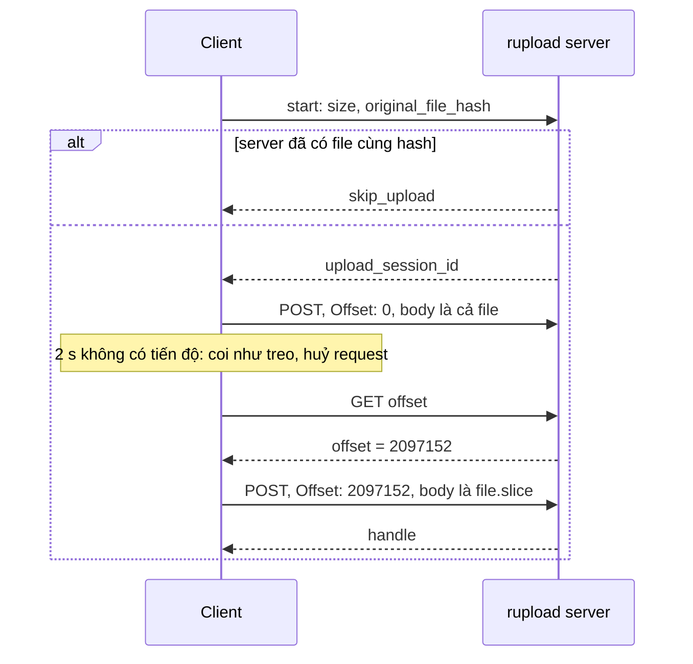

Upload một video 500 MB qua mạng di động mất vài phút. Trong vài phút đó, người dùng đi vào thang máy, điện thoại chuyển từ Wi-Fi sang 4G, hoặc trình duyệt tạm dừng tab ở nền. Nếu mỗi lần như vậy upload phải bắt đầu lại từ byte 0, video lớn gần như không bao giờ lên được.

[Bài #61](/blogs/facebook-mp4-metadata-client) kiểm tra file trước khi gửi. Bài này đi theo file lúc nó đang được gửi, qua ba module trong bundle upload video của Facebook.

> [!TIP]
> **Tóm tắt**
> - `ResumableUploadService` nói chuyện với `rupload.facebook.com` theo giao thức hai bước: **GET** để hỏi server đã nhận bao nhiêu byte, **POST** phần còn lại (`file.slice(offset)`) kèm header `Offset`. Mất kết nối thì chỉ gửi lại phần chưa tới.
> - Trước khi bắt đầu, file nhỏ được **băm trong Web Worker** và gửi kèm `original_file_hash`. Server đã có file giống hệt thì trả `skip_upload`, không cần gửi byte nào.
> - `VideoUploadConnectionMonitor` coi upload là **treo** khi 2 giây không có sự kiện tiến độ, thay vì tin sự kiện `offline` của trình duyệt.
> - Bản gốc có thể phát sự kiện `FAIL` hai lần cho một lần lỗi, và thử lại theo luỹ thừa không có jitter. Bản viết lại kết thúc đúng một lần, đếm lỗi liên tiếp thay vì tổng số lỗi, và thêm jitter.

<iframe class="demo-frame" src="/demos/facebook-patterns/index.html?theme=dark#/resumable-upload" title="Demo resumable-upload" loading="lazy" style="height: 900px"></iframe>

<p class="demo-links">▶ <a href="/demos/facebook-patterns/index.html#/resumable-upload" target="_blank" rel="noopener">Mở demo toàn màn hình ↗</a> · <a href="https://stackblitz.com/github/hunghg255/blog-hunghg/tree/master/examples/facebook-patterns?file=src/lib/resumableUpload.ts" target="_blank" rel="noopener">Sửa code trên StackBlitz ↗</a> · <a href="https://github.com/hunghg255/blog-hunghg/blob/master/examples/facebook-patterns/src/lib/resumableUpload.ts" target="_blank" rel="noopener">Xem source trên GitHub ↗</a></p>

## Facebook làm thế nào?

Các module nằm trong bundle `177.js`.

### Giao thức rupload: GET offset, POST phần còn lại

`ResumableUploadService` dựng URL theo dạng `https://<service>.<domain>/<consumer>/<sessionKey>`, mặc định `rupload.facebook.com`, với `sessionKey` là một UUID sinh ở client. Hàm `resume(file)`, đổi tên biến:

```js
resume(file) {
  const uri = new URI(`https://${this.serviceName}.${this.serviceDomain}/${this.consumer}/${this.sessionKey}`);
  const fetchOffset = () => new Promise((resolve, reject) => {
    new AsyncRequest().setAllowCrossOrigin(true).setAllowCredentials(true)
      .setMethod('GET').setURI(uri).setHandler(resolve).setErrorHandler(reject)
      .setTransportErrorHandler((e) => this.emit(TRANSPORT_FAILURE, e, { method: 'GET' }))
      .send();
  });
  const upload = (res) => new Promise((resolve, reject) => {
    const offset = res !== undefined ? JSON.parse(res.payload.response).offset : 0;
    this.emit(START, { offset });
    this.uploadAsyncRequest = new AsyncRequest().setURI(uri)
      .setRawData(file.slice(offset))
      .setRequestHeader('X-Entity-Name', encodeURIComponent(file.name))
      .setRequestHeader('X-Entity-Type', file.type)
      .setRequestHeader('X-Entity-Length', String(file.size))
      .setRequestHeader('Offset', String(offset))
      .setUploadProgressHandler((e) =>
        this.emit(PROGRESS, new ProgressEvent('upload-service', { total: file.size, loaded: e.loaded + Number(offset) })))
      .setHandler(resolve).setErrorHandler(reject)
      .send();
  });
  const onDone = (res) => res != null ? this.emit(SUCCESS, JSON.parse(res.payload.response).h ?? …)
                                      : this.emit(FAIL, 'uploading failed');
  const onFail = (e) => this.emit(FAIL, e);
  return (this.skipOffsetFetching ? Promise.resolve() : fetchOffset()).then(upload, onFail).then(onDone, onFail);
}
```

Ba điểm đáng học:

- **Server là nguồn sự thật về offset.** Client không tự nhớ "đã gửi tới đâu", vì byte được gửi chưa chắc đã tới, và byte đã tới chưa chắc được ghi xuống đĩa. Hỏi lại server sau mỗi lần đứt kết nối là cách duy nhất chắc chắn.
- **Tiến độ được cộng thêm offset**, nên thanh tiến độ không nhảy về 0 khi tiếp tục.
- **Phân vùng file.** Khi có `receiveParameters`, request mang thêm `start_offset`, `end_offset`, `X-FB-Region`, `X-Total-Asset-Size`. Server có thể chia file lớn thành nhiều phần và chỉ định từng phần đi tới vùng máy chủ nào.

**Lỗi ở dòng cuối.** `.then(upload, onFail).then(onDone, onFail)`: nếu GET offset thất bại, `onFail` phát `FAIL` rồi trả về giá trị của `emit` (không phải một promise bị reject). Promise kế tiếp vì thế **resolve**, `onDone` được gọi với `res` là giá trị đó, không có `payload`, và tuỳ giá trị mà hoặc phát `FAIL` lần hai với chuỗi "uploading failed", hoặc ném lỗi khi đọc `payload`. Ai nghe `FAIL` để hiện thông báo hay đếm lỗi sẽ thấy hai lần. Cách sửa là chỉ bắt lỗi một lần ở cuối chuỗi: `.then(upload).then(onDone).catch(onFail)`.

### Băm file để bỏ qua video đã có

`VideoUploadStartRequestManager` gửi request "bắt đầu upload" để server tạo phiên. Trước đó, nếu được bật và file nhỏ hơn một ngưỡng, nó băm file:

```js
sendRequest(ctx) {
  if (this.hasher || this.request) return;
  const file = ctx.getFile().getFile();
  if (this.hashEnabled && file && file.size < this.hashMaxSize && FileHasher.isSupported()) {
    this.hashStart = performanceNow();
    this.hasher = new FileHasher();              // chạy trong Web Worker
    this.hasher.hash(file, ({ hash, exception }) => {
      this.hashTime = performanceNow() - this.hashStart;
      this.hash = hash;
      this.hasher.destroy(); this.hasher = null;
      if (!hash) this.hashException = exception;   // băm hỏng vẫn upload bình thường
      this.send();
    });
  } else this.send();
}
```

Request gửi đi có `file_size`, `file_extension`, `supports_chunking`, `partition_start_offset`, `partition_end_offset`, `spherical_metadata` và `original_file_hash`. Response có `video_id`, `upload_session_id`, `start_offset`, `end_offset`, `region_hint` và **`skip_upload`**: server đã có file với hash này (người dùng đăng lại cùng một video, hoặc lần trước upload xong nhưng bước đăng bài hỏng) thì không cần gửi lại byte nào. `FileHasher` chạy trong Web Worker để không chặn giao diện; thuật toán băm nằm trong worker resource không có trong bundle.

### Thử lại: lỗi server và lỗi đường truyền tách riêng

```js
backoff(base, attempt, cap) {
  let ms = Math.pow(base, attempt) * 1000;
  if (cap > 0) ms = Math.min(ms, cap);
  return ms;
}
onServerError(err) {
  this.transportRetries = 0;
  if (err.isTransient() && this.serverRetries < this.maxServerRetries)
    this.retryAfter(this.backoff(this.serverBase, ++this.serverRetries));      // không truyền cap
  else this.fail(err);
}
onTransportError(err) {
  if (this.maxTransportRetries === 0 || this.transportRetries >= this.maxTransportRetries) return this.fail(err);
  this.retryAfter(this.backoff(this.transportBase, ++this.transportRetries, this.transportCap));
}
```

Hai loại lỗi có bộ đếm và hệ số riêng: lỗi đường truyền (mất mạng) thường hết sau vài giây nên thử lại nhanh và có trần; lỗi server chỉ thử lại khi server nói lỗi là tạm thời (`isTransient`). Nhánh lỗi server không truyền trần, nên với hệ số 2, lần thứ 10 chờ 1024 giây. Cả hai nhánh đều **không có jitter (độ ngẫu nhiên)**: khi một sự cố làm hàng nghìn client lỗi cùng lúc, chúng cũng thử lại cùng lúc, đúng thời điểm server đang hồi phục. Ngoài nhánh này còn một đường mới hơn: nếu ngữ cảnh upload có đối tượng `retryState` thì cả hai loại lỗi đi qua `retryState.handleRetry(...)`, và request thành công gọi `resetDelay()`; phần cài đặt của `retryState` không nằm trong module này.

### Phát hiện upload treo

Kiểu hỏng khó chịu nhất không phải lỗi mà là **treo**: request vẫn mở, không lỗi, nhưng không byte nào đi. Điện thoại vừa vào vùng sóng yếu, hoặc NAT của nhà mạng xoá kết nối mà không báo. Trình duyệt có thể chờ vài phút mới báo lỗi.

```js
class VideoUploadConnectionMonitor {
  constructor() { this.stalled = debounce(() => this.setOnline(false), 2000); }
  notifyStart() {
    Network.addListener('online', () => this.setOnline(true));
    Network.addListener('offline', () =>
      this.hasProgressEvents ? this.stalled()                       // chờ thêm 2 s xem tiến độ có dừng thật
                             : (this.stalled.reset(), setTimeout(this.stalled, 2000)));
  }
  notifyProgress(e) {
    if (!VideoUploadFeatureDetector.supportsFullProgress()) return;
    this.hasProgressEvents = true;
    e.total && e.loaded === e.total ? this.stalled.reset() : this.stalled();  // gửi xong byte cuối: chờ server, không tính treo
  }
  notifyTransportError() { this.active = false; this.setOnline(false); }  // KHÔNG gỡ listener
  notifySuccess() { this.reset(); this.setOnline(true); }                 // gỡ listener
}
```

Mỗi sự kiện tiến độ đẩy lùi một hàm debounce 2 giây; 2 giây không có tiến độ thì hàm chạy và báo `offline`. Sự kiện `offline` của trình duyệt chỉ là **gợi ý**: nó chỉ báo máy không có giao diện mạng nào, không báo được Wi-Fi "có vạch nhưng không có internet". Nên khi nhận được, monitor vẫn chờ tiến độ dừng thật. Gửi xong byte cuối thì không còn sự kiện tiến độ trong lúc server xử lý, nên debounce được huỷ để không báo treo nhầm.

Khi lỗi đường truyền, monitor ngừng đếm nhưng **giữ listener `online`**. Lớp trên vì thế biết ngay lúc mạng trở lại để thử tiếp, thay vì chờ hết thời gian backoff.



## Bên trong trình duyệt

- **`Blob.slice(offset)`** không sao chép dữ liệu; trình duyệt đọc phần đó từ đĩa khi gửi. Gửi lại 300 MB cuối của file 500 MB không tốn thêm 300 MB RAM.
- **Tiến độ upload** chỉ có qua `XMLHttpRequest.upload.onprogress`. `fetch` với body là `ReadableStream` (cần `duplex: 'half'`) cho phép tự đếm byte đã đưa vào stream, nhưng đó là byte đã vào bộ đệm, chưa chắc đã lên mạng, và trình duyệt hỗ trợ chưa đồng đều (tính tới 10/2026).
- **`navigator.onLine`** và sự kiện `online`/`offline` chỉ phản ánh có giao diện mạng hay không. `true` không có nghĩa là có internet.
- **Request treo** không tự lỗi nhanh: TCP chờ ACK theo thời gian chờ truyền lại tăng dần, có thể vài phút. Chỉ ứng dụng mới biết "2 giây không có tiến độ là bất thường".
- **`crypto.subtle.digest`** cần toàn bộ dữ liệu trong một `ArrayBuffer`, không băm theo luồng. Đó là một lý do để chỉ băm file dưới một ngưỡng kích thước, như bản gốc.

## Viết lại

Thời gian chờ có trần và jitter, băm file nhỏ bằng WebCrypto:

```ts title=src/lib/resumableUpload.ts
export function backoffDelay(attempt: number, { base = 2, capMs = 30_000, jitter = 0.3, random = Math.random } = {}): number {
  const raw = Math.min(capMs, Math.pow(base, attempt) * 1000); // gốc: Math.pow(base, n) * 1e3, có/không có trần
  return Math.round(raw * (1 - jitter + random() * jitter * 2)); // jitter để hàng nghìn client không thử lại cùng lúc
}

/** SHA-256 của file nhỏ, dạng hex. File lớn thì bỏ qua (WebCrypto không băm theo luồng). */
export async function hashSmallFile(file: Blob, maxBytes: number): Promise<string | null> {
  if (file.size > maxBytes || typeof crypto === 'undefined' || !crypto.subtle) return null;
  const digest = await crypto.subtle.digest('SHA-256', await file.arrayBuffer());
  return Array.from(new Uint8Array(digest), (b) => b.toString(16).padStart(2, '0')).join('');
}
```

Monitor phát hiện treo:

```ts title=src/lib/resumableUpload.ts
export class StallMonitor {
  private timer: ReturnType<typeof setTimeout> | null = null;
  private listeners = new Set<(e: MonitorEvent) => void>();
  private active = false;
  private readonly onOnline = () => this.emit('online');
  private readonly onOffline = () => this.active && this.arm();

  constructor(
    private readonly stallMs = 2000,
    private readonly target: Pick<Window, 'addEventListener' | 'removeEventListener'> | null = typeof window === 'undefined' ? null : window,
  ) {}

  on(fn: (e: MonitorEvent) => void): () => void {
    this.listeners.add(fn);
    return () => void this.listeners.delete(fn);
  }

  private emit(e: MonitorEvent) {
    this.listeners.forEach((fn) => fn(e));
  }

  private arm() {
    this.clear();
    this.timer = setTimeout(() => {
      this.timer = null;
      if (this.active) this.emit('stalled');
    }, this.stallMs);
  }

  private clear() {
    if (this.timer) clearTimeout(this.timer);
    this.timer = null;
  }

  start() {
    if (!this.active) {
      this.target?.addEventListener('online', this.onOnline);
      this.target?.addEventListener('offline', this.onOffline);
    }
    this.active = true;
    this.arm();
  }

  /** Gửi xong byte cuối thì chờ server trả lời, không có tiến độ nữa là bình thường. */
  progress(loaded: number, total: number) {
    if (!this.active) return;
    if (loaded >= total) this.clear();
    else this.arm();
  }

  /** Dừng đếm treo nhưng vẫn nghe `online` để biết lúc nên thử lại. */
  pause() {
    this.active = false;
    this.clear();
  }
```

Một lần upload: băm, mở phiên, rồi vòng thử lại. Mỗi lượt hỏi offset, gửi phần còn lại, và huỷ request nếu monitor báo treo:

```ts title=src/lib/resumableUpload.ts
export function resumableUpload(file: File | Blob, transport: UploadTransport, o: UploadOptions = {}) {
  const { maxRetries = 6, hashMaxBytes = 50 * 1024 * 1024, stallMs = 2000, resume = true, onEvent = () => {} } = o;
  const monitor = o.monitor ?? new StallMonitor(stallMs);
  const outer = new AbortController();
  let bytesSent = 0;

  const waitBeforeRetry = (ms: number) =>
    new Promise<void>((resolve) => {
      const t = setTimeout(done, ms);
      const off = monitor.on((e) => e === 'online' && done()); // có mạng lại thì thử ngay
      outer.signal.addEventListener('abort', done);
      function done() {
        clearTimeout(t);
        off();
        outer.signal.removeEventListener('abort', done);
        resolve();
      }
    });

  const promise = (async (): Promise<UploadEvent> => {
    const name = 'name' in file ? file.name : 'blob';
    const t0 = performance.now();
    const hash = await hashSmallFile(file, hashMaxBytes);
    onEvent({ type: 'hashed', hash, ms: performance.now() - t0 });
    const session = await transport.start({ size: file.size, name, type: file.type, hash });
    if (session.skipUpload && session.handle) {
      onEvent({ type: 'skipped' });
      return { type: 'done', handle: session.handle, bytesSent: 0 };
    }
    onEvent({ type: 'session', sessionKey: session.sessionKey });
```

```ts title=src/lib/resumableUpload.ts
    let failures = 0; // lỗi LIÊN TIẾP không có tiến độ; có tiến độ thì đếm lại từ 0
    for (let attempt = 0; ; attempt++) {
      if (outer.signal.aborted) throw new DOMException('Đã huỷ', 'AbortError');
      const request = new AbortController();
      let lastLoaded = 0;
      const abortRequest = () => request.abort();
      outer.signal.addEventListener('abort', abortRequest);
      const stopWatching = monitor.on((e) => e === 'stalled' && request.abort(new TransientError('Không có tiến độ, coi như treo')));
      try {
        const offset = resume && attempt > 0 ? await transport.getOffset(session.sessionKey) : 0;
        onEvent({ type: 'resume', offset, attempt });
        monitor.start();
        const { handle } = await transport.send(
          session.sessionKey,
          file.slice(offset),
          offset,
          file.size,
          (loaded) => {
            bytesSent += loaded - lastLoaded; // tổng byte thật sự đi qua mạng, kể cả phần bị gửi lại
            lastLoaded = loaded;
            monitor.progress(offset + loaded, file.size);
            onEvent({ type: 'progress', sent: offset + loaded, total: file.size });
          },
          request.signal,
        );
        return { type: 'done', handle, bytesSent };
      } catch (err) {
        if (outer.signal.aborted) throw new DOMException('Đã huỷ', 'AbortError');
        const reason = request.signal.reason instanceof TransientError ? request.signal.reason : err;
        failures = lastLoaded > 0 ? 0 : failures + 1;
        if (!(reason instanceof TransientError) || failures > maxRetries) throw reason;
        const delayMs = backoffDelay(failures, o.backoff);
        onEvent({ type: 'retry', reason: reason.message, delayMs, attempt: attempt + 1 });
        monitor.pause();
        await waitBeforeRetry(delayMs);
      } finally {
        stopWatching();
        outer.signal.removeEventListener('abort', abortRequest);
      }
    }
  })()
    .catch((err: unknown): UploadEvent => ({ type: 'failed', error: err instanceof Error ? err.message : String(err) }))
    .then((final) => {
      if (!o.monitor) monitor.dispose();
      else monitor.pause();
      onEvent(final); // kết thúc đúng MỘT lần (bản gốc có thể phát FAIL hai lần)
      return final;
    });

  return { promise, cancel: () => outer.abort() };
}
```

::: spoiler Xem toàn bộ src/lib/resumableUpload.ts

```ts title=src/lib/resumableUpload.ts
/**
 * Upload tiếp tục được (kiểu rupload của Facebook): hỏi server đã nhận tới byte nào, gửi phần còn lại
 * với header Offset; băm file để server bỏ qua file đã có; phát hiện upload "treo" khi không có
 * tiến độ trong vài giây; thử lại có backoff. Viết lại từ đầu.
 */

export interface UploadTransport {
  /** Bắt đầu phiên: server có thể trả skipUpload nếu đã có file cùng hash. */
  start(info: { size: number; name: string; type: string; hash: string | null }): Promise<{ sessionKey: string; skipUpload?: boolean; handle?: string }>;
  /** GET: server đã nhận bao nhiêu byte của phiên này. */
  getOffset(sessionKey: string): Promise<number>;
  /** POST phần [offset, size) với header Offset; báo tiến độ theo byte đã gửi trong request này. */
  send(sessionKey: string, body: Blob, offset: number, total: number, onProgress: (loaded: number) => void, signal: AbortSignal): Promise<{ handle: string }>;
}

export class TransientError extends Error {}

export function backoffDelay(attempt: number, { base = 2, capMs = 30_000, jitter = 0.3, random = Math.random } = {}): number {
  const raw = Math.min(capMs, Math.pow(base, attempt) * 1000); // gốc: Math.pow(base, n) * 1e3, có/không có trần
  return Math.round(raw * (1 - jitter + random() * jitter * 2)); // jitter để hàng nghìn client không thử lại cùng lúc
}

/** SHA-256 của file nhỏ, dạng hex. File lớn thì bỏ qua (WebCrypto không băm theo luồng). */
export async function hashSmallFile(file: Blob, maxBytes: number): Promise<string | null> {
  if (file.size > maxBytes || typeof crypto === 'undefined' || !crypto.subtle) return null;
  const digest = await crypto.subtle.digest('SHA-256', await file.arrayBuffer());
  return Array.from(new Uint8Array(digest), (b) => b.toString(16).padStart(2, '0')).join('');
}

type MonitorEvent = 'stalled' | 'online';

/**
 * Coi upload là "treo" khi không có sự kiện tiến độ trong stallMs. Sự kiện `offline` của trình duyệt
 * chỉ là gợi ý (nó báo sai cả hai chiều), nên khi nhận được thì vẫn chờ thêm xem tiến độ có dừng thật không.
 */
export class StallMonitor {
  private timer: ReturnType<typeof setTimeout> | null = null;
  private listeners = new Set<(e: MonitorEvent) => void>();
  private active = false;
  private readonly onOnline = () => this.emit('online');
  private readonly onOffline = () => this.active && this.arm();

  constructor(
    private readonly stallMs = 2000,
    private readonly target: Pick<Window, 'addEventListener' | 'removeEventListener'> | null = typeof window === 'undefined' ? null : window,
  ) {}

  on(fn: (e: MonitorEvent) => void): () => void {
    this.listeners.add(fn);
    return () => void this.listeners.delete(fn);
  }

  private emit(e: MonitorEvent) {
    this.listeners.forEach((fn) => fn(e));
  }

  private arm() {
    this.clear();
    this.timer = setTimeout(() => {
      this.timer = null;
      if (this.active) this.emit('stalled');
    }, this.stallMs);
  }

  private clear() {
    if (this.timer) clearTimeout(this.timer);
    this.timer = null;
  }

  start() {
    if (!this.active) {
      this.target?.addEventListener('online', this.onOnline);
      this.target?.addEventListener('offline', this.onOffline);
    }
    this.active = true;
    this.arm();
  }

  /** Gửi xong byte cuối thì chờ server trả lời, không có tiến độ nữa là bình thường. */
  progress(loaded: number, total: number) {
    if (!this.active) return;
    if (loaded >= total) this.clear();
    else this.arm();
  }

  /** Dừng đếm treo nhưng vẫn nghe `online` để biết lúc nên thử lại. */
  pause() {
    this.active = false;
    this.clear();
  }

  dispose() {
    this.pause();
    this.target?.removeEventListener('online', this.onOnline);
    this.target?.removeEventListener('offline', this.onOffline);
    this.listeners.clear();
  }
}

export type UploadEvent =
  | { type: 'hashed'; hash: string | null; ms: number }
  | { type: 'session'; sessionKey: string }
  | { type: 'resume'; offset: number; attempt: number }
  | { type: 'progress'; sent: number; total: number }
  | { type: 'retry'; reason: string; delayMs: number; attempt: number }
  | { type: 'skipped' }
  | { type: 'done'; handle: string; bytesSent: number }
  | { type: 'failed'; error: string };

export interface UploadOptions {
  maxRetries?: number;
  hashMaxBytes?: number;
  stallMs?: number;
  backoff?: Parameters<typeof backoffDelay>[1];
  /** false: mỗi lần lỗi gửi lại từ byte 0 (cách ngây thơ, để demo so sánh). */
  resume?: boolean;
  monitor?: StallMonitor;
  onEvent?: (e: UploadEvent) => void;
}

/** Một lần upload: trả promise kết thúc đúng một lần (thành công, thất bại hoặc bị huỷ) và hàm cancel. */
export function resumableUpload(file: File | Blob, transport: UploadTransport, o: UploadOptions = {}) {
  const { maxRetries = 6, hashMaxBytes = 50 * 1024 * 1024, stallMs = 2000, resume = true, onEvent = () => {} } = o;
  const monitor = o.monitor ?? new StallMonitor(stallMs);
  const outer = new AbortController();
  let bytesSent = 0;

  const waitBeforeRetry = (ms: number) =>
    new Promise<void>((resolve) => {
      const t = setTimeout(done, ms);
      const off = monitor.on((e) => e === 'online' && done()); // có mạng lại thì thử ngay
      outer.signal.addEventListener('abort', done);
      function done() {
        clearTimeout(t);
        off();
        outer.signal.removeEventListener('abort', done);
        resolve();
      }
    });

  const promise = (async (): Promise<UploadEvent> => {
    const name = 'name' in file ? file.name : 'blob';
    const t0 = performance.now();
    const hash = await hashSmallFile(file, hashMaxBytes);
    onEvent({ type: 'hashed', hash, ms: performance.now() - t0 });
    const session = await transport.start({ size: file.size, name, type: file.type, hash });
    if (session.skipUpload && session.handle) {
      onEvent({ type: 'skipped' });
      return { type: 'done', handle: session.handle, bytesSent: 0 };
    }
    onEvent({ type: 'session', sessionKey: session.sessionKey });

    let failures = 0; // lỗi LIÊN TIẾP không có tiến độ; có tiến độ thì đếm lại từ 0
    for (let attempt = 0; ; attempt++) {
      if (outer.signal.aborted) throw new DOMException('Đã huỷ', 'AbortError');
      const request = new AbortController();
      let lastLoaded = 0;
      const abortRequest = () => request.abort();
      outer.signal.addEventListener('abort', abortRequest);
      const stopWatching = monitor.on((e) => e === 'stalled' && request.abort(new TransientError('Không có tiến độ, coi như treo')));
      try {
        const offset = resume && attempt > 0 ? await transport.getOffset(session.sessionKey) : 0;
        onEvent({ type: 'resume', offset, attempt });
        monitor.start();
        const { handle } = await transport.send(
          session.sessionKey,
          file.slice(offset),
          offset,
          file.size,
          (loaded) => {
            bytesSent += loaded - lastLoaded; // tổng byte thật sự đi qua mạng, kể cả phần bị gửi lại
            lastLoaded = loaded;
            monitor.progress(offset + loaded, file.size);
            onEvent({ type: 'progress', sent: offset + loaded, total: file.size });
          },
          request.signal,
        );
        return { type: 'done', handle, bytesSent };
      } catch (err) {
        if (outer.signal.aborted) throw new DOMException('Đã huỷ', 'AbortError');
        const reason = request.signal.reason instanceof TransientError ? request.signal.reason : err;
        failures = lastLoaded > 0 ? 0 : failures + 1;
        if (!(reason instanceof TransientError) || failures > maxRetries) throw reason;
        const delayMs = backoffDelay(failures, o.backoff);
        onEvent({ type: 'retry', reason: reason.message, delayMs, attempt: attempt + 1 });
        monitor.pause();
        await waitBeforeRetry(delayMs);
      } finally {
        stopWatching();
        outer.signal.removeEventListener('abort', abortRequest);
      }
    }
  })()
    .catch((err: unknown): UploadEvent => ({ type: 'failed', error: err instanceof Error ? err.message : String(err) }))
    .then((final) => {
      if (!o.monitor) monitor.dispose();
      else monitor.pause();
      onEvent(final); // kết thúc đúng MỘT lần (bản gốc có thể phát FAIL hai lần)
      return final;
    });

  return { promise, cancel: () => outer.abort() };
}

/** Transport thật trên XMLHttpRequest (fetch chưa có tiến độ upload ổn định), theo giao thức kiểu rupload. */
export function xhrTransport(baseUrl: string, startUrl: string): UploadTransport {
  const xhr = <T>(method: string, url: string, body: Blob | string | null, headers: Record<string, string>, signal?: AbortSignal, onProgress?: (n: number) => void) =>
    new Promise<T>((resolve, reject) => {
      const req = new XMLHttpRequest();
      req.open(method, url);
      req.withCredentials = true;
      Object.entries(headers).forEach(([k, v]) => req.setRequestHeader(k, v));
      if (onProgress) req.upload.onprogress = (e) => onProgress(e.loaded);
      req.onload = () =>
        req.status >= 200 && req.status < 300
          ? resolve(JSON.parse(req.responseText) as T)
          : reject(req.status >= 500 || req.status === 429 ? new TransientError(`HTTP ${req.status}`) : new Error(`HTTP ${req.status}`));
      req.onerror = () => reject(new TransientError('Lỗi mạng'));
      signal?.addEventListener('abort', () => req.abort());
      req.onabort = () => reject(signal?.reason ?? new DOMException('Đã huỷ', 'AbortError'));
      req.send(body);
    });
  return {
    start: (info) => xhr('POST', startUrl, JSON.stringify(info), { 'Content-Type': 'application/json' }),
    getOffset: async (key) => (await xhr<{ offset: number }>('GET', `${baseUrl}/${key}`, null, {})).offset,
    send: (key, body, offset, total, onProgress, signal) =>
      xhr('POST', `${baseUrl}/${key}`, body, { Offset: String(offset), 'X-Entity-Length': String(total) }, signal, onProgress),
  };
}
```

:::

**Khác bản gốc:**

- Kết quả cuối được phát **đúng một lần** qua `onEvent` và promise; không có đường nào phát lỗi hai lần.
- Thời gian chờ có trần cho mọi loại lỗi và có jitter ±30%.
- Đếm **lỗi liên tiếp không có tiến độ**: lượt nào gửi được ít nhất một byte thì bộ đếm và thời gian chờ về lại mức đầu. Mạng chập chờn suốt một lần upload dài không làm upload bị bỏ cuộc chỉ vì tổng số lỗi.
- Đang chờ backoff mà có sự kiện `online` thì thử lại ngay.
- Băm bằng `crypto.subtle` trên luồng chính cho gọn; với file lớn hơn vài chục MB nên chuyển vào Worker như bản gốc.
- Không có phân vùng file và các header riêng của Facebook; transport là một interface ba hàm, có bản `xhrTransport` cho server thật.

## Đi qua code

- **`backoffDelay(attempt)`** nhân thời gian chờ với hệ số ngẫu nhiên trong khoảng `[1 − jitter, 1 + jitter]` để các client tản ra.
- **`StallMonitor.start()`** gắn listener một lần và bắt đầu đếm; `progress()` đẩy lùi bộ đếm, hoặc huỷ nó khi đã gửi tới byte cuối; `pause()` ngừng đếm nhưng giữ listener `online`; `dispose()` gỡ hết.
- **`waitBeforeRetry(ms)`** kết thúc ở cái nào đến trước: hết thời gian, sự kiện `online`, hoặc người dùng huỷ.
- **Vòng thử lại**: mỗi lượt có `AbortController` riêng. Monitor báo `stalled` thì lượt đó bị huỷ với lý do là một `TransientError`, nên được thử lại; người dùng huỷ thì `outer` bị huỷ và vòng dừng hẳn.
- **`resume: false`** bỏ bước GET offset và luôn gửi từ byte 0. Chỉ dùng để demo so sánh.
- **`bytesSent`** cộng mọi byte đã đi qua mạng, kể cả phần gửi lại. Trong demo, cách ngây thơ đẩy khoảng 10,6 MB lên mạng cho file 6 MB, cách tiếp tục đẩy đúng 6 MB.

## Tại sao không làm cách khác?

**Chia file thành chunk cố định (ví dụ 5 MB), mỗi chunk một request?** Cách này cũng tiếp tục được (chỉ gửi lại chunk hỏng) và là cách của nhiều API, kể cả nhánh `supports_chunking` của chính Facebook. Đổi lại là thêm một vòng mạng cho mỗi chunk và phải chọn kích thước chunk: nhỏ thì tốn request, lớn thì gửi lại nhiều. Một request dài với offset để server quyết định, client không phải chọn.

**Tự nhớ offset ở client?** Byte đã gửi khỏi máy chưa chắc đã tới server. Chỉ server biết chắc.

**Chờ trình duyệt báo lỗi thay vì tự phát hiện treo?** Có thể là vài phút. Người dùng sẽ nghĩ upload đã chết và tải lại trang.

**Băm cả file lớn?** Đọc 2 GB để băm mất nhiều giây và tốn pin, trong khi khả năng trùng lặp với file lớn thấp hơn. Ngưỡng kích thước là đánh đổi hợp lý.

## Edge case và cạm bẫy

- **Server nhận nhiều hơn offset client nghĩ**: request cũ có thể vẫn đang ghi khi request mới bắt đầu. Server nên khoá phiên, hoặc từ chối `Offset` không khớp (409) để client hỏi lại.
- **Người dùng đổi file giữa chừng**: phiên cũ phải bị bỏ. Gắn kích thước, tên và thời gian sửa file (hoặc hash) vào phiên.
- **Tab bị tắt hẳn**: muốn tiếp tục sau khi mở lại trang thì phải lưu `sessionKey` (ví dụ `localStorage`) và người dùng chọn lại đúng file, vì trang không giữ được quyền đọc file qua lần tải lại.
- **Proxy công ty cắt body lớn** hoặc giới hạn thời gian request: vẫn cần phương án chia chunk.
- **Băm không phải bằng chứng sở hữu**: server không được trả về nội dung chỉ vì client đưa ra đúng hash, nếu không thì hash trở thành cách đọc trộm file của người khác. `skip_upload` chỉ nên áp dụng cho file của chính tài khoản đó, hoặc server tự xác minh theo cách khác.

## Dùng trong dự án

```ts
import { resumableUpload, xhrTransport } from './resumableUpload';

const transport = xhrTransport('https://upload.example.com/videos', 'https://api.example.com/videos/start');

async function uploadVideo(file: File, onProgress: (p: number) => void) {
  const { promise, cancel } = resumableUpload(file, transport, {
    onEvent: (e) => {
      if (e.type === 'progress') onProgress(e.sent / e.total);
      if (e.type === 'retry') console.info(`Thử lại sau ${e.delayMs} ms: ${e.reason}`);
    },
  });
  cancelButton.onclick = cancel;
  const result = await promise;
  if (result.type === 'done') return result.handle;
  throw new Error(result.type === 'failed' ? result.error : 'Upload thất bại');
}
```

Phía server cần ba endpoint: tạo phiên (trả `sessionKey`, hoặc `skipUpload` khi có hash trùng), `GET /videos/:key` trả `{ offset }`, và `POST /videos/:key` nhận body từ `Offset`, ghi nối vào file tạm.

## Kiểm thử

::: spoiler Ví dụ test (bản phác, không có trong repo)

```ts
import { afterEach, describe, expect, it, vi } from 'vitest';
import { backoffDelay, resumableUpload, StallMonitor, TransientError, type UploadTransport } from './resumableUpload';

afterEach(() => vi.useRealTimers());

function fakeTransport({ failAt = [] as number[] } = {}) {
  let received = 0;
  const posts: number[] = [];
  const t: UploadTransport = {
    start: async () => ({ sessionKey: 'k' }),
    getOffset: async () => received,
    send: async (_k, body, offset, _total, onProgress) => {
      posts.push(offset);
      received = offset;
      for (let sent = 0; sent < body.size; sent += 100) {
        if (failAt.length && received >= failAt[0]) {
          failAt.shift();
          throw new TransientError('đứt');
        }
        received = offset + Math.min(body.size, sent + 100);
        onProgress(received - offset);
      }
      return { handle: 'h' };
    },
  };
  return { t, posts };
}

describe('resumableUpload', () => {
  const noWait = { base: 1, capMs: 0, jitter: 0 };

  it('tiếp tục từ offset của server và chỉ kết thúc một lần', async () => {
    const { t, posts } = fakeTransport({ failAt: [300, 700] });
    const events: string[] = [];
    const r = resumableUpload(new Blob([new Uint8Array(1000)]), t, {
      hashMaxBytes: 0, backoff: noWait, monitor: new StallMonitor(60_000, null),
      onEvent: (e) => events.push(e.type),
    });
    await expect(r.promise).resolves.toMatchObject({ type: 'done', bytesSent: 1000 });
    expect(posts).toEqual([0, 300, 700]);
    expect(events.filter((e) => e === 'done' || e === 'failed')).toHaveLength(1);
  });

  it('gửi lại từ đầu khi tắt resume', async () => {
    const { t, posts } = fakeTransport({ failAt: [500] });
    const r = resumableUpload(new Blob([new Uint8Array(1000)]), t, { resume: false, hashMaxBytes: 0, backoff: noWait, monitor: new StallMonitor(60_000, null) });
    await expect(r.promise).resolves.toMatchObject({ bytesSent: 1500 });
    expect(posts).toEqual([0, 0]);
  });

  it('lỗi không tạm thời thì dừng ngay', async () => {
    const t: UploadTransport = { start: async () => ({ sessionKey: 'k' }), getOffset: async () => 0, send: async () => { throw new Error('HTTP 403'); } };
    const r = resumableUpload(new Blob(['x']), t, { hashMaxBytes: 0, monitor: new StallMonitor(60_000, null) });
    await expect(r.promise).resolves.toEqual({ type: 'failed', error: 'HTTP 403' });
  });
});

describe('backoffDelay và StallMonitor', () => {
  it('có trần và jitter', () => {
    expect(backoffDelay(10, { base: 2, capMs: 30_000, jitter: 0 })).toBe(30_000);
    expect(backoffDelay(1, { jitter: 0.3, random: () => 0 })).toBe(1400);
  });
  it('báo treo khi không có tiến độ, không báo khi đã gửi xong', () => {
    vi.useFakeTimers();
    const m = new StallMonitor(2000, null);
    const seen: string[] = [];
    m.on((e) => seen.push(e));
    m.start();
    vi.advanceTimersByTime(1500);
    m.progress(10, 100);
    vi.advanceTimersByTime(1500);
    expect(seen).toEqual([]);
    vi.advanceTimersByTime(600);
    expect(seen).toEqual(['stalled']);
    m.start();
    m.progress(100, 100);
    vi.advanceTimersByTime(5000);
    expect(seen).toEqual(['stalled']);
  });
});
```

:::

## So với thư viện và chuẩn web

- **tus** (tus.io) là giao thức mở cho upload tiếp tục được, rất giống rupload: `HEAD` để lấy `Upload-Offset`, `PATCH` với header `Upload-Offset` để gửi tiếp. Có client JavaScript chính thức (`tus-js-client`) với backoff cấu hình được.
- **Google Cloud Storage resumable upload** và **YouTube Data API** dùng cùng ý tưởng: tạo phiên, hỏi bằng `Content-Range: bytes */<size>`, server trả `Range` đã nhận.
- **IETF Resumable Uploads for HTTP** (draft `draft-ietf-httpbis-resumable-upload`) chuẩn hoá chuyện này ở tầng HTTP với header `Upload-Offset` và `Upload-Complete`.
- **Background Fetch API** cho phép upload/tải tiếp khi tab đóng, nhưng mới có trên trình duyệt nhân Chromium (tính tới 10/2026).
- **AWS S3 multipart upload** chọn hướng chia chunk: mỗi phần một request, cuối cùng gửi danh sách phần để ghép.

---

Bài này thuộc series **[Học từ mã nguồn Facebook](/series/facebook)** (106 bài, đọc theo thứ tự).

::: spoiler Xem nhanh danh sách bài trong series

*Phần 1*

- [Mở đầu: cách đọc code minify của Facebook](/blogs/learn-from-facebook-source-code)
- [#1 Dùng chung IntersectionObserver + infinite scroll](/blogs/facebook-shared-intersection-observer)
- [#2 useViewportDuration: đo thời gian thực sự được xem](/blogs/facebook-use-viewport-duration)
- [#3 Preload code + data khi hover](/blogs/facebook-preload-on-hover)
- [#4 Toast manager với external store](/blogs/facebook-toast-manager)
- [#5 Network status + heartbeat backoff](/blogs/facebook-network-status-heartbeat)
- [#6 ErrorGuard: bắt lỗi theo ngữ cảnh](/blogs/facebook-error-guard)
- [#7 Banzai: gom log theo lô + sendBeacon](/blogs/facebook-batch-logger)
- [#8 Focus trap + Esc theo layer](/blogs/facebook-focus-trap)

*Phần 2*

- [#9 Mẹo calc(… * 9999): container query, line-clamp, mũi tên carousel bằng CSS](/blogs/facebook-css-9999-trick)
- [#10 Thanh cuộn tuỳ biến bằng CSS 3D](/blogs/facebook-css-3d-scrollbar)
- [#11 Modal cuộn bằng window, giữ vị trí trang nền](/blogs/facebook-document-scroll-modal)
- [#12 Popover, tooltip group và hovercard](/blogs/facebook-popover-tooltip)
- [#13 Primitive Pressable + focus-visible](/blogs/facebook-pressable)
- [#14 Tab "Xem thêm" + sticky header bằng IntersectionObserver](/blogs/facebook-priority-tabs-sticky-header)
- [#15 Avatar khoét mask, gradient Messenger, skeleton steps()](/blogs/facebook-visual-tricks)
- [#16 Khung chat không giật](/blogs/facebook-chat-scroller)
- [#17 Thuật toán chọn bố cục collage ảnh](/blogs/facebook-photo-collage-layout)
- [#18 Keep-alive tab trong SPA](/blogs/facebook-keep-alive-tabs)
- [#19 Tự đo Visual Completion & interaction tracing](/blogs/facebook-visual-completion)
- [#20 Router SPA bền bỉ & tải chunk có retry](/blogs/facebook-spa-router-resilient-loading)

*Phần 3*

- [#21 Smart Compose: gợi ý chữ mờ khi gõ](/blogs/facebook-smart-compose-ghost-text)
- [#22 MQTT ngay trong trình duyệt, tự chuyển sang long-poll](/blogs/facebook-mqtt-in-browser)
- [#23 Đo thời gian dùng bằng bitmap 64 giây](/blogs/facebook-time-spent-bitmap)
- [#24 Bảng reaction nhấn giữ rồi trượt](/blogs/facebook-reaction-press-slide)
- [#25 Tìm kiếm gấp dấu, phiên âm và highlight đầu từ](/blogs/facebook-search-diacritics-tokenize)
- [#26 Ring buffer biết trace nào đã mất log](/blogs/facebook-trace-ring-buffer)
- [#27 Engine animation JS: một vòng rAF và solver cubic-bezier](/blogs/facebook-keyframes-loop-cubic-bezier)
- [#28 Bootloader: bitmap tài nguyên đã tải, chỉ reload khi cần](/blogs/facebook-bootloader-bitmap-consistency)
- [#29 Nhận biết click do screen reader tạo ra](/blogs/facebook-virtual-cursor-detection)
- [#30 Tải trước feed theo chất lượng mạng, đoán hạng thiết bị](/blogs/facebook-network-aware-prefetch)
- [#31 Hàng đợi gửi tin chat giữ đúng thứ tự](/blogs/facebook-ordered-send-queue)
- [#32 Gộp lời gọi API trong cùng một tick](/blogs/facebook-api-batcher)
- [#33 Resize ảnh trong pool Web Worker](/blogs/facebook-jpeg-resize-worker-pool)
- [#34 Crop ảnh theo nhiều khuôn mặt](/blogs/facebook-face-aware-crop)
- [#35 Kéo-thả sắp xếp và vùng thả file không nhấp nháy](/blogs/facebook-flicker-free-drag-drop)
- [#36 Tiện ích UI: fade-out, sticky event, hàm huỷ được](/blogs/facebook-ui-utility-hooks)
- [#37 Hạ tầng nhỏ: cookie, hash lỗi, prefetch khi chuột dừng](/blogs/facebook-small-infra-cookie-hash-idle)

*Phần 4–6*

- [#38 Đồng bộ tin nhắn: phát hiện lỗ seqID và fetch bù theo tầng](/blogs/facebook-messenger-sync-seqid-gaps)
- [#39 OTID: ID tin nhắn kiểu Snowflake sinh ở client](/blogs/facebook-otid-client-snowflake)
- [#40 QPL: lấy mẫu từ lúc bắt đầu, đo RTT gửi tin đầu-cuối](/blogs/facebook-qpl-send-rtt)
- [#41 Bộ điều phối request bảy chế độ gộp và chống trùng](/blogs/facebook-request-dispatcher-modes)
- [#42 Thread list theo mốc thời gian, cookie presence có version](/blogs/facebook-threadlist-ranged-presence)
- [#43 Composer dạng plugin: reducer, dirty checker, chuỗi kiểm tra](/blogs/facebook-plugin-composer)
- [#44 Thanh toán bất đồng bộ: subscribe trước, poll dự phòng](/blogs/facebook-async-checkout)
- [#45 Validate số thẻ: sửa lỗi gõ, dải BIN, Luhn](/blogs/facebook-card-validation)
- [#46 Lịch chọn khoảng ngày: bo góc dải chọn, phím đủ bộ, RTL](/blogs/facebook-range-calendar-a11y)
- [#47 Giờ mở cửa theo tuần: qua đêm, gộp khoảng, phần bù](/blogs/facebook-weekly-hours-intervals)
- [#48 Tiến độ đăng realtime: giữ event chờ snapshot, watchdog](/blogs/facebook-realtime-publish-snapshot)
- [#49 Tiền tệ theo đơn vị nhỏ nhất và ô nhập tiền](/blogs/facebook-currency-minor-units)
- [#50 Sửa hàng loạt Empty/Uniform/Mixed, seen/read bằng 2 bit](/blogs/facebook-bulk-edit-seen-bits)
- [#51 Phát hiện script lạ hook vào hàm native](/blogs/facebook-native-hook-detection)
- [#52 localStorage tự dọn khi đầy quota](/blogs/facebook-quota-aware-storage)
- [#53 Cache tuyến do server phân giải, chờ sẵn promise](/blogs/facebook-route-cache-prefetch)
- [#54 Lưới phím mũi tên 2D và focus không làm cuộn trang](/blogs/facebook-focus-table-grid)
- [#55 Tách emoji bằng máy trạng thái](/blogs/facebook-emoji-segmentation)
- [#56 Đọc trước ghi sau trong một frame, con tự biết vị trí](/blogs/facebook-read-then-write-dom)
- [#57 Hàng đợi lệnh cho video và stream sắp lại chunk](/blogs/facebook-video-command-queue)

*Phần 7–10*

- [#58 Ước lượng băng thông EWMA: loại outlier, nhớ qua phiên](/blogs/facebook-bandwidth-ewma-estimator)
- [#59 ABR theo độ tự tin phát và cắt bậc bitrate theo MOS](/blogs/facebook-abr-playback-confidence)
- [#60 Prefetch segment dự đoán từ manifest, parse hộp sidx](/blogs/facebook-dash-predicted-segments)
- [#61 Đọc metadata MP4/MOV ngay trên client](/blogs/facebook-mp4-metadata-client)
- **#62 Upload tiếp tục được: offset, hash dedupe, phát hiện treo** (bài này)
- [#63 Fenwick tree: chọn ngẫu nhiên có trọng số và offset dòng](/blogs/facebook-fenwick-weighted-random)
- [#64 Vạch trục số và trục thời gian "đẹp"](/blogs/facebook-nice-axis-ticks)
- [#65 Damerau-Levenshtein theo dải chéo và tự sửa tên gõ sai](/blogs/facebook-damerau-levenshtein)
- [#66 PRNG có seed, shuffle tái lập và lấy mẫu trace](/blogs/facebook-seeded-prng-sampling)
- [#67 Cặp min/max-heap tái dùng vị trí trong danh sách ảo](/blogs/facebook-dual-heap-buffer-set)
- [#68 Memo nhiều đối số bằng Map/WeakMap và interning object](/blogs/facebook-multikey-memo-interning)
- [#69 Thống kê cửa sổ trượt và đại số khoảng thời gian](/blogs/facebook-moving-stat-intervals)
- [#70 Int64 từ hai số 32-bit, decode UTF, offset theo code point](/blogs/facebook-int64-utf-codepoints)
- [#71 Engine múi giờ IANA trên client, phát hiện lệch giờ](/blogs/facebook-client-iana-timezone)
- [#72 Tự cài semver range](/blogs/facebook-semver-range)
- [#73 Auto-link URL, cắt chữ an toàn, giới hạn LaTeX](/blogs/facebook-autolink-safe-truncate)
- [#74 Parser query kiểu PHP chống prototype pollution](/blogs/facebook-php-query-serializer)
- [#75 Popover tự lật theo phần tràn nhỏ nhất](/blogs/facebook-popover-auto-flip)
- [#76 Tiền tố for(;;) chống JSON hijacking, đọc stream](/blogs/facebook-csrf-prefix-streaming)
- [#77 Chống lộ Referer, linkshim, xoá token trên URL](/blogs/facebook-referrer-linkshim-url-scrub)
- [#78 setImmediate bằng postMessage, gom delta chuột theo frame](/blogs/facebook-setimmediate-mouse-batching)
- [#79 Phát hiện crash qua heartbeat, dò proxy cache hỏng](/blogs/facebook-crash-heartbeat-proxy-check)
- [#80 DPR vào cookie cho ảnh @2x, che khoá trong log](/blogs/facebook-dpr-cookie-secret-redaction)
- [#81 Flux waitFor tự viết và proxy có đệm](/blogs/facebook-flux-dispatch-buffered-proxy)
- [#82 Crop đúng tỉ lệ, xoay sticker bằng ma trận](/blogs/facebook-image-crop-rotation-geometry)

*Phần 11–15*

- [#83 Chia subdomain giữa các tab bằng lease, long-poll theo bảng trạng thái](/blogs/facebook-tab-subdomain-lease-longpoll)
- [#84 MQTT QoS1: giữ publish chờ ack, gửi lại khi kết nối lại](/blogs/facebook-mqtt-qos1-republish)
- [#85 Cache Promise gộp request, cache lỗi ngắn, đua dữ liệu nhúng sẵn](/blogs/facebook-promise-cache-preload-race)
- [#86 Lịch retry: backoff có trần, Fibonacci, báo lỗi CDN mỗi N ngày](/blogs/facebook-retry-backoff-schedules)
- [#87 Giữ nguyên tham chiếu nhánh dữ liệu không đổi](/blogs/facebook-relay-recycle-nodes)
- [#88 Store optimistic: copy-on-write, rollback rồi áp lại](/blogs/facebook-relay-optimistic-store)
- [#89 Chỉ mục subscription theo record, hàng đợi task theo chiều sâu](/blogs/facebook-relay-subscription-index)
- [#90 Phân trang connection: cursor khớp đầu, edge không trùng](/blogs/facebook-relay-connection-pagination)
- [#91 Profiler kiểu middleware và memo selector có lấy mẫu kiểm tra](/blogs/facebook-profiler-middleware-memo-check)
- [#92 Đọc EBML/WebM Cues để tìm byte range của segment](/blogs/facebook-webm-ebml-cues)
- [#93 Stream HTTP Range tạm dừng được, tải tiếp đúng byte](/blogs/facebook-pausable-range-stream)
- [#94 Bảng khoảng thời gian gắn nhãn và nhảy qua lỗ buffer](/blogs/facebook-tagged-time-ranges-gaps)
- [#95 Gom chunk cho SourceBuffer, đồng bộ video bằng playbackRate](/blogs/facebook-sourcebuffer-video-sync)
- [#96 Gom tin nhắn thành cụm, vạch ngày và avatar đã xem](/blogs/facebook-message-grouping)
- [#97 Bao nhiêu tab chat vừa màn hình, chuỗi luật mở tab](/blogs/facebook-chat-tab-policy)
- [#98 Phím tắt Markdown trong editor, Backspace để hoàn tác](/blogs/facebook-markdown-shortcuts-editor)
- [#99 Offset theo code point hay UTF-16: bốn bug cùng một gốc](/blogs/facebook-codepoint-offset-bugs)
- [#100 Typeahead không nhảy: cache tiền tố, chặn reflow, khoá hover](/blogs/facebook-typeahead-stable-results)
- [#101 Hit-test trên canvas bằng phát lại path, nét đứt và cung Bézier](/blogs/facebook-canvas-hit-regions)
- [#102 Vòng tròn theo mét trên bản đồ Mercator](/blogs/facebook-mercator-meter-circles)
- [#103 Dò tính năng trình duyệt: ảnh EXIF 2×1, getter bẫy, scrollbar](/blogs/facebook-feature-probe-tricks)
- [#104 Bug định dạng số và kiểm tra dữ liệu theo locale](/blogs/facebook-locale-validation-bugs)
- [#105 Dispose cho đúng: idle callback, splice(-1), xoá nhầm key](/blogs/facebook-dispose-leak-bugs)

:::

Code + demo: [`examples/facebook-patterns`](https://github.com/hunghg255/blog-hunghg/tree/master/examples/facebook-patterns) · [Mở trên StackBlitz](https://stackblitz.com/github/hunghg255/blog-hunghg/tree/master/examples/facebook-patterns)
