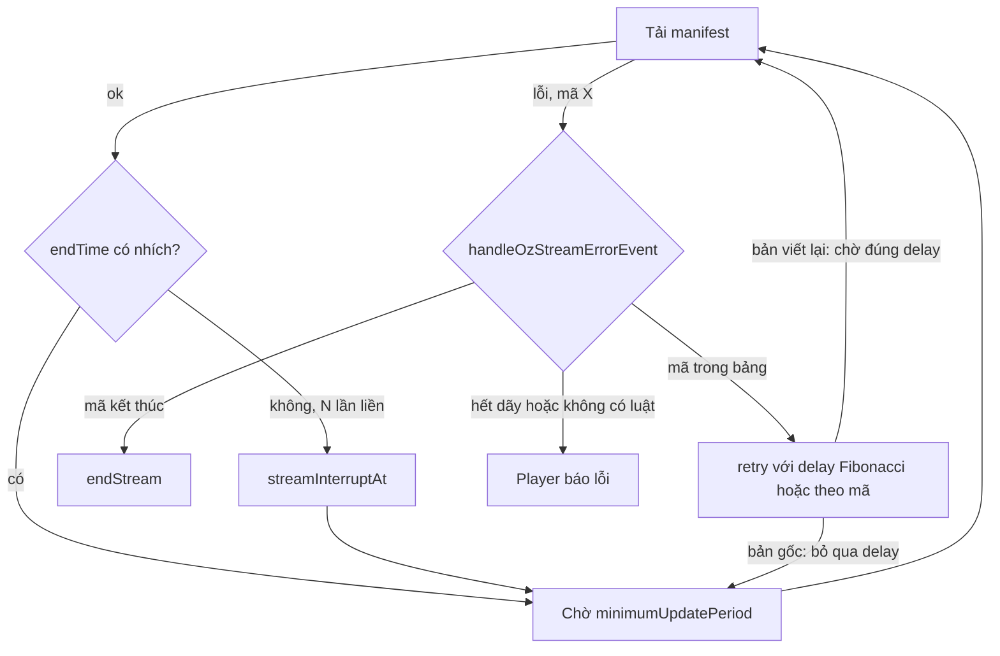

"Lỗi thì thử lại" là một dòng code. "Thử lại sau bao lâu, bao nhiêu lần, khi nào bỏ cuộc, và làm sao để một triệu client không cùng thử lại một lúc" là cả một chính sách.

[Bài #62 về upload tiếp tục được](/blogs/facebook-resumable-upload) có nhắc tới `retryState.handleRetry` mà không có phần cài đặt. Bài này đọc phần đó, cùng hai lịch retry khác trong code Facebook: player video live khi manifest lỗi, và cách trình duyệt báo "file JavaScript trên CDN có vấn đề" mà không làm ngập server.

> [!TIP]
> **Tóm tắt**
> - `VideoUploadRetries` (bundle `151.js`): delay `min(400 + 100·1,5^(n−1), 8000) ± 50 ms`, dừng khi quá 500 lần hoặc quá 1 giờ, mọi tham số đổi được qua thử nghiệm A/B. Jitter ±50 ms quá nhỏ: 1000 client lỗi cùng lúc thì vẫn retry gần như cùng nhịp.
> - Player live (`handleOzStreamErrorEvent`, `OzMpdUpdater`): phân loại lỗi theo HTTP code, chờ theo dãy Fibonacci `0,1,1,2,3,5,8,13,21,34` giây, hết dãy thì bỏ cuộc. Nhưng hàm `retry(delay)` mà `OzMpdUpdater` truyền vào **bỏ qua** delay, và nhánh xử lý mã 410 trong đường cũ không bao giờ chạy tới.
> - `SyntaxErrorMonitor` (bundle `22.js`): gặp `SyntaxError` thì báo về server, tối đa một lần mỗi N ngày, nhớ bằng **số ngày kể từ 2010-01-01** trong cookie.
> - Quy tắc mang về: backoff cần trần, cần giới hạn tổng, cần jitter tỉ lệ với delay; và delay tính ra phải thật sự được dùng.

<iframe class="demo-frame" src="/demos/facebook-patterns/index.html?theme=dark#/retry-backoff-schedules" title="Demo retry-backoff-schedules" loading="lazy" style="height: 1080px"></iframe>

<p class="demo-links">▶ <a href="/demos/facebook-patterns/index.html#/retry-backoff-schedules" target="_blank" rel="noopener">Mở demo toàn màn hình ↗</a> · <a href="https://stackblitz.com/github/hunghg255/blog-hunghg/tree/master/examples/facebook-patterns?file=src/lib/retrySchedules.ts" target="_blank" rel="noopener">Sửa code trên StackBlitz ↗</a> · <a href="https://github.com/hunghg255/blog-hunghg/blob/master/examples/facebook-patterns/src/lib/retrySchedules.ts" target="_blank" rel="noopener">Xem source trên GitHub ↗</a></p>

## Lịch 1: backoff luỹ thừa có trần cho upload video

### Facebook làm thế nào?

`VideoUploadRetries.createState(policy)` trả một object có `handleRetry` và `resetDelay`. Lõi:

```js
let d = Math.min(400 + 100 * 1.5 ** (delayRetry - 1), 8000);   // initial + exp_base · mult^(n−1), trần max
d += (Random.random() - 0.5) * 100;                            // jitter ± 50 ms
// dừng nếu: predicate() === false, hoặc totalRetry ≥ 500, hoặc đã quá 1 giờ kể từ createState
```

::: spoiler Code gốc đã đổi tên biến: VideoUploadRetries

```js
const DEFAULT = {
  backoff_ms: { initial: 400, jitter: 100, exp_base: 100, exp_multiplier: 1.5, max: 8000 },
  limits: { total_retry_count: 500, total_time_ms: 60 * 60 * 1000 },
};

delay() {
  let d = b.initial + b.exp_base * Math.pow(b.exp_multiplier, this.delayRetry - 1);
  d = Math.min(d, b.max);
  d += (Random.random() - 0.5) * b.jitter;          // ± 50 ms
  return Math.round(d);
}

handleRetry({ predicate, retryHandler, failureHandler, context }) {
  const reason = predicate?.() === false ? 'predicate'
    : limits.delay_retry_count != null && this.delayRetry >= limits.delay_retry_count ? 'delay-retries'
    : limits.total_retry_count != null && this.totalRetry >= limits.total_retry_count ? 'total-retries'
    : limits.total_time_ms != null && limits.total_time_ms <= Date.now() - this.startedAt ? 'total-time'
    : null;
  if (reason) { emit('retries-abandoned', { reason, … }); return failureHandler(); }
  this.delayRetry++; this.totalRetry++;
  const ms = this.delay();
  emit('retry-attempted', { backoff_ms: ms, … });
  retryHandler(ms);
}
```

:::

Mỗi tham số trong `DEFAULT` có thể bị ghi đè bởi một tham số thử nghiệm (`qex._("1661399")` tới `"1661406"`): đội upload đổi được độ dài chờ, trần, giới hạn cho một nhóm người dùng mà không cần deploy.

Tôi chạy lại module thật bằng node với `Random.random() = 0.5` (bỏ jitter). Dãy delay: `500, 550, 625, 738, 906, 1159, 1539, 2109, 2963, 4244, 6167, 8000, 8000…` ms. Ba điểm:

- **Có hai bộ đếm.** `delayRetry` quyết định độ dài chờ và được `resetDelay()` đặt về 0 khi có tiến triển (upload thêm được một chunk). `totalRetry` không bao giờ reset. Một upload chập chờn kéo dài vẫn quay lại delay ngắn sau mỗi lần thành công, nhưng tổng số lần thử vẫn bị chặn.
- **Hai giới hạn chồng nhau.** Ở trần 8 giây, 500 lần là hơn 66 phút, nên giới hạn 1 giờ luôn chạm trước. `delay_retry_count` mặc định không đặt.
- **Jitter ±50 ms trên delay tới 8000 ms là ±0,6%.** Khi server upload sập, các client đang upload cùng lỗi trong vài chục mili giây. Chúng retry theo cùng một dãy, lệch nhau không đáng kể, nên mỗi đợt retry đổ vào server gần như cùng lúc. Tab 1 của demo cho thấy: lúc server vừa sống lại, jitter ±50 ms dồn khoảng 500 request vào một khung 100 ms, full jitter khoảng 50.

## Lịch 2: poll manifest live và dãy Fibonacci

### Facebook làm thế nào?

Video live dùng DASH (xem [bài #60](/blogs/facebook-dash-predicted-segments)): manifest (MPD) liệt kê các segment, và với live, manifest phải được tải lại liên tục để thấy segment mới. `OzMpdUpdater` (trong `26.VideoPlayer/all.js`) hẹn giờ `minimumUpdatePeriod` giây (khai báo trong MPD) rồi tải lại. Có cờ để dừng poll khi người xem pause, và dừng hẳn khi MPD chuyển từ `dynamic` sang `static` (live đã thành video thường).

Khi tải manifest lỗi, `OzMpdUpdater` phát sự kiện `manifestFetchError` kèm một object điều khiển, và `handleOzStreamErrorEvent` quyết định theo thứ tự:

1. Mã nằm trong `network_end_broadcasts_json`: `endStream()`.
2. Mã nằm trong `network_skip_json`: `retry()` ngay.
3. Đã thử quá 10 lần (`FIB[retryAttemptCount]` là `undefined`): không làm gì, tức bỏ cuộc và player báo lỗi.
4. Mã nằm trong `network_reload_mpd_json`: `retry(FIB[n] * 1000)` với `FIB = [0, 1, 1, 2, 3, 5, 8, 13, 21, 34]`.
5. Mã có trong bảng `network_retry_intervals_json` (mặc định `{"0":1000, "404":2000, "502":1000, "503":1000, "504":1000}`): `retry(bảng[mã])`.
6. Còn lại: không làm gì, player báo lỗi.

Cả ba danh sách mã mặc định là `[]`: mọi thứ do cấu hình từ server quyết định.

::: spoiler Code gốc đã đổi tên biến: handleOzStreamErrorEvent

```js
const FIB = [0, 1, 1, 2, 3, 5, 8, 13, 21, 34];
function handle(config, event) {
  const code = event.error.getExtra().code;
  if (json(config, 'network_end_broadcasts_json', '[]').includes(code)) return event.endStream();
  if (json(config, 'network_skip_json', '[]').includes(code)) return event.retry();
  const fib = config.getBool('back_off_pdash_504_retry', true) ? FIB[event.retryAttemptCount] : 0;
  const reloadCodes = json(config, 'network_reload_mpd_json', '[]');
  if (config.getBool('back_off_pdash_504_retry', true) && fib == null && (!fixFlag || reloadCodes.includes(code))) return; // hết dãy
  if (fib != null && reloadCodes.includes(code)) return event.retry(fib * 1000);
  const intervals = json(config, 'network_retry_intervals_json', '{"0":1000,"404":2000,"502":1000,"503":1000,"504":1000}');
  if (code != null && intervals[code] != null) return event.retry(intervals[code]);
  // không gọi gì: OzMpdUpdater phát lỗi cho player
}
```

:::

Còn object điều khiển mà `OzMpdUpdater` tạo ra:

```js
const control = {
  endStream() { handled(); this.ended = true; if (gracefully410) this.emit('streamGone'); },
  retry(delay) { handled(); this.setupUpdateLoop(); },   // ← delay không được dùng
  retryAttemptCount: this.requestCount - 1,
  consecutiveFailuresForErrorCode, error, isInitialRequest: false,
};
```

**Bug 1: delay bị bỏ qua.** `retry(delay)` gọi `setupUpdateLoop()`, hàm hẹn giờ theo `minimumUpdatePeriod`. Bảng Fibonacci, bảng delay theo mã, tất cả tính ra rồi không được dùng: manifest lỗi thì vẫn bị tải lại đúng nhịp như khi khoẻ. Tôi chạy `handleOzStreamErrorEvent` thật bằng node với `network_reload_mpd_json = ["504"]`: nó xin `0, 1000, 1000, 2000, 3000, 5000, 8000, 13000, 21000, 34000` ms cho 10 lần lỗi 504 liên tiếp, rồi im (bỏ cuộc). Với `minimumUpdatePeriod = 2` giây, 10 lần đó diễn ra trong khoảng 20 giây thay vì 88 giây. Một sự cố 504 kéo dài 40 giây làm player báo lỗi (demo, nút "504 kéo dài 40 giây"), trong khi lịch Fibonacci thật sự sẽ chờ qua được.

**Bug 2: nhánh 410 không bao giờ chạy.** Đường xử lý cũ (khi cờ `handle_mpd_retries_outside_oz_mpd_updater` tắt):

```js
const handled = ['404', '503'];                 // thêm '0' nếu có cờ live_gracefully_handle_no_network
if (code && handled.indexOf(code) > -1) switch (code) {
  case '410': this.ended = true; ok = true; break;   // không bao giờ tới: '410' không có trong danh sách
  case '404': if (++this.count404 >= maxTries) break;  // rơi xuống
  case '503': case '0': ok = true; break;
}
```

`indexOf` lọc trước, mà `'410'` không có trong mảng, nên `case '410'` là code chết. HTTP 410 Gone là cách tự nhiên để server nói "buổi live đã kết thúc"; ở đường này nó thành lỗi chung của player. Đường mới xử lý được 410 nếu cấu hình `network_end_broadcasts_json` có chứa nó; mặc định là `[]`.

### Phát hiện stream đứng

`OzStreamInterruptChecker` nhận mỗi lần manifest được cập nhật, đọc `endTime` của khoảng thời gian cuối. Nếu nó **không đổi** qua `stream_interrupt_check_mpd_stale_count_threshold` lần liên tiếp, phát `streamInterruptAt` (người phát live mất mạng, server vẫn trả manifest cũ). Khi `endTime` nhích lại, phát `streamResumedAt`. Không cần server báo gì thêm: chính việc manifest "đứng yên" là tín hiệu.



## Lịch 3: báo lỗi CDN tối đa một lần mỗi N ngày

### Facebook làm thế nào?

Một `SyntaxError` khi chạy JavaScript của chính trang thường không phải lỗi lập trình (code đã qua build và test), mà là **file bị hỏng trên đường tới**: CDN trả file cắt cụt, proxy chèn nội dung, hai phiên bản lệch nhau. `SyntaxErrorMonitor` nghe mọi lỗi qua `ErrorPubSub`. Toàn bộ module, đã đổi tên biến:

```js
const COOKIE = 'js_ver', DAY = 864e5, EPOCH = 1262304e6;   // 2010-01-01T00:00:00Z
function onError(error) {
  if (error.name != 'SyntaxError' && !/syntaxerror/i.test(error.message)) return;
  let last = Cookie.get(COOKIE);
  const today = Math.floor((Date.now() - EPOCH) / DAY);
  if (!last || today - last >= config.bump_freq_day) {
    Cookie.set(COOKIE, today);
    if (!last) last = today;
    new Image().src = `/ajax/js_bump/?cdn_config=${encodeURIComponent(config.cdn_config)}&days=${today}&last_update=${last}`;
  }
}
```

- **Giới hạn tần suất phía client, không cần server nhớ gì.** Mỗi trình duyệt tự nhớ lần báo cuối. Lỗi CDN ảnh hưởng một triệu người thì server nhận tối đa một triệu beacon mỗi N ngày, không phải một triệu mỗi lần tải trang.
- **Số ngày thay cho timestamp.** Hôm nay (28/10/2026) là ngày 6144 kể từ 2010-01-01: bốn chữ số trong cookie thay vì mười ba. Cookie đi kèm mọi request tới domain, nên ngắn là đáng giá.
- **`new Image().src`** là beacon cổ điển: GET không cần CORS, không chờ phản hồi.
- **`cdn_config` gửi kèm** cho biết người này đang được phục vụ bởi cấu hình CDN nào. Có lẽ server dùng số beacon theo `cdn_config` để biết CDN nào đang hỏng, và "bump" (đổi phiên bản, xoá cache) cho nhóm đó, đúng như tên endpoint `js_bump`.

Tôi chạy module thật với `bump_freq_day = 3` qua 8 ngày, mỗi ngày hai lỗi: beacon bắn ở ngày 6144, 6147, 6150, đúng một lần mỗi 3 ngày.

Một giới hạn nhỏ: nếu đồng hồ máy từng chạy nhanh (cookie ghi ngày ở tương lai) rồi được chỉnh lại, `today - last` âm và module im lặng cho tới khi ngày thật vượt qua ngày trong cookie. Demo, tab 3, nút "Đồng hồ máy chạy nhanh 30 ngày".

## Bên trong trình duyệt

- **Đàn bò tót (thundering herd):** khi một server sập, mọi client đang kết nối nhận lỗi trong cùng khoảng vài chục mili giây. Nếu chúng retry theo cùng một hàm của số lần thử, chúng giữ nguyên sự đồng bộ đó qua mọi lần thử. Jitter phải đủ lớn so với delay để phá sự đồng bộ: full jitter chọn ngẫu nhiên trong `[0, delay]`, equal jitter trong `[delay/2, delay]`.
- **Bộ hẹn giờ của tab ẩn bị bóp.** Chrome có thể dồn timer của tab nền về một lần mỗi phút. Retry 500 ms ở tab nền thành retry 60 giây; tính "tổng thời gian" bằng `Date.now()` như bản gốc (thay vì cộng các delay) là đúng.
- **Lỗi cú pháp của script** được báo qua sự kiện `error` của `window`, message dạng `"Uncaught SyntaxError: …"`. Với script khác origin không có `crossorigin` và header CORS, trình duyệt giấu chi tiết, chỉ còn `"Script error."`: không có chữ SyntaxError để bắt. Có lẽ đó là lý do bundle Facebook được nạp với CORS.
- **HTTP 410 Gone** khác 404 ở chỗ nói "đã từng có, giờ hết hẳn, đừng hỏi nữa". Với live, đó là tín hiệu kết thúc sạch nhất.

## Viết lại

Ba kiểu jitter cho cùng một công thức delay:

```ts title=src/lib/retrySchedules.ts
export function backoffDelay(policy: BackoffPolicy, attempt: number, random = Math.random) {
  const base = Math.min(policy.initial + policy.expBase * policy.multiplier ** (attempt - 1), policy.max);
  const r = random();
  switch (policy.jitterMode) {
    case 'full':
      return Math.round(base * r);
    case 'equal':
      return Math.round(base / 2 + (base / 2) * r);
    default:
      return Math.max(0, Math.round(base + (r - 0.5) * policy.jitter));
  }
}
```

Phân loại lỗi manifest, thứ tự giống `handleOzStreamErrorEvent`: mã kết thúc, mã bỏ qua, hết dãy thì bỏ cuộc, rồi Fibonacci hoặc delay theo mã.

```ts title=src/lib/retrySchedules.ts
export function classifyStreamError(code: string | null, attempt: number, cfg: StreamErrorConfig = DEFAULT_STREAM_CONFIG): StreamErrorAction {
  if (code != null && cfg.endCodes.includes(code)) return { action: 'end' };
  if (code != null && cfg.skipCodes.includes(code)) return { action: 'retry', delayMs: 0 };
  const fib = FIB_BACKOFF_SEC[attempt];
  if (fib == null) return { action: 'give-up' }; // hết bảng: 10 lần thử
  if (code != null && cfg.fibCodes.includes(code)) return { action: 'retry', delayMs: fib * 1000 };
  const fixed = code != null ? cfg.retryIntervals[code] : undefined;
  return fixed != null ? { action: 'retry', delayMs: fixed } : { action: 'give-up' };
}
```

Vòng poll: thành công thì đặt `attempt = 0`, báo cho bộ phát hiện stream đứng, hẹn lần sau sau `periodMs`. Phần lỗi khác bản gốc ở đúng một dòng, `schedule(next.delayMs)`:

```ts title=src/lib/retrySchedules.ts
    } catch (err) {
      if (stopped) return;
      const code = String((err as { code?: unknown })?.code ?? '0');
      const next = classifyStreamError(code, attempt++, config);
      onEvent?.({ type: 'error', at: now(), code, next });
      if (next.action === 'retry') schedule(next.delayMs); // bản gốc bỏ qua delay này
      else if (next.action === 'end') {
        stopped = true;
        onEvent?.({ type: 'ended', at: now() });
      } else {
        stopped = true;
        onEvent?.({ type: 'failed', at: now() });
      }
    }
```

Giới hạn báo lỗi theo ngày, thêm trường hợp ngày lưu nằm ở tương lai:

```ts title=src/lib/retrySchedules.ts
export function shouldReport(stored: string | null, nowMs: number, freqDays: number): { report: boolean; store: number; lastDay: number | null } {
  const today = dayNumber(nowMs);
  const last = stored != null && /^\d+$/.test(stored) ? Number(stored) : null;
  if (last == null || last > today || today - last >= freqDays) return { report: true, store: today, lastDay: last };
  return { report: false, store: last, lastDay: last };
}
```

::: spoiler Xem toàn bộ src/lib/retrySchedules.ts

```ts title=src/lib/retrySchedules.ts
/**
 * Ba kiểu lịch retry trong code Facebook:
 * 1. VideoUploadRetries: backoff luỹ thừa có trần + jitter, dừng theo số lần hoặc tổng thời gian.
 * 2. Player live (OzMpdUpdater + handleOzStreamErrorEvent): phân loại lỗi theo HTTP code,
 *    chờ theo dãy Fibonacci, phát hiện stream đứng khi manifest không nhích.
 * 3. SyntaxErrorMonitor: báo lỗi CDN tối đa một lần mỗi N ngày, nhớ bằng số ngày trong cookie.
 * Khác bản gốc: có full jitter, lịch retry của manifest thật sự dùng delay được trả về,
 * mã 410 kết thúc stream, đồng hồ lùi không làm kẹt bộ đếm ngày.
 */

// ───────────────────────── 1. Backoff có trần ─────────────────────────

export type JitterMode = 'fixed' | 'full' | 'equal';

export interface BackoffPolicy {
  /** delay = min(initial + expBase · multiplier^(n−1), max) rồi cộng jitter */
  initial: number;
  expBase: number;
  multiplier: number;
  max: number;
  /** 'fixed': ± jitter/2 ms như bản gốc; 'full': ngẫu nhiên trong [0, delay]; 'equal': [delay/2, delay] */
  jitterMode: JitterMode;
  jitter: number;
  limits: { delayRetries?: number; totalRetries?: number; totalTimeMs?: number };
}

/** Giá trị mặc định của VideoUploadRetries */
export const UPLOAD_POLICY: BackoffPolicy = {
  initial: 400,
  expBase: 100,
  multiplier: 1.5,
  max: 8000,
  jitterMode: 'fixed',
  jitter: 100,
  limits: { totalRetries: 500, totalTimeMs: 60 * 60 * 1000 },
};

export function backoffDelay(policy: BackoffPolicy, attempt: number, random = Math.random) {
  const base = Math.min(policy.initial + policy.expBase * policy.multiplier ** (attempt - 1), policy.max);
  const r = random();
  switch (policy.jitterMode) {
    case 'full':
      return Math.round(base * r);
    case 'equal':
      return Math.round(base / 2 + (base / 2) * r);
    default:
      return Math.max(0, Math.round(base + (r - 0.5) * policy.jitter));
  }
}

export type AbandonReason = 'predicate' | 'delay-retries' | 'total-retries' | 'total-time';
export type RetryDecision =
  | { action: 'retry'; delayMs: number; delayRetry: number; totalRetry: number }
  | { action: 'abandon'; reason: AbandonReason; delayRetry: number; totalRetry: number };

export function createRetryState(policy: BackoffPolicy = UPLOAD_POLICY, now = Date.now, random = Math.random) {
  const startedAt = now();
  let delayRetry = 0; // reset khi có tiến triển (vd upload thêm được một chunk)
  let totalRetry = 0; // không bao giờ reset
  return {
    next(shouldRetry?: () => boolean): RetryDecision {
      const { limits } = policy;
      let reason: AbandonReason | null = null;
      if (shouldRetry && !shouldRetry()) reason = 'predicate';
      else if (limits.delayRetries != null && delayRetry >= limits.delayRetries) reason = 'delay-retries';
      else if (limits.totalRetries != null && totalRetry >= limits.totalRetries) reason = 'total-retries';
      else if (limits.totalTimeMs != null && now() - startedAt >= limits.totalTimeMs) reason = 'total-time';
      if (reason) return { action: 'abandon', reason, delayRetry, totalRetry };
      delayRetry++;
      totalRetry++;
      return { action: 'retry', delayMs: backoffDelay(policy, delayRetry, random), delayRetry, totalRetry };
    },
    /** gọi khi request thành công: lần lỗi sau bắt đầu lại từ delay nhỏ nhất */
    resetDelay() {
      delayRetry = 0;
    },
  };
}

// ───────────────────────── 2. Lỗi manifest live ─────────────────────────

/** giây, theo số lần thử lại liên tiếp (bản gốc: [0,1,1,2,3,5,8,13,21,34]) */
export const FIB_BACKOFF_SEC = [0, 1, 1, 2, 3, 5, 8, 13, 21, 34];

export interface StreamErrorConfig {
  /** mã nghĩa là buổi live đã kết thúc */
  endCodes: string[];
  /** mã bỏ qua: thử lại ngay */
  skipCodes: string[];
  /** mã thử lại theo bảng Fibonacci */
  fibCodes: string[];
  /** mã thử lại sau một khoảng cố định (ms) */
  retryIntervals: Record<string, number>;
}

export const DEFAULT_STREAM_CONFIG: StreamErrorConfig = {
  endCodes: ['410'],
  skipCodes: [],
  fibCodes: ['504'],
  retryIntervals: { '0': 1000, '404': 2000, '502': 1000, '503': 1000, '504': 1000 },
};

export type StreamErrorAction =
  | { action: 'end' }
  | { action: 'retry'; delayMs: number }
  | { action: 'give-up' };

/** attempt: số lần đã thử lại liên tiếp trước lần này (0 = lỗi đầu tiên) */
export function classifyStreamError(code: string | null, attempt: number, cfg: StreamErrorConfig = DEFAULT_STREAM_CONFIG): StreamErrorAction {
  if (code != null && cfg.endCodes.includes(code)) return { action: 'end' };
  if (code != null && cfg.skipCodes.includes(code)) return { action: 'retry', delayMs: 0 };
  const fib = FIB_BACKOFF_SEC[attempt];
  if (fib == null) return { action: 'give-up' }; // hết bảng: 10 lần thử
  if (code != null && cfg.fibCodes.includes(code)) return { action: 'retry', delayMs: fib * 1000 };
  const fixed = code != null ? cfg.retryIntervals[code] : undefined;
  return fixed != null ? { action: 'retry', delayMs: fixed } : { action: 'give-up' };
}

export type PollEvent =
  | { type: 'ok'; at: number; endTime: number }
  | { type: 'error'; at: number; code: string; next: StreamErrorAction }
  | { type: 'interrupted'; at: number; endTime: number }
  | { type: 'resumed'; at: number; endTime: number }
  | { type: 'ended'; at: number }
  | { type: 'failed'; at: number };

export interface ManifestPollerOptions {
  /** tải manifest; trả endTime của đoạn cuối, hoặc ném { code } */
  fetch: () => Promise<number>;
  /** minimumUpdatePeriod của MPD, ms */
  periodMs: number;
  /** số lần cập nhật liên tiếp endTime không đổi thì coi là stream đứng (0 = tắt) */
  staleThreshold?: number;
  config?: StreamErrorConfig;
  now?: () => number;
  setTimer?: (fn: () => void, ms: number) => unknown;
  clearTimer?: (h: unknown) => void;
  onEvent?: (e: PollEvent) => void;
}

export function createManifestPoller(opts: ManifestPollerOptions) {
  const {
    fetch,
    periodMs,
    staleThreshold = 3,
    config = DEFAULT_STREAM_CONFIG,
    now = Date.now,
    setTimer = (fn, ms) => setTimeout(fn, ms),
    clearTimer = (h) => clearTimeout(h as ReturnType<typeof setTimeout>),
    onEvent,
  } = opts;
  let timer: unknown = null;
  let stopped = false;
  let attempt = 0;
  const stale = createStaleDetector(staleThreshold);

  const schedule = (ms: number) => {
    if (stopped) return;
    timer = setTimer(poll, ms);
  };

  async function poll() {
    timer = null;
    try {
      const endTime = await fetch();
      if (stopped) return;
      attempt = 0;
      onEvent?.({ type: 'ok', at: now(), endTime });
      const change = stale.update(endTime);
      if (change) onEvent?.({ type: change, at: now(), endTime });
      schedule(periodMs);
    } catch (err) {
      if (stopped) return;
      const code = String((err as { code?: unknown })?.code ?? '0');
      const next = classifyStreamError(code, attempt++, config);
      onEvent?.({ type: 'error', at: now(), code, next });
      if (next.action === 'retry') schedule(next.delayMs); // bản gốc bỏ qua delay này
      else if (next.action === 'end') {
        stopped = true;
        onEvent?.({ type: 'ended', at: now() });
      } else {
        stopped = true;
        onEvent?.({ type: 'failed', at: now() });
      }
    }
  }

  return {
    start() {
      stopped = false;
      schedule(0);
    },
    stop() {
      stopped = true;
      if (timer != null) clearTimer(timer);
      timer = null;
    },
  };
}

/** endTime của đoạn cuối không nhích qua `threshold` lần cập nhật liên tiếp → 'interrupted'; nhích lại → 'resumed'. */
export function createStaleDetector(threshold: number) {
  let last: number | null = null;
  let same = 0;
  let interrupted = false;
  return {
    update(endTime: number | null): 'interrupted' | 'resumed' | null {
      let out: 'interrupted' | 'resumed' | null = null;
      if (endTime != null && endTime === last) same++;
      else {
        same = 0;
        if (interrupted && last != null) {
          interrupted = false;
          out = 'resumed';
        }
      }
      if (!interrupted && threshold > 0 && same >= threshold && endTime != null) {
        interrupted = true;
        out = 'interrupted';
      }
      last = endTime;
      return out;
    },
  };
}

// ───────────────────────── 3. Báo lỗi CDN mỗi N ngày ─────────────────────────

/** mốc riêng của SyntaxErrorMonitor: 2010-01-01 UTC */
export const DAY_EPOCH = Date.UTC(2010, 0, 1);

export function dayNumber(nowMs: number, epoch = DAY_EPOCH) {
  return Math.floor((nowMs - epoch) / 86_400_000);
}

/**
 * Có nên gửi báo cáo không, và giá trị mới để lưu (vào cookie).
 * Bản gốc: gửi khi chưa có giá trị hoặc đã qua đủ freqDays. Thêm: giá trị lưu nằm ở "tương lai"
 * (đồng hồ máy từng chạy nhanh rồi được chỉnh lại) thì coi như chưa có, để không bị kẹt nhiều ngày.
 */
export function shouldReport(stored: string | null, nowMs: number, freqDays: number): { report: boolean; store: number; lastDay: number | null } {
  const today = dayNumber(nowMs);
  const last = stored != null && /^\d+$/.test(stored) ? Number(stored) : null;
  if (last == null || last > today || today - last >= freqDays) return { report: true, store: today, lastDay: last };
  return { report: false, store: last, lastDay: last };
}

/** Chỉ đếm SyntaxError đến từ script của chính mình (lỗi của extension hay script bên thứ ba thì bỏ). */
export function isOwnSyntaxError(e: { message?: string; filename?: string; error?: unknown }, ownOrigins: string[]) {
  const name = (e.error as { name?: string } | undefined)?.name;
  const looksSyntax = name === 'SyntaxError' || /syntaxerror/i.test(e.message ?? '');
  if (!looksSyntax) return false;
  if (!e.filename) return false;
  try {
    return ownOrigins.includes(new URL(e.filename).origin);
  } catch {
    return false;
  }
}
```

:::

## Đi qua code

- `backoffDelay` tách công thức gốc khỏi kiểu jitter. `'fixed'` giữ hành vi bản gốc để so sánh; nên dùng `'full'` hoặc `'equal'`.
- `createRetryState.next()` trả một quyết định (`retry` kèm `delayMs`, hoặc `abandon` kèm lý do) thay vì gọi callback, để người gọi tự hẹn giờ và log.
- `classifyStreamError` nhận `attempt` là số lần đã thử lại liên tiếp, bắt đầu từ 0. Lần lỗi đầu chờ `FIB[0] = 0` giây: thử lại ngay, vì phần lớn lỗi mạng là thoáng qua.
- `createManifestPoller` đặt `attempt = 0` mỗi lần thành công, nên dãy Fibonacci chỉ áp cho lỗi liên tiếp.
- `createStaleDetector` phát `interrupted` một lần, và chỉ phát `resumed` khi đã từng `interrupted`.
- `shouldReport` coi giá trị cookie không phải số nguyên dương là chưa có, tránh `Number('abc')` thành `NaN` làm phép so sánh luôn sai.
- `isOwnSyntaxError` chỉ đếm lỗi từ script có origin nằm trong danh sách, loại lỗi của extension trình duyệt (vốn cũng hiện trên `window.onerror` của trang).

**Khác bản gốc:**

- Có full jitter và equal jitter.
- Delay trả về được dùng thật; mã kết thúc (mặc định `410`) dừng poll êm.
- Ngày lưu ở tương lai thì báo ngay và ghi lại ngày hôm nay.
- Lọc SyntaxError theo origin của file.
- Không có tham số thử nghiệm A/B; truyền `policy` và `config` từ ngoài vào.

## Tại sao không làm cách khác?

- **Delay cố định (ví dụ 2 giây mãi mãi):** khi server sập lâu, client tạo tải đều đặn đúng lúc server cần thở nhất. Đó chính là hành vi thực tế của player live vì bug 1.
- **Luỹ thừa không trần:** delay gốc 1 giây, hệ số 2 thì lần thử thứ 21 phải chờ hơn 12 ngày. Trần 8 giây (upload) hay 34 giây (live) giữ trải nghiệm: người dùng không phải chờ vô lý sau khi mạng đã ổn.
- **Fibonacci thay vì luỹ thừa:** tăng chậm hơn hệ số 2 (tỉ lệ tiến tới 1,618) và bắt đầu bằng 0, 1, 1: hai lần thử nhanh cho lỗi thoáng qua, rồi mới giãn ra. Với live, chờ quá lâu là lỡ phần đang phát, nên tăng chậm hợp lý.
- **Gửi mọi SyntaxError về server, server tự lọc:** một CDN hỏng tạo ra một beacon mỗi lần tải trang của mỗi người dùng. Lọc ở client rẻ hơn nhiều, và N ngày là đủ để phát hiện xu hướng.
- **Lưu `Date.now()` trong `localStorage` thay vì số ngày trong cookie:** cũng được. Cookie có ưu điểm là server đọc được ngay trong request (`last_update` gửi kèm cũng vậy) và dùng chung giữa các subdomain.

## Edge case và cạm bẫy

- **Retry cần idempotent.** Upload chunk theo offset (bài #62) an toàn khi gửi lại; gửi tin nhắn thì không (xem [bài #84](/blogs/facebook-mqtt-qos1-republish) về khử trùng).
- **Full jitter có thể chờ 0 ms.** Với delay nhỏ, nhiều client thử lại gần như ngay lập tức, tổng số lần thử tăng (demo: khoảng 9800 so với 7300). Equal jitter giữ được nửa delay tối thiểu.
- **Retry-After:** server trả 503 hoặc 429 kèm header `Retry-After` thì nên ưu tiên giá trị đó hơn lịch của mình.
- **Đếm `attempt` theo request hay theo lỗi:** bản gốc tính `retryAttemptCount = số request − 1`, bộ đếm request được reset khi thành công. Nếu bạn huỷ request đang bay (đổi chất lượng, người dùng tua), nhớ đừng để bộ đếm reset nhầm.
- **Mã 404 với live:** đường cũ cho phép 404 tối đa `live_max_try_attempts_on_404` lần rồi mới coi là lỗi, vì manifest live mới tạo có thể chưa kịp phân phối tới mọi edge của CDN.
- **Cookie bị chặn:** `Cookie.get` luôn `null` thì mỗi lỗi đều là "lần đầu" và beacon bắn mỗi lần. Nên có giới hạn thứ hai trong bộ nhớ trang (một lần mỗi lần tải trang).

## Dùng trong dự án

```ts
import { createManifestPoller, createRetryState, UPLOAD_POLICY } from './retrySchedules';

const retry = createRetryState({ ...UPLOAD_POLICY, jitterMode: 'equal' });
async function send(chunk: Blob, offset: number): Promise<void> {
  try { await sendChunk(chunk, offset); retry.resetDelay(); }
  catch {
    const d = retry.next(() => navigator.onLine);
    if (d.action === 'abandon') throw new Error(`bỏ cuộc: ${d.reason}`);
    await new Promise((r) => setTimeout(r, d.delayMs));
    return send(chunk, offset);
  }
}
// live: fetch ném { code: String(res.status) } khi lỗi, trả endTime khi thành công
createManifestPoller({ periodMs: 2000, fetch: loadManifestEndTime, onEvent: (e) => e.type === 'ended' && showReplay() }).start();
```

## Kiểm thử

::: spoiler Ví dụ test (bản phác, không có trong repo)

```ts
import { describe, expect, it } from 'vitest';
import { backoffDelay, classifyStreamError, createRetryState, createStaleDetector, dayNumber, shouldReport, UPLOAD_POLICY } from './retrySchedules';

describe('backoff', () => {
  it('dãy delay giống bản gốc khi jitter = 0', () => {
    const seq = Array.from({ length: 13 }, (_, i) => backoffDelay(UPLOAD_POLICY, i + 1, () => 0.5));
    expect(seq).toEqual([500, 550, 625, 738, 906, 1159, 1539, 2109, 2963, 4244, 6167, 8000, 8000]);
  });

  it('full jitter nằm trong [0, delay]', () => {
    for (let i = 0; i < 100; i++) {
      const d = backoffDelay({ ...UPLOAD_POLICY, jitterMode: 'full' }, 12);
      expect(d).toBeGreaterThanOrEqual(0);
      expect(d).toBeLessThanOrEqual(8000);
    }
  });

  it('dừng theo tổng số lần và theo thời gian', () => {
    let t = 0;
    const s = createRetryState({ ...UPLOAD_POLICY, limits: { totalRetries: 2, totalTimeMs: 1000 } }, () => t);
    expect(s.next().action).toBe('retry');
    s.resetDelay();
    expect(s.next()).toMatchObject({ action: 'retry', delayRetry: 1, totalRetry: 2 });
    expect(s.next()).toMatchObject({ action: 'abandon', reason: 'total-retries' });
    const s2 = createRetryState(UPLOAD_POLICY, () => t);
    t = 60 * 60 * 1000;
    expect(s2.next()).toMatchObject({ action: 'abandon', reason: 'total-time' });
  });
});

describe('classifyStreamError', () => {
  it('Fibonacci cho 504, hết dãy thì bỏ cuộc, 410 kết thúc', () => {
    const delays = Array.from({ length: 11 }, (_, i) => classifyStreamError('504', i));
    expect(delays.slice(0, 10).map((d) => (d.action === 'retry' ? d.delayMs : -1))).toEqual([0, 1000, 1000, 2000, 3000, 5000, 8000, 13000, 21000, 34000]);
    expect(delays[10]).toEqual({ action: 'give-up' });
    expect(classifyStreamError('410', 0)).toEqual({ action: 'end' });
    expect(classifyStreamError('418', 0)).toEqual({ action: 'give-up' });
  });
});

it('createStaleDetector', () => {
  const s = createStaleDetector(2);
  expect([10, 10, 10, 10, 12].map((x) => s.update(x))).toEqual([null, null, 'interrupted', null, 'resumed']);
});

describe('shouldReport', () => {
  const day = (n: number) => Date.UTC(2010, 0, 1) + n * 86_400_000 + 3600_000;
  it('một lần mỗi N ngày', () => {
    expect(dayNumber(Date.UTC(2026, 9, 28))).toBe(6144);
    expect(shouldReport(null, day(100), 3)).toMatchObject({ report: true, store: 100 });
    expect(shouldReport('100', day(102), 3)).toMatchObject({ report: false });
    expect(shouldReport('100', day(103), 3)).toMatchObject({ report: true, store: 103 });
  });
  it('ngày lưu ở tương lai thì báo ngay', () => {
    expect(shouldReport('130', day(100), 3)).toMatchObject({ report: true, store: 100 });
  });
});
```

:::

## So với thư viện và chuẩn web

- **AWS SDK, gRPC:** đều dùng backoff luỹ thừa có trần với jitter ngẫu nhiên lớn (gRPC: ±20% delay; AWS khuyến nghị full jitter). Bài "Exponential Backoff And Jitter" trên blog kiến trúc của AWS là nơi so sánh ba kiểu jitter kinh điển.
- **`p-retry`, `async-retry` (npm):** cài đặt sẵn backoff có trần, có tuỳ chọn `randomize`. Tuỳ chọn mặc định của `p-retry` không bật ngẫu nhiên; nhớ bật.
- **dash.js, Shaka Player:** có cấu hình retry riêng cho request manifest (số lần, khoảng chờ). Shaka dùng backoff luỹ thừa có hệ số ngẫu nhiên (`fuzzFactor`).
- **Reporting API, `Reporting-Endpoints`:** trình duyệt tự gửi báo cáo lỗi CSP, deprecation, crash; không có loại báo cáo cho "script bị cắt cụt". Bắt `SyntaxError` vẫn là việc của trang.
- **Subresource Integrity (`integrity="sha384-…"`):** file trên CDN bị sửa hay cắt cụt thì trình duyệt từ chối chạy, phát sự kiện `error` trên thẻ `<script>`. Phát hiện cùng loại sự cố, sớm hơn và chắc hơn bắt `SyntaxError`, nhưng phải biết hash lúc render HTML.

---

Bài này thuộc series **[Học từ mã nguồn Facebook](/series/facebook)** (106 bài, đọc theo thứ tự).

::: spoiler Xem nhanh danh sách bài trong series

*Phần 1*

- [Mở đầu: cách đọc code minify của Facebook](/blogs/learn-from-facebook-source-code)
- [#1 Dùng chung IntersectionObserver + infinite scroll](/blogs/facebook-shared-intersection-observer)
- [#2 useViewportDuration: đo thời gian thực sự được xem](/blogs/facebook-use-viewport-duration)
- [#3 Preload code + data khi hover](/blogs/facebook-preload-on-hover)
- [#4 Toast manager với external store](/blogs/facebook-toast-manager)
- [#5 Network status + heartbeat backoff](/blogs/facebook-network-status-heartbeat)
- [#6 ErrorGuard: bắt lỗi theo ngữ cảnh](/blogs/facebook-error-guard)
- [#7 Banzai: gom log theo lô + sendBeacon](/blogs/facebook-batch-logger)
- [#8 Focus trap + Esc theo layer](/blogs/facebook-focus-trap)

*Phần 2*

- [#9 Mẹo calc(… * 9999): container query, line-clamp, mũi tên carousel bằng CSS](/blogs/facebook-css-9999-trick)
- [#10 Thanh cuộn tuỳ biến bằng CSS 3D](/blogs/facebook-css-3d-scrollbar)
- [#11 Modal cuộn bằng window, giữ vị trí trang nền](/blogs/facebook-document-scroll-modal)
- [#12 Popover, tooltip group và hovercard](/blogs/facebook-popover-tooltip)
- [#13 Primitive Pressable + focus-visible](/blogs/facebook-pressable)
- [#14 Tab "Xem thêm" + sticky header bằng IntersectionObserver](/blogs/facebook-priority-tabs-sticky-header)
- [#15 Avatar khoét mask, gradient Messenger, skeleton steps()](/blogs/facebook-visual-tricks)
- [#16 Khung chat không giật](/blogs/facebook-chat-scroller)
- [#17 Thuật toán chọn bố cục collage ảnh](/blogs/facebook-photo-collage-layout)
- [#18 Keep-alive tab trong SPA](/blogs/facebook-keep-alive-tabs)
- [#19 Tự đo Visual Completion & interaction tracing](/blogs/facebook-visual-completion)
- [#20 Router SPA bền bỉ & tải chunk có retry](/blogs/facebook-spa-router-resilient-loading)

*Phần 3*

- [#21 Smart Compose: gợi ý chữ mờ khi gõ](/blogs/facebook-smart-compose-ghost-text)
- [#22 MQTT ngay trong trình duyệt, tự chuyển sang long-poll](/blogs/facebook-mqtt-in-browser)
- [#23 Đo thời gian dùng bằng bitmap 64 giây](/blogs/facebook-time-spent-bitmap)
- [#24 Bảng reaction nhấn giữ rồi trượt](/blogs/facebook-reaction-press-slide)
- [#25 Tìm kiếm gấp dấu, phiên âm và highlight đầu từ](/blogs/facebook-search-diacritics-tokenize)
- [#26 Ring buffer biết trace nào đã mất log](/blogs/facebook-trace-ring-buffer)
- [#27 Engine animation JS: một vòng rAF và solver cubic-bezier](/blogs/facebook-keyframes-loop-cubic-bezier)
- [#28 Bootloader: bitmap tài nguyên đã tải, chỉ reload khi cần](/blogs/facebook-bootloader-bitmap-consistency)
- [#29 Nhận biết click do screen reader tạo ra](/blogs/facebook-virtual-cursor-detection)
- [#30 Tải trước feed theo chất lượng mạng, đoán hạng thiết bị](/blogs/facebook-network-aware-prefetch)
- [#31 Hàng đợi gửi tin chat giữ đúng thứ tự](/blogs/facebook-ordered-send-queue)
- [#32 Gộp lời gọi API trong cùng một tick](/blogs/facebook-api-batcher)
- [#33 Resize ảnh trong pool Web Worker](/blogs/facebook-jpeg-resize-worker-pool)
- [#34 Crop ảnh theo nhiều khuôn mặt](/blogs/facebook-face-aware-crop)
- [#35 Kéo-thả sắp xếp và vùng thả file không nhấp nháy](/blogs/facebook-flicker-free-drag-drop)
- [#36 Tiện ích UI: fade-out, sticky event, hàm huỷ được](/blogs/facebook-ui-utility-hooks)
- [#37 Hạ tầng nhỏ: cookie, hash lỗi, prefetch khi chuột dừng](/blogs/facebook-small-infra-cookie-hash-idle)

*Phần 4–6*

- [#38 Đồng bộ tin nhắn: phát hiện lỗ seqID và fetch bù theo tầng](/blogs/facebook-messenger-sync-seqid-gaps)
- [#39 OTID: ID tin nhắn kiểu Snowflake sinh ở client](/blogs/facebook-otid-client-snowflake)
- [#40 QPL: lấy mẫu từ lúc bắt đầu, đo RTT gửi tin đầu-cuối](/blogs/facebook-qpl-send-rtt)
- [#41 Bộ điều phối request bảy chế độ gộp và chống trùng](/blogs/facebook-request-dispatcher-modes)
- [#42 Thread list theo mốc thời gian, cookie presence có version](/blogs/facebook-threadlist-ranged-presence)
- [#43 Composer dạng plugin: reducer, dirty checker, chuỗi kiểm tra](/blogs/facebook-plugin-composer)
- [#44 Thanh toán bất đồng bộ: subscribe trước, poll dự phòng](/blogs/facebook-async-checkout)
- [#45 Validate số thẻ: sửa lỗi gõ, dải BIN, Luhn](/blogs/facebook-card-validation)
- [#46 Lịch chọn khoảng ngày: bo góc dải chọn, phím đủ bộ, RTL](/blogs/facebook-range-calendar-a11y)
- [#47 Giờ mở cửa theo tuần: qua đêm, gộp khoảng, phần bù](/blogs/facebook-weekly-hours-intervals)
- [#48 Tiến độ đăng realtime: giữ event chờ snapshot, watchdog](/blogs/facebook-realtime-publish-snapshot)
- [#49 Tiền tệ theo đơn vị nhỏ nhất và ô nhập tiền](/blogs/facebook-currency-minor-units)
- [#50 Sửa hàng loạt Empty/Uniform/Mixed, seen/read bằng 2 bit](/blogs/facebook-bulk-edit-seen-bits)
- [#51 Phát hiện script lạ hook vào hàm native](/blogs/facebook-native-hook-detection)
- [#52 localStorage tự dọn khi đầy quota](/blogs/facebook-quota-aware-storage)
- [#53 Cache tuyến do server phân giải, chờ sẵn promise](/blogs/facebook-route-cache-prefetch)
- [#54 Lưới phím mũi tên 2D và focus không làm cuộn trang](/blogs/facebook-focus-table-grid)
- [#55 Tách emoji bằng máy trạng thái](/blogs/facebook-emoji-segmentation)
- [#56 Đọc trước ghi sau trong một frame, con tự biết vị trí](/blogs/facebook-read-then-write-dom)
- [#57 Hàng đợi lệnh cho video và stream sắp lại chunk](/blogs/facebook-video-command-queue)

*Phần 7–10*

- [#58 Ước lượng băng thông EWMA: loại outlier, nhớ qua phiên](/blogs/facebook-bandwidth-ewma-estimator)
- [#59 ABR theo độ tự tin phát và cắt bậc bitrate theo MOS](/blogs/facebook-abr-playback-confidence)
- [#60 Prefetch segment dự đoán từ manifest, parse hộp sidx](/blogs/facebook-dash-predicted-segments)
- [#61 Đọc metadata MP4/MOV ngay trên client](/blogs/facebook-mp4-metadata-client)
- [#62 Upload tiếp tục được: offset, hash dedupe, phát hiện treo](/blogs/facebook-resumable-upload)
- [#63 Fenwick tree: chọn ngẫu nhiên có trọng số và offset dòng](/blogs/facebook-fenwick-weighted-random)
- [#64 Vạch trục số và trục thời gian "đẹp"](/blogs/facebook-nice-axis-ticks)
- [#65 Damerau-Levenshtein theo dải chéo và tự sửa tên gõ sai](/blogs/facebook-damerau-levenshtein)
- [#66 PRNG có seed, shuffle tái lập và lấy mẫu trace](/blogs/facebook-seeded-prng-sampling)
- [#67 Cặp min/max-heap tái dùng vị trí trong danh sách ảo](/blogs/facebook-dual-heap-buffer-set)
- [#68 Memo nhiều đối số bằng Map/WeakMap và interning object](/blogs/facebook-multikey-memo-interning)
- [#69 Thống kê cửa sổ trượt và đại số khoảng thời gian](/blogs/facebook-moving-stat-intervals)
- [#70 Int64 từ hai số 32-bit, decode UTF, offset theo code point](/blogs/facebook-int64-utf-codepoints)
- [#71 Engine múi giờ IANA trên client, phát hiện lệch giờ](/blogs/facebook-client-iana-timezone)
- [#72 Tự cài semver range](/blogs/facebook-semver-range)
- [#73 Auto-link URL, cắt chữ an toàn, giới hạn LaTeX](/blogs/facebook-autolink-safe-truncate)
- [#74 Parser query kiểu PHP chống prototype pollution](/blogs/facebook-php-query-serializer)
- [#75 Popover tự lật theo phần tràn nhỏ nhất](/blogs/facebook-popover-auto-flip)
- [#76 Tiền tố for(;;) chống JSON hijacking, đọc stream](/blogs/facebook-csrf-prefix-streaming)
- [#77 Chống lộ Referer, linkshim, xoá token trên URL](/blogs/facebook-referrer-linkshim-url-scrub)
- [#78 setImmediate bằng postMessage, gom delta chuột theo frame](/blogs/facebook-setimmediate-mouse-batching)
- [#79 Phát hiện crash qua heartbeat, dò proxy cache hỏng](/blogs/facebook-crash-heartbeat-proxy-check)
- [#80 DPR vào cookie cho ảnh @2x, che khoá trong log](/blogs/facebook-dpr-cookie-secret-redaction)
- [#81 Flux waitFor tự viết và proxy có đệm](/blogs/facebook-flux-dispatch-buffered-proxy)
- [#82 Crop đúng tỉ lệ, xoay sticker bằng ma trận](/blogs/facebook-image-crop-rotation-geometry)

*Phần 11–15*

- [#83 Chia subdomain giữa các tab bằng lease, long-poll theo bảng trạng thái](/blogs/facebook-tab-subdomain-lease-longpoll)
- [#84 MQTT QoS1: giữ publish chờ ack, gửi lại khi kết nối lại](/blogs/facebook-mqtt-qos1-republish)
- [#85 Cache Promise gộp request, cache lỗi ngắn, đua dữ liệu nhúng sẵn](/blogs/facebook-promise-cache-preload-race)
- **#86 Lịch retry: backoff có trần, Fibonacci, báo lỗi CDN mỗi N ngày** (bài này)
- [#87 Giữ nguyên tham chiếu nhánh dữ liệu không đổi](/blogs/facebook-relay-recycle-nodes)
- [#88 Store optimistic: copy-on-write, rollback rồi áp lại](/blogs/facebook-relay-optimistic-store)
- [#89 Chỉ mục subscription theo record, hàng đợi task theo chiều sâu](/blogs/facebook-relay-subscription-index)
- [#90 Phân trang connection: cursor khớp đầu, edge không trùng](/blogs/facebook-relay-connection-pagination)
- [#91 Profiler kiểu middleware và memo selector có lấy mẫu kiểm tra](/blogs/facebook-profiler-middleware-memo-check)
- [#92 Đọc EBML/WebM Cues để tìm byte range của segment](/blogs/facebook-webm-ebml-cues)
- [#93 Stream HTTP Range tạm dừng được, tải tiếp đúng byte](/blogs/facebook-pausable-range-stream)
- [#94 Bảng khoảng thời gian gắn nhãn và nhảy qua lỗ buffer](/blogs/facebook-tagged-time-ranges-gaps)
- [#95 Gom chunk cho SourceBuffer, đồng bộ video bằng playbackRate](/blogs/facebook-sourcebuffer-video-sync)
- [#96 Gom tin nhắn thành cụm, vạch ngày và avatar đã xem](/blogs/facebook-message-grouping)
- [#97 Bao nhiêu tab chat vừa màn hình, chuỗi luật mở tab](/blogs/facebook-chat-tab-policy)
- [#98 Phím tắt Markdown trong editor, Backspace để hoàn tác](/blogs/facebook-markdown-shortcuts-editor)
- [#99 Offset theo code point hay UTF-16: bốn bug cùng một gốc](/blogs/facebook-codepoint-offset-bugs)
- [#100 Typeahead không nhảy: cache tiền tố, chặn reflow, khoá hover](/blogs/facebook-typeahead-stable-results)
- [#101 Hit-test trên canvas bằng phát lại path, nét đứt và cung Bézier](/blogs/facebook-canvas-hit-regions)
- [#102 Vòng tròn theo mét trên bản đồ Mercator](/blogs/facebook-mercator-meter-circles)
- [#103 Dò tính năng trình duyệt: ảnh EXIF 2×1, getter bẫy, scrollbar](/blogs/facebook-feature-probe-tricks)
- [#104 Bug định dạng số và kiểm tra dữ liệu theo locale](/blogs/facebook-locale-validation-bugs)
- [#105 Dispose cho đúng: idle callback, splice(-1), xoá nhầm key](/blogs/facebook-dispose-leak-bugs)

:::

Code + demo: [`examples/facebook-patterns`](https://github.com/hunghg255/blog-hunghg/tree/master/examples/facebook-patterns) · [Mở trên StackBlitz](https://stackblitz.com/github/hunghg255/blog-hunghg/tree/master/examples/facebook-patterns)
