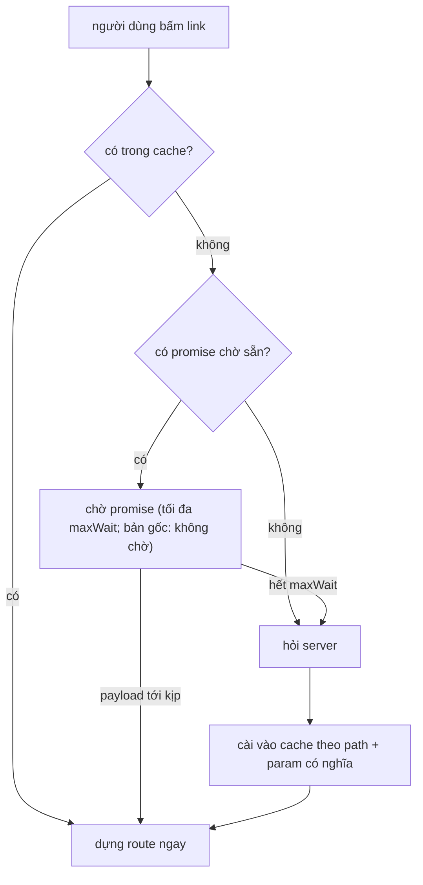

Router của một SPA thường có bảng route viết sẵn ở client: `/profile/:id` → `ProfilePage`, `/groups/:slug` → `GroupPage`. Với facebook.com thì cách này khó. Có hàng nghìn loại URL, nhiều URL cũ từ thời PHP như `/profile.php?id=…` hay `/permalink.php?story_fbid=…`, có vanity URL (`/zuck` là trang cá nhân, `/cocacola` là Page), và quyết định "URL này là trang gì" phụ thuộc dữ liệu trong database.

Router Comet của Facebook để server trả lời câu hỏi đó, còn client thì cache câu trả lời cho khéo. Bài này đọc `CometRouteStore` và `CometRouteMapper`, rồi viết lại một router mini có cùng ý tưởng.

> [!TIP]
> **Tóm tắt**
> - Client không biết URL nào là trang gì. URL lạ được gửi lên server (`fetchAnonymousCometRoute`), server trả về định nghĩa route hoặc redirect.
> - Kết quả được cache theo **path + những param có nghĩa** do chính server khai báo. `/profile.php?id=1&ref=feed` và `/profile.php?id=1&__tn__=R` dùng chung một mục cache. Redirect được giải tiếp ở client.
> - Server có thể **báo trước** route của các URL sắp xuất hiện, kèm response GraphQL. Client đặt sẵn một promise cho từng URL; preload route khi rê chuột lên link chờ promise đó thay vì gọi mạng.
> - Điều hướng thật thì không chờ: không có trong cache là gọi mạng ngay, kể cả khi route đang trên đường tới. Bản viết lại cho điều hướng chờ thêm tối đa vài trăm ms, đổi lại có thể tiết kiệm một request.

<iframe class="demo-frame" src="/demos/facebook-patterns/index.html?theme=dark#/route-cache" title="Demo route-cache" loading="lazy" style="height: 900px"></iframe>

<p class="demo-links">▶ <a href="/demos/facebook-patterns/index.html#/route-cache" target="_blank" rel="noopener">Mở demo toàn màn hình ↗</a> · <a href="https://stackblitz.com/github/hunghg255/blog-hunghg/tree/master/examples/facebook-patterns?file=src/lib/routeCache.ts" target="_blank" rel="noopener">Sửa code trên StackBlitz ↗</a> · <a href="https://github.com/hunghg255/blog-hunghg/blob/master/examples/facebook-patterns/src/lib/routeCache.ts" target="_blank" rel="noopener">Xem source trên GitHub ↗</a></p>

## Facebook làm thế nào?

### Hai tầng cache

`CometRouteStore.getRoute(url)` tra hai nơi (`26.js`):

```js
let route = CometRouteCache.getRoute(url);       // tầng 1: theo URL đầy đủ đã chuẩn hoá
if (route == null) route = CometRouteMapper.getRoute(url); // tầng 2: path + param có nghĩa, trúng thì cài vào tầng 1
```

`CometRouteCache` là một object đơn giản, khoá là URL đã qua `normalizeCometRouterUrl` (bỏ origin, bỏ `/` cuối, thêm `/` đầu). `CometRouteMapper` thông minh hơn: mỗi path có một nút, trong nút có các kết quả, khoá là chuỗi JSON ổn định của **các param có nghĩa**:

```js
function keyFor(routeParams, values) {
  return stableStringify(buildRouteParams(routeParams, values, 'significant'));
}
```

`buildRouteParams(…, 'significant')` chỉ giữ những param mà định nghĩa route (do server gửi) đánh dấu `significant: true`, kèm giá trị mặc định và ép kiểu (`BOOL` nhận `"0"`, `"false"`). Một route trang cá nhân có thể khai báo `id` là có nghĩa, còn `ref`, `sk` thì không. Vì vậy người dùng bấm vào cùng một người từ feed, từ thông báo, từ bình luận, URL khác nhau nhưng client chỉ hỏi server một lần.

Kết quả có ba loại: `routeDefinition` (lá, dựng route ngay), `routeMatch` (đi tiếp một tầng, dùng khi một path có nhiều tầng khớp lồng nhau) và `routeRedirect`. Redirect được giải **ở client**, đệ quy qua `getRoute(redirectUrl)`, có tuỳ chọn mang theo param hiện tại (`useCurrentParams`) và bỏ một số param (`strip`).

### Bỏ param tracking

Trước khi so khớp với các promise chờ sẵn, URL bị bỏ bốn param tracking:

```js
const TRACKING = ['__cft__', '__tn__', 'fnr_t', 'sw_fnr_id'];
```

`__cft__` và `__tn__` là các param theo dõi Facebook gắn vào link trong feed. Chúng không đổi nội dung trang.

### Route được đẩy trước

Đây là phần thú vị nhất. `CometRelayEnvironmentFactory` truyền một callback cho lớp network của Relay:

```js
createRelayFBNetwork(fetchFn, subscribeFn, …, (urls, payload) => {
  CometRouteStore.handleRoutingPayload(urls, payload);
});
```

Có lẽ khi một query GraphQL trả về dữ liệu chứa link (bài viết, tên người, nhóm), server đính kèm luôn route của các link đó. Response GraphQL của Facebook được stream thành nhiều phần, nên danh sách URL có thể tới trước, payload route tới sau (suy đoán dựa trên việc hàm nhận hai tham số riêng). `handleRoutingPayload` làm hai việc:

```js
function handleRoutingPayload(urls, payload) {
  if (!gkx('1401861')) return;                        // sau một cờ gating
  urls.forEach((url) => {
    // đã có route hoặc đã chờ thì bỏ qua; ngược lại tạo { promise, resolve, reject }
    pending.set(key, entry);
    setTimeout(() => { pending.delete(key); entry.reject(); }, 15000);   // hết hạn sau 15s
  });
  // payload có thì: install(url, route) cho từng URL, resolve/reject promise tương ứng
}
```

Ai dùng các promise chờ sẵn? `CometRouteStore` có hai hàm lấy route:

```js
// fetch: dùng cho preloadRoute (BaseLink gọi qua useCometPreloader khi rê chuột lên link)
return entry ? entry.promise.catch(() => fetchFromNetwork(url)) : fetchFromNetwork(url);

// fetchForNavigation: dùng khi người dùng thật sự điều hướng, không nhìn tới pending
return cached != null ? Promise.resolve({ route: cached }) : fetchAnonymousCometRouteForTransition(url, actorID);
```

Preload chờ promise, có thể tới 15 giây, và việc đó không chặn ai vì người dùng chưa bấm. Điều hướng thì không bao giờ chờ: route chưa có trong cache là gọi mạng ngay, và router ghi thêm metadata `unfetched_rd` vào trace để đo những lần như vậy. Đây là lựa chọn hợp lý: không bao giờ để người dùng chờ một payload có thể không tới. Cái giá là nếu payload chỉ còn vài chục ms nữa là tới, request điều hướng vẫn đi, thành ra trùng.

Ngoài ra `fetchForValidation` hỏi lại server sau khi đã điều hướng xong. Nếu server trả về route khác route đang hiển thị (dữ liệu đổi, hoặc cache sai), client cài route mới. Cache vì vậy có cơ chế tự sửa.

### Những chỗ đáng chú ý

1. **Timer xoá nhầm.** Timer hết hạn gọi `pending.delete(key)` mà không kiểm entry trong map còn là entry của mình không. Payload tới, entry bị xoá, rồi một lần `handleRoutingPayload` sau tạo entry mới cho cùng URL; timer cũ hết hạn sẽ xoá entry mới. Hậu quả nhẹ (thêm một request mạng), nhưng là loại lỗi dễ lặp lại ở code khác.
2. **Xoá cache theo tiền tố chuỗi.** `invalidatePath('/groups/1')` dùng `startsWith`, nên xoá luôn `/groups/12`, `/groups/123`. Cũng chỉ tốn thêm request.

## Luồng điều hướng



## Viết lại

### Cache theo param có nghĩa

```ts title=src/lib/routeCache.ts
export function normalizeUrl(url: string, tracking = TRACKING_PARAMS): string {
  const u = new URL(url, 'https://example.test');
  tracking.forEach((p) => u.searchParams.delete(p));
  u.searchParams.sort();
  let path = u.pathname;
  if (path.length > 1 && path.endsWith('/')) path = path.slice(0, -1);
  const qs = u.searchParams.toString();
  return path + (qs ? `?${qs}` : '');
}

function splitUrl(url: string) {
  const u = new URL(url, 'https://example.test');
  return { path: u.pathname.replace(/(.)\/$/, '$1'), params: Object.fromEntries(u.searchParams) as Record<string, string> };
}

const significantKey = (params: Record<string, string>, names: string[]) =>
  JSON.stringify([...names].sort().map((n) => [n, params[n] ?? null]));
```

```ts title=src/lib/routeCache.ts
  function lookup(url: string, depth = 0): { route: ResolvedRoute; source: Source } | null {
    const key = normalizeUrl(url);
    const hit = byUrl.get(key);
    if (hit) return { route: hit, source: 'url-cache' };
    const { path, params } = splitUrl(key);
    const node = byPath.get(path);
    const result = node?.results.get(significantKey(params, node.significant));
    if (!result) return null;
    if (result.type === 'redirect') return depth < maxRedirects ? lookup(result.to, depth + 1) : null;
    const route = { name: result.name, url: key, params };
    byUrl.set(key, route);
    return { route, source: 'path-cache' };
  }
```

### Điều hướng và prefetch (expect/deliver xem trong spoiler)

```ts title=src/lib/routeCache.ts
    async navigate(url: string): Promise<{ route: ResolvedRoute; source: Source; waitedMs: number }> {
      const start = performance.now();
      const cached = lookup(url);
      if (cached) return { ...cached, waitedMs: 0 };
      const entry = pending.get(normalizeUrl(url));
      if (entry && maxWaitOnNavigate > 0) {
        const timeout = new Promise<null>((r) => setTimeout(() => r(null), maxWaitOnNavigate));
        const pushed = await Promise.race([entry.promise, timeout]);
        if (pushed) {
          const hit = lookup(url);
          if (hit) return { route: hit.route, source: 'pushed', waitedMs: performance.now() - start };
        }
      }
      const route = await fromNetwork(url);
      return { route, source: 'network', waitedMs: performance.now() - start };
    },
    /** Prefetch khi rê chuột lên link: chờ promise đặt trước tới khi nó hết hạn, giống `fetch` của bản gốc. */
    async prefetch(url: string): Promise<{ route: ResolvedRoute; source: Source }> {
      const cached = lookup(url);
      if (cached) return cached;
      const entry = pending.get(normalizeUrl(url));
      if (entry && (await entry.promise)) {
        const hit = lookup(url);
        if (hit) return { route: hit.route, source: 'pushed' };
      }
      return { route: await fromNetwork(url), source: 'network' };
    },
```

::: spoiler Xem toàn bộ src/lib/routeCache.ts

```ts title=src/lib/routeCache.ts
/**
 * Router không có bảng route ở client: hỏi server URL này là trang gì, rồi cache kết quả
 * (ý tưởng từ CometRouteStore + CometRouteMapper của Facebook).
 *
 * - Cache 2 tầng: theo URL đầy đủ (đã chuẩn hoá), và theo path + các param "có nghĩa".
 *   Param không có nghĩa (tracking, ref…) không tách cache.
 * - Bỏ param tracking trước khi so khớp.
 * - Server có thể báo trước "sắp gửi route cho các URL này" (kèm response dữ liệu):
 *   client đặt sẵn một promise chờ cho từng URL. Prefetch (khi rê chuột lên link) chờ
 *   promise này thay vì gọi mạng lần nữa.
 *
 * Bản gốc: prefetch chờ promise tới khi nó hết hạn (15s); điều hướng thật thì không chờ,
 * không có trong cache là gọi mạng ngay. Bản viết lại cho điều hướng chờ thêm một khoảng
 * ngắn có giới hạn (`maxWaitOnNavigate`, đặt 0 để giống bản gốc); timer hết hạn chỉ xoá
 * đúng entry nó tạo; invalidatePath so theo ranh giới "/".
 */

export interface RouteResult {
  type: 'route';
  name: string;
  /** param của query được dùng để tách cache, ví dụ ['id'] cho /profile.php?id=… */
  significant: string[];
}
export interface RedirectResult {
  type: 'redirect';
  to: string;
}
export type ResolveResult = RouteResult | RedirectResult;

export interface ResolvedRoute {
  name: string;
  url: string;
  params: Record<string, string>;
}

export type Source = 'url-cache' | 'path-cache' | 'pushed' | 'network';

export const TRACKING_PARAMS = ['__cft__', '__tn__', 'fnr_t', 'sw_fnr_id', 'utm_source', 'utm_medium', 'fbclid'];

export function normalizeUrl(url: string, tracking = TRACKING_PARAMS): string {
  const u = new URL(url, 'https://example.test');
  tracking.forEach((p) => u.searchParams.delete(p));
  u.searchParams.sort();
  let path = u.pathname;
  if (path.length > 1 && path.endsWith('/')) path = path.slice(0, -1);
  const qs = u.searchParams.toString();
  return path + (qs ? `?${qs}` : '');
}

function splitUrl(url: string) {
  const u = new URL(url, 'https://example.test');
  return { path: u.pathname.replace(/(.)\/$/, '$1'), params: Object.fromEntries(u.searchParams) as Record<string, string> };
}

const significantKey = (params: Record<string, string>, names: string[]) =>
  JSON.stringify([...names].sort().map((n) => [n, params[n] ?? null]));

interface Pending {
  promise: Promise<ResolveResult | null>;
  resolve: (r: ResolveResult | null) => void;
  timer: ReturnType<typeof setTimeout>;
}

export interface RouteStoreOptions {
  /** gọi server phân giải URL */
  resolve: (url: string) => Promise<ResolveResult>;
  /** promise đặt trước tự hết hạn sau khoảng này (bản gốc 15s) */
  pushTtl?: number;
  /** một lần điều hướng chờ promise đặt trước tối đa bao lâu rồi tự gọi mạng (0 = không chờ) */
  maxWaitOnNavigate?: number;
  maxRedirects?: number;
}

export function createRouteStore({ resolve, pushTtl = 15_000, maxWaitOnNavigate = 300, maxRedirects = 5 }: RouteStoreOptions) {
  const byUrl = new Map<string, ResolvedRoute>();
  /** path → { significant names, results theo khoá param có nghĩa } */
  const byPath = new Map<string, { significant: string[]; results: Map<string, ResolveResult> }>();
  const pending = new Map<string, Pending>();

  function install(url: string, result: ResolveResult) {
    const { path, params } = splitUrl(normalizeUrl(url));
    const significant = result.type === 'route' ? result.significant : Object.keys(params);
    let node = byPath.get(path);
    if (!node) {
      node = { significant, results: new Map() };
      byPath.set(path, node);
    }
    node.results.set(significantKey(params, node.significant), result);
  }

  /** Tra cache ở client, đi theo redirect đã biết. */
  function lookup(url: string, depth = 0): { route: ResolvedRoute; source: Source } | null {
    const key = normalizeUrl(url);
    const hit = byUrl.get(key);
    if (hit) return { route: hit, source: 'url-cache' };
    const { path, params } = splitUrl(key);
    const node = byPath.get(path);
    const result = node?.results.get(significantKey(params, node.significant));
    if (!result) return null;
    if (result.type === 'redirect') return depth < maxRedirects ? lookup(result.to, depth + 1) : null;
    const route = { name: result.name, url: key, params };
    byUrl.set(key, route);
    return { route, source: 'path-cache' };
  }

  /** request phân giải đang bay, để prefetch và điều hướng cùng URL không gọi mạng hai lần */
  const inflight = new Map<string, Promise<ResolvedRoute>>();

  function fromNetwork(url: string, depth = 0): Promise<ResolvedRoute> {
    const key = normalizeUrl(url);
    const running = inflight.get(key);
    if (running) return running;
    const request = (async () => {
      const result = await resolve(key);
      install(key, result);
      if (result.type === 'redirect') {
        if (depth >= maxRedirects) throw new Error('Quá nhiều redirect');
        return fromNetwork(result.to, depth + 1);
      }
      return lookup(key)!.route;
    })().finally(() => inflight.delete(key));
    inflight.set(key, request);
    return request;
  }

  return {
    lookup,
    install,
    /** Server báo trước sẽ gửi route cho các URL này. */
    expect(urls: string[]) {
      urls.forEach((url) => {
        const key = normalizeUrl(url);
        if (lookup(key) || pending.has(key)) return;
        let resolveFn!: (r: ResolveResult | null) => void;
        const promise = new Promise<ResolveResult | null>((r) => (resolveFn = r));
        const entry: Pending = {
          promise,
          resolve: resolveFn,
          timer: setTimeout(() => {
            // chỉ xoá nếu entry trong map vẫn là entry mình tạo
            if (pending.get(key) === entry) pending.delete(key);
            resolveFn(null);
          }, pushTtl),
        };
        pending.set(key, entry);
      });
    },
    /** Payload route server đẩy tới (null = server không phân giải được). */
    deliver(url: string, result: ResolveResult | null) {
      const key = normalizeUrl(url);
      if (result) install(key, result);
      const entry = pending.get(key);
      if (entry) {
        pending.delete(key);
        clearTimeout(entry.timer);
        entry.resolve(result);
      }
    },
    async navigate(url: string): Promise<{ route: ResolvedRoute; source: Source; waitedMs: number }> {
      const start = performance.now();
      const cached = lookup(url);
      if (cached) return { ...cached, waitedMs: 0 };
      const entry = pending.get(normalizeUrl(url));
      if (entry && maxWaitOnNavigate > 0) {
        const timeout = new Promise<null>((r) => setTimeout(() => r(null), maxWaitOnNavigate));
        const pushed = await Promise.race([entry.promise, timeout]);
        if (pushed) {
          const hit = lookup(url);
          if (hit) return { route: hit.route, source: 'pushed', waitedMs: performance.now() - start };
        }
      }
      const route = await fromNetwork(url);
      return { route, source: 'network', waitedMs: performance.now() - start };
    },
    /** Prefetch khi rê chuột lên link: chờ promise đặt trước tới khi nó hết hạn, giống `fetch` của bản gốc. */
    async prefetch(url: string): Promise<{ route: ResolvedRoute; source: Source }> {
      const cached = lookup(url);
      if (cached) return cached;
      const entry = pending.get(normalizeUrl(url));
      if (entry && (await entry.promise)) {
        const hit = lookup(url);
        if (hit) return { route: hit.route, source: 'pushed' };
      }
      return { route: await fromNetwork(url), source: 'network' };
    },
    invalidatePath(prefix: string) {
      const matches = (p: string) => p === prefix || p.startsWith(prefix.endsWith('/') ? prefix : `${prefix}/`);
      [...byPath.keys()].forEach((p) => matches(p) && byPath.delete(p));
      [...byUrl.keys()].forEach((u) => matches(u.split('?')[0]) && byUrl.delete(u));
    },
    stats: () => ({ urls: byUrl.size, paths: byPath.size, pending: pending.size }),
  };
}

export type RouteStore = ReturnType<typeof createRouteStore>;
```

:::

## Đi qua code

- `normalizeUrl` bỏ param tracking, sắp lại query (để `?a=1&b=2` và `?b=2&a=1` là một), bỏ `/` cuối. Kết quả dùng làm khoá cho cả cache URL lẫn promise chờ sẵn.
- `install` lưu kết quả vào nút của path, khoá bằng `significantKey`. Danh sách param có nghĩa lấy từ kết quả server trả về lần đầu cho path đó.
- `lookup` tra cache URL trước, rồi cache theo path; gặp redirect thì đi tiếp, giới hạn độ sâu để tránh vòng lặp.
- `expect` đặt promise chờ cho các URL chưa có trong cache. Timer hết hạn chỉ xoá **đúng entry nó tạo**.
- `deliver` cài kết quả và giải quyết promise. `null` nghĩa là server không phân giải được; promise trả `null`, người đang chờ sẽ tự gọi mạng.
- `navigate` dùng `Promise.race` giữa promise chờ sẵn và một timeout `maxWaitOnNavigate` (mặc định 300ms). Hết thời gian thì gọi mạng ngay. Đặt `0` để giống bản gốc. Promise chờ sẵn vẫn còn trong map; nếu payload tới muộn, nó vẫn được cài vào cache cho lần sau.
- `prefetch` chờ promise tới khi nó kết thúc, giống `fetch` của bản gốc.
- `fromNetwork` giữ một map các request đang bay theo URL đã chuẩn hoá. Hover (prefetch) rồi bấm ngay (điều hướng) cùng một link chỉ tạo một request.
- `invalidatePath` so theo ranh giới `/`.

**Khác bản gốc:** không có tầng `routeMatch` lồng nhau, không có `fetchForValidation`, danh sách param có nghĩa là mảng tên thay vì object định nghĩa đầy đủ (kiểu, giá trị mặc định, tên cũ), có dedupe request đang bay, và điều hướng chờ route đang được đẩy tới trong một khoảng ngắn.

### Đánh đổi của việc chờ khi điều hướng

Đo trong demo (mạng giả lập 450ms), bấm link ngay sau khi tải feed:

| Payload đẩy trước tới sau | Bản gốc (không chờ) | Chờ tối đa 300ms |
|---|---|---|
| 200ms | ~490ms, thêm 1 request | ~190ms, 0 request |
| 1500ms | ~500ms, thêm 1 request | ~800ms, thêm 1 request |
| không bao giờ tới | ~500ms, thêm 1 request | ~800ms, thêm 1 request |

Chờ có lợi khi payload thường tới nhanh, và có hại tối đa `maxWaitOnNavigate` khi payload tới muộn hoặc không tới. Bản gốc chọn không bao giờ để người dùng chờ. Muốn chọn khác thì nên đo trước: payload route thường tới sau bao lâu so với lúc dữ liệu hiện lên màn hình.

## Tại sao không làm cách khác?

**Gửi cả bảng route xuống client?** Với vài chục route thì nên làm vậy (React Router, Next.js đều thế). Với vanity URL và URL cũ phụ thuộc dữ liệu, client không thể tự quyết `/cocacola` là trang cá nhân hay Page. Hỏi server là bắt buộc; câu hỏi chỉ còn là hỏi lúc nào và cache ra sao.

**Cache theo URL đầy đủ thôi?** Mỗi link trong feed mang `__tn__`, `__cft__`, `ref` khác nhau. Cache theo URL đầy đủ gần như không bao giờ trúng.

**Chỉ preload route khi hover?** Facebook có làm (BaseLink gọi `preloadRoute` qua `useCometPreloader`, xem bài [preload khi hover](/blogs/facebook-preload-on-hover)). Đẩy kèm response GraphQL còn sớm hơn: route có thể đã nằm trong cache trước cả khi người dùng thấy link, và preload lúc hover thì dùng lại promise đang chờ thay vì gọi mạng thêm.

## Edge case và cạm bẫy

- **Server đổi định nghĩa route.** Sau một lần deploy, param có nghĩa của một path có thể đổi. Cache cũ sẽ chọn sai mục. Cần một cơ chế như `fetchForValidation` của bản gốc, hoặc xoá cache khi phát hiện bản build mới.
- **Redirect vòng.** `/a` → `/b` → `/a`. Giới hạn độ sâu (`maxRedirects`) là bắt buộc.
- **Param có nghĩa bị thiếu.** `/profile.php` không có `id` nghĩa là "trang của tôi". Khoá vẫn hợp lệ vì `significantKey` ghi `null` cho param thiếu.
- **Hai URL cùng chờ một payload.** Link `/profile.php?id=1&ref=feed` có `ref` không phải param tracking, nên khoá của nó khác khoá của URL server báo trước (`/profile.php?id=1`). Bản gốc cũng có giới hạn này. Muốn khớp được, server phải báo đúng URL như trong link.

## Dùng trong dự án

```ts
const routes = createRouteStore({
  resolve: (url) => fetch(`/api/resolve-route?url=${encodeURIComponent(url)}`).then((r) => r.json()),
  maxWaitOnNavigate: 250,
});

// response API danh sách bài viết kèm route của các link trong đó
const data = await api.get('/feed');
routes.expect(data.links);
data.routes && Object.entries(data.routes).forEach(([url, r]) => routes.deliver(url, r));

// trong router
async function onLinkClick(url: string) {
  const { route } = await routes.navigate(url);
  render(PAGES[route.name], route.params);
}
```

## Kiểm thử

::: spoiler Ví dụ test (bản phác, không có trong repo)

```ts
import { describe, expect, it, vi } from 'vitest';
import { createRouteStore, normalizeUrl, type ResolveResult } from './routeCache';

const server = () =>
  vi.fn(async (url: string): Promise<ResolveResult> =>
    url.startsWith('/me')
      ? { type: 'redirect', to: '/profile.php?id=4' }
      : { type: 'route', name: 'ProfilePage', significant: ['id'] },
  );

describe('route cache', () => {
  it('bỏ param tracking và sắp lại query', () => {
    expect(normalizeUrl('/profile.php?__tn__=R&id=1&b=2')).toBe('/profile.php?b=2&id=1');
  });

  it('param không có nghĩa không tạo request mới, redirect giải ở client', async () => {
    const resolve = server();
    const store = createRouteStore({ resolve });
    expect((await store.navigate('/profile.php?id=1')).source).toBe('network');
    expect((await store.navigate('/profile.php?id=1&ref=feed&__tn__=R')).source).toBe('path-cache');
    await store.navigate('/me');
    expect((await store.navigate('/me')).route.params.id).toBe('4');
    expect(resolve).toHaveBeenCalledTimes(3); // id=1, /me, id=4
  });

  it('route được đẩy trước thì không gọi mạng', async () => {
    const resolve = server();
    const store = createRouteStore({ resolve });
    store.expect(['/profile.php?id=9']);
    setTimeout(() => store.deliver('/profile.php?id=9', { type: 'route', name: 'ProfilePage', significant: ['id'] }), 20);
    expect((await store.navigate('/profile.php?id=9&__cft__=x')).source).toBe('pushed');
    expect(resolve).not.toHaveBeenCalled();
  });

  it('đẩy trước không tới thì chỉ chờ tối đa maxWaitOnNavigate', async () => {
    const store = createRouteStore({ resolve: server(), maxWaitOnNavigate: 50 });
    store.expect(['/profile.php?id=7']);
    const r = await store.navigate('/profile.php?id=7');
    expect(r.source).toBe('network');
    expect(r.waitedMs).toBeLessThan(1000);
  });

  it('prefetch chờ route được đẩy; request đang bay được dùng chung', async () => {
    const resolve = server();
    const store = createRouteStore({ resolve });
    store.expect(['/profile.php?id=5']);
    setTimeout(() => store.deliver('/profile.php?id=5', { type: 'route', name: 'ProfilePage', significant: ['id'] }), 400);
    expect((await store.prefetch('/profile.php?id=5')).source).toBe('pushed');
    await Promise.all([store.prefetch('/profile.php?id=6'), store.navigate('/profile.php?id=6')]);
    expect(resolve).toHaveBeenCalledTimes(1);
  });
});
```

:::

## So với thư viện và chuẩn web

- Router phổ biến (React Router, TanStack Router, Next.js) dùng bảng route khai báo ở client hoặc sinh từ thư mục lúc build. Next.js App Router lấy "RSC payload" của trang từ server khi điều hướng, gần với ý "hỏi server" nhưng route vẫn xác định từ cấu trúc thư mục.
- **Speculation Rules API** cho phép khai báo URL nên prefetch hoặc prerender khi người dùng có khả năng bấm (Chromium hỗ trợ, tính tới 10/2026). Nó áp dụng cho điều hướng tải trang đầy đủ, không phải route trong SPA.
- **`Promise.withResolvers()`** (có trong các trình duyệt hiện đại, tính tới 10/2026) thay được đoạn `let resolve; new Promise((r) => (resolve = r))` khi đặt promise chờ sẵn.

---

Bài này thuộc series **[Học từ mã nguồn Facebook](/series/facebook)** (106 bài, đọc theo thứ tự).

::: spoiler Xem nhanh danh sách bài trong series

*Phần 1*

- [Mở đầu: cách đọc code minify của Facebook](/blogs/learn-from-facebook-source-code)
- [#1 Dùng chung IntersectionObserver + infinite scroll](/blogs/facebook-shared-intersection-observer)
- [#2 useViewportDuration: đo thời gian thực sự được xem](/blogs/facebook-use-viewport-duration)
- [#3 Preload code + data khi hover](/blogs/facebook-preload-on-hover)
- [#4 Toast manager với external store](/blogs/facebook-toast-manager)
- [#5 Network status + heartbeat backoff](/blogs/facebook-network-status-heartbeat)
- [#6 ErrorGuard: bắt lỗi theo ngữ cảnh](/blogs/facebook-error-guard)
- [#7 Banzai: gom log theo lô + sendBeacon](/blogs/facebook-batch-logger)
- [#8 Focus trap + Esc theo layer](/blogs/facebook-focus-trap)

*Phần 2*

- [#9 Mẹo calc(… * 9999): container query, line-clamp, mũi tên carousel bằng CSS](/blogs/facebook-css-9999-trick)
- [#10 Thanh cuộn tuỳ biến bằng CSS 3D](/blogs/facebook-css-3d-scrollbar)
- [#11 Modal cuộn bằng window, giữ vị trí trang nền](/blogs/facebook-document-scroll-modal)
- [#12 Popover, tooltip group và hovercard](/blogs/facebook-popover-tooltip)
- [#13 Primitive Pressable + focus-visible](/blogs/facebook-pressable)
- [#14 Tab "Xem thêm" + sticky header bằng IntersectionObserver](/blogs/facebook-priority-tabs-sticky-header)
- [#15 Avatar khoét mask, gradient Messenger, skeleton steps()](/blogs/facebook-visual-tricks)
- [#16 Khung chat không giật](/blogs/facebook-chat-scroller)
- [#17 Thuật toán chọn bố cục collage ảnh](/blogs/facebook-photo-collage-layout)
- [#18 Keep-alive tab trong SPA](/blogs/facebook-keep-alive-tabs)
- [#19 Tự đo Visual Completion & interaction tracing](/blogs/facebook-visual-completion)
- [#20 Router SPA bền bỉ & tải chunk có retry](/blogs/facebook-spa-router-resilient-loading)

*Phần 3*

- [#21 Smart Compose: gợi ý chữ mờ khi gõ](/blogs/facebook-smart-compose-ghost-text)
- [#22 MQTT ngay trong trình duyệt, tự chuyển sang long-poll](/blogs/facebook-mqtt-in-browser)
- [#23 Đo thời gian dùng bằng bitmap 64 giây](/blogs/facebook-time-spent-bitmap)
- [#24 Bảng reaction nhấn giữ rồi trượt](/blogs/facebook-reaction-press-slide)
- [#25 Tìm kiếm gấp dấu, phiên âm và highlight đầu từ](/blogs/facebook-search-diacritics-tokenize)
- [#26 Ring buffer biết trace nào đã mất log](/blogs/facebook-trace-ring-buffer)
- [#27 Engine animation JS: một vòng rAF và solver cubic-bezier](/blogs/facebook-keyframes-loop-cubic-bezier)
- [#28 Bootloader: bitmap tài nguyên đã tải, chỉ reload khi cần](/blogs/facebook-bootloader-bitmap-consistency)
- [#29 Nhận biết click do screen reader tạo ra](/blogs/facebook-virtual-cursor-detection)
- [#30 Tải trước feed theo chất lượng mạng, đoán hạng thiết bị](/blogs/facebook-network-aware-prefetch)
- [#31 Hàng đợi gửi tin chat giữ đúng thứ tự](/blogs/facebook-ordered-send-queue)
- [#32 Gộp lời gọi API trong cùng một tick](/blogs/facebook-api-batcher)
- [#33 Resize ảnh trong pool Web Worker](/blogs/facebook-jpeg-resize-worker-pool)
- [#34 Crop ảnh theo nhiều khuôn mặt](/blogs/facebook-face-aware-crop)
- [#35 Kéo-thả sắp xếp và vùng thả file không nhấp nháy](/blogs/facebook-flicker-free-drag-drop)
- [#36 Tiện ích UI: fade-out, sticky event, hàm huỷ được](/blogs/facebook-ui-utility-hooks)
- [#37 Hạ tầng nhỏ: cookie, hash lỗi, prefetch khi chuột dừng](/blogs/facebook-small-infra-cookie-hash-idle)

*Phần 4–6*

- [#38 Đồng bộ tin nhắn: phát hiện lỗ seqID và fetch bù theo tầng](/blogs/facebook-messenger-sync-seqid-gaps)
- [#39 OTID: ID tin nhắn kiểu Snowflake sinh ở client](/blogs/facebook-otid-client-snowflake)
- [#40 QPL: lấy mẫu từ lúc bắt đầu, đo RTT gửi tin đầu-cuối](/blogs/facebook-qpl-send-rtt)
- [#41 Bộ điều phối request bảy chế độ gộp và chống trùng](/blogs/facebook-request-dispatcher-modes)
- [#42 Thread list theo mốc thời gian, cookie presence có version](/blogs/facebook-threadlist-ranged-presence)
- [#43 Composer dạng plugin: reducer, dirty checker, chuỗi kiểm tra](/blogs/facebook-plugin-composer)
- [#44 Thanh toán bất đồng bộ: subscribe trước, poll dự phòng](/blogs/facebook-async-checkout)
- [#45 Validate số thẻ: sửa lỗi gõ, dải BIN, Luhn](/blogs/facebook-card-validation)
- [#46 Lịch chọn khoảng ngày: bo góc dải chọn, phím đủ bộ, RTL](/blogs/facebook-range-calendar-a11y)
- [#47 Giờ mở cửa theo tuần: qua đêm, gộp khoảng, phần bù](/blogs/facebook-weekly-hours-intervals)
- [#48 Tiến độ đăng realtime: giữ event chờ snapshot, watchdog](/blogs/facebook-realtime-publish-snapshot)
- [#49 Tiền tệ theo đơn vị nhỏ nhất và ô nhập tiền](/blogs/facebook-currency-minor-units)
- [#50 Sửa hàng loạt Empty/Uniform/Mixed, seen/read bằng 2 bit](/blogs/facebook-bulk-edit-seen-bits)
- [#51 Phát hiện script lạ hook vào hàm native](/blogs/facebook-native-hook-detection)
- [#52 localStorage tự dọn khi đầy quota](/blogs/facebook-quota-aware-storage)
- **#53 Cache tuyến do server phân giải, chờ sẵn promise** (bài này)
- [#54 Lưới phím mũi tên 2D và focus không làm cuộn trang](/blogs/facebook-focus-table-grid)
- [#55 Tách emoji bằng máy trạng thái](/blogs/facebook-emoji-segmentation)
- [#56 Đọc trước ghi sau trong một frame, con tự biết vị trí](/blogs/facebook-read-then-write-dom)
- [#57 Hàng đợi lệnh cho video và stream sắp lại chunk](/blogs/facebook-video-command-queue)

*Phần 7–10*

- [#58 Ước lượng băng thông EWMA: loại outlier, nhớ qua phiên](/blogs/facebook-bandwidth-ewma-estimator)
- [#59 ABR theo độ tự tin phát và cắt bậc bitrate theo MOS](/blogs/facebook-abr-playback-confidence)
- [#60 Prefetch segment dự đoán từ manifest, parse hộp sidx](/blogs/facebook-dash-predicted-segments)
- [#61 Đọc metadata MP4/MOV ngay trên client](/blogs/facebook-mp4-metadata-client)
- [#62 Upload tiếp tục được: offset, hash dedupe, phát hiện treo](/blogs/facebook-resumable-upload)
- [#63 Fenwick tree: chọn ngẫu nhiên có trọng số và offset dòng](/blogs/facebook-fenwick-weighted-random)
- [#64 Vạch trục số và trục thời gian "đẹp"](/blogs/facebook-nice-axis-ticks)
- [#65 Damerau-Levenshtein theo dải chéo và tự sửa tên gõ sai](/blogs/facebook-damerau-levenshtein)
- [#66 PRNG có seed, shuffle tái lập và lấy mẫu trace](/blogs/facebook-seeded-prng-sampling)
- [#67 Cặp min/max-heap tái dùng vị trí trong danh sách ảo](/blogs/facebook-dual-heap-buffer-set)
- [#68 Memo nhiều đối số bằng Map/WeakMap và interning object](/blogs/facebook-multikey-memo-interning)
- [#69 Thống kê cửa sổ trượt và đại số khoảng thời gian](/blogs/facebook-moving-stat-intervals)
- [#70 Int64 từ hai số 32-bit, decode UTF, offset theo code point](/blogs/facebook-int64-utf-codepoints)
- [#71 Engine múi giờ IANA trên client, phát hiện lệch giờ](/blogs/facebook-client-iana-timezone)
- [#72 Tự cài semver range](/blogs/facebook-semver-range)
- [#73 Auto-link URL, cắt chữ an toàn, giới hạn LaTeX](/blogs/facebook-autolink-safe-truncate)
- [#74 Parser query kiểu PHP chống prototype pollution](/blogs/facebook-php-query-serializer)
- [#75 Popover tự lật theo phần tràn nhỏ nhất](/blogs/facebook-popover-auto-flip)
- [#76 Tiền tố for(;;) chống JSON hijacking, đọc stream](/blogs/facebook-csrf-prefix-streaming)
- [#77 Chống lộ Referer, linkshim, xoá token trên URL](/blogs/facebook-referrer-linkshim-url-scrub)
- [#78 setImmediate bằng postMessage, gom delta chuột theo frame](/blogs/facebook-setimmediate-mouse-batching)
- [#79 Phát hiện crash qua heartbeat, dò proxy cache hỏng](/blogs/facebook-crash-heartbeat-proxy-check)
- [#80 DPR vào cookie cho ảnh @2x, che khoá trong log](/blogs/facebook-dpr-cookie-secret-redaction)
- [#81 Flux waitFor tự viết và proxy có đệm](/blogs/facebook-flux-dispatch-buffered-proxy)
- [#82 Crop đúng tỉ lệ, xoay sticker bằng ma trận](/blogs/facebook-image-crop-rotation-geometry)

*Phần 11–15*

- [#83 Chia subdomain giữa các tab bằng lease, long-poll theo bảng trạng thái](/blogs/facebook-tab-subdomain-lease-longpoll)
- [#84 MQTT QoS1: giữ publish chờ ack, gửi lại khi kết nối lại](/blogs/facebook-mqtt-qos1-republish)
- [#85 Cache Promise gộp request, cache lỗi ngắn, đua dữ liệu nhúng sẵn](/blogs/facebook-promise-cache-preload-race)
- [#86 Lịch retry: backoff có trần, Fibonacci, báo lỗi CDN mỗi N ngày](/blogs/facebook-retry-backoff-schedules)
- [#87 Giữ nguyên tham chiếu nhánh dữ liệu không đổi](/blogs/facebook-relay-recycle-nodes)
- [#88 Store optimistic: copy-on-write, rollback rồi áp lại](/blogs/facebook-relay-optimistic-store)
- [#89 Chỉ mục subscription theo record, hàng đợi task theo chiều sâu](/blogs/facebook-relay-subscription-index)
- [#90 Phân trang connection: cursor khớp đầu, edge không trùng](/blogs/facebook-relay-connection-pagination)
- [#91 Profiler kiểu middleware và memo selector có lấy mẫu kiểm tra](/blogs/facebook-profiler-middleware-memo-check)
- [#92 Đọc EBML/WebM Cues để tìm byte range của segment](/blogs/facebook-webm-ebml-cues)
- [#93 Stream HTTP Range tạm dừng được, tải tiếp đúng byte](/blogs/facebook-pausable-range-stream)
- [#94 Bảng khoảng thời gian gắn nhãn và nhảy qua lỗ buffer](/blogs/facebook-tagged-time-ranges-gaps)
- [#95 Gom chunk cho SourceBuffer, đồng bộ video bằng playbackRate](/blogs/facebook-sourcebuffer-video-sync)
- [#96 Gom tin nhắn thành cụm, vạch ngày và avatar đã xem](/blogs/facebook-message-grouping)
- [#97 Bao nhiêu tab chat vừa màn hình, chuỗi luật mở tab](/blogs/facebook-chat-tab-policy)
- [#98 Phím tắt Markdown trong editor, Backspace để hoàn tác](/blogs/facebook-markdown-shortcuts-editor)
- [#99 Offset theo code point hay UTF-16: bốn bug cùng một gốc](/blogs/facebook-codepoint-offset-bugs)
- [#100 Typeahead không nhảy: cache tiền tố, chặn reflow, khoá hover](/blogs/facebook-typeahead-stable-results)
- [#101 Hit-test trên canvas bằng phát lại path, nét đứt và cung Bézier](/blogs/facebook-canvas-hit-regions)
- [#102 Vòng tròn theo mét trên bản đồ Mercator](/blogs/facebook-mercator-meter-circles)
- [#103 Dò tính năng trình duyệt: ảnh EXIF 2×1, getter bẫy, scrollbar](/blogs/facebook-feature-probe-tricks)
- [#104 Bug định dạng số và kiểm tra dữ liệu theo locale](/blogs/facebook-locale-validation-bugs)
- [#105 Dispose cho đúng: idle callback, splice(-1), xoá nhầm key](/blogs/facebook-dispose-leak-bugs)

:::

Code + demo: [`examples/facebook-patterns`](https://github.com/hunghg255/blog-hunghg/tree/master/examples/facebook-patterns) · [Mở trên StackBlitz](https://stackblitz.com/github/hunghg255/blog-hunghg/tree/master/examples/facebook-patterns)
