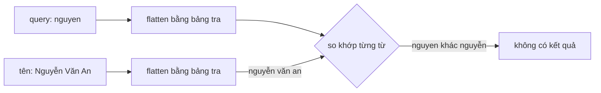

Người Việt gõ tìm bạn bè gần như luôn gõ không dấu: "nguyen van an", "hung", "duc". Ô tìm kiếm phải:

1. Coi "Nguyễn" và "nguyen" là một.
2. Cho từ cuối là **tiền tố** khi người dùng còn đang gõ ("nguy" khớp "Nguyễn"), nhưng từ đã gõ xong (có dấu cách phía sau) thì phải khớp đủ.
3. Tô đậm phần khớp ở **đầu từ**, không tô giữa từ ("an" không được tô "Văn").
4. Không tô đậm khi chữ viết có ghép nét (Ả Rập, Hindi, Thái…), vì chèn `<b>` vào giữa sẽ làm vỡ hình chữ.

Facebook làm đủ bốn việc trên trong hai module nhỏ, nhưng bảng gấp dấu của họ **không có chữ Việt**. Gõ "nguyen" trên bản mô phỏng không ra "Nguyễn".

> [!TIP]
> **Tóm tắt**
> - Facebook gấp chữ bằng bảng tra từng ký tự (Latin-1, Latin Extended-A, Cyrillic): "Hùng" → "hung" nhưng "Hưng", "Nguyễn" giữ nguyên dấu.
> - Highlight thêm một dấu cách vào đầu chuỗi rồi tìm `( từ1| từ2)` để chỉ khớp đầu từ; regex nhận diện chữ ghép nét gõ nhầm dấu gạch dài "–", nên "Hello – World" mất highlight.
> - Bản viết lại: `normalize('NFD')` + bỏ dấu (`\p{M}`), riêng "đ" xử lý tay; highlight tính trên chuỗi đã gấp rồi ánh xạ ngược về chuỗi gốc.
> - Nhận diện chữ ghép nét bằng `\p{Script=…}` thay vì liệt kê dải ký tự bằng tay.

<iframe class="demo-frame" src="/demos/facebook-patterns/index.html?theme=dark#/search-tokenize" title="Demo search-tokenize" loading="lazy" style="height: 760px"></iframe>

<p class="demo-links">▶ <a href="/demos/facebook-patterns/index.html#/search-tokenize" target="_blank" rel="noopener">Mở demo toàn màn hình ↗</a> · <a href="https://stackblitz.com/github/hunghg255/blog-hunghg/tree/master/examples/facebook-patterns?file=src/lib/searchTokenize.ts" target="_blank" rel="noopener">Sửa code trên StackBlitz ↗</a> · <a href="https://github.com/hunghg255/blog-hunghg/blob/master/examples/facebook-patterns/src/lib/searchTokenize.ts" target="_blank" rel="noopener">Xem source trên GitHub ↗</a></p>

## Facebook làm thế nào?

Hai module liên quan nằm trong bundle của [facebook-codebase](https://github.com/hunghg255/codebase/tree/main/facebook-codebase):

- `TokenizeUtil` (file `35.js`): gấp chữ, tách từ, các kiểu so khớp.
- `cometSearchTypeaheadHighlightUtils` (file `6.js`, có bản gần giống tên `cometTypeaheadHighlightUtils` trong thư mục `00 CometAppLoggedInNavigation/Search/`) và `mayHaveConnectedCharacters`.

### Gấp chữ bằng bảng tra

`TokenizeUtil` khai báo một object ánh xạ "chữ Latin → các biến thể", rồi đảo lại thành bảng tra từng ký tự (rút gọn, đã đổi tên biến):

```js
var n = {
  a: "а à á â ã ä å ā",   // chữ đầu tiên là "а" Cyrillic
  d: "д ð ď đ",
  e: "э е è é ê ë ě ē",
  u: "у ю ü û ú ù ů ū",
  ts: "ц", ch: "ч", sh: "ш", ya: "я", ss: "ß",
  // ...
};
function flatten(a) {
  a = a.toLowerCase();
  var b = "";
  for (var d = a.length; d--; ) b = (m[a.charAt(d)] || a.charAt(d)) + b;
  return b.replace(/[ ]+/g, " ");
}
```

Cách này gộp luôn **phiên âm Cyrillic** ("Привет" → "privet") và chữ ghép ("æ" → "ae", "ß" → "ss"). Nhưng bảng chỉ có những gì người viết liệt kê:

- Có `à á â ã`, `è é ê`, `ù ú`, `đ`, nên "Hùng" → "hung". Nhưng "Đức" → "dức": "đ" có trong bảng, "ứ" thì không.
- Không có `ư ơ ă`, không có các chữ hai dấu như `ễ ặ ữ` (dải Latin Extended Additional, U+1E00–U+1EFF). Kết quả `flatten("Nguyễn") = "nguyễn"`, `flatten("Hưng") = "hưng"`, nên gõ "nguyen" hay "hung" đều không ra.
- Cyrillic cũng thiếu: không có `ж`, `щ`, `ё`.

Bảng kết quả trong demo cho thấy rõ những chữ nào gấp đúng, chữ nào không.

### Tách từ và các kiểu khớp

Sau khi gấp, `TokenizeUtil` tách từ theo dấu cách hoặc theo một tập dấu câu rất rộng (có cả dấu câu CJK, Ả Rập, Devanagari). Kết quả parse được cache, tối đa **1000** mục; đầy thì **xoá sạch** cache rồi làm lại.

Hàm so khớp có 5 chế độ dùng chung một vòng lặp:

| Chế độ | Ý nghĩa |
|---|---|
| `exact` | mọi từ query phải trùng một từ đích |
| `query` | như exact, riêng từ cuối là tiền tố nếu query không kết thúc bằng dấu cách |
| `query_punc` | như `query` nhưng giữ dấu câu khi tách |
| `aligned` | các từ phải khớp **đúng thứ tự** |
| `prefix` | mọi từ đều là tiền tố, từ dài xét trước |

Mỗi từ đích chỉ được "dùng" một lần (mảng cờ `j[d] = !0`): query "an an" không khớp "Nguyễn Văn An" vì chỉ có một từ "an".

### Highlight chỉ ở đầu từ

```js
function g(query, text, markMatched) {
  if (mayHaveConnectedCharacters(text)) return [{ content: text, isMatched: false }];
  var re = new RegExp("( " + escapeRegex(query).split(/\s+/).join("| ") + ")", "gi");
  text = " " + text;          // để từ đầu tiên cũng có dấu cách đứng trước
  // ... cắt text thành các đoạn khớp / không khớp theo re.exec
}
```

Mẹo ở đây: thêm một dấu cách vào đầu chuỗi, rồi mỗi nhánh regex đều bắt đầu bằng dấu cách. Vậy regex chỉ khớp ở **sau dấu cách**, tức là đầu từ. Gõ "an" sẽ tô "**An**" nhưng không tô "V**an**".

Cách này có ba chỗ yếu:

1. Regex chạy trên **chuỗi gốc**, không gấp dấu. Dù phần so khớp có đúng thì gõ "nguyen" cũng không tô được "Nguyễn".
2. "Đầu từ" chỉ là "sau dấu cách": "(An)" hay "Anh-Quân" không được tô.
3. Query có dấu cách ở cuối, ví dụ "anh ", tạo ra `split` có phần tử rỗng, regex thành `( anh| )`: **mọi dấu cách** trong chuỗi đều bị đánh dấu là khớp. Mình chạy lại bằng Node: "Nguyễn Văn Nam" với query "ng " cho ra `[Ng]uyễn[ ]Văn[ ]Nam`.

### Bug dấu gạch dài trong `mayHaveConnectedCharacters`

```js
a.match(/[ऀ-ॿ ... ؀-ۿݐ–ݿࢠ–ࣿﭐ–﷿ﹰ– ...]/)
```

Ba dải cuối dùng dấu "–" (U+2013, en dash) thay cho dấu trừ "-". Trong một lớp ký tự (character class), `ݐ–ݿ` không phải là dải mà là **ba ký tự**: U+0750, "–", U+077F. Hệ quả (mình chạy lại bằng Node):

- Chữ Ả Rập dạng trình bày như "ﻻ" (U+FEFB) **không** được nhận ra là chữ ghép nét → bị chèn highlight.
- Chuỗi bất kỳ có ký tự "–" như "Hello – World" **bị coi là** chữ ghép nét → mất highlight. Gõ "hello" trong demo: cột Facebook vẫn tìm ra nhưng không tô đậm.

Có lẽ dấu "–" lọt vào khi ai đó chép bảng dải Unicode từ một trang web (trình soạn thảo tự đổi "-" thành "–").



## Bên trong trình duyệt: NFD và dấu tổ hợp

Unicode có hai cách viết "ễ":

- **NFC** (dạng dựng sẵn): một code point U+1EC5.
- **NFD** (dạng tách): "e" + U+0302 (dấu mũ) + U+0303 (dấu ngã).

`String.prototype.normalize('NFD')` chuyển sang dạng tách. Các dấu tổ hợp (combining mark) đều thuộc nhóm `\p{M}` trong regex Unicode, nên xoá chúng là ra chữ gốc:

```js
'Nguyễn Hưng Đặng'.normalize('NFD').replace(/\p{M}/gu, '') // "Nguyen Hung Đang"
```

Chỉ còn "đ" không tách được (nó là chữ riêng, không phải "d" + dấu), nên phải xử lý tay. Tương tự với "ł", "ø", "æ", "ß".

## Viết lại

Gấp từng ký tự và giữ **bảng ánh xạ vị trí** để sau này cắt highlight trên chuỗi gốc:

```ts title=src/lib/searchTokenize.ts
const COMBINING_MARKS = /\p{M}/gu;

/** Gấp MỘT ký tự (code point) thành chuỗi Latin thường, có thể rỗng hoặc dài hơn 1. */
export function foldChar(ch: string): string {
  const lower = ch.toLowerCase();
  if (lower in SPECIAL) return SPECIAL[lower];
  if (lower in CYRILLIC) return CYRILLIC[lower];
  // NFD tách "ễ" thành "e" + dấu mũ + dấu ngã; bỏ hết dấu (category M)
  return lower.normalize('NFD').replace(COMBINING_MARKS, '');
}

/**
 * Gấp cả chuỗi và giữ bảng ánh xạ: map[i] = vị trí (UTF-16) trong chuỗi gốc
 * của ký tự gấp thứ i. Cần cho highlight trên chuỗi gốc.
 */
export function foldWithMap(text: string): { folded: string; map: number[] } {
  let folded = '';
  const map: number[] = [];
  let offset = 0;
  // for..of duyệt theo code point, không cắt đôi cặp surrogate (emoji, chữ Hán hiếm)
  for (const ch of text) {
    const f = foldChar(ch);
    for (let k = 0; k < f.length; k++) map.push(offset);
    folded += f;
    offset += ch.length;
  }
  map.push(offset); // vị trí "sau ký tự cuối", để cắt substring
  return { folded, map };
}

export const fold = (text: string) => foldWithMap(text).folded;
```

Vài điểm:

- Duyệt bằng `for...of` để đi theo code point, không cắt đôi cặp surrogate của emoji hay chữ Hán hiếm.
- Một ký tự gốc có thể gấp thành **nhiều** ký tự ("щ" → "shch", "ß" → "ss") hoặc **không** ký tự nào ("ъ", hay dấu tổ hợp nếu chuỗi gốc đã ở dạng NFD). `map[i]` luôn trỏ về vị trí của ký tự gốc sinh ra ký tự gấp thứ `i`.

So khớp giữ đúng ngữ nghĩa của Facebook (từ cuối là tiền tố, mỗi từ đích dùng một lần), thêm một cải tiến: xét **từ dài trước** để "an anh" khớp được "Anh An" (nếu xét "an" trước, nó có thể chiếm mất từ "anh"):

```ts title=src/lib/searchTokenize.ts
export function isQueryMatch(
  query: string,
  target: string,
  mode: 'query' | 'prefix' = 'query',
): boolean {
  const { tokens, lastIsPrefix } = parseQuery(query);
  if (tokens.length === 0) return false;
  const targetTokens = tokenize(fold(target));
  const used = new Set<number>();
  // từ dài trước: tránh từ ngắn "chiếm" mất từ đích mà từ dài cần (vd "an" và "anh")
  const order = tokens.map((t, i) => ({ t, i })).sort((a, b) => b.t.length - a.t.length);
  return order.every(({ t, i }) => {
    const prefixOk = mode === 'prefix' || (lastIsPrefix && i === tokens.length - 1);
    const index = targetTokens.findIndex(
      (tt, j) => !used.has(j) && (tt === t || (prefixOk && tt.startsWith(t))),
    );
    if (index === -1) return false;
    used.add(index);
    return true;
  });
}
```

Highlight duyệt các **từ** trên chuỗi đã gấp (dãy chữ và số), tô phần đầu dài nhất trùng một từ của query, rồi đổi vị trí về chuỗi gốc qua `map`:

```ts title=src/lib/searchTokenize.ts
export function highlightMatch(query: string, text: string): Segment[] {
  const { tokens } = parseQuery(query);
  if (tokens.length === 0 || mayHaveConnectedCharacters(text)) return [{ text, matched: false }];

  const { folded, map } = foldWithMap(text);
  // các khoảng [start, end) trên chuỗi GẤP cần tô
  const ranges: Array<[number, number]> = [];
  const wordStart = /[\p{L}\p{N}]+/gu;
  for (let m = wordStart.exec(folded); m; m = wordStart.exec(folded)) {
    // lấy từ query dài nhất là tiền tố của từ này (gõ "ng nguy" thì tô "Nguy")
    let best = 0;
    for (const t of tokens) if (t.length > best && m[0].startsWith(t)) best = t.length;
    if (best > 0) ranges.push([m.index, m.index + best]);
  }
  if (ranges.length === 0) return [{ text, matched: false }];

  const segments: Segment[] = [];
  let cursor = 0;
  for (const [start, end] of ranges) {
    const from = map[start];
    // end là "sau ký tự gấp cuối": lấy vị trí gốc của ký tự gấp kế tiếp. Một ký tự gốc
    // có thể gấp ra nhiều ký tự ("щ" -> "shch"); khi đó tô trọn ký tự gốc.
    let to = map[end];
    if (end > start && map[end - 1] === map[end]) to = nextOriginalBoundary(map, end);
    if (from > cursor) segments.push({ text: text.slice(cursor, from), matched: false });
    segments.push({ text: text.slice(from, to), matched: true });
    cursor = to;
  }
  if (cursor < text.length) segments.push({ text: text.slice(cursor), matched: false });
  return segments;
}
```

**Khác bản gốc:**

- Gấp dấu bằng NFD thay cho bảng tra, nên đủ mọi chữ Latin có dấu (Việt, Séc, Ba Lan…). Phiên âm Cyrillic vẫn dùng bảng, nhưng đủ chữ hơn.
- Highlight trên chuỗi gấp, "đầu từ" là sau bất kỳ ký tự không phải chữ/số, và bỏ qua phần tử rỗng của query (không còn lỗi tô dấu cách).
- Chữ ghép nét nhận diện bằng `\p{Script=Arabic}`, `\p{Script=Devanagari}`… Bản gốc có liệt kê cả dải chữ Hán (`一-龯`) dù chữ Hán không ghép nét; bản viết lại không gộp chữ Hán vào nhóm này.
- Cache xoá mục cũ nhất thay vì xoá sạch.

::: spoiler Xem toàn bộ src/lib/searchTokenize.ts

```ts title=src/lib/searchTokenize.ts
/**
 * Tìm kiếm "gõ không dấu vẫn ra" + tô đậm đúng đầu từ (ý tưởng từ TokenizeUtil và
 * cometSearchTypeaheadHighlightUtils của Facebook).
 *
 * Khác bản gốc:
 * - Gấp dấu bằng Unicode NFD thay cho bảng tra từng ký tự, nên đủ cả tiếng Việt
 *   ("Nguyễn" -> "nguyen", "Hưng" -> "hung"); bảng của Facebook thiếu ư, ơ, ă, ễ…
 * - Highlight tính trên chuỗi đã gấp rồi ánh xạ ngược về chuỗi gốc, nên gõ "nguyen"
 *   vẫn tô được "Nguyễn".
 * - Nhận diện chữ "nối nét" bằng Unicode Script, không dùng dải ký tự viết tay
 *   (bản gốc gõ nhầm dấu gạch dài "–" nên vài dải không còn là dải).
 */

// ---- 1. Gấp chữ: lowercase + bỏ dấu + phiên âm Cyrillic ----

/** Các chữ không tách được bằng NFD (không phải "chữ gốc + dấu"). */
const SPECIAL: Record<string, string> = {
  đ: 'd',
  ð: 'd',
  ł: 'l',
  ø: 'o',
  ħ: 'h',
  ı: 'i',
  æ: 'ae',
  œ: 'oe',
  ß: 'ss',
  þ: 'th',
};

/** Phiên âm Cyrillic cơ bản (kiểu hộ chiếu Nga), để "privet" tìm ra "Привет". */
const CYRILLIC: Record<string, string> = {
  а: 'a', б: 'b', в: 'v', г: 'g', д: 'd', е: 'e', ё: 'e', ж: 'zh', з: 'z', и: 'i', й: 'i',
  к: 'k', л: 'l', м: 'm', н: 'n', о: 'o', п: 'p', р: 'r', с: 's', т: 't', у: 'u', ф: 'f',
  х: 'kh', ц: 'ts', ч: 'ch', ш: 'sh', щ: 'shch', ъ: '', ы: 'y', ь: '', э: 'e', ю: 'iu', я: 'ia',
  і: 'i', ї: 'i', є: 'ie', ґ: 'g',
};

const COMBINING_MARKS = /\p{M}/gu;

/** Gấp MỘT ký tự (code point) thành chuỗi Latin thường, có thể rỗng hoặc dài hơn 1. */
export function foldChar(ch: string): string {
  const lower = ch.toLowerCase();
  if (lower in SPECIAL) return SPECIAL[lower];
  if (lower in CYRILLIC) return CYRILLIC[lower];
  // NFD tách "ễ" thành "e" + dấu mũ + dấu ngã; bỏ hết dấu (category M)
  return lower.normalize('NFD').replace(COMBINING_MARKS, '');
}

/**
 * Gấp cả chuỗi và giữ bảng ánh xạ: map[i] = vị trí (UTF-16) trong chuỗi gốc
 * của ký tự gấp thứ i. Cần cho highlight trên chuỗi gốc.
 */
export function foldWithMap(text: string): { folded: string; map: number[] } {
  let folded = '';
  const map: number[] = [];
  let offset = 0;
  // for..of duyệt theo code point, không cắt đôi cặp surrogate (emoji, chữ Hán hiếm)
  for (const ch of text) {
    const f = foldChar(ch);
    for (let k = 0; k < f.length; k++) map.push(offset);
    folded += f;
    offset += ch.length;
  }
  map.push(offset); // vị trí "sau ký tự cuối", để cắt substring
  return { folded, map };
}

export const fold = (text: string) => foldWithMap(text).folded;

// ---- 2. Tách từ ----

/** Ranh giới từ: mọi thứ không phải chữ hoặc số (gồm cả dấu câu CJK, Ả Rập…). */
const SEPARATOR = /[^\p{L}\p{N}]+/u;

export function tokenize(folded: string): string[] {
  return folded.split(SEPARATOR).filter(Boolean);
}

export interface ParsedQuery {
  tokens: string[];
  /** từ cuối đang gõ dở -> so khớp kiểu tiền tố */
  lastIsPrefix: boolean;
}

// Cache kết quả parse: người dùng gõ "ng", "ngu", "nguy"… lặp lại cùng chuỗi rất nhiều.
// Facebook giới hạn 1000 mục và xoá SẠCH khi đầy; ở đây xoá mục cũ nhất (Map giữ thứ tự chèn).
const CACHE_LIMIT = 1000;
const parseCache = new Map<string, ParsedQuery>();

export function parseQuery(query: string): ParsedQuery {
  const hit = parseCache.get(query);
  if (hit) return hit;
  const folded = fold(query);
  const parsed = {
    tokens: tokenize(folded),
    // gõ "nguyen " (có dấu cách cuối) nghĩa là đã gõ xong từ đó
    lastIsPrefix: folded.length > 0 && !/\s$/u.test(folded),
  };
  if (parseCache.size >= CACHE_LIMIT) parseCache.delete(parseCache.keys().next().value!);
  parseCache.set(query, parsed);
  return parsed;
}

/**
 * Mọi từ của query phải khớp một từ KHÁC NHAU của target (không dùng lại một từ hai lần).
 * Từ cuối đang gõ dở thì chỉ cần là tiền tố; các từ trước phải là tiền tố hoặc khớp đủ
 * tuỳ `mode`.
 */
export function isQueryMatch(
  query: string,
  target: string,
  mode: 'query' | 'prefix' = 'query',
): boolean {
  const { tokens, lastIsPrefix } = parseQuery(query);
  if (tokens.length === 0) return false;
  const targetTokens = tokenize(fold(target));
  const used = new Set<number>();
  // từ dài trước: tránh từ ngắn "chiếm" mất từ đích mà từ dài cần (vd "an" và "anh")
  const order = tokens.map((t, i) => ({ t, i })).sort((a, b) => b.t.length - a.t.length);
  return order.every(({ t, i }) => {
    const prefixOk = mode === 'prefix' || (lastIsPrefix && i === tokens.length - 1);
    const index = targetTokens.findIndex(
      (tt, j) => !used.has(j) && (tt === t || (prefixOk && tt.startsWith(t))),
    );
    if (index === -1) return false;
    used.add(index);
    return true;
  });
}

// ---- 3. Highlight đầu từ ----

/**
 * Chữ viết có ghép nét: chèn <b> vào giữa sẽ phá hình chữ (ligature, dạng đầu/giữa/cuối
 * từ của chữ Ả Rập…), nên không highlight. Dùng Script property thay cho dải viết tay.
 */
const CONNECTED_SCRIPTS =
  /[\p{Script=Arabic}\p{Script=Syriac}\p{Script=Devanagari}\p{Script=Bengali}\p{Script=Gurmukhi}\p{Script=Gujarati}\p{Script=Oriya}\p{Script=Tamil}\p{Script=Telugu}\p{Script=Kannada}\p{Script=Malayalam}\p{Script=Sinhala}\p{Script=Thai}\p{Script=Lao}\p{Script=Tibetan}\p{Script=Myanmar}\p{Script=Khmer}\p{Script=Mongolian}]/u;

export const mayHaveConnectedCharacters = (text: string) => CONNECTED_SCRIPTS.test(text);

export interface Segment {
  text: string;
  matched: boolean;
}

/**
 * Tô đậm phần đầu những từ khớp với query, tính trên chuỗi đã gấp rồi cắt trên chuỗi gốc.
 * "nguyen" tô được "Nguyễn"; "an" tô được "(An)" vì đầu từ là sau bất kỳ ký tự không
 * phải chữ/số, không chỉ sau dấu cách.
 */
export function highlightMatch(query: string, text: string): Segment[] {
  const { tokens } = parseQuery(query);
  if (tokens.length === 0 || mayHaveConnectedCharacters(text)) return [{ text, matched: false }];

  const { folded, map } = foldWithMap(text);
  // các khoảng [start, end) trên chuỗi GẤP cần tô
  const ranges: Array<[number, number]> = [];
  const wordStart = /[\p{L}\p{N}]+/gu;
  for (let m = wordStart.exec(folded); m; m = wordStart.exec(folded)) {
    // lấy từ query dài nhất là tiền tố của từ này (gõ "ng nguy" thì tô "Nguy")
    let best = 0;
    for (const t of tokens) if (t.length > best && m[0].startsWith(t)) best = t.length;
    if (best > 0) ranges.push([m.index, m.index + best]);
  }
  if (ranges.length === 0) return [{ text, matched: false }];

  const segments: Segment[] = [];
  let cursor = 0;
  for (const [start, end] of ranges) {
    const from = map[start];
    // end là "sau ký tự gấp cuối": lấy vị trí gốc của ký tự gấp kế tiếp. Một ký tự gốc
    // có thể gấp ra nhiều ký tự ("щ" -> "shch"); khi đó tô trọn ký tự gốc.
    let to = map[end];
    if (end > start && map[end - 1] === map[end]) to = nextOriginalBoundary(map, end);
    if (from > cursor) segments.push({ text: text.slice(cursor, from), matched: false });
    segments.push({ text: text.slice(from, to), matched: true });
    cursor = to;
  }
  if (cursor < text.length) segments.push({ text: text.slice(cursor), matched: false });
  return segments;
}

function nextOriginalBoundary(map: number[], index: number) {
  const current = map[index];
  for (let i = index; i < map.length; i++) if (map[i] !== current) return map[i];
  return map[map.length - 1];
}
```

:::

## Tại sao không làm cách khác?

**Dùng `localeCompare` hay `Intl.Collator` với `sensitivity: 'base'`?** Collator so sánh **cả chuỗi** ("nguyen" bằng "Nguyễn"), nhưng không cho biết tiền tố hay vị trí để highlight. Ta cần một chuỗi gấp sẵn để `startsWith` và để cắt.

**Gấp cả chuỗi bằng một lần `normalize('NFD').replace(...)` rồi highlight theo chỉ số?** Chỉ số trên chuỗi gấp lệch so với chuỗi gốc ngay khi gặp chữ có dấu (NFD dài hơn) hoặc chữ gấp ra nhiều ký tự. Phải có bảng ánh xạ như `foldWithMap`.

**Tô highlight bằng regex không dấu cách, kiểu `\b`?** `\b` trong JS chỉ hiểu `[A-Za-z0-9_]`, nên coi "ễ" là ranh giới từ: "Nguy**ễ**n" bị cắt giữa từ. Dùng `\p{L}` với cờ `u` mới đúng cho chữ ngoài ASCII.

## Edge case và cạm bẫy

- **Chuỗi gốc ở dạng NFD.** Tên copy từ macOS (tên file) đôi khi ở dạng NFD. `foldWithMap` vẫn đúng vì dấu tổ hợp gấp thành chuỗi rỗng và được gộp vào ký tự đứng trước khi cắt.
- **"đ" và "Đ".** NFD không tách được, phải có trong bảng `SPECIAL`. Quên dòng này là "Đức" không ra khi gõ "duc".
- **Phiên âm nhiều cách.** "Щукин" có thể viết "Shchukin" hoặc "Schukin". Bảng chỉ chọn một cách; muốn tìm cả hai thì phải sinh nhiều biến thể cho chuỗi đích.
- **Gõ tiếng Việt bằng bộ gõ.** Khi đang gõ "ngu" + phím dấu, giá trị `input` có thể ở trạng thái trung gian. Nếu tìm theo `onChange` thì vẫn chạy đúng vì mỗi lần đều gấp lại toàn bộ query.
- **Chữ Hán, chữ Nhật.** Không có khái niệm "đầu từ" theo dấu cách. Bản viết lại coi cả cụm chữ liền nhau là một từ; muốn tách đúng thì dùng `Intl.Segmenter` với `granularity: 'word'`.

## Dùng trong dự án

```tsx
const results = contacts.filter((c) => isQueryMatch(query, c.name));

{results.map((c) => (
  <li key={c.id}>
    {highlightMatch(query, c.name).map((s, i) => (s.matched ? <mark key={i}>{s.text}</mark> : s.text))}
  </li>
))}
```

Với danh sách lớn (vài chục nghìn liên hệ), nên gấp sẵn tên một lần khi tải dữ liệu thay vì gấp lại mỗi lần gõ.

## Kiểm thử

::: spoiler Ví dụ test (bản phác, không có trong repo)

```ts
import { describe, expect, it } from 'vitest';
import { fold, highlightMatch, isQueryMatch, mayHaveConnectedCharacters } from './searchTokenize';

const marks = (q: string, t: string) =>
  highlightMatch(q, t).map((s) => (s.matched ? `[${s.text}]` : s.text)).join('');

describe('searchTokenize', () => {
  it('gấp dấu tiếng Việt, đ và Cyrillic', () => {
    expect(fold('Nguyễn Hưng Đặng')).toBe('nguyen hung dang');
    expect(fold('Привет Жуков')).toBe('privet zhukov');
  });

  it('từ cuối là tiền tố, từ đã gõ xong phải khớp đủ', () => {
    expect(isQueryMatch('nguy', 'Nguyễn Văn An')).toBe(true);
    expect(isQueryMatch('nguy ', 'Nguyễn Văn An')).toBe(false);
    expect(isQueryMatch('van ng', 'Nguyễn Văn An')).toBe(true);
    expect(isQueryMatch('an an', 'Nguyễn Văn An')).toBe(false);
  });

  it('highlight trên chuỗi gốc, đầu từ sau dấu câu', () => {
    expect(marks('nguyen', 'Nguyễn Văn An')).toBe('[Nguyễn] Văn An');
    expect(marks('an', '(An) Bình')).toBe('([An]) Bình');
    expect(marks('ng ', 'Nguyễn Văn Nam')).toBe('[Ng]uyễn Văn Nam');
  });

  it('nhận diện chữ ghép nét đúng, không nhầm dấu gạch dài', () => {
    expect(mayHaveConnectedCharacters('ﻻ')).toBe(true);
    expect(mayHaveConnectedCharacters('Hello – World')).toBe(false);
  });
});
```

:::

## So với chuẩn web và thư viện

- `String.prototype.normalize` và regex Unicode property escapes (`\p{M}`, `\p{Script=…}`) đều có trên các trình duyệt chính (Chrome, Firefox, Safari, tính tới 10/2026).
- `Intl.Collator` hợp cho **sắp xếp** và so sánh bằng nhau không phân biệt dấu, không hợp cho tìm tiền tố và highlight.
- `Intl.Segmenter` tách từ đúng cho cả tiếng Nhật, tiếng Thái; có thể thay `SEPARATOR` khi cần.
- Các thư viện fuzzy search phổ biến (Fuse.js, MiniSearch…) cho phép cấu hình hàm chuẩn hoá; vẫn nên truyền hàm gấp dấu kiểu NFD như trên để người dùng gõ không dấu tìm được.

---

Bài này thuộc series **[Học từ mã nguồn Facebook](/series/facebook)** (106 bài, đọc theo thứ tự).

::: spoiler Xem nhanh danh sách bài trong series

*Phần 1*

- [Mở đầu: cách đọc code minify của Facebook](/blogs/learn-from-facebook-source-code)
- [#1 Dùng chung IntersectionObserver + infinite scroll](/blogs/facebook-shared-intersection-observer)
- [#2 useViewportDuration: đo thời gian thực sự được xem](/blogs/facebook-use-viewport-duration)
- [#3 Preload code + data khi hover](/blogs/facebook-preload-on-hover)
- [#4 Toast manager với external store](/blogs/facebook-toast-manager)
- [#5 Network status + heartbeat backoff](/blogs/facebook-network-status-heartbeat)
- [#6 ErrorGuard: bắt lỗi theo ngữ cảnh](/blogs/facebook-error-guard)
- [#7 Banzai: gom log theo lô + sendBeacon](/blogs/facebook-batch-logger)
- [#8 Focus trap + Esc theo layer](/blogs/facebook-focus-trap)

*Phần 2*

- [#9 Mẹo calc(… * 9999): container query, line-clamp, mũi tên carousel bằng CSS](/blogs/facebook-css-9999-trick)
- [#10 Thanh cuộn tuỳ biến bằng CSS 3D](/blogs/facebook-css-3d-scrollbar)
- [#11 Modal cuộn bằng window, giữ vị trí trang nền](/blogs/facebook-document-scroll-modal)
- [#12 Popover, tooltip group và hovercard](/blogs/facebook-popover-tooltip)
- [#13 Primitive Pressable + focus-visible](/blogs/facebook-pressable)
- [#14 Tab "Xem thêm" + sticky header bằng IntersectionObserver](/blogs/facebook-priority-tabs-sticky-header)
- [#15 Avatar khoét mask, gradient Messenger, skeleton steps()](/blogs/facebook-visual-tricks)
- [#16 Khung chat không giật](/blogs/facebook-chat-scroller)
- [#17 Thuật toán chọn bố cục collage ảnh](/blogs/facebook-photo-collage-layout)
- [#18 Keep-alive tab trong SPA](/blogs/facebook-keep-alive-tabs)
- [#19 Tự đo Visual Completion & interaction tracing](/blogs/facebook-visual-completion)
- [#20 Router SPA bền bỉ & tải chunk có retry](/blogs/facebook-spa-router-resilient-loading)

*Phần 3*

- [#21 Smart Compose: gợi ý chữ mờ khi gõ](/blogs/facebook-smart-compose-ghost-text)
- [#22 MQTT ngay trong trình duyệt, tự chuyển sang long-poll](/blogs/facebook-mqtt-in-browser)
- [#23 Đo thời gian dùng bằng bitmap 64 giây](/blogs/facebook-time-spent-bitmap)
- [#24 Bảng reaction nhấn giữ rồi trượt](/blogs/facebook-reaction-press-slide)
- **#25 Tìm kiếm gấp dấu, phiên âm và highlight đầu từ** (bài này)
- [#26 Ring buffer biết trace nào đã mất log](/blogs/facebook-trace-ring-buffer)
- [#27 Engine animation JS: một vòng rAF và solver cubic-bezier](/blogs/facebook-keyframes-loop-cubic-bezier)
- [#28 Bootloader: bitmap tài nguyên đã tải, chỉ reload khi cần](/blogs/facebook-bootloader-bitmap-consistency)
- [#29 Nhận biết click do screen reader tạo ra](/blogs/facebook-virtual-cursor-detection)
- [#30 Tải trước feed theo chất lượng mạng, đoán hạng thiết bị](/blogs/facebook-network-aware-prefetch)
- [#31 Hàng đợi gửi tin chat giữ đúng thứ tự](/blogs/facebook-ordered-send-queue)
- [#32 Gộp lời gọi API trong cùng một tick](/blogs/facebook-api-batcher)
- [#33 Resize ảnh trong pool Web Worker](/blogs/facebook-jpeg-resize-worker-pool)
- [#34 Crop ảnh theo nhiều khuôn mặt](/blogs/facebook-face-aware-crop)
- [#35 Kéo-thả sắp xếp và vùng thả file không nhấp nháy](/blogs/facebook-flicker-free-drag-drop)
- [#36 Tiện ích UI: fade-out, sticky event, hàm huỷ được](/blogs/facebook-ui-utility-hooks)
- [#37 Hạ tầng nhỏ: cookie, hash lỗi, prefetch khi chuột dừng](/blogs/facebook-small-infra-cookie-hash-idle)

*Phần 4–6*

- [#38 Đồng bộ tin nhắn: phát hiện lỗ seqID và fetch bù theo tầng](/blogs/facebook-messenger-sync-seqid-gaps)
- [#39 OTID: ID tin nhắn kiểu Snowflake sinh ở client](/blogs/facebook-otid-client-snowflake)
- [#40 QPL: lấy mẫu từ lúc bắt đầu, đo RTT gửi tin đầu-cuối](/blogs/facebook-qpl-send-rtt)
- [#41 Bộ điều phối request bảy chế độ gộp và chống trùng](/blogs/facebook-request-dispatcher-modes)
- [#42 Thread list theo mốc thời gian, cookie presence có version](/blogs/facebook-threadlist-ranged-presence)
- [#43 Composer dạng plugin: reducer, dirty checker, chuỗi kiểm tra](/blogs/facebook-plugin-composer)
- [#44 Thanh toán bất đồng bộ: subscribe trước, poll dự phòng](/blogs/facebook-async-checkout)
- [#45 Validate số thẻ: sửa lỗi gõ, dải BIN, Luhn](/blogs/facebook-card-validation)
- [#46 Lịch chọn khoảng ngày: bo góc dải chọn, phím đủ bộ, RTL](/blogs/facebook-range-calendar-a11y)
- [#47 Giờ mở cửa theo tuần: qua đêm, gộp khoảng, phần bù](/blogs/facebook-weekly-hours-intervals)
- [#48 Tiến độ đăng realtime: giữ event chờ snapshot, watchdog](/blogs/facebook-realtime-publish-snapshot)
- [#49 Tiền tệ theo đơn vị nhỏ nhất và ô nhập tiền](/blogs/facebook-currency-minor-units)
- [#50 Sửa hàng loạt Empty/Uniform/Mixed, seen/read bằng 2 bit](/blogs/facebook-bulk-edit-seen-bits)
- [#51 Phát hiện script lạ hook vào hàm native](/blogs/facebook-native-hook-detection)
- [#52 localStorage tự dọn khi đầy quota](/blogs/facebook-quota-aware-storage)
- [#53 Cache tuyến do server phân giải, chờ sẵn promise](/blogs/facebook-route-cache-prefetch)
- [#54 Lưới phím mũi tên 2D và focus không làm cuộn trang](/blogs/facebook-focus-table-grid)
- [#55 Tách emoji bằng máy trạng thái](/blogs/facebook-emoji-segmentation)
- [#56 Đọc trước ghi sau trong một frame, con tự biết vị trí](/blogs/facebook-read-then-write-dom)
- [#57 Hàng đợi lệnh cho video và stream sắp lại chunk](/blogs/facebook-video-command-queue)

*Phần 7–10*

- [#58 Ước lượng băng thông EWMA: loại outlier, nhớ qua phiên](/blogs/facebook-bandwidth-ewma-estimator)
- [#59 ABR theo độ tự tin phát và cắt bậc bitrate theo MOS](/blogs/facebook-abr-playback-confidence)
- [#60 Prefetch segment dự đoán từ manifest, parse hộp sidx](/blogs/facebook-dash-predicted-segments)
- [#61 Đọc metadata MP4/MOV ngay trên client](/blogs/facebook-mp4-metadata-client)
- [#62 Upload tiếp tục được: offset, hash dedupe, phát hiện treo](/blogs/facebook-resumable-upload)
- [#63 Fenwick tree: chọn ngẫu nhiên có trọng số và offset dòng](/blogs/facebook-fenwick-weighted-random)
- [#64 Vạch trục số và trục thời gian "đẹp"](/blogs/facebook-nice-axis-ticks)
- [#65 Damerau-Levenshtein theo dải chéo và tự sửa tên gõ sai](/blogs/facebook-damerau-levenshtein)
- [#66 PRNG có seed, shuffle tái lập và lấy mẫu trace](/blogs/facebook-seeded-prng-sampling)
- [#67 Cặp min/max-heap tái dùng vị trí trong danh sách ảo](/blogs/facebook-dual-heap-buffer-set)
- [#68 Memo nhiều đối số bằng Map/WeakMap và interning object](/blogs/facebook-multikey-memo-interning)
- [#69 Thống kê cửa sổ trượt và đại số khoảng thời gian](/blogs/facebook-moving-stat-intervals)
- [#70 Int64 từ hai số 32-bit, decode UTF, offset theo code point](/blogs/facebook-int64-utf-codepoints)
- [#71 Engine múi giờ IANA trên client, phát hiện lệch giờ](/blogs/facebook-client-iana-timezone)
- [#72 Tự cài semver range](/blogs/facebook-semver-range)
- [#73 Auto-link URL, cắt chữ an toàn, giới hạn LaTeX](/blogs/facebook-autolink-safe-truncate)
- [#74 Parser query kiểu PHP chống prototype pollution](/blogs/facebook-php-query-serializer)
- [#75 Popover tự lật theo phần tràn nhỏ nhất](/blogs/facebook-popover-auto-flip)
- [#76 Tiền tố for(;;) chống JSON hijacking, đọc stream](/blogs/facebook-csrf-prefix-streaming)
- [#77 Chống lộ Referer, linkshim, xoá token trên URL](/blogs/facebook-referrer-linkshim-url-scrub)
- [#78 setImmediate bằng postMessage, gom delta chuột theo frame](/blogs/facebook-setimmediate-mouse-batching)
- [#79 Phát hiện crash qua heartbeat, dò proxy cache hỏng](/blogs/facebook-crash-heartbeat-proxy-check)
- [#80 DPR vào cookie cho ảnh @2x, che khoá trong log](/blogs/facebook-dpr-cookie-secret-redaction)
- [#81 Flux waitFor tự viết và proxy có đệm](/blogs/facebook-flux-dispatch-buffered-proxy)
- [#82 Crop đúng tỉ lệ, xoay sticker bằng ma trận](/blogs/facebook-image-crop-rotation-geometry)

*Phần 11–15*

- [#83 Chia subdomain giữa các tab bằng lease, long-poll theo bảng trạng thái](/blogs/facebook-tab-subdomain-lease-longpoll)
- [#84 MQTT QoS1: giữ publish chờ ack, gửi lại khi kết nối lại](/blogs/facebook-mqtt-qos1-republish)
- [#85 Cache Promise gộp request, cache lỗi ngắn, đua dữ liệu nhúng sẵn](/blogs/facebook-promise-cache-preload-race)
- [#86 Lịch retry: backoff có trần, Fibonacci, báo lỗi CDN mỗi N ngày](/blogs/facebook-retry-backoff-schedules)
- [#87 Giữ nguyên tham chiếu nhánh dữ liệu không đổi](/blogs/facebook-relay-recycle-nodes)
- [#88 Store optimistic: copy-on-write, rollback rồi áp lại](/blogs/facebook-relay-optimistic-store)
- [#89 Chỉ mục subscription theo record, hàng đợi task theo chiều sâu](/blogs/facebook-relay-subscription-index)
- [#90 Phân trang connection: cursor khớp đầu, edge không trùng](/blogs/facebook-relay-connection-pagination)
- [#91 Profiler kiểu middleware và memo selector có lấy mẫu kiểm tra](/blogs/facebook-profiler-middleware-memo-check)
- [#92 Đọc EBML/WebM Cues để tìm byte range của segment](/blogs/facebook-webm-ebml-cues)
- [#93 Stream HTTP Range tạm dừng được, tải tiếp đúng byte](/blogs/facebook-pausable-range-stream)
- [#94 Bảng khoảng thời gian gắn nhãn và nhảy qua lỗ buffer](/blogs/facebook-tagged-time-ranges-gaps)
- [#95 Gom chunk cho SourceBuffer, đồng bộ video bằng playbackRate](/blogs/facebook-sourcebuffer-video-sync)
- [#96 Gom tin nhắn thành cụm, vạch ngày và avatar đã xem](/blogs/facebook-message-grouping)
- [#97 Bao nhiêu tab chat vừa màn hình, chuỗi luật mở tab](/blogs/facebook-chat-tab-policy)
- [#98 Phím tắt Markdown trong editor, Backspace để hoàn tác](/blogs/facebook-markdown-shortcuts-editor)
- [#99 Offset theo code point hay UTF-16: bốn bug cùng một gốc](/blogs/facebook-codepoint-offset-bugs)
- [#100 Typeahead không nhảy: cache tiền tố, chặn reflow, khoá hover](/blogs/facebook-typeahead-stable-results)
- [#101 Hit-test trên canvas bằng phát lại path, nét đứt và cung Bézier](/blogs/facebook-canvas-hit-regions)
- [#102 Vòng tròn theo mét trên bản đồ Mercator](/blogs/facebook-mercator-meter-circles)
- [#103 Dò tính năng trình duyệt: ảnh EXIF 2×1, getter bẫy, scrollbar](/blogs/facebook-feature-probe-tricks)
- [#104 Bug định dạng số và kiểm tra dữ liệu theo locale](/blogs/facebook-locale-validation-bugs)
- [#105 Dispose cho đúng: idle callback, splice(-1), xoá nhầm key](/blogs/facebook-dispose-leak-bugs)

:::

Code + demo: [`examples/facebook-patterns`](https://github.com/hunghg255/blog-hunghg/tree/master/examples/facebook-patterns) · [Mở trên StackBlitz](https://stackblitz.com/github/hunghg255/blog-hunghg/tree/master/examples/facebook-patterns)
