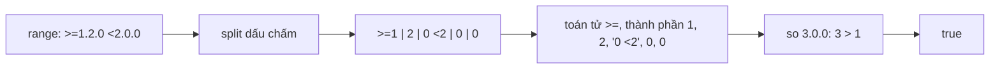

"Phiên bản 3.0.0 có nằm trong `>=1.2.0 <2.0.0` không?" Câu trả lời hiển nhiên là không. Nhưng hàm kiểm tra phiên bản trong bundle Facebook trả lời **có**, và không báo lỗi gì.

Hàm đó là `VersionRange.contains`, nền của `UserAgent.isBrowser('Chrome >= 100')` và `UserAgent.isPlatform('iOS < 15')`, các điều kiện mà code giao diện dùng để bật tắt tính năng theo trình duyệt. Bài này đọc nó, liệt kê các chỗ nó lệch với cách npm hiểu cùng một chuỗi, rồi viết lại một bản nhỏ khớp npm semver (fuzz 400.000 ca, chỉ lệch vài ca, đều ở một góc riêng của npm).

> [!TIP]
> **Tóm tắt**
> - `VersionRange` tách `||`, rồi tách khoảng gạch nối `a - b`, rồi đọc toán tử (`<`, `<=`, `=`, `>=`, `>`, `~`, `~>`) và so từng thành phần sau dấu chấm: phần số đầu so như số, còn lại so như chuỗi. Version có bao nhiêu thành phần cũng được, hợp với version trình duyệt như `120.0.6099.109`.
> - Không có **AND bằng dấu cách**: `">=1.2.0 <2.0.0"` tách theo dấu chấm thành `>=1`, `2`, `0 <2`, `0`, `0`: toán tử `>=` và phần sau dấu cách lẫn vào các thành phần, nên 3.0.0 lọt qua. Không có `^`: `"^1.2.0"` luôn `false`.
> - **Prerelease so như chuỗi**: `"0-rc"` > `"0"`, nên `1.0.0-rc.1` lớn hơn `1.0.0`. `~1.2` theo kiểu Ruby (`< 2`), không theo npm (`< 1.3`). Cận trên thiếu số như `<=15` loại luôn `15.4`.
> - Bản viết lại tách range thành các bộ so sánh đơn (`>=1.2.0`, `<2.0.0-0`) trước khi so, đúng cách npm làm. Version thiếu hoặc dư số thì dùng `loose: true`.

<iframe class="demo-frame" src="/demos/facebook-patterns/index.html?theme=dark#/semver-range" title="Demo semver-range" loading="lazy" style="height: 1000px"></iframe>

<p class="demo-links">▶ <a href="/demos/facebook-patterns/index.html#/semver-range" target="_blank" rel="noopener">Mở demo toàn màn hình ↗</a> · <a href="https://stackblitz.com/github/hunghg255/blog-hunghg/tree/master/examples/facebook-patterns?file=src/lib/semverRange.ts" target="_blank" rel="noopener">Sửa code trên StackBlitz ↗</a> · <a href="https://github.com/hunghg255/blog-hunghg/blob/master/examples/facebook-patterns/src/lib/semverRange.ts" target="_blank" rel="noopener">Xem source trên GitHub ↗</a></p>

## Facebook làm thế nào?

### Ai dùng VersionRange?

Trong bundle chỉ có một module phụ thuộc vào `VersionRange`: `UserAgent` (trong `99 ChatComposer/all.js`):

```js
function g(name, version, query, normalize) {
  if (name === query) return true;            // "Chrome" khớp mọi phiên bản
  if (!query.startsWith(name)) return false;
  query = query.slice(name.length);           // "Chrome >= 100" → " >= 100"
  if (version != null) return VersionRange.contains(normalize ? normalize(query) : query, version);
  return false;
}
isBrowser: memoizeStringOnly(q => g(UserAgentData.browserName, UserAgentData.browserFullVersion, q)),
isPlatform: memoizeStringOnly(q => g(UserAgentData.platformName, UserAgentData.platformFullVersion, q, stripNT)),
```

Tên và phiên bản trình duyệt lấy từ `UserAgentData` (server đã parse user agent sẵn). Điều kiện được viết dạng chuỗi gọn: `isBrowser("IE")`, `isBrowser("Safari < 14")`, `isPlatform("Windows >= 10")`. `stripNT` bỏ chữ `NT` trong `"Windows NT 10.0"`. Kết quả được memo theo chuỗi điều kiện.

### VersionRange.contains

Module `VersionRange` (trong `22.js`) dùng ba regex:

```js
var i = /\|\|/, j = /\s+\-\s+/, k = /^(<=|<|=|>=|~>|~|>|)?\s*(.+)/;
```

Thứ tự xử lý:

1. Tách theo `||`: đúng một nhánh là đủ.
2. Tách theo ` - `: hai vế thì thành `>=a` và `<=b`.
3. Còn lại là một điều kiện đơn: tách version trong range theo dấu chấm, đọc toán tử ở **thành phần đầu tiên**.

So sánh hai mảng thành phần: lấp `"0"` cho bên ngắn hơn, thành phần `x`/`*` ở range biến cả hai bên về `"0"`, rồi so từng cặp:

```js
function A(a, b) {
  var c = parseInt(a.match(/^(\d*)(.*)/)[1], 10), d = parseInt(b.match(/^(\d*)(.*)/)[1], 10);
  if (isFinite(c) && isFinite(d) && c !== d) return c > d ? 1 : -1;  // phần số đầu khác nhau
  return a > b ? 1 : a < b ? -1 : 0;                                    // còn lại so chuỗi
}
```

Toán tử `~` bỏ thành phần cuối rồi tăng thành phần kề cuối: `~1.2.3` thành `>=1.2.3 <1.3`, `~1.2` thành `>=1.2 <2`. Đó là toán tử `~>` của Ruby gem, khác với `~` của npm.

### Bên trong: điều kiện đơn nuốt phần sau dấu cách



Vì regex toán tử chỉ chạy trên thành phần đầu, mọi thứ sau dấu cách trở thành một phần của các thành phần sau. Chạy chính module này trong Node với các ca trong demo:

| Range | Version | VersionRange | npm |
| --- | --- | --- | --- |
| `^1.2.0` | `1.5.0` | false | true |
| `>=1.2.0 <2.0.0` | `3.0.0` | **true** | false |
| `>=1.0.0` | `1.0.0-rc.1` | true | false |
| `~1.2` | `1.3.0` | true | false |
| `1.x` | `1.5.3` | false | true |
| `1.0.0 - 2.0` | `2.0.5` | false | true |
| `<=1.2` | `1.2.5` | false | true |
| `14 - 15` | `15.4` | false | true (sau `semver.coerce`) |

Ba dòng cuối có cùng nguyên nhân: cận trên thiếu số được lấp `0` thay vì hiểu là "cả dòng 15.x". Với `UserAgent` thì `isBrowser("Safari 14 - 15")` trả `false` trên Safari 15.4, một lỗi rất dễ gặp. Ca `^` có lẽ không ảnh hưởng thực tế vì không ai viết `isBrowser("Chrome ^100")`, nhưng một hàm âm thầm trả `false` thay vì báo "không hiểu cú pháp" thì khó phát hiện.

## Viết lại

`src/lib/semverRange.ts`. So sánh version theo semver 2.0: ba số, rồi prerelease. Không có prerelease thì lớn hơn, định danh số nhỏ hơn định danh chữ, chữ so theo ASCII, danh sách ngắn hơn thì nhỏ hơn (`1.0.0-alpha` < `1.0.0-alpha.1`).

Mỗi điều kiện viết tắt được đổi về một hoặc hai bộ so sánh đơn. `-0` là prerelease nhỏ nhất, nên `<2.0.0-0` loại cả `2.0.0-alpha`:

```ts title=src/lib/semverRange.ts
function desugar(token: string, incPre: boolean): Comparator[] {
  const m = /^(\^|~>?|<=|>=|<|>|=)?(.*)$/.exec(token)!;
  const op = m[1] ?? '';
  const { nums, pre } = partial(m[2]);
  const [M, m2, p] = nums;
  if (M === null) return op === '<' || op === '>' ? [{ op: '<', v: floor(0) }] : []; // "*" khớp tất cả, "<*" không gì
  const exact = p !== null;
  // includePrerelease: cận dưới của range thiếu số hạ xuống "-0" để ">=1.2" nhận cả 1.2.0-alpha
  const low = (major: number, minor = 0) => (incPre ? floor(major, minor) : ver(major, minor));
  const lower = exact ? ver(M, m2!, p, pre) : low(M, m2 ?? 0);
  // phần trên của một x-range: 1.2 → <1.3.0-0, 1 → <2.0.0-0
  const next = () => (m2 === null ? floor(M + 1) : floor(M, m2 + 1));

  if (op === '^') {
    const upper = M > 0 || m2 === null ? floor(M + 1) : m2 > 0 || p === null ? floor(0, m2 + 1) : floor(0, 0, p! + 1);
    return [
      { op: '>=', v: lower },
      { op: '<', v: upper },
    ];
  }
  if (op.startsWith('~')) {
    return [
      { op: '>=', v: exact ? lower : ver(M, m2 ?? 0) }, // npm không hạ "-0" cho ~
      { op: '<', v: next() },
    ];
  }
  switch (op) {
    case '':
    case '=':
      return exact
        ? [{ op: '=', v: lower }]
        : [
            { op: '>=', v: lower },
            { op: '<', v: next() },
          ];
    case '>': {
      if (exact) return [{ op: '>', v: lower }];
      const n = next();
      return [{ op: '>=', v: incPre ? n : ver(n.major, n.minor) }];
    }
    case '>=':
      return [{ op: '>=', v: lower }];
    case '<':
      return [{ op: '<', v: exact ? lower : floor(M, m2 ?? 0) }];
    case '<=':
      return [exact ? { op: '<=', v: lower } : { op: '<', v: next() }];
  }
  throw new SyntaxError(`Toán tử lạ: ${op}`);
}
```

::: spoiler Xem toàn bộ src/lib/semverRange.ts

```ts title=src/lib/semverRange.ts
/**
 * Kiểm tra "version có nằm trong range không", cú pháp giống npm (ý tưởng từ VersionRange của Facebook).
 *
 * Hỗ trợ: `||`, khoảng gạch nối `1.2 - 2.3`, nhiều điều kiện cách nhau bởi dấu cách (AND),
 * `^`, `~` (và `~>`), wildcard `x`/`*`/thiếu số, so sánh prerelease theo semver 2.0.
 *
 * Khác bản gốc: bản gốc không có `^` (luôn trả false, không báo lỗi), không có AND bằng dấu cách
 * (`">=1.2 <2"` thành `">=1.2"`), so prerelease bằng so chuỗi nên `1.0.0-rc.1` lớn hơn `1.0.0`,
 * và `~1.2` hiểu theo kiểu Ruby (`< 2`) thay vì npm (`< 1.3`).
 */

export interface Version {
  major: number;
  minor: number;
  patch: number;
  pre: (string | number)[];
}

const VERSION = /^v?(\d+)\.(\d+)\.(\d+)(?:-([0-9A-Za-z-]+(?:\.[0-9A-Za-z-]+)*))?(?:\+[0-9A-Za-z.-]+)?$/;

export function parseVersion(text: string): Version {
  const m = VERSION.exec(text.trim());
  if (!m) throw new SyntaxError(`Version không hợp lệ: "${text}"`);
  const pre = m[4] ? m[4].split('.').map((id) => (/^\d+$/.test(id) ? Number(id) : id)) : [];
  return { major: +m[1], minor: +m[2], patch: +m[3], pre };
}

/**
 * Version "lỏng" kiểu trình duyệt/hệ điều hành: "15.4", "120.0.6099.109", "NT 10.0".
 * Đúng chuẩn semver thì giữ nguyên (kể cả prerelease), còn lại lấy tối đa ba số đầu, thiếu thì lấp 0.
 */
export function coerceVersion(text: string): Version {
  if (VERSION.test(text.trim())) return parseVersion(text);
  const m = /(\d+)(?:\.(\d+))?(?:\.(\d+))?/.exec(text);
  if (!m) throw new SyntaxError(`Không tìm thấy số version trong "${text}"`);
  return ver(+m[1], +(m[2] ?? 0), +(m[3] ?? 0));
}

function comparePre(a: Version['pre'], b: Version['pre']): number {
  if (!a.length || !b.length) return b.length - a.length; // không có prerelease thì lớn hơn
  for (let i = 0; i < Math.max(a.length, b.length); i++) {
    const x = a[i];
    const y = b[i];
    if (x === undefined) return -1; // 1.0.0-alpha < 1.0.0-alpha.1
    if (y === undefined) return 1;
    if (x === y) continue;
    if (typeof x === 'number' && typeof y === 'number') return x < y ? -1 : 1;
    if (typeof x === 'number') return -1; // số luôn nhỏ hơn chữ
    if (typeof y === 'number') return 1;
    return x < y ? -1 : 1; // so ASCII
  }
  return 0;
}

export function compareVersions(a: Version, b: Version): number {
  return a.major - b.major || a.minor - b.minor || a.patch - b.patch || comparePre(a.pre, b.pre);
}

type Op = '<' | '<=' | '>' | '>=' | '=';
interface Comparator {
  op: Op;
  v: Version;
}

/** "1.2" → [1, 2, null]; x, X, * và phần thiếu đều là null */
function partial(text: string): { nums: (number | null)[]; pre: Version['pre'] } {
  const m = /^v?(\d+|[xX*])?(?:\.(\d+|[xX*]))?(?:\.(\d+|[xX*]))?(?:-([0-9A-Za-z.-]+))?(?:\+[0-9A-Za-z.-]+)?$/.exec(text);
  if (!m) throw new SyntaxError(`Range không hợp lệ: "${text}"`);
  const nums = [m[1], m[2], m[3]].map((p) => (p === undefined || /^[xX*]$/.test(p) ? null : Number(p)));
  // sau một chỗ wildcard thì mọi phần sau cũng là wildcard: 1.x.3 = 1.x
  const firstWild = nums.indexOf(null);
  if (firstWild >= 0) nums.fill(null, firstWild);
  const pre = m[4] ? m[4].split('.').map((id) => (/^\d+$/.test(id) ? Number(id) : id)) : [];
  return { nums, pre };
}

const ver = (major: number, minor = 0, patch = 0, pre: Version['pre'] = []): Version => ({ major, minor, patch, pre });
/** "-0" là prerelease nhỏ nhất: <2.0.0-0 loại cả 2.0.0-alpha */
const floor = (major: number, minor = 0, patch = 0) => ver(major, minor, patch, [0]);

function desugar(token: string, incPre: boolean): Comparator[] {
  const m = /^(\^|~>?|<=|>=|<|>|=)?(.*)$/.exec(token)!;
  const op = m[1] ?? '';
  const { nums, pre } = partial(m[2]);
  const [M, m2, p] = nums;
  if (M === null) return op === '<' || op === '>' ? [{ op: '<', v: floor(0) }] : []; // "*" khớp tất cả, "<*" không gì
  const exact = p !== null;
  // includePrerelease: cận dưới của range thiếu số hạ xuống "-0" để ">=1.2" nhận cả 1.2.0-alpha
  const low = (major: number, minor = 0) => (incPre ? floor(major, minor) : ver(major, minor));
  const lower = exact ? ver(M, m2!, p, pre) : low(M, m2 ?? 0);
  // phần trên của một x-range: 1.2 → <1.3.0-0, 1 → <2.0.0-0
  const next = () => (m2 === null ? floor(M + 1) : floor(M, m2 + 1));

  if (op === '^') {
    const upper = M > 0 || m2 === null ? floor(M + 1) : m2 > 0 || p === null ? floor(0, m2 + 1) : floor(0, 0, p! + 1);
    return [
      { op: '>=', v: lower },
      { op: '<', v: upper },
    ];
  }
  if (op.startsWith('~')) {
    return [
      { op: '>=', v: exact ? lower : ver(M, m2 ?? 0) }, // npm không hạ "-0" cho ~
      { op: '<', v: next() },
    ];
  }
  switch (op) {
    case '':
    case '=':
      return exact
        ? [{ op: '=', v: lower }]
        : [
            { op: '>=', v: lower },
            { op: '<', v: next() },
          ];
    case '>': {
      if (exact) return [{ op: '>', v: lower }];
      const n = next();
      return [{ op: '>=', v: incPre ? n : ver(n.major, n.minor) }];
    }
    case '>=':
      return [{ op: '>=', v: lower }];
    case '<':
      return [{ op: '<', v: exact ? lower : floor(M, m2 ?? 0) }];
    case '<=':
      return [exact ? { op: '<=', v: lower } : { op: '<', v: next() }];
  }
  throw new SyntaxError(`Toán tử lạ: ${op}`);
}

/** "1.2 - 2.3": đầu thiếu số thì lấp 0, cuối thiếu số thì lấy "< phiên bản kế tiếp" */
function hyphen(from: string, to: string, incPre: boolean): Comparator[] {
  const out: Comparator[] = [];
  const a = partial(from);
  if (a.nums[0] !== null) {
    const [M, m, p] = a.nums as number[];
    if (p === null || a.pre.length) out.push(...desugar('>=' + from, incPre));
    else out.push({ op: '>=', v: incPre ? floor(M, m, p) : ver(M, m, p) });
  }
  const b = partial(to);
  if (b.nums[0] !== null) {
    const [M, m, p] = b.nums as number[];
    if (p === null || b.pre.length || !incPre) out.push(...desugar('<=' + to, incPre));
    else out.push({ op: '<', v: floor(M, m, p + 1) });
  }
  return out;
}

function parseSet(set: string, incPre: boolean): Comparator[] {
  const h = /^(\S+)\s+-\s+(\S+)$/.exec(set);
  if (h) return hyphen(h[1], h[2], incPre);
  // ">= 1.2" → ">=1.2" rồi tách theo khoảng trắng: mọi điều kiện phải cùng đúng
  const tokens = set.replace(/(\^|~>?|<=|>=|<|>|=)\s+/g, '$1').split(/\s+/).filter(Boolean);
  return tokens.flatMap((t) => desugar(t, incPre));
}

export function parseRange(range: string, includePrerelease = false): Comparator[][] {
  return range.split('||').map((s) => parseSet(s.trim(), includePrerelease));
}

const test = (v: Version, c: Comparator) => {
  const r = compareVersions(v, c.v);
  return c.op === '<' ? r < 0 : c.op === '<=' ? r <= 0 : c.op === '>' ? r > 0 : c.op === '>=' ? r >= 0 : r === 0;
};

export interface SatisfiesOptions {
  /** mặc định false như npm: 2.0.0-beta chỉ khớp range có nhắc prerelease của chính 2.0.0 */
  includePrerelease?: boolean;
  /** nhận version thiếu số hoặc dư số ("15.4", "120.0.6099.109") bằng coerceVersion */
  loose?: boolean;
}

export function satisfies(
  version: string,
  range: string,
  { includePrerelease = false, loose = false }: SatisfiesOptions = {},
) {
  const v = loose ? coerceVersion(version) : parseVersion(version);
  return parseRange(range, includePrerelease).some((set) => {
    if (!set.every((c) => test(v, c))) return false;
    if (!v.pre.length || includePrerelease) return true;
    // prerelease chỉ lọt qua khi chính range nhắc tới prerelease của cùng major.minor.patch
    return set.some(
      (c) => c.v.pre.length > 0 && c.v.major === v.major && c.v.minor === v.minor && c.v.patch === v.patch,
    );
  });
}
```

:::

**Khác bản gốc:**

- Có `^`, có AND bằng dấu cách, có `>= 1.2` (dấu cách giữa toán tử và số).
- Thiếu số được hiểu như npm: `1.2` là `>=1.2.0 <1.3.0-0`, `<=1.2` là `<1.3.0-0`, `1.0 - 2.0` là `>=1.0.0 <2.1.0-0`.
- Prerelease so theo semver 2.0, và mặc định chỉ khớp range **có nhắc** prerelease của cùng `major.minor.patch` (luật của npm). `includePrerelease: true` bỏ luật đó.
- `~` theo npm. Bản gốc coi `~` và `~>` là một và theo Ruby; bản viết lại cũng coi là một nhưng theo npm.
- `parseVersion` mặc định đòi đủ ba số. `loose: true` dùng `coerceVersion` để nhận `"15.4"` hay `"120.0.6099.109"` (lấy ba số đầu).
- Cú pháp sai thì ném `SyntaxError`, không trả `false`.

## Đi qua code

- `partial(text)` đọc `1`, `1.2`, `1.2.x`, `*` thành mảng ba phần tử, `null` cho phần thiếu hoặc wildcard. Sau `null` đầu tiên thì mọi phần sau cũng là `null`: `1.x.3` giống `1.x`.
- `desugar` xử lý theo toán tử. `^` tìm số khác 0 đầu tiên rồi tăng nó (`^0.2.3` → `<0.3.0-0`, `^0.0.3` → `<0.0.4-0`). `~` tăng minor nếu có, không thì major.
- `>1.2` thành `>=1.3.0`: "lớn hơn mọi bản 1.2.x". `<1.2` thành `<1.2.0-0` để loại cả `1.2.0-alpha`.
- `hyphen` tách riêng vì hai vế có luật lấp số khác nhau: vế trái lấp 0, vế phải lấy "nhỏ hơn bản kế tiếp".
- `satisfies` thử từng nhánh `||`. Trong một nhánh, mọi bộ so sánh phải đúng. Version có prerelease thì cần thêm một bộ so sánh có prerelease cùng `major.minor.patch`.
- Kiểm chứng: sinh ngẫu nhiên 200.000 cặp range/version (kết hợp `^ ~ ~> < <= > >= =`, wildcard, khoảng gạch nối, `||`, prerelease), chạy cả hai chế độ `includePrerelease`, so với `semver@7.8.4`. Mỗi lần chạy lệch 3 tới 5 ca trên 400.000, đều cùng một kiểu: khi một nhánh `||` là `*`, npm rút gọn cả range thành `*` rồi áp luật prerelease, nên `x || <1.0.0-alpha.beta` không khớp `1.0.0-alpha`. Bản viết lại vẫn cho nhánh thứ hai khớp.

## Tại sao không làm cách khác?

- **Dùng thư viện `semver`**: nên dùng nếu được, nhất là ở server hay công cụ build. Nó đúng tới từng góc, đổi lại nặng hơn nhiều so với một file 200 dòng. Bản tự viết đáng khi cần vài KB trong bundle client, hoặc cần cú pháp riêng như `UserAgent` của Facebook.
- **So chuỗi `"1.10" > "1.9"`**: sai (`"1.10" < "1.9"` theo thứ tự chữ). Phải tách và so từng số.
- **`localeCompare(b, undefined, { numeric: true })`**: so được `1.10` với `1.9`, nhưng không hiểu prerelease (`1.0.0-rc.1` vẫn lớn hơn `1.0.0`).
- **So version trình duyệt bằng feature detection**: cách được khuyên dùng nhất. `isBrowser("Safari < 14")` chỉ nên là đường lùi cho lỗi riêng của một phiên bản, không phải để đoán tính năng.

## Edge case và cạm bẫy

- **Build metadata** (`1.0.0+20260101`) bị bỏ qua khi so sánh, theo semver 2.0.
- **Số rất lớn**: thành phần version vượt 2^53 thì `Number` mất chính xác. npm giới hạn `MAX_SAFE_INTEGER`; bản viết lại không kiểm tra.
- **`v1.2.3`**: chữ `v` đầu được chấp nhận ở cả version lẫn range, như npm.
- **`1.2.3 - 2.3.4 - 3`** (hai dấu gạch): bản gốc ném lỗi invariant, bản viết lại báo `SyntaxError` vì `- 3` không phải điều kiện hợp lệ.
- **Range rỗng** (`""`) khớp mọi version không phải prerelease, giống npm.

## Dùng trong dự án

Kiểm tra phiên bản plugin hay API mà server báo về:

```ts
import { satisfies } from './lib/semverRange';

if (!satisfies(server.apiVersion, '^3.2.0')) {
  showBanner('Ứng dụng cần cập nhật để dùng tính năng này');
}
```

Bật đường lùi cho một lỗi riêng của Safari, giống `UserAgent.isBrowser`:

```ts
const safari = /Version\/([\d.]+).*Safari/.exec(navigator.userAgent)?.[1];
const needsScrollFix = safari != null && satisfies(safari, '>=15.0 <15.4', { loose: true });
```

## Kiểm thử

::: spoiler Ví dụ test (bản phác, không có trong repo)

```ts
import { describe, expect, it } from 'vitest';
import { coerceVersion, compareVersions, parseVersion, satisfies } from '../src/lib/semverRange';

describe('compareVersions', () => {
  it('theo thứ tự trong đặc tả semver 2.0', () => {
    const order = [
      '1.0.0-alpha',
      '1.0.0-alpha.1',
      '1.0.0-alpha.beta',
      '1.0.0-beta',
      '1.0.0-beta.2',
      '1.0.0-beta.11',
      '1.0.0-rc.1',
      '1.0.0',
    ].map(parseVersion);
    for (let i = 1; i < order.length; i++) expect(compareVersions(order[i - 1], order[i])).toBeLessThan(0);
  });
});

describe('satisfies', () => {
  it.each([
    ['^1.2.0', '1.5.0', true],
    ['^0.2.3', '0.3.0', false],
    ['>=1.2.0 <2.0.0', '3.0.0', false],
    ['>= 1.2.0', '1.3.0', true],
    ['~1.2', '1.3.0', false],
    ['1.x', '1.5.3', true],
    ['1.0.0 - 2.0', '2.0.5', true],
    ['<=1.2', '1.2.5', true],
    ['>1.2', '1.2.9', false],
    ['>=1.0.0', '1.0.0-rc.1', false],
    ['>=1.0.0-beta', '1.0.0-rc.1', true],
    ['<2.0.0', '2.0.0-beta.1', false],
    ['1.2.x || >=3', '3.1.0', true],
  ])('%s chứa %s → %s', (range, version, expected) => {
    expect(satisfies(version, range)).toBe(expected);
  });

  it('includePrerelease', () => {
    expect(satisfies('1.3.0-alpha', '^1.2.0')).toBe(false);
    expect(satisfies('1.3.0-alpha', '^1.2.0', { includePrerelease: true })).toBe(true);
  });

  it('loose cho version trình duyệt', () => {
    expect(coerceVersion('120.0.6099.109')).toMatchObject({ major: 120, minor: 0, patch: 6099 });
    expect(satisfies('15.4', '14 - 15', { loose: true })).toBe(true);
    expect(() => satisfies('15.4', '14 - 15')).toThrow(SyntaxError);
  });
});
```

:::

## So với thư viện và chuẩn web

- **`semver`** (npm): chuẩn thực tế, định nghĩa cú pháp range mà hầu hết công cụ JavaScript dùng. Bản 7.x có `satisfies`, `coerce`, `minVersion`, `intersects`, `subset` (tính tới 10/2026).
- **Cargo, Composer, Bundler** mỗi nơi một cú pháp hơi khác: Cargo coi `1.2.3` là `^1.2.3`, Bundler có `~>` theo kiểu Ruby (đúng nghĩa `~` của `VersionRange`). Khi viết hàm range, ghi rõ theo quy ước của ai.
- **User-Agent Client Hints** (`navigator.userAgentData.getHighEntropyValues(['fullVersionList'])`) cho phiên bản trình duyệt có cấu trúc thay vì phải parse chuỗi user agent. Mới có trên Chromium (tính tới 10/2026); Safari và Firefox vẫn chỉ có chuỗi user agent.

---

Bài này thuộc series **[Học từ mã nguồn Facebook](/series/facebook)** (106 bài, đọc theo thứ tự).

::: spoiler Xem nhanh danh sách bài trong series

*Phần 1*

- [Mở đầu: cách đọc code minify của Facebook](/blogs/learn-from-facebook-source-code)
- [#1 Dùng chung IntersectionObserver + infinite scroll](/blogs/facebook-shared-intersection-observer)
- [#2 useViewportDuration: đo thời gian thực sự được xem](/blogs/facebook-use-viewport-duration)
- [#3 Preload code + data khi hover](/blogs/facebook-preload-on-hover)
- [#4 Toast manager với external store](/blogs/facebook-toast-manager)
- [#5 Network status + heartbeat backoff](/blogs/facebook-network-status-heartbeat)
- [#6 ErrorGuard: bắt lỗi theo ngữ cảnh](/blogs/facebook-error-guard)
- [#7 Banzai: gom log theo lô + sendBeacon](/blogs/facebook-batch-logger)
- [#8 Focus trap + Esc theo layer](/blogs/facebook-focus-trap)

*Phần 2*

- [#9 Mẹo calc(… * 9999): container query, line-clamp, mũi tên carousel bằng CSS](/blogs/facebook-css-9999-trick)
- [#10 Thanh cuộn tuỳ biến bằng CSS 3D](/blogs/facebook-css-3d-scrollbar)
- [#11 Modal cuộn bằng window, giữ vị trí trang nền](/blogs/facebook-document-scroll-modal)
- [#12 Popover, tooltip group và hovercard](/blogs/facebook-popover-tooltip)
- [#13 Primitive Pressable + focus-visible](/blogs/facebook-pressable)
- [#14 Tab "Xem thêm" + sticky header bằng IntersectionObserver](/blogs/facebook-priority-tabs-sticky-header)
- [#15 Avatar khoét mask, gradient Messenger, skeleton steps()](/blogs/facebook-visual-tricks)
- [#16 Khung chat không giật](/blogs/facebook-chat-scroller)
- [#17 Thuật toán chọn bố cục collage ảnh](/blogs/facebook-photo-collage-layout)
- [#18 Keep-alive tab trong SPA](/blogs/facebook-keep-alive-tabs)
- [#19 Tự đo Visual Completion & interaction tracing](/blogs/facebook-visual-completion)
- [#20 Router SPA bền bỉ & tải chunk có retry](/blogs/facebook-spa-router-resilient-loading)

*Phần 3*

- [#21 Smart Compose: gợi ý chữ mờ khi gõ](/blogs/facebook-smart-compose-ghost-text)
- [#22 MQTT ngay trong trình duyệt, tự chuyển sang long-poll](/blogs/facebook-mqtt-in-browser)
- [#23 Đo thời gian dùng bằng bitmap 64 giây](/blogs/facebook-time-spent-bitmap)
- [#24 Bảng reaction nhấn giữ rồi trượt](/blogs/facebook-reaction-press-slide)
- [#25 Tìm kiếm gấp dấu, phiên âm và highlight đầu từ](/blogs/facebook-search-diacritics-tokenize)
- [#26 Ring buffer biết trace nào đã mất log](/blogs/facebook-trace-ring-buffer)
- [#27 Engine animation JS: một vòng rAF và solver cubic-bezier](/blogs/facebook-keyframes-loop-cubic-bezier)
- [#28 Bootloader: bitmap tài nguyên đã tải, chỉ reload khi cần](/blogs/facebook-bootloader-bitmap-consistency)
- [#29 Nhận biết click do screen reader tạo ra](/blogs/facebook-virtual-cursor-detection)
- [#30 Tải trước feed theo chất lượng mạng, đoán hạng thiết bị](/blogs/facebook-network-aware-prefetch)
- [#31 Hàng đợi gửi tin chat giữ đúng thứ tự](/blogs/facebook-ordered-send-queue)
- [#32 Gộp lời gọi API trong cùng một tick](/blogs/facebook-api-batcher)
- [#33 Resize ảnh trong pool Web Worker](/blogs/facebook-jpeg-resize-worker-pool)
- [#34 Crop ảnh theo nhiều khuôn mặt](/blogs/facebook-face-aware-crop)
- [#35 Kéo-thả sắp xếp và vùng thả file không nhấp nháy](/blogs/facebook-flicker-free-drag-drop)
- [#36 Tiện ích UI: fade-out, sticky event, hàm huỷ được](/blogs/facebook-ui-utility-hooks)
- [#37 Hạ tầng nhỏ: cookie, hash lỗi, prefetch khi chuột dừng](/blogs/facebook-small-infra-cookie-hash-idle)

*Phần 4–6*

- [#38 Đồng bộ tin nhắn: phát hiện lỗ seqID và fetch bù theo tầng](/blogs/facebook-messenger-sync-seqid-gaps)
- [#39 OTID: ID tin nhắn kiểu Snowflake sinh ở client](/blogs/facebook-otid-client-snowflake)
- [#40 QPL: lấy mẫu từ lúc bắt đầu, đo RTT gửi tin đầu-cuối](/blogs/facebook-qpl-send-rtt)
- [#41 Bộ điều phối request bảy chế độ gộp và chống trùng](/blogs/facebook-request-dispatcher-modes)
- [#42 Thread list theo mốc thời gian, cookie presence có version](/blogs/facebook-threadlist-ranged-presence)
- [#43 Composer dạng plugin: reducer, dirty checker, chuỗi kiểm tra](/blogs/facebook-plugin-composer)
- [#44 Thanh toán bất đồng bộ: subscribe trước, poll dự phòng](/blogs/facebook-async-checkout)
- [#45 Validate số thẻ: sửa lỗi gõ, dải BIN, Luhn](/blogs/facebook-card-validation)
- [#46 Lịch chọn khoảng ngày: bo góc dải chọn, phím đủ bộ, RTL](/blogs/facebook-range-calendar-a11y)
- [#47 Giờ mở cửa theo tuần: qua đêm, gộp khoảng, phần bù](/blogs/facebook-weekly-hours-intervals)
- [#48 Tiến độ đăng realtime: giữ event chờ snapshot, watchdog](/blogs/facebook-realtime-publish-snapshot)
- [#49 Tiền tệ theo đơn vị nhỏ nhất và ô nhập tiền](/blogs/facebook-currency-minor-units)
- [#50 Sửa hàng loạt Empty/Uniform/Mixed, seen/read bằng 2 bit](/blogs/facebook-bulk-edit-seen-bits)
- [#51 Phát hiện script lạ hook vào hàm native](/blogs/facebook-native-hook-detection)
- [#52 localStorage tự dọn khi đầy quota](/blogs/facebook-quota-aware-storage)
- [#53 Cache tuyến do server phân giải, chờ sẵn promise](/blogs/facebook-route-cache-prefetch)
- [#54 Lưới phím mũi tên 2D và focus không làm cuộn trang](/blogs/facebook-focus-table-grid)
- [#55 Tách emoji bằng máy trạng thái](/blogs/facebook-emoji-segmentation)
- [#56 Đọc trước ghi sau trong một frame, con tự biết vị trí](/blogs/facebook-read-then-write-dom)
- [#57 Hàng đợi lệnh cho video và stream sắp lại chunk](/blogs/facebook-video-command-queue)

*Phần 7–10*

- [#58 Ước lượng băng thông EWMA: loại outlier, nhớ qua phiên](/blogs/facebook-bandwidth-ewma-estimator)
- [#59 ABR theo độ tự tin phát và cắt bậc bitrate theo MOS](/blogs/facebook-abr-playback-confidence)
- [#60 Prefetch segment dự đoán từ manifest, parse hộp sidx](/blogs/facebook-dash-predicted-segments)
- [#61 Đọc metadata MP4/MOV ngay trên client](/blogs/facebook-mp4-metadata-client)
- [#62 Upload tiếp tục được: offset, hash dedupe, phát hiện treo](/blogs/facebook-resumable-upload)
- [#63 Fenwick tree: chọn ngẫu nhiên có trọng số và offset dòng](/blogs/facebook-fenwick-weighted-random)
- [#64 Vạch trục số và trục thời gian "đẹp"](/blogs/facebook-nice-axis-ticks)
- [#65 Damerau-Levenshtein theo dải chéo và tự sửa tên gõ sai](/blogs/facebook-damerau-levenshtein)
- [#66 PRNG có seed, shuffle tái lập và lấy mẫu trace](/blogs/facebook-seeded-prng-sampling)
- [#67 Cặp min/max-heap tái dùng vị trí trong danh sách ảo](/blogs/facebook-dual-heap-buffer-set)
- [#68 Memo nhiều đối số bằng Map/WeakMap và interning object](/blogs/facebook-multikey-memo-interning)
- [#69 Thống kê cửa sổ trượt và đại số khoảng thời gian](/blogs/facebook-moving-stat-intervals)
- [#70 Int64 từ hai số 32-bit, decode UTF, offset theo code point](/blogs/facebook-int64-utf-codepoints)
- [#71 Engine múi giờ IANA trên client, phát hiện lệch giờ](/blogs/facebook-client-iana-timezone)
- **#72 Tự cài semver range** (bài này)
- [#73 Auto-link URL, cắt chữ an toàn, giới hạn LaTeX](/blogs/facebook-autolink-safe-truncate)
- [#74 Parser query kiểu PHP chống prototype pollution](/blogs/facebook-php-query-serializer)
- [#75 Popover tự lật theo phần tràn nhỏ nhất](/blogs/facebook-popover-auto-flip)
- [#76 Tiền tố for(;;) chống JSON hijacking, đọc stream](/blogs/facebook-csrf-prefix-streaming)
- [#77 Chống lộ Referer, linkshim, xoá token trên URL](/blogs/facebook-referrer-linkshim-url-scrub)
- [#78 setImmediate bằng postMessage, gom delta chuột theo frame](/blogs/facebook-setimmediate-mouse-batching)
- [#79 Phát hiện crash qua heartbeat, dò proxy cache hỏng](/blogs/facebook-crash-heartbeat-proxy-check)
- [#80 DPR vào cookie cho ảnh @2x, che khoá trong log](/blogs/facebook-dpr-cookie-secret-redaction)
- [#81 Flux waitFor tự viết và proxy có đệm](/blogs/facebook-flux-dispatch-buffered-proxy)
- [#82 Crop đúng tỉ lệ, xoay sticker bằng ma trận](/blogs/facebook-image-crop-rotation-geometry)

*Phần 11–15*

- [#83 Chia subdomain giữa các tab bằng lease, long-poll theo bảng trạng thái](/blogs/facebook-tab-subdomain-lease-longpoll)
- [#84 MQTT QoS1: giữ publish chờ ack, gửi lại khi kết nối lại](/blogs/facebook-mqtt-qos1-republish)
- [#85 Cache Promise gộp request, cache lỗi ngắn, đua dữ liệu nhúng sẵn](/blogs/facebook-promise-cache-preload-race)
- [#86 Lịch retry: backoff có trần, Fibonacci, báo lỗi CDN mỗi N ngày](/blogs/facebook-retry-backoff-schedules)
- [#87 Giữ nguyên tham chiếu nhánh dữ liệu không đổi](/blogs/facebook-relay-recycle-nodes)
- [#88 Store optimistic: copy-on-write, rollback rồi áp lại](/blogs/facebook-relay-optimistic-store)
- [#89 Chỉ mục subscription theo record, hàng đợi task theo chiều sâu](/blogs/facebook-relay-subscription-index)
- [#90 Phân trang connection: cursor khớp đầu, edge không trùng](/blogs/facebook-relay-connection-pagination)
- [#91 Profiler kiểu middleware và memo selector có lấy mẫu kiểm tra](/blogs/facebook-profiler-middleware-memo-check)
- [#92 Đọc EBML/WebM Cues để tìm byte range của segment](/blogs/facebook-webm-ebml-cues)
- [#93 Stream HTTP Range tạm dừng được, tải tiếp đúng byte](/blogs/facebook-pausable-range-stream)
- [#94 Bảng khoảng thời gian gắn nhãn và nhảy qua lỗ buffer](/blogs/facebook-tagged-time-ranges-gaps)
- [#95 Gom chunk cho SourceBuffer, đồng bộ video bằng playbackRate](/blogs/facebook-sourcebuffer-video-sync)
- [#96 Gom tin nhắn thành cụm, vạch ngày và avatar đã xem](/blogs/facebook-message-grouping)
- [#97 Bao nhiêu tab chat vừa màn hình, chuỗi luật mở tab](/blogs/facebook-chat-tab-policy)
- [#98 Phím tắt Markdown trong editor, Backspace để hoàn tác](/blogs/facebook-markdown-shortcuts-editor)
- [#99 Offset theo code point hay UTF-16: bốn bug cùng một gốc](/blogs/facebook-codepoint-offset-bugs)
- [#100 Typeahead không nhảy: cache tiền tố, chặn reflow, khoá hover](/blogs/facebook-typeahead-stable-results)
- [#101 Hit-test trên canvas bằng phát lại path, nét đứt và cung Bézier](/blogs/facebook-canvas-hit-regions)
- [#102 Vòng tròn theo mét trên bản đồ Mercator](/blogs/facebook-mercator-meter-circles)
- [#103 Dò tính năng trình duyệt: ảnh EXIF 2×1, getter bẫy, scrollbar](/blogs/facebook-feature-probe-tricks)
- [#104 Bug định dạng số và kiểm tra dữ liệu theo locale](/blogs/facebook-locale-validation-bugs)
- [#105 Dispose cho đúng: idle callback, splice(-1), xoá nhầm key](/blogs/facebook-dispose-leak-bugs)

:::

Code + demo: [`examples/facebook-patterns`](https://github.com/hunghg255/blog-hunghg/tree/master/examples/facebook-patterns) · [Mở trên StackBlitz](https://stackblitz.com/github/hunghg255/blog-hunghg/tree/master/examples/facebook-patterns)
