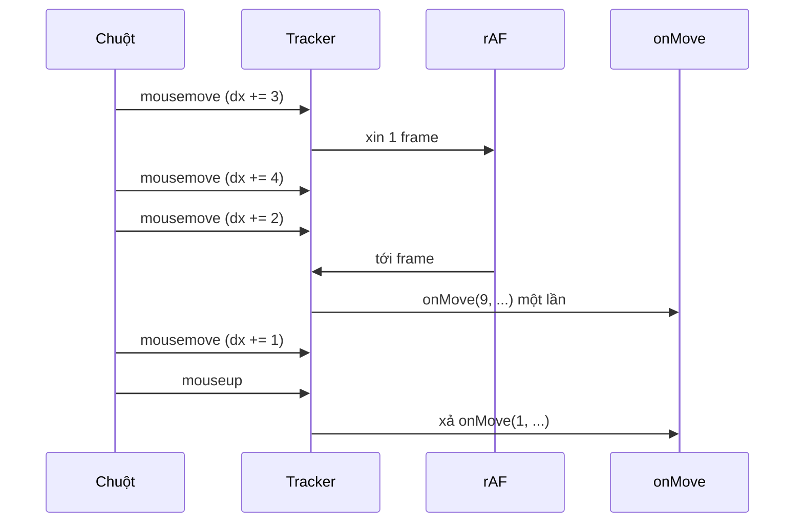

Bạn muốn chạy một việc "ngay sau khi code hiện tại xong", nhưng không chạy luôn trong stack hiện tại. Cách quen tay là `setTimeout(fn, 0)`. Vấn đề:

- Trình duyệt kẹp timer lồng nhau: từ lần lồng thứ 5 trở đi, `setTimeout(fn, 0)` chờ tối thiểu **4ms** (theo chuẩn HTML). Một chuỗi 300 việc gọi nối nhau mất hơn 1 giây chỉ để chờ.
- `Promise.resolve().then(fn)` thì quá nhanh: microtask chạy trước khi trình duyệt kịp vẽ hay xử lý input. Một chuỗi microtask dài làm đứng trang.

Cần một thứ ở giữa: một **macrotask** không bị kẹp 4ms. Đó là `setImmediate`, API mà chỉ IE và Node có. Facebook tự viết lại nó trong module `ImmediateImplementation`.

Cùng họ "đừng làm việc thừa trong vòng lặp sự kiện" là `DOMMouseMoveTracker`: chuột bắn `mousemove` 60 đến 1000 lần mỗi giây (chuột gaming), nhưng màn hình chỉ vẽ 60 đến 120 lần. Xử lý từng sự kiện là phí.

> [!TIP]
> **Tóm tắt**
> - `ImmediateImplementation` xếp việc vào hàng đợi rồi tự đánh thức bằng `MessageChannel` hoặc `window.postMessage`: một macrotask, không bị kẹp 4ms. Khi đang ở trong một sự kiện người dùng thật (`click`, `pointerup`, `submit`…), nó ưu tiên `postMessage`.
> - Bản gốc rút cạn hàng đợi, kể cả việc thêm vào trong lúc rút. Một chuỗi `setImmediate` đệ quy vì vậy chạy hết trong một task duy nhất: trong thử nghiệm 20.000 bước, một `setTimeout(0)` đặt trước không chạy được lần nào cho tới khi chuỗi xong.
> - `DOMMouseMoveTracker` cộng dồn delta chuột, chỉ gọi handler một lần mỗi frame qua `requestAnimationFrame`, và xả phần còn lại khi thả chuột.
> - Bản viết lại chỉ rút những việc đã có trước lượt hiện tại, dùng Pointer Events + pointer capture; trình duyệt mới có sẵn `scheduler.postTask` cho vai trò tương tự.

<iframe class="demo-frame" src="/demos/facebook-patterns/index.html?theme=dark#/setimmediate" title="Demo setimmediate" loading="lazy" style="height: 900px"></iframe>

<p class="demo-links">▶ <a href="/demos/facebook-patterns/index.html#/setimmediate" target="_blank" rel="noopener">Mở demo toàn màn hình ↗</a> · <a href="https://stackblitz.com/github/hunghg255/blog-hunghg/tree/master/examples/facebook-patterns?file=src/lib/immediate.ts" target="_blank" rel="noopener">Sửa code trên StackBlitz ↗</a> · <a href="https://github.com/hunghg255/blog-hunghg/blob/master/examples/facebook-patterns/src/lib/immediate.ts" target="_blank" rel="noopener">Xem source trên GitHub ↗</a></p>

## Facebook làm thế nào?

### `ImmediateImplementation` (bundle `22.js`, `1.js`; bản cũ không có nhánh thử nghiệm trong `Scroll/TimeSlice.js`)

Module là bản chuyển thể từ polyfill `setImmediate` quen thuộc (của YuzuJS), có thêm một nhánh thử nghiệm. Lõi là một danh sách liên kết và một vòng rút (đổi tên biến cho dễ đọc, bản đầy đủ trong spoiler):

```js
while (!running && (task = head.next)) {   // đi tới cuối danh sách, kể cả việc mới nối vào
  head = task;
  if ((cb = callbacks[task.handle])) { running = true; try { cb(); running = false; } finally { … } }
}
```

::: spoiler Code gốc đã đổi tên biến: hàng đợi và vòng rút

```js
const callbacks = {};                    // handle → callback
let head = {}, tail = head, running = false;
const token = 'setImmediate$' + Math.random() + '$';

function enqueue([fn, ...args]) {
  callbacks[nextHandle] = () => fn(...args);
  tail = tail.next = { handle: nextHandle++ };   // danh sách liên kết, head là nút đã chạy
  return tail.handle;
}

function drain() {
  let task, cb;
  while (!running && (task = head.next)) {       // chạy tới khi danh sách rỗng
    head = task;
    if ((cb = callbacks[task.handle])) {
      running = true;
      try { cb(); running = false; }
      finally {
        delete callbacks[task.handle];
        if (running) { running = false; if (head.next) wake(drain); }  // lỗi: hẹn lượt sau
      }
    }
  }
}

function inTrustedUserEvent() {
  const e = window.event;
  return e && (e.isTrusted && ['change', 'click', 'contextmenu', 'dblclick', 'mouseup',
      'pointerup', 'reset', 'submit', 'touchend'].includes(e.type)
    || e.type === 'message' && e.source === window && e.data.indexOf(token) === 0);
}
```

:::

Bản trong `Scroll/TimeSlice.js` chỉ có phần polyfill: không có `inTrustedUserEvent` và cờ thử nghiệm. Bản trong `22.js` và `1.js` thì có. Phần đánh thức chọn đường theo thứ tự: `postMessage` (nếu trình duyệt gọi handler `message` bất đồng bộ) → `MessageChannel` → thẻ `<script>` với `onreadystatechange` (IE cũ) → `setTimeout`. Khi bật cờ thử nghiệm `prefer_message_channel`, nó dùng `MessageChannel` làm mặc định và chỉ quay sang `postMessage` (qua `originalPostMessage` nếu có) khi `inTrustedUserEvent()` đúng. Nhánh `MessageChannel` có cờ "đang bay", nên nhiều lần `setImmediate` liên tiếp chỉ gửi một message; nhánh `postMessage` gửi một message cho mỗi lần gọi (chuỗi `token + handle`), message đầu tiên rút hết, các message sau tới nơi thì thấy hàng đợi rỗng.

Vì sao ưu tiên `postMessage` khi đang trong một click thật? Code không giải thích. Có lẽ là để giữ "user activation": một số API (mở popup, vào fullscreen, phát âm thanh) chỉ cho phép khi đang trong cử chỉ người dùng. Các trình duyệt cũ coi việc chạy trong handler `message` của chính `window` gửi ngay sau click vẫn còn trong cử chỉ đó; `MessageChannel` có lẽ không được đối xử như vậy.

Khi message tới, `drain` đi theo `head.next` tới cuối danh sách: callback nào được `setImmediate` trong lúc rút cũng nối vào đuôi và được chạy luôn, trong cùng task. Đây là chỗ đáng chú ý (xem phần "Bên trong").

### `DOMMouseMoveTracker` (bundle `199.js`)

Mỗi `mousemove` chỉ cộng dồn, việc thật để cho frame kế tiếp:

```js
onMouseMove = (e) => {
  this.dx += e.clientX - this.x; this.dy += e.clientY - this.y;
  this.x = e.clientX; this.y = e.clientY;
  this.frame ??= requestAnimationFramePolyfill(this.didMouseMove);   // một lần onMove mỗi frame
};
```

`onMouseUp` gọi `didMouseMove` ngay nếu còn frame đang chờ, rồi mới `onMoveEnd`: phần dịch chuyển cuối không bị mất.

::: spoiler Code gốc đã đổi tên biến: DOMMouseMoveTracker

```js
class DOMMouseMoveTracker {
  captureMouseMoves(e) {
    if (!this.moveListener) {
      this.moveListener = listen(document, 'mousemove', this.onMouseMove);
      this.upListener = listen(document, 'mouseup', this.onMouseUp);
    }
    this.isDragging = true; this.x = e.clientX; this.y = e.clientY; this.dx = this.dy = 0;
    e.preventDefault();
  }
  onMouseMove = (e) => {
    this.dx += e.clientX - this.x; this.dy += e.clientY - this.y;   // chỉ cộng dồn
    this.x = e.clientX; this.y = e.clientY;
    this.frame ??= requestAnimationFramePolyfill(this.didMouseMove);
    e.preventDefault();
  };
  didMouseMove = () => {
    this.frame = null;
    this.onMove(this.dx, this.dy);                                   // một lần mỗi frame
    this.dx = this.dy = 0;
  };
  onMouseUp = () => {
    if (this.frame) this.didMouseMove();                             // xả phần còn treo
    this.onMoveEnd();
  };
  releaseMouseMoves() { /* gỡ listener, cancelAnimationFrame */ }
}
```

:::

Nghe trên `document` để vẫn nhận sự kiện khi chuột chạy ra ngoài phần tử đang kéo (thanh cuộn tuỳ biến, cột bảng co giãn). Chỉ có chuột: không có touch hay bút.



## Bên trong: task, microtask và mức kẹp 4ms

Mỗi vòng của event loop: lấy **một** task (timer, message, sự kiện input) → chạy hết microtask → nếu tới lúc thì vẽ (chạy `requestAnimationFrame`, style, layout, paint). Có ba hệ quả:

1. **`setTimeout(fn, 0)` không phải 0.** Chuẩn HTML cho phép kẹp tối thiểu 4ms khi timer lồng quá 5 cấp; trình duyệt chính đều làm vậy. Tab ẩn còn bị kẹp 1 giây.
2. **Message không bị kẹp.** `MessageChannel.port.postMessage` xếp một task mới ngay lập tức. React Scheduler cũng dùng đúng mẹo này.
3. **Một task dài chặn tất cả.** Trong lúc task chạy, không có vẽ, không có input. Nếu bộ rút hàng đợi chạy luôn những việc mới được thêm, một chuỗi `setImmediate` đệ quy biến thành **một task vô tận**.

Thử nghiệm với Node (cùng logic, đổi `MessageChannel` của Node): đặt `setTimeout(check, 0)` rồi bắt đầu chuỗi 20.000 `setImmediate` nối nhau.

| Cách rút | Timer chạy khi chuỗi ở bước |
| --- | --- |
| Rút cạn kiểu Facebook | không chạy cho tới khi chuỗi xong |
| Chỉ rút việc có trước lượt (bản viết lại) | khoảng bước 1.000 |

Bản gốc có lẽ không gặp vấn đề vì code Facebook ít khi gọi `setImmediate` đệ quy dài; nhưng nếu bạn dùng nó để "chia nhỏ việc nặng cho khỏi đứng trang" thì nó không chia gì cả. Demo phần 1 cho thấy điều đó qua số frame vẽ được trong lúc chạy.

## Viết lại

Phần rút hàng đợi: chụp `tail` lúc bắt đầu, chỉ chạy tới đó.

```ts title=src/lib/immediate.ts
  function drain() {
    wakeScheduled = false;
    // Chỉ chạy những việc đã có TRƯỚC lượt này. Việc được thêm trong lúc chạy đợi lượt sau,
    // nhờ vậy một chuỗi setImmediate gọi đệ quy vẫn nhường cho trình duyệt vẽ và xử lý input.
    const end = tail;
    let task: Task | null;
    while (!running && cursor !== end && (task = cursor.next)) {
      cursor = task;
      const callback = callbacks.get(task.handle);
      if (!callback) continue; // đã bị clearImmediate
      callbacks.delete(task.handle);
      running = true;
      try {
        callback();
        running = false;
      } finally {
        if (running) {
          // callback vừa ném lỗi: hẹn chạy tiếp phần còn lại rồi để lỗi bay ra ngoài
          running = false;
          if (cursor.next) wake();
        }
      }
    }
    if (!cursor.next) {
      // hàng đợi rỗng: thu hồi danh sách để không giữ nút cũ trong bộ nhớ
      head.next = null;
      tail = cursor = head;
    }
  }
```

Gom delta theo frame bằng Pointer Events:

```ts title=src/lib/dragTracker.ts
  const flush = () => {
    frame = null;
    if (dx === 0 && dy === 0) return;
    stats.flushes++;
    const x = dx;
    const y = dy;
    dx = dy = 0;
    options.onMove(x, y);
  };

  const onMove = (event: PointerEvent) => {
    if (event.pointerId !== pointerId) return;
    stats.events++;
    dx += event.clientX - lastX;
    dy += event.clientY - lastY;
    lastX = event.clientX;
    lastY = event.clientY;
    if (frame === null) frame = schedule(flush);
  };
```

## Đi qua code

- `const end = tail` chụp đuôi danh sách lúc bắt đầu lượt. Vòng `while` dừng khi `cursor` tới `end`, nên việc được `setImmediate` trong lúc chạy nằm sau `end` và chờ lượt sau. Đó là toàn bộ khác biệt so với bản gốc, và là thứ làm chuỗi đệ quy nhường cho trình duyệt.
- `running` chặn chạy lồng: nếu một callback tự gọi đồng bộ vào vòng rút (qua một đường lạ), vòng trong thoát ngay.
- Callback ném lỗi thì `running` vẫn là `true` khi vào `finally`. Đó là dấu hiệu để hẹn một lượt mới cho phần còn lại, rồi để lỗi bay ra ngoài cho `window.onerror` thấy.
- `wake()` (trong file đầy đủ) có cờ `wakeScheduled`: 1.000 lần `setImmediate` liên tiếp chỉ gửi một message. Demo "Xếp 1000 việc cùng lúc" đếm đúng con số này.
- Ở tracker, `flush` đặt `frame = null` trước khi gọi `onMove`, để nếu `onMove` chậm và có `pointermove` mới tới trong lúc đó, frame sau vẫn được xin.

**Khác bản gốc:**

- Chỉ rút những việc có trước lượt hiện tại; việc mới thêm chờ lượt sau, nên chuỗi đệ quy vẫn nhường cho trình duyệt vẽ.
- Xử lý lỗi giữ như bản gốc (hẹn lượt mới cho phần còn lại rồi để lỗi bay ra); thêm thu hồi danh sách khi rỗng và đếm số lần đánh thức.
- Bỏ nhánh `postMessage`-trong-cử-chỉ và nhánh `<script>` của IE; `postMessage` còn lại dùng token ngẫu nhiên và kiểm tra `event.source`.
- Tracker dùng `pointermove` + `setPointerCapture` (chuột, cảm ứng, bút), thêm `cancel()` và `pointercancel` để huỷ mà không xả delta.

::: spoiler Xem toàn bộ src/lib/immediate.ts

```ts title=src/lib/immediate.ts
/**
 * setImmediate tự viết (ý tưởng từ ImmediateImplementation của Facebook):
 * - Hàng đợi FIFO bằng danh sách liên kết, gọi lại bằng handle.
 * - Mỗi lần "đánh thức" chỉ gửi MỘT message; khi chạy thì làm hết các việc đã xếp hàng
 *   trước lượt đó trong cùng một task.
 * - Callback ném lỗi: phần còn lại được hẹn lượt sau rồi lỗi mới được ném tiếp
 *   (không nuốt lỗi, không bỏ rơi các việc đang xếp hàng).
 */

export type ImmediateTransport = 'message-channel' | 'post-message' | 'timeout';

type Task = { handle: number; next: Task | null };

export interface Immediate {
  setImmediate(fn: (...args: unknown[]) => void, ...args: unknown[]): number;
  clearImmediate(handle: number): void;
  readonly transport: ImmediateTransport;
  /** số lần thực sự gửi tín hiệu đánh thức (message/timer) */
  readonly wakes: number;
  dispose(): void;
}

export function createImmediate(preferred?: ImmediateTransport): Immediate {
  const callbacks = new Map<number, () => void>();
  let nextHandle = 1;
  const head: Task = { handle: 0, next: null }; // nút giả: head.next là việc kế tiếp
  let tail = head;
  let cursor = head;
  let running = false;
  let wakeScheduled = false;
  let wakes = 0;

  function drain() {
    wakeScheduled = false;
    // Chỉ chạy những việc đã có TRƯỚC lượt này. Việc được thêm trong lúc chạy đợi lượt sau,
    // nhờ vậy một chuỗi setImmediate gọi đệ quy vẫn nhường cho trình duyệt vẽ và xử lý input.
    const end = tail;
    let task: Task | null;
    while (!running && cursor !== end && (task = cursor.next)) {
      cursor = task;
      const callback = callbacks.get(task.handle);
      if (!callback) continue; // đã bị clearImmediate
      callbacks.delete(task.handle);
      running = true;
      try {
        callback();
        running = false;
      } finally {
        if (running) {
          // callback vừa ném lỗi: hẹn chạy tiếp phần còn lại rồi để lỗi bay ra ngoài
          running = false;
          if (cursor.next) wake();
        }
      }
    }
    if (!cursor.next) {
      // hàng đợi rỗng: thu hồi danh sách để không giữ nút cũ trong bộ nhớ
      head.next = null;
      tail = cursor = head;
    }
  }

  const transport: ImmediateTransport =
    preferred ??
    (typeof MessageChannel !== 'undefined'
      ? 'message-channel'
      : typeof window !== 'undefined' && typeof window.postMessage === 'function'
        ? 'post-message'
        : 'timeout');

  let wakeRaw: () => void;
  let dispose = () => {};

  if (transport === 'message-channel') {
    const channel = new MessageChannel();
    channel.port1.onmessage = drain;
    wakeRaw = () => channel.port2.postMessage(null);
    dispose = () => {
      channel.port1.onmessage = null;
      channel.port1.close();
    };
  } else if (transport === 'post-message') {
    // token ngẫu nhiên để không nhầm với message của script khác trên trang
    const token = `immediate$${Math.random().toString(36).slice(2)}`;
    const onMessage = (event: MessageEvent) => {
      if (event.source === window && event.data === token) drain();
    };
    window.addEventListener('message', onMessage);
    wakeRaw = () => window.postMessage(token, '*');
    dispose = () => window.removeEventListener('message', onMessage);
  } else {
    wakeRaw = () => setTimeout(drain, 0);
  }

  function wake() {
    if (wakeScheduled) return; // đã có một lần đánh thức đang bay: các việc mới đi chung chuyến
    wakeScheduled = true;
    wakes++;
    wakeRaw();
  }

  return {
    transport,
    get wakes() {
      return wakes;
    },
    setImmediate(fn, ...args) {
      const handle = nextHandle++;
      callbacks.set(handle, () => fn(...args));
      tail = tail.next = { handle, next: null };
      wake();
      return handle;
    },
    clearImmediate(handle) {
      callbacks.delete(handle);
    },
    dispose,
  };
}
```

:::

::: spoiler Xem toàn bộ src/lib/dragTracker.ts

```ts title=src/lib/dragTracker.ts
/**
 * Kéo bằng con trỏ, gom delta theo khung hình (ý tưởng từ DOMMouseMoveTracker của Facebook):
 * mỗi pointermove chỉ CỘNG DỒN dx/dy, handler thật chạy tối đa một lần mỗi frame với tổng delta.
 * Khác bản gốc: dùng Pointer Events + pointer capture (chuột, cảm ứng, bút), xả delta còn treo
 * khi thả, và có cancel() để huỷ giữa chừng.
 */

export interface DragTrackerOptions {
  /** gọi tối đa 1 lần/frame với tổng dịch chuyển kể từ lần gọi trước */
  onMove: (dx: number, dy: number) => void;
  onEnd?: (cancelled: boolean) => void;
  /** đổi để test: mặc định requestAnimationFrame */
  schedule?: (cb: () => void) => number;
  cancelSchedule?: (id: number) => void;
}

export interface DragTracker {
  start(event: PointerEvent): void;
  cancel(): void;
  readonly dragging: boolean;
  /** số pointermove đã nhận và số lần onMove thực sự chạy, để so sánh */
  readonly stats: { events: number; flushes: number };
}

export function createDragTracker(target: HTMLElement, options: DragTrackerOptions): DragTracker {
  const schedule = options.schedule ?? ((cb) => requestAnimationFrame(cb));
  const cancelSchedule = options.cancelSchedule ?? ((id) => cancelAnimationFrame(id));
  let dragging = false;
  let pointerId = -1;
  let lastX = 0;
  let lastY = 0;
  let dx = 0;
  let dy = 0;
  let frame: number | null = null;
  const stats = { events: 0, flushes: 0 };

  const flush = () => {
    frame = null;
    if (dx === 0 && dy === 0) return;
    stats.flushes++;
    const x = dx;
    const y = dy;
    dx = dy = 0;
    options.onMove(x, y);
  };

  const onMove = (event: PointerEvent) => {
    if (event.pointerId !== pointerId) return;
    stats.events++;
    dx += event.clientX - lastX;
    dy += event.clientY - lastY;
    lastX = event.clientX;
    lastY = event.clientY;
    if (frame === null) frame = schedule(flush);
  };

  const stop = (cancelled: boolean) => {
    if (!dragging) return;
    if (frame !== null) cancelSchedule(frame);
    if (!cancelled) flush(); // xả delta cuối, không để "hụt" vài pixel khi thả
    frame = null;
    dx = dy = 0;
    dragging = false;
    target.removeEventListener('pointermove', onMove);
    target.removeEventListener('pointerup', onUp);
    target.removeEventListener('pointercancel', onCancel);
    if (target.hasPointerCapture?.(pointerId)) target.releasePointerCapture(pointerId);
    options.onEnd?.(cancelled);
  };
  const onUp = (event: PointerEvent) => event.pointerId === pointerId && stop(false);
  const onCancel = (event: PointerEvent) => event.pointerId === pointerId && stop(true);

  return {
    get dragging() {
      return dragging;
    },
    stats,
    start(event) {
      if (dragging) return;
      dragging = true;
      pointerId = event.pointerId;
      lastX = event.clientX;
      lastY = event.clientY;
      dx = dy = 0;
      // capture: vẫn nhận move/up khi con trỏ ra khỏi phần tử (thay cho nghe trên document)
      target.setPointerCapture?.(pointerId);
      target.addEventListener('pointermove', onMove);
      target.addEventListener('pointerup', onUp);
      target.addEventListener('pointercancel', onCancel);
      event.preventDefault();
    },
    cancel: () => stop(true),
  };
}
```

:::

## Tại sao không làm cách khác?

- **`queueMicrotask`/`Promise.then`**: nhanh nhất, nhưng microtask chạy hết trước khi trình duyệt làm bất cứ gì khác. Dùng để "chia nhỏ việc nặng" là sai chỗ.
- **`requestAnimationFrame`**: chỉ 60 đến 120 lần/giây, và dừng hẳn khi tab ẩn. Hợp cho việc gắn với vẽ (như tracker), không hợp cho hàng đợi việc chung.
- **`requestIdleCallback`**: chỉ chạy khi rảnh, có thể chờ rất lâu; Safari chưa bật mặc định (tính tới 10/2026).
- **`scheduler.postTask`**: đúng thứ cần (macrotask có độ ưu tiên, huỷ được bằng `AbortSignal`), nhưng chưa có ở Safari (tính tới 10/2026). Hàm tự viết vẫn cần làm fallback.
- **Xử lý từng `pointermove`**: đúng nhưng phí; với chuột 1000Hz và handler 6ms, trang không theo kịp. Demo phần 2 đếm số lần xử lý của hai cách.

## Edge case và cạm bẫy

- **`window.postMessage` dùng chung với mọi script**: iframe, extension cũng nghe `message`. Dùng token ngẫu nhiên, kiểm tra `event.source === window`, và đừng `stopPropagation` message không phải của mình. `MessageChannel` riêng tư hơn.
- **Tab ẩn**: message không bị kẹp như timer, nên hàng đợi vẫn chạy khi tab ẩn. Tốt cho việc phải xong, nhưng tốn pin nếu là vòng lặp vô tận.
- **Delta cuối khi thả**: nếu chỉ huỷ rAF lúc `pointerup`, phần dịch chuyển cuối bị mất, đối tượng "hụt" vài pixel. Phải xả trước khi kết thúc (bản gốc làm đúng).
- **Pointer capture thay cho nghe trên `document`**: capture giữ sự kiện cả khi con trỏ ra ngoài iframe hay cửa sổ, và tự giải phóng khi `pointerup`. Nhớ `touch-action: none` trên phần tử kéo, nếu không trình duyệt cuộn trang và bắn `pointercancel`.
- **`getCoalescedEvents()`**: trình duyệt đã gộp sẵn nhiều `pointermove` thành một sự kiện mỗi frame. Nếu cần vẽ nét bút mượt, lấy các điểm gộp từ đây; nếu chỉ cần delta tổng thì như tracker là đủ.

## Dùng trong dự án

```ts
import { createImmediate } from './immediate';
const imm = createImmediate();

// chia việc nặng thành nhiều lượt, trình duyệt vẫn vẽ giữa các lượt
function processInChunks<T>(items: T[], work: (item: T) => void, chunk = 200) {
  let i = 0;
  const step = () => {
    const end = Math.min(i + chunk, items.length);
    for (; i < end; i++) work(items[i]);
    if (i < items.length) imm.setImmediate(step);
  };
  imm.setImmediate(step);
}
```

Tracker dùng cho tay nắm co giãn cột: `createDragTracker(handle, { onMove: (dx) => column.setWidth(column.width + dx), onEnd: (cancelled) => !cancelled && column.save() })`, rồi gọi `tracker.start(e)` trong `pointerdown`.

## Kiểm thử

::: spoiler Ví dụ test (bản phác, không có trong repo)

```ts
import { describe, expect, it, vi } from 'vitest';
import { createImmediate } from './immediate';
import { createDragTracker } from './dragTracker';

describe('createImmediate', () => {
  it('nhiều việc cùng lúc chỉ gửi một tín hiệu', async () => {
    const imm = createImmediate();
    const seen: number[] = [];
    for (let i = 0; i < 100; i++) imm.setImmediate(() => seen.push(i));
    await new Promise((r) => setTimeout(r, 10));
    expect(seen).toHaveLength(100);
    expect(imm.wakes).toBe(1);
  });

  it('chuỗi đệ quy nhường cho timer', async () => {
    const imm = createImmediate();
    let steps = 0, timerAt = -1;
    setTimeout(() => (timerAt = steps), 0);
    await new Promise<void>((done) => {
      const step = () => (++steps < 5000 ? imm.setImmediate(step) : done());
      imm.setImmediate(step);
    });
    expect(timerAt).toBeGreaterThan(0);
    expect(timerAt).toBeLessThan(5000);
  });

  it('clearImmediate bỏ việc chưa chạy', async () => {
    const imm = createImmediate();
    const fn = vi.fn();
    imm.clearImmediate(imm.setImmediate(fn));
    await new Promise((r) => setTimeout(r, 10));
    expect(fn).not.toHaveBeenCalled();
  });
});

describe('createDragTracker', () => {
  it('cộng dồn delta, gọi một lần mỗi frame, xả khi thả', () => {
    const el = document.createElement('div');
    let frame: (() => void) | null = null;
    const onMove = vi.fn();
    const t = createDragTracker(el, { onMove, schedule: (cb) => ((frame = cb), 1), cancelSchedule: () => {} });
    const ev = (type: string, x: number) => new PointerEvent(type, { pointerId: 1, clientX: x, clientY: 0 });
    t.start(ev('pointerdown', 0));
    el.dispatchEvent(ev('pointermove', 3));
    el.dispatchEvent(ev('pointermove', 7));
    frame!();
    expect(onMove).toHaveBeenLastCalledWith(7, 0);
    el.dispatchEvent(ev('pointermove', 9));
    el.dispatchEvent(ev('pointerup', 9));
    expect(onMove).toHaveBeenLastCalledWith(2, 0);
    expect(onMove).toHaveBeenCalledTimes(2);
  });
});
```

:::

## So với thư viện và chuẩn web

- **`scheduler.postTask(fn, { priority })`** và **`scheduler.yield()`**: có ở Chrome và Firefox, chưa có ở Safari (tính tới 10/2026). `scheduler.yield()` còn giữ ưu tiên cho phần tiếp theo, tốt hơn mọi mẹo message.
- **React Scheduler**: dùng `MessageChannel` để đánh thức, và tự cắt lượt sau khoảng 5ms để nhường trình duyệt. Đó là cách giải đúng vấn đề "rút cạn".
- **Polyfill `setimmediate` (YuzuJS)**: tổ tiên của bản Facebook, cùng thứ tự fallback; cũng rút cạn theo handle.
- **`PointerEvent.getCoalescedEvents()`** có ở mọi trình duyệt chính; **`getPredictedEvents()`** chưa có ở Safari (tính tới 10/2026).
- Thư viện kéo thả (dnd-kit, `@use-gesture`) đều gom theo rAF tương tự tracker.

---

Bài này thuộc series **[Học từ mã nguồn Facebook](/series/facebook)** (83 bài, đọc theo thứ tự).

::: spoiler Xem nhanh danh sách bài trong series

*Phần 1*

- [Mở đầu: cách đọc code minify của Facebook](/blogs/learn-from-facebook-source-code)
- [#1 Dùng chung IntersectionObserver + infinite scroll](/blogs/facebook-shared-intersection-observer)
- [#2 useViewportDuration: đo thời gian thực sự được xem](/blogs/facebook-use-viewport-duration)
- [#3 Preload code + data khi hover](/blogs/facebook-preload-on-hover)
- [#4 Toast manager với external store](/blogs/facebook-toast-manager)
- [#5 Network status + heartbeat backoff](/blogs/facebook-network-status-heartbeat)
- [#6 ErrorGuard: bắt lỗi theo ngữ cảnh](/blogs/facebook-error-guard)
- [#7 Banzai: gom log theo lô + sendBeacon](/blogs/facebook-batch-logger)
- [#8 Focus trap + Esc theo layer](/blogs/facebook-focus-trap)

*Phần 2*

- [#9 Mẹo calc(… * 9999): container query, line-clamp, mũi tên carousel bằng CSS](/blogs/facebook-css-9999-trick)
- [#10 Thanh cuộn tuỳ biến bằng CSS 3D](/blogs/facebook-css-3d-scrollbar)
- [#11 Modal cuộn bằng window, giữ vị trí trang nền](/blogs/facebook-document-scroll-modal)
- [#12 Popover, tooltip group và hovercard](/blogs/facebook-popover-tooltip)
- [#13 Primitive Pressable + focus-visible](/blogs/facebook-pressable)
- [#14 Tab "Xem thêm" + sticky header bằng IntersectionObserver](/blogs/facebook-priority-tabs-sticky-header)
- [#15 Avatar khoét mask, gradient Messenger, skeleton steps()](/blogs/facebook-visual-tricks)
- [#16 Khung chat không giật](/blogs/facebook-chat-scroller)
- [#17 Thuật toán chọn bố cục collage ảnh](/blogs/facebook-photo-collage-layout)
- [#18 Keep-alive tab trong SPA](/blogs/facebook-keep-alive-tabs)
- [#19 Tự đo Visual Completion & interaction tracing](/blogs/facebook-visual-completion)
- [#20 Router SPA bền bỉ & tải chunk có retry](/blogs/facebook-spa-router-resilient-loading)

*Phần 3*

- [#21 Smart Compose: gợi ý chữ mờ khi gõ](/blogs/facebook-smart-compose-ghost-text)
- [#22 MQTT ngay trong trình duyệt, tự chuyển sang long-poll](/blogs/facebook-mqtt-in-browser)
- [#23 Đo thời gian dùng bằng bitmap 64 giây](/blogs/facebook-time-spent-bitmap)
- [#24 Bảng reaction nhấn giữ rồi trượt](/blogs/facebook-reaction-press-slide)
- [#25 Tìm kiếm gấp dấu, phiên âm và highlight đầu từ](/blogs/facebook-search-diacritics-tokenize)
- [#26 Ring buffer biết trace nào đã mất log](/blogs/facebook-trace-ring-buffer)
- [#27 Engine animation JS: một vòng rAF và solver cubic-bezier](/blogs/facebook-keyframes-loop-cubic-bezier)
- [#28 Bootloader: bitmap tài nguyên đã tải, chỉ reload khi cần](/blogs/facebook-bootloader-bitmap-consistency)
- [#29 Nhận biết click do screen reader tạo ra](/blogs/facebook-virtual-cursor-detection)
- [#30 Tải trước feed theo chất lượng mạng, đoán hạng thiết bị](/blogs/facebook-network-aware-prefetch)
- [#31 Hàng đợi gửi tin chat giữ đúng thứ tự](/blogs/facebook-ordered-send-queue)
- [#32 Gộp lời gọi API trong cùng một tick](/blogs/facebook-api-batcher)
- [#33 Resize ảnh trong pool Web Worker](/blogs/facebook-jpeg-resize-worker-pool)
- [#34 Crop ảnh theo nhiều khuôn mặt](/blogs/facebook-face-aware-crop)
- [#35 Kéo-thả sắp xếp và vùng thả file không nhấp nháy](/blogs/facebook-flicker-free-drag-drop)
- [#36 Tiện ích UI: fade-out, sticky event, hàm huỷ được](/blogs/facebook-ui-utility-hooks)
- [#37 Hạ tầng nhỏ: cookie, hash lỗi, prefetch khi chuột dừng](/blogs/facebook-small-infra-cookie-hash-idle)

*Phần 4–6*

- [#38 Đồng bộ tin nhắn: phát hiện lỗ seqID và fetch bù theo tầng](/blogs/facebook-messenger-sync-seqid-gaps)
- [#39 OTID: ID tin nhắn kiểu Snowflake sinh ở client](/blogs/facebook-otid-client-snowflake)
- [#40 QPL: lấy mẫu từ lúc bắt đầu, đo RTT gửi tin đầu-cuối](/blogs/facebook-qpl-send-rtt)
- [#41 Bộ điều phối request bảy chế độ gộp và chống trùng](/blogs/facebook-request-dispatcher-modes)
- [#42 Thread list theo mốc thời gian, cookie presence có version](/blogs/facebook-threadlist-ranged-presence)
- [#43 Composer dạng plugin: reducer, dirty checker, chuỗi kiểm tra](/blogs/facebook-plugin-composer)
- [#44 Thanh toán bất đồng bộ: subscribe trước, poll dự phòng](/blogs/facebook-async-checkout)
- [#45 Validate số thẻ: sửa lỗi gõ, dải BIN, Luhn](/blogs/facebook-card-validation)
- [#46 Lịch chọn khoảng ngày: bo góc dải chọn, phím đủ bộ, RTL](/blogs/facebook-range-calendar-a11y)
- [#47 Giờ mở cửa theo tuần: qua đêm, gộp khoảng, phần bù](/blogs/facebook-weekly-hours-intervals)
- [#48 Tiến độ đăng realtime: giữ event chờ snapshot, watchdog](/blogs/facebook-realtime-publish-snapshot)
- [#49 Tiền tệ theo đơn vị nhỏ nhất và ô nhập tiền](/blogs/facebook-currency-minor-units)
- [#50 Sửa hàng loạt Empty/Uniform/Mixed, seen/read bằng 2 bit](/blogs/facebook-bulk-edit-seen-bits)
- [#51 Phát hiện script lạ hook vào hàm native](/blogs/facebook-native-hook-detection)
- [#52 localStorage tự dọn khi đầy quota](/blogs/facebook-quota-aware-storage)
- [#53 Cache tuyến do server phân giải, chờ sẵn promise](/blogs/facebook-route-cache-prefetch)
- [#54 Lưới phím mũi tên 2D và focus không làm cuộn trang](/blogs/facebook-focus-table-grid)
- [#55 Tách emoji bằng máy trạng thái](/blogs/facebook-emoji-segmentation)
- [#56 Đọc trước ghi sau trong một frame, con tự biết vị trí](/blogs/facebook-read-then-write-dom)
- [#57 Hàng đợi lệnh cho video và stream sắp lại chunk](/blogs/facebook-video-command-queue)

*Phần 7–10*

- [#58 Ước lượng băng thông EWMA: loại outlier, nhớ qua phiên](/blogs/facebook-bandwidth-ewma-estimator)
- [#59 ABR theo độ tự tin phát và cắt bậc bitrate theo MOS](/blogs/facebook-abr-playback-confidence)
- [#60 Prefetch segment dự đoán từ manifest, parse hộp sidx](/blogs/facebook-dash-predicted-segments)
- [#61 Đọc metadata MP4/MOV ngay trên client](/blogs/facebook-mp4-metadata-client)
- [#62 Upload tiếp tục được: offset, hash dedupe, phát hiện treo](/blogs/facebook-resumable-upload)
- [#63 Fenwick tree: chọn ngẫu nhiên có trọng số và offset dòng](/blogs/facebook-fenwick-weighted-random)
- [#64 Vạch trục số và trục thời gian "đẹp"](/blogs/facebook-nice-axis-ticks)
- [#65 Damerau-Levenshtein theo dải chéo và tự sửa tên gõ sai](/blogs/facebook-damerau-levenshtein)
- [#66 PRNG có seed, shuffle tái lập và lấy mẫu trace](/blogs/facebook-seeded-prng-sampling)
- [#67 Cặp min/max-heap tái dùng vị trí trong danh sách ảo](/blogs/facebook-dual-heap-buffer-set)
- [#68 Memo nhiều đối số bằng Map/WeakMap và interning object](/blogs/facebook-multikey-memo-interning)
- [#69 Thống kê cửa sổ trượt và đại số khoảng thời gian](/blogs/facebook-moving-stat-intervals)
- [#70 Int64 từ hai số 32-bit, decode UTF, offset theo code point](/blogs/facebook-int64-utf-codepoints)
- [#71 Engine múi giờ IANA trên client, phát hiện lệch giờ](/blogs/facebook-client-iana-timezone)
- [#72 Tự cài semver range](/blogs/facebook-semver-range)
- [#73 Auto-link URL, cắt chữ an toàn, giới hạn LaTeX](/blogs/facebook-autolink-safe-truncate)
- [#74 Parser query kiểu PHP chống prototype pollution](/blogs/facebook-php-query-serializer)
- [#75 Popover tự lật theo phần tràn nhỏ nhất](/blogs/facebook-popover-auto-flip)
- [#76 Tiền tố for(;;) chống JSON hijacking, đọc stream](/blogs/facebook-csrf-prefix-streaming)
- [#77 Chống lộ Referer, linkshim, xoá token trên URL](/blogs/facebook-referrer-linkshim-url-scrub)
- **#78 setImmediate bằng postMessage, gom delta chuột theo frame** (bài này)
- [#79 Phát hiện crash qua heartbeat, dò proxy cache hỏng](/blogs/facebook-crash-heartbeat-proxy-check)
- [#80 DPR vào cookie cho ảnh @2x, che khoá trong log](/blogs/facebook-dpr-cookie-secret-redaction)
- [#81 Flux waitFor tự viết và proxy có đệm](/blogs/facebook-flux-dispatch-buffered-proxy)
- [#82 Crop đúng tỉ lệ, xoay sticker bằng ma trận](/blogs/facebook-image-crop-rotation-geometry)

:::

Code + demo: [`examples/facebook-patterns`](https://github.com/hunghg255/blog-hunghg/tree/master/examples/facebook-patterns) · [Mở trên StackBlitz](https://stackblitz.com/github/hunghg255/blog-hunghg/tree/master/examples/facebook-patterns)
