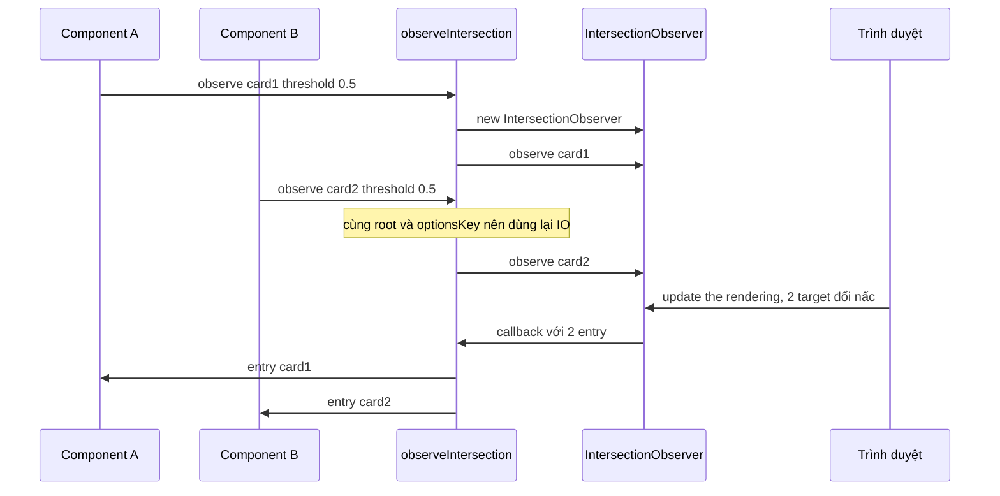
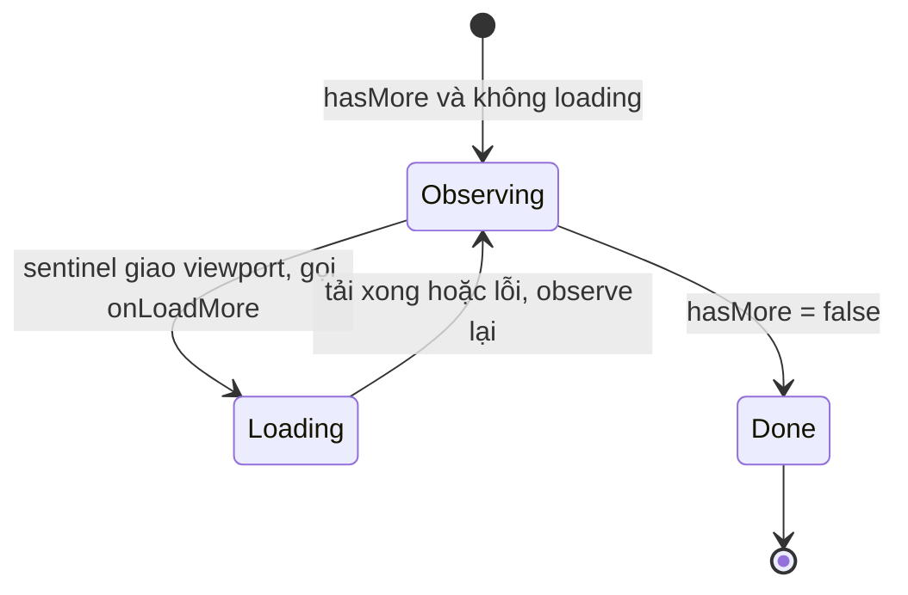

Hầu như hook `useInView` nào bạn từng viết cũng giống thế này:

```tsx
useEffect(() => {
  const observer = new IntersectionObserver(([entry]) => setInView(entry.isIntersecting));
  observer.observe(ref.current);
  return () => observer.disconnect();
}, []);
```

Không sai, nhưng **mỗi component tạo một observer**. Một news feed có 200 bài viết, mỗi bài có ảnh lazy-load, video autoplay, tracking impression… sẽ có **hàng trăm đến hàng nghìn observer** cùng tồn tại.

Để hiểu vì sao đó là vấn đề và vì sao dùng chung lại tốt hơn, trước tiên cần biết IntersectionObserver thực sự chạy thế nào bên trong trình duyệt.

## Bên trong trình duyệt: IntersectionObserver chạy lúc nào?

Spec HTML mô tả mỗi vòng **event loop** có một bước gọi là *update the rendering*. Bước này chạy khoảng một lần mỗi frame, khi trình duyệt quyết định vẽ lại. Thứ tự rút gọn của bước này như sau:

1. Chạy các callback `requestAnimationFrame`.
2. Tính lại style và **layout**.
3. Chạy các `ResizeObserver`.
4. **Cập nhật intersection observation**: với **từng observer**, duyệt **từng target**, tính hình chữ nhật giao nhau giữa target và root (đã cộng `rootMargin`). Sau đó so tỉ lệ giao nhau với danh sách `threshold` để biết target đang ở "nấc" nào.
5. Vẽ (paint).

Ở bước 4, nếu nấc threshold của một target **khác lần trước**, trình duyệt tạo một `IntersectionObserverEntry` và cho vào hàng đợi của observer đó. Sau đó trình duyệt **lên lịch một task** để gọi callback của observer với **tất cả entry đang chờ** trong một lần gọi.

Từ đó rút ra vài hệ quả quan trọng:

- **Callback luôn bất đồng bộ và được gom lô.** 50 target của cùng một observer đổi trạng thái trong một frame thì callback chỉ chạy **một lần** với mảng 50 entry. 50 observer riêng thì là **50 lần gọi callback** riêng lẻ, mỗi lần một mảng 1 phần tử.
- **Nó không đo liên tục.** Trình duyệt chỉ báo khi target **vượt qua một mốc threshold**. Với `threshold: 0` (mặc định), bạn chỉ nhận được 2 sự kiện: bắt đầu giao và hết giao. Muốn biết "đang hiện 30% hay 70%", phải khai báo nhiều mốc như `[0, 0.25, 0.5, 0.75, 1]`.
- **Lần `observe()` đầu tiên luôn cho ra một entry.** Spec khởi tạo "nấc trước đó" là `-1`, nên lần tính đầu tiên chắc chắn khác và luôn tạo entry, kể cả khi element nằm ngoài màn hình (`isIntersecting: false`). Ta sẽ tận dụng chi tiết này ở phần infinite scroll.
- **`rootMargin` nới hoặc thu hẹp vùng root.** `rootMargin: '300px'` coi như viewport cao thêm 300px mỗi phía, dùng để tải trước. `'-64px 0px 0px 0px'` thì bỏ 64px trên cùng, ví dụ khi có thanh header cố định che nội dung.

Phần tính hình học đã rẻ vì layout vừa được tính xong. Chi phí của nhiều observer nằm ở phía còn lại: mỗi observer là một object riêng trong engine, có danh sách target và hàng đợi entry riêng, và mỗi observer kích hoạt một callback JS riêng. Trong JS, mỗi callback lại tạo closure, mảng entry, rồi gọi `setState`. Dùng chung observer **không làm phép tính giao nhau biến mất**, vì trình duyệt vẫn phải xét từng target. Nhưng nó gom hàng trăm lần gọi callback nhỏ thành vài lần gọi lớn và bớt hẳn số object phải quản lý.

> [!NOTE]
> Đừng kỳ vọng dùng chung observer làm trang của bạn "nhanh gấp 300 lần". Lợi ích thật nằm ở việc ít callback hơn, ít bộ nhớ hơn và một chỗ duy nhất để kiểm soát (bắt lỗi, debug, đo đạc). Hãy đo bằng Performance panel trên máy yếu trước khi kết luận.

## Facebook làm thế nào?

Có hai module liên quan: `observeIntersection` (hàm thuần, thư mục `useIntersectionObserver/`) và hook `useIntersectionObserver` (thư mục `Scroll/`) trong [facebook-codebase](https://github.com/hunghg255/facebook-codebase).

### `observeIntersection`: kho observer dùng chung

1. **Gom theo `root`, rồi theo option.** Cấu trúc là `WeakMap<root, { [optionsKey]: SharedObserver }>`. Viewport (`root = null`) không thể làm key của WeakMap, nên họ dùng một object hằng `{ __noRoot: true }` để đại diện.
2. **`optionsKey` được chuẩn hoá.** Threshold được bỏ trùng và sort, các key của object option cũng được sort trước khi `JSON.stringify`. Nhờ vậy `{ threshold: [1, 0.5] }` và `{ threshold: [0.5, 1, 1] }` dùng chung một observer.
3. **Một observer, nhiều callback.** Mỗi observer giữ `targetToCallbacksMap: element → callback[]`. Họ dùng `WeakMap` nếu trình duyệt hỗ trợ và đếm số target bằng một biến `referenceCount` riêng, vì WeakMap không có `.size`. Khi entry về, observer tra map để gọi đúng các callback của element đó.
4. **Đếm tham chiếu.** Callback cuối của element bị gỡ thì `unobserve`. `referenceCount` về 0 thì xoá observer khỏi cache. Mỗi callback được gọi qua `ErrorGuard.applyWithGuard` ([bài #6](/blogs/facebook-error-guard)), nên một callback lỗi không chặn các callback khác.
5. **Bất biến được kiểm tra bằng `invariant`.** Những dòng như `n != null || g(0, 2439)` là các assert kiểu "observer phải tồn tại". Nếu sai, code throw ngay với một mã lỗi số thay vì chạy tiếp trong trạng thái hỏng.

API trả về `{ remove() }`, và `remove` gọi nhiều lần vẫn an toàn nhờ một cờ `removed`.

### `useIntersectionObserver`: lớp React phía trên

Hook này có vài chi tiết rất đáng học:

- **`rootMargin` nhận object** `{ top, right, bottom, left }` hoặc số, rồi tự đổi thành chuỗi `"Tpx Rpx Bpx Lpx"`. Ở `useViewportDuration` ([bài #2](/blogs/facebook-use-viewport-duration)), giá trị này được tính từ `CometViewportMarginsContext`: chiều cao các thanh cố định (header, thanh điều hướng) đổi dấu thành margin âm. Nhờ vậy phần nội dung nằm **dưới header** không bị tính là đang được xem.
- **Callback ref**: hook trả về một hàm ref. Khi React gắn element mới, hook gỡ đăng ký cũ và đăng ký element mới.
- **Element bị gỡ khỏi DOM thì hook tự bắn một entry giả "không còn giao"** (`isIntersecting: false`, các rect bằng 0). Entry này được bắn qua `JSScheduler.defer`, và chỉ khi ref vẫn còn là `null`, tức element không được gắn lại ngay. Nếu không có bước này, component tiêu thụ sẽ kẹt ở trạng thái "đang hiện", vì trình duyệt không báo gì cho element đã bị `unobserve`.
- Callback người dùng được bọc bằng `useDynamicCallbackDANGEROUS`. Đây là pattern "latest ref": luôn gọi bản callback mới nhất mà không phải đăng ký lại observer mỗi lần render.

## Viết lại

Bản viết lại giữ nguyên các ý của `observeIntersection` và sửa thêm một chỗ bản gốc chưa xử lý: khi element **đã** được observe và một callback thứ hai đăng ký sau, IntersectionObserver **không** bắn lại entry. Như đã nói ở trên, entry đầu tiên chỉ có ở lần `observe()` đầu. Callback mới sẽ không biết element đang hiện hay không cho tới lần đổi trạng thái kế tiếp, mà lần đó có thể không bao giờ tới. Ta lưu entry gần nhất của mỗi target và phát lại cho callback mới.

```ts title=src/lib/observeIntersection.ts
/**
 * Dùng chung IntersectionObserver giữa nhiều element.
 *
 * Ý tưởng lấy từ module `observeIntersection` của Facebook: các element có cùng
 * `root` + `rootMargin` + `threshold` sẽ dùng chung MỘT observer. Observer được
 * tạo khi có người cần và tự `disconnect()` khi không còn ai dùng.
 */

export type IntersectionCallback = (entry: IntersectionObserverEntry) => void;

export interface ObserveIntersectionOptions {
  root?: Element | Document | null;
  rootMargin?: string;
  threshold?: number | number[];
}

interface SharedObserver {
  observer: IntersectionObserver;
  callbacks: Map<Element, IntersectionCallback[]>;
  lastEntries: Map<Element, IntersectionObserverEntry>;
}

// WeakMap không cho dùng `null` làm key nên viewport được đại diện bằng một object rỗng.
const VIEWPORT_ROOT = {};
const observersByRoot = new WeakMap<object, Map<string, SharedObserver>>();

// Hai option giống nhau phải ra cùng một key: chuẩn hoá giá trị mặc định,
// sort + bỏ trùng threshold.
function getOptionsKey(rootMargin = '0px', threshold: number | number[] = 0): string {
  const normalizedThreshold = Array.isArray(threshold)
    ? [...new Set(threshold)].sort((a, b) => a - b)
    : [threshold];
  return JSON.stringify({ rootMargin, threshold: normalizedThreshold });
}

function reportCallbackError(error: unknown) {
  // Một callback lỗi không được làm hỏng các callback khác của cùng observer.
  // Ném lỗi ở task khác để vẫn hiện trên console / error tracking.
  setTimeout(() => {
    throw error;
  });
}

let observerCount = 0;
let targetCount = 0;

/** Số liệu để debug: đang có bao nhiêu observer và bao nhiêu element được theo dõi. */
export function getIntersectionStats() {
  return { observers: observerCount, targets: targetCount };
}

/**
 * Theo dõi `target`. Trả về hàm huỷ theo dõi (gọi nhiều lần cũng không sao).
 */
export function observeIntersection(
  target: Element,
  callback: IntersectionCallback,
  options: ObserveIntersectionOptions = {},
): () => void {
  const rootKey = options.root ?? VIEWPORT_ROOT;
  const optionsKey = getOptionsKey(options.rootMargin, options.threshold);

  let observersForRoot = observersByRoot.get(rootKey);
  if (!observersForRoot) {
    observersForRoot = new Map();
    observersByRoot.set(rootKey, observersForRoot);
  }

  let shared = observersForRoot.get(optionsKey);
  if (!shared) {
    const callbacks = new Map<Element, IntersectionCallback[]>();
    const lastEntries = new Map<Element, IntersectionObserverEntry>();
    const observer = new IntersectionObserver(
      (entries) => {
        for (const entry of entries) {
          lastEntries.set(entry.target, entry);
          // copy mảng: callback có thể tự huỷ đăng ký trong lúc đang chạy
          for (const cb of callbacks.get(entry.target)?.slice() ?? []) {
            try {
              cb(entry);
            } catch (error) {
              reportCallbackError(error);
            }
          }
        }
      },
      {
        root: options.root ?? null,
        rootMargin: options.rootMargin,
        threshold: options.threshold,
      },
    );
    shared = { observer, callbacks, lastEntries };
    observersForRoot.set(optionsKey, shared);
    observerCount++;
  }

  const current = shared;
  let removed = false;
  let callbacksForTarget = current.callbacks.get(target);
  if (!callbacksForTarget) {
    callbacksForTarget = [];
    current.callbacks.set(target, callbacksForTarget);
    current.observer.observe(target);
    targetCount++;
  } else {
    // Element đã được observe trước đó nên observer sẽ không bắn entry đầu tiên
    // cho callback mới. Phát lại entry gần nhất để callback mới cũng biết trạng thái.
    const last = current.lastEntries.get(target);
    if (last) {
      queueMicrotask(() => {
        if (removed) return;
        try {
          callback(last);
        } catch (error) {
          reportCallbackError(error);
        }
      });
    }
  }
  callbacksForTarget.push(callback);

  return () => {
    if (removed) return;
    removed = true;

    const list = current.callbacks.get(target);
    if (!list) return;
    const index = list.indexOf(callback);
    if (index !== -1) list.splice(index, 1);

    if (list.length === 0) {
      current.callbacks.delete(target);
      current.lastEntries.delete(target);
      current.observer.unobserve(target);
      targetCount--;
    }

    if (current.callbacks.size === 0) {
      current.observer.disconnect();
      observersForRoot!.delete(optionsKey);
      observerCount--;
      if (observersForRoot!.size === 0) observersByRoot.delete(rootKey);
    }
  };
}
```

### Đi qua từng bước của `observeIntersection(target, cb, options)`



1. **Chọn kho theo root.** `rootKey = options.root ?? VIEWPORT_ROOT`. Root là element thật thì dùng chính element làm key của WeakMap. Khi element đó bị xoá khỏi DOM và không còn ai tham chiếu, cả kho observer của nó được GC dọn đi.
2. **Tính `optionsKey`.** `getOptionsKey` điền giá trị mặc định (`'0px'`, `0`), bỏ trùng và sort threshold. Không chuẩn hoá thì `undefined` và `'0px'` sẽ ra hai observer khác nhau, dù trình duyệt coi chúng là một.
3. **Tạo observer lười.** Chỉ tạo khi chưa có. Callback của observer duyệt `entries`, lưu `lastEntries`, rồi gọi **bản copy** (`slice()`) của danh sách callback. Có copy thì một callback tự huỷ đăng ký trong lúc chạy (kiểu "hiện một lần rồi thôi") không làm lệch vòng lặp.
4. **Đăng ký target.** Target mới thì `observer.observe(target)`. Target đã có thì phát lại `lastEntries.get(target)` cho callback mới bằng `queueMicrotask`. Dùng microtask để callback luôn được gọi **bất đồng bộ** giống hành vi của trình duyệt. Code gọi `observeIntersection` không bao giờ bị gọi ngược lại ngay trong lúc nó còn đang đăng ký. Cờ `removed` chặn việc phát lại nếu người dùng đã huỷ trước khi microtask kịp chạy. Lời gọi phát lại cũng được bọc `try/catch` giống đường gọi bình thường, để việc cô lập lỗi nhất quán.
5. **Huỷ đăng ký theo dây chuyền.** Gỡ callback. Hết callback thì `unobserve`. Hết target thì `disconnect` và xoá observer khỏi kho. Kho trống thì xoá luôn root khỏi WeakMap.

### Tại sao không làm cách khác?

**"Sao không dùng một observer duy nhất cho mọi thứ?"** `root`, `rootMargin` và `threshold` là tham số **bất biến** của một IntersectionObserver, truyền vào constructor rồi không đổi được nữa. Option khác nhau bắt buộc phải là observer khác nhau. Điều ta làm được là đảm bảo option **giống nhau** thì dùng chung.

**"Sao muốn phát lại cho callback mới, không `unobserve` rồi `observe` lại cho nhanh?"** Làm vậy thì trình duyệt tạo entry mới và gửi cho **mọi** callback của target đó. Những callback cũ sẽ nhận một entry trùng lặp. Với `useViewportDuration`, một entry thừa có thể bị tính thành một lần "hiện lại". Phát lại chỉ cho callback mới thì không ảnh hưởng ai khác.

**"Bản gốc dùng WeakMap cho target, sao bản viết lại dùng Map?"** Map cho phép dùng `.size` để đếm tham chiếu, khỏi giữ một biến đếm riêng dễ lệch. Cái giá là nếu ai đó quên gọi hàm huỷ, Map giữ element lại trong bộ nhớ. Nhưng trong trường hợp đó, chính IntersectionObserver cũng đang giữ tham chiếu mạnh tới target, vì spec yêu cầu observer giữ danh sách target của nó. Vậy nên WeakMap không cứu được lỗi quên huỷ. Bài học: **luôn trả hàm huỷ từ `useEffect`**.

**"Sao ném lỗi trong `setTimeout`, không `console.error`?"** Lỗi ném ra ở task riêng sẽ đi qua `window.onerror`, nên Sentry hoặc hệ thống báo lỗi của bạn vẫn bắt được kèm stack trace. Trong khi đó vòng lặp callback hiện tại vẫn chạy tiếp cho các component khác.

## Hook `useInView`

```ts title=src/lib/useInView.ts
import { useEffect, useLayoutEffect, useRef, useState } from 'react';
import { observeIntersection, type ObserveIntersectionOptions } from './observeIntersection';

/**
 * Hook trả về [ref, inView]. Mọi component dùng cùng option sẽ chung một observer.
 */
export function useInView<T extends Element>(
  options: ObserveIntersectionOptions = {},
): [(node: T | null) => void, boolean] {
  const [node, setNode] = useState<T | null>(null);
  const [inView, setInView] = useState(false);
  const { root, rootMargin, threshold } = options;
  // mảng threshold mới mỗi lần render -> so sánh bằng key để không đăng ký lại liên tục
  const thresholdKey = JSON.stringify(threshold ?? 0);

  useEffect(() => {
    if (!node) return;
    return observeIntersection(node, (entry) => setInView(entry.isIntersecting), {
      root,
      rootMargin,
      threshold: JSON.parse(thresholdKey),
    });
  }, [node, root, rootMargin, thresholdKey]);

  return [setNode, inView];
}
```

Ba quyết định nhỏ:

- **Element nằm trong `useState`, không phải `useRef`.** Ref callback `setNode` làm component render lại khi element đổi (render có điều kiện, đổi `key`, element trước đó bị thay thế). Effect phụ thuộc `node` nên tự đăng ký lại. Với `useRef`, effect không có cách nào biết `ref.current` đã đổi.
- **`thresholdKey`.** Người dùng hay viết `useInView({ threshold: [0, 1] })`, mỗi lần render tạo một mảng mới. So sánh bằng chuỗi JSON thì effect không chạy lại vô ích. Nếu không, mỗi lần render sẽ huỷ rồi đăng ký lại, và mỗi lần đăng ký lại lại sinh thêm một entry.
- **Không dùng chung state giữa các component.** Mỗi component có `inView` riêng. Chỉ observer là dùng chung.

## Demo

300 card, mỗi card một `useInView`. Bật/tắt công tắc để so sánh: dùng chung chỉ cần **1** observer, cách thông thường cần **300**. Mở tab Performance của DevTools và cuộn nhanh ở cả hai chế độ: chế độ dùng chung có ít lần gọi "IntersectionObserver callback" hơn hẳn trong mỗi frame.

<iframe class="demo-frame" src="/demos/facebook-patterns/index.html?theme=dark#/shared-intersection-observer" title="Demo shared-intersection-observer" loading="lazy" style="height: 560px"></iframe>

<p class="demo-links">▶ <a href="/demos/facebook-patterns/index.html#/shared-intersection-observer" target="_blank" rel="noopener">Mở demo toàn màn hình ↗</a> · <a href="https://stackblitz.com/github/hunghg255/blog-hunghg/tree/master/examples/facebook-patterns?file=src/lib/observeIntersection.ts" target="_blank" rel="noopener">Sửa code trên StackBlitz ↗</a> · <a href="https://github.com/hunghg255/blog-hunghg/blob/master/examples/facebook-patterns/src/lib/observeIntersection.ts" target="_blank" rel="noopener">Xem source trên GitHub ↗</a></p>

## Ứng dụng: infinite scroll

Ý tưởng cơ bản: đặt một `div` rỗng (**sentinel**) ở cuối danh sách. Sentinel tiến gần viewport thì tải trang tiếp. Viết thì dễ, nhưng có 3 cái bẫy kinh điển:

1. **Gọi trùng.** Trong lúc chờ API, sentinel vẫn nằm đó. Nếu observer bắn thêm lần nữa (do threshold hoặc layout dịch chuyển), hai request cho cùng một trang chạy song song và dữ liệu bị nhân đôi.
2. **Kẹt khi trang quá ngắn.** Trang 1 chỉ có 3 item, sentinel vẫn nằm trong viewport sau khi tải xong. Observer chỉ báo khi trạng thái **đổi**, nên sẽ không có lần báo tiếp theo. Danh sách dừng lại dù vẫn còn dữ liệu.
3. **Kẹt khi API lỗi.** Nếu bạn dùng một cờ "đã kích hoạt" và chỉ reset khi **số item đổi**, thì khi API lỗi, số item không đổi, cờ không bao giờ được reset, và danh sách chết luôn. Bản đầu tiên của mình trong series này mắc đúng lỗi đó.

### Facebook làm thế nào?

`CometInfiniteScrollSuspenseList` có **hai cách**, được chọn bằng gatekeeper `gkx("1475760")`:

- **Cách A (bật GK):** chỉ render một component trigger khi `hasMore && !isLoading`, với `key = "tailTrigger" + loadCount`. Mỗi lần tải xong, trigger được **mount mới** với key mới, nên nó có observer mới và cờ `alreadyTriggered` mới. Đang tải thì trigger không tồn tại, nên không thể gọi trùng.
- **Cách B (tắt GK):** observe chính khối skeleton ("glimmer") ở cuối danh sách, giữ cờ `isGlimmerVisible` qua `onVisible`/`onHidden`. Một `useEffect` chạy lại mỗi khi `isLoading`/`hasMore` đổi: nếu không còn đang tải, còn dữ liệu và glimmer **vẫn đang hiện**, thì tải tiếp. Cách này giải quyết bẫy số 2 mà không cần observer báo lại.

Ngoài ra, `onLoadMore` được gọi bên trong một **transition** (`useSuspenseTransition`), để React render trang mới mà không chặn thao tác cuộn. Mốc thời gian bắt đầu tải được lưu lại để đo người dùng phải nhìn skeleton bao lâu (`useCometTailLoadGlimmerTracker`). Danh sách được bọc bằng `SuspenseList` để các item hiện ra theo đúng thứ tự từ trên xuống.

### Bản viết lại

Bản viết lại đi theo **cách A**, nhưng không cần đổi `key`. Ta dừng observe khi `isLoading` và observe lại khi tải xong, dựa vào đúng tính chất "lần `observe()` đầu luôn cho ra một entry":

```ts title=src/lib/useInView.ts
/**
 * Gọi `onLoadMore` khi phần tử "sentinel" ở cuối danh sách tiến gần viewport.
 *
 * Giống CometInfiniteScrollSuspenseList: mỗi "phiên" observe chỉ được gọi tối đa một lần.
 * Khi đang tải thì ngừng observe. Tải xong (thành công hay lỗi) thì observe lại:
 * IntersectionObserver luôn bắn entry đầu tiên ngay khi bắt đầu observe, nên nếu sentinel
 * vẫn còn trong vùng kích hoạt (trang quá ngắn) thì trang tiếp theo được tải luôn.
 */
export function useInfiniteScroll<T extends Element>({
  onLoadMore,
  hasMore,
  isLoading,
  rootMargin = '300px',
}: {
  onLoadMore: () => void;
  hasMore: boolean;
  isLoading: boolean;
  rootMargin?: string;
}) {
  // "latest ref": callback luôn là bản mới nhất mà không phải observe lại
  const onLoadMoreRef = useRef(onLoadMore);
  useLayoutEffect(() => {
    onLoadMoreRef.current = onLoadMore;
  });

  const [node, setNode] = useState<T | null>(null);

  useEffect(() => {
    if (!node || !hasMore || isLoading) return;
    // Cờ riêng cho từng phiên observe: chặn trường hợp observer bắn 2 lần trước khi
    // React kịp render lại với isLoading = true.
    let fired = false;
    return observeIntersection(
      node,
      (entry) => {
        if (!entry.isIntersecting || fired) return;
        fired = true;
        onLoadMoreRef.current();
      },
      { rootMargin },
    );
  }, [node, hasMore, isLoading, rootMargin]);

  return setNode;
}
```



Đối chiếu với 3 cái bẫy ở trên:

- **Gọi trùng:** khi `isLoading = true`, effect bị dọn và observer ngừng theo dõi sentinel. Còn một khe hở nhỏ: observer có thể đã kịp bắn lần hai **trước khi** React render lại với `isLoading = true`. Biến `fired` khai báo **bên trong effect** chặn khe hở đó. Mỗi phiên observe chỉ gọi `onLoadMore` tối đa một lần.
- **Trang quá ngắn:** tải xong, `isLoading` về `false`, effect chạy lại và `observe()` lần nữa. Entry đầu tiên báo sentinel vẫn đang giao, nên trang tiếp theo được tải luôn. Cứ thế cho tới khi màn hình đầy.
- **API lỗi:** dù thành công hay lỗi, `finally { setLoading(false) }` cũng đưa ta về trạng thái Observing. Không có cờ nào bị kẹt. Demo dưới đây cố tình cho API **lỗi ở mỗi lần gọi thứ 3** để bạn thấy điều đó.

> [!IMPORTANT]
> Hợp đồng của hook: `onLoadMore` **phải** làm `isLoading` chuyển sang `true` (và sau đó về `false`). Nếu quên, phiên observe hiện tại đã "dùng hết lượt" và sẽ không có phiên mới. Khi API lỗi liên tục, hãy chờ một chút trước khi trả `isLoading` về `false` (demo chờ 1 giây), hoặc hiện nút "Thử lại", để không gọi lại API dồn dập.

<iframe class="demo-frame" src="/demos/facebook-patterns/index.html?theme=dark#/infinite-scroll" title="Demo infinite-scroll" loading="lazy" style="height: 480px"></iframe>

<p class="demo-links">▶ <a href="/demos/facebook-patterns/index.html#/infinite-scroll" target="_blank" rel="noopener">Mở demo toàn màn hình ↗</a> · <a href="https://stackblitz.com/github/hunghg255/blog-hunghg/tree/master/examples/facebook-patterns?file=src/lib/observeIntersection.ts" target="_blank" rel="noopener">Sửa code trên StackBlitz ↗</a> · <a href="https://github.com/hunghg255/blog-hunghg/blob/master/examples/facebook-patterns/src/lib/observeIntersection.ts" target="_blank" rel="noopener">Xem source trên GitHub ↗</a></p>

## Edge case và bẫy thường gặp

- **Element `display: none` hoặc chưa có kích thước.** Target có diện tích 0 vẫn có thể `isIntersecting: true` khi nằm trong vùng root. Lúc đó spec cho `intersectionRatio = 1`. Đừng chỉ dựa vào ratio. Bài #2 xử lý trường hợp này bằng lý do `TARGET_SIZE_0`.
- **Root là một container cuộn** (danh sách trong sidebar, modal). Phải truyền `root: containerElement`. Mặc định root là viewport, nên item cuộn bên trong một div có `overflow: auto` sẽ bị coi là luôn hiện, miễn là cái div đó nằm trong viewport.
- **`rootMargin` trong iframe khác origin.** Khi trang của bạn nằm trong iframe khác origin với trang cha và dùng root mặc định, trình duyệt **bỏ qua `rootMargin`**, vì không được phép để lộ hình học của trang cha. Tải trước bằng `rootMargin` sẽ không hoạt động trong trường hợp đó.
- **Đừng đổi option liên tục.** Mỗi bộ `rootMargin`/`threshold` mới là một observer mới. Ví dụ ``rootMargin: `${window.innerHeight}px` `` tính lại mỗi lần resize sẽ tạo observer mới liên tục. Hãy làm tròn hoặc cố định giá trị.
- **StrictMode (dev).** Effect chạy, dọn, rồi chạy lại. Nhờ đếm tham chiếu chính xác, observer bị `disconnect` rồi tạo lại sạch sẽ, không để lại rác. Đây cũng là một cách tự kiểm tra code dọn dẹp của bạn.

## Kiểm thử

jsdom không có IntersectionObserver, nên ta tự viết một bản giả có thể điều khiển được. Ví dụ với Vitest (đoạn này để minh hoạ, không có trong repo):

```ts title=observeIntersection.test.ts
import { beforeEach, expect, it, vi } from 'vitest';

class FakeIO {
  static instances: FakeIO[] = [];
  targets = new Set<Element>();
  constructor(public cb: IntersectionObserverCallback, public options?: IntersectionObserverInit) {
    FakeIO.instances.push(this);
  }
  observe = (t: Element) => void this.targets.add(t);
  unobserve = (t: Element) => void this.targets.delete(t);
  disconnect = () => this.targets.clear();
  // test chủ động "bắn" entry, giống trình duyệt ở bước update the rendering
  fire(target: Element, isIntersecting: boolean) {
    this.cb([{ target, isIntersecting } as IntersectionObserverEntry], this as any);
  }
}

beforeEach(() => {
  FakeIO.instances = [];
  vi.stubGlobal('IntersectionObserver', FakeIO);
  vi.resetModules(); // kho observer nằm ở module scope, phải nạp lại module
});

it('dùng chung observer khi option giống nhau', async () => {
  const { observeIntersection } = await import('./observeIntersection');
  const a = document.createElement('div');
  const b = document.createElement('div');
  observeIntersection(a, () => {}, { threshold: [1, 0.5] });
  observeIntersection(b, () => {}, { threshold: [0.5, 1, 1] });
  expect(FakeIO.instances).toHaveLength(1);
});

it('phát lại entry gần nhất cho callback đăng ký sau', async () => {
  const { observeIntersection } = await import('./observeIntersection');
  const el = document.createElement('div');
  observeIntersection(el, () => {});
  FakeIO.instances[0].fire(el, true);

  const late = vi.fn();
  observeIntersection(el, late);
  await Promise.resolve(); // chờ microtask
  expect(late).toHaveBeenCalledWith(expect.objectContaining({ isIntersecting: true }));
});
```

Với test end-to-end, dùng Playwright trên trình duyệt thật như cách mình kiểm tra các demo trong series: cuộn bằng `page.mouse.wheel`, rồi đếm số card có class `active`.

## So sánh với thư viện

- [`react-intersection-observer`](https://github.com/thebuilder/react-intersection-observer) cũng dùng chung observer theo bộ option, và có thêm `triggerOnce`, `skip`, cùng một helper để mock trong test. Nếu dự án đã dùng nó thì không cần tự viết. Giờ bạn đã biết nó làm gì bên trong.
- Lazy-load ảnh thì dùng `` có sẵn của trình duyệt, không cần observer.
- Animation khi cuộn tới (fade-in…) thì cân nhắc CSS scroll-driven animations (`animation-timeline: view()`) ở những trình duyệt đã hỗ trợ.

## Khi nào nên dùng?

- **Nên**: feed, grid ảnh, bảng dài, bất cứ đâu có từ vài chục element dùng observer với **cùng option**. Hoặc khi bạn muốn **một chỗ duy nhất** để bắt lỗi và đo đạc mọi callback intersection.
- **Không cần**: trang chỉ có vài observer. Khi đó code đơn giản quan trọng hơn.

---

**Series "Học từ mã nguồn Facebook"**

- [Mở đầu: cách đọc code minify của Facebook](/blogs/learn-from-facebook-source-code)
- **#1 Dùng chung IntersectionObserver + infinite scroll** (bài này)
- [#2 useViewportDuration: đo thời gian thực sự được xem](/blogs/facebook-use-viewport-duration)
- [#3 Preload code + data khi hover](/blogs/facebook-preload-on-hover)
- [#4 Toast manager với external store](/blogs/facebook-toast-manager)
- [#5 Network status + heartbeat backoff](/blogs/facebook-network-status-heartbeat)
- [#6 ErrorGuard: bắt lỗi theo ngữ cảnh](/blogs/facebook-error-guard)
- [#7 Banzai: gom log theo lô + sendBeacon](/blogs/facebook-batch-logger)
- [#8 Focus trap + Esc theo layer](/blogs/facebook-focus-trap)

Code + demo: [`examples/facebook-patterns`](https://github.com/hunghg255/blog-hunghg/tree/master/examples/facebook-patterns) · [Mở trên StackBlitz](https://stackblitz.com/github/hunghg255/blog-hunghg/tree/master/examples/facebook-patterns)
