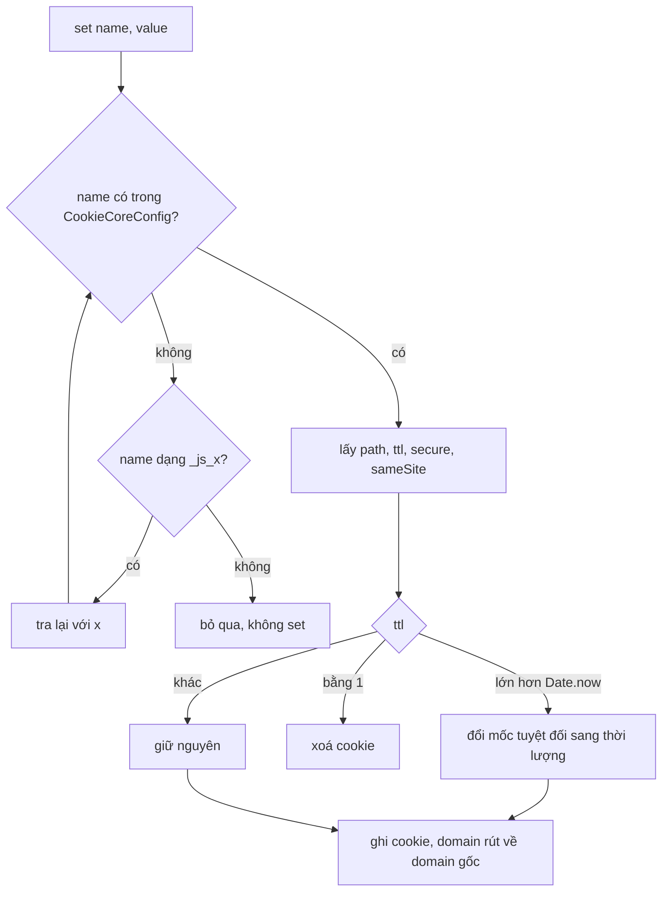

Code set cookie trong một dự án lâu năm thường trông thế này: chỗ này `document.cookie = 'lang=vi; path=/'`, chỗ kia một helper với `max-age=31536000`, chỗ khác quên `Secure`, cookie mới thêm năm ngoái không ai nhớ đặt `SameSite`. Đến lúc trình duyệt đổi mặc định SameSite hay đội bảo mật hỏi "trang mình đang set những cookie nào, sống bao lâu", không ai trả lời được.

Facebook giải quyết bằng một module nhỏ: **mọi cookie phải được khai báo trong một bảng chính sách**, tên không có trong bảng thì không set được. Bài này đi qua `CookieCore`, rồi bổ sung hai góc chưa nói ở các bài trước cho `getSimpleHash` (xem [bài #6 ErrorGuard](/blogs/facebook-error-guard)) và `CometMouseActivity` (xem [bài #3 preload khi hover](/blogs/facebook-preload-on-hover)).

> [!TIP]
> **Tóm tắt**
> - `CookieCore` đọc path, TTL, Secure, SameSite của từng cookie từ `CookieCoreConfig`. Cookie `_js_<x>` dùng chính sách của `<x>`. Tên không khai báo thì `set` im lặng bỏ qua.
> - Mặc định của bản gốc rất chặt: `Secure` và `SameSite=None`; domain được rút về domain gốc (`www.facebook.com` → `.facebook.com`) bằng một regex.
> - TTL bằng đúng `1` (ms) được hiểu là "xoá cookie"; giá trị lớn hơn `Date.now()` được hiểu là mốc hết hạn tuyệt đối. Bản viết lại tách thành API rõ ràng.
> - `getSimpleHash` nối các tham số liền nhau nên `hash('ab','c') === hash('a','bc')`; `CometMouseActivity` có một hàm huỷ làm hỏng luôn việc đăng ký lại.

<iframe class="demo-frame" src="/demos/facebook-patterns/index.html?theme=dark#/small-infra" title="Demo small-infra" loading="lazy" style="height: 880px"></iframe>

<p class="demo-links">▶ <a href="/demos/facebook-patterns/index.html#/small-infra" target="_blank" rel="noopener">Mở demo toàn màn hình ↗</a> · <a href="https://stackblitz.com/github/hunghg255/blog-hunghg/tree/master/examples/facebook-patterns?file=src/lib/smallInfra.ts" target="_blank" rel="noopener">Sửa code trên StackBlitz ↗</a> · <a href="https://github.com/hunghg255/blog-hunghg/blob/master/examples/facebook-patterns/src/lib/smallInfra.ts" target="_blank" rel="noopener">Xem source trên GitHub ↗</a></p>

## CookieCore: một bảng chính sách cho mọi cookie

### Facebook làm thế nào?

`CookieCore` có trong bundle `22.js` của [facebook-codebase](https://github.com/hunghg255/facebook-codebase) (cùng nhiều bản trùng ở các bundle khác). Đã đổi tên biến:

```js
const DOMAIN_RE = /^.*(\.(facebook|messenger|oculus|instagram|facebookcorewwwi|workplace|fbaddins)\..*)$/i;
const JS_PREFIX = /_js_(.*)/;

function policyOf(name) {
  if (CookieCoreConfig[name] !== undefined) {
    const p = CookieCoreConfig[name];
    return { insecure: p.i || false, path: p.p || '/', ttlSeconds: p.t || 0, sameSite: p.s || 'None' };
  }
  const match = name.match(JS_PREFIX);
  return match && match.length > 1 ? policyOf(match[1]) : null;   // _js_datr -> datr
}
const isAllowed = (name) => policyOf(name) !== null;

function set(name, value) {
  if (!isAllowed(name)) return;                                     // không có trong bảng: bỏ qua
  setWithoutChecks(name, value, ttlMs(name), path(name), secure(name), sameSite(name));
}

function setWithoutChecks(name, value, ttl, path, secure, sameSite) {
  const now = Date.now();
  if (ttl != null) {
    if (ttl > now) ttl -= now;                                      // mốc tuyệt đối -> thời lượng
    else if (ttl == 1) { clear(name, path); return; }               // 1 = xoá
  }
  store().setCookie(now, name, value, path, location.hostname.replace(DOMAIN_RE, '$1'), ttl, secure, sameSite);
}

function setIfFirstPartyContext(name, value) {
  if (window.self != window.top) return;                            // đang trong iframe: không set
  set(name, value);
}

function get(name) { return !isAllowed(name) ? null : store().getCookie(name); }
```

Vài điều đáng học:

- **Bảng cấu hình là nguồn sự thật duy nhất.** `CookieCoreConfig` không nằm trong code mà được server gửi kèm dữ liệu trang (trong `000.js` / `Bootloader/SiteData.js` của bản dump, dạng `["CookieCoreConfig", [], {…}]`), khoá rút gọn `i`/`p`/`t`/`s`. Bản dump có 18 mục, ví dụ:

  | Cookie | `t` (giây) | `s` |
  |---|---|---|
  | `locale` | 604800 (7 ngày) | None |
  | `presence` | 2592000 (30 ngày) | None |
  | `wd` (kích thước cửa sổ) | 604800 | Lax |
  | `fbl_st` | 31536000 (1 năm) | Strict |
  | `c_user` | (cookie phiên) | None |
  | `x-src` | 1 | None |

  Muốn thêm cookie mới phải thêm vào bảng, tức là phải qua review. Cũng nhờ đó trả lời được ngay câu "trang set những cookie nào".
- **Tên lạ bị từ chối, kể cả khi đọc.** `get('abc')` trả `null` dù cookie `abc` có tồn tại: code client không phụ thuộc được vào cookie chưa khai báo.
- **Mặc định an toàn.** Không khai báo gì thì cookie là `Secure` và `SameSite=None` (gửi kèm cả request khác site, vì Facebook có nhiều domain và plugin nhúng). Muốn cookie gửi qua http phải ghi rõ `i: true`.
- **Domain gốc bằng regex.** `www.facebook.com` → `.facebook.com`, `m.facebook.com` → `.facebook.com`: cookie dùng chung cho mọi subdomain. Host không khớp regex thì giữ nguyên hostname.
- **Không set trong iframe** với `setIfFirstPartyContext`: khi trang Facebook bị nhúng vào site khác, nó không ghi đè cookie của chính người dùng.

### Hai chỗ "ma thuật"

Tham số `ttl` của `setWithoutChecks` mang ba nghĩa tuỳ giá trị:

| Giá trị | Nghĩa |
|---|---|
| `> Date.now()` | mốc hết hạn tuyệt đối (ms), đổi ra thời lượng |
| `== 1` | xoá cookie |
| còn lại | thời lượng (ms); `0` hoặc `null` là cookie phiên |

Chạy được, nhưng ai đọc `setWithoutChecks('x', '', 1)` mà không biết quy ước sẽ tưởng đặt TTL 1ms. Để ý `set()` nhân `t` với 1000 trước khi truyền xuống, nên cookie `x-src` với `t: 1` trong bảng là cookie sống 1 giây chứ không bị xoá: "1 = xoá" chỉ xảy ra khi ai đó gọi thẳng `setWithoutChecks` với 1. Hai quy ước chồng lên cùng một con số là chỗ rất dễ nhầm. Bản viết lại tách thành `clear(name)` và `{ ttlSeconds }` / `{ expiresAt }`.

Regex tiền tố `/_js_(.*)/` **không neo đầu chuỗi**, nên `abc_js_datr` cũng ăn chính sách của `datr`. Có lẽ không ai đặt tên như vậy, nhưng neo `^` thì chắc chắn hơn.



### Bên trong trình duyệt: các thuộc tính cookie

- `path` giới hạn URL mà cookie được gửi kèm **và** đọc được qua `document.cookie`. Demo đặt `path` bằng thư mục của trang demo để không chạm phần còn lại của blog.
- `max-age` tính bằng giây; thiếu cả `max-age` lẫn `expires` thì là cookie phiên (mất khi đóng trình duyệt, tuy trình duyệt có tính năng khôi phục phiên có thể giữ lại).
- `Secure` chỉ gửi qua HTTPS. Trình duyệt coi `localhost` là ngữ cảnh an toàn nên vẫn set được khi dev.
- `SameSite=None` bắt buộc đi kèm `Secure`, nếu không cookie bị từ chối.
- `domain=.facebook.com` cho mọi subdomain; không ghi `domain` thì cookie chỉ thuộc đúng host hiện tại (host-only).
- Xoá cookie = ghi lại **cùng tên, cùng path, cùng domain** với `max-age=0`. Sai path hoặc domain thì trình duyệt coi là cookie khác, cookie cũ vẫn còn. Đây là lý do bảng chính sách giúp cả việc xoá: path và domain luôn lấy từ cùng một chỗ.

### Viết lại

```ts title=src/lib/smallInfra.ts
export function resolvePolicy(config: CookieConfig, name: string): ResolvedPolicy | null {
  let key = name;
  // bản gốc dùng regex /_js_(.*)/ không neo đầu: "abc_js_x" cũng khớp. Ở đây neo ^.
  while (!(key in config)) {
    const match = key.match(JS_PREFIX);
    if (!match) return null;
    key = match[1];
  }
  const p = config[key];
  return {
    name,
    policyKey: key,
    ttlSeconds: p.ttlSeconds ?? 0,
    path: p.path ?? '/',
    secure: !p.insecure,
    sameSite: p.sameSite ?? 'Lax',
  };
}

/**
 * Domain để set cookie: rút về domain gốc nếu host thuộc danh sách (vd www.facebook.com ->
 * .facebook.com) để mọi subdomain đọc được; còn lại để host-only.
 */
export function cookieDomain(hostname: string, baseDomains: string[]): string | null {
  for (const base of baseDomains) {
    if (hostname === base || hostname.endsWith(`.${base}`)) return `.${base}`;
  }
  return null;
}
```

`createCookieStore` ghép các phần: `set` từ chối tên không có chính sách (hoặc đang trong iframe nếu bật `firstPartyOnly`), dựng chuỗi bằng `serializeCookie`, rồi ghi qua hàm `write` (mặc định là `document.cookie`).

::: spoiler Xem toàn bộ src/lib/smallInfra.ts

```ts title=src/lib/smallInfra.ts
/* -------------------------------------------------------------------------- */
/* 1. Cookie theo chính sách khai báo một chỗ (ý tưởng từ CookieCore)         */
/* -------------------------------------------------------------------------- */

/**
 * Facebook không rải path/TTL/secure/SameSite khắp nơi mỗi lần set cookie. Mọi cookie được
 * khai báo trong một bảng cấu hình (CookieCoreConfig); tên không có trong bảng thì KHÔNG
 * được set. Cookie tên `_js_<x>` dùng chung chính sách với `<x>`.
 */
export interface CookiePolicy {
  /** thời gian sống, giây; 0 = cookie phiên */
  ttlSeconds?: number;
  path?: string;
  /** cho phép gửi qua http (mặc định false = luôn Secure) */
  insecure?: boolean;
  sameSite?: 'Strict' | 'Lax' | 'None';
}

export type CookieConfig = Record<string, CookiePolicy>;

export interface ResolvedPolicy {
  name: string;
  /** tên khoá chính sách thực sự được dùng (có thể khác name nếu đi qua tiền tố _js_) */
  policyKey: string;
  ttlSeconds: number;
  path: string;
  secure: boolean;
  sameSite: 'Strict' | 'Lax' | 'None';
}

const JS_PREFIX = /^_js_(.+)$/;

export function resolvePolicy(config: CookieConfig, name: string): ResolvedPolicy | null {
  let key = name;
  // bản gốc dùng regex /_js_(.*)/ không neo đầu: "abc_js_x" cũng khớp. Ở đây neo ^.
  while (!(key in config)) {
    const match = key.match(JS_PREFIX);
    if (!match) return null;
    key = match[1];
  }
  const p = config[key];
  return {
    name,
    policyKey: key,
    ttlSeconds: p.ttlSeconds ?? 0,
    path: p.path ?? '/',
    secure: !p.insecure,
    sameSite: p.sameSite ?? 'Lax',
  };
}

/**
 * Domain để set cookie: rút về domain gốc nếu host thuộc danh sách (vd www.facebook.com ->
 * .facebook.com) để mọi subdomain đọc được; còn lại để host-only.
 */
export function cookieDomain(hostname: string, baseDomains: string[]): string | null {
  for (const base of baseDomains) {
    if (hostname === base || hostname.endsWith(`.${base}`)) return `.${base}`;
  }
  return null;
}

export interface SetOptions {
  /** ghi đè TTL của chính sách, giây */
  ttlSeconds?: number;
  /** mốc hết hạn tuyệt đối (ms). Bản gốc nhận chung một tham số: > Date.now() thì hiểu là mốc tuyệt đối */
  expiresAt?: number;
}

export function serializeCookie(policy: ResolvedPolicy, value: string, domain: string | null, opts: SetOptions = {}, now = Date.now()) {
  const parts = [`${encodeURIComponent(policy.name)}=${encodeURIComponent(value)}`, `path=${policy.path}`];
  const maxAge = opts.expiresAt != null ? Math.round((opts.expiresAt - now) / 1000) : (opts.ttlSeconds ?? policy.ttlSeconds);
  if (maxAge > 0) parts.push(`max-age=${maxAge}`);
  if (domain) parts.push(`domain=${domain}`);
  if (policy.secure) parts.push('secure');
  parts.push(`samesite=${policy.sameSite.toLowerCase()}`);
  return parts.join('; ');
}

export interface CookieStoreOptions {
  config: CookieConfig;
  baseDomains?: string[];
  /** để test: ghi/đọc vào chỗ khác thay vì document.cookie */
  write?: (cookie: string) => void;
  read?: () => string;
  hostname?: string;
  /** chỉ set khi trang không nằm trong iframe (setIfFirstPartyContext của bản gốc) */
  firstPartyOnly?: boolean;
}

export function createCookieStore({
  config,
  baseDomains = [],
  write = (c) => (document.cookie = c),
  read = () => document.cookie,
  hostname = location.hostname,
  firstPartyOnly = false,
}: CookieStoreOptions) {
  const domain = cookieDomain(hostname, baseDomains);
  const inIframe = typeof window !== 'undefined' && window.self !== window.top;

  return {
    /** trả về chuỗi đã ghi, hoặc null nếu bị từ chối (không có chính sách / đang trong iframe) */
    set(name: string, value: string, opts?: SetOptions): string | null {
      const policy = resolvePolicy(config, name);
      if (!policy || (firstPartyOnly && inIframe)) return null;
      const cookie = serializeCookie(policy, value, domain, opts);
      write(cookie);
      return cookie;
    },
    get(name: string): string | null {
      if (!resolvePolicy(config, name)) return null;
      const prefix = `${encodeURIComponent(name)}=`;
      const hit = read()
        .split('; ')
        .find((c) => c.startsWith(prefix));
      return hit ? decodeURIComponent(hit.slice(prefix.length)) : null;
    },
    /** xoá rõ ràng. Bản gốc dùng "TTL == 1" làm tín hiệu xoá. */
    clear(name: string): string | null {
      const policy = resolvePolicy(config, name);
      if (!policy) return null;
      const cookie = `${encodeURIComponent(name)}=; path=${policy.path}; max-age=0${domain ? `; domain=${domain}` : ''}`;
      write(cookie);
      return cookie;
    },
  };
}

/* -------------------------------------------------------------------------- */
/* 2. Hash 6 ký tự để gom lỗi giống nhau (getSimpleHash)                       */
/* -------------------------------------------------------------------------- */

const BASE32 = 'abcdefghijklmnopqrstuvwxyz012345';

/**
 * Hash đa thức kiểu Java (h = h*31 + c), lấy 30 bit thấp mã hoá thành 6 ký tự base32.
 * Bản gốc nối các tham số liền nhau nên hash('ab','c') === hash('a','bc');
 * `separate: true` chèn ký tự \u0000 giữa các phần để tránh va chạm kiểu đó.
 */
export function simpleHash(parts: Array<string | null | undefined>, { separate = true } = {}): string {
  let h = 0;
  parts.forEach((part, index) => {
    if (part == null) return;
    if (separate && index > 0) h = (Math.imul(h, 31) + 0) | 0;
    for (let i = 0; i < part.length; i++) h = (Math.imul(h, 31) + part.charCodeAt(i)) | 0;
  });
  let out = '';
  for (let i = 0; i < 6; i++) {
    out = BASE32.charAt(h & 31) + out;
    h >>= 5;
  }
  return out;
}

/* -------------------------------------------------------------------------- */
/* 3. "Chuột vừa dừng" (CometMouseActivity)                                   */
/* -------------------------------------------------------------------------- */

/**
 * Một listener mousemove dùng chung cho cả trang; không có mousemove trong `delay` ms thì
 * gọi mọi callback. Khác bản gốc: listener được gỡ khi không còn ai đăng ký (bản gốc giữ
 * listener mãi, và hàm huỷ của init() gỡ listener nhưng không reset cờ, nên sau đó không
 * đăng ký lại được nữa).
 */
const stopCallbacks = new Set<() => void>();
let stopTimer: ReturnType<typeof setTimeout> | null = null;
let stopDelay = 50;

function onMove() {
  if (stopTimer != null) clearTimeout(stopTimer);
  stopTimer = setTimeout(() => {
    stopTimer = null;
    stopCallbacks.forEach((fn) => fn());
  }, stopDelay);
}

export function onMouseStop(callback: () => void, { delay = 50 } = {}) {
  stopDelay = delay;
  if (stopCallbacks.size === 0) window.addEventListener('mousemove', onMove, { passive: true });
  stopCallbacks.add(callback);
  return () => {
    stopCallbacks.delete(callback);
    if (stopCallbacks.size === 0) {
      window.removeEventListener('mousemove', onMove);
      if (stopTimer != null) clearTimeout(stopTimer);
      stopTimer = null;
    }
  };
}

/** số callback đang đăng ký (để demo) */
export const mouseStopSubscribers = () => stopCallbacks.size;
```

:::

**Khác bản gốc:** mặc định `SameSite=Lax` (hợp với site thông thường; Facebook cần `None` vì có nhiều domain và nhúng chéo), domain gốc truyền vào dạng danh sách thay vì regex cứng, `clear()` tách riêng thay cho TTL = 1, regex tiền tố có neo, và hàm ghi/đọc tiêm vào được để test không cần `document.cookie`.

## getSimpleHash: góc mới

[Bài #6](/blogs/facebook-error-guard) đã nói `getSimpleHash(name, stack, type, project, source)` tạo "dấu vân tay" 6 ký tự để gom các lỗi giống nhau. Nhìn kỹ code (`ErrorGuard/getSimpleHash.js`, cũng có bản trong `FBLogger`):

```js
const ALPHABET = 'abcdefghijklmnopqrstuvwxyz012345';
function getSimpleHash(...parts) {
  let h = 0;
  for (const part of parts) {
    if (part != null) for (let i = 0; i < part.length; i++) h = (h << 5) - h + part.charCodeAt(i);
  }
  let out = '';
  for (let k = 0; k < 6; k++) { out = ALPHABET.charAt(h & 31) + out; h >>= 5; }
  return out;
}
```

- `(h << 5) - h` là `h * 31`: hash đa thức kiểu `String.hashCode` của Java.
- 6 ký tự × 5 bit = **30 bit**, tức khoảng 1,07 tỉ giá trị. Đủ để gom lỗi, nhưng không dùng làm khoá duy nhất được.
- `h` không được ép về 32 bit sau mỗi bước (`| 0`), nên có lúc vượt khoảng int32. Không sai: lần `<<` tiếp theo tự cắt về int32, và `& 31`, `>>= 5` cũng cắt trước khi tính. Mình đã so 4 bộ đầu vào (có cả chữ có dấu và emoji) với bản dùng `Math.imul(h, 31) | 0`: kết quả trùng hoàn toàn.
- **Các phần được nối liền nhau, không có ký tự phân cách.** `hash('ab', 'c')` và `hash('a', 'bc')` ra cùng `aac4dc`. Với lỗi thật, `name + stack` ít khi vô tình trùng kiểu này, nhưng thêm một ký tự phân cách (bản viết lại dùng `\u0000`) là loại hẳn rủi ro.

```ts title=src/lib/smallInfra.ts
export function simpleHash(parts: Array<string | null | undefined>, { separate = true } = {}): string {
  let h = 0;
  parts.forEach((part, index) => {
    if (part == null) return;
    if (separate && index > 0) h = (Math.imul(h, 31) + 0) | 0;
    for (let i = 0; i < part.length; i++) h = (Math.imul(h, 31) + part.charCodeAt(i)) | 0;
  });
  let out = '';
  for (let i = 0; i < 6; i++) {
    out = BASE32.charAt(h & 31) + out;
    h >>= 5;
  }
  return out;
}
```

## CometMouseActivity: góc mới

[Bài #3](/blogs/facebook-preload-on-hover) đã nói Facebook preload thêm một lần khi **chuột dừng** trên nút (`CometMouseActivity`: một listener `mousemove` toàn cục, 50ms không di chuyển là "dừng"). Toàn bộ module:

```js
const DELAY = 50, callbacks = [];
let timer = null, installed = false;
function fire() { callbacks.length > 0 && callbacks.forEach((fn) => fn()); timer = null; }
function onMove() { clearTimeout(timer); timer = setTimeout(fire, DELAY); }
function init() {
  installed || (window.addEventListener('mousemove', onMove), (installed = true));
  return () => window.removeEventListener('mousemove', onMove);   // không đặt lại installed = false
}
function addOnMouseStopCallback(fn) {
  installed || init();
  callbacks.push(fn);
  return () => removeFromArray(callbacks, fn);
}
```

Hai điểm yếu:

- Hàm huỷ mà `init()` trả về gỡ listener nhưng **không đặt lại cờ `installed`**. Ai đó gọi hàm huỷ này một lần thì mọi `addOnMouseStopCallback` về sau chỉ đẩy callback vào mảng, không còn listener nào bắn nữa.
- Listener và timer chạy mãi, kể cả khi không còn callback nào: mỗi lần chuột nhích lại `clearTimeout` + `setTimeout`.

Bản viết lại (`onMouseStop` trong file trên) đếm số người đăng ký: người đầu tiên gắn listener, người cuối cùng rời đi thì gỡ listener và huỷ timer.

## Tại sao không làm cách khác?

**Sao không dùng thư viện cookie (js-cookie) là đủ?** js-cookie giải quyết việc *mã hoá/giải mã* chuỗi cookie. Nó không trả lời "cookie này được phép tồn tại không, sống bao lâu". Bảng chính sách là một lớp quản trị đặt trên đó.

**Sao không để server set mọi cookie?** Cookie quan trọng (phiên đăng nhập) nên do server set với `HttpOnly`, JavaScript không đọc được. Những cookie còn lại do client set (ngôn ngữ, trạng thái giao diện, id thiết bị cho chống gian lận) vẫn cần cùng kỷ luật.

**Sao không dùng crypto hash (SHA-1) cho dấu vân tay lỗi?** `crypto.subtle.digest` là bất đồng bộ; code xử lý lỗi cần chạy đồng bộ, đôi khi ngay lúc trang sắp đóng. Hash 30 bit đồng bộ, vài dòng code, là đủ cho việc gom nhóm.

## Edge case và cạm bẫy

- **Cookie trong iframe khác site.** Từ khi trình duyệt chặn cookie bên thứ ba, cookie set trong iframe khác site có thể bị bỏ hoặc bị phân vùng (CHIPS, thuộc tính `Partitioned`). `setIfFirstPartyContext` tránh luôn vấn đề này.
- **Giới hạn dung lượng.** Mỗi cookie khoảng 4KB, và tổng header Cookie gửi đi có thể vượt giới hạn của server/CDN (xem [cách InVision dọn cookie](/blogs/web-cross-tab-auth-cookie-guard)).
- **Giá trị có dấu `;`, `=` hoặc chữ có dấu.** Phải `encodeURIComponent`, nếu không chuỗi cookie bị cắt sai.
- **Mouse stop trên cảm ứng.** Không có `mousemove`, callback không bao giờ chạy. Đó là lý do Facebook preload ở `pointerdown` cho cảm ứng.

## Dùng trong dự án

```ts
// cookies.ts: nơi duy nhất trong codebase được động vào document.cookie
export const cookies = createCookieStore({
  config: {
    locale: { ttlSeconds: 365 * 24 * 3600 },
    theme: { ttlSeconds: 365 * 24 * 3600 },
    consent: { ttlSeconds: 180 * 24 * 3600, sameSite: 'Strict' },
  },
  baseDomains: ['example.com'],
});

cookies.set('locale', 'vi');   // ok
cookies.set('trackingId', 'x'); // null: chưa khai báo, bị từ chối
```

Thêm một luật ESLint `no-restricted-properties` cấm `document.cookie` ở mọi file trừ `cookies.ts` là đủ để bảng chính sách luôn được tôn trọng.

## Kiểm thử

::: spoiler Ví dụ test (bản phác, không có trong repo)

```ts
import { describe, expect, it } from 'vitest';
import { createCookieStore, resolvePolicy, simpleHash } from './smallInfra';

const config = { datr: { ttlSeconds: 100, sameSite: 'None' as const }, locale: {} };

describe('cookie policy', () => {
  it('tiền tố _js_ dùng chính sách của tên gốc, tên lạ bị từ chối', () => {
    expect(resolvePolicy(config, '_js_datr')?.policyKey).toBe('datr');
    expect(resolvePolicy(config, 'x_js_datr')).toBeNull();
    expect(resolvePolicy(config, 'tracking')).toBeNull();
  });

  it('ghi chuỗi cookie đúng thuộc tính', () => {
    const jar: string[] = [];
    const store = createCookieStore({ config, baseDomains: ['facebook.com'], hostname: 'www.facebook.com', write: (c) => jar.push(c), read: () => '' });
    expect(store.set('datr', 'abc')).toBe('datr=abc; path=/; max-age=100; domain=.facebook.com; secure; samesite=none');
    expect(store.set('tracking', '1')).toBeNull();
    expect(store.clear('locale')).toBe('locale=; path=/; max-age=0; domain=.facebook.com');
    expect(jar).toHaveLength(2);
  });
});

describe('simpleHash', () => {
  it('6 ký tự; nối liền như bản gốc thì va chạm, có phân cách thì không', () => {
    expect(simpleHash(['TypeError', 'x'])).toMatch(/^[a-z0-5]{6}$/);
    expect(simpleHash(['ab', 'c'], { separate: false })).toBe(simpleHash(['a', 'bc'], { separate: false }));
    expect(simpleHash(['ab', 'c'])).not.toBe(simpleHash(['a', 'bc']));
  });
});
```

:::

## So với cách khác

- **Cookie Store API** (`cookieStore.set({ name, value, expires, sameSite })`) là API bất đồng bộ, có sự kiện `change`, rõ ràng hơn `document.cookie`; tính tới 10/2026 đã có ở Chromium và Safari, Firefox thì xem [caniuse](https://caniuse.com/cookie-store-api). Nó vẫn không có khái niệm "bảng chính sách", lớp đó vẫn phải tự viết.
- **Consent manager** (OneTrust, Cookiebot) phân loại cookie theo mục đích để xin đồng ý; bảng chính sách như CookieCore là chỗ tự nhiên để gắn thêm trường "mục đích".

---

Bài này thuộc series **[Học từ mã nguồn Facebook](/series/facebook)** (83 bài, đọc theo thứ tự).

::: spoiler Xem nhanh danh sách bài trong series

*Phần 1*

- [Mở đầu: cách đọc code minify của Facebook](/blogs/learn-from-facebook-source-code)
- [#1 Dùng chung IntersectionObserver + infinite scroll](/blogs/facebook-shared-intersection-observer)
- [#2 useViewportDuration: đo thời gian thực sự được xem](/blogs/facebook-use-viewport-duration)
- [#3 Preload code + data khi hover](/blogs/facebook-preload-on-hover)
- [#4 Toast manager với external store](/blogs/facebook-toast-manager)
- [#5 Network status + heartbeat backoff](/blogs/facebook-network-status-heartbeat)
- [#6 ErrorGuard: bắt lỗi theo ngữ cảnh](/blogs/facebook-error-guard)
- [#7 Banzai: gom log theo lô + sendBeacon](/blogs/facebook-batch-logger)
- [#8 Focus trap + Esc theo layer](/blogs/facebook-focus-trap)

*Phần 2*

- [#9 Mẹo calc(… * 9999): container query, line-clamp, mũi tên carousel bằng CSS](/blogs/facebook-css-9999-trick)
- [#10 Thanh cuộn tuỳ biến bằng CSS 3D](/blogs/facebook-css-3d-scrollbar)
- [#11 Modal cuộn bằng window, giữ vị trí trang nền](/blogs/facebook-document-scroll-modal)
- [#12 Popover, tooltip group và hovercard](/blogs/facebook-popover-tooltip)
- [#13 Primitive Pressable + focus-visible](/blogs/facebook-pressable)
- [#14 Tab "Xem thêm" + sticky header bằng IntersectionObserver](/blogs/facebook-priority-tabs-sticky-header)
- [#15 Avatar khoét mask, gradient Messenger, skeleton steps()](/blogs/facebook-visual-tricks)
- [#16 Khung chat không giật](/blogs/facebook-chat-scroller)
- [#17 Thuật toán chọn bố cục collage ảnh](/blogs/facebook-photo-collage-layout)
- [#18 Keep-alive tab trong SPA](/blogs/facebook-keep-alive-tabs)
- [#19 Tự đo Visual Completion & interaction tracing](/blogs/facebook-visual-completion)
- [#20 Router SPA bền bỉ & tải chunk có retry](/blogs/facebook-spa-router-resilient-loading)

*Phần 3*

- [#21 Smart Compose: gợi ý chữ mờ khi gõ](/blogs/facebook-smart-compose-ghost-text)
- [#22 MQTT ngay trong trình duyệt, tự chuyển sang long-poll](/blogs/facebook-mqtt-in-browser)
- [#23 Đo thời gian dùng bằng bitmap 64 giây](/blogs/facebook-time-spent-bitmap)
- [#24 Bảng reaction nhấn giữ rồi trượt](/blogs/facebook-reaction-press-slide)
- [#25 Tìm kiếm gấp dấu, phiên âm và highlight đầu từ](/blogs/facebook-search-diacritics-tokenize)
- [#26 Ring buffer biết trace nào đã mất log](/blogs/facebook-trace-ring-buffer)
- [#27 Engine animation JS: một vòng rAF và solver cubic-bezier](/blogs/facebook-keyframes-loop-cubic-bezier)
- [#28 Bootloader: bitmap tài nguyên đã tải, chỉ reload khi cần](/blogs/facebook-bootloader-bitmap-consistency)
- [#29 Nhận biết click do screen reader tạo ra](/blogs/facebook-virtual-cursor-detection)
- [#30 Tải trước feed theo chất lượng mạng, đoán hạng thiết bị](/blogs/facebook-network-aware-prefetch)
- [#31 Hàng đợi gửi tin chat giữ đúng thứ tự](/blogs/facebook-ordered-send-queue)
- [#32 Gộp lời gọi API trong cùng một tick](/blogs/facebook-api-batcher)
- [#33 Resize ảnh trong pool Web Worker](/blogs/facebook-jpeg-resize-worker-pool)
- [#34 Crop ảnh theo nhiều khuôn mặt](/blogs/facebook-face-aware-crop)
- [#35 Kéo-thả sắp xếp và vùng thả file không nhấp nháy](/blogs/facebook-flicker-free-drag-drop)
- [#36 Tiện ích UI: fade-out, sticky event, hàm huỷ được](/blogs/facebook-ui-utility-hooks)
- **#37 Hạ tầng nhỏ: cookie, hash lỗi, prefetch khi chuột dừng** (bài này)

*Phần 4–6*

- [#38 Đồng bộ tin nhắn: phát hiện lỗ seqID và fetch bù theo tầng](/blogs/facebook-messenger-sync-seqid-gaps)
- [#39 OTID: ID tin nhắn kiểu Snowflake sinh ở client](/blogs/facebook-otid-client-snowflake)
- [#40 QPL: lấy mẫu từ lúc bắt đầu, đo RTT gửi tin đầu-cuối](/blogs/facebook-qpl-send-rtt)
- [#41 Bộ điều phối request bảy chế độ gộp và chống trùng](/blogs/facebook-request-dispatcher-modes)
- [#42 Thread list theo mốc thời gian, cookie presence có version](/blogs/facebook-threadlist-ranged-presence)
- [#43 Composer dạng plugin: reducer, dirty checker, chuỗi kiểm tra](/blogs/facebook-plugin-composer)
- [#44 Thanh toán bất đồng bộ: subscribe trước, poll dự phòng](/blogs/facebook-async-checkout)
- [#45 Validate số thẻ: sửa lỗi gõ, dải BIN, Luhn](/blogs/facebook-card-validation)
- [#46 Lịch chọn khoảng ngày: bo góc dải chọn, phím đủ bộ, RTL](/blogs/facebook-range-calendar-a11y)
- [#47 Giờ mở cửa theo tuần: qua đêm, gộp khoảng, phần bù](/blogs/facebook-weekly-hours-intervals)
- [#48 Tiến độ đăng realtime: giữ event chờ snapshot, watchdog](/blogs/facebook-realtime-publish-snapshot)
- [#49 Tiền tệ theo đơn vị nhỏ nhất và ô nhập tiền](/blogs/facebook-currency-minor-units)
- [#50 Sửa hàng loạt Empty/Uniform/Mixed, seen/read bằng 2 bit](/blogs/facebook-bulk-edit-seen-bits)
- [#51 Phát hiện script lạ hook vào hàm native](/blogs/facebook-native-hook-detection)
- [#52 localStorage tự dọn khi đầy quota](/blogs/facebook-quota-aware-storage)
- [#53 Cache tuyến do server phân giải, chờ sẵn promise](/blogs/facebook-route-cache-prefetch)
- [#54 Lưới phím mũi tên 2D và focus không làm cuộn trang](/blogs/facebook-focus-table-grid)
- [#55 Tách emoji bằng máy trạng thái](/blogs/facebook-emoji-segmentation)
- [#56 Đọc trước ghi sau trong một frame, con tự biết vị trí](/blogs/facebook-read-then-write-dom)
- [#57 Hàng đợi lệnh cho video và stream sắp lại chunk](/blogs/facebook-video-command-queue)

*Phần 7–10*

- [#58 Ước lượng băng thông EWMA: loại outlier, nhớ qua phiên](/blogs/facebook-bandwidth-ewma-estimator)
- [#59 ABR theo độ tự tin phát và cắt bậc bitrate theo MOS](/blogs/facebook-abr-playback-confidence)
- [#60 Prefetch segment dự đoán từ manifest, parse hộp sidx](/blogs/facebook-dash-predicted-segments)
- [#61 Đọc metadata MP4/MOV ngay trên client](/blogs/facebook-mp4-metadata-client)
- [#62 Upload tiếp tục được: offset, hash dedupe, phát hiện treo](/blogs/facebook-resumable-upload)
- [#63 Fenwick tree: chọn ngẫu nhiên có trọng số và offset dòng](/blogs/facebook-fenwick-weighted-random)
- [#64 Vạch trục số và trục thời gian "đẹp"](/blogs/facebook-nice-axis-ticks)
- [#65 Damerau-Levenshtein theo dải chéo và tự sửa tên gõ sai](/blogs/facebook-damerau-levenshtein)
- [#66 PRNG có seed, shuffle tái lập và lấy mẫu trace](/blogs/facebook-seeded-prng-sampling)
- [#67 Cặp min/max-heap tái dùng vị trí trong danh sách ảo](/blogs/facebook-dual-heap-buffer-set)
- [#68 Memo nhiều đối số bằng Map/WeakMap và interning object](/blogs/facebook-multikey-memo-interning)
- [#69 Thống kê cửa sổ trượt và đại số khoảng thời gian](/blogs/facebook-moving-stat-intervals)
- [#70 Int64 từ hai số 32-bit, decode UTF, offset theo code point](/blogs/facebook-int64-utf-codepoints)
- [#71 Engine múi giờ IANA trên client, phát hiện lệch giờ](/blogs/facebook-client-iana-timezone)
- [#72 Tự cài semver range](/blogs/facebook-semver-range)
- [#73 Auto-link URL, cắt chữ an toàn, giới hạn LaTeX](/blogs/facebook-autolink-safe-truncate)
- [#74 Parser query kiểu PHP chống prototype pollution](/blogs/facebook-php-query-serializer)
- [#75 Popover tự lật theo phần tràn nhỏ nhất](/blogs/facebook-popover-auto-flip)
- [#76 Tiền tố for(;;) chống JSON hijacking, đọc stream](/blogs/facebook-csrf-prefix-streaming)
- [#77 Chống lộ Referer, linkshim, xoá token trên URL](/blogs/facebook-referrer-linkshim-url-scrub)
- [#78 setImmediate bằng postMessage, gom delta chuột theo frame](/blogs/facebook-setimmediate-mouse-batching)
- [#79 Phát hiện crash qua heartbeat, dò proxy cache hỏng](/blogs/facebook-crash-heartbeat-proxy-check)
- [#80 DPR vào cookie cho ảnh @2x, che khoá trong log](/blogs/facebook-dpr-cookie-secret-redaction)
- [#81 Flux waitFor tự viết và proxy có đệm](/blogs/facebook-flux-dispatch-buffered-proxy)
- [#82 Crop đúng tỉ lệ, xoay sticker bằng ma trận](/blogs/facebook-image-crop-rotation-geometry)

:::

Code + demo: [`examples/facebook-patterns`](https://github.com/hunghg255/blog-hunghg/tree/master/examples/facebook-patterns) · [Mở trên StackBlitz](https://stackblitz.com/github/hunghg255/blog-hunghg/tree/master/examples/facebook-patterns)
