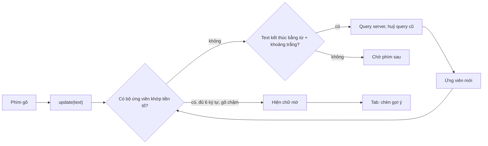

Gmail có Smart Compose: bạn gõ "Cảm ơn bạn đã", chữ "đặt hàng" hiện mờ phía sau con trỏ, bấm Tab là nhận. Tính năng trông đơn giản, nhưng làm vội thì gặp ngay ba vấn đề:

1. **Gọi server mỗi phím gõ.** Một tin 60 ký tự thành 60 request, đa số trả về khi người dùng đã gõ tiếp.
2. **Gợi ý nhảy múa.** Gõ nhanh thì chữ mờ hiện rồi biến liên tục, gây rối mắt hơn là giúp.
3. **Gợi ý vô ích.** Đoán đúng 2 ký tự cuối của một từ thì người dùng đã gõ xong trước khi kịp nhìn.

Facebook có một bản Smart Compose cho hộp thư Pages (chủ trang trả lời tin nhắn khách) và giải cả ba vấn đề bằng vài quy tắc rất cụ thể.

> [!TIP]
> **Tóm tắt**
> - Chỉ gửi query khi text vừa kết thúc bằng "một từ + khoảng trắng". Các phím sau đó lọc ứng viên **ngay ở client** theo tiền tố.
> - Chỉ hiện gợi ý khi phần còn thiếu dài **≥ 6 ký tự** và hai phím cách nhau **≥ 100ms**. Gợi ý đã hiện một lần thì giữ, không chớp tắt.
> - Chữ mờ là một lớp đặt **sau** ô nhập: cùng font, cùng cách xuống dòng, phần đã gõ để trong suốt, nên gợi ý luôn nằm đúng sau con trỏ.
> - Query cũ bị huỷ khi có query mới; phím đầu tiên bắn một query rỗng để "làm ấm" kết nối.

<iframe class="demo-frame" src="/demos/facebook-patterns/index.html?theme=dark#/smart-compose" title="Demo smart-compose" loading="lazy" style="height: 900px"></iframe>

<p class="demo-links">▶ <a href="/demos/facebook-patterns/index.html#/smart-compose" target="_blank" rel="noopener">Mở demo toàn màn hình ↗</a> · <a href="https://stackblitz.com/github/hunghg255/blog-hunghg/tree/master/examples/facebook-patterns?file=src/lib/smartCompose.ts" target="_blank" rel="noopener">Sửa code trên StackBlitz ↗</a> · <a href="https://github.com/hunghg255/blog-hunghg/blob/master/examples/facebook-patterns/src/lib/smartCompose.ts" target="_blank" rel="noopener">Xem source trên GitHub ↗</a></p>

## Facebook làm thế nào?

Lớp chính là `SmartComposeTypeaheadHelper` (bundle `56.js` trong [facebook-codebase](https://github.com/hunghg255/facebook-codebase)). Chỗ dùng duy nhất trong bản dump là `PagesTypeaheadSuggestionInput.react` (`182.js`), khởi tạo với surface `"p2b_messaging"`, tức là ô trả lời tin nhắn từ người dùng tới Page.

### Hai hằng số và một Set

Đầu module là hai hằng số đặt tên kiểu minify:

```js
var g, h = b("React"), i = 6, j = 100, k = /* SmartComposeTypeaheadHelperQuery.graphql */;
```

`i = 6` là độ dài tối thiểu của phần còn thiếu, `j = 100` là khoảng cách tối thiểu giữa hai phím (ms). Hàm tính gợi ý (đã đổi tên biến):

```js
computeSuggestion(candidates = this.candidates) {
  if (candidates.length === 0 || this.text.indexOf(this.lastQuery) < 0 || this.isDeleting() || !this.cursorAtEnd)
    return null;
  const typed = this.text.substring(this.lastQuery.length).toLowerCase(); // gõ thêm sau lần query
  if (typed.length === 0) return null;
  const c = candidates.find(c => c.text.toLowerCase().indexOf(typed) === 0);
  if (c == null) return null;
  if (c.text.length <= typed.length && this.shown.has(c.text)) { logMatchingSuggestion(); return null; }
  if (!this.shown.has(c.text) && (c.text.length - typed.length < 6 || this.keyInterval !== -1 && this.keyInterval < 100))
    return null;
  ...
}
```

Ba chi tiết đáng chú ý:

- **`typed.length === 0` thì không hiện.** Ngay sau khoảng trắng, chưa có gợi ý nào. Phải gõ chữ cái đầu của từ tiếp theo thì gợi ý mới xuất hiện. Có lẽ để chắc người dùng định viết tiếp, và để chữ mờ không chen vào lúc người dùng đang nghĩ.
- **`shown` là một `Set`.** Ứng viên nào đã hiện một lần thì được miễn hai điều kiện "≥ 6 ký tự" và "≥ 100ms". Không có Set này, gợi ý sẽ biến mất khi người dùng gõ nhanh hơn một chút hoặc khi phần còn thiếu ngắn lại dưới 6, rồi hiện lại: nhấp nháy.
- **Tự gõ hết đúng câu gợi ý** (`c.text.length <= typed.length` và đã hiện) được log riêng thành `SmartComposeMatchingSuggestionFalcoEvent`: tín hiệu "gợi ý đúng nhưng người dùng không cần". Model phía server có lẽ dùng tín hiệu này để chỉnh.

### Khi nào hỏi server

```js
maybeQuery() {
  if (!this.warmedUp && this.text.length > 0) { this.query(""); this.warmedUp = true; return; }
  if (this.text.trim() === "" || !/[^\s]+\s$/.test(this.text) || this.currentQuery === this.text ||
      this.lastQuery === this.text || this.isDeleting() || this.suggestion != null)
    return;
  this.query(this.text, candidates => { /* thay bộ ứng viên nếu dùng được */ });
}
```

- **Phím đầu tiên bắn query rỗng, không có callback.** Kết quả bị bỏ. Mục đích có lẽ là mở kết nối và làm ấm cache phía server, để query thật sau đó nhanh hơn.
- Query thật chỉ đi khi text khớp `/[^\s]+\s$/`: vừa gõ xong một từ. Đang xoá, hoặc đang có gợi ý dùng được thì không hỏi.
- Mỗi query là một `CancelablePromise` bọc `RelayModern.fetchQuery`; query mới huỷ query cũ.

### Chữ mờ nằm ở đâu

`PagesTypeaheadSuggestionInput` vẽ **hai** editor Draft.js chồng lên nhau. Editor phía sau là bản `readOnly`, chứa toàn bộ nội dung đã gõ với inline style `GHOST: { visibility: "hidden" }`, rồi chèn chuỗi gợi ý vào cuối. Editor phía trước là editor thật, nền trong suốt. Vì hai editor có cùng font và cùng chiều rộng, phần đã gõ trong editor sau chiếm đúng chỗ của chữ thật, và chuỗi gợi ý rơi đúng vào sau con trỏ, kể cả khi xuống dòng. `Tab` và `→` gọi `insertTypeahead`: chèn chuỗi gợi ý vào editor thật.

## Bên trong trình duyệt: vì sao lớp phủ khớp được

Không có API nào để vẽ chữ "ở sau con trỏ" trong `<textarea>`. Mẹo của Facebook (và của bản viết lại) dựa trên một điều: hai hộp có cùng font, cùng `padding`, cùng `white-space: pre-wrap` và cùng chiều rộng thì trình duyệt ngắt dòng giống hệt nhau. Phần chữ đã gõ được vẽ trong suốt (`visibility: hidden` hoặc `color: transparent`) chỉ để giữ chỗ, chuỗi gợi ý theo sau nó.



## Viết lại

Phần lõi là một lớp không phụ thuộc React: nhận text và vị trí con trỏ, trả ra chuỗi gợi ý qua callback. Hàm tính gợi ý chỉ chạy trên bộ ứng viên đang có, không gọi mạng:

```ts title=src/lib/smartCompose.ts
  /** Tính gợi ý từ bộ ứng viên đang có, không gọi mạng. */
  private computeSuggestion(candidates = this.candidates): { candidate: Candidate; rest: string } | null {
    if (candidates.length === 0 || !this.cursorAtEnd || this.isDeleting()) return null;
    // Khác bản gốc: FB dùng indexOf(base) >= 0 (base nằm ở đâu cũng được). Sửa đoạn đầu câu
    // thì substring(base.length) cắt sai chỗ. Ở đây đòi base phải là tiền tố.
    if (!this.text.startsWith(this.baseText)) return null;
    const typed = this.text.slice(this.baseText.length).toLowerCase();
    // vừa gõ xong từ (typed rỗng) thì chưa hiện: chờ chữ cái đầu của từ tiếp theo
    if (typed.length === 0) return null;
    const candidate = candidates.find((c) => c.text.toLowerCase().startsWith(typed));
    if (!candidate) return null;

    const remaining = candidate.text.length - typed.length;
    if (remaining <= 0) {
      // người dùng tự gõ hết đúng câu đã gợi ý: tín hiệu "gợi ý đúng" cho model.
      // Khác bản gốc: FB cũng log sự kiện này ngay sau khi người dùng bấm Tab nhận gợi ý.
      if (this.shown.has(candidate.text) && !this.accepting) this.opts.onEvent?.({ type: 'typed-it-all', candidate: candidate.text });
      return null;
    }
    const tooShort = remaining < this.opts.minRemaining;
    const typingFast = this.keyIntervalMs !== -1 && this.keyIntervalMs < this.opts.minKeyIntervalMs;
    if (!this.shown.has(candidate.text) && (tooShort || typingFast)) return null;
    return { candidate, rest: candidate.text.slice(typed.length) };
  }
```

Quyết định khi nào hỏi server:

```ts title=src/lib/smartCompose.ts
  private maybeQuery() {
    // phím đầu tiên: bắn một query rỗng để "làm ấm" kết nối, bỏ kết quả
    if (!this.warmedUp && this.text.length > 0) {
      this.warmedUp = true;
      void this.query('', true);
      return;
    }
    if (
      this.text.trim() === '' ||
      !ENDS_WITH_WORD_AND_SPACE.test(this.text) ||
      this.text === this.queryText ||
      this.text === this.baseText ||
      this.isDeleting() ||
      this.suggestion !== '' // đang có gợi ý dùng được thì khỏi hỏi lại
    ) {
      return;
    }
    void this.query(this.text, false);
  }
```

::: spoiler Xem toàn bộ src/lib/smartCompose.ts

```ts title=src/lib/smartCompose.ts
/**
 * Smart Compose: gợi ý phần còn lại của câu bằng chữ mờ (ghost text).
 * Ý tưởng từ SmartComposeTypeaheadHelper của Facebook (hộp thư Pages Manager):
 * - chỉ hỏi server khi người dùng vừa gõ xong một từ (text kết thúc bằng "từ + khoảng trắng"),
 *   các phím sau đó lọc ứng viên ngay ở client;
 * - chỉ hiện gợi ý khi phần còn thiếu đủ dài (≥ 6 ký tự) và người dùng gõ chậm (≥ 100ms/phím);
 * - gợi ý đã hiện một lần thì giữ, không chớp tắt theo tốc độ gõ.
 */

export interface Candidate {
  /** phần chữ server đoán sẽ đến SAU đoạn text đã gửi đi */
  text: string;
  confidence: number;
}

export type FetchCandidates = (text: string, signal: AbortSignal) => Promise<Candidate[]>;

export type SmartComposeEvent =
  | { type: 'query'; text: string; warmUp: boolean }
  | { type: 'query-done'; text: string; count: number; ms: number }
  | { type: 'query-cancelled'; text: string }
  | { type: 'displayed'; suggestion: string; keyIntervalMs: number }
  | { type: 'accepted'; suggestion: string }
  | { type: 'typed-it-all'; candidate: string };

export interface SmartComposeOptions {
  fetchCandidates: FetchCandidates;
  /** phần còn thiếu phải dài ít nhất bấy nhiêu ký tự mới đáng hiện (FB: 6) */
  minRemaining?: number;
  /** khoảng cách giữa hai phím phải ít nhất bấy nhiêu ms (FB: 100) */
  minKeyIntervalMs?: number;
  onSuggestionChange?: (suggestion: string) => void;
  onEvent?: (event: SmartComposeEvent) => void;
  now?: () => number;
}

const ENDS_WITH_WORD_AND_SPACE = /\S+\s$/;

export class SmartCompose {
  private text = '';
  private prevText = '';
  private cursorAtEnd = true;
  /** text của request đang bay (hoặc vừa gửi) */
  private queryText: string | null = null;
  /** text đã dùng để lấy bộ ứng viên hiện tại: gợi ý = phần ứng viên còn lại sau `baseText` */
  private baseText = '';
  private candidates: Candidate[] = [];
  /** ứng viên đã từng hiện: được giữ dù tốc độ gõ thay đổi */
  private shown = new Set<string>();
  private suggestion = '';
  private warmedUp = false;
  private accepting = false;
  private inFlight: AbortController | null = null;
  private lastKeyAt = -1;
  private keyIntervalMs = -1;
  private readonly opts: Required<Omit<SmartComposeOptions, 'onSuggestionChange' | 'onEvent'>> &
    Pick<SmartComposeOptions, 'onSuggestionChange' | 'onEvent'>;

  constructor(options: SmartComposeOptions) {
    this.opts = { minRemaining: 6, minKeyIntervalMs: 100, now: () => performance.now(), ...options };
  }

  getSuggestion() {
    return this.suggestion;
  }

  /** Gọi ở mỗi lần nội dung đổi do người dùng gõ. */
  update(text: string, cursorAtEnd: boolean) {
    const now = this.opts.now();
    this.keyIntervalMs = this.lastKeyAt < 0 ? -1 : now - this.lastKeyAt;
    this.lastKeyAt = now;
    this.setText(text.normalize('NFC'), cursorAtEnd);
  }

  /** Con trỏ di chuyển (click, phím mũi tên): không tính là một lần gõ. */
  setCursorAtEnd(cursorAtEnd: boolean) {
    this.setText(this.text, cursorAtEnd);
  }

  /** Người dùng bấm Tab/→: trả về đoạn cần chèn ('' nếu không có gợi ý). */
  accept(): string {
    const suggestion = this.suggestion;
    if (!suggestion) return '';
    this.opts.onEvent?.({ type: 'accepted', suggestion });
    // nội dung mới = text + gợi ý; không tính là một lần gõ phím
    this.accepting = true;
    try {
      this.setText(this.text + suggestion, true);
    } finally {
      this.accepting = false;
    }
    return suggestion;
  }

  dispose() {
    this.inFlight?.abort();
    this.inFlight = null;
  }

  private setText(text: string, cursorAtEnd: boolean) {
    if (text === this.text && cursorAtEnd === this.cursorAtEnd) return;
    this.prevText = this.text;
    this.text = text;
    this.cursorAtEnd = cursorAtEnd;
    this.refreshSuggestion();
    this.maybeQuery();
  }

  private isDeleting() {
    return this.text.length < this.prevText.length;
  }

  /** Tính gợi ý từ bộ ứng viên đang có, không gọi mạng. */
  private computeSuggestion(candidates = this.candidates): { candidate: Candidate; rest: string } | null {
    if (candidates.length === 0 || !this.cursorAtEnd || this.isDeleting()) return null;
    // Khác bản gốc: FB dùng indexOf(base) >= 0 (base nằm ở đâu cũng được). Sửa đoạn đầu câu
    // thì substring(base.length) cắt sai chỗ. Ở đây đòi base phải là tiền tố.
    if (!this.text.startsWith(this.baseText)) return null;
    const typed = this.text.slice(this.baseText.length).toLowerCase();
    // vừa gõ xong từ (typed rỗng) thì chưa hiện: chờ chữ cái đầu của từ tiếp theo
    if (typed.length === 0) return null;
    const candidate = candidates.find((c) => c.text.toLowerCase().startsWith(typed));
    if (!candidate) return null;

    const remaining = candidate.text.length - typed.length;
    if (remaining <= 0) {
      // người dùng tự gõ hết đúng câu đã gợi ý: tín hiệu "gợi ý đúng" cho model.
      // Khác bản gốc: FB cũng log sự kiện này ngay sau khi người dùng bấm Tab nhận gợi ý.
      if (this.shown.has(candidate.text) && !this.accepting) this.opts.onEvent?.({ type: 'typed-it-all', candidate: candidate.text });
      return null;
    }
    const tooShort = remaining < this.opts.minRemaining;
    const typingFast = this.keyIntervalMs !== -1 && this.keyIntervalMs < this.opts.minKeyIntervalMs;
    if (!this.shown.has(candidate.text) && (tooShort || typingFast)) return null;
    return { candidate, rest: candidate.text.slice(typed.length) };
  }

  private refreshSuggestion() {
    const next = this.computeSuggestion();
    const rest = next?.rest ?? '';
    if (next && !this.shown.has(next.candidate.text)) {
      this.shown.add(next.candidate.text);
      this.opts.onEvent?.({ type: 'displayed', suggestion: rest, keyIntervalMs: Math.round(this.keyIntervalMs) });
    }
    if (rest !== this.suggestion) {
      this.suggestion = rest;
      this.opts.onSuggestionChange?.(rest);
    }
  }

  private maybeQuery() {
    // phím đầu tiên: bắn một query rỗng để "làm ấm" kết nối, bỏ kết quả
    if (!this.warmedUp && this.text.length > 0) {
      this.warmedUp = true;
      void this.query('', true);
      return;
    }
    if (
      this.text.trim() === '' ||
      !ENDS_WITH_WORD_AND_SPACE.test(this.text) ||
      this.text === this.queryText ||
      this.text === this.baseText ||
      this.isDeleting() ||
      this.suggestion !== '' // đang có gợi ý dùng được thì khỏi hỏi lại
    ) {
      return;
    }
    void this.query(this.text, false);
  }

  private async query(text: string, warmUp: boolean) {
    this.inFlight?.abort(); // request cũ hết giá trị: người dùng đã gõ thêm
    const controller = new AbortController();
    this.inFlight = controller;
    this.queryText = text;
    const started = this.opts.now();
    this.opts.onEvent?.({ type: 'query', text, warmUp });
    try {
      const result = await this.opts.fetchCandidates(text, controller.signal);
      if (controller.signal.aborted) throw new DOMException('Aborted', 'AbortError');
      this.opts.onEvent?.({ type: 'query-done', text, count: result.length, ms: Math.round(this.opts.now() - started) });
      if (warmUp || result.length === 0) return;
      // Chỉ thay bộ ứng viên nếu chưa có gợi ý, hoặc bộ mới cho ra gợi ý.
      const previousBase = this.baseText;
      this.baseText = text;
      if (this.suggestion !== '' && this.computeSuggestion(result) == null) {
        this.baseText = previousBase;
        return;
      }
      this.candidates = result;
      this.shown = new Set();
      this.refreshSuggestion();
    } catch (error) {
      if ((error as Error).name === 'AbortError') this.opts.onEvent?.({ type: 'query-cancelled', text });
      else throw error;
    } finally {
      if (this.inFlight === controller) this.inFlight = null;
    }
  }
}
```

:::

**Khác bản gốc:**

- FB kiểm tra `text.indexOf(lastQuery) >= 0`: đoạn đã query nằm *ở đâu cũng được* trong text. Nếu người dùng sửa chữ ở đầu câu (thêm "Dạ, " phía trước), `substring(lastQuery.length)` cắt sai chỗ và gợi ý lệch. Bản viết lại đòi `startsWith`.
- Ngay sau khi người dùng bấm Tab, text khớp trọn ứng viên đã hiện, nên FB log luôn sự kiện "người dùng tự gõ hết" (có lẽ ngoài ý muốn). Bản viết lại bỏ qua trường hợp này.
- Huỷ request bằng `AbortController` thay cho `CancelablePromise`, và chuẩn hoá Unicode `NFC` để chữ tiếng Việt gõ bằng bộ gõ tổ hợp vẫn so khớp được.

## Đi qua code

- `update(text, cursorAtEnd)` ghi lại khoảng cách từ phím trước (`keyIntervalMs`), rồi tính lại gợi ý và cân nhắc hỏi server. Click hay mũi tên chỉ đổi vị trí con trỏ thì gọi `setCursorAtEnd`, không tính là gõ phím.
- `computeSuggestion` lấy phần gõ thêm sau `baseText` (text đã gửi đi), tìm ứng viên đầu tiên bắt đầu bằng phần đó, trả về đoạn còn lại. Hai điều kiện "≥ 6 ký tự" và "≥ 100ms" chỉ áp cho ứng viên **chưa từng hiện**.
- `maybeQuery` chỉ hỏi khi vừa gõ xong một từ và hiện chưa có gợi ý. Đang có gợi ý dùng được nghĩa là bộ ứng viên cũ vẫn đúng, hỏi thêm là lãng phí.
- Khi kết quả về, bộ ứng viên mới chỉ thay bộ cũ nếu chưa có gợi ý, hoặc bộ mới cho ra gợi ý. Có lẽ để một response "rỗng ý" không xoá mất gợi ý đang hiện.

Phía giao diện, demo dùng một `div` bản sao đặt sau `<textarea>`:

```tsx
<div className='sc-editor'>
  <div className='sc-mirror' aria-hidden='true'>
    <span className='sc-typed'>{text}</span>
    <span className='sc-ghost'>{suggestion}</span>
  </div>
  <textarea className='sc-input' value={text} onChange={…} onKeyDown={…} />
</div>
```

`.sc-mirror` và `.sc-input` dùng chung một khối CSS cho font, padding, `white-space: pre-wrap`, `overflow-wrap`, `box-sizing`. `.sc-typed` có `visibility: hidden`, textarea có nền trong suốt nên chữ mờ phía sau lộ ra.

## Tại sao không làm cách khác?

- **Debounce 300ms rồi gọi server.** Ít request hơn mỗi phím, nhưng vẫn gọi giữa chừng một từ ("đã đ", "đã đặ") và luôn trễ ít nhất 300ms. Cách của FB gắn query với ranh giới từ: đúng lúc ngữ cảnh thay đổi nhiều nhất.
- **Gọi server và để server tự lọc.** Lọc theo tiền tố ở client là phép so chuỗi rẻ, phản hồi ngay ở phím tiếp theo, không phụ thuộc mạng.
- **Hiện gợi ý trong một dropdown** (như autocomplete). Phù hợp khi có nhiều lựa chọn. Smart Compose chỉ đưa ra một đoạn văn bản, ghost text không che nội dung và không cướp phím mũi tên lên/xuống.
- **`contenteditable` với một `<span>` gợi ý chèn thẳng vào DOM.** Con trỏ, undo, copy và trình đọc màn hình đều sẽ "thấy" đoạn gợi ý như văn bản thật. Lớp phủ tách biệt hoàn toàn khỏi nội dung.

## Edge case và cạm bẫy

- **Font hoặc padding lệch một chút** là chữ mờ lệch dòng. Giữ CSS của lớp phủ và ô nhập trong cùng một selector, và đặt `box-sizing` giống nhau. Scrollbar dọc của textarea cũng làm hẹp vùng chữ: nên cho textarea tự giãn chiều cao, hoặc đồng bộ `scrollTop` cho lớp phủ.
- **Bộ gõ tiếng Việt (IME).** Trong lúc soạn ký tự, `onChange` có thể bắn nhiều lần với chữ chưa hoàn chỉnh. Ngưỡng 100ms giúp một phần; nếu muốn chắc, bỏ qua cập nhật khi `event.nativeEvent.isComposing`.
- **Gợi ý không dành cho trình đọc màn hình** vì lớp phủ có `aria-hidden`. Demo đặt thêm một dòng `aria-live` ("Gợi ý: … (Tab để nhận)") để người dùng trình đọc màn hình biết có gợi ý.
- **Tab là phím điều hướng.** Chỉ chặn Tab khi đang có gợi ý; không có gợi ý thì để Tab đi tiếp như bình thường (FB gọi `onTab` gốc trong trường hợp này).
- **Ứng viên chứa thông tin nhạy cảm.** Gợi ý sinh từ lịch sử tin nhắn có thể lộ dữ liệu của khách khác nếu model dùng chung. Đây là việc của server, nhưng client nên log được tỉ lệ nhận/bỏ để phát hiện gợi ý lạ.

## Dùng trong dự án

```tsx
const engine = useMemo(
  () =>
    new SmartCompose({
      fetchCandidates: (text, signal) =>
        fetch(`/api/compose?q=${encodeURIComponent(text)}`, { signal }).then((r) => r.json()),
      onSuggestionChange: setSuggestion,
      onEvent: (e) => analytics.track(`smart_compose_${e.type}`, e),
    }),
  [],
);
useEffect(() => () => engine.dispose(), [engine]);
```

Server trả về danh sách `{ text, confidence }`, trong đó `text` là phần câu **tiếp theo** sau đoạn đã gửi. Ghi lại các sự kiện `displayed`, `accepted`, `typed-it-all` để đo tỉ lệ nhận: gợi ý hiện nhiều mà ít được nhận thì nên tăng ngưỡng 6 ký tự.

## Kiểm thử

::: spoiler Ví dụ test (bản phác, không có trong repo)

```ts
import { describe, expect, it } from 'vitest';
import { SmartCompose, type Candidate } from './smartCompose';

const flush = () => new Promise((r) => setTimeout(r, 0));

function setup(candidatesFor: (text: string) => Candidate[] = () => [{ text: 'đặt hàng, shop sẽ giao', confidence: 1 }]) {
  let clock = 0;
  const queries: string[] = [];
  const events: string[] = [];
  let suggestion = '';
  const sc = new SmartCompose({
    now: () => clock,
    fetchCandidates: (text) => {
      queries.push(text);
      return Promise.resolve(candidatesFor(text));
    },
    onSuggestionChange: (s) => (suggestion = s),
    onEvent: (e) => events.push(e.type),
  });
  // gõ từng ký tự, mỗi phím cách nhau `gap` ms
  const type = async (text: string, from = '', gap = 150) => {
    for (let i = from.length + 1; i <= text.length; i++) {
      clock += gap;
      sc.update(text.slice(0, i), true);
    }
    await flush();
  };
  return { sc, queries, events, type, get suggestion() { return suggestion; } };
}

describe('SmartCompose', () => {
  it('chỉ hỏi server khi vừa gõ xong một từ (cộng một query rỗng để làm ấm)', async () => {
    const t = setup(() => []);
    await t.type('cảm ơn bạn');
    expect(t.queries).toEqual(['', 'cảm ', 'cảm ơn ']);
  });

  it('gõ chậm thì hiện phần còn lại, Tab để nhận', async () => {
    const t = setup();
    await t.type('cảm ơn bạn đã ');
    await t.type('cảm ơn bạn đã đ', 'cảm ơn bạn đã ');
    expect(t.suggestion).toBe('ặt hàng, shop sẽ giao');
    expect(t.sc.accept()).toBe('ặt hàng, shop sẽ giao');
    expect(t.events).not.toContain('typed-it-all');
  });

  it('gõ nhanh hơn 100ms/phím thì không hiện gợi ý mới', async () => {
    const t = setup();
    await t.type('cảm ơn bạn đã ', '', 50);
    await t.type('cảm ơn bạn đã đ', 'cảm ơn bạn đã ', 50);
    expect(t.suggestion).toBe('');
  });

  it('phần còn thiếu ngắn hơn 6 ký tự thì bỏ qua', async () => {
    const t = setup(() => [{ text: 'đặt', confidence: 1 }]);
    await t.type('cảm ơn bạn đã ');
    await t.type('cảm ơn bạn đã đ', 'cảm ơn bạn đã ');
    expect(t.suggestion).toBe('');
  });

  it('query cũ bị huỷ khi có query mới', async () => {
    let resolveFirst!: (c: Candidate[]) => void;
    let n = 0;
    const aborted: string[] = [];
    const sc = new SmartCompose({
      now: () => (n += 200),
      fetchCandidates: (text, signal) => {
        signal.addEventListener('abort', () => aborted.push(text));
        return text === 'a ' ? new Promise((r) => (resolveFirst = r)) : Promise.resolve([]);
      },
    });
    sc.update('a', true); // query rỗng làm ấm
    sc.update('a ', true);
    sc.update('a b', true);
    sc.update('a b ', true);
    resolveFirst([]);
    await flush();
    expect(aborted).toEqual(['', 'a ']);
  });
});
```

:::

## So với thư viện và chuẩn web

- Chưa có API chuẩn cho "inline suggestion" trong ô nhập (tính tới 10/2026). Các editor lớn (Monaco, CodeMirror) tự vẽ ghost text bằng decoration riêng, cùng ý tưởng lớp phủ không thuộc nội dung.
- [`AbortSignal`](https://developer.mozilla.org/docs/Web/API/AbortSignal) giờ được mọi trình duyệt hỗ trợ và là cách chuẩn để huỷ `fetch`. `CancelablePromise` của FB chỉ bỏ qua kết quả, request vẫn chạy tới cùng.
- Phần khó nhất của Smart Compose là model sinh câu, không nằm ở client. Bài này chỉ bàn phần client: khi nào hỏi, khi nào hiện, hiện ở đâu.

---

Bài này thuộc series **[Học từ mã nguồn Facebook](/series/facebook)** (38 bài, đọc theo thứ tự).

::: spoiler Xem nhanh danh sách bài trong series

*Phần 1*

- [Mở đầu: cách đọc code minify của Facebook](/blogs/learn-from-facebook-source-code)
- [#1 Dùng chung IntersectionObserver + infinite scroll](/blogs/facebook-shared-intersection-observer)
- [#2 useViewportDuration: đo thời gian thực sự được xem](/blogs/facebook-use-viewport-duration)
- [#3 Preload code + data khi hover](/blogs/facebook-preload-on-hover)
- [#4 Toast manager với external store](/blogs/facebook-toast-manager)
- [#5 Network status + heartbeat backoff](/blogs/facebook-network-status-heartbeat)
- [#6 ErrorGuard: bắt lỗi theo ngữ cảnh](/blogs/facebook-error-guard)
- [#7 Banzai: gom log theo lô + sendBeacon](/blogs/facebook-batch-logger)
- [#8 Focus trap + Esc theo layer](/blogs/facebook-focus-trap)

*Phần 2*

- [#9 Mẹo calc(… * 9999): container query, line-clamp, mũi tên carousel bằng CSS](/blogs/facebook-css-9999-trick)
- [#10 Thanh cuộn tuỳ biến bằng CSS 3D](/blogs/facebook-css-3d-scrollbar)
- [#11 Modal cuộn bằng window, giữ vị trí trang nền](/blogs/facebook-document-scroll-modal)
- [#12 Popover, tooltip group và hovercard](/blogs/facebook-popover-tooltip)
- [#13 Primitive Pressable + focus-visible](/blogs/facebook-pressable)
- [#14 Tab "Xem thêm" + sticky header bằng IntersectionObserver](/blogs/facebook-priority-tabs-sticky-header)
- [#15 Avatar khoét mask, gradient Messenger, skeleton steps()](/blogs/facebook-visual-tricks)
- [#16 Khung chat không giật](/blogs/facebook-chat-scroller)
- [#17 Thuật toán chọn bố cục collage ảnh](/blogs/facebook-photo-collage-layout)
- [#18 Keep-alive tab trong SPA](/blogs/facebook-keep-alive-tabs)
- [#19 Tự đo Visual Completion & interaction tracing](/blogs/facebook-visual-completion)
- [#20 Router SPA bền bỉ & tải chunk có retry](/blogs/facebook-spa-router-resilient-loading)

*Phần 3*

- **#21 Smart Compose: gợi ý chữ mờ khi gõ** (bài này)
- [#22 MQTT ngay trong trình duyệt, tự chuyển sang long-poll](/blogs/facebook-mqtt-in-browser)
- [#23 Đo thời gian dùng bằng bitmap 64 giây](/blogs/facebook-time-spent-bitmap)
- [#24 Bảng reaction nhấn giữ rồi trượt](/blogs/facebook-reaction-press-slide)
- [#25 Tìm kiếm gấp dấu, phiên âm và highlight đầu từ](/blogs/facebook-search-diacritics-tokenize)
- [#26 Ring buffer biết trace nào đã mất log](/blogs/facebook-trace-ring-buffer)
- [#27 Engine animation JS: một vòng rAF và solver cubic-bezier](/blogs/facebook-keyframes-loop-cubic-bezier)
- [#28 Bootloader: bitmap tài nguyên đã tải, chỉ reload khi cần](/blogs/facebook-bootloader-bitmap-consistency)
- [#29 Nhận biết click do screen reader tạo ra](/blogs/facebook-virtual-cursor-detection)
- [#30 Tải trước feed theo chất lượng mạng, đoán hạng thiết bị](/blogs/facebook-network-aware-prefetch)
- [#31 Hàng đợi gửi tin chat giữ đúng thứ tự](/blogs/facebook-ordered-send-queue)
- [#32 Gộp lời gọi API trong cùng một tick](/blogs/facebook-api-batcher)
- [#33 Resize ảnh trong pool Web Worker](/blogs/facebook-jpeg-resize-worker-pool)
- [#34 Crop ảnh theo nhiều khuôn mặt](/blogs/facebook-face-aware-crop)
- [#35 Kéo-thả sắp xếp và vùng thả file không nhấp nháy](/blogs/facebook-flicker-free-drag-drop)
- [#36 Tiện ích UI: fade-out, sticky event, hàm huỷ được](/blogs/facebook-ui-utility-hooks)
- [#37 Hạ tầng nhỏ: cookie, hash lỗi, prefetch khi chuột dừng](/blogs/facebook-small-infra-cookie-hash-idle)

:::

Code + demo: [`examples/facebook-patterns`](https://github.com/hunghg255/blog-hunghg/tree/master/examples/facebook-patterns) · [Mở trên StackBlitz](https://stackblitz.com/github/hunghg255/blog-hunghg/tree/master/examples/facebook-patterns)
