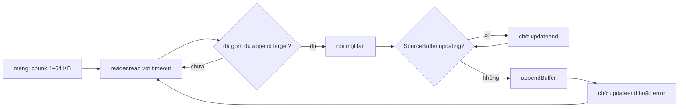

Dữ liệu video về tới trình duyệt rồi vẫn chưa xong việc. Với Media Source Extensions (MSE), trình phát phải tự đưa từng đoạn byte vào `SourceBuffer.appendBuffer()`. Hàm này có ba tính chất dễ làm sai: nó **bất đồng bộ** nhưng không trả Promise (phải chờ sự kiện `updateend`), nó **ném lỗi** nếu bị gọi khi lần append trước chưa xong, và mỗi lần gọi có **chi phí cố định** (trình duyệt phải phân tích, tách khung hình), nên gọi 100 lần với 4 KB chậm hơn gọi 6 lần với 64 KB.

Bài này gộp hai module của Facebook cùng xoay quanh thẻ `<video>`: `SourceBufferManager` của oz-player lo phần append, còn `KeyframesVideoManager` giữ một video nhúng trong animation chạy khớp với animation bằng cách chỉnh `playbackRate`.

> [!TIP]
> **Tóm tắt**
> - `SourceBufferManager` xếp hàng mọi lần append, mỗi lúc chỉ một lần chạy, chờ `updateend` nếu SourceBuffer đang bận, và với dữ liệu dạng stream thì **gom chunk tới `appendTarget` byte** rồi mới append. Mỗi lần `read()` có timeout.
> - Đọc code thấy ba chỗ sai: chunk `Uint8Array` được đổi thành `chunk.buffer` (lấy cả ArrayBuffer gốc, sai khi chunk là `subarray`), gom chunk bằng cách nối lại toàn bộ phần đã gom mỗi lần (O(n²) byte chép), và timer của `read()` không bao giờ được lưu nên `destroy()` không huỷ được.
> - `KeyframesVideoManager` tính `rate = (độ dài đoạn − currentTime) / (độ dài đoạn − vị trí lẽ ra)` để video về đích cùng animation, chỉ áp dụng khi rate trong `[0,85; 1,15]`, qua một debounce chỉ chạy lần gọi đầu. Kết quả: lệch kéo dài không được sửa, và rate không bao giờ về 1.
> - Bản viết lại: `AppendQueue` truyền thẳng view cho `appendBuffer`, gom bằng mảng chunk rồi nối một lần; `VideoSyncer` kẹp rate thay vì bỏ qua, seek khi lệch quá 1 s, giới hạn tần suất đổi rate thay cho debounce, và trả rate về 1 khi đã khớp.

<iframe class="demo-frame" src="/demos/facebook-patterns/index.html?theme=dark#/sourcebuffer-video-sync" title="Demo sourcebuffer-video-sync" loading="lazy" style="height: 1000px"></iframe>

<p class="demo-links">▶ <a href="/demos/facebook-patterns/index.html#/sourcebuffer-video-sync" target="_blank" rel="noopener">Mở demo toàn màn hình ↗</a> · <a href="https://stackblitz.com/github/hunghg255/blog-hunghg/tree/master/examples/facebook-patterns?file=src/lib/videoSync.ts" target="_blank" rel="noopener">Sửa code trên StackBlitz ↗</a> · <a href="https://github.com/hunghg255/blog-hunghg/blob/master/examples/facebook-patterns/src/lib/videoSync.ts" target="_blank" rel="noopener">Xem source trên GitHub ↗</a></p>

## Facebook làm thế nào?

### SourceBufferManager

Module `oz-player/media_source/SourceBufferManager`, bundle `26.VideoPlayer/all.js` (bản trùng ở `21.js`). Mỗi SourceBuffer có một manager, do `OzMediaSourceManager.createSourceBufferManager()` tạo sau khi `MediaSource` vào trạng thái `open`.

**Hàng đợi, mỗi lúc một lần append:**

```js
// đổi tên biến
queueData(data, logger, appendTarget = 0, onDataAppend = null) {
  const deferred = new Deferred();
  this.queue.push({ data, deferred, logger, appendTarget, onDataAppend });
  if (!this.busy) this.processNext();
  return deferred.promise;
}

appendOnce(bytes) {
  if (this.pending !== null) return Promise.reject(invariant('cannot have concurrent appends'));
  const run = () => {
    if (config.getBool('sbm_recursively_waits_for_update_end') && this.sb.updating)
      return this.waitForUpdateEnd().then(run);        // remove() ở nơi khác có thể đang chạy
    const d = (this.pending = new Deferred());          // updateend sẽ resolve d
    try { this.sb.appendBuffer(bytes); }
    catch (e) { /* phân loại: updating đang true? error khác null? SourceBuffer đã bị gỡ? */ }
    return d.promise;
  };
  return run();
}
```

Lỗi của `appendBuffer` được gắn mã theo trạng thái lúc ném: `SOURCE_BUFFER_UPDATING_ATTRIBUTE_IS_TRUE`, `SOURCE_BUFFER_ERROR_ATTRIBUTE_NOT_NULL` (thẻ video đã có `error`), hay `SOURCE_BUFFER_HAS_BEEN_REMOVED`. Ba nguyên nhân cùng ra một `InvalidStateError`, và mã riêng giúp nhóm vận hành biết lỗi nào phổ biến.

**Gom chunk từ stream:**

```js
appendStream(stream, logger, appendTarget, onDataAppend) {
  let acc = new ArrayBuffer(0);
  const reader = stream.getReader();
  const step = () => {
    const d = new Deferred();
    this.pendingRead = d;
    let timer = null;
    if (config.getNumber('sbm_read_timeout_ms') > 0)
      timer = setTimeout(() => { d.reject(new OzError('ReadableStreamReader.read() timed out.')); this.readTimer = timer = null; }, ms);
    reader.read().then((r) => { d.resolve(r); if (timer) { clearTimeout(timer); this.readTimer = timer = null; } });
    return d.promise.then(({ done, value }) => {
      if (done) return acc.byteLength > 0 ? this.appendOnce(acc) : 0;
      let toAppend = value;
      if (appendTarget > 0) {
        if (value instanceof Uint8Array) value = value.buffer;   // ← lấy cả ArrayBuffer gốc
        acc = concatArrayBuffer(acc, value);                     // ← chép lại toàn bộ phần đã gom
        toAppend = acc;
      }
      if (toAppend.byteLength >= appendTarget) {
        acc = new ArrayBuffer(0);
        return this.appendOnce(toAppend).then((sec) => step().then((rest) => rest + sec));
      }
      return step();
    });
  };
  return step();
}
```

Gom chunk là ý hay: luồng mạng trả chunk 16–64 KB tuỳ trình duyệt và tốc độ, nhưng mỗi lần `appendBuffer` có chi phí cố định. Với `appendTarget` vài trăm KB, số lần append giảm hẳn.

**Lỗi 1: `value.buffer`.** Một `Uint8Array` có thể chỉ là một khung nhìn (view) vào một phần của ArrayBuffer lớn hơn: `pool.subarray(4096, 8192)` có `byteOffset = 4096`, `byteLength = 4096`, nhưng `.buffer` là cả vùng nhớ của `pool`. Đổi sang `.buffer` rồi nối là append **cả vùng nhớ gốc**. Trong demo, 96 chunk 4 KB cắt từ một vùng đệm 64 KB thành 6 MB dữ liệu rác đi vào SourceBuffer, thay vì 384 KB. Với chunk lấy thẳng từ `fetch` thì mỗi chunk thường có ArrayBuffer riêng nên lỗi không lộ ra; chỉ cần một tầng ở giữa dùng `subarray` (bộ đọc theo `maxBytes`, bộ cắt header) là đủ để hỏng. Điều trớ trêu là `appendBuffer` nhận thẳng `Uint8Array` và tự tôn trọng `byteOffset`, nên dòng chuyển đổi đó không cần thiết. Nhánh `appendTarget = 0` không đổi gì nên không dính.

**Lỗi 2: gom O(n²).** `concatArrayBuffer(acc, value)` tạo mảng mới dài `acc + value` và chép cả hai. Gom 16 chunk 4 KB để đủ 64 KB là chép 4 + 8 + … + 64 = 544 KB cho 64 KB dữ liệu. Với `appendTarget` lớn và chunk nhỏ, số byte chép tăng theo bình phương.

**Lỗi 3: timer không bao giờ được lưu.** Code gán `this.readTimer = timer = null` ở ba chỗ, nhưng không có chỗ nào gán `this.readTimer = timer` khi tạo. `destroy()` gọi `clearTimeout(this.readTimer)`, tức là `clearTimeout(undefined)`. Timer vẫn chạy sau khi manager bị huỷ và reject một promise không còn ai chờ. Thêm nữa, khi timeout bắn, `reader.read()` đang dở **không bị huỷ**: nếu chunk về muộn, `d.resolve()` trên một promise đã reject là không làm gì, chunk đó mất, và reader vẫn bị khoá.

### KeyframesVideoManager

Keyframes là định dạng animation vector của Facebook (xuất từ After Effects). Một layer trong animation có thể là video, sống trong đoạn tiến độ `[fromProgress, toProgress]` của animation. Module `KeyframesVideoManager` (thư mục `AAA Keyframes/`, có bản trong bundle chứa `UFIReactionsDialogLayerImpl.react.js`) giữ video khớp với animation:

```js
// đổi tên biến; DRIFT = 0.2, DEBOUNCE_MS = 100, RATE_RANGE = [0.85, 1.15]
renderProgress(progress) {
  this.layers.forEach((layer, i) => {
    const video = layer.video;
    const inside = progress >= layer.from && progress <= layer.to;
    const target = doc.duration() * (progress - layer.from);         // lẽ ra video phải ở đây
    const segLen = doc.duration() * (layer.to - layer.from);
    if (Math.abs(target - video.currentTime) > DRIFT && video.currentTime < segLen && target < segLen) {
      const rate = (segLen - video.currentTime) / (segLen - target);   // về đích cùng lúc với animation
      if (rate >= RATE_RANGE[0] && rate <= RATE_RANGE[1]) this.setRate[i](rate);
    }
    if (inside && video.paused) video.play();
    else if (!inside && !video.paused) { video.pause(); video.currentTime = 0; }
  });
}

// setRate[i] = debounce(rate => video.playbackRate = rate, 100, /* leading */ true)
function debounce(fn, ms, leading) {
  let timer;
  return (...args) => {
    const callNow = leading && !timer;
    clearTimeout(timer);
    timer = setTimeout(() => { timer = null; if (!leading) fn(...args); }, ms);
    if (callNow) fn(...args);
  };
}
```

Công thức rate gọn: video còn phải đi `segLen − currentTime` giây nội dung trong `segLen − target` giây thực, nên tốc độ là thương hai số đó. Video chậm 0,6 s ở giây thứ 2 của đoạn 8 s thì rate = 6,6 / 6 = 1,1: tới cuối đoạn hai bên gặp nhau.

Khi đặt vào vòng lặp mỗi frame, vài chi tiết làm nó không đạt được ý đó (mô phỏng trong tab thứ hai của demo):

- **Debounce chỉ chạy lần gọi đầu.** Khi còn lệch, `setRate` được gọi mỗi frame (16 ms), timer liên tục bị đặt lại, nên chỉ lần gọi **đầu tiên** của chuỗi được áp dụng. Lần đầu thường là lúc video vừa lệch 0,2 s (đang đứng hình chưa xong), rate tính ra chỉ đủ bù 0,2 s. Phần lệch thêm sau đó không được tính lại. Trong demo, gây lag 0,6 s thì bản gốc giữ lệch khoảng 0,6 s tới hết đoạn.
- **Lệch ngoài khoảng 15% thì bỏ luôn.** Lag 2 s ở đầu đoạn cần rate 1,33: bị bỏ qua, và vì rate cần còn tăng dần khi đoạn sắp hết, video lệch 2 s cho tới khi ra khỏi đoạn.
- **Tính cả khi chưa vào đoạn.** Trước `fromProgress`, `target` âm và video đứng ở 0, nên điều kiện lệch đúng và rate = `segLen / (segLen − target)` < 1 được áp dụng lên một video đang pause. Vào đoạn, video bắt đầu chạy ở tốc độ 0,89 chẳng hạn (demo cho thấy đúng con số này với đoạn 8 s bắt đầu sau 1 s).
- **Rate không bao giờ về 1.** Không có nhánh nào đặt lại `playbackRate = 1`, kể cả khi `pause()` và `currentTime = 0` lúc rời đoạn. Lần lặp sau của animation bắt đầu với rate của lần trước.
- **`video.play()` trả Promise** và bị bỏ qua. Trình duyệt chặn tự phát (video có tiếng, người dùng chưa tương tác) thì Promise reject và thành lỗi "unhandled rejection".

`seekToProgress()` (khi người dùng kéo animation) thì làm cẩn thận: pause mọi video, đặt `currentTime` đã làm tròn tới 0,01 s, và chờ mọi video tải xong khung hình bằng `Promise.all`.



## Bên trong trình duyệt

- **`SourceBuffer.updating`** là `true` từ lúc gọi `appendBuffer()`/`remove()` tới khi `updateend` bắn. Gọi `appendBuffer()` trong lúc đó ném `InvalidStateError`. Thứ tự sự kiện: `updatestart`, rồi `update` (hoặc `error`/`abort`), rồi `updateend`.
- **`appendBuffer(data)`** nhận `ArrayBuffer` hoặc bất kỳ `ArrayBufferView` nào, và chỉ đọc đúng `byteOffset..byteOffset+byteLength` của view. Không cần (và không nên) đổi view sang `.buffer`.
- **`QuotaExceededError`** khi buffer đầy (trình duyệt đặt giới hạn bộ nhớ cho mỗi SourceBuffer). Cách xử lý là `remove()` phần đã phát rồi append lại.
- **`playbackRate`** đổi tốc độ phát; mặc định trình duyệt giữ cao độ tiếng (`preservesPitch = true`), nhưng tốc độ lệch nhiều vẫn nghe ra. Trình duyệt chấp nhận khoảng khá rộng (Chrome từ 0,0625 tới 16); giữ trong ±15% là để người xem không nhận ra.
- **`video.play()`** trả Promise từ khi có chính sách chặn tự phát (autoplay policy); video tắt tiếng (`muted`) thì thường được tự phát.

## Viết lại

`AppendQueue` nối các lần `append()` bằng một chuỗi Promise, nên không bao giờ có hai lần chạy cùng lúc, kể cả khi nơi gọi không chờ:

```ts title=src/lib/videoSync.ts
  /** Xếp hàng một khối dữ liệu hoặc cả một stream. Các lần gọi chạy lần lượt, không bao giờ chồng nhau. */
  append(data: Uint8Array | ReadableStream<Uint8Array>): Promise<AppendResult> {
    const run = () => (data instanceof Uint8Array ? this.appendBytes(data).then(() => ({ bytes: data.byteLength, appends: 1 })) : this.appendStream(data));
    const p = this.tail.then(run);
    this.tail = p.catch(() => {});
    return p;
  }
```

Một lần append: chờ hết `updating`, gắn listener **trước** khi gọi, gỡ listener nếu `appendBuffer` ném lỗi đồng bộ:

```ts title=src/lib/videoSync.ts
  private async appendBytes(bytes: Uint8Array) {
    if (this.destroyed) throw new Error('AppendQueue đã bị huỷ');
    while (this.sb.updating) await this.once('updateend').promise; // remove() hay abort() ở nơi khác có thể đang chạy
    const done = this.once('updateend');
    try {
      // Truyền chính view: appendBuffer tôn trọng byteOffset/byteLength. Lấy .buffer sẽ append cả ArrayBuffer gốc.
      this.sb.appendBuffer(bytes);
    } catch (e) {
      done.cancel(e as Error); // QuotaExceededError, InvalidStateError…: gỡ listener rồi báo lỗi lên
      throw e;
    }
    this.appends++;
    await done.promise;
  }
```

`read()` với timeout: timer được lưu để `destroy()` huỷ được, và khi hết giờ thì huỷ luôn reader:

```ts title=src/lib/videoSync.ts
  private read(reader: ReadableStreamDefaultReader<Uint8Array>) {
    const ms = this.opts.readTimeoutMs ?? 0;
    if (!ms) return reader.read();
    return new Promise<ReadableStreamReadResult<Uint8Array>>((resolve, reject) => {
      this.timer = setTimeout(() => {
        this.timer = null;
        const err = new Error(`read() quá ${ms} ms`);
        void reader.cancel(err).catch(() => {}); // không để chunk đến muộn bị đọc rồi vứt
        reject(err);
      }, ms);
      reader.read().then(resolve, reject).finally(() => {
        if (this.timer) clearTimeout(this.timer);
        this.timer = null;
      });
    });
  }
```

Gom chunk vào mảng, đủ ngưỡng thì nối **một lần**:

```ts title=src/lib/videoSync.ts
  private async appendStream(stream: ReadableStream<Uint8Array>): Promise<AppendResult> {
    const target = this.opts.appendTarget ?? 0;
    const reader = (this.reader = stream.getReader());
    let pending: Uint8Array[] = [];
    let pendingBytes = 0;
    let bytes = 0;
    let appends = 0;
    const flush = async () => {
      if (!pendingBytes) return;
      // Nối một lần khi đủ ngưỡng: O(tổng byte), không chép lại phần đã gom mỗi khi có chunk mới.
      const one = pending.length === 1 ? pending[0] : concat(pending, pendingBytes);
      pending = [];
      pendingBytes = 0;
      await this.appendBytes(one);
      bytes += one.byteLength;
      appends++;
    };
    try {
      for (;;) {
        const { done, value } = await this.read(reader);
        if (done) break;
        pending.push(value);
        pendingBytes += value.byteLength;
        if (pendingBytes >= target) await flush();
      }
      await flush();
      return { bytes, appends };
    } finally {
      this.reader = null;
      reader.releaseLock();
    }
  }
```

`VideoSyncer.render()`: ngoài đoạn thì trả rate về 1; lệch quá xa thì seek; lệch vừa phải thì kẹp rate và đuổi trong tối đa `catchUpSec` giây; khớp lại thì về 1:

```ts title=src/lib/videoSync.ts
  render(progress: number, nowMs: number): SyncAction | null {
    const v = this.video;
    const inside = progress >= this.from && progress <= this.to;
    if (!inside) {
      if (v.paused) return null;
      v.pause();
      v.currentTime = 0;
      v.playbackRate = 1; // lần chạy sau bắt đầu ở tốc độ chuẩn
      return { type: 'pause' };
    }
    if (v.paused) {
      void Promise.resolve(v.play()).catch(() => {}); // autoplay bị chặn thì thôi, đừng để rejection trôi nổi
      return { type: 'play' };
    }
    const target = this.docDuration * (progress - this.from);
    const segLen = this.docDuration * (this.to - this.from);
    const drift = v.currentTime - target; // > 0: video chạy trước
    const abs = Math.abs(drift);

    if (abs > this.o.seekAboveSec) {
      v.currentTime = target;
      v.playbackRate = 1;
      this.lastRateAt = nowMs;
      return { type: 'seek', to: target, drift };
    }
    if (nowMs - this.lastRateAt < this.o.rateIntervalMs) return null;
    if (abs > this.o.toleranceSec) {
      // Sau `horizon` giây animation ở target + horizon; video cần đi (target + horizon − currentTime) trong
      // cùng khoảng đó, tức rate = 1 − drift / horizon. Với horizon = phần còn lại của đoạn, đây chính là công thức của bản gốc.
      const horizon = Math.min(segLen - target, this.o.catchUpSec);
      const raw = horizon > 0.05 ? 1 - drift / horizon : 1;
      const rate = Math.min(this.o.maxRate, Math.max(this.o.minRate, raw));
      if (Math.abs(rate - v.playbackRate) < 0.005) return null;
      v.playbackRate = rate;
      this.lastRateAt = nowMs;
      return { type: 'rate', rate, drift };
    }
    if (v.playbackRate !== 1 && abs < this.o.toleranceSec / 4) {
      v.playbackRate = 1; // đã khớp: trả về tốc độ chuẩn, có khoảng trễ (hysteresis) để không bật tắt liên tục
      this.lastRateAt = nowMs;
      return { type: 'rate', rate: 1, drift };
    }
    return null;
  }
```

::: spoiler Xem toàn bộ src/lib/videoSync.ts

```ts title=src/lib/videoSync.ts
/**
 * Hai việc nhỏ quanh thẻ <video>:
 * 1. AppendQueue: đưa dữ liệu vào SourceBuffer tuần tự, gom chunk nhỏ thành lần append lớn, có timeout khi đọc stream.
 * 2. VideoSyncer: giữ một video chạy khớp với timeline animation bằng cách chỉnh playbackRate, seek khi lệch quá xa.
 * Ý tưởng học từ oz-player/media_source/SourceBufferManager và KeyframesVideoManager của Facebook, viết lại từ đầu.
 */

/** Phần của SourceBuffer mà AppendQueue cần (SourceBuffer thật thoả interface này). */
export interface SourceBufferLike extends EventTarget {
  readonly updating: boolean;
  appendBuffer(data: ArrayBufferView | ArrayBuffer): void;
  abort(): void;
}

export interface AppendQueueOptions {
  /** Gom chunk của stream tới ít nhất chừng này byte rồi mới append. 0 = append từng chunk. */
  appendTarget?: number;
  /** Mỗi lần read() của stream chờ tối đa chừng này ms. 0 = không giới hạn. */
  readTimeoutMs?: number;
}

export interface AppendResult {
  bytes: number;
  appends: number;
}

export class AppendQueue {
  private tail: Promise<unknown> = Promise.resolve();
  private destroyed = false;
  private timer: ReturnType<typeof setTimeout> | null = null;
  private reader: ReadableStreamDefaultReader<Uint8Array> | null = null;
  private wakeOnDestroy = new Set<(e: Error) => void>();
  appends = 0;

  constructor(
    private readonly sb: SourceBufferLike,
    private readonly opts: AppendQueueOptions = {},
  ) {}

  /** Xếp hàng một khối dữ liệu hoặc cả một stream. Các lần gọi chạy lần lượt, không bao giờ chồng nhau. */
  append(data: Uint8Array | ReadableStream<Uint8Array>): Promise<AppendResult> {
    const run = () => (data instanceof Uint8Array ? this.appendBytes(data).then(() => ({ bytes: data.byteLength, appends: 1 })) : this.appendStream(data));
    const p = this.tail.then(run);
    this.tail = p.catch(() => {});
    return p;
  }

  /** Huỷ mọi việc đang chờ: timer, reader của stream, lời hứa đang treo. */
  destroy() {
    this.destroyed = true;
    if (this.timer) clearTimeout(this.timer);
    this.timer = null;
    void this.reader?.cancel().catch(() => {});
    const err = new Error('AppendQueue đã bị huỷ');
    this.wakeOnDestroy.forEach((f) => f(err));
    this.wakeOnDestroy.clear();
    if (this.sb.updating) this.sb.abort();
  }

  /** Chờ sự kiện `type`, hoặc lỗi của SourceBuffer, hoặc destroy(). `cancel` gỡ listener khi không cần chờ nữa. */
  private once(type: string) {
    let cancel: (e: Error) => void = () => {};
    const promise = new Promise<void>((resolve, reject) => {
      const cleanup = () => {
        this.sb.removeEventListener(type, ok);
        this.sb.removeEventListener('error', bad);
        this.wakeOnDestroy.delete(cancel);
      };
      const ok = () => (cleanup(), resolve());
      const bad = () => (cleanup(), reject(new Error('SourceBuffer báo lỗi khi append')));
      cancel = (e) => (cleanup(), reject(e));
      this.sb.addEventListener(type, ok);
      this.sb.addEventListener('error', bad);
      this.wakeOnDestroy.add(cancel);
    });
    return { promise, cancel };
  }

  private async appendBytes(bytes: Uint8Array) {
    if (this.destroyed) throw new Error('AppendQueue đã bị huỷ');
    while (this.sb.updating) await this.once('updateend').promise; // remove() hay abort() ở nơi khác có thể đang chạy
    const done = this.once('updateend');
    try {
      // Truyền chính view: appendBuffer tôn trọng byteOffset/byteLength. Lấy .buffer sẽ append cả ArrayBuffer gốc.
      this.sb.appendBuffer(bytes);
    } catch (e) {
      done.cancel(e as Error); // QuotaExceededError, InvalidStateError…: gỡ listener rồi báo lỗi lên
      throw e;
    }
    this.appends++;
    await done.promise;
  }

  private read(reader: ReadableStreamDefaultReader<Uint8Array>) {
    const ms = this.opts.readTimeoutMs ?? 0;
    if (!ms) return reader.read();
    return new Promise<ReadableStreamReadResult<Uint8Array>>((resolve, reject) => {
      this.timer = setTimeout(() => {
        this.timer = null;
        const err = new Error(`read() quá ${ms} ms`);
        void reader.cancel(err).catch(() => {}); // không để chunk đến muộn bị đọc rồi vứt
        reject(err);
      }, ms);
      reader.read().then(resolve, reject).finally(() => {
        if (this.timer) clearTimeout(this.timer);
        this.timer = null;
      });
    });
  }

  private async appendStream(stream: ReadableStream<Uint8Array>): Promise<AppendResult> {
    const target = this.opts.appendTarget ?? 0;
    const reader = (this.reader = stream.getReader());
    let pending: Uint8Array[] = [];
    let pendingBytes = 0;
    let bytes = 0;
    let appends = 0;
    const flush = async () => {
      if (!pendingBytes) return;
      // Nối một lần khi đủ ngưỡng: O(tổng byte), không chép lại phần đã gom mỗi khi có chunk mới.
      const one = pending.length === 1 ? pending[0] : concat(pending, pendingBytes);
      pending = [];
      pendingBytes = 0;
      await this.appendBytes(one);
      bytes += one.byteLength;
      appends++;
    };
    try {
      for (;;) {
        const { done, value } = await this.read(reader);
        if (done) break;
        pending.push(value);
        pendingBytes += value.byteLength;
        if (pendingBytes >= target) await flush();
      }
      await flush();
      return { bytes, appends };
    } finally {
      this.reader = null;
      reader.releaseLock();
    }
  }
}

function concat(parts: Uint8Array[], total: number) {
  const out = new Uint8Array(total);
  let o = 0;
  for (const p of parts) {
    out.set(p, o); // set() đọc đúng phần của view, kể cả khi p là subarray
    o += p.byteLength;
  }
  return out;
}

// ---------- Đồng bộ video với animation ----------

export interface VideoLike {
  currentTime: number;
  playbackRate: number;
  readonly paused: boolean;
  play(): Promise<void> | void;
  pause(): void;
}

export interface SyncOptions {
  /** Lệch dưới mức này thì coi là khớp. */
  toleranceSec?: number;
  /** Lệch quá mức này thì seek thẳng, không cố đuổi bằng tốc độ. */
  seekAboveSec?: number;
  /** Tốc độ cho phép khi đuổi (ngoài khoảng này tiếng bị méo rõ). */
  minRate?: number;
  maxRate?: number;
  /** Khoảng cách tối thiểu giữa hai lần đổi playbackRate. */
  rateIntervalMs?: number;
  /** Đuổi kịp trong tối đa chừng này giây (bản gốc: tới hết đoạn, có thể rất lâu). */
  catchUpSec?: number;
}

export type SyncAction = { type: 'rate'; rate: number; drift: number } | { type: 'seek'; to: number; drift: number } | { type: 'play' } | { type: 'pause' };

/**
 * Một layer video sống trong đoạn [from, to] của animation (tiến độ 0..1), animation dài `docDuration` giây.
 * Gọi render(progress, nowMs) mỗi frame.
 */
export class VideoSyncer {
  private lastRateAt = -Infinity;
  private readonly o: Required<SyncOptions>;

  constructor(
    private readonly video: VideoLike,
    private readonly from: number,
    private readonly to: number,
    private readonly docDuration: number,
    opts: SyncOptions = {},
  ) {
    this.o = { toleranceSec: 0.2, seekAboveSec: 1, minRate: 0.85, maxRate: 1.15, rateIntervalMs: 250, catchUpSec: 3, ...opts };
  }

  render(progress: number, nowMs: number): SyncAction | null {
    const v = this.video;
    const inside = progress >= this.from && progress <= this.to;
    if (!inside) {
      if (v.paused) return null;
      v.pause();
      v.currentTime = 0;
      v.playbackRate = 1; // lần chạy sau bắt đầu ở tốc độ chuẩn
      return { type: 'pause' };
    }
    if (v.paused) {
      void Promise.resolve(v.play()).catch(() => {}); // autoplay bị chặn thì thôi, đừng để rejection trôi nổi
      return { type: 'play' };
    }
    const target = this.docDuration * (progress - this.from);
    const segLen = this.docDuration * (this.to - this.from);
    const drift = v.currentTime - target; // > 0: video chạy trước
    const abs = Math.abs(drift);

    if (abs > this.o.seekAboveSec) {
      v.currentTime = target;
      v.playbackRate = 1;
      this.lastRateAt = nowMs;
      return { type: 'seek', to: target, drift };
    }
    if (nowMs - this.lastRateAt < this.o.rateIntervalMs) return null;
    if (abs > this.o.toleranceSec) {
      // Sau `horizon` giây animation ở target + horizon; video cần đi (target + horizon − currentTime) trong
      // cùng khoảng đó, tức rate = 1 − drift / horizon. Với horizon = phần còn lại của đoạn, đây chính là công thức của bản gốc.
      const horizon = Math.min(segLen - target, this.o.catchUpSec);
      const raw = horizon > 0.05 ? 1 - drift / horizon : 1;
      const rate = Math.min(this.o.maxRate, Math.max(this.o.minRate, raw));
      if (Math.abs(rate - v.playbackRate) < 0.005) return null;
      v.playbackRate = rate;
      this.lastRateAt = nowMs;
      return { type: 'rate', rate, drift };
    }
    if (v.playbackRate !== 1 && abs < this.o.toleranceSec / 4) {
      v.playbackRate = 1; // đã khớp: trả về tốc độ chuẩn, có khoảng trễ (hysteresis) để không bật tắt liên tục
      this.lastRateAt = nowMs;
      return { type: 'rate', rate: 1, drift };
    }
    return null;
  }
}
```

:::

**Khác bản gốc:**

- Truyền thẳng `Uint8Array` cho `appendBuffer`; gom bằng danh sách chunk và nối một lần (O(n) byte chép).
- Timeout của `read()` được lưu, huỷ được, và huỷ luôn reader để chunk về muộn không bị mất âm thầm.
- `destroy()` từ chối mọi lần chờ đang treo và gỡ listener.
- Không có cờ cấu hình (`sbm_waits_for_update_end`, `queue_data_with_error_handling`…), phân loại mã lỗi, đo `appendedSec`.
- `VideoSyncer` dùng công thức rate của bản gốc nhưng với chân trời đuổi tối đa `catchUpSec` (bản gốc là "tới hết đoạn"), kẹp rate vào khoảng cho phép thay vì bỏ qua, seek khi lệch quá `seekAboveSec`, đổi rate tối đa mỗi `rateIntervalMs`, trả về 1 khi lệch dưới một phần tư ngưỡng, và chỉ tính khi đang ở trong đoạn.
- Không có phần duyệt cây layer của Keyframes; mỗi `VideoSyncer` lo một video.

## Đi qua code

- **`append()`** gắn việc mới vào `this.tail`. `tail` luôn được `.catch(() => {})` để một lần lỗi không chặn cả hàng.
- **`once(type)`** trả cả `promise` lẫn `cancel`. Ba đường kết thúc (sự kiện, lỗi, `destroy()`) đều đi qua `cleanup()` gỡ listener.
- **`appendBytes()`** dùng `while (sb.updating)` vì một `remove()` của nơi khác có thể chen vào giữa lúc ta chờ.
- **`appendStream()`** giữ `pending` (mảng chunk) và `pendingBytes`. `concat()` dùng `out.set(p, o)`: `set` đọc đúng phần của view.
- **`render()`** tính `drift = currentTime − target` (dương là video chạy trước). Công thức `1 − drift / horizon` là dạng rút gọn của công thức bản gốc khi `horizon = segLen − target`.
- **Hysteresis**: đổi rate khi lệch > 0,2 s, trả về 1 khi lệch < 0,05 s. Hai ngưỡng khác nhau để rate không bật tắt liên tục quanh một ngưỡng.

## Tại sao không làm cách khác?

**Append từng chunk ngay khi về, không gom?** Đơn giản và độ trễ thấp nhất, hợp với live độ trễ thấp. Với VOD, gom giảm số lần append (demo: 96 lần thành 6 lần, nhanh hơn khoảng 25% trên SourceBuffer giả).

**`sourceBuffer.mode = 'sequence'`?** Chỉ đổi cách tính timestamp, không đổi chuyện phải chờ `updateend`.

**Đặt `currentTime` mỗi frame để video luôn khớp?** Mỗi lần seek là một lần giải mã lại từ keyframe gần nhất: giật hình và tốn CPU. `playbackRate` sửa lệch nhỏ mượt hơn; seek chỉ dành cho lệch lớn.

**Vẽ video lên canvas theo timeline animation (`requestVideoFrameCallback`)?** Cho biết chính xác khung hình nào đang hiện và thời điểm của nó, rất hợp để đo lệch. Nhưng vẫn phải điều khiển tốc độ video bằng cách nào đó, nên là bổ sung cho cách này chứ không thay thế.

## Edge case và cạm bẫy

- **SourceBuffer bị gỡ** (`mediaSource.removeSourceBuffer`) hoặc `MediaSource` đóng: `appendBuffer` ném lỗi, và `updateend` không bao giờ tới. Nơi gọi phải `destroy()` hàng đợi khi gỡ.
- **Gom quá nhiều.** `appendTarget` lớn hơn cả segment thì segment chỉ được append khi stream kết thúc, tăng thời gian chờ khung hình đầu. Ngưỡng nên nhỏ hơn segment nhỏ nhất.
- **Video chưa đủ dữ liệu để chạy** (đang `waiting`): `currentTime` đứng yên, lệch tăng dần, rate lên trần. Khi dữ liệu về, rate cao làm video lao lên. Bản viết lại giới hạn bằng `maxRate` và seek khi lệch quá xa, nên không bị lao quá đà lâu.
- **Tab ẩn.** `requestAnimationFrame` dừng, animation dừng, nhưng video vẫn có thể chạy. Khi quay lại, lệch rất lớn: seek là đúng.
- **`playbackRate` có thể bị trình duyệt từ chối** ngoài khoảng nó hỗ trợ (ném `NotSupportedError`). Trong khoảng 0,85–1,15 thì không gặp.

## Dùng trong dự án

```ts
import { AppendQueue, VideoSyncer } from './videoSync';

// MSE: một hàng đợi cho mỗi SourceBuffer
const ms = new MediaSource();
video.src = URL.createObjectURL(ms);
await new Promise((ok) => ms.addEventListener('sourceopen', ok, { once: true }));
const sb = ms.addSourceBuffer('video/webm; codecs="vp9"');
const queue = new AppendQueue(sb, { appendTarget: 256 * 1024, readTimeoutMs: 10_000 });

await queue.append(initSegment);                                  // Uint8Array
for (const seg of segments) {
  const res = await fetch(url, { headers: { Range: `bytes=${seg.startByte}-${seg.endByte}` } });
  await queue.append(res.body!);                                  // ReadableStream
}

// Video trong animation: layer sống từ 20% tới 80% của animation dài 12 s
const sync = new VideoSyncer(layerVideo, 0.2, 0.8, 12);
function frame(now: number) {
  const progress = ((now - startedAt) / 12_000) % 1;
  drawAnimation(progress);
  sync.render(progress, now);
  requestAnimationFrame(frame);
}
requestAnimationFrame(frame);
```

## Kiểm thử

::: spoiler Ví dụ test (bản phác, không có trong repo)

```ts
import { describe, expect, it } from 'vitest';
import { AppendQueue, VideoSyncer, type SourceBufferLike } from './videoSync';

class FakeSB extends EventTarget implements SourceBufferLike {
  updating = false;
  got: number[] = [];
  calls = 0;
  appendBuffer(d: ArrayBufferView | ArrayBuffer) {
    if (this.updating) throw new DOMException('busy', 'InvalidStateError');
    const view = ArrayBuffer.isView(d) ? new Uint8Array(d.buffer, d.byteOffset, d.byteLength) : new Uint8Array(d);
    this.got.push(...view);
    this.calls++;
    this.updating = true;
    setTimeout(() => {
      this.updating = false;
      this.dispatchEvent(new Event('updateend'));
    }, 2);
  }
  abort() {
    this.updating = false;
  }
}

const streamOf = (...chunks: Uint8Array[]) =>
  new ReadableStream<Uint8Array>({ start(c) { chunks.forEach((x) => c.enqueue(x)); c.close(); } });

describe('AppendQueue', () => {
  it('append tuần tự dù nơi gọi không chờ', async () => {
    const sb = new FakeSB();
    const q = new AppendQueue(sb);
    await Promise.all([q.append(Uint8Array.of(1)), q.append(Uint8Array.of(2)), q.append(Uint8Array.of(3))]);
    expect(sb.got).toEqual([1, 2, 3]);
  });
  it('gom chunk là subarray mà không kéo theo byte thừa', async () => {
    const sb = new FakeSB();
    const pool = Uint8Array.of(1, 2, 3, 4, 5, 6, 7, 8);
    const r = await new AppendQueue(sb, { appendTarget: 5 }).append(streamOf(pool.subarray(0, 2), pool.subarray(2, 4), pool.subarray(6, 8)));
    expect(sb.got).toEqual([1, 2, 3, 4, 7, 8]);
    expect(r).toEqual({ bytes: 6, appends: 1 });
  });
  it('đủ ngưỡng thì append, phần dư append khi stream kết thúc', async () => {
    const sb = new FakeSB();
    const r = await new AppendQueue(sb, { appendTarget: 4 }).append(streamOf(Uint8Array.of(1, 2), Uint8Array.of(3, 4), Uint8Array.of(5)));
    expect(r).toEqual({ bytes: 5, appends: 2 });
  });
  it('read() quá hạn thì báo lỗi', async () => {
    const q = new AppendQueue(new FakeSB(), { readTimeoutMs: 20 });
    await expect(q.append(new ReadableStream({ pull: () => new Promise(() => {}) }))).rejects.toThrow('quá 20 ms');
  });
});

describe('VideoSyncer', () => {
  const fakeVideo = () => ({ currentTime: 0, playbackRate: 1, paused: true, play() { this.paused = false; }, pause() { this.paused = true; } });

  it('lệch vừa phải: tăng rate, kẹp ở maxRate', () => {
    const v = fakeVideo();
    const s = new VideoSyncer(v, 0, 1, 10);
    s.render(0.1, 0);                     // play
    v.currentTime = 0.5;                  // lẽ ra phải ở 1,0 s: chậm 0,5 s
    expect(s.render(0.1, 1000)).toMatchObject({ type: 'rate' });
    expect(v.playbackRate).toBeCloseTo(1.15);
  });
  it('lệch quá 1 s thì seek và đặt rate về 1', () => {
    const v = fakeVideo();
    const s = new VideoSyncer(v, 0, 1, 10);
    s.render(0.5, 0);
    v.currentTime = 1;
    expect(s.render(0.5, 1000)).toEqual({ type: 'seek', to: 5, drift: -4 });
    expect(v.playbackRate).toBe(1);
  });
  it('ra khỏi đoạn: pause, về 0, rate về 1', () => {
    const v = fakeVideo();
    const s = new VideoSyncer(v, 0.2, 0.8, 10);
    s.render(0.5, 0);
    v.playbackRate = 1.1;
    expect(s.render(0.9, 100)).toEqual({ type: 'pause' });
    expect([v.paused, v.currentTime, v.playbackRate]).toEqual([true, 0, 1]);
  });
});
```

:::

## So với thư viện và chuẩn web

- **Media Source Extensions** ([đặc tả W3C](https://www.w3.org/TR/media-source-2/)) có trên các trình duyệt chính; iPhone dùng `ManagedMediaSource` từ iOS 17 (tính tới 10/2026), xem [caniuse](https://caniuse.com/mediasource).
- **Shaka Player** (`MediaSourceEngine`), **hls.js** (`BufferController` với `BufferOperationQueue`) và **dash.js** (`SourceBufferSink`) đều có hàng đợi append tuần tự giống ý tưởng ở đây.
- **`HTMLVideoElement.requestVideoFrameCallback()`** cho biết thời điểm của từng khung hình được hiện, hữu ích để đo lệch chính xác hơn `currentTime`; có trên Chrome, Edge, Safari và Firefox gần đây (tính tới 10/2026), xem [caniuse](https://caniuse.com/mdn-api_htmlvideoelement_requestvideoframecallback).
- **Web Animations API** có `Animation.playbackRate` và `currentTime` như video, nên cùng một bộ đồng bộ có thể chỉnh animation theo video thay vì ngược lại.

---

Bài này thuộc series **[Học từ mã nguồn Facebook](/series/facebook)** (106 bài, đọc theo thứ tự).

::: spoiler Xem nhanh danh sách bài trong series

*Phần 1*

- [Mở đầu: cách đọc code minify của Facebook](/blogs/learn-from-facebook-source-code)
- [#1 Dùng chung IntersectionObserver + infinite scroll](/blogs/facebook-shared-intersection-observer)
- [#2 useViewportDuration: đo thời gian thực sự được xem](/blogs/facebook-use-viewport-duration)
- [#3 Preload code + data khi hover](/blogs/facebook-preload-on-hover)
- [#4 Toast manager với external store](/blogs/facebook-toast-manager)
- [#5 Network status + heartbeat backoff](/blogs/facebook-network-status-heartbeat)
- [#6 ErrorGuard: bắt lỗi theo ngữ cảnh](/blogs/facebook-error-guard)
- [#7 Banzai: gom log theo lô + sendBeacon](/blogs/facebook-batch-logger)
- [#8 Focus trap + Esc theo layer](/blogs/facebook-focus-trap)

*Phần 2*

- [#9 Mẹo calc(… * 9999): container query, line-clamp, mũi tên carousel bằng CSS](/blogs/facebook-css-9999-trick)
- [#10 Thanh cuộn tuỳ biến bằng CSS 3D](/blogs/facebook-css-3d-scrollbar)
- [#11 Modal cuộn bằng window, giữ vị trí trang nền](/blogs/facebook-document-scroll-modal)
- [#12 Popover, tooltip group và hovercard](/blogs/facebook-popover-tooltip)
- [#13 Primitive Pressable + focus-visible](/blogs/facebook-pressable)
- [#14 Tab "Xem thêm" + sticky header bằng IntersectionObserver](/blogs/facebook-priority-tabs-sticky-header)
- [#15 Avatar khoét mask, gradient Messenger, skeleton steps()](/blogs/facebook-visual-tricks)
- [#16 Khung chat không giật](/blogs/facebook-chat-scroller)
- [#17 Thuật toán chọn bố cục collage ảnh](/blogs/facebook-photo-collage-layout)
- [#18 Keep-alive tab trong SPA](/blogs/facebook-keep-alive-tabs)
- [#19 Tự đo Visual Completion & interaction tracing](/blogs/facebook-visual-completion)
- [#20 Router SPA bền bỉ & tải chunk có retry](/blogs/facebook-spa-router-resilient-loading)

*Phần 3*

- [#21 Smart Compose: gợi ý chữ mờ khi gõ](/blogs/facebook-smart-compose-ghost-text)
- [#22 MQTT ngay trong trình duyệt, tự chuyển sang long-poll](/blogs/facebook-mqtt-in-browser)
- [#23 Đo thời gian dùng bằng bitmap 64 giây](/blogs/facebook-time-spent-bitmap)
- [#24 Bảng reaction nhấn giữ rồi trượt](/blogs/facebook-reaction-press-slide)
- [#25 Tìm kiếm gấp dấu, phiên âm và highlight đầu từ](/blogs/facebook-search-diacritics-tokenize)
- [#26 Ring buffer biết trace nào đã mất log](/blogs/facebook-trace-ring-buffer)
- [#27 Engine animation JS: một vòng rAF và solver cubic-bezier](/blogs/facebook-keyframes-loop-cubic-bezier)
- [#28 Bootloader: bitmap tài nguyên đã tải, chỉ reload khi cần](/blogs/facebook-bootloader-bitmap-consistency)
- [#29 Nhận biết click do screen reader tạo ra](/blogs/facebook-virtual-cursor-detection)
- [#30 Tải trước feed theo chất lượng mạng, đoán hạng thiết bị](/blogs/facebook-network-aware-prefetch)
- [#31 Hàng đợi gửi tin chat giữ đúng thứ tự](/blogs/facebook-ordered-send-queue)
- [#32 Gộp lời gọi API trong cùng một tick](/blogs/facebook-api-batcher)
- [#33 Resize ảnh trong pool Web Worker](/blogs/facebook-jpeg-resize-worker-pool)
- [#34 Crop ảnh theo nhiều khuôn mặt](/blogs/facebook-face-aware-crop)
- [#35 Kéo-thả sắp xếp và vùng thả file không nhấp nháy](/blogs/facebook-flicker-free-drag-drop)
- [#36 Tiện ích UI: fade-out, sticky event, hàm huỷ được](/blogs/facebook-ui-utility-hooks)
- [#37 Hạ tầng nhỏ: cookie, hash lỗi, prefetch khi chuột dừng](/blogs/facebook-small-infra-cookie-hash-idle)

*Phần 4–6*

- [#38 Đồng bộ tin nhắn: phát hiện lỗ seqID và fetch bù theo tầng](/blogs/facebook-messenger-sync-seqid-gaps)
- [#39 OTID: ID tin nhắn kiểu Snowflake sinh ở client](/blogs/facebook-otid-client-snowflake)
- [#40 QPL: lấy mẫu từ lúc bắt đầu, đo RTT gửi tin đầu-cuối](/blogs/facebook-qpl-send-rtt)
- [#41 Bộ điều phối request bảy chế độ gộp và chống trùng](/blogs/facebook-request-dispatcher-modes)
- [#42 Thread list theo mốc thời gian, cookie presence có version](/blogs/facebook-threadlist-ranged-presence)
- [#43 Composer dạng plugin: reducer, dirty checker, chuỗi kiểm tra](/blogs/facebook-plugin-composer)
- [#44 Thanh toán bất đồng bộ: subscribe trước, poll dự phòng](/blogs/facebook-async-checkout)
- [#45 Validate số thẻ: sửa lỗi gõ, dải BIN, Luhn](/blogs/facebook-card-validation)
- [#46 Lịch chọn khoảng ngày: bo góc dải chọn, phím đủ bộ, RTL](/blogs/facebook-range-calendar-a11y)
- [#47 Giờ mở cửa theo tuần: qua đêm, gộp khoảng, phần bù](/blogs/facebook-weekly-hours-intervals)
- [#48 Tiến độ đăng realtime: giữ event chờ snapshot, watchdog](/blogs/facebook-realtime-publish-snapshot)
- [#49 Tiền tệ theo đơn vị nhỏ nhất và ô nhập tiền](/blogs/facebook-currency-minor-units)
- [#50 Sửa hàng loạt Empty/Uniform/Mixed, seen/read bằng 2 bit](/blogs/facebook-bulk-edit-seen-bits)
- [#51 Phát hiện script lạ hook vào hàm native](/blogs/facebook-native-hook-detection)
- [#52 localStorage tự dọn khi đầy quota](/blogs/facebook-quota-aware-storage)
- [#53 Cache tuyến do server phân giải, chờ sẵn promise](/blogs/facebook-route-cache-prefetch)
- [#54 Lưới phím mũi tên 2D và focus không làm cuộn trang](/blogs/facebook-focus-table-grid)
- [#55 Tách emoji bằng máy trạng thái](/blogs/facebook-emoji-segmentation)
- [#56 Đọc trước ghi sau trong một frame, con tự biết vị trí](/blogs/facebook-read-then-write-dom)
- [#57 Hàng đợi lệnh cho video và stream sắp lại chunk](/blogs/facebook-video-command-queue)

*Phần 7–10*

- [#58 Ước lượng băng thông EWMA: loại outlier, nhớ qua phiên](/blogs/facebook-bandwidth-ewma-estimator)
- [#59 ABR theo độ tự tin phát và cắt bậc bitrate theo MOS](/blogs/facebook-abr-playback-confidence)
- [#60 Prefetch segment dự đoán từ manifest, parse hộp sidx](/blogs/facebook-dash-predicted-segments)
- [#61 Đọc metadata MP4/MOV ngay trên client](/blogs/facebook-mp4-metadata-client)
- [#62 Upload tiếp tục được: offset, hash dedupe, phát hiện treo](/blogs/facebook-resumable-upload)
- [#63 Fenwick tree: chọn ngẫu nhiên có trọng số và offset dòng](/blogs/facebook-fenwick-weighted-random)
- [#64 Vạch trục số và trục thời gian "đẹp"](/blogs/facebook-nice-axis-ticks)
- [#65 Damerau-Levenshtein theo dải chéo và tự sửa tên gõ sai](/blogs/facebook-damerau-levenshtein)
- [#66 PRNG có seed, shuffle tái lập và lấy mẫu trace](/blogs/facebook-seeded-prng-sampling)
- [#67 Cặp min/max-heap tái dùng vị trí trong danh sách ảo](/blogs/facebook-dual-heap-buffer-set)
- [#68 Memo nhiều đối số bằng Map/WeakMap và interning object](/blogs/facebook-multikey-memo-interning)
- [#69 Thống kê cửa sổ trượt và đại số khoảng thời gian](/blogs/facebook-moving-stat-intervals)
- [#70 Int64 từ hai số 32-bit, decode UTF, offset theo code point](/blogs/facebook-int64-utf-codepoints)
- [#71 Engine múi giờ IANA trên client, phát hiện lệch giờ](/blogs/facebook-client-iana-timezone)
- [#72 Tự cài semver range](/blogs/facebook-semver-range)
- [#73 Auto-link URL, cắt chữ an toàn, giới hạn LaTeX](/blogs/facebook-autolink-safe-truncate)
- [#74 Parser query kiểu PHP chống prototype pollution](/blogs/facebook-php-query-serializer)
- [#75 Popover tự lật theo phần tràn nhỏ nhất](/blogs/facebook-popover-auto-flip)
- [#76 Tiền tố for(;;) chống JSON hijacking, đọc stream](/blogs/facebook-csrf-prefix-streaming)
- [#77 Chống lộ Referer, linkshim, xoá token trên URL](/blogs/facebook-referrer-linkshim-url-scrub)
- [#78 setImmediate bằng postMessage, gom delta chuột theo frame](/blogs/facebook-setimmediate-mouse-batching)
- [#79 Phát hiện crash qua heartbeat, dò proxy cache hỏng](/blogs/facebook-crash-heartbeat-proxy-check)
- [#80 DPR vào cookie cho ảnh @2x, che khoá trong log](/blogs/facebook-dpr-cookie-secret-redaction)
- [#81 Flux waitFor tự viết và proxy có đệm](/blogs/facebook-flux-dispatch-buffered-proxy)
- [#82 Crop đúng tỉ lệ, xoay sticker bằng ma trận](/blogs/facebook-image-crop-rotation-geometry)

*Phần 11–15*

- [#83 Chia subdomain giữa các tab bằng lease, long-poll theo bảng trạng thái](/blogs/facebook-tab-subdomain-lease-longpoll)
- [#84 MQTT QoS1: giữ publish chờ ack, gửi lại khi kết nối lại](/blogs/facebook-mqtt-qos1-republish)
- [#85 Cache Promise gộp request, cache lỗi ngắn, đua dữ liệu nhúng sẵn](/blogs/facebook-promise-cache-preload-race)
- [#86 Lịch retry: backoff có trần, Fibonacci, báo lỗi CDN mỗi N ngày](/blogs/facebook-retry-backoff-schedules)
- [#87 Giữ nguyên tham chiếu nhánh dữ liệu không đổi](/blogs/facebook-relay-recycle-nodes)
- [#88 Store optimistic: copy-on-write, rollback rồi áp lại](/blogs/facebook-relay-optimistic-store)
- [#89 Chỉ mục subscription theo record, hàng đợi task theo chiều sâu](/blogs/facebook-relay-subscription-index)
- [#90 Phân trang connection: cursor khớp đầu, edge không trùng](/blogs/facebook-relay-connection-pagination)
- [#91 Profiler kiểu middleware và memo selector có lấy mẫu kiểm tra](/blogs/facebook-profiler-middleware-memo-check)
- [#92 Đọc EBML/WebM Cues để tìm byte range của segment](/blogs/facebook-webm-ebml-cues)
- [#93 Stream HTTP Range tạm dừng được, tải tiếp đúng byte](/blogs/facebook-pausable-range-stream)
- [#94 Bảng khoảng thời gian gắn nhãn và nhảy qua lỗ buffer](/blogs/facebook-tagged-time-ranges-gaps)
- **#95 Gom chunk cho SourceBuffer, đồng bộ video bằng playbackRate** (bài này)
- [#96 Gom tin nhắn thành cụm, vạch ngày và avatar đã xem](/blogs/facebook-message-grouping)
- [#97 Bao nhiêu tab chat vừa màn hình, chuỗi luật mở tab](/blogs/facebook-chat-tab-policy)
- [#98 Phím tắt Markdown trong editor, Backspace để hoàn tác](/blogs/facebook-markdown-shortcuts-editor)
- [#99 Offset theo code point hay UTF-16: bốn bug cùng một gốc](/blogs/facebook-codepoint-offset-bugs)
- [#100 Typeahead không nhảy: cache tiền tố, chặn reflow, khoá hover](/blogs/facebook-typeahead-stable-results)
- [#101 Hit-test trên canvas bằng phát lại path, nét đứt và cung Bézier](/blogs/facebook-canvas-hit-regions)
- [#102 Vòng tròn theo mét trên bản đồ Mercator](/blogs/facebook-mercator-meter-circles)
- [#103 Dò tính năng trình duyệt: ảnh EXIF 2×1, getter bẫy, scrollbar](/blogs/facebook-feature-probe-tricks)
- [#104 Bug định dạng số và kiểm tra dữ liệu theo locale](/blogs/facebook-locale-validation-bugs)
- [#105 Dispose cho đúng: idle callback, splice(-1), xoá nhầm key](/blogs/facebook-dispose-leak-bugs)

:::

Code + demo: [`examples/facebook-patterns`](https://github.com/hunghg255/blog-hunghg/tree/master/examples/facebook-patterns) · [Mở trên StackBlitz](https://stackblitz.com/github/hunghg255/blog-hunghg/tree/master/examples/facebook-patterns)
