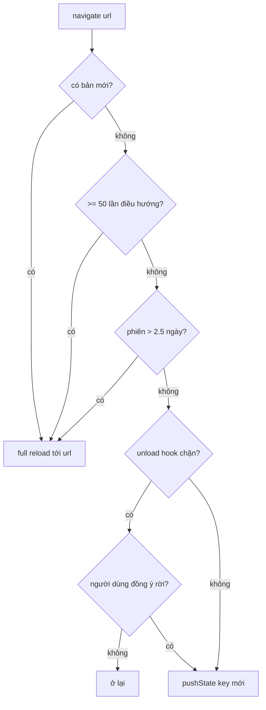
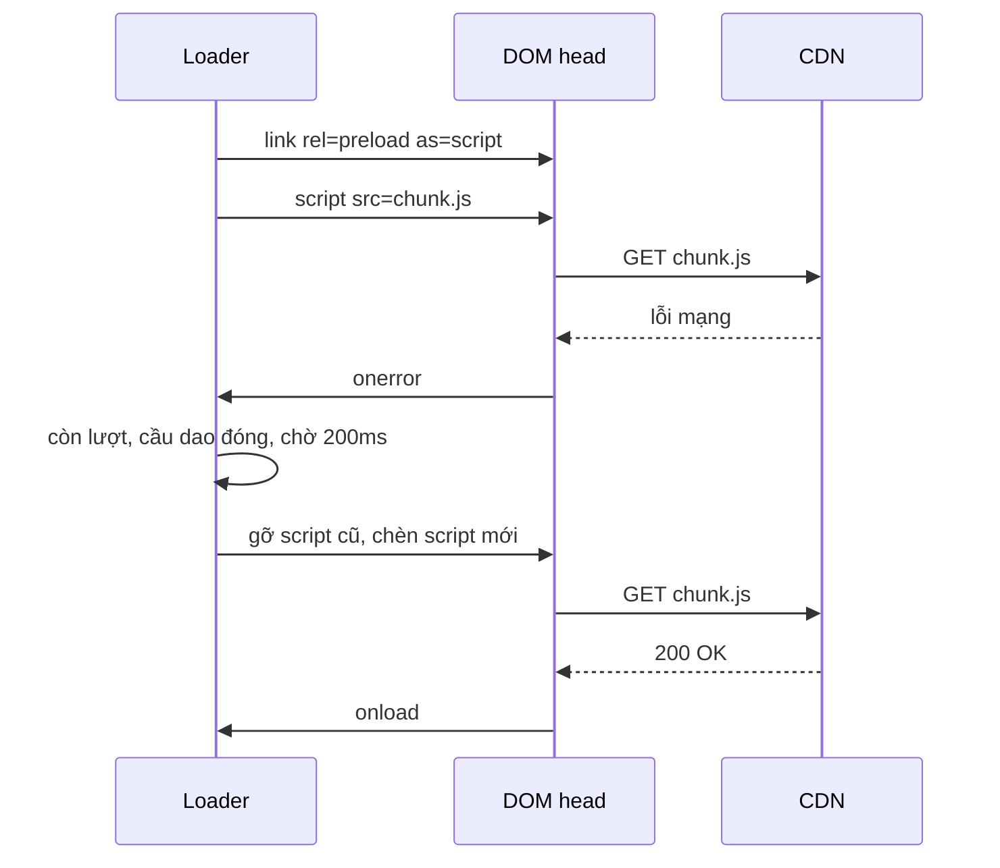

Một SPA như facebook.com có thể mở trong một tab **nhiều ngày liền**. Người dùng không bao giờ bấm F5. Trong lúc đó:

- Bộ nhớ tăng dần sau mỗi lần điều hướng (cache, listener quên gỡ, ảnh đã decode…).
- Đội frontend deploy 3 lần một ngày. Tab cũ vẫn chạy JS của hôm kia và gọi API theo kiểu cũ.
- Người dùng mở một link trong tab mới rồi bấm nút "←" của app. Không có gì để back cả.
- Người dùng đang viết dở một bài dài, lỡ bấm nút Back của trình duyệt. Mất sạch.
- Mạng 3G chập chờn: chunk JS của trang Ảnh tải lỗi một lần, và trang trắng xoá.

Không cái nào trong số này là "tính năng", nên hầu hết router và bundler không lo cho bạn. Router của Facebook (`buildCometRouter`) và bộ tải tài nguyên (`Bootloader`, `CSSLoader`) xử lý tất cả. Bài này đọc từng chi tiết rồi viết lại thành hai module nhỏ.

> [!TIP]
> **Tóm tắt**
> - **Reload ở lần điều hướng kế tiếp** khi có bản deploy mới, sau 50 lần điều hướng, hoặc phiên quá 2.5 ngày: lưới an toàn cho memory leak và code cũ, người dùng gần như không nhận ra. Hỏi unload hook **trước** khi reload.
> - `history.state` chỉ chứa **key**, dữ liệu route ở bộ nhớ; mất bộ nhớ (sau reload) thì dựng lại từ URL. Nút "←" của app có dự phòng khi không có lịch sử.
> - Chunk JS lỗi: retry **[200, 500]ms**, và **ngắt mạch** cho cả trang khi nhiều file lỗi gần như cùng lúc (mất mạng, CDN sập).
> - Biết chắc CSS đã **áp dụng** bằng một rule "lính gác" (sentinel) `#bootloader_x{height:42px}` + `getComputedStyle`.

## Phần 1: Router

Code gốc ở `20.Router/buildCometRouter.js` trong [facebook-codebase](https://github.com/hunghg255/facebook-codebase). Ngay đầu module là các hằng số đã nói lên gần hết câu chuyện:

```js
k = ["__cft__", "__tn__", "fnr_t", "sw_fnr_id"],   // query param tracking bị gỡ khỏi URL
m = 2.5 * 24 * 60 * 60 * 1e3,                       // 2.5 ngày
n = Date.now(),                                     // lúc router khởi tạo
q = 50,                                             // số lần điều hướng tối đa
r = 500,                                            // ms chờ popstate sau history.back()
```

### 1. Tự reload ở lần điều hướng kế tiếp

Trong hàm điều hướng (`la`), trước khi làm bất cứ điều gì:

```js
h = Date.now() - n > m;      // phiên quá 2.5 ngày
var i = F >= q,              // đã điều hướng >= 50 lần
    j = null;
b("ClientConsistency").hasPendingClientActions() && w(c)
  ? (j = "multiple_revs", …)
  : i ? j = "navigation_limit" : h && (j = "session_time_limit");
if (j != null) return Y(a, j);   // Y = goForceFullPageRedirectTo(url)
```

Thứ tự ưu tiên: **có bản mới** → **quá số lần điều hướng** → **phiên quá cũ**. Khi có lý do, router **không** `pushState` nữa mà gọi `goForceFullPageRedirectTo(url)`: tải đầy đủ **đúng trang người dùng vừa bấm**. Mẹo nằm ở thời điểm: người dùng vừa bấm sang trang khác, họ đã sẵn sàng chờ một chút, nên một lần tải lại toàn trang gần như không bị nhận ra. Không có popup "Đã có phiên bản mới, vui lòng tải lại".

Để ý trong đoạn trên, việc kiểm tra reload đứng **trước** unload hook; dữ liệu đang nhập dở khi đó chỉ còn được `beforeunload` bảo vệ. Bản viết lại đảo thứ tự này (xem phần "Viết lại").

Hàm `Y` còn ghi log (lấy mẫu bằng `Random.coinflip`) lý do reload: `navigation_limit`, `session_time_limit`, `history_back_failed`, `unmatched`… Facebook biết chính xác bao nhiêu % lần reload là do từng lý do.

**"Có bản mới" lấy từ đâu?** Module `ClientConsistency` (thư mục `Bootloader/`) nghe các response từ server. Mỗi response mang `{ rev, actions }`. Nếu `rev` khác `client_revision` của trang, `actions` được lưu lại: đó là danh sách module bị ảnh hưởng theo mức độ (2 = `softRefresh`, 3 = `hardRefresh`), và chỉ có hiệu lực nếu module đó **thật sự đã được tải** trên trang (`requireWeak`). Tức là deploy một module mà tab của bạn chưa bao giờ dùng thì không ép reload. `hasPendingClientActions()` trả `true` khi còn hành động chờ xử lý. Hàm `w(route)` loại một số loại route (`media_viewer`, `creation_flow`) khỏi việc reload vì "có bản mới": đang xem ảnh hay đang tạo bài thì không nên bị cắt ngang.

### 2. `history.state` chỉ chứa một key

```js
K = "state-key-" + Date.now(), L = { key: K };
…
window.history.scrollRestoration = "manual";
```

`history.state` chỉ là `{ key }`. Toàn bộ trạng thái của route (dữ liệu, entry point, scroll key, ref để trả focus…) nằm trong một map trong bộ nhớ `f[key]`. Lý do:

- `history.state` bị **serialize** (structured clone) và có giới hạn kích thước. Nhét object lớn vào là chậm, có khi lỗi.
- Trạng thái route chứa thứ không serialize được (hàm, ref DOM).
- Sau khi reload, bộ nhớ trống. Popstate về một entry có key lạ, router làm thế này (hàm `T`):

```js
if (c == null || !f[c]) {
  W.go(window.location.pathname + window.location.search, { navigationType: "popstate", replace: !0, target: "self" });
  return
}
```

Tức là **dựng lại trang từ URL** và thay thế entry. URL luôn là nguồn sự thật cuối cùng.

`scrollRestoration = "manual"`: trình duyệt tự khôi phục vị trí cuộn khi back thường sai với SPA (nội dung chưa render xong thì cuộn tới đâu?). Đổi lại, router phải **tự** lưu và khôi phục vị trí cuộn; Facebook làm việc này qua scroll key của từng route. Tắt `scrollRestoration` mà quên phần tự làm là người dùng bấm Back sẽ luôn bị đưa về đầu trang.

### 3. Back có fallback

Nút "←" trên giao diện của app (khác nút Back của trình duyệt) gọi:

```js
function pa() {
  G = b("uuid")();
  window.history.back();
  b("setTimeout")(oa.bind(null, G), r /* 500ms */);
}
function oa(a) {
  requestAnimationFrame(() => requestAnimationFrame(() => {
    if (G !== null && G === a) { /* không có popstate nào -> back thất bại */
      …; Y(parentUrl, "history_back_failed")
    }
  }))
}
```

Handler `popstate` đặt `G = null`. Nếu sau 500ms cộng 2 frame mà `G` vẫn là token cũ, nghĩa là `history.back()` **không làm gì**: trang được mở trong tab mới, hoặc từ một link ngoài. Khi đó router đưa người dùng về trang cha: trang dưới cùng của push view stack, hoặc trang "hosted", hoặc trang chính.

### 4. Unload hook: chặn rời trang

Mỗi route có `mutableState.unloadHooks`. Hàm `ra()` chạy các hook, hook nào trả về object cảnh báo thì chặn:

- **`beforeunload`** (đóng tab, F5): `preventDefault()` + `returnValue`, trình duyệt hiện hộp thoại của nó.
- **Điều hướng trong app**: hiện dialog của app với nút "Rời khỏi Trang" / "Ở lại Trang".
- **Nút Back/Forward của trình duyệt**: không "huỷ" được `popstate`, vì URL đã đổi rồi. Trong handler popstate, nếu có hook chặn, router hiện dialog với hai lựa chọn: **ở lại** thì chạy `history.pushState({ key: currentKey }, null, currentUrl)` để đưa URL về trang cũ; **rời** thì áp dụng popstate như bình thường.



## Phần 2: Tải JS/CSS bền bỉ

### Bootloader: preload, retry, ngắt mạch

Cấu hình thật được nhúng vào trang (`Bootloader/BootloaderConfig.js`):

```js
["BootloaderConfig", [], {
  "deferBootloads": false, "highPriBootloads": true,
  "jsRetries": [200, 500], "jsRetryAbortNum": 2, "jsRetryAbortTime": 5,
  "retryQueuedBootloads": true, "silentDups": true
}, 329],
["CSSLoaderConfig", [], { "timeout": 5000, "modulePrefix": "BLCSS:", "loadEventSupported": true }, 619],
```

**Preload trước** (`Bootloader.js`, hàm `P`): mỗi tài nguyên được chèn một `<link rel="preload" as="script|style" crossOrigin="anonymous">` trước khi chèn thẻ thật. Trình duyệt bắt đầu tải ngay, kể cả khi thẻ `<script>` thật còn phải chờ (vd: chờ tier trước tải xong). Preload chỉ có lợi chính vì **khoảng chờ** đó: nếu thẻ thật được chèn ngay cùng lúc thì preload gần như không thay đổi gì.

**Retry** (hàm `R`): khi `script.onerror`:

```js
O() && h < F.length                       // còn được retry và chưa hết lượt
  ? (y.push(now), setTimeout(function () {
        if (!O()) return;
        var b = a.parentNode;
        b && (b.removeChild(a), Q(c, d, e, b))   // gỡ thẻ cũ, tạo thẻ <script> mới
     }, F[h]), x.set(f, h + 1))
  : (/* bỏ cuộc */ …, b("NetworkStatus").reportError(), …)
```

Thẻ `<script>` đã lỗi không thể "tải lại", phải tạo thẻ mới. Lần 1 chờ 200ms, lần 2 chờ 500ms, rồi bỏ cuộc và báo cho `NetworkStatus` ([bài #5](/blogs/facebook-network-status-heartbeat)) biết có lỗi mạng.

**Ngắt mạch** (hàm `O`):

```js
function O() {
  if (!H) return !1;                 // đã ngắt từ trước
  var a = y.length;                  // y: thời điểm các lần retry (toàn trang)
  if (a < G) return !0;              // G = jsRetryAbortNum = 2
  a = y[a - 1] - y[a - G];           // khoảng cách giữa 2 lần retry gần nhất
  a < aa && (warn("JS retry abort"), H = !1);   // aa = jsRetryAbortTime = 5 (ms)
  return H
}
```

Nếu 2 lần retry (của bất kỳ file nào) xảy ra **cách nhau dưới 5ms**, tức là nhiều file lỗi **cùng một lúc**, thì đó không phải "CDN chập chờn một file" mà là **mất mạng** hoặc CDN sập. Retry lúc đó chỉ tạo thêm hàng chục request vô ích và làm chậm lần phục hồi. Bootloader ngắt retry cho **cả trang** (`H = false`). Đây là một **circuit breaker** thu nhỏ.

### CSSLoader: biết chắc CSS đã ÁP DỤNG

`link.onload` cho biết file CSS đã **tải xong**. Nhưng điều bạn cần biết là rule đã được **áp dụng** chưa, để hiện component mà không bị nháy giao diện chưa có style. Ngày trước nhiều trình duyệt còn không bắn `onload` cho `<link rel=stylesheet>`. Facebook giải bằng một mẹo cực kỳ đơn giản:

1. Lúc build, **mỗi file CSS** được thêm một rule "lính gác" (sentinel) ở cuối. Mở bất kỳ file nào trong thư mục `000 CSS` của repo là thấy:

   ```css
   #bootloader_U_L3R{height:42px;}
   ```

2. Lúc tải, `CSSLoader` (hàm `q`) chèn một `<meta id="bootloader_U_L3R">` vào trang.
3. Một vòng `setInterval` **dùng chung** chạy mỗi **20ms** (hàm `p`), kiểm tra:

   ```js
   l = window.getComputedStyle ? getComputedStyle(k) : k.currentStyle;
   l && parseInt(l.height, 10) > 1 && (/* CSS đã áp dụng */ …)
   ```

   Rule sentinel đã có hiệu lực ⇔ `height` của meta là `42px`. Vì rule nằm **cuối** file, nó có hiệu lực đồng nghĩa cả file đã được parse và áp dụng.
4. **Timeout trượt** 5 giây: mỗi khi có một stylesheet về, hạn chót được gia hạn thêm 5 giây (`m = Date.now() + i`). Chỉ khi **không có gì tiến triển** trong 5 giây thì mọi stylesheet còn chờ mới bị coi là lỗi.

Còn một chi tiết: Facebook tự **dò** xem trình duyệt có bắn `onload` cho CSS không, bằng cách tải một stylesheet rỗng `data:text/css;base64,` một lần. Có thì dùng event, không thì dùng sentinel.



## Viết lại

### `routerHygiene.ts`

`navigate()`: hỏi unload hook trước, rồi mới quyết định reload hay `pushState`:

```ts title=src/lib/routerHygiene.ts
  async function navigate(url: string, { replace = false, state = null as unknown } = {}) {
    if (reloading) return false;
    // Hỏi unload hook TRƯỚC, kể cả khi sắp reload: không thể trông vào beforeunload
    // (iOS Safari hầu như không hiện hộp thoại), nên tự hỏi bằng dialog của app.
    const message = blockingMessage();
    if (message) {
      onEvent?.({ type: 'blocked', message });
      if (!(await confirmLeave(message))) return false;
    }
    const reason = reloadReason();
    if (reason) {
      // Điều hướng TỚI url mới bằng full page load: đúng trang người dùng muốn,
      // nhưng với JS/CSS mới và bộ nhớ sạch. `reloading` để beforeunload không hỏi lại.
      reloading = true;
      onEvent?.({ type: 'force_reload', url, reason });
      forceReload(url, reason);
      return false;
    }
    saveScroll();
    const current = entries.get(currentKey)!;
    const key = newKey();
    const index = replace ? current.index : current.index + 1;
    entries.set(key, { url, index, state, scrollY: 0 });
    if (replace) history.replaceState({ key, index }, '', url);
    else history.pushState({ key, index }, '', url);
    currentKey = key;
    navigationCount++;
    onEvent?.({ type: 'navigate', url, replace });
    emit();
    restoreScroll(0); // trang mới: lên đầu
    return true;
  }
```

Tải lại đầy đủ, kể cả khi URL chỉ khác phần `#hash`:

```ts title=src/lib/routerHygiene.ts
const withoutHash = (url: URL) => url.href.slice(0, url.href.length - url.hash.length);

/**
 * Tải lại đầy đủ tới `url`. Cẩn thận: nếu `url` chỉ khác URL hiện tại ở phần `#…` (vd hash
 * route `#/a` -> `#/b`, hoặc trùng hệt), location.assign() chỉ là "điều hướng fragment":
 * đổi hash, KHÔNG tải lại trang. Khi đó đổi URL trước rồi reload.
 */
export function hardNavigate(url: string) {
  const target = new URL(url, location.href);
  if (withoutHash(target) === withoutHash(new URL(location.href))) {
    if (target.href !== location.href) location.assign(target.href);
    location.reload();
  } else {
    location.assign(target.href);
  }
}
```

Nút Back/Forward của trình duyệt khi có unload hook chặn (giải thích ở bước 5 bên dưới):

::: spoiler Xem đoạn onPopState

```ts title=src/lib/routerHygiene.ts
  async function onPopState(event: PopStateEvent) {
    pendingBackToken = null; // back() đã thành công
    const key: string | undefined = event.state?.key;
    const entry = key ? entries.get(key) : undefined;
    // Quay về đúng entry đang hiển thị (vd: bước "hoàn tác" bên dưới): không có gì thay đổi.
    if (key && key === currentKey) return;

    if (!skipHooksOnce) {
      const message = blockingMessage();
      if (message) {
        // Trình duyệt đã đổi URL rồi, không "huỷ" popstate được. Đưa người dùng về lại entry
        // hiện tại bằng history.go(-delta) (Back: delta = -1 -> go(1); Forward: delta = +1 ->
        // go(-1)), nên không làm mất lịch sử phía trước như pushState. Nếu họ đồng ý rời thì
        // go(delta) tới đúng đích ban đầu.
        const current = entries.get(currentKey)!;
        const targetIndex = typeof event.state?.index === 'number' ? event.state.index : null;
        const delta = targetIndex === null ? null : targetIndex - current.index;
        if (delta) history.go(-delta);
        // không biết vị trí đích (entry do code khác tạo): đành đẩy lại trang hiện tại
        else history.pushState({ key: currentKey, index: current.index }, '', current.url);
        onEvent?.({ type: 'blocked', message });
        if (await confirmLeave(message)) {
          skipHooksOnce = true;
          history.go(delta || -1);
        }
        return;
      }
    }
    skipHooksOnce = false;
```

:::

::: spoiler Xem toàn bộ src/lib/routerHygiene.ts

```ts title=src/lib/routerHygiene.ts
/**
 * Những chi tiết "vệ sinh" cho router SPA chạy lâu (ý tưởng từ buildCometRouter của Facebook).
 *
 * 1. Tự reload đầy đủ ở lần điều hướng kế tiếp khi: đã điều hướng quá N lần, phiên quá cũ,
 *    hoặc server báo đã có bản deploy mới. Reload đúng lúc người dùng đang chuyển trang thì
 *    họ gần như không nhận ra. Unload hook được hỏi TRƯỚC khi reload, nên dữ liệu đang nhập dở
 *    vẫn được bảo vệ (kể cả trên iOS Safari, nơi beforeunload hầu như không hiện hộp thoại).
 * 2. history.state chỉ chứa một `key` (+ chỉ số), dữ liệu thật nằm trong bộ nhớ. Sau reload,
 *    key không còn trong bộ nhớ -> dựng lại trang từ URL.
 * 3. back() an toàn: mở link trong tab mới thì không có gì để back, nên sau một khoảng chờ
 *    mà không thấy popstate thì tự điều hướng về trang cha.
 * 4. Unload hook: chặn rời trang khi còn thay đổi chưa lưu, cả khi bấm nút Back/Forward.
 * 5. Tự lưu/khôi phục vị trí cuộn của window theo từng entry (vì đã tắt scrollRestoration).
 */

export type ReloadReason = 'navigation_limit' | 'session_time_limit' | 'new_version';

export interface RouterSnapshot {
  url: string;
  /** vị trí trong lịch sử của app, 0 = trang đầu tiên của phiên */
  index: number;
  state: unknown;
  navigationCount: number;
  newVersionAvailable: boolean;
}

export type RouterEvent =
  | { type: 'navigate'; url: string; replace: boolean }
  | { type: 'popstate'; url: string }
  | { type: 'unknown_key'; url: string }
  | { type: 'force_reload'; url: string; reason: ReloadReason }
  | { type: 'blocked'; message: string }
  | { type: 'back_no_history'; fallbackUrl: string }
  | { type: 'back_failed'; fallbackUrl: string };

/** Trả về chuỗi cảnh báo để chặn rời trang, hoặc null/undefined để cho đi. */
export type UnloadHook = () => string | null | undefined;

export interface RouterOptions {
  maxNavigations?: number;
  maxSessionAgeMs?: number;
  /** chờ popstate bao lâu sau history.back() */
  backTimeoutMs?: number;
  now?: () => number;
  /** mặc định: hardNavigate(url) */
  forceReload?: (url: string, reason: ReloadReason) => void;
  /** hỏi người dùng có muốn rời trang không; mặc định window.confirm */
  confirmLeave?: (message: string) => Promise<boolean>;
  /**
   * true (mặc định): router tắt scrollRestoration của trình duyệt và tự lưu/khôi phục
   * window.scrollY theo từng entry. false: để trình duyệt tự lo.
   */
  manageScroll?: boolean;
  onEvent?: (event: RouterEvent) => void;
}

interface Entry {
  url: string;
  index: number;
  state: unknown;
  /** vị trí cuộn của window lúc rời entry này */
  scrollY: number;
}

const withoutHash = (url: URL) => url.href.slice(0, url.href.length - url.hash.length);

/**
 * Tải lại đầy đủ tới `url`. Cẩn thận: nếu `url` chỉ khác URL hiện tại ở phần `#…` (vd hash
 * route `#/a` -> `#/b`, hoặc trùng hệt), location.assign() chỉ là "điều hướng fragment":
 * đổi hash, KHÔNG tải lại trang. Khi đó đổi URL trước rồi reload.
 */
export function hardNavigate(url: string) {
  const target = new URL(url, location.href);
  if (withoutHash(target) === withoutHash(new URL(location.href))) {
    if (target.href !== location.href) location.assign(target.href);
    location.reload();
  } else {
    location.assign(target.href);
  }
}

const currentUrl = () => location.pathname + location.search + location.hash;
const nextFrame = () => new Promise<void>((resolve) => requestAnimationFrame(() => resolve()));

export function createRouter({
  maxNavigations = 50,
  maxSessionAgeMs = 2.5 * 24 * 60 * 60 * 1000,
  backTimeoutMs = 500,
  now = Date.now,
  forceReload = hardNavigate,
  confirmLeave = async (message) => window.confirm(message),
  manageScroll = true,
  onEvent,
}: RouterOptions = {}) {
  const sessionStart = now();
  const entries = new Map<string, Entry>();
  const hooks = new Set<UnloadHook>();
  const listeners = new Set<() => void>();
  let navigationCount = 0;
  let newVersionAvailable = false;
  let keySeq = 0;
  let pendingBackToken: symbol | null = null;
  let skipHooksOnce = false;
  let reloading = false;

  const newKey = () => `state-key-${now()}-${keySeq++}`;

  // Trình duyệt tự khôi phục vị trí cuộn khi back thường sai với SPA (nội dung chưa render xong),
  // nên router tự làm: lưu scrollY khi rời entry, cuộn lại sau khi trang mới đã render.
  if (manageScroll && 'scrollRestoration' in history) history.scrollRestoration = 'manual';
  const saveScroll = () => {
    const entry = entries.get(currentKey);
    if (entry) entry.scrollY = window.scrollY;
  };
  const restoreScroll = (y: number) => {
    if (!manageScroll) return;
    // listener (useSyncExternalStore) render đồng bộ trong emit(); đợi 1 frame cho chắc
    requestAnimationFrame(() => window.scrollTo(0, y));
  };

  // Trang đầu tiên: giữ key cũ nếu có (vd: reload), luôn ghi lại để chắc chắn có key.
  const initialIndex = typeof history.state?.index === 'number' ? history.state.index : 0;
  let currentKey: string = history.state?.key ?? newKey();
  entries.set(currentKey, { url: currentUrl(), index: initialIndex, state: null, scrollY: 0 });
  history.replaceState({ key: currentKey, index: initialIndex }, '', currentUrl());

  let snapshot = makeSnapshot();
  function makeSnapshot(): RouterSnapshot {
    const entry = entries.get(currentKey)!;
    return { url: entry.url, index: entry.index, state: entry.state, navigationCount, newVersionAvailable };
  }
  const emit = () => {
    snapshot = makeSnapshot();
    listeners.forEach((listener) => listener());
  };

  const blockingMessage = () => {
    for (const hook of hooks) {
      const message = hook();
      if (message) return message;
    }
    return null;
  };

  /** Lý do phải reload đầy đủ thay vì điều hướng trong SPA, nếu có. */
  function reloadReason(): ReloadReason | null {
    if (newVersionAvailable) return 'new_version';
    if (navigationCount >= maxNavigations) return 'navigation_limit';
    if (now() - sessionStart > maxSessionAgeMs) return 'session_time_limit';
    return null;
  }

  async function navigate(url: string, { replace = false, state = null as unknown } = {}) {
    if (reloading) return false;
    // Hỏi unload hook TRƯỚC, kể cả khi sắp reload: không thể trông vào beforeunload
    // (iOS Safari hầu như không hiện hộp thoại), nên tự hỏi bằng dialog của app.
    const message = blockingMessage();
    if (message) {
      onEvent?.({ type: 'blocked', message });
      if (!(await confirmLeave(message))) return false;
    }
    const reason = reloadReason();
    if (reason) {
      // Điều hướng TỚI url mới bằng full page load: đúng trang người dùng muốn,
      // nhưng với JS/CSS mới và bộ nhớ sạch. `reloading` để beforeunload không hỏi lại.
      reloading = true;
      onEvent?.({ type: 'force_reload', url, reason });
      forceReload(url, reason);
      return false;
    }
    saveScroll();
    const current = entries.get(currentKey)!;
    const key = newKey();
    const index = replace ? current.index : current.index + 1;
    entries.set(key, { url, index, state, scrollY: 0 });
    if (replace) history.replaceState({ key, index }, '', url);
    else history.pushState({ key, index }, '', url);
    currentKey = key;
    navigationCount++;
    onEvent?.({ type: 'navigate', url, replace });
    emit();
    restoreScroll(0); // trang mới: lên đầu
    return true;
  }

  async function onPopState(event: PopStateEvent) {
    pendingBackToken = null; // back() đã thành công
    const key: string | undefined = event.state?.key;
    const entry = key ? entries.get(key) : undefined;
    // Quay về đúng entry đang hiển thị (vd: bước "hoàn tác" bên dưới): không có gì thay đổi.
    if (key && key === currentKey) return;

    if (!skipHooksOnce) {
      const message = blockingMessage();
      if (message) {
        // Trình duyệt đã đổi URL rồi, không "huỷ" popstate được. Đưa người dùng về lại entry
        // hiện tại bằng history.go(-delta) (Back: delta = -1 -> go(1); Forward: delta = +1 ->
        // go(-1)), nên không làm mất lịch sử phía trước như pushState. Nếu họ đồng ý rời thì
        // go(delta) tới đúng đích ban đầu.
        const current = entries.get(currentKey)!;
        const targetIndex = typeof event.state?.index === 'number' ? event.state.index : null;
        const delta = targetIndex === null ? null : targetIndex - current.index;
        if (delta) history.go(-delta);
        // không biết vị trí đích (entry do code khác tạo): đành đẩy lại trang hiện tại
        else history.pushState({ key: currentKey, index: current.index }, '', current.url);
        onEvent?.({ type: 'blocked', message });
        if (await confirmLeave(message)) {
          skipHooksOnce = true;
          history.go(delta || -1);
        }
        return;
      }
    }
    skipHooksOnce = false;
    saveScroll();

    if (!key || !entry) {
      // Entry từ trước khi reload (bộ nhớ đã mất) hoặc do code khác pushState:
      // dựng lại từ URL, thay thế entry hiện tại.
      const url = currentUrl();
      onEvent?.({ type: 'unknown_key', url });
      const newEntryKey = newKey();
      const index = typeof event.state?.index === 'number' ? event.state.index : 0;
      entries.set(newEntryKey, { url, index, state: null, scrollY: 0 });
      history.replaceState({ key: newEntryKey, index }, '', url);
      currentKey = newEntryKey;
      emit();
      restoreScroll(0);
      return;
    }
    currentKey = key;
    onEvent?.({ type: 'popstate', url: entry.url });
    emit();
    restoreScroll(entry.scrollY);
  }

  /**
   * Quay lại trang trước trong app; không được thì về `fallbackUrl`.
   * - index = 0: trang này là trang đầu tiên của phiên (vd: mở link từ tab mới), back sẽ
   *   rời khỏi app hoặc không làm gì -> đi thẳng tới fallback.
   * - Còn lại: history.back(), rồi sau `backTimeoutMs` + 2 frame mà chưa có popstate thì
   *   coi như back thất bại (Facebook dùng đúng cách này, với 500ms).
   */
  async function back(fallbackUrl: string) {
    const current = entries.get(currentKey)!;
    if (current.index === 0) {
      onEvent?.({ type: 'back_no_history', fallbackUrl });
      return navigate(fallbackUrl, { replace: true });
    }
    const token = Symbol('back');
    pendingBackToken = token;
    history.back();
    await new Promise((resolve) => setTimeout(resolve, backTimeoutMs));
    await nextFrame();
    await nextFrame();
    if (pendingBackToken !== token) return true;
    pendingBackToken = null;
    onEvent?.({ type: 'back_failed', fallbackUrl });
    return navigate(fallbackUrl, { replace: true });
  }

  const onBeforeUnload = (event: BeforeUnloadEvent) => {
    if (reloading) return;
    const message = blockingMessage();
    if (message) {
      event.preventDefault();
      // trình duyệt hiện thông báo mặc định của nó, không dùng chuỗi này
      event.returnValue = message;
    }
  };

  window.addEventListener('popstate', onPopState);
  window.addEventListener('beforeunload', onBeforeUnload);

  return {
    navigate,
    back,
    /** Gọi khi server báo có bản deploy mới (header, polling /version.json, websocket…). */
    markNewVersionAvailable() {
      newVersionAvailable = true;
      emit();
    },
    addUnloadHook(hook: UnloadHook) {
      hooks.add(hook);
      return () => {
        hooks.delete(hook);
      };
    },
    subscribe(listener: () => void) {
      listeners.add(listener);
      return () => {
        listeners.delete(listener);
      };
    },
    getSnapshot: () => snapshot,
    destroy() {
      window.removeEventListener('popstate', onPopState);
      window.removeEventListener('beforeunload', onBeforeUnload);
    },
  };
}

export type Router = ReturnType<typeof createRouter>;
```

:::

#### Đi qua code

1. **`reloadReason()`** giữ đúng thứ tự ưu tiên của Facebook, nhưng `navigate()` hỏi **unload hook trước**. Không thể trông vào `beforeunload` để bảo vệ bản nháp: iOS Safari hầu như không hiện hộp thoại đó. Người dùng chọn "rời" thì mới reload; cờ `reloading` chặn `beforeunload` hỏi thêm một lần nữa khi chính router chủ động reload.
2. **`hardNavigate()`** sửa một lỗi mình gặp khi chạy demo, và lỗi này rộng hơn tưởng tượng: theo thuật toán điều hướng của HTML, URL mới chỉ khác URL hiện tại ở phần `#…` (kể cả **khác** fragment, vd hash route `#/a` → `#/b`, chứ không chỉ trùng hệt) là "điều hướng fragment": `location.assign()` chỉ đổi hash, **không tải lại trang**. Hàm so hai URL sau khi bỏ hash; trùng thì đổi URL rồi gọi `location.reload()`.
3. **Vị trí cuộn.** Vì đã tắt `scrollRestoration`, router tự lưu `window.scrollY` vào entry hiện tại trước khi rời đi, và sau popstate thì cuộn về đúng chỗ (đợi một frame để trang đã render). Trang mới thì lên đầu. Không muốn router đụng vào cuộn thì truyền `manageScroll: false`.
4. **`{ key, index }` trong `history.state`.** Facebook chỉ lưu `key`. Mình lưu thêm `index` (vị trí trong lịch sử của app) để `back()` biết ngay "đây là trang đầu tiên của phiên" mà không cần gọi `history.back()` rồi chờ 500ms. Trong iframe (như demo nhúng trong blog), gọi `history.back()` khi app không có lịch sử sẽ đưa **cả trang blog** quay lại, nên kiểm tra trước là bắt buộc. Timeout 500ms vẫn được giữ cho các trường hợp `index` không đáng tin.
5. **`onPopState` khi hook chặn.** Trình duyệt đã đổi URL, không "huỷ" được. Bản viết lại tính `delta = index đích − index hiện tại` (Back là −1, Forward là +1, nhảy nhiều bước qua menu lịch sử thì lớn hơn) và gọi `history.go(-delta)` để **quay về** entry hiện tại ngay, rồi mới hỏi. Popstate của lần quay về này trỏ đúng `currentKey`, nên bị bỏ qua. Đồng ý rời thì `history.go(delta)` tới đúng đích ban đầu. Cách đầu tiên mình viết là `pushState` lại trang hiện tại như Facebook: với nút **Forward** nó sai, vì `pushState` xoá toàn bộ lịch sử phía trước, và sau khi đồng ý rời, `history.back()` lại đưa người dùng về trang cũ thay vì trang đích. Facebook cũng chỉ đẩy lại khi người dùng chọn ở lại.
6. **Key lạ** (sau reload, hoặc do code khác `pushState`): dựng entry mới từ URL hiện tại bằng `replaceState`, giống hàm `T` của Facebook.

### `resilientLoader.ts`

Cầu dao và retry của `loadScript`:

```ts title=src/lib/resilientLoader.ts
  /** Còn được phép retry không? Đồng thời là "cầu dao": nhiều retry dồn dập thì ngắt hẳn. */
  function canRetry(name: string) {
    if (!retriesEnabled) return false;
    if (retryTimes.length < breakerCount) return true;
    const span = retryTimes[retryTimes.length - 1] - retryTimes[retryTimes.length - breakerCount];
    if (span < breakerWindowMs) {
      retriesEnabled = false;
      onEvent?.({ type: 'breaker-open', name });
    }
    return retriesEnabled;
  }
```

Phần `onerror` của `loadScript`: mỗi lần thử tạo thẻ `<script>` mới, lỗi thì hỏi cầu dao rồi hẹn lần thử sau.

::: spoiler Xem nhánh onerror của loadScript

```ts title=src/lib/resilientLoader.ts
        script.onerror = () => {
          if (attempt < retryDelays.length && canRetry(name)) {
            retryTimes.push(performance.now());
            const delay = retryDelays[attempt];
            attempt++;
            onEvent?.({ type: 'retry', name, attempt, delay });
            setTimeout(() => {
              // kiểm tra lại: trong lúc chờ có thể cầu dao đã ngắt vì file khác
              if (!canRetry(name)) return fail();
              // thẻ <script> đã lỗi không tải lại được, phải tạo thẻ mới
              script.remove();
              inject();
            }, delay);
          } else {
            fail();
          }
        };
```

:::

Vòng poll sentinel dùng chung cho mọi stylesheet:

```ts title=src/lib/resilientLoader.ts
  function poll() {
    const now = performance.now();
    if (now >= deadline) {
      // Không có stylesheet nào về trong `cssTimeoutMs` gần nhất: coi như tất cả đều lỗi.
      pendingCss.forEach(({ meta, start, reject }, name) => {
        meta.remove();
        onEvent?.({ type: 'css-timeout', name, ms: Math.round(now - start) });
        reject(new Error(`CSS "${name}" không được áp dụng sau ${cssTimeoutMs}ms`));
      });
      pendingCss.clear();
    } else {
      pendingCss.forEach(({ meta, start, resolve }, name) => {
        // <meta> mặc định display:none, nhưng getComputedStyle vẫn trả về giá trị đã tính
        // của height: '42px' khi rule sentinel đã được áp dụng, 'auto' khi chưa.
        if (parseInt(getComputedStyle(meta).height, 10) > 1) {
          meta.remove();
          pendingCss.delete(name);
          // có tiến triển -> gia hạn cho các file còn lại (giống CSSLoader của FB)
          deadline = now + cssTimeoutMs;
          onEvent?.({ type: 'css-applied', name, ms: Math.round(now - start) });
          resolve();
        }
      });
    }
    if (pendingCss.size === 0) {
      clearInterval(pollTimer);
      pollTimer = undefined;
    }
  }
```

::: spoiler Xem toàn bộ src/lib/resilientLoader.ts

```ts title=src/lib/resilientLoader.ts
/**
 * Tải JS/CSS động bền bỉ (ý tưởng từ Bootloader + CSSLoader của Facebook).
 *
 * - <link rel="preload"> trước, rồi mới tới thẻ thật. Chỉ có lợi khi thẻ thật bị trễ (vd: chờ
 *   tier trước như Bootloader); ở đây thẻ thật được chèn ngay nên preload gần như không đổi gì,
 *   giữ lại để minh hoạ. Preload và thẻ thật phải cùng `crossOrigin` để không tải hai lần.
 * - Script lỗi: thử lại sau [200, 500]ms (giá trị jsRetries của Facebook).
 * - Ngắt mạch: nếu `breakerCount` lần retry dồn vào trong `breakerWindowMs` (rất nhiều file lỗi
 *   CÙNG LÚC = mất mạng/CDN sập) thì tắt retry cho cả trang, tránh "bão" request vô ích.
 * - CSS: biết chắc CSS đã ÁP DỤNG bằng một rule "lính gác" (sentinel) trong chính file CSS,
 *   kiểm tra bằng getComputedStyle mỗi 20ms, có timeout.
 */

export type LoaderEvent =
  | { type: 'preload'; name: string; url: string }
  | { type: 'attempt'; name: string; url: string; attempt: number }
  | { type: 'retry'; name: string; attempt: number; delay: number }
  | { type: 'breaker-open'; name: string }
  | { type: 'success'; name: string; ms: number; attempts: number }
  | { type: 'error'; name: string; ms: number; attempts: number }
  | { type: 'css-applied'; name: string; ms: number }
  | { type: 'css-timeout'; name: string; ms: number };

export interface ResilientLoaderOptions {
  retryDelays?: number[];
  /** số lần retry tối thiểu nằm trong cửa sổ để ngắt mạch */
  breakerCount?: number;
  breakerWindowMs?: number;
  cssTimeoutMs?: number;
  cssPollMs?: number;
  preload?: boolean;
  onEvent?: (event: LoaderEvent) => void;
}

/** id của phần tử lính gác cho một stylesheet */
export const sentinelId = (name: string) => `css_sentinel_${name.replace(/[^a-z0-9]/gi, '_')}`;
/** rule cần chèn vào cuối file CSS lúc build (Facebook: #bootloader_<hash>{height:42px}) */
export const sentinelRule = (name: string) => `#${sentinelId(name)}{height:42px}`;

type UrlSource = string | ((attempt: number) => string);
const resolveUrl = (src: UrlSource, attempt: number) => (typeof src === 'function' ? src(attempt) : src);

export function createResilientLoader({
  retryDelays = [200, 500],
  breakerCount = 2,
  breakerWindowMs = 5,
  cssTimeoutMs = 5000,
  cssPollMs = 20,
  preload = true,
  onEvent,
}: ResilientLoaderOptions = {}) {
  const retryTimes: number[] = [];
  let retriesEnabled = true;
  const preloaded = new Set<string>();

  /** Còn được phép retry không? Đồng thời là "cầu dao": nhiều retry dồn dập thì ngắt hẳn. */
  function canRetry(name: string) {
    if (!retriesEnabled) return false;
    if (retryTimes.length < breakerCount) return true;
    const span = retryTimes[retryTimes.length - 1] - retryTimes[retryTimes.length - breakerCount];
    if (span < breakerWindowMs) {
      retriesEnabled = false;
      onEvent?.({ type: 'breaker-open', name });
    }
    return retriesEnabled;
  }

  function preloadOnce(name: string, url: string, as: 'script' | 'style') {
    if (!preload || preloaded.has(url)) return;
    preloaded.add(url);
    const link = document.createElement('link');
    link.rel = 'preload';
    link.as = as;
    link.href = url;
    link.crossOrigin = 'anonymous';
    document.head.appendChild(link);
    onEvent?.({ type: 'preload', name, url });
  }

  function loadScript(name: string, src: UrlSource): Promise<void> {
    preloadOnce(name, resolveUrl(src, 0), 'script');
    const start = performance.now();
    return new Promise((resolve, reject) => {
      let attempt = 0;
      const inject = () => {
        const url = resolveUrl(src, attempt);
        const script = document.createElement('script');
        script.src = url;
        script.async = true;
        script.crossOrigin = 'anonymous';
        onEvent?.({ type: 'attempt', name, url, attempt });
        script.onload = () => {
          onEvent?.({ type: 'success', name, ms: Math.round(performance.now() - start), attempts: attempt + 1 });
          resolve();
        };
        script.onerror = () => {
          if (attempt < retryDelays.length && canRetry(name)) {
            retryTimes.push(performance.now());
            const delay = retryDelays[attempt];
            attempt++;
            onEvent?.({ type: 'retry', name, attempt, delay });
            setTimeout(() => {
              // kiểm tra lại: trong lúc chờ có thể cầu dao đã ngắt vì file khác
              if (!canRetry(name)) return fail();
              // thẻ <script> đã lỗi không tải lại được, phải tạo thẻ mới
              script.remove();
              inject();
            }, delay);
          } else {
            fail();
          }
        };
        document.head.appendChild(script);
      };
      const fail = () => {
        onEvent?.({ type: 'error', name, ms: Math.round(performance.now() - start), attempts: attempt + 1 });
        reject(new Error(`Không tải được script "${name}"`));
      };
      inject();
    });
  }

  // ---- CSS: một vòng poll dùng chung cho mọi stylesheet đang chờ ----
  const pendingCss = new Map<
    string,
    { meta: HTMLMetaElement; start: number; resolve: () => void; reject: (error: Error) => void }
  >();
  let deadline = 0;
  let pollTimer: ReturnType<typeof setInterval> | undefined;

  function poll() {
    const now = performance.now();
    if (now >= deadline) {
      // Không có stylesheet nào về trong `cssTimeoutMs` gần nhất: coi như tất cả đều lỗi.
      pendingCss.forEach(({ meta, start, reject }, name) => {
        meta.remove();
        onEvent?.({ type: 'css-timeout', name, ms: Math.round(now - start) });
        reject(new Error(`CSS "${name}" không được áp dụng sau ${cssTimeoutMs}ms`));
      });
      pendingCss.clear();
    } else {
      pendingCss.forEach(({ meta, start, resolve }, name) => {
        // <meta> mặc định display:none, nhưng getComputedStyle vẫn trả về giá trị đã tính
        // của height: '42px' khi rule sentinel đã được áp dụng, 'auto' khi chưa.
        if (parseInt(getComputedStyle(meta).height, 10) > 1) {
          meta.remove();
          pendingCss.delete(name);
          // có tiến triển -> gia hạn cho các file còn lại (giống CSSLoader của FB)
          deadline = now + cssTimeoutMs;
          onEvent?.({ type: 'css-applied', name, ms: Math.round(now - start) });
          resolve();
        }
      });
    }
    if (pendingCss.size === 0) {
      clearInterval(pollTimer);
      pollTimer = undefined;
    }
  }

  function waitForSentinel(name: string): Promise<void> {
    return new Promise((resolve, reject) => {
      const meta = document.createElement('meta');
      meta.id = sentinelId(name);
      document.head.appendChild(meta);
      deadline = performance.now() + cssTimeoutMs;
      pendingCss.set(name, { meta, start: performance.now(), resolve, reject });
      pollTimer ??= setInterval(poll, cssPollMs);
    });
  }

  /**
   * detect:
   * - 'event': dùng link.onload/onerror (trình duyệt hiện đại đều hỗ trợ)
   * - 'sentinel': kiểm tra rule lính gác; dùng khi không tin được sự kiện load
   *   (CSS nạp qua @import, CSS-in-JS, trình duyệt cũ) hoặc muốn chắc rule đã ÁP DỤNG.
   */
  function loadStyle(name: string, href: string, { detect = 'event' as 'event' | 'sentinel' } = {}) {
    preloadOnce(name, href, 'style');
    const link = document.createElement('link');
    link.rel = 'stylesheet';
    // PHẢI cùng crossOrigin với thẻ preload, nếu không "credentials mode" khác nhau và trình
    // duyệt bỏ bản preload, tải file lần thứ hai.
    link.crossOrigin = 'anonymous';
    link.href = href;
    const start = performance.now();
    const done =
      detect === 'sentinel'
        ? waitForSentinel(name)
        : new Promise<void>((resolve, reject) => {
            link.onload = () => {
              onEvent?.({ type: 'css-applied', name, ms: Math.round(performance.now() - start) });
              resolve();
            };
            link.onerror = () => reject(new Error(`Không tải được CSS "${name}"`));
          });
    document.head.appendChild(link);
    return done;
  }

  return {
    loadScript,
    loadStyle,
    isRetryEnabled: () => retriesEnabled,
  };
}

/**
 * Retry cho dynamic import(). Theo spec HTML, một module tải lỗi có thể bị ghi nhớ trong
 * "module map", nên import lại ĐÚNG URL cũ có thể thất bại ngay mà không gửi request.
 * Vì vậy factory nhận số lần thử để có thể đổi URL (vd: thêm ?retry=n).
 */
export async function importWithRetry<T>(
  factory: (attempt: number) => Promise<T>,
  { retryDelays = [200, 500], onRetry }: { retryDelays?: number[]; onRetry?: (attempt: number, error: unknown) => void } = {},
): Promise<T> {
  for (let attempt = 0; ; attempt++) {
    try {
      return await factory(attempt);
    } catch (error) {
      if (attempt >= retryDelays.length) throw error;
      onRetry?.(attempt + 1, error);
      await new Promise((resolve) => setTimeout(resolve, retryDelays[attempt]));
    }
  }
}
```

:::

Chú ý:

- **`canRetry()` vừa hỏi vừa ngắt.** Giống `O()`: lần gọi phát hiện 2 retry dồn dập sẽ tắt `retriesEnabled` vĩnh viễn cho loader đó. `retryTimes` là **toàn cục** cho loader chứ không theo từng file, vì cầu dao nhìn sức khoẻ của **cả mạng**.
- **Kiểm tra lại sau khi chờ.** Trong 200ms chờ retry, file khác có thể làm cầu dao ngắt. Callback `setTimeout` gọi lại `canRetry()` trước khi tạo thẻ mới (Facebook cũng gọi `O()` lần thứ hai ở đúng chỗ này).
- **Sentinel dùng `<meta>`.** `<meta>` mặc định `display: none`, nhưng `getComputedStyle` vẫn trả về **giá trị đã tính** của `height`: `"42px"` khi rule đã áp dụng, `"auto"` khi chưa. Không cần phần tử hiển thị.
- **Preload ở đây gần như không có tác dụng**: thẻ thật được chèn ngay sau preload, không có khoảng chờ nào để tận dụng. Mình giữ lại để minh hoạ cách Bootloader làm; trong app của bạn, chỉ preload khi thẻ thật bị trì hoãn (chờ tier trước, chờ người dùng mở tab). Preload và thẻ thật phải có **cùng** `crossOrigin`, nếu không trình duyệt tải file hai lần; bản viết lại đặt `anonymous` cho preload, `<script>` lẫn `<link rel=stylesheet>`.
- **`importWithRetry`** cho `import()` động: theo spec HTML, module tải lỗi có thể được ghi nhớ trong "module map", nên `import()` lại **đúng URL đó** có thể lỗi ngay mà không gửi request. Factory nhận số lần thử để bạn thêm `?retry=n` nếu cần.

## Demo

**Router**: 3 trang, giới hạn 5 lần điều hướng (Facebook: 50). Thử:

- Bấm "← Quay lại" ngay khi mở: không có lịch sử nên về trang chủ, không rời app.
- Vào "Soạn bài", gõ gì đó, rồi bấm sang trang khác: dialog "Rời khỏi trang?" hiện ra.
- Bấm qua lại cho tới lần thứ 6: trang reload thật, ô vàng báo lý do `navigation_limit`.
- "Giả lập deploy mới" hoặc "Tua thời gian +3 ngày", rồi bấm một trang bất kỳ: reload với lý do tương ứng.

<iframe class="demo-frame" src="/demos/facebook-patterns/index.html?theme=dark#/spa-router" title="Demo spa-router" loading="lazy" style="height: 640px"></iframe>

<p class="demo-links">▶ <a href="/demos/facebook-patterns/index.html#/spa-router" target="_blank" rel="noopener">Mở demo toàn màn hình ↗</a> · <a href="https://stackblitz.com/github/hunghg255/blog-hunghg/tree/master/examples/facebook-patterns?file=src/lib/routerHygiene.ts" target="_blank" rel="noopener">Sửa code trên StackBlitz ↗</a> · <a href="https://github.com/hunghg255/blog-hunghg/blob/master/examples/facebook-patterns/src/lib/routerHygiene.ts" target="_blank" rel="noopener">Xem source trên GitHub ↗</a></p>

**Tải tài nguyên**: CDN giả trả về URL hỏng `n` lần đầu. "Mất mạng" cho 4 file lỗi gần như cùng lúc để thấy cầu dao ngắt (demo dùng cửa sổ 50ms thay vì 5ms cho ổn định trên mọi máy). Hai nút CSS so sánh có và không có rule sentinel.

<iframe class="demo-frame" src="/demos/facebook-patterns/index.html?theme=dark#/resilient-loading" title="Demo resilient-loading" loading="lazy" style="height: 560px"></iframe>

<p class="demo-links">▶ <a href="/demos/facebook-patterns/index.html#/resilient-loading" target="_blank" rel="noopener">Mở demo toàn màn hình ↗</a> · <a href="https://stackblitz.com/github/hunghg255/blog-hunghg/tree/master/examples/facebook-patterns?file=src/lib/resilientLoader.ts" target="_blank" rel="noopener">Sửa code trên StackBlitz ↗</a> · <a href="https://github.com/hunghg255/blog-hunghg/blob/master/examples/facebook-patterns/src/lib/resilientLoader.ts" target="_blank" rel="noopener">Xem source trên GitHub ↗</a></p>

## Tại sao không làm cách khác?

**"Hiện banner 'Có phiên bản mới, bấm để tải lại'?"** Nhiều app làm vậy, và tỉ lệ người bấm thấp. Người dùng phải tự quyết định ngắt việc đang làm. Reload **ở lần điều hướng kế tiếp** thì không ai phải quyết định gì.

**"Reload ngay khi có bản mới?"** Mất dữ liệu đang nhập, mất vị trí đang đọc. Không bao giờ nên làm.

**"Sao lại giới hạn số lần điều hướng? Cứ sửa hết memory leak là được."** Ở quy mô hàng nghìn engineer, luôn có ai đó vừa thêm một leak. Reload định kỳ là **lưới an toàn** giới hạn hậu quả của mọi leak chưa tìm ra. Người dùng chăm chỉ có thể chạm mốc 50 trong một buổi, nhưng nhờ reload đúng lúc chuyển trang, họ gần như không nhận ra; với app của bạn, hãy chọn con số theo số liệu điều hướng thật.

**"Sao không retry vô hạn với exponential backoff?"** Code-splitting chunk khác với API: người dùng đang **nhìn màn hình trắng** chờ nó. 2 lần retry nhanh (200ms, 500ms) xử lý được lỗi thoáng qua; lỗi kéo dài hơn thì nên hiện thông báo lỗi và để `NetworkStatus` lo việc phát hiện khi có mạng lại.

**"`link.onload` đủ rồi, cần gì sentinel?"** Ngày nay đa số trình duyệt hỗ trợ `onload` cho stylesheet. Sentinel vẫn hữu ích khi: CSS được nạp gián tiếp (`@import`, CSS-in-JS chèn `<style>`), bạn muốn chắc **rule** đã áp dụng (không chỉ file đã tải), hoặc kiểm tra microfrontend nào đã nạp CSS của nó. Ý tưởng cũng dùng được trong test: chờ tới khi một biến CSS có giá trị.

## Edge case và cạm bẫy

- **Reload trong iframe.** `location.assign()` trong iframe chỉ tải lại iframe, đúng như mong muốn (demo trong blog hoạt động như vậy). Nhưng `history.back()` trong iframe dùng chung lịch sử với trang cha: luôn kiểm tra `index` trước khi gọi.
- **Hash route.** Như đã nói, `location.assign()` tới URL chỉ khác phần `#…` không reload. Dùng `hardNavigate()`.
- **Service worker cache.** Reload để lấy bản mới vô ích nếu service worker vẫn trả về `index.html` cũ. Kết hợp với `registration.update()` và chiến lược network-first cho HTML.
- **Đếm điều hướng.** Facebook không đếm mọi lần, ví dụ điều hướng có `target: "self"` hay một số loại route thì bỏ qua. Mở/đóng một dialog có cập nhật URL không nên tính như một trang.
- **`beforeunload` trên mobile.** Safari iOS hầu như không hiện hộp thoại `beforeunload`. Đừng dựa vào nó để bảo vệ dữ liệu: **lưu nháp** vào `localStorage` / IndexedDB song song.
- **Preload trùng.** Gọi `loadScript` nhiều lần cho cùng URL thì chỉ preload một lần (Set `preloaded`). Bootloader còn dedupe ở cấp module (`silentDups`).
- **CORS và `crossOrigin`.** Preload với `crossorigin="anonymous"` mà thẻ thật không có (hoặc ngược lại) thì trình duyệt **tải hai lần**, vì "credentials mode" khác nhau. Facebook đặt cùng cờ `nc` cho cả hai thẻ; bản viết lại đặt `anonymous` cho preload, script và stylesheet.
- **Rule sentinel lúc build.** Rule phải nằm **cuối** mỗi file CSS. Với Vite, một plugin nhỏ là đủ (xem mục "Dùng trong dự án").
- **`importWithRetry` và bundler.** Thêm `?retry=n` vào URL chunk là việc của bundler, không dễ làm từ code ứng dụng. Thực tế phổ biến hơn: bắt lỗi chunk rồi **reload trang một lần** (có cờ trong `sessionStorage` để không lặp vô hạn).

## So với công cụ hiện đại

- **Vite** bắn sự kiện `vite:preloadError` trên `window` khi tải chunk động lỗi. Tài liệu của Vite gợi ý chính cách xử lý ở trên: nghe sự kiện đó và `window.location.reload()`. Cách này cùng tinh thần "reload khi có bản mới" của Facebook, vì lỗi chunk thường do vừa deploy (file cũ đã bị xoá khỏi CDN).
- **Navigation API** (`navigation.navigate()`, sự kiện `navigate` với `intercept()`, `navigation.entries()`, `navigation.canGoBack`) giải quyết gọn nhiều vấn đề ở đây: biết có thể back hay không mà không cần tự lưu `index`, chặn điều hướng trong cùng document. Chromium đã hỗ trợ từ lâu và các trình duyệt khác đang/đã bổ sung; tình trạng hiện tại (10/2026) xem ở [caniuse](https://caniuse.com/mdn-api_navigation) trước khi dựa hoàn toàn vào nó.
- **React Router / TanStack Router** lo phần khớp route và tải dữ liệu, nhưng không có sẵn reload theo số lần điều hướng hay phiên quá cũ. Bạn có thể gắn `reloadReason()` vào chỗ điều hướng (vd: `navigate` wrapper hoặc `<Link>` tuỳ biến).

## Dùng trong dự án

Báo "có bản mới" bằng một header từ server, gắn vào lớp fetch:

```ts
const router = createRouter({ maxNavigations: 50 });

const BUILD_ID = import.meta.env.VITE_BUILD_ID;
export async function api(input: RequestInfo, init?: RequestInit) {
  const res = await fetch(input, init);
  const serverBuild = res.headers.get('x-build-id');
  if (serverBuild && serverBuild !== BUILD_ID) router.markNewVersionAvailable();
  return res;
}

// Vite: chunk lỗi (thường do vừa deploy) -> reload, nhưng tối đa 1 lần mỗi 10 phút để không lặp vô hạn.
// Lưu thời điểm thay vì cờ true/false: cờ không bao giờ được xoá thì lần deploy sau tab này không tự phục hồi.
window.addEventListener('vite:preloadError', (event) => {
  const last = Number(sessionStorage.getItem('reloaded-for-chunk-at') ?? 0);
  if (Date.now() - last < 10 * 60_000) return;
  sessionStorage.setItem('reloaded-for-chunk-at', String(Date.now()));
  event.preventDefault();
  location.reload();
});
```

Chèn rule sentinel vào cuối mỗi file CSS lúc build (plugin Vite, tên sentinel lấy theo tên file):

::: spoiler Xem plugin Vite chèn sentinel (bản phác)

```ts
import type { Plugin } from 'vite';
import { sentinelRule } from './src/lib/resilientLoader';

export function cssSentinel(): Plugin {
  return {
    name: 'css-sentinel',
    generateBundle(_, bundle) {
      for (const file of Object.values(bundle)) {
        if (file.type === 'asset' && file.fileName.endsWith('.css')) {
          const name = file.fileName.replace(/^.*\//, '').replace(/\.css$/, '');
          file.source = `${file.source}\n${sentinelRule(name)}`;
        }
      }
    },
  };
}
```

:::

Chặn rời trang khi có thay đổi chưa lưu:

```tsx
useEffect(() => {
  if (!isDirty) return;
  return router.addUnloadHook(() => 'Bạn có thay đổi chưa lưu. Rời trang?');
}, [isDirty]);
```

## Kiểm thử

::: spoiler Ví dụ test Vitest (bản phác, không có trong repo)

Test router chạy được với jsdom; test loader cần trình duyệt thật vì jsdom không tải `<script>`, nên chạy nó bằng Vitest browser mode hoặc Playwright:

```ts
it('reload ở lần điều hướng thứ N+1', async () => {
  const forceReload = vi.fn();
  const router = createRouter({ maxNavigations: 2, forceReload });
  await router.navigate('/a');
  await router.navigate('/b');
  expect(forceReload).not.toHaveBeenCalled();
  await router.navigate('/c');
  expect(forceReload).toHaveBeenCalledWith('/c', 'navigation_limit');
  router.destroy();
});

it('ngắt retry khi nhiều file lỗi gần như cùng lúc', async () => {
  const events: string[] = [];
  const loader = createResilientLoader({ breakerWindowMs: 50, onEvent: (e) => events.push(e.type) });
  const broken = () => 'http://127.0.0.1:9/khong-ton-tai.js';
  await Promise.allSettled(['a', 'b', 'c'].map((name) => loader.loadScript(name, broken)));
  expect(events).toContain('breaker-open');
  expect(loader.isRetryEnabled()).toBe(false);
});
```

Phần CSS sentinel cần trình duyệt thật (jsdom không áp dụng stylesheet ngoài), nên test bằng Playwright: tải một stylesheet có rule sentinel, chờ promise resolve, kiểm tra `getComputedStyle` của phần tử mục tiêu.

:::

---

Bài này thuộc series **[Học từ mã nguồn Facebook](/series/facebook)** (21 bài, đọc theo thứ tự).

::: spoiler Xem nhanh danh sách bài trong series

*Phần 1*

- [Mở đầu: cách đọc code minify của Facebook](/blogs/learn-from-facebook-source-code)
- [#1 Dùng chung IntersectionObserver + infinite scroll](/blogs/facebook-shared-intersection-observer)
- [#2 useViewportDuration: đo thời gian thực sự được xem](/blogs/facebook-use-viewport-duration)
- [#3 Preload code + data khi hover](/blogs/facebook-preload-on-hover)
- [#4 Toast manager với external store](/blogs/facebook-toast-manager)
- [#5 Network status + heartbeat backoff](/blogs/facebook-network-status-heartbeat)
- [#6 ErrorGuard: bắt lỗi theo ngữ cảnh](/blogs/facebook-error-guard)
- [#7 Banzai: gom log theo lô + sendBeacon](/blogs/facebook-batch-logger)
- [#8 Focus trap + Esc theo layer](/blogs/facebook-focus-trap)

*Phần 2*

- [#9 Mẹo calc(… * 9999): container query, line-clamp, mũi tên carousel bằng CSS](/blogs/facebook-css-9999-trick)
- [#10 Thanh cuộn tuỳ biến bằng CSS 3D](/blogs/facebook-css-3d-scrollbar)
- [#11 Modal cuộn bằng window, giữ vị trí trang nền](/blogs/facebook-document-scroll-modal)
- [#12 Popover, tooltip group và hovercard](/blogs/facebook-popover-tooltip)
- [#13 Primitive Pressable + focus-visible](/blogs/facebook-pressable)
- [#14 Tab "Xem thêm" + sticky header bằng IntersectionObserver](/blogs/facebook-priority-tabs-sticky-header)
- [#15 Avatar khoét mask, gradient Messenger, skeleton steps()](/blogs/facebook-visual-tricks)
- [#16 Khung chat không giật](/blogs/facebook-chat-scroller)
- [#17 Thuật toán chọn bố cục collage ảnh](/blogs/facebook-photo-collage-layout)
- [#18 Keep-alive tab trong SPA](/blogs/facebook-keep-alive-tabs)
- [#19 Tự đo Visual Completion & interaction tracing](/blogs/facebook-visual-completion)
- **#20 Router SPA bền bỉ & tải chunk có retry** (bài này)

:::

Code + demo: [`examples/facebook-patterns`](https://github.com/hunghg255/blog-hunghg/tree/master/examples/facebook-patterns) · [Mở trên StackBlitz](https://stackblitz.com/github/hunghg255/blog-hunghg/tree/master/examples/facebook-patterns)
