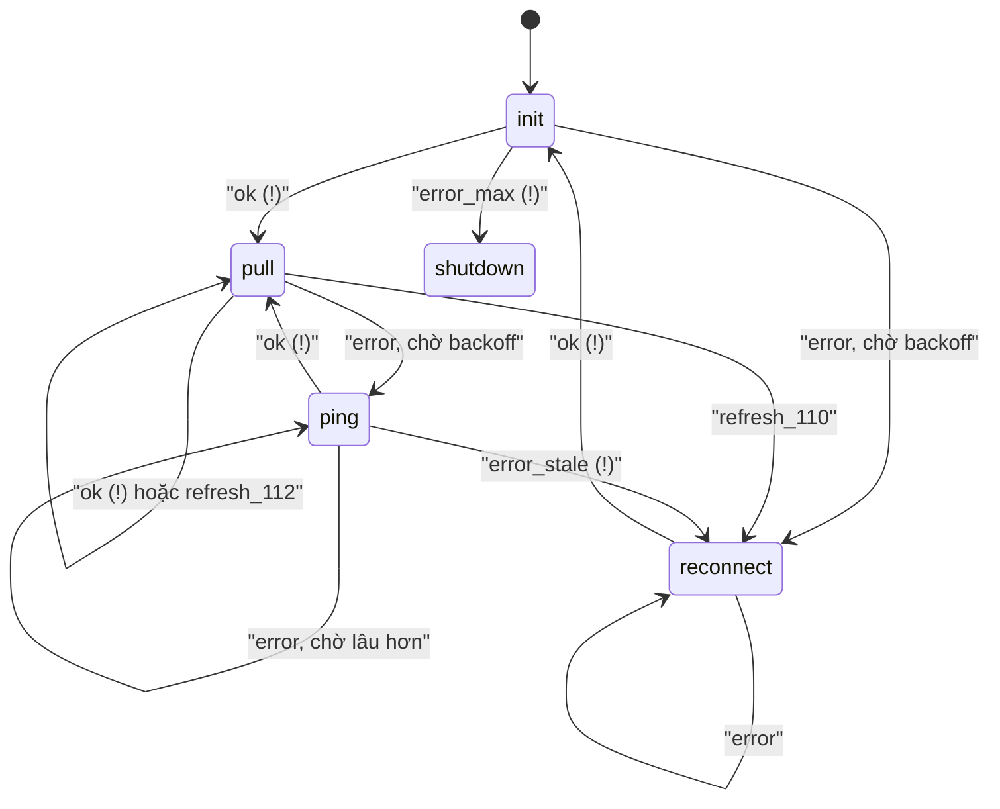
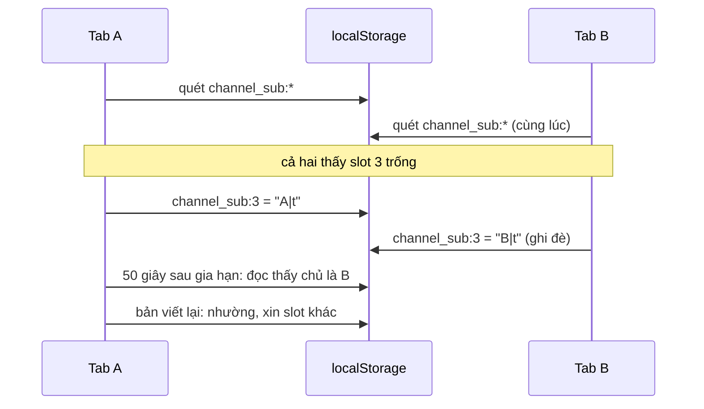

Trước khi có WebSocket ổn định (xem [bài #22 về MQTT trong trình duyệt](/blogs/facebook-mqtt-in-browser)), chat của Facebook chạy bằng long-poll (long polling): trình duyệt gửi một request, server giữ nó tới khi có tin mới hoặc hết 60 giây, trả về, rồi trình duyệt gửi request kế tiếp ngay.

Một request luôn mở nghĩa là **một kết nối luôn bị chiếm**. Với HTTP/1.1, trình duyệt chỉ cho khoảng 6 kết nối đồng thời tới cùng một host. Người dùng mở 6 tab Facebook là 6 kết nối tới `edge-chat.facebook.com` bị giữ hết. Tab thứ 7 gửi tin nhắn thì request phải xếp hàng chờ một long-poll nào đó trả về.

Bài này gồm hai mẹo trong cùng một bundle (`225.js`): cách các tab tự chia nhau 7 subdomain mà không cần server điều phối, và cách long-poll được lái bằng một bảng chuyển trạng thái thay vì một đống `if`.

> [!TIP]
> **Tóm tắt**
> - Giới hạn kết nối tính theo host, nên `0-edge-chat`, `1-edge-chat`… là 7 host khác nhau, mỗi host có 6 kết nối riêng. Các tab chỉ cần không chọn trùng subdomain.
> - `ChannelSubdomain` chia slot bằng lease (giấy thuê có hạn) trong `localStorage`: khoá `channel_sub:N` chứa thời điểm gia hạn gần nhất, gia hạn mỗi 50 giây, quá 100 giây thì slot coi như trống, `pagehide` thì xoá.
> - `ChannelManager` là máy trạng thái (state machine) điều khiển bằng bảng: `pull` + `ok` → `pull!` (đi ngay), `pull` + `error` → `ping` (chờ backoff). Mỗi lần vào state, `stateId` tăng, phản hồi của request cũ về muộn bị bỏ.
> - Bản viết lại ghi kèm chủ sở hữu vào lease để phát hiện hai tab giành cùng slot, và xin lại slot khi trang quay về từ bfcache.

<iframe class="demo-frame" src="/demos/facebook-patterns/index.html?theme=dark#/tab-subdomain-lease-longpoll" title="Demo tab-subdomain-lease-longpoll" loading="lazy" style="height: 1150px"></iframe>

<p class="demo-links">▶ <a href="/demos/facebook-patterns/index.html#/tab-subdomain-lease-longpoll" target="_blank" rel="noopener">Mở demo toàn màn hình ↗</a> · <a href="https://stackblitz.com/github/hunghg255/blog-hunghg/tree/master/examples/facebook-patterns?file=src/lib/subdomainLease.ts" target="_blank" rel="noopener">Sửa code trên StackBlitz ↗</a> · <a href="https://github.com/hunghg255/blog-hunghg/blob/master/examples/facebook-patterns/src/lib/subdomainLease.ts" target="_blank" rel="noopener">Xem source trên GitHub ↗</a></p>

## Mẹo 1: lease subdomain trong localStorage

### Facebook làm thế nào?

`ChannelSubdomain` (bundle `225.js`) chỉ có hai hàm, `allocate` và `clear`. Phần lõi, đã đổi tên biến:

```js
const total = (maxConn - 1) * 7;                  // số slot
const start = Math.floor(Math.random() * total);  // điểm bắt đầu ngẫu nhiên
for (let i = 0; i < total; i++) {
  const s = (i + start) % total;
  if (!seen[s] || seen[s] < Date.now() - 100_000) { slot = s; break; } // trống hoặc quá 100 giây
}
// ghi ngay Date.now() vào "channel_sub:" + slot, rồi gia hạn mỗi 50 giây; pagehide thì xoá
return slot == null ? null : slot % 7;
```

::: spoiler Code gốc đầy đủ đã đổi tên biến: ChannelSubdomain.allocate

```js
const PREFIX = 'channel_sub:', HOSTS = 7, TTL = 100 * 1000;
let slot = null, timer = null;

function allocate(maxConn, start, force = false) {
  const total = (maxConn - 1) * HOSTS;
  if (start == null) start = Math.floor(Math.random() * total);
  if (slot == null) {
    const ls = WebStorage.getLocalStorage();
    if (ls) {
      const seen = [];
      for (let i = 0; i < ls.length; i++) {          // quét mọi khoá channel_sub:N
        const key = ls.key(i);
        if (key?.indexOf(PREFIX) === 0) seen[parseInt(key.substr(PREFIX.length))] = parseInt(ls.getItem(key));
      }
      const staleBefore = Date.now() - TTL;
      for (let i = 0; i < total; i++) {
        const s = (i + start) % total;
        if (!seen[s] || seen[s] < staleBefore) { slot = s; break; }
      }
      if (slot != null) (function renew() {          // ghi ngay, rồi mỗi 50 giây
        if (slot == null) return;
        ls.setItem(PREFIX + slot, Date.now().toString());
        timer = setTimeoutAcrossTransitions(renew, TTL / 2);
      })();
      listen(window, 'pagehide', clear);              // clear(): xoá khoá, slot = null
    } else slot = start;                              // không có localStorage: chọn bừa
  }
  return slot == null ? null : slot % HOSTS;
}
```

:::

`ChannelManager` gọi `allocate(getConfig('max_conn', 2))` lúc khởi động, rồi ghép kết quả thành host: `0-edge-chat.facebook.com` tới `6-edge-chat.facebook.com`. Không xin được (trả `null`) thì dùng host chung `edge-chat.facebook.com`.

Ba điểm đáng chú ý:

- **Không có server điều phối.** Các tab cùng origin dùng chung `localStorage`, nên đó là bảng phân công tự nhiên. Không cần tab nào làm "leader".
- **Lease thay vì khoá vĩnh viễn.** Tab bị crash hoặc bị trình duyệt giết không kịp chạy `pagehide`. Nếu khoá không có hạn, slot đó mất mãi. Với lease 100 giây gia hạn mỗi 50 giây, slot của tab chết tự trống sau tối đa 100 giây.
- **Điểm bắt đầu ngẫu nhiên.** Hai tab mở cùng lúc (khôi phục phiên trình duyệt chẳng hạn) đọc storage gần như cùng thời điểm. Nếu cả hai quét từ slot 0, cả hai thấy slot 0 trống. Bắt đầu ở vị trí ngẫu nhiên làm va chạm hiếm đi, nhưng không loại bỏ được.

Vì sao là `(max_conn − 1) × 7`? Mỗi host có 6 kết nối, nhưng kênh chỉ được dùng `max_conn − 1` trong số đó cho long-poll; có lẽ phần còn lại dành cho request gửi tin, ping, tải file tới cùng host. Với `max_conn = 2` (mặc định), mỗi subdomain nhận đúng một tab.

### Giới hạn (đã chạy lại module thật bằng node)

Tôi nạp nguyên văn module từ bundle, giả lập `localStorage` và cho từng "tab" gọi `allocate`:

| max_conn | số slot | kết quả cho các tab mở lần lượt |
| --- | --- | --- |
| 2 | 7 | `1,6,2,3,4,0,5,null,null` |
| 1 | 0 | `null,null` |
| 3 | 14 | `0,5,0,3,6,2,4,5,1,2,3,4,6,1,null` |

- Từ tab thứ 8 (với `max_conn = 2`) hàm trả `null`, tab dùng host chung. Thường ổn: hiếm ai mở hơn 7 tab Facebook có chat.
- `max_conn = 1` cho 0 slot: luôn `null`.
- `max_conn = 3`: slot 7–13 quay về subdomain 0–6. Đó là chủ ý (mỗi subdomain nhận 2 tab), không phải thêm host.
- Lease chỉ chứa timestamp, không chứa ai giữ. Hai tab đọc cùng lúc rồi cùng ghi một slot thì cả hai tin mình giữ slot đó, mãi mãi, vì lần gia hạn sau mỗi tab chỉ ghi đè timestamp mà không kiểm tra.
- Trang vào bfcache (back/forward cache) thì `pagehide` xoá lease. Người dùng bấm Back, trang sống lại với `slot = null` và không ai gọi `allocate` lại.

## Mẹo 2: long-poll điều khiển bằng bảng chuyển

### Facebook làm thế nào?

Trong `ChannelManager` có một bảng `state → (status → state kế tiếp)`. Chép lại gần đủ:

| state | status → state kế tiếp |
| --- | --- |
| `idle` | `ok → init!` |
| `init` | `ok → pull!`, `error → reconnect`, `sys_online → init`, `sys_timetravel → init` |
| `pull` | `ok → pull!`, `error → ping`, `error_missing → pull`, `refresh_0/110/111/117 → reconnect`, `refresh_112/113 → pull` |
| `ping` | `ok → pull!`, `error → ping`, `error_stale → reconnect!` |
| `reconnect` | `ok → init!`, `error → reconnect`, `sys_online → reconnect` |
| `_all` (mọi state) | `error_max → shutdown!`, `sys_offline → idle!`, `sys_online → ping`, `sys_nonowner → idle!`, `sys_owner → reconnect`, `sys_timetravel → ping` |

Mỗi request xong (thành công, lỗi, hoặc server trả `refresh` kèm mã lý do), `exitState` tra `transitions[state][status]`, không có thì tra `_all`, không có nữa thì vào `shutdown`. Hậu tố quyết định thời điểm:

- `!`: đi ngay. Nhưng vẫn qua bộ đếm `MovingStat(30s)`: nếu trung bình đã vào từ `MAX_CHANNEL_STATES_PER_SEC` (mặc định 1) state mỗi giây trở lên thì chờ `1000 / f` ms. Đây là cầu chì cho trường hợp server trả lời ngay lập tức liên tục (proxy lỗi trả 200 rỗng chẳng hạn), không có nó thì tab quay vòng `pull!` hàng trăm lần mỗi giây.
- Không hậu tố: chờ backoff `min(5s · 2^(n−1), 320s) · (1 + rand · 0,5)`, `n` là số lỗi liên tiếp. Khi server trả 5xx thì dùng `proxy_down_delay_millis` từ cấu hình.
- `#`: đánh dấu "đã chờ rồi". Khi hẹn giờ xong, nó gọi lại `enterState('ping#')` để lần này vào thẳng.

Và chi tiết quan trọng nhất: `_enterState` tăng một biến cấp module `stateId` (tên gốc là `p`), gửi nó kèm request, và `exitState` mở đầu bằng `if (result.stateId < stateId) return;`.

::: spoiler Code gốc đã đổi tên biến: enterState và exitState

```js
_enterState(target) {
  stateId++;                                // biến cấp module `p`
  config.stateId = stateId;                 // gửi kèm request
  clearTimeout(this._deferredTransition);   // huỷ lần chuyển đang chờ
  // … tính delay, hoặc vào state ngay, hoặc hẹn giờ
},
exitState(result, xhr) {
  if (this.isShutdown() || result.stateId < stateId) return;   // phản hồi của request cũ
  // … tra bảng, enterState(next)
}
```

:::

Một long-poll có thể treo 60 giây. Trong lúc đó máy mất mạng, có mạng lại, tab vào `reconnect`, rồi `init`, rồi `pull` mới. Request cũ lúc này mới trả lỗi. Không có `stateId`, lỗi đó sẽ đẩy máy trạng thái sang `ping` dù request mới đang chạy tốt. Với `stateId`, mọi phản hồi mang id cũ bị bỏ qua.

Ngoài ra có một watchdog mỗi 5 giây: không `pull` thành công quá `STALL_THRESHOLD` (180 giây) thì ghi log stall; đang ở `pull` mà quá `JUMPSTART_THRESHOLD` (90 giây) không vào state mới thì gọi thẳng `enterState('init')` để "đề máy" lại.

**Ghi chú về bản build này:** dòng đầu `_enterState` là `if (!(/init/.test(a) || /reconnect/.test(a))) return;`, tức `pull` và `ping` đã bị tắt hẳn, còn `_enter_reconnect` gọi thẳng `onSuccess()` mà không gửi request. Có lẽ đây là đường cũ được giữ lại sau khi chat chuyển sang MQTT, chỉ còn chạy phần `init/reconnect` để đăng ký phiên. Bảng chuyển vẫn còn nguyên và là phần đáng học.



## Bên trong trình duyệt: vì sao 6 kết nối mỗi host

- **HTTP/1.1** cho mỗi kết nối TCP xử lý một request tại một thời điểm. Trình duyệt giới hạn số kết nối song song tới một host (Chrome, Firefox, Safari đều là 6) để không làm quá tải server. Long-poll chiếm trọn một kết nối trong suốt thời gian chờ.
- Giới hạn tính theo **host** (chính xác hơn là theo origin cộng thêm vài yếu tố), không phải theo domain gốc. `0-edge-chat.facebook.com` và `1-edge-chat.facebook.com` có hai pool riêng. Đây là mẹo "domain sharding" quen thuộc thời HTTP/1.1, áp cho kết nối dài thay vì cho ảnh.
- Giới hạn tính **chung cho mọi tab** của cùng profile trình duyệt. Mười tab là mười long-poll cùng tranh 6 chỗ.
- **HTTP/2 và HTTP/3** ghép nhiều request trên một kết nối, giới hạn 6 không còn. Nhưng nếu các subdomain dùng chung chứng chỉ và IP, trình duyệt còn có thể gộp chúng vào một kết nối HTTP/2 (connection coalescing), khi đó sharding vô nghĩa. Mẹo này thuộc thời HTTP/1.1.
- `localStorage` dùng chung giữa các tab cùng origin và ghi đồng bộ, nhưng **không có giao dịch**: đọc, quyết định, ghi là ba bước rời; tab khác chen vào giữa được.



## Viết lại

Lease lưu `chủ|thời điểm` thay vì chỉ thời điểm. Lúc gia hạn, nếu thấy chủ là người khác (và lease đó còn hạn) thì nhường, xin slot khác.

```ts title=src/lib/subdomainLease.ts
    acquire() {
      if (slot != null) return slot;
      if (!storage || total === 0) return null;
      // bắt đầu từ vị trí ngẫu nhiên để các tab mở cùng lúc ít va nhau
      const start = Math.floor(random() * total);
      const t = now();
      for (let i = 0; i < total; i++) {
        const s = (start + i) % total;
        if (isFree(s, t)) {
          slot = s;
          write();
          schedule();
          return slot;
        }
      }
      return null;
    },
    renew() {
      if (slot == null || !storage) return false;
      const rec = dec(storage.getItem(prefix + slot));
      if (rec && rec.owner !== owner && rec.at >= now() - ttlMs) {
        // tab khác đã giành slot này (hai tab đọc cùng lúc, hoặc mình ngủ quá ttl)
        slot = null;
        lease.acquire();
        return false;
      }
      write();
      return true;
    },
```

`release` chỉ xoá khoá nếu chủ vẫn là mình; `pagehide` gọi `release`, `pageshow` với `persisted = true` gọi lại `acquire`.

Máy trạng thái: `enter` quyết định đi ngay, chờ chặn tần suất hay chờ backoff; `exit` bỏ phản hồi cũ rồi tra bảng.

```ts title=src/lib/subdomainLease.ts
      let delay = 0;
      let reason: 'backoff' | 'throttle' = 'backoff';
      if (target.endsWith('!')) {
        const r = rate();
        if (r >= maxStatesPerSec) {
          delay = Math.round(1000 / maxStatesPerSec);
          reason = 'throttle';
        }
      } else if (!target.endsWith('#')) {
        delay = backoffDelay(retries, minRetryMs, maxRetryMs, random());
      }

      if (delay > 0) {
        state = 'idle';
        pending = { state: name, at: now() + delay };
        onEvent?.({ type: 'defer', state: name, delayMs: delay, reason });
        // `#` = đã chờ rồi, lần sau vào thẳng
        cancelPending = schedule(() => {
          cancelPending = null;
          fsm.enter(name + '#');
        }, delay);
        return;
      }
      state = name;
      entries.push(now());
      onEvent?.({ type: 'enter', state, stateId });
      onEnter?.(state, stateId);
    },
    exit(id, status) {
      if (state === 'shutdown') return false;
      if (id < stateId) {
        onEvent?.({ type: 'stale', stateId: id, current: stateId, status });
        return false;
      }
      retries = status === 'ok' ? 0 : retries + 1;
      // đang chờ vào state X thì tra bảng theo X (giống `nextState || state` của bản gốc)
      const from = pending?.state ?? state;
      const next = table[from]?.[status] ?? table._all?.[status] ?? 'shutdown!';
      onEvent?.({ type: 'exit', from, status, to: next });
      fsm.enter(next);
      return true;
    },
```

::: spoiler Xem toàn bộ src/lib/subdomainLease.ts

```ts title=src/lib/subdomainLease.ts
/**
 * Hai mẹo của kênh long-poll cũ trên Facebook (ChannelSubdomain + ChannelManager):
 * 1. Chia subdomain giữa các tab bằng "lease" trong localStorage, để các tab không
 *    dồn long-poll vào cùng một host (trình duyệt chỉ cho khoảng 6 kết nối mỗi host).
 * 2. Máy trạng thái long-poll điều khiển bằng bảng chuyển: hậu tố `!` = đi ngay (có chặn tần suất),
 *    không hậu tố = chờ backoff có jitter; stateId tăng mỗi lần vào state để bỏ phản hồi muộn.
 * Khác bản gốc: lease ghi kèm chủ sở hữu nên phát hiện được hai tab giành cùng slot,
 * xin lại slot khi trang quay về từ bfcache, đồng hồ/storage/timer tiêm vào được.
 */

// ───────────────────────── 1. Lease subdomain ─────────────────────────

export interface LeaseStorage {
  readonly length: number;
  key(index: number): string | null;
  getItem(key: string): string | null;
  setItem(key: string, value: string): void;
  removeItem(key: string): void;
}

export interface SubdomainLeaseOptions {
  storage: LeaseStorage | null;
  /** số kết nối mỗi host dành cho kênh; giữ lại 1 cho request thường (bản gốc: max_conn = 2) */
  maxConn: number;
  /** số subdomain có thật, vd 0-edge-chat … 6-edge-chat (bản gốc: 7) */
  hosts?: number;
  /** lease không được gia hạn quá lâu thì coi là trống (bản gốc: 100 giây) */
  ttlMs?: number;
  prefix?: string;
  owner?: string;
  now?: () => number;
  random?: () => number;
  setTimer?: (fn: () => void, ms: number) => unknown;
  clearTimer?: (handle: unknown) => void;
  /** true: không tự hẹn giờ gia hạn, không nghe pagehide/pageshow (test, mô phỏng) */
  manual?: boolean;
}

export interface SlotRecord {
  slot: number;
  owner: string;
  at: number;
}

export interface SubdomainLease {
  readonly owner: string;
  /** slot đang giữ, null nếu không xin được (dùng host chung) */
  readonly slot: number | null;
  /** số subdomain tương ứng (slot % hosts), null = host chung */
  readonly host: number | null;
  acquire(): number | null;
  /** ghi lại thời điểm; nếu slot đã bị tab khác ghi đè thì xin slot khác. Trả false nếu mất slot */
  renew(): boolean;
  release(): void;
}

const enc = (owner: string, at: number) => `${owner}|${at}`;
function dec(raw: string | null): { owner: string; at: number } | null {
  if (!raw) return null;
  const bar = raw.lastIndexOf('|');
  // bản gốc chỉ lưu timestamp: vẫn đọc được, chủ là ''
  if (bar < 0) return { owner: '', at: parseInt(raw, 10) || 0 };
  return { owner: raw.slice(0, bar), at: parseInt(raw.slice(bar + 1), 10) || 0 };
}

/** Đọc mọi lease đang có trong storage (để debug, demo). */
export function readSlots(storage: LeaseStorage, prefix = 'channel_sub:'): SlotRecord[] {
  const out: SlotRecord[] = [];
  for (let i = 0; i < storage.length; i++) {
    const key = storage.key(i);
    if (!key || !key.startsWith(prefix)) continue;
    const rec = dec(storage.getItem(key));
    const slot = parseInt(key.slice(prefix.length), 10);
    if (rec && Number.isInteger(slot)) out.push({ slot, ...rec });
  }
  return out.sort((a, b) => a.slot - b.slot);
}

export function createSubdomainLease(options: SubdomainLeaseOptions): SubdomainLease {
  const {
    storage,
    hosts = 7,
    ttlMs = 100_000,
    prefix = 'channel_sub:',
    now = Date.now,
    random = Math.random,
    setTimer = (fn, ms) => setTimeout(fn, ms),
    clearTimer = (h) => clearTimeout(h as ReturnType<typeof setTimeout>),
    manual = false,
  } = options;
  const owner = options.owner ?? random().toString(36).slice(2, 10);
  const total = Math.max(0, options.maxConn - 1) * hosts;
  let slot: number | null = null;
  let timer: unknown = null;

  const isFree = (s: number, t: number) => {
    const rec = dec(storage!.getItem(prefix + s));
    return !rec || rec.owner === owner || rec.at < t - ttlMs;
  };

  const write = () => {
    try {
      storage!.setItem(prefix + slot, enc(owner, now()));
    } catch {
      /* đầy bộ nhớ: vẫn giữ slot trong bộ nhớ, lần gia hạn sau thử lại */
    }
  };

  const schedule = () => {
    if (manual) return;
    if (timer != null) clearTimer(timer);
    timer = setTimer(() => {
      timer = null;
      lease.renew();
      if (slot != null) schedule();
    }, ttlMs / 2);
  };

  const lease: SubdomainLease = {
    owner,
    get slot() {
      return slot;
    },
    get host() {
      return slot == null ? null : slot % hosts;
    },
    acquire() {
      if (slot != null) return slot;
      if (!storage || total === 0) return null;
      // bắt đầu từ vị trí ngẫu nhiên để các tab mở cùng lúc ít va nhau
      const start = Math.floor(random() * total);
      const t = now();
      for (let i = 0; i < total; i++) {
        const s = (start + i) % total;
        if (isFree(s, t)) {
          slot = s;
          write();
          schedule();
          return slot;
        }
      }
      return null;
    },
    renew() {
      if (slot == null || !storage) return false;
      const rec = dec(storage.getItem(prefix + slot));
      if (rec && rec.owner !== owner && rec.at >= now() - ttlMs) {
        // tab khác đã giành slot này (hai tab đọc cùng lúc, hoặc mình ngủ quá ttl)
        slot = null;
        lease.acquire();
        return false;
      }
      write();
      return true;
    },
    release() {
      if (timer != null) clearTimer(timer);
      timer = null;
      if (slot != null && storage) {
        const rec = dec(storage.getItem(prefix + slot));
        // chỉ xoá lease của chính mình
        if (!rec || rec.owner === owner) storage.removeItem(prefix + slot);
      }
      slot = null;
    },
  };

  if (!manual && typeof window !== 'undefined') {
    window.addEventListener('pagehide', () => lease.release());
    // bản gốc không xin lại khi trang quay về từ back/forward cache
    window.addEventListener('pageshow', (e) => {
      if (e.persisted) lease.acquire();
    });
  }
  return lease;
}

// ───────────────────────── 2. Máy trạng thái long-poll ─────────────────────────

/** state → (status → state kế tiếp). `!` = đi ngay, không hậu tố = chờ backoff. */
export type TransitionTable = Record<string, Record<string, string>>;

/** Bảng của ChannelManager, giữ nguyên tên status. */
export const CHANNEL_TABLE: TransitionTable = {
  idle: { ok: 'init!' },
  init: { ok: 'pull!', error: 'reconnect', sys_online: 'init', sys_timetravel: 'init' },
  pull: {
    ok: 'pull!',
    error: 'ping',
    error_missing: 'pull',
    error_msg_type: 'pull',
    refresh_0: 'reconnect',
    refresh_110: 'reconnect',
    refresh_111: 'reconnect',
    refresh_112: 'pull',
    refresh_113: 'pull',
    refresh_117: 'reconnect',
  },
  ping: { ok: 'pull!', error: 'ping', error_stale: 'reconnect!' },
  reconnect: { ok: 'init!', error: 'reconnect', sys_online: 'reconnect', sys_timetravel: 'reconnect' },
  shutdown: {},
  _all: {
    error_max: 'shutdown!',
    error_shutdown: 'shutdown!',
    sys_owner: 'reconnect',
    sys_nonowner: 'idle!',
    sys_online: 'ping',
    sys_offline: 'idle!',
    sys_timetravel: 'ping',
  },
};

export type FsmEvent =
  | { type: 'enter'; state: string; stateId: number }
  | { type: 'defer'; state: string; delayMs: number; reason: 'backoff' | 'throttle' }
  | { type: 'stale'; stateId: number; current: number; status: string }
  | { type: 'exit'; from: string; status: string; to: string };

export interface ChannelFsmOptions {
  table?: TransitionTable;
  now?: () => number;
  random?: () => number;
  /** hẹn chạy fn sau ms, trả hàm huỷ */
  schedule?: (fn: () => void, ms: number) => () => void;
  minRetryMs?: number;
  maxRetryMs?: number;
  /** quá tần suất này (trung bình trên rateWindowMs) thì `!` cũng phải chờ */
  maxStatesPerSec?: number;
  rateWindowMs?: number;
  /** vào state thật (gửi request…); gọi exit(stateId, status) khi xong */
  onEnter?: (state: string, stateId: number) => void;
  onEvent?: (event: FsmEvent) => void;
}

export interface ChannelFsm {
  readonly state: string;
  readonly stateId: number;
  readonly retries: number;
  /** state đang chờ hẹn giờ (đang ở idle), nếu có */
  readonly pending: { state: string; at: number } | null;
  enter(target: string): void;
  /** kết quả của request thuộc stateId; trả false nếu là phản hồi muộn bị bỏ */
  exit(stateId: number, status: string): boolean;
  /** sự kiện hệ thống (sys_online, sys_offline…) áp cho state hiện tại */
  signal(status: string): void;
  /** chờ backoff tiếp theo sẽ là bao lâu (chưa jitter) */
  nextBackoffMs(): number;
  dispose(): void;
}

export function backoffDelay(retries: number, minMs: number, maxMs: number, rand: number) {
  const base = Math.min(minMs * 2 ** Math.max(0, retries - 1), maxMs);
  return Math.floor(base * (1 + rand * 0.5));
}

export function createChannelFsm(options: ChannelFsmOptions = {}): ChannelFsm {
  const {
    table = CHANNEL_TABLE,
    now = Date.now,
    random = Math.random,
    schedule = (fn, ms) => {
      const id = setTimeout(fn, ms);
      return () => clearTimeout(id);
    },
    minRetryMs = 5_000,
    maxRetryMs = 320_000,
    maxStatesPerSec = 1,
    rateWindowMs = 30_000,
    onEnter,
    onEvent,
  } = options;

  let state = 'idle';
  let stateId = 0;
  let retries = 0;
  let pending: { state: string; at: number } | null = null;
  let cancelPending: (() => void) | null = null;
  const entries: number[] = []; // thời điểm vào state, để đo tần suất

  const rate = () => {
    const t = now();
    while (entries.length && entries[0] < t - rateWindowMs) entries.shift();
    return entries.length / (rateWindowMs / 1000);
  };

  const fsm: ChannelFsm = {
    get state() {
      return state;
    },
    get stateId() {
      return stateId;
    },
    get retries() {
      return retries;
    },
    get pending() {
      return pending;
    },
    enter(target) {
      const name = target.replace(/\W*$/, '');
      if (!table[name]) throw new Error('invalid state: ' + name);
      // mỗi lần vào state (kể cả chỉ để chờ) đều làm mọi callback cũ hết hiệu lực
      stateId++;
      cancelPending?.();
      cancelPending = null;
      pending = null;

      let delay = 0;
      let reason: 'backoff' | 'throttle' = 'backoff';
      if (target.endsWith('!')) {
        const r = rate();
        if (r >= maxStatesPerSec) {
          delay = Math.round(1000 / maxStatesPerSec);
          reason = 'throttle';
        }
      } else if (!target.endsWith('#')) {
        delay = backoffDelay(retries, minRetryMs, maxRetryMs, random());
      }

      if (delay > 0) {
        state = 'idle';
        pending = { state: name, at: now() + delay };
        onEvent?.({ type: 'defer', state: name, delayMs: delay, reason });
        // `#` = đã chờ rồi, lần sau vào thẳng
        cancelPending = schedule(() => {
          cancelPending = null;
          fsm.enter(name + '#');
        }, delay);
        return;
      }
      state = name;
      entries.push(now());
      onEvent?.({ type: 'enter', state, stateId });
      onEnter?.(state, stateId);
    },
    exit(id, status) {
      if (state === 'shutdown') return false;
      if (id < stateId) {
        onEvent?.({ type: 'stale', stateId: id, current: stateId, status });
        return false;
      }
      retries = status === 'ok' ? 0 : retries + 1;
      // đang chờ vào state X thì tra bảng theo X (giống `nextState || state` của bản gốc)
      const from = pending?.state ?? state;
      const next = table[from]?.[status] ?? table._all?.[status] ?? 'shutdown!';
      onEvent?.({ type: 'exit', from, status, to: next });
      fsm.enter(next);
      return true;
    },
    signal(status) {
      fsm.exit(stateId, status);
    },
    nextBackoffMs() {
      return Math.min(minRetryMs * 2 ** Math.max(0, retries - 1), maxRetryMs);
    },
    dispose() {
      cancelPending?.();
      cancelPending = null;
      pending = null;
      state = 'shutdown';
    },
  };
  return fsm;
}
```

:::

## Đi qua code

- `isFree` coi slot là trống khi chưa có khoá, khoá đã quá `ttlMs`, hoặc khoá là của chính mình (trường hợp gọi `acquire` lại sau bfcache).
- `write` nuốt lỗi `QuotaExceededError`: tab vẫn giữ slot trong bộ nhớ, lần gia hạn sau thử lại. Không ghi được thì lease hết hạn sau 100 giây và tab khác có thể lấy trùng, chấp nhận được vì hậu quả chỉ là hai long-poll chung một host.
- `renew` là nơi phát hiện va chạm. Người thắng là người ghi sau cùng (trong demo: Y), người thua chuyển slot ở lần gia hạn kế tiếp, tức trùng nhau tối đa 50 giây.
- `release` chỉ xoá khoá nếu khoá vẫn là của mình, để tab vừa bị giành slot không xoá lease của người thắng.
- `enter` tăng `stateId` **trước khi** quyết định chờ hay đi. Bản gốc cũng vậy: ngay cả một lần chuyển đang chờ cũng làm mọi phản hồi cũ mất hiệu lực.
- `exit` tra bảng theo state đang chờ (nếu có) chứ không theo `idle`, giống `transitions[this.nextState || state]` của bản gốc. Nhờ vậy tín hiệu `sys_offline` tới lúc đang chờ vào `ping` vẫn tra đúng hàng.
- Đếm tần suất bằng một mảng thời điểm trong cửa sổ 30 giây, đơn giản hơn `MovingStat` của bản gốc nhưng cùng ý.

**Khác bản gốc:**

- Lease ghi chủ sở hữu, gia hạn có kiểm tra, nên hai tab va nhau tự tách ra.
- Xin lại slot ở `pageshow` khi `persisted = true`.
- Không có `localStorage` thì trả `null` (dùng host chung) thay vì chọn bừa một slot: chọn bừa thì mười tab có thể chọn trùng mà không ai biết.
- Đồng hồ, bộ hẹn giờ, storage, hàm ngẫu nhiên đều tiêm vào được; `manual: true` để mô phỏng như trong demo.
- Máy trạng thái không gắn với transport: `onEnter(state, stateId)` gửi request gì là việc của người dùng, xong thì gọi `exit(stateId, status)`.

## Tại sao không làm cách khác?

- **Một tab làm leader, các tab khác nhận tin qua `BroadcastChannel`:** chỉ một kết nối cho cả trình duyệt, tốt hơn hẳn về tài nguyên. Nhưng phải bầu leader, xử lý leader chết, chuyển tiếp mọi tin giữa các tab. Facebook có làm kiểu này ở chỗ khác; với long-poll thời đó, chia subdomain đơn giản hơn nhiều.
- **SharedWorker giữ kết nối chung:** cùng ý tưởng, nhưng Safari bỏ SharedWorker nhiều năm (có lại từ Safari 16), không dùng được cho mọi người ở thời điểm kênh này ra đời.
- **Random subdomain mỗi tab, không lease:** 7 tab chọn ngẫu nhiên trong 7 host thì xác suất không trùng là 7!/7⁷ ≈ 0,6%. Gần như chắc chắn có host bị hai tab.
- **Lease không hết hạn, chỉ xoá ở `pagehide`/`beforeunload`:** tab crash không chạy sự kiện nào, slot mất vĩnh viễn (xem [bài #79](/blogs/facebook-crash-heartbeat-proxy-check) về chuyện tab chết không kịp nói).
- **`switch` lồng nhau thay cho bảng:** chạy được, nhưng bảng cho phép đọc toàn bộ hành vi ở một chỗ, kiểm thử từng ô, và đổi chính sách (ví dụ thêm mã `refresh_117`) mà không đụng logic.
- **Huỷ request cũ bằng `AbortController` thay cho `stateId`:** nên làm cả hai. Huỷ giải phóng kết nối, nhưng callback của request đã trả về một nửa vẫn có thể chạy; `stateId` là lớp chặn cuối cùng.

## Edge case và cạm bẫy

- **Máy ngủ quá 100 giây:** lease hết hạn, tab khác có thể lấy. Khi máy thức, `renew` của bản viết lại thấy chủ khác và nhường. Bản gốc thì cứ ghi đè.
- **Tab ẩn lâu bị bóp timer:** Chrome có thể dồn timer của tab ẩn về khoảng một lần mỗi phút. 50 giây gia hạn so với 100 giây hạn vẫn còn biên, nhưng nếu bạn hạ TTL thì nhớ tính tới chuyện này.
- **`storage` event:** bản này không nghe sự kiện `storage`, vì quét lại lúc xin slot là đủ. Nếu muốn tab ở host chung chuyển sang slot vừa trống ngay lập tức, nghe `storage` khi một khoá `channel_sub:*` bị xoá.
- **Backoff dồn quá lâu:** sau 7 lỗi liên tiếp, chờ đã tới trần 320 giây (hơn 5 phút). Khi có tín hiệu `online` hoặc tab được hiện lại, nên reset bộ đếm và thử ngay, như `ChannelConnection` làm khi tab VISIBLE trở lại.
- **Bảng thiếu ô:** status lạ rơi xuống `shutdown!`. Đó là chủ ý (an toàn hơn đoán), nhưng nên log lại như bản gốc (`terminal_transition`).
- **Đệ quy:** `exit` gọi `enter`, `enter` gọi `onEnter`, `onEnter` có thể gọi `exit` đồng bộ (request lỗi ngay). Bản gốc có cờ `_inEnterState` để log trường hợp này. Nếu transport của bạn có thể lỗi đồng bộ, hãy đẩy `exit` qua `queueMicrotask`.

## Dùng trong dự án

```ts
import { createChannelFsm, createSubdomainLease } from './subdomainLease';

const lease = createSubdomainLease({ storage: localStorage, maxConn: 2 });
lease.acquire();
const host = () => (lease.host == null ? 'poll.example.com' : `${lease.host}-poll.example.com`);

const fsm = createChannelFsm({
  onEnter(state, id) {
    if (state === 'idle' || state === 'shutdown') return;
    fetch(`https://${host()}/${state}`, { credentials: 'include' })
      .then((r) => r.json())
      .then((body) => fsm.exit(id, body.refresh ? `refresh_${body.reason}` : 'ok'))
      .catch(() => fsm.exit(id, 'error')); // id cũ thì tự bị bỏ
  },
});
addEventListener('offline', () => fsm.signal('sys_offline'));
addEventListener('online', () => fsm.signal('sys_online'));
fsm.enter('init!');
```

Nên kèm `AbortController` để huỷ request của state cũ: `stateId` chặn kết quả sai, còn huỷ thì trả lại kết nối.

## Kiểm thử

::: spoiler Ví dụ test (bản phác, không có trong repo)

```ts
import { describe, expect, it } from 'vitest';
import { createChannelFsm, createSubdomainLease, type LeaseStorage } from './subdomainLease';

function mem(): LeaseStorage & { map: Map<string, string> } {
  const map = new Map<string, string>();
  return { map, get length() { return map.size; }, key: (i) => [...map.keys()][i] ?? null,
    getItem: (k) => map.get(k) ?? null, setItem: (k, v) => void map.set(k, v), removeItem: (k) => void map.delete(k) };
}

describe('createSubdomainLease', () => {
  const opts = (storage: LeaseStorage, owner: string, now: () => number) =>
    ({ storage, maxConn: 2, owner, now, manual: true } as const);

  it('7 tab nhận 7 host khác nhau, tab thứ 8 dùng host chung', () => {
    const s = mem();
    const hosts = Array.from({ length: 8 }, (_, i) => createSubdomainLease(opts(s, 't' + i, () => 0)).acquire());
    expect(new Set(hosts.slice(0, 7)).size).toBe(7);
    expect(hosts[7]).toBeNull();
  });

  it('lease hết hạn thì slot trống lại', () => {
    const s = mem(); let t = 0;
    const tab = (owner: string) => createSubdomainLease({ ...opts(s, owner, () => t), random: () => 0 });
    expect(tab('a').acquire()).toBe(0);  // a không bao giờ gia hạn
    t = 50_000;
    expect(tab('b').acquire()).toBe(1);  // slot 0 còn hạn
    t = 100_001;
    expect(tab('c').acquire()).toBe(0);  // slot 0 đã quá 100 giây
  });

  it('hai tab giành cùng slot: người thua nhường ở lần gia hạn', () => {
    const s = mem();
    const a = createSubdomainLease({ ...opts(s, 'a', () => 0), random: () => 0 });
    const b = createSubdomainLease({ ...opts(s, 'b', () => 0), random: () => 0 });
    a.acquire();
    s.map.clear(); // giả lập b đọc trước khi a ghi
    b.acquire();
    expect(a.slot).toBe(b.slot);
    expect(a.renew()).toBe(false);
    expect(a.slot).not.toBe(b.slot);
    expect(b.renew()).toBe(true);
  });

  it('max_conn = 1 thì không có slot', () => {
    expect(createSubdomainLease({ storage: mem(), maxConn: 1, manual: true }).acquire()).toBeNull();
  });
});

describe('createChannelFsm', () => {
  function setup() {
    let t = 0; const timers: { at: number; fn: () => void }[] = [];
    const fsm = createChannelFsm({ now: () => t, random: () => 0,
      schedule: (fn, ms) => { const x = { at: t + ms, fn }; timers.push(x); return () => timers.splice(timers.indexOf(x), 1); } });
    const run = () => { const x = timers.shift()!; t = x.at; x.fn(); };
    return { fsm, run, timers };
  }

  it('ok đi ngay, lỗi thì chờ backoff tăng gấp đôi', () => {
    const { fsm, run, timers } = setup();
    fsm.enter('init!');
    fsm.exit(fsm.stateId, 'ok');
    expect(fsm.state).toBe('pull');
    fsm.exit(fsm.stateId, 'error');
    expect(fsm.pending).toEqual({ state: 'ping', at: 5000 });
    run();
    fsm.exit(fsm.stateId, 'error');
    expect(timers[0].at - 5000).toBe(10_000);
  });

  it('bỏ phản hồi của request cũ', () => {
    const { fsm } = setup();
    fsm.enter('init!');
    const old = fsm.stateId;
    fsm.exit(old, 'ok'); // sang pull
    expect(fsm.exit(old, 'error')).toBe(false);
    expect(fsm.state).toBe('pull');
  });

  it('status không có trong bảng thì shutdown', () => {
    const { fsm } = setup();
    fsm.enter('init!');
    fsm.exit(fsm.stateId, 'không-biết');
    expect(fsm.state).toBe('shutdown');
  });
});
```

:::

## So với thư viện và chuẩn web

- **Web Locks API** (`navigator.locks.request('slot-3', { ifAvailable: true }, …)`): lock thật giữa các tab cùng origin, tự nhả khi tab chết, không cần TTL hay gia hạn. Có trên mọi trình duyệt chính (tính tới 10/2026). Nếu viết mới hôm nay, chia slot bằng Web Locks gọn hơn lease trong `localStorage`.
- **`BroadcastChannel` / SharedWorker:** gom về một kết nối cho mọi tab, giải quyết tận gốc thay vì chia host.
- **HTTP/2, HTTP/3, WebSocket, Server-Sent Events qua HTTP/2:** không còn giới hạn 6 kết nối kiểu cũ; SSE qua HTTP/1.1 vẫn dính giới hạn này.
- **XState:** thư viện máy trạng thái đầy đủ (state lồng nhau, guard, delay `after`). Bảng của Facebook chỉ là một phần nhỏ của nó, đủ cho long-poll mà không kéo thêm phụ thuộc.
- **Backoff có jitter:** công thức `base · (1 + rand · 0,5)` là jitter một phía, chỉ cộng thêm tối đa 50%. Bài [#86](/blogs/facebook-retry-backoff-schedules) so các kiểu jitter khác.

---

Bài này thuộc series **[Học từ mã nguồn Facebook](/series/facebook)** (106 bài, đọc theo thứ tự).

::: spoiler Xem nhanh danh sách bài trong series

*Phần 1*

- [Mở đầu: cách đọc code minify của Facebook](/blogs/learn-from-facebook-source-code)
- [#1 Dùng chung IntersectionObserver + infinite scroll](/blogs/facebook-shared-intersection-observer)
- [#2 useViewportDuration: đo thời gian thực sự được xem](/blogs/facebook-use-viewport-duration)
- [#3 Preload code + data khi hover](/blogs/facebook-preload-on-hover)
- [#4 Toast manager với external store](/blogs/facebook-toast-manager)
- [#5 Network status + heartbeat backoff](/blogs/facebook-network-status-heartbeat)
- [#6 ErrorGuard: bắt lỗi theo ngữ cảnh](/blogs/facebook-error-guard)
- [#7 Banzai: gom log theo lô + sendBeacon](/blogs/facebook-batch-logger)
- [#8 Focus trap + Esc theo layer](/blogs/facebook-focus-trap)

*Phần 2*

- [#9 Mẹo calc(… * 9999): container query, line-clamp, mũi tên carousel bằng CSS](/blogs/facebook-css-9999-trick)
- [#10 Thanh cuộn tuỳ biến bằng CSS 3D](/blogs/facebook-css-3d-scrollbar)
- [#11 Modal cuộn bằng window, giữ vị trí trang nền](/blogs/facebook-document-scroll-modal)
- [#12 Popover, tooltip group và hovercard](/blogs/facebook-popover-tooltip)
- [#13 Primitive Pressable + focus-visible](/blogs/facebook-pressable)
- [#14 Tab "Xem thêm" + sticky header bằng IntersectionObserver](/blogs/facebook-priority-tabs-sticky-header)
- [#15 Avatar khoét mask, gradient Messenger, skeleton steps()](/blogs/facebook-visual-tricks)
- [#16 Khung chat không giật](/blogs/facebook-chat-scroller)
- [#17 Thuật toán chọn bố cục collage ảnh](/blogs/facebook-photo-collage-layout)
- [#18 Keep-alive tab trong SPA](/blogs/facebook-keep-alive-tabs)
- [#19 Tự đo Visual Completion & interaction tracing](/blogs/facebook-visual-completion)
- [#20 Router SPA bền bỉ & tải chunk có retry](/blogs/facebook-spa-router-resilient-loading)

*Phần 3*

- [#21 Smart Compose: gợi ý chữ mờ khi gõ](/blogs/facebook-smart-compose-ghost-text)
- [#22 MQTT ngay trong trình duyệt, tự chuyển sang long-poll](/blogs/facebook-mqtt-in-browser)
- [#23 Đo thời gian dùng bằng bitmap 64 giây](/blogs/facebook-time-spent-bitmap)
- [#24 Bảng reaction nhấn giữ rồi trượt](/blogs/facebook-reaction-press-slide)
- [#25 Tìm kiếm gấp dấu, phiên âm và highlight đầu từ](/blogs/facebook-search-diacritics-tokenize)
- [#26 Ring buffer biết trace nào đã mất log](/blogs/facebook-trace-ring-buffer)
- [#27 Engine animation JS: một vòng rAF và solver cubic-bezier](/blogs/facebook-keyframes-loop-cubic-bezier)
- [#28 Bootloader: bitmap tài nguyên đã tải, chỉ reload khi cần](/blogs/facebook-bootloader-bitmap-consistency)
- [#29 Nhận biết click do screen reader tạo ra](/blogs/facebook-virtual-cursor-detection)
- [#30 Tải trước feed theo chất lượng mạng, đoán hạng thiết bị](/blogs/facebook-network-aware-prefetch)
- [#31 Hàng đợi gửi tin chat giữ đúng thứ tự](/blogs/facebook-ordered-send-queue)
- [#32 Gộp lời gọi API trong cùng một tick](/blogs/facebook-api-batcher)
- [#33 Resize ảnh trong pool Web Worker](/blogs/facebook-jpeg-resize-worker-pool)
- [#34 Crop ảnh theo nhiều khuôn mặt](/blogs/facebook-face-aware-crop)
- [#35 Kéo-thả sắp xếp và vùng thả file không nhấp nháy](/blogs/facebook-flicker-free-drag-drop)
- [#36 Tiện ích UI: fade-out, sticky event, hàm huỷ được](/blogs/facebook-ui-utility-hooks)
- [#37 Hạ tầng nhỏ: cookie, hash lỗi, prefetch khi chuột dừng](/blogs/facebook-small-infra-cookie-hash-idle)

*Phần 4–6*

- [#38 Đồng bộ tin nhắn: phát hiện lỗ seqID và fetch bù theo tầng](/blogs/facebook-messenger-sync-seqid-gaps)
- [#39 OTID: ID tin nhắn kiểu Snowflake sinh ở client](/blogs/facebook-otid-client-snowflake)
- [#40 QPL: lấy mẫu từ lúc bắt đầu, đo RTT gửi tin đầu-cuối](/blogs/facebook-qpl-send-rtt)
- [#41 Bộ điều phối request bảy chế độ gộp và chống trùng](/blogs/facebook-request-dispatcher-modes)
- [#42 Thread list theo mốc thời gian, cookie presence có version](/blogs/facebook-threadlist-ranged-presence)
- [#43 Composer dạng plugin: reducer, dirty checker, chuỗi kiểm tra](/blogs/facebook-plugin-composer)
- [#44 Thanh toán bất đồng bộ: subscribe trước, poll dự phòng](/blogs/facebook-async-checkout)
- [#45 Validate số thẻ: sửa lỗi gõ, dải BIN, Luhn](/blogs/facebook-card-validation)
- [#46 Lịch chọn khoảng ngày: bo góc dải chọn, phím đủ bộ, RTL](/blogs/facebook-range-calendar-a11y)
- [#47 Giờ mở cửa theo tuần: qua đêm, gộp khoảng, phần bù](/blogs/facebook-weekly-hours-intervals)
- [#48 Tiến độ đăng realtime: giữ event chờ snapshot, watchdog](/blogs/facebook-realtime-publish-snapshot)
- [#49 Tiền tệ theo đơn vị nhỏ nhất và ô nhập tiền](/blogs/facebook-currency-minor-units)
- [#50 Sửa hàng loạt Empty/Uniform/Mixed, seen/read bằng 2 bit](/blogs/facebook-bulk-edit-seen-bits)
- [#51 Phát hiện script lạ hook vào hàm native](/blogs/facebook-native-hook-detection)
- [#52 localStorage tự dọn khi đầy quota](/blogs/facebook-quota-aware-storage)
- [#53 Cache tuyến do server phân giải, chờ sẵn promise](/blogs/facebook-route-cache-prefetch)
- [#54 Lưới phím mũi tên 2D và focus không làm cuộn trang](/blogs/facebook-focus-table-grid)
- [#55 Tách emoji bằng máy trạng thái](/blogs/facebook-emoji-segmentation)
- [#56 Đọc trước ghi sau trong một frame, con tự biết vị trí](/blogs/facebook-read-then-write-dom)
- [#57 Hàng đợi lệnh cho video và stream sắp lại chunk](/blogs/facebook-video-command-queue)

*Phần 7–10*

- [#58 Ước lượng băng thông EWMA: loại outlier, nhớ qua phiên](/blogs/facebook-bandwidth-ewma-estimator)
- [#59 ABR theo độ tự tin phát và cắt bậc bitrate theo MOS](/blogs/facebook-abr-playback-confidence)
- [#60 Prefetch segment dự đoán từ manifest, parse hộp sidx](/blogs/facebook-dash-predicted-segments)
- [#61 Đọc metadata MP4/MOV ngay trên client](/blogs/facebook-mp4-metadata-client)
- [#62 Upload tiếp tục được: offset, hash dedupe, phát hiện treo](/blogs/facebook-resumable-upload)
- [#63 Fenwick tree: chọn ngẫu nhiên có trọng số và offset dòng](/blogs/facebook-fenwick-weighted-random)
- [#64 Vạch trục số và trục thời gian "đẹp"](/blogs/facebook-nice-axis-ticks)
- [#65 Damerau-Levenshtein theo dải chéo và tự sửa tên gõ sai](/blogs/facebook-damerau-levenshtein)
- [#66 PRNG có seed, shuffle tái lập và lấy mẫu trace](/blogs/facebook-seeded-prng-sampling)
- [#67 Cặp min/max-heap tái dùng vị trí trong danh sách ảo](/blogs/facebook-dual-heap-buffer-set)
- [#68 Memo nhiều đối số bằng Map/WeakMap và interning object](/blogs/facebook-multikey-memo-interning)
- [#69 Thống kê cửa sổ trượt và đại số khoảng thời gian](/blogs/facebook-moving-stat-intervals)
- [#70 Int64 từ hai số 32-bit, decode UTF, offset theo code point](/blogs/facebook-int64-utf-codepoints)
- [#71 Engine múi giờ IANA trên client, phát hiện lệch giờ](/blogs/facebook-client-iana-timezone)
- [#72 Tự cài semver range](/blogs/facebook-semver-range)
- [#73 Auto-link URL, cắt chữ an toàn, giới hạn LaTeX](/blogs/facebook-autolink-safe-truncate)
- [#74 Parser query kiểu PHP chống prototype pollution](/blogs/facebook-php-query-serializer)
- [#75 Popover tự lật theo phần tràn nhỏ nhất](/blogs/facebook-popover-auto-flip)
- [#76 Tiền tố for(;;) chống JSON hijacking, đọc stream](/blogs/facebook-csrf-prefix-streaming)
- [#77 Chống lộ Referer, linkshim, xoá token trên URL](/blogs/facebook-referrer-linkshim-url-scrub)
- [#78 setImmediate bằng postMessage, gom delta chuột theo frame](/blogs/facebook-setimmediate-mouse-batching)
- [#79 Phát hiện crash qua heartbeat, dò proxy cache hỏng](/blogs/facebook-crash-heartbeat-proxy-check)
- [#80 DPR vào cookie cho ảnh @2x, che khoá trong log](/blogs/facebook-dpr-cookie-secret-redaction)
- [#81 Flux waitFor tự viết và proxy có đệm](/blogs/facebook-flux-dispatch-buffered-proxy)
- [#82 Crop đúng tỉ lệ, xoay sticker bằng ma trận](/blogs/facebook-image-crop-rotation-geometry)

*Phần 11–15*

- **#83 Chia subdomain giữa các tab bằng lease, long-poll theo bảng trạng thái** (bài này)
- [#84 MQTT QoS1: giữ publish chờ ack, gửi lại khi kết nối lại](/blogs/facebook-mqtt-qos1-republish)
- [#85 Cache Promise gộp request, cache lỗi ngắn, đua dữ liệu nhúng sẵn](/blogs/facebook-promise-cache-preload-race)
- [#86 Lịch retry: backoff có trần, Fibonacci, báo lỗi CDN mỗi N ngày](/blogs/facebook-retry-backoff-schedules)
- [#87 Giữ nguyên tham chiếu nhánh dữ liệu không đổi](/blogs/facebook-relay-recycle-nodes)
- [#88 Store optimistic: copy-on-write, rollback rồi áp lại](/blogs/facebook-relay-optimistic-store)
- [#89 Chỉ mục subscription theo record, hàng đợi task theo chiều sâu](/blogs/facebook-relay-subscription-index)
- [#90 Phân trang connection: cursor khớp đầu, edge không trùng](/blogs/facebook-relay-connection-pagination)
- [#91 Profiler kiểu middleware và memo selector có lấy mẫu kiểm tra](/blogs/facebook-profiler-middleware-memo-check)
- [#92 Đọc EBML/WebM Cues để tìm byte range của segment](/blogs/facebook-webm-ebml-cues)
- [#93 Stream HTTP Range tạm dừng được, tải tiếp đúng byte](/blogs/facebook-pausable-range-stream)
- [#94 Bảng khoảng thời gian gắn nhãn và nhảy qua lỗ buffer](/blogs/facebook-tagged-time-ranges-gaps)
- [#95 Gom chunk cho SourceBuffer, đồng bộ video bằng playbackRate](/blogs/facebook-sourcebuffer-video-sync)
- [#96 Gom tin nhắn thành cụm, vạch ngày và avatar đã xem](/blogs/facebook-message-grouping)
- [#97 Bao nhiêu tab chat vừa màn hình, chuỗi luật mở tab](/blogs/facebook-chat-tab-policy)
- [#98 Phím tắt Markdown trong editor, Backspace để hoàn tác](/blogs/facebook-markdown-shortcuts-editor)
- [#99 Offset theo code point hay UTF-16: bốn bug cùng một gốc](/blogs/facebook-codepoint-offset-bugs)
- [#100 Typeahead không nhảy: cache tiền tố, chặn reflow, khoá hover](/blogs/facebook-typeahead-stable-results)
- [#101 Hit-test trên canvas bằng phát lại path, nét đứt và cung Bézier](/blogs/facebook-canvas-hit-regions)
- [#102 Vòng tròn theo mét trên bản đồ Mercator](/blogs/facebook-mercator-meter-circles)
- [#103 Dò tính năng trình duyệt: ảnh EXIF 2×1, getter bẫy, scrollbar](/blogs/facebook-feature-probe-tricks)
- [#104 Bug định dạng số và kiểm tra dữ liệu theo locale](/blogs/facebook-locale-validation-bugs)
- [#105 Dispose cho đúng: idle callback, splice(-1), xoá nhầm key](/blogs/facebook-dispose-leak-bugs)

:::

Code + demo: [`examples/facebook-patterns`](https://github.com/hunghg255/blog-hunghg/tree/master/examples/facebook-patterns) · [Mở trên StackBlitz](https://stackblitz.com/github/hunghg255/blog-hunghg/tree/master/examples/facebook-patterns)
