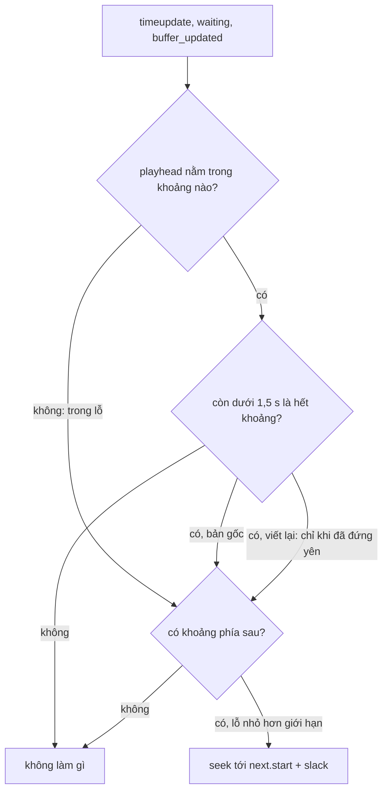

Trình phát thích ứng (ABR) đổi chất lượng liên tục: 10 giây đầu ở 360p, rồi mạng tốt lên, 20 giây sau ở 1080p. Buffer của `<video>` chỉ biết "có dữ liệu từ giây 0 tới giây 30", không biết đoạn nào là chất lượng nào. Muốn hiện "đang phát 1080p", ghi log chất lượng thực sự người xem thấy, hay quyết định có nên tải lại đoạn phía trước ở chất lượng cao hơn, trình phát phải tự giữ một bảng **khoảng thời gian → nhãn**.

Cũng buffer đó có thể có **lỗ**: segment 8,0–8,4 s bị thiếu vì timestamp của encoder lệch một chút, hay vì segment lỗi bị bỏ qua. Trình duyệt phát tới mép lỗ thì đứng chờ (sự kiện `waiting`), và chờ mãi vì dữ liệu cho 8,0–8,4 s không bao giờ tới. Trình phát phải tự tua qua.

> [!TIP]
> **Tóm tắt**
> - `OzTaggedTimeRanges` là một **interval map**: mảng `[start, end) → tag` đã sắp xếp. `add()` ghi đè đoạn cũ, `get(t)` nhớ chỉ số lần trước nên khi phát tuần tự mỗi lần tra gần như O(1).
> - Bản gốc có ba lỗi, kiểm bằng node trên chính code gốc: đoạn mới **phủ trọn** đoạn cũ khác nhãn thì đoạn cũ vẫn còn (và mảng có thể mất thứ tự), ghi một đoạn **nối** hai hàng xóm cùng nhãn thì mất phần bên trái, và con trỏ của `get()` không được đặt lại sau `add()`.
> - `OzPlayheadManager` tua tới `nextRange.start + slack` khi playhead nằm trong lỗ **hoặc còn dưới 1,5 s là hết khoảng hiện tại**. Điều kiện thứ hai bỏ qua tới 1,5 s đã tải, kể cả khi video đang phát bình thường. Trình xử lý `waiting` thì gọi `.bind()` mà quên gọi hàm.
> - Bản viết lại: `add()` tính vùng bị chồng bằng tìm kiếm nhị phân rồi thay bằng một lần `splice`, `get()` dùng con trỏ như gợi ý và tìm nhị phân khi trượt; chỉ tua khi trình phát thật sự đứng yên.

<iframe class="demo-frame" src="/demos/facebook-patterns/index.html?theme=dark#/tagged-time-ranges-gaps" title="Demo tagged-time-ranges-gaps" loading="lazy" style="height: 900px"></iframe>

<p class="demo-links">▶ <a href="/demos/facebook-patterns/index.html#/tagged-time-ranges-gaps" target="_blank" rel="noopener">Mở demo toàn màn hình ↗</a> · <a href="https://stackblitz.com/github/hunghg255/blog-hunghg/tree/master/examples/facebook-patterns?file=src/lib/taggedRanges.ts" target="_blank" rel="noopener">Sửa code trên StackBlitz ↗</a> · <a href="https://github.com/hunghg255/blog-hunghg/blob/master/examples/facebook-patterns/src/lib/taggedRanges.ts" target="_blank" rel="noopener">Xem source trên GitHub ↗</a></p>

## Facebook làm thế nào?

Các module nằm trong bundle `26.VideoPlayer/all.js` (bản trùng ở `21.js`): `oz-player/utils/OzTaggedTimeRanges`, `oz-player/playback_controls/OzPlayheadManager`, `oz-player/utils/OzTimelineGapUtil`, `oz-player/utils/OzNumericalRangeUtil` và `oz-player/strategies/LiveheadSeekaheadStrategy`.

### Bảng nhãn theo thời gian

`OzMediaStream` (một luồng hình hoặc tiếng) tạo bảng với hàm so nhãn theo `id` của representation, và ghi vào sau mỗi lần append thành công:

```js
// OzMediaStream, đổi tên biến
this.taggedRanges = new OzTaggedTimeRanges((a, b) => a.id === b.id);

sourceBufferManager.queueData(stream, logger, appendTarget, onAppend).then((r) => {
  if (timeRange && segmentLocator.canPredict() && r.startTime_UNSAFE && r.endTime_UNSAFE)
    this.taggedRanges.add(r.startTime_UNSAFE, r.endTime_UNSAFE, timeRange.tag);   // khoảng thật trong buffer
  else if (timeRange)
    this.taggedRanges.add(timeRange.startTime, timeRange.endTime, timeRange.tag); // khoảng theo manifest
});

getRepresentationIDAtTime(t) {
  let tag = this.taggedRanges.get(t);
  /* hết khoảng cuối mà vẫn trong duration: lấy nhãn của 1 ms trước đó */
  return tag ? tag.id : null;
}
```

`add()` của bản gốc tìm vị trí chèn bằng một vòng lặp tuyến tính, chèn đoạn mới bằng `splice`, rồi một hàm "sửa" xử lý hai hàng xóm:

```js
// OzTaggedTimeRanges.add, đổi tên biến
let from = 0, to = 0;
for (let f = 0; f < list.length; f++) {
  if (start === list[f].start && end === list[f].end) { from = f; to = f + 1; break; }
  if (start >= list[f].start) from = f + 1;
  if (end <= list[f].end) to = f;
  if (end < list[f].start) break;
}
list.splice(from, to - from, { start, end, tag });
this.fixNeighbors(from);

get(t) {
  let i = t >= this.lastT ? this.cursor : 0;      // phát tuần tự: quét tiếp từ chỗ cũ
  let found = null;
  for (; i < list.length; i++) if (list[i].start <= t && t < list[i].end) { found = i; break; }
  this.cursor = found === null ? 0 : found;
  this.lastT = t;
  return found === null ? null : list[found].tag;
}
```

Ý tưởng con trỏ rất hợp với video: `get()` thường được gọi với `t` tăng dần theo `currentTime`, nên lần tra sau bắt đầu đúng ở đoạn lần trước tìm thấy.

### Ba lỗi của `add()` và `get()`

Demo mô phỏng lại thuật toán gốc bằng code dễ đọc, và đã được đối chiếu với code gốc trên 35 000 thao tác ngẫu nhiên (kết quả trùng khớp hoàn toàn). Các trường hợp dưới đây đều chạy trên chính code gốc bằng node.

**Đoạn mới phủ trọn đoạn cũ.** `add(10, 20, '720p'); add(0, 30, '1080p')` cho ra `1080p 0–10, 720p 10–20, 1080p 20–30`, đúng ra phải là `1080p 0–30`. Nhánh xử lý hàng xóm bên phải, khi hàng xóm khác nhãn và nằm trọn trong đoạn mới, cắt đoạn mới làm hai rồi **`push` phần sau xuống cuối mảng** thay vì xoá hàng xóm:

```js
} else if (next.end < cur.end) {
  list.splice(i, 1, { start: cur.start, end: next.start, tag: cur.tag });
  list.push({ start: next.end, end: cur.end, tag: cur.tag });   // hàng xóm vẫn ở đó; phần sau xuống cuối mảng
}
```

Nếu phía sau còn đoạn khác, mảng mất thứ tự: `add(10,20,A); add(25,26,C); add(0,30,B)` cho ra `[B 0–10, A 10–20, C 25–26, B 20–30]`, `get(25.5)` trả `C` dù đoạn `B 20–30` ghi sau. Trường hợp này không hiếm: khi người xem chủ động chọn chất lượng cao hơn, oz-player xoá buffer phía trước rồi tải lại ở chất lượng mới (`OzHandleUserRepresentationSwitch`), tức là ghi một khoảng lớn đè lên nhiều khoảng nhỏ khác nhãn. Có lẽ đó là lúc bảng nhãn sai nhiều nhất.

**Nối hai hàng xóm cùng nhãn.** Bảng `720p 0–5, 360p 5–10, 720p 10–15`, ghi `add(5, 10, '720p')`. Kết quả gốc: `720p 5–15`, mất `0–5`. Hàm sửa gộp bên trái trước (tạo đối tượng mới `0–10`), rồi gộp bên phải nhưng lại dùng biến giữ **đối tượng cũ** `5–10` để lấy `start`.

**Con trỏ cũ sau `add()`.** `get(15)` trỏ tới chỉ số 2. Sau đó `add(0, 10, ...)` gộp hai đoạn đầu thành một, đoạn chứa giây 16 giờ ở chỉ số 1. `get(16)` có `t >= lastT` nên bắt đầu quét từ chỉ số 2, đi qua hết mảng, trả `null`.

Với 20 lần ghi chồng ngẫu nhiên trên trục 0–50 s, 98% chuỗi cho ít nhất một lần `get()` sai. Cách oz-player ghi thực tế (append tuần tự, thỉnh thoảng thay đoạn phía trước) ít chồng hơn nhiều, nên tỉ lệ thật thấp hơn; nhưng mỗi lần đổi chất lượng là một lần có thể sai.

### Nhảy qua lỗ

```js
// OzTimelineGapUtil, đổi tên biến
const NEAR_GAP_SEC = 1.5;
isInGap(t, ranges)   { return findCurrentRangeIndex(t, ranges) === -1; }
isNearGap(t, ranges) {
  const i = findCurrentRangeIndex(t, ranges);
  return i !== -1 && lessThanOrEqual(t, ranges[i].end) && ranges[i].end - t < NEAR_GAP_SEC;
}

// OzPlayheadManager: kiểm tra theo video.buffered
const next = findNextRangeIndex(t, buffered);
const maxGap = this.liveheadCatchupEnabled ? 0 : config.getNumber('skip_videobuffer_gaps_max_gap_size_sec');
if ((isNearGap(t, buffered) || isInGap(t, buffered)) && next !== -1 && (maxGap === 0 || buffered[next].start - t < maxGap))
  this.seek(buffered[next].start + config.getNumber('auto_seek_playhead_slack'), 'jump_over_buffer_gap');
```

Mọi phép so trong `OzNumericalRangeUtil` có sai số `0.01` s, vì timestamp của buffer hiếm khi khớp tuyệt đối (`8.000000` với `7.999989`). Lệnh seek nhỏ hơn `seek_ahead_epsilon` thì bỏ qua để không giật.

Với luồng live, `LiveheadSeekaheadStrategy.computeSeekAhead` lấy `max` của điểm bắt đầu khoảng buffer đầu tiên trong mọi SourceBuffer (hình và tiếng) cộng `0.05` s: đó là thời điểm sớm nhất mà cả hai đều có dữ liệu.

Hai chỗ đáng bàn:

**Sát lỗ là nhảy, dù vẫn đang phát.** Còn dưới 1,5 s là hết khoảng hiện tại và có khoảng kế tiếp thì nhảy ngay, bỏ qua phần còn lại của khoảng. Với buffer `0–8, 8,4–16, 19–30`, trình phát nhảy ở giây 6,5 và 14,5: 3 s nội dung đã tải không được phát (tab "Nhảy qua lỗ buffer" của demo). Có lẽ quy tắc này nhằm tránh khoảnh khắc đứng hình ở mép lỗ, đổi lại là mất nội dung. Nhảy sớm cũng không cần thiết khi lỗ chỉ là chỗ hai khoảng chưa được gộp.

**`waiting` không gọi kiểm tra theo timeline.**

```js
listen(video, 'waiting', () => {
  this.checkTimelineGap.bind(this, 'waiting');   // tạo hàm rồi bỏ đi, không gọi
  this.checkBufferGap('waiting');
});
```

`bind()` chỉ trả về một hàm mới. Các sự kiện khác (`pause`, `play`, `playing`, `durationchange`) đều truyền thẳng hàm đã bind làm listener nên chạy đúng; riêng `waiting` được bọc trong một hàm khác nên dòng này không làm gì. Kiểm tra theo `video.buffered` vẫn chạy, nhưng lỗ trên **timeline của manifest** (khoảng thời gian không có segment nào) chỉ được xử lý ở các sự kiện khác (`play`, `playing`, `pause`, `durationchange`, `timeupdate` nếu cờ bật, và khi timeline cập nhật), không phải đúng lúc trình phát kẹt.

**`mergeSortedRanges` sửa đầu vào.** Hàm gộp đẩy chính đối tượng `ranges[0]` vào kết quả rồi gán `rangeEnd` cho nó: `[{0,5},{4,9}]` thành `[{0,9}]` nhưng phần tử đầu của mảng truyền vào cũng thành `{0,9}`.



## Bên trong trình duyệt

- **`video.buffered`** là một `TimeRanges`: danh sách khoảng đã sắp xếp, không chồng nhau. Với MSE, đó là **giao** các khoảng của mọi SourceBuffer đang hoạt động: hình có 0–10 s, tiếng có 0–9 s thì `buffered` là 0–9 s.
- **Lỗ nhỏ trong buffer** xuất hiện khi timestamp của segment sau bắt đầu trễ hơn điểm kết thúc của segment trước một chút (do encoder, do cắt segment theo keyframe). Một số trình duyệt tự phát qua lỗ rất nhỏ, nhưng ngưỡng khác nhau và không được chuẩn hoá.
- **`waiting`** bắn ra khi phát bị dừng vì thiếu dữ liệu; `stalled` là chuyện khác (mạng không gửi thêm byte). Trình phát kẹt ở mép lỗ thì `currentTime` đứng yên và `readyState` xuống `HAVE_CURRENT_DATA`.
- **`Function.prototype.bind`** không gọi hàm. `f.bind(this, x);` đứng riêng một dòng là code chết, nhưng vẫn là một lời gọi hàm hợp lệ nên TypeScript và các quy tắc lint thông dụng không báo.

## Viết lại

`add()`: tìm đoạn đầu tiên có thể chồng bằng tìm kiếm nhị phân, thay cả vùng bị chồng bằng tối đa ba đoạn (mẩu trái, đoạn mới, mẩu phải) trong một lần `splice`, rồi gộp hàng xóm cùng nhãn chỉ quanh vùng vừa đổi:

```ts title=src/lib/taggedRanges.ts
  /** Ghi đè [start, end) bằng `tag`: phần cũ bị cắt hoặc xoá, đoạn kề nhau cùng nhãn được gộp. */
  add(start: number, end: number, tag: T) {
    if (!(end > start)) return;
    const L = this.list;
    const i = lowerBound(L, (r) => r.end > start); // đoạn đầu tiên có thể chồng
    let j = i;
    while (j < L.length && L[j].start < end) j++; // L[i..j) chồng lên [start, end)

    const repl: TaggedRange<T>[] = [];
    if (i < j && L[i].start < start) repl.push({ ...L[i], end: start });
    repl.push({ start, end, tag });
    if (i < j && L[j - 1].end > end) repl.push({ ...L[j - 1], start: end });
    L.splice(i, j - i, ...repl);

    // Gộp với hàng xóm cùng nhãn chạm đúng mép, chỉ trong vùng vừa đổi.
    let k = Math.max(0, i - 1);
    let last = i + repl.length; // chỉ số của phần tử ngay sau vùng vừa thay
    while (k < last && k + 1 < L.length) {
      const a = L[k];
      const b = L[k + 1];
      if (a.end === b.start && this.same(a.tag, b.tag)) {
        L.splice(k, 2, { start: a.start, end: b.end, tag: b.tag });
        last--;
      } else k++;
    }
    this.cursor = 0; // chỉ số cũ không còn đúng sau khi mảng đổi
  }
```

`get()`: con trỏ chỉ là gợi ý. Thử đoạn đang trỏ và đoạn kế (phát tuần tự gần như luôn trúng), trượt thì tìm nhị phân. `add()` đặt con trỏ về 0 nên không bao giờ dùng chỉ số cũ:

```ts title=src/lib/taggedRanges.ts
  /** Nhãn tại thời điểm t. Phát tuần tự thì thường trúng ngay đoạn đang trỏ hoặc đoạn kế, không thì tìm nhị phân. */
  get(t: number): T | null {
    const L = this.list;
    for (const k of [this.cursor, this.cursor + 1]) {
      const r = L[k];
      if (r && r.start <= t && t < r.end) {
        this.cursor = k;
        return r.tag;
      }
    }
    const k = lowerBound(L, (r) => r.end > t);
    if (k < L.length && L[k].start <= t) {
      this.cursor = k;
      return L[k].tag;
    }
    return null;
  }
```

Tiện ích khoảng thời gian, không sửa đầu vào:

```ts title=src/lib/taggedRanges.ts
/** Gộp các khoảng chồng hoặc chạm nhau (trong sai số). Không sửa mảng đầu vào. */
export function mergeRanges(ranges: readonly Range[], eps = EPS): Range[] {
  const sorted = [...ranges].sort((a, b) => a.start - b.start);
  const out: Range[] = [];
  for (const r of sorted) {
    const last = out[out.length - 1];
    if (last && r.start <= last.end + eps) last.end = Math.max(last.end, r.end);
    else out.push({ start: r.start, end: r.end }); // bản sao, không giữ tham chiếu tới input
  }
  return out;
}

/** Chỉ số khoảng chứa t (nới mỗi đầu `eps`), -1 nếu t nằm trong lỗ. */
export function rangeIndexAt(t: number, ranges: readonly Range[], eps = EPS): number {
  return ranges.findIndex((r) => t >= r.start - eps && t <= r.end + eps);
}

/** Chỉ số khoảng đầu tiên bắt đầu sau t. */
export function nextRangeIndex(t: number, ranges: readonly Range[], eps = EPS): number {
  return ranges.findIndex((r) => r.start > t + eps);
}

/** Số giây trong [a, b] được các khoảng phủ. */
export function coveredSeconds(a: number, b: number, ranges: readonly Range[]): number {
  let sum = 0;
  for (const r of ranges) sum += Math.max(0, Math.min(b, r.end) - Math.max(a, r.start));
  return sum;
}
```

Quyết định nhảy: trong lỗ thì nhảy, sát lỗ thì chỉ nhảy khi đã đứng yên:

```ts title=src/lib/taggedRanges.ts
/**
 * Quyết định có nhảy qua lỗ không. `stalled`: trình phát đã đứng yên (sự kiện waiting, hoặc
 * currentTime không tăng) trong khi đáng lẽ đang phát. Sát lỗ mà vẫn phát được thì để nó phát nốt.
 */
export function planGapJump(t: number, buffered: readonly Range[], policy: GapPolicy, stalled: boolean): GapJump {
  const ranges = mergeRanges(buffered);
  const n = nextRangeIndex(t, ranges);
  if (n === -1) return null;
  const next = ranges[n];
  const i = rangeIndexAt(t, ranges);
  if (i !== -1) {
    const cur = ranges[i];
    if (!stalled || cur.end - t >= policy.nearGapSec) return null;
  }
  if (policy.maxGapSec > 0 && next.start - t > policy.maxGapSec) return null;
  const to = next.start + policy.slack;
  return { to, reason: i === -1 ? 'in_gap' : 'stalled_near_gap', skippedBuffered: coveredSeconds(t, next.start, ranges) };
}
```

::: spoiler Xem toàn bộ src/lib/taggedRanges.ts

```ts title=src/lib/taggedRanges.ts
/**
 * Hai công cụ cho trình phát video:
 * 1. TaggedRanges: bảng [start, end) → nhãn (ví dụ representation đang có trong buffer), truy vấn tuần tự O(1).
 * 2. Tiện ích khoảng thời gian và quyết định nhảy qua lỗ (gap) trong buffer.
 * Ý tưởng học từ oz-player (OzTaggedTimeRanges, OzPlayheadManager, OzNumericalRangeUtil) của Facebook, viết lại từ đầu.
 */

export interface TaggedRange<T> {
  start: number;
  end: number;
  tag: T;
}

/** Tìm chỉ số đầu tiên thoả `pred` trong mảng đã sắp xếp (pred đơn điệu false… true). */
function lowerBound<T>(arr: T[], pred: (x: T) => boolean): number {
  let lo = 0;
  let hi = arr.length;
  while (lo < hi) {
    const mid = (lo + hi) >> 1;
    if (pred(arr[mid])) hi = mid;
    else lo = mid + 1;
  }
  return lo;
}

export class TaggedRanges<T> {
  private list: TaggedRange<T>[] = [];
  private cursor = 0;

  constructor(private readonly same: (a: T, b: T) => boolean = Object.is) {}

  /** Ghi đè [start, end) bằng `tag`: phần cũ bị cắt hoặc xoá, đoạn kề nhau cùng nhãn được gộp. */
  add(start: number, end: number, tag: T) {
    if (!(end > start)) return;
    const L = this.list;
    const i = lowerBound(L, (r) => r.end > start); // đoạn đầu tiên có thể chồng
    let j = i;
    while (j < L.length && L[j].start < end) j++; // L[i..j) chồng lên [start, end)

    const repl: TaggedRange<T>[] = [];
    if (i < j && L[i].start < start) repl.push({ ...L[i], end: start });
    repl.push({ start, end, tag });
    if (i < j && L[j - 1].end > end) repl.push({ ...L[j - 1], start: end });
    L.splice(i, j - i, ...repl);

    // Gộp với hàng xóm cùng nhãn chạm đúng mép, chỉ trong vùng vừa đổi.
    let k = Math.max(0, i - 1);
    let last = i + repl.length; // chỉ số của phần tử ngay sau vùng vừa thay
    while (k < last && k + 1 < L.length) {
      const a = L[k];
      const b = L[k + 1];
      if (a.end === b.start && this.same(a.tag, b.tag)) {
        L.splice(k, 2, { start: a.start, end: b.end, tag: b.tag });
        last--;
      } else k++;
    }
    this.cursor = 0; // chỉ số cũ không còn đúng sau khi mảng đổi
  }

  /** Nhãn tại thời điểm t. Phát tuần tự thì thường trúng ngay đoạn đang trỏ hoặc đoạn kế, không thì tìm nhị phân. */
  get(t: number): T | null {
    const L = this.list;
    for (const k of [this.cursor, this.cursor + 1]) {
      const r = L[k];
      if (r && r.start <= t && t < r.end) {
        this.cursor = k;
        return r.tag;
      }
    }
    const k = lowerBound(L, (r) => r.end > t);
    if (k < L.length && L[k].start <= t) {
      this.cursor = k;
      return L[k].tag;
    }
    return null;
  }

  ranges(): readonly TaggedRange<T>[] {
    return this.list;
  }
}

// ---------- Khoảng thời gian và lỗ buffer ----------

export interface Range {
  start: number;
  end: number;
}

/** Sai số khi so thời gian (giây): timestamp của buffer hiếm khi khớp tuyệt đối. */
export const EPS = 0.01;

export function fromTimeRanges(tr: TimeRanges): Range[] {
  const out: Range[] = [];
  for (let i = 0; i < tr.length; i++) out.push({ start: tr.start(i), end: tr.end(i) });
  return out;
}

/** Gộp các khoảng chồng hoặc chạm nhau (trong sai số). Không sửa mảng đầu vào. */
export function mergeRanges(ranges: readonly Range[], eps = EPS): Range[] {
  const sorted = [...ranges].sort((a, b) => a.start - b.start);
  const out: Range[] = [];
  for (const r of sorted) {
    const last = out[out.length - 1];
    if (last && r.start <= last.end + eps) last.end = Math.max(last.end, r.end);
    else out.push({ start: r.start, end: r.end }); // bản sao, không giữ tham chiếu tới input
  }
  return out;
}

/** Chỉ số khoảng chứa t (nới mỗi đầu `eps`), -1 nếu t nằm trong lỗ. */
export function rangeIndexAt(t: number, ranges: readonly Range[], eps = EPS): number {
  return ranges.findIndex((r) => t >= r.start - eps && t <= r.end + eps);
}

/** Chỉ số khoảng đầu tiên bắt đầu sau t. */
export function nextRangeIndex(t: number, ranges: readonly Range[], eps = EPS): number {
  return ranges.findIndex((r) => r.start > t + eps);
}

/** Số giây trong [a, b] được các khoảng phủ. */
export function coveredSeconds(a: number, b: number, ranges: readonly Range[]): number {
  let sum = 0;
  for (const r of ranges) sum += Math.max(0, Math.min(b, r.end) - Math.max(a, r.start));
  return sum;
}

export interface GapPolicy {
  /** Nhảy tới next.start + slack, để chắc chắn rơi vào trong khoảng có dữ liệu. */
  slack: number;
  /** Coi là "sát lỗ" khi còn ít hơn chừng này giây là hết khoảng hiện tại. */
  nearGapSec: number;
  /** Lỗ lớn hơn thì không nhảy (có thể dữ liệu đang tới); 0 là không giới hạn. */
  maxGapSec: number;
}

export type GapJump = { to: number; reason: 'in_gap' | 'stalled_near_gap'; skippedBuffered: number } | null;

/**
 * Quyết định có nhảy qua lỗ không. `stalled`: trình phát đã đứng yên (sự kiện waiting, hoặc
 * currentTime không tăng) trong khi đáng lẽ đang phát. Sát lỗ mà vẫn phát được thì để nó phát nốt.
 */
export function planGapJump(t: number, buffered: readonly Range[], policy: GapPolicy, stalled: boolean): GapJump {
  const ranges = mergeRanges(buffered);
  const n = nextRangeIndex(t, ranges);
  if (n === -1) return null;
  const next = ranges[n];
  const i = rangeIndexAt(t, ranges);
  if (i !== -1) {
    const cur = ranges[i];
    if (!stalled || cur.end - t >= policy.nearGapSec) return null;
  }
  if (policy.maxGapSec > 0 && next.start - t > policy.maxGapSec) return null;
  const to = next.start + policy.slack;
  return { to, reason: i === -1 ? 'in_gap' : 'stalled_near_gap', skippedBuffered: coveredSeconds(t, next.start, ranges) };
}
```

:::

**Khác bản gốc:**

- `add()` là thay vùng rồi gộp: không có nhánh đặc biệt cho từng kiểu chồng, nên không có trường hợp bị sót. Độ phức tạp O(log n + k) để tìm, cộng chi phí `splice`.
- Hàng xóm chỉ được gộp khi **chạm đúng mép** và cùng nhãn; nhãn của đoạn gộp là nhãn mới nhất (giống bản gốc, để `tag` luôn là đối tượng mới).
- `get()` đúng cả khi gọi sau `add()` và khi `t` đi lùi.
- `mergeRanges` sắp xếp bản sao và tạo đối tượng mới.
- `planGapJump` nhận cờ `stalled` từ nơi gọi; nhảy sớm chỉ khi trình phát đã đứng yên. Trả thêm `skippedBuffered` để log được bao nhiêu giây đã tải bị bỏ qua.
- Không có phần live catch-up (`playheadCatchup`), vị trí phát ban đầu, hay logging.

## Đi qua code

- **`lowerBound(arr, pred)`** là tìm kiếm nhị phân cho vị trí đầu tiên thoả điều kiện. Với `r.end > start` trên mảng đã sắp xếp không chồng nhau, `end` tăng dần nên điều kiện đơn điệu.
- **Vùng `L[i..j)`** gồm mọi đoạn có `start < end` mới và `end > start` mới, tức là mọi đoạn chồng lên khoảng mới (khoảng nửa mở nên chạm mép không tính là chồng).
- **`repl`** giữ mẩu trái của `L[i]` và mẩu phải của `L[j-1]` nếu chúng thò ra ngoài; mọi thứ ở giữa biến mất. Đoạn mới nằm trong đoạn cũ thì `i === j - 1` và cả hai mẩu đến từ cùng một đoạn.
- **Vòng gộp** chạy từ `i - 1` tới phần tử ngay sau vùng mới, giảm `last` mỗi lần gộp.
- **`planGapJump`** gộp buffer trước (để hai khoảng chạm nhau không bị coi là lỗ), rồi trả `null` khi không có khoảng phía sau, khi chưa kẹt, hoặc khi lỗ lớn hơn `maxGapSec`.

## Tại sao không làm cách khác?

**Cây khoảng (interval tree)?** Cho truy vấn chồng lấn tổng quát. Ở đây các khoảng không chồng nhau sau mỗi lần ghi, nên mảng đã sắp xếp cộng tìm kiếm nhị phân là đủ, và vài chục phần tử thì `splice` rất rẻ.

**Lưu nhãn theo segment thay vì theo khoảng?** Đơn giản hơn nhưng phải biết ranh giới segment, và khi trình duyệt tự cắt buffer (`remove()`, giới hạn bộ nhớ) thì bảng segment không còn khớp với `buffered`. Bản gốc ghi khoảng thật đo từ `buffered` trước và sau append, hợp lý hơn.

**Để trình duyệt tự xử lý lỗ?** Cách trình duyệt xử lý lỗ trong buffer không được chuẩn hoá và khác nhau giữa các trình duyệt. Trình phát lớn (Shaka, hls.js, dash.js) đều có bộ nhảy lỗ riêng.

**Luôn nhảy ngay khi sát lỗ như bản gốc?** Không bao giờ đứng hình ở mép lỗ, nhưng bỏ phát nội dung đã tải. Chờ 0,3 s đứng yên thì đổi lại một khoảng khựng ngắn. Chọn bên nào là quyết định sản phẩm; bản viết lại cho chỉnh qua `nearGapSec` và ngưỡng `stalled`.

## Edge case và cạm bẫy

- **Số thực.** `add(0, 0.1 + 0.2)` rồi `add(0.3, 1)` không chạm nhau vì `0.1 + 0.2 !== 0.3`. Bản viết lại so `end === start` tuyệt đối; nếu thời gian đến từ phép cộng, nên làm tròn (ví dụ tới micro giây) trước khi ghi.
- **Lỗ ở đầu.** Buffer bắt đầu ở 0,04 s chứ không phải 0 (thường gặp với audio có priming). `currentTime = 0` nằm trong lỗ; `planGapJump` nhảy tới 0,04 + slack.
- **Hình và tiếng lệch.** Lỗ chỉ có ở tiếng cũng làm `buffered` có lỗ. Nhảy qua thì mất một đoạn hình; nhiều trình phát chọn chèn im lặng thay vì nhảy.
- **Lỗ lớn trên luồng live.** Lỗ vài giây có thể là dữ liệu đang tới chậm. Đặt `maxGapSec` để không nhảy quá xa trong khi segment sắp về.
- **Seek do người dùng.** Đừng chạy bộ nhảy lỗ khi `video.seeking`; vị trí mới có thể chưa có dữ liệu nhưng sẽ có ngay.

## Dùng trong dự án

```ts
import { TaggedRanges, fromTimeRanges, planGapJump } from './taggedRanges';

// 1. Chất lượng đang phát
const quality = new TaggedRanges<{ id: string; height: number }>((a, b) => a.id === b.id);
async function appendSegment(seg: { data: Uint8Array; rep: { id: string; height: number } }) {
  const before = fromTimeRanges(sourceBuffer.buffered);
  await appendAndWait(sourceBuffer, seg.data); // ví dụ AppendQueue ở bài #95
  const added = diffRanges(before, fromTimeRanges(sourceBuffer.buffered)); // tự viết: khoảng mới xuất hiện
  if (added) quality.add(added.start, added.end, seg.rep);
}
video.addEventListener('timeupdate', () => (badge.textContent = `${quality.get(video.currentTime)?.height ?? '?'}p`));

// 2. Nhảy qua lỗ
let lastTime = -1;
let stillSince = performance.now();
setInterval(() => {
  if (video.paused || video.seeking) return;
  const now = performance.now();
  if (video.currentTime !== lastTime) (lastTime = video.currentTime), (stillSince = now);
  const plan = planGapJump(video.currentTime, fromTimeRanges(video.buffered), { slack: 0.1, nearGapSec: 1.5, maxGapSec: 5 }, now - stillSince > 300);
  if (plan) video.currentTime = plan.to;
}, 250);
```

## Kiểm thử

::: spoiler Ví dụ test (bản phác, không có trong repo)

```ts
import { describe, expect, it } from 'vitest';
import { TaggedRanges, coveredSeconds, mergeRanges, planGapJump } from './taggedRanges';

const dump = (t: TaggedRanges<string>) => t.ranges().map((r) => `${r.tag}${r.start}-${r.end}`).join(' ');

describe('TaggedRanges', () => {
  it('chèn vào giữa thì chia ba', () => {
    const t = new TaggedRanges<string>();
    t.add(0, 30, 'A');
    t.add(10, 20, 'B');
    expect(dump(t)).toBe('A0-10 B10-20 A20-30');
  });
  it('phủ trọn thì xoá đoạn cũ, kể cả khi phía sau còn đoạn khác', () => {
    const t = new TaggedRanges<string>();
    t.add(10, 20, 'A');
    t.add(25, 26, 'C');
    t.add(0, 30, 'B');
    t.add(40, 50, 'D');
    expect(dump(t)).toBe('B0-30 D40-50');
  });
  it('nối hai hàng xóm cùng nhãn không mất phần bên trái', () => {
    const t = new TaggedRanges<string>();
    t.add(0, 5, 'A');
    t.add(5, 10, 'B');
    t.add(10, 15, 'A');
    t.add(5, 10, 'A');
    expect(dump(t)).toBe('A0-15');
  });
  it('get() đúng sau add() và khi t đi lùi', () => {
    const t = new TaggedRanges<string>();
    t.add(0, 5, 'A');
    t.add(5, 10, 'B');
    t.add(10, 20, 'C');
    expect(t.get(15)).toBe('C');
    t.add(0, 10, 'A');
    expect(t.get(16)).toBe('C');
    expect(t.get(2)).toBe('A');
    expect(t.get(25)).toBeNull();
  });
  it('khớp với mô hình ô vuông trên dữ liệu ngẫu nhiên', () => {
    for (let n = 0; n < 500; n++) {
      const t = new TaggedRanges<string>();
      const cells: (string | null)[] = Array(30).fill(null);
      for (let k = 0; k < 8; k++) {
        const a = Math.floor(Math.random() * 30);
        const b = Math.min(30, a + 1 + Math.floor(Math.random() * 10));
        const tag = 'ABC'[k % 3];
        t.add(a, b, tag);
        cells.fill(tag, a, b);
      }
      cells.forEach((c, x) => expect(t.get(x + 0.5)).toBe(c));
    }
  });
});

describe('khoảng và lỗ', () => {
  it('mergeRanges không sửa đầu vào', () => {
    const input = [{ start: 4, end: 9 }, { start: 0, end: 5 }];
    expect(mergeRanges(input)).toEqual([{ start: 0, end: 9 }]);
    expect(input).toEqual([{ start: 4, end: 9 }, { start: 0, end: 5 }]);
  });
  it('coveredSeconds', () => {
    expect(coveredSeconds(5, 20, [{ start: 0, end: 8 }, { start: 10, end: 12 }])).toBe(5);
  });
  const buf = [{ start: 0, end: 8 }, { start: 8.4, end: 16 }];
  const p = { slack: 0.1, nearGapSec: 1.5, maxGapSec: 0 };
  it('sát lỗ mà vẫn phát được thì không nhảy', () => {
    expect(planGapJump(7, buf, p, false)).toBeNull();
  });
  it('kẹt ở mép lỗ thì nhảy, chỉ bỏ qua phần slack', () => {
    const j = planGapJump(8, buf, p, true)!;
    expect(j.to).toBeCloseTo(8.5);
    expect(j.reason).toBe('stalled_near_gap');
  });
  it('trong lỗ thì nhảy ngay; lỗ quá lớn thì không', () => {
    expect(planGapJump(8.2, buf, p, false)?.reason).toBe('in_gap');
    expect(planGapJump(8.2, buf, { ...p, maxGapSec: 0.1 }, false)).toBeNull();
  });
});
```

:::

## So với thư viện và chuẩn web

- **`TimeRanges`** và các sự kiện `waiting`, `stalled`, `timeupdate` được định nghĩa trong [HTML Standard, phần media elements](https://html.spec.whatwg.org/multipage/media.html); `buffered` của MSE là giao các SourceBuffer theo [đặc tả Media Source Extensions](https://www.w3.org/TR/media-source-2/).
- **Shaka Player** có `GapJumpingController`, **hls.js** có `GapController`, **dash.js** có `GapController`; cả ba đều tự tua qua lỗ nhỏ trong buffer, với ngưỡng cấu hình được.
- Interval map kiểu "ghi đè khoảng" có sẵn trong vài thư viện (ví dụ `RangeMap` của Guava trong Java); trong JavaScript thường tự viết như bài này.

---

Bài này thuộc series **[Học từ mã nguồn Facebook](/series/facebook)** (106 bài, đọc theo thứ tự).

::: spoiler Xem nhanh danh sách bài trong series

*Phần 1*

- [Mở đầu: cách đọc code minify của Facebook](/blogs/learn-from-facebook-source-code)
- [#1 Dùng chung IntersectionObserver + infinite scroll](/blogs/facebook-shared-intersection-observer)
- [#2 useViewportDuration: đo thời gian thực sự được xem](/blogs/facebook-use-viewport-duration)
- [#3 Preload code + data khi hover](/blogs/facebook-preload-on-hover)
- [#4 Toast manager với external store](/blogs/facebook-toast-manager)
- [#5 Network status + heartbeat backoff](/blogs/facebook-network-status-heartbeat)
- [#6 ErrorGuard: bắt lỗi theo ngữ cảnh](/blogs/facebook-error-guard)
- [#7 Banzai: gom log theo lô + sendBeacon](/blogs/facebook-batch-logger)
- [#8 Focus trap + Esc theo layer](/blogs/facebook-focus-trap)

*Phần 2*

- [#9 Mẹo calc(… * 9999): container query, line-clamp, mũi tên carousel bằng CSS](/blogs/facebook-css-9999-trick)
- [#10 Thanh cuộn tuỳ biến bằng CSS 3D](/blogs/facebook-css-3d-scrollbar)
- [#11 Modal cuộn bằng window, giữ vị trí trang nền](/blogs/facebook-document-scroll-modal)
- [#12 Popover, tooltip group và hovercard](/blogs/facebook-popover-tooltip)
- [#13 Primitive Pressable + focus-visible](/blogs/facebook-pressable)
- [#14 Tab "Xem thêm" + sticky header bằng IntersectionObserver](/blogs/facebook-priority-tabs-sticky-header)
- [#15 Avatar khoét mask, gradient Messenger, skeleton steps()](/blogs/facebook-visual-tricks)
- [#16 Khung chat không giật](/blogs/facebook-chat-scroller)
- [#17 Thuật toán chọn bố cục collage ảnh](/blogs/facebook-photo-collage-layout)
- [#18 Keep-alive tab trong SPA](/blogs/facebook-keep-alive-tabs)
- [#19 Tự đo Visual Completion & interaction tracing](/blogs/facebook-visual-completion)
- [#20 Router SPA bền bỉ & tải chunk có retry](/blogs/facebook-spa-router-resilient-loading)

*Phần 3*

- [#21 Smart Compose: gợi ý chữ mờ khi gõ](/blogs/facebook-smart-compose-ghost-text)
- [#22 MQTT ngay trong trình duyệt, tự chuyển sang long-poll](/blogs/facebook-mqtt-in-browser)
- [#23 Đo thời gian dùng bằng bitmap 64 giây](/blogs/facebook-time-spent-bitmap)
- [#24 Bảng reaction nhấn giữ rồi trượt](/blogs/facebook-reaction-press-slide)
- [#25 Tìm kiếm gấp dấu, phiên âm và highlight đầu từ](/blogs/facebook-search-diacritics-tokenize)
- [#26 Ring buffer biết trace nào đã mất log](/blogs/facebook-trace-ring-buffer)
- [#27 Engine animation JS: một vòng rAF và solver cubic-bezier](/blogs/facebook-keyframes-loop-cubic-bezier)
- [#28 Bootloader: bitmap tài nguyên đã tải, chỉ reload khi cần](/blogs/facebook-bootloader-bitmap-consistency)
- [#29 Nhận biết click do screen reader tạo ra](/blogs/facebook-virtual-cursor-detection)
- [#30 Tải trước feed theo chất lượng mạng, đoán hạng thiết bị](/blogs/facebook-network-aware-prefetch)
- [#31 Hàng đợi gửi tin chat giữ đúng thứ tự](/blogs/facebook-ordered-send-queue)
- [#32 Gộp lời gọi API trong cùng một tick](/blogs/facebook-api-batcher)
- [#33 Resize ảnh trong pool Web Worker](/blogs/facebook-jpeg-resize-worker-pool)
- [#34 Crop ảnh theo nhiều khuôn mặt](/blogs/facebook-face-aware-crop)
- [#35 Kéo-thả sắp xếp và vùng thả file không nhấp nháy](/blogs/facebook-flicker-free-drag-drop)
- [#36 Tiện ích UI: fade-out, sticky event, hàm huỷ được](/blogs/facebook-ui-utility-hooks)
- [#37 Hạ tầng nhỏ: cookie, hash lỗi, prefetch khi chuột dừng](/blogs/facebook-small-infra-cookie-hash-idle)

*Phần 4–6*

- [#38 Đồng bộ tin nhắn: phát hiện lỗ seqID và fetch bù theo tầng](/blogs/facebook-messenger-sync-seqid-gaps)
- [#39 OTID: ID tin nhắn kiểu Snowflake sinh ở client](/blogs/facebook-otid-client-snowflake)
- [#40 QPL: lấy mẫu từ lúc bắt đầu, đo RTT gửi tin đầu-cuối](/blogs/facebook-qpl-send-rtt)
- [#41 Bộ điều phối request bảy chế độ gộp và chống trùng](/blogs/facebook-request-dispatcher-modes)
- [#42 Thread list theo mốc thời gian, cookie presence có version](/blogs/facebook-threadlist-ranged-presence)
- [#43 Composer dạng plugin: reducer, dirty checker, chuỗi kiểm tra](/blogs/facebook-plugin-composer)
- [#44 Thanh toán bất đồng bộ: subscribe trước, poll dự phòng](/blogs/facebook-async-checkout)
- [#45 Validate số thẻ: sửa lỗi gõ, dải BIN, Luhn](/blogs/facebook-card-validation)
- [#46 Lịch chọn khoảng ngày: bo góc dải chọn, phím đủ bộ, RTL](/blogs/facebook-range-calendar-a11y)
- [#47 Giờ mở cửa theo tuần: qua đêm, gộp khoảng, phần bù](/blogs/facebook-weekly-hours-intervals)
- [#48 Tiến độ đăng realtime: giữ event chờ snapshot, watchdog](/blogs/facebook-realtime-publish-snapshot)
- [#49 Tiền tệ theo đơn vị nhỏ nhất và ô nhập tiền](/blogs/facebook-currency-minor-units)
- [#50 Sửa hàng loạt Empty/Uniform/Mixed, seen/read bằng 2 bit](/blogs/facebook-bulk-edit-seen-bits)
- [#51 Phát hiện script lạ hook vào hàm native](/blogs/facebook-native-hook-detection)
- [#52 localStorage tự dọn khi đầy quota](/blogs/facebook-quota-aware-storage)
- [#53 Cache tuyến do server phân giải, chờ sẵn promise](/blogs/facebook-route-cache-prefetch)
- [#54 Lưới phím mũi tên 2D và focus không làm cuộn trang](/blogs/facebook-focus-table-grid)
- [#55 Tách emoji bằng máy trạng thái](/blogs/facebook-emoji-segmentation)
- [#56 Đọc trước ghi sau trong một frame, con tự biết vị trí](/blogs/facebook-read-then-write-dom)
- [#57 Hàng đợi lệnh cho video và stream sắp lại chunk](/blogs/facebook-video-command-queue)

*Phần 7–10*

- [#58 Ước lượng băng thông EWMA: loại outlier, nhớ qua phiên](/blogs/facebook-bandwidth-ewma-estimator)
- [#59 ABR theo độ tự tin phát và cắt bậc bitrate theo MOS](/blogs/facebook-abr-playback-confidence)
- [#60 Prefetch segment dự đoán từ manifest, parse hộp sidx](/blogs/facebook-dash-predicted-segments)
- [#61 Đọc metadata MP4/MOV ngay trên client](/blogs/facebook-mp4-metadata-client)
- [#62 Upload tiếp tục được: offset, hash dedupe, phát hiện treo](/blogs/facebook-resumable-upload)
- [#63 Fenwick tree: chọn ngẫu nhiên có trọng số và offset dòng](/blogs/facebook-fenwick-weighted-random)
- [#64 Vạch trục số và trục thời gian "đẹp"](/blogs/facebook-nice-axis-ticks)
- [#65 Damerau-Levenshtein theo dải chéo và tự sửa tên gõ sai](/blogs/facebook-damerau-levenshtein)
- [#66 PRNG có seed, shuffle tái lập và lấy mẫu trace](/blogs/facebook-seeded-prng-sampling)
- [#67 Cặp min/max-heap tái dùng vị trí trong danh sách ảo](/blogs/facebook-dual-heap-buffer-set)
- [#68 Memo nhiều đối số bằng Map/WeakMap và interning object](/blogs/facebook-multikey-memo-interning)
- [#69 Thống kê cửa sổ trượt và đại số khoảng thời gian](/blogs/facebook-moving-stat-intervals)
- [#70 Int64 từ hai số 32-bit, decode UTF, offset theo code point](/blogs/facebook-int64-utf-codepoints)
- [#71 Engine múi giờ IANA trên client, phát hiện lệch giờ](/blogs/facebook-client-iana-timezone)
- [#72 Tự cài semver range](/blogs/facebook-semver-range)
- [#73 Auto-link URL, cắt chữ an toàn, giới hạn LaTeX](/blogs/facebook-autolink-safe-truncate)
- [#74 Parser query kiểu PHP chống prototype pollution](/blogs/facebook-php-query-serializer)
- [#75 Popover tự lật theo phần tràn nhỏ nhất](/blogs/facebook-popover-auto-flip)
- [#76 Tiền tố for(;;) chống JSON hijacking, đọc stream](/blogs/facebook-csrf-prefix-streaming)
- [#77 Chống lộ Referer, linkshim, xoá token trên URL](/blogs/facebook-referrer-linkshim-url-scrub)
- [#78 setImmediate bằng postMessage, gom delta chuột theo frame](/blogs/facebook-setimmediate-mouse-batching)
- [#79 Phát hiện crash qua heartbeat, dò proxy cache hỏng](/blogs/facebook-crash-heartbeat-proxy-check)
- [#80 DPR vào cookie cho ảnh @2x, che khoá trong log](/blogs/facebook-dpr-cookie-secret-redaction)
- [#81 Flux waitFor tự viết và proxy có đệm](/blogs/facebook-flux-dispatch-buffered-proxy)
- [#82 Crop đúng tỉ lệ, xoay sticker bằng ma trận](/blogs/facebook-image-crop-rotation-geometry)

*Phần 11–15*

- [#83 Chia subdomain giữa các tab bằng lease, long-poll theo bảng trạng thái](/blogs/facebook-tab-subdomain-lease-longpoll)
- [#84 MQTT QoS1: giữ publish chờ ack, gửi lại khi kết nối lại](/blogs/facebook-mqtt-qos1-republish)
- [#85 Cache Promise gộp request, cache lỗi ngắn, đua dữ liệu nhúng sẵn](/blogs/facebook-promise-cache-preload-race)
- [#86 Lịch retry: backoff có trần, Fibonacci, báo lỗi CDN mỗi N ngày](/blogs/facebook-retry-backoff-schedules)
- [#87 Giữ nguyên tham chiếu nhánh dữ liệu không đổi](/blogs/facebook-relay-recycle-nodes)
- [#88 Store optimistic: copy-on-write, rollback rồi áp lại](/blogs/facebook-relay-optimistic-store)
- [#89 Chỉ mục subscription theo record, hàng đợi task theo chiều sâu](/blogs/facebook-relay-subscription-index)
- [#90 Phân trang connection: cursor khớp đầu, edge không trùng](/blogs/facebook-relay-connection-pagination)
- [#91 Profiler kiểu middleware và memo selector có lấy mẫu kiểm tra](/blogs/facebook-profiler-middleware-memo-check)
- [#92 Đọc EBML/WebM Cues để tìm byte range của segment](/blogs/facebook-webm-ebml-cues)
- [#93 Stream HTTP Range tạm dừng được, tải tiếp đúng byte](/blogs/facebook-pausable-range-stream)
- **#94 Bảng khoảng thời gian gắn nhãn và nhảy qua lỗ buffer** (bài này)
- [#95 Gom chunk cho SourceBuffer, đồng bộ video bằng playbackRate](/blogs/facebook-sourcebuffer-video-sync)
- [#96 Gom tin nhắn thành cụm, vạch ngày và avatar đã xem](/blogs/facebook-message-grouping)
- [#97 Bao nhiêu tab chat vừa màn hình, chuỗi luật mở tab](/blogs/facebook-chat-tab-policy)
- [#98 Phím tắt Markdown trong editor, Backspace để hoàn tác](/blogs/facebook-markdown-shortcuts-editor)
- [#99 Offset theo code point hay UTF-16: bốn bug cùng một gốc](/blogs/facebook-codepoint-offset-bugs)
- [#100 Typeahead không nhảy: cache tiền tố, chặn reflow, khoá hover](/blogs/facebook-typeahead-stable-results)
- [#101 Hit-test trên canvas bằng phát lại path, nét đứt và cung Bézier](/blogs/facebook-canvas-hit-regions)
- [#102 Vòng tròn theo mét trên bản đồ Mercator](/blogs/facebook-mercator-meter-circles)
- [#103 Dò tính năng trình duyệt: ảnh EXIF 2×1, getter bẫy, scrollbar](/blogs/facebook-feature-probe-tricks)
- [#104 Bug định dạng số và kiểm tra dữ liệu theo locale](/blogs/facebook-locale-validation-bugs)
- [#105 Dispose cho đúng: idle callback, splice(-1), xoá nhầm key](/blogs/facebook-dispose-leak-bugs)

:::

Code + demo: [`examples/facebook-patterns`](https://github.com/hunghg255/blog-hunghg/tree/master/examples/facebook-patterns) · [Mở trên StackBlitz](https://stackblitz.com/github/hunghg255/blog-hunghg/tree/master/examples/facebook-patterns)
