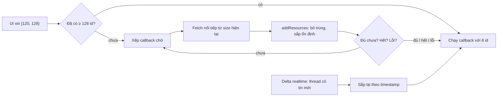

Cột trái của Messenger là danh sách cuộc trò chuyện, xếp theo tin nhắn mới nhất. Nghe đơn giản, nhưng có ba thứ cùng lúc kéo danh sách này về ba phía:

1. **Phân trang.** Người dùng có vài nghìn thread, không ai tải hết một lần. Trang đầu tải 20, cuộn xuống tải tiếp.
2. **Realtime.** Một thread ở vị trí 87 vừa có tin mới: nó phải nhảy lên đầu ngay, kể cả khi trang hiện tại chưa tải tới đó.
3. **Nhảy cóc.** Mở lại app ở vị trí cuộn cũ, hoặc lọc theo thư mục: UI xin "từ vị trí 120, lấy 8 cái" trong khi mới có 20 cái trong bộ nhớ.

Cách quen thuộc là `items.slice(start, start + 8)` rồi thiếu thì fetch. Kết quả là trong lúc chờ, UI hiện một nửa dữ liệu, nửa kia trống, rồi lần lượt lấp vào, thứ tự có thể đổi giữa chừng.

> [!TIP]
> **Tóm tắt**
> - Messenger web giữ thread list bằng `RangedCallbackManager`: một mảng id sắp theo `timestamp` giảm dần, và một hàng callback chờ theo **khoảng** `[start, start + limit)`.
> - Khoảng đã đủ dữ liệu thì callback chạy ngay; thiếu thì callback **xếp chờ** và lớp ngoài fetch đúng phần còn thiếu, nối tiếp phần đã có. UI không bao giờ thấy một khoảng có lỗ.
> - Presence (ai đang online, tab chat nào đang mở) được lưu qua điều hướng trang, kèm version schema. Đọc ra mà khác version thì coi như không có, khỏi phải viết code migrate.
> - Bản gốc có ý chặn tab cũ ghi đè dữ liệu của tab mới, nhưng điều kiện đó không bao giờ đúng. Bản viết lại sửa lỗi này.

<iframe class="demo-frame" src="/demos/facebook-patterns/index.html?theme=dark#/thread-list" title="Demo thread-list" loading="lazy" style="height: 900px"></iframe>

<p class="demo-links">▶ <a href="/demos/facebook-patterns/index.html#/thread-list" target="_blank" rel="noopener">Mở demo toàn màn hình ↗</a> · <a href="https://stackblitz.com/github/hunghg255/blog-hunghg/tree/master/examples/facebook-patterns?file=src/lib/threadList.ts" target="_blank" rel="noopener">Sửa code trên StackBlitz ↗</a> · <a href="https://github.com/hunghg255/blog-hunghg/blob/master/examples/facebook-patterns/src/lib/threadList.ts" target="_blank" rel="noopener">Xem source trên GitHub ↗</a></p>

## Facebook làm thế nào?

Hai module này nằm trong bundle Messenger của facebook.com: `MercuryOrderedThreadlist` (file `66.js`), `RangedCallbackManager` (file `47.js`) và `PresenceCookieManager` (file `96.js`). "Mercury" là tên nội bộ của lớp dữ liệu chat đời đầu; xem thêm [#31 hàng đợi gửi tin](/blogs/facebook-ordered-send-queue) cũng thuộc lớp này.

### Một chỉ mục cho mỗi (thư mục × bộ lọc)

`MercuryOrderedThreadlist` không giữ một danh sách mà giữ một **ma trận**: mỗi thư mục (inbox, spam, tin nhắn chờ…) nhân với mỗi bộ lọc (tất cả, chưa đọc, nhóm…) có một `RangedCallbackManager` riêng. Đổi tên biến cho dễ đọc:

```js
this.lists[folder][filter] = new RangedCallbackManager(
  (threadID) => MessengerState.getThreadMetaNow(fbid, threadID)?.timestamp, // key để sắp
  (a, b) => b - a,                                                          // mới nhất trước
  threadIDMap.canLinkExternally,                                            // bộ lọc "strict"
);
```

Chỉ mục chỉ giữ **id**. Thứ tự được tính từ key của từng id, đọc từ state chung (`MessengerState.bs`, viết bằng ReasonML). Thread có tin mới thì timestamp đổi, chỉ mục chỉ việc sắp lại.

### Xin một khoảng, thiếu thì chờ

UI gọi `getFilteredThreadlist(start, limit, folder, filter, callback)`:

```js
getFilteredThreadlist(start, limit, folder, filter, callback, strict, …) {
  const list = this.getThreadlistOrderMap(folder, filter);
  const requestId = list.executeOrEnqueue(start, limit, callback, strict);
  const missing = list.getUnavailableResources(requestId);
  if (missing.length) {
    if (list.getCurrentArraySize() < start) log.warn('range_with_gap', …);
    serverRequests.fetchThreadlistInfo(list.getCurrentArraySize(), missing.length, folder, filter, …);
  }
  return requestId;
}
```

Hai chi tiết đáng để ý:

- Fetch luôn bắt đầu từ `getCurrentArraySize()`, tức **nối tiếp** phần đã có, không bao giờ xin riêng khoảng `[120, 128)`. Xin từ 120 khi mới có 20 nghĩa là tải 108 thread. Đổi lại, mảng không bao giờ có lỗ. Trường hợp này được ghi log `range_with_gap` để đội Messenger biết nó xảy ra bao nhiêu lần.
- `getUnavailableResources` trả **danh sách chỉ số** còn thiếu, nhưng code chỉ dùng `.length` của nó.

Phần quyết định callback có chạy được chưa nằm trong `RangedCallbackManager`:

```js
// tên biến đã đổi
canRun(request, options) {
  const ids = this.filtered(options);                 // lọc "strict" nếu cần
  const end = request.start + request.limit;
  const force = !!options?.force;
  if (!force && !this.reachedEnd && !this.error && end > ids.length) return false; // chờ tiếp
  const slice = ids.slice(request.start, end);
  const error = end > ids.length ? this.error : null;
  return [slice, error];
}
```

Ba lối thoát cho callback đang chờ: đủ dữ liệu, server báo đã hết (`setReachedEndOfArray`), hoặc fetch lỗi (`setError`). Hai trường hợp sau trả phần đang có kèm lỗi nếu có, để UI không chờ mãi.

`addResources` bỏ id trùng bằng một object `{id: true}`, đẩy vào mảng, sắp lại bằng `arrayStableSort` rồi gọi `runPossibleCallbacks()`. Sắp ổn định quan trọng ở đây: hai thread cùng timestamp phải giữ thứ tự cũ, nếu không mỗi lần thêm dữ liệu chúng lại đổi chỗ cho nhau trên màn hình.

### Presence: cookie nhỏ, dữ liệu ở sessionStorage

`PresenceCookieManager` lưu trạng thái chat của tab qua các lần chuyển trang. Mỗi module đăng ký một "sub-cookie" bằng `register(name, fn)`; lúc ghi, manager gom kết quả của mọi `fn` thành một object `{v, time, user, ...}`, `JSON.stringify` rồi mã hoá bằng `Dcode`.

Ký tự đầu của chuỗi lưu cho biết dữ liệu nằm ở đâu:

```js
function store(data, smallFlags) {
  const savedToSession = writeSessionStorage(data);   // sessionStorage['presence'] = 'E' + data
  if (savedToSession) setCookie('S' + smallFlags);    // cookie chỉ còn vài ký tự cờ
  else setCookie('E' + data);                         // không có sessionStorage: cookie chứa hết
}
```

Khi trình duyệt có `sessionStorage`, dữ liệu đầy đủ nằm ở đó, còn cookie `presence` chỉ mang vài ký tự cờ: `f` (tài khoản Facebook) hoặc `w` (Workplace), được bật khi trường `t3` (hoặc `t3w`) trong state có dữ liệu. Code không ghi chú `t3` là gì; có lẽ là danh sách tab chat đang mở, để server biết mà không cần đọc cả state. Cookie đi kèm **mọi request**, nên giữ cho nó nhỏ là tiết kiệm băng thông ở mỗi request.

Lúc đọc, dữ liệu bị bỏ qua nếu khác user hoặc khác version:

```js
function read() {
  const m = JSON.parse(Dcode.decode(raw));
  if (m.user && m.user !== CurrentUser.getID()) return null;
  return m.v !== cookieVersion ? null : m;
}
```

Đây là cách migrate rẻ nhất: đổi schema thì tăng `cookieVersion`, dữ liệu cũ tự biến mất ở lần đọc kế tiếp.

### Lỗi trong bản gốc: chặn ghi đè không bao giờ chạy

Hàm ghi có một dòng chặn rất có lý:

```js
function save() {
  const current = read();
  if (current && current.v && cookieVersion < current.v) return; // đừng ghi đè dữ liệu của bản mới hơn
  …
}
```

Ý đồ: người dùng mở hai tab, một tab đã tải bản JS mới (version 4), tab kia còn chạy bản cũ (version 3). Tab cũ không được ghi đè dữ liệu version 4. Nhưng `read()` đã trả `null` khi `m.v !== cookieVersion`, nên `current` luôn `null` đúng trong trường hợp version khác nhau. Điều kiện `cookieVersion < current.v` không bao giờ được xét, và tab cũ vẫn ghi đè. Hai tab sẽ giành nhau ghi, mỗi bên lần lượt xoá dữ liệu của bên kia.



## Viết lại

Bản viết lại gom phần chỉ mục và hàng chờ vào một class `RangedIndex<T>`. Lớp ngoài chỉ cần biết hai thứ: xin một khoảng, và nếu thiếu thì thiếu bao nhiêu.

```ts title=src/lib/threadList.ts
  /**
   * Xin khoảng [start, start + limit). Trả về id để huỷ chờ và số phần tử còn thiếu
   * (0 nghĩa là callback đã chạy xong ngay trong lần gọi này).
   */
  request(start: number, limit: number, callback: (result: RangeResult<T>) => void) {
    const waiter = { start, limit, callback };
    if (this.tryRun(waiter)) return { id: 0, missing: 0 };
    const id = this.nextWaiterId++;
    this.waiters.set(id, waiter);
    return { id, missing: start + limit - this.ids.length };
  }

  unsubscribe(id: number) {
    this.waiters.delete(id);
  }

  /** Thêm id (bỏ trùng), sắp lại rồi chạy những callback nay đã đủ dữ liệu. */
  add(newIds: T[]) {
    let changed = false;
    for (const id of newIds) {
      if (this.known.has(id)) continue;
      this.known.add(id);
      this.ids.push(id);
      changed = true;
    }
    if (!changed) return;
    this.error = null;
    this.resort();
    this.flush();
  }
```

Phần quyết định có chạy callback được chưa:

```ts title=src/lib/threadList.ts
  private tryRun(waiter: Waiter<T>) {
    const end = waiter.start + waiter.limit;
    const enough = end <= this.ids.length;
    if (!enough && !this.ended && this.error == null) return false;
    waiter.callback({
      items: this.ids.slice(waiter.start, end),
      error: enough ? null : this.error,
    });
    return true;
  }

  private flush() {
    for (const [id, waiter] of this.waiters) {
      if (this.tryRun(waiter)) this.waiters.delete(id);
    }
  }
```

Presence store, với chỗ sửa lỗi ghi đè: đọc version **thô** của dữ liệu đang lưu, không qua bộ lọc version.

```ts title=src/lib/threadList.ts
  /** version của dữ liệu đang nằm trong storage (kể cả khác version mình), để quyết định có ghi đè không. */
  function storedVersion(): number | null {
    const raw = readRaw();
    if (!raw) return null;
    try {
      const v = (JSON.parse(raw) as Partial<PresenceRecord>).v;
      return typeof v === 'number' ? v : null;
    } catch {
      return null;
    }
  }

  /**
   * Ghi. Trả false nếu dữ liệu đang có thuộc version MỚI HƠN: tab chạy bản cũ không được
   * ghi đè lên dữ liệu của tab đã lên bản mới.
   */
  function write(fields: Record<string, unknown>): boolean {
    const existing = storedVersion();
    if (existing !== null && existing > version) return false;
    const record: PresenceRecord = {
      ...fields,
      v: version,
      user: currentUser,
      time: Math.floor(now() / 1000),
    };
    const value = JSON.stringify(record);
    if (primary) {
      primary.set(key, value);
      fallback.remove(key);
    } else {
      fallback.set(key, value);
    }
    return true;
  }
```

::: spoiler Xem toàn bộ src/lib/threadList.ts

```ts title=src/lib/threadList.ts
/**
 * Danh sách thread sắp theo mốc hoạt động mới nhất, phân trang bằng "ranged callback"
 * (ý tưởng từ MercuryOrderedThreadlist + RangedCallbackManager của Messenger web).
 *
 * - Chỉ mục giữ id, thứ tự lấy từ key (timestamp) của từng id, sắp giảm dần.
 * - UI xin một khoảng [start, start + limit). Đủ dữ liệu thì callback chạy ngay;
 *   thiếu thì callback được XẾP CHỜ, đồng thời trả về số phần tử còn thiếu để gọi fetch.
 *   UI không bao giờ thấy một khoảng có "lỗ".
 * - Đã tới cuối danh sách hoặc fetch lỗi: callback chờ được chạy với phần đang có.
 */

export interface RangeResult<T> {
  items: T[];
  /** lỗi fetch nếu khoảng xin vượt quá phần đã có, ngược lại null */
  error: unknown;
}

type Waiter<T> = { start: number; limit: number; callback: (result: RangeResult<T>) => void };

export class RangedIndex<T> {
  private ids: T[] = [];
  private known = new Set<T>();
  private ended = false;
  private error: unknown = null;
  private waiters = new Map<number, Waiter<T>>();
  private nextWaiterId = 1;

  constructor(
    /** key để sắp; undefined thì xếp cuối */
    private getKey: (id: T) => number | undefined,
    /** mặc định: key lớn đứng trước (mới nhất trước) */
    private compare: (a: number, b: number) => number = (a, b) => b - a,
  ) {}

  /**
   * Xin khoảng [start, start + limit). Trả về id để huỷ chờ và số phần tử còn thiếu
   * (0 nghĩa là callback đã chạy xong ngay trong lần gọi này).
   */
  request(start: number, limit: number, callback: (result: RangeResult<T>) => void) {
    const waiter = { start, limit, callback };
    if (this.tryRun(waiter)) return { id: 0, missing: 0 };
    const id = this.nextWaiterId++;
    this.waiters.set(id, waiter);
    return { id, missing: start + limit - this.ids.length };
  }

  unsubscribe(id: number) {
    this.waiters.delete(id);
  }

  /** Thêm id (bỏ trùng), sắp lại rồi chạy những callback nay đã đủ dữ liệu. */
  add(newIds: T[]) {
    let changed = false;
    for (const id of newIds) {
      if (this.known.has(id)) continue;
      this.known.add(id);
      this.ids.push(id);
      changed = true;
    }
    if (!changed) return;
    this.error = null;
    this.resort();
    this.flush();
  }

  remove(ids: T[]) {
    const drop = new Set(ids.filter((id) => this.known.has(id)));
    if (drop.size === 0) return;
    drop.forEach((id) => this.known.delete(id));
    this.ids = this.ids.filter((id) => !drop.has(id));
  }

  /** Key của id đã đổi (vd: thread có tin mới): sắp lại. */
  resort() {
    const keyOf = (id: T) => this.getKey(id) ?? Number.NEGATIVE_INFINITY;
    // Array.prototype.sort đã ổn định (stable) từ ES2019: thread cùng key giữ thứ tự cũ
    this.ids.sort((a, b) => {
      const ka = keyOf(a);
      const kb = keyOf(b);
      if (ka === kb) return 0;
      if (ka === Number.NEGATIVE_INFINITY) return 1;
      if (kb === Number.NEGATIVE_INFINITY) return -1;
      return this.compare(ka, kb);
    });
  }

  /** Server báo không còn gì để tải: callback đang chờ nhận phần còn lại. */
  setEnded() {
    if (this.ended) return;
    this.ended = true;
    this.flush();
  }

  setError(error: unknown) {
    if (this.error === error) return;
    this.error = error;
    this.flush();
  }

  get size() {
    return this.ids.length;
  }

  get hasEnded() {
    return this.ended;
  }

  get pendingCount() {
    return this.waiters.size;
  }

  /** Số phần tử cần có để mọi callback đang chờ chạy được (0 nếu không ai chờ). */
  get wantedSize() {
    let max = 0;
    for (const w of this.waiters.values()) max = Math.max(max, w.start + w.limit);
    return max;
  }

  getAll() {
    return this.ids.slice();
  }

  /** Mọi id có key "mới hơn hoặc bằng" mốc cho trước (dùng cho "tải tới khi gặp tin X"). */
  getUntil(key: number) {
    const out: T[] = [];
    for (const id of this.ids) {
      const k = this.getKey(id);
      if (k !== undefined && this.compare(k, key) > 0) break;
      out.push(id);
    }
    return out;
  }

  private tryRun(waiter: Waiter<T>) {
    const end = waiter.start + waiter.limit;
    const enough = end <= this.ids.length;
    if (!enough && !this.ended && this.error == null) return false;
    waiter.callback({
      items: this.ids.slice(waiter.start, end),
      error: enough ? null : this.error,
    });
    return true;
  }

  private flush() {
    for (const [id, waiter] of this.waiters) {
      if (this.tryRun(waiter)) this.waiters.delete(id);
    }
  }
}

// ---------------------------------------------------------------------------
// Presence lưu qua điều hướng, tự vô hiệu khi đổi schema (ý tưởng từ PresenceCookieManager)
// ---------------------------------------------------------------------------

export interface KeyValueStore {
  get(key: string): string | null;
  set(key: string, value: string): void;
  remove(key: string): void;
}

export interface PresenceRecord {
  /** version schema của dữ liệu */
  v: number;
  user: string;
  /** giây, lúc ghi */
  time: number;
  [field: string]: unknown;
}

export interface PresenceStoreOptions {
  key?: string;
  version: number;
  currentUser: string;
  /** nơi lưu chính, vd sessionStorage; null nếu không dùng được */
  primary: KeyValueStore | null;
  /** nơi lưu dự phòng, vd cookie */
  fallback: KeyValueStore;
  now?: () => number;
}

export function createPresenceStore({
  key = 'presence',
  version,
  currentUser,
  primary,
  fallback,
  now = () => Date.now(),
}: PresenceStoreOptions) {
  const readRaw = () => primary?.get(key) ?? fallback.get(key);

  /** null nếu không có, hỏng, khác user hoặc khác version. */
  function read(): PresenceRecord | null {
    const raw = readRaw();
    if (!raw) return null;
    try {
      const record = JSON.parse(raw) as PresenceRecord;
      if (record.user !== currentUser) return null;
      if (record.v !== version) return null;
      return record;
    } catch {
      return null;
    }
  }

  /** version của dữ liệu đang nằm trong storage (kể cả khác version mình), để quyết định có ghi đè không. */
  function storedVersion(): number | null {
    const raw = readRaw();
    if (!raw) return null;
    try {
      const v = (JSON.parse(raw) as Partial<PresenceRecord>).v;
      return typeof v === 'number' ? v : null;
    } catch {
      return null;
    }
  }

  /**
   * Ghi. Trả false nếu dữ liệu đang có thuộc version MỚI HƠN: tab chạy bản cũ không được
   * ghi đè lên dữ liệu của tab đã lên bản mới.
   */
  function write(fields: Record<string, unknown>): boolean {
    const existing = storedVersion();
    if (existing !== null && existing > version) return false;
    const record: PresenceRecord = {
      ...fields,
      v: version,
      user: currentUser,
      time: Math.floor(now() / 1000),
    };
    const value = JSON.stringify(record);
    if (primary) {
      primary.set(key, value);
      fallback.remove(key);
    } else {
      fallback.set(key, value);
    }
    return true;
  }

  function clear() {
    primary?.remove(key);
    fallback.remove(key);
  }

  return { read, write, clear, storedVersion };
}

export function storageAdapter(storage: Storage | undefined): KeyValueStore | null {
  if (!storage) return null;
  try {
    const probe = '__probe__';
    storage.setItem(probe, '1');
    storage.removeItem(probe);
  } catch {
    return null; // Safari private mode cũ, quota = 0…
  }
  return {
    get: (k) => storage.getItem(k),
    set: (k, v) => storage.setItem(k, v),
    remove: (k) => storage.removeItem(k),
  };
}

export function memoryAdapter(): KeyValueStore & { dump(): Record<string, string> } {
  const map = new Map<string, string>();
  return {
    get: (k) => map.get(k) ?? null,
    set: (k, v) => void map.set(k, v),
    remove: (k) => void map.delete(k),
    dump: () => Object.fromEntries(map),
  };
}
```

:::

**Khác bản gốc:**

- Callback chỉ chạy **một lần** rồi rời hàng chờ. `CallbackManagerController` của Facebook có thêm chế độ đăng ký lâu dài, nhưng thread list chỉ dùng kiểu một lần.
- `remove()` không chạy lại callback, giống bản gốc: bỏ bớt id không làm một khoảng đang thiếu trở nên đủ.
- Presence lưu JSON thuần, không qua `Dcode`. Lớp lưu trữ được truyền vào (`KeyValueStore`), nên test được bằng bộ nhớ.

## Đi qua code

- **`request()`** thử chạy callback ngay. Không chạy được thì cấp một id để huỷ (`unsubscribe`) và trả về `missing`, số phần tử còn thiếu tính từ cuối mảng. Lớp ngoài dùng `missing` để fetch, giống `getUnavailableResources(...).length` của bản gốc.
- **`add()`** bỏ trùng bằng `Set`, đẩy id mới vào rồi sắp lại toàn bộ. Sắp lại `n` phần tử mỗi lần thêm là `O(n log n)`; với vài nghìn thread vẫn chỉ mất dưới một mili giây, và đổi lại code rất đơn giản.
- **`resort()`** dùng `Array.prototype.sort`, vốn ổn định từ ES2019. Thread chưa có key (chưa nạp metadata) xếp cuối.
- **`flush()`** duyệt hàng chờ và chạy mọi callback đã đủ điều kiện. Xoá phần tử của `Map` trong lúc duyệt bằng `for…of` là an toàn trong JavaScript.
- **`wantedSize`**: demo dùng getter này để biết, khi một fetch vừa xong, có callback nào đang chờ một khoảng còn xa hơn không, để fetch tiếp. Bản gốc làm việc này ở lớp `MercuryServerRequests`.
- **`write()`** đọc `storedVersion()` trước: nếu dữ liệu đang lưu thuộc version mới hơn thì từ chối ghi và trả `false`.

## Tại sao không làm cách khác?

**Vẽ phần đang có, thiếu thì để skeleton từng dòng?** Bật "Cách ngây thơ" trong demo rồi nhảy tới 120: tám dòng trống hiện ra, sau đó lấp đầy. Với danh sách chat thì còn tệ hơn, vì trong lúc chờ có thể có tin mới làm thứ tự đổi, các dòng đã vẽ bị đẩy xuống. Chờ đủ cả khoảng rồi vẽ một lần cho kết quả ổn định hơn.

**Fetch đúng khoảng `[120, 128)` thay vì nối tiếp?** Server phải hỗ trợ phân trang theo offset ổn định, mà danh sách chat đổi liên tục: giữa hai lần gọi, thread ở vị trí 120 có thể đã thành 121. Phân trang theo con trỏ nối tiếp tránh được chuyện trùng hay sót, đổi lại phải tải phần ở giữa. Nhảy xa là trường hợp hiếm, và có log `range_with_gap` để đo.

**Lưu presence trong `localStorage`?** `localStorage` dùng chung giữa mọi tab, trong khi trạng thái "tab chat nào đang mở" là của từng tab. `sessionStorage` sống theo tab và vẫn còn sau khi chuyển trang, khớp đúng nhu cầu.

**Migrate dữ liệu cũ thay vì bỏ?** Presence là dữ liệu tạm, mất thì tạo lại sau vài giây. Code migrate thì phải giữ mãi và test với mọi version cũ. Bỏ đi là lựa chọn hợp lý cho loại dữ liệu này.

## Edge case và cạm bẫy

- **Key đổi mà không sắp lại.** Chỉ mục chỉ biết thứ tự đổi khi được gọi `resort()`. Ở bản gốc, delta `update-threadlist` từ server kéo theo cập nhật chỉ mục rồi `MercuryThreadInformer.updatedThreadlist()` báo view vẽ lại.
- **Callback chờ mãi.** Fetch lỗi mà không gọi `setError`, hoặc server hết dữ liệu mà không gọi `setEnded`, thì callback treo vĩnh viễn. Lớp gọi fetch phải luôn kết thúc bằng một trong ba cách: `add`, `setEnded`, `setError`.
- **Component unmount khi đang chờ.** Phải `unsubscribe(id)` trong cleanup, nếu không callback sẽ `setState` vào component đã gỡ. Demo làm việc này trong `useEffect`.
- **Sắp theo timestamp của client.** Đồng hồ máy người dùng có thể lệch. Timestamp ở đây do server cấp, không phải `Date.now()` của trình duyệt.
- **sessionStorage bị chặn.** Safari ở chế độ riêng tư (bản cũ) ném lỗi khi `setItem`. Hàm `storageAdapter` thử ghi một khoá mẫu và trả `null` nếu không được, store chuyển sang cookie.
- **Hai tab cùng ghi.** Với `sessionStorage`, mỗi tab có bản riêng nên không giành nhau. Với cookie thì dùng chung, và đó là lúc lỗi "tab cũ ghi đè" của bản gốc xảy ra.

## Dùng trong dự án

Danh sách có phân trang và thứ tự đổi theo realtime (inbox, danh sách thông báo, bảng xếp hạng):

```ts
const index = new RangedIndex<string>((id) => cache.get(id)?.updatedAt);

function useRange(start: number, limit: number) {
  const [items, setItems] = useState<string[] | null>(null);
  useEffect(() => {
    const { id, missing } = index.request(start, limit, ({ items }) => setItems(items));
    if (missing > 0) loadMore(missing); // gọi index.add / setEnded / setError khi xong
    return () => index.unsubscribe(id);
  }, [start, limit]);
  return items; // null = đang chờ, hiện skeleton cả khoảng
}
```

Dữ liệu tạm cần sống qua điều hướng, có version:

```ts
const presence = createPresenceStore({
  version: 4,
  currentUser: user.id,
  primary: storageAdapter(window.sessionStorage),
  fallback: cookieAdapter('presence'), // tự viết, nhớ giới hạn ~4KB của cookie
});
```

## Kiểm thử

::: spoiler Ví dụ test (bản phác, không có trong repo)

```ts
import { describe, expect, it, vi } from 'vitest';
import { RangedIndex, createPresenceStore, memoryAdapter } from './threadList';

const ts = new Map<string, number>();
const index = () => new RangedIndex<string>((id) => ts.get(id));

describe('RangedIndex', () => {
  it('chạy callback ngay khi khoảng đã đủ, xếp chờ khi thiếu', () => {
    ts.clear();
    ['a', 'b', 'c'].forEach((id, i) => ts.set(id, 100 - i));
    const idx = index();
    idx.add(['c', 'a', 'b']);
    const now = vi.fn();
    expect(idx.request(0, 2, now)).toEqual({ id: 0, missing: 0 });
    expect(now).toHaveBeenCalledWith({ items: ['a', 'b'], error: null });

    const later = vi.fn();
    const { missing } = idx.request(2, 3, later);
    expect(missing).toBe(2);
    expect(later).not.toHaveBeenCalled();
    ['d', 'e'].forEach((id, i) => ts.set(id, 50 - i));
    idx.add(['d', 'e']);
    expect(later).toHaveBeenCalledWith({ items: ['c', 'd', 'e'], error: null });
  });

  it('hết dữ liệu hoặc lỗi: callback nhận phần đang có', () => {
    ts.clear();
    ts.set('x', 1);
    const idx = index();
    idx.add(['x']);
    const cb = vi.fn();
    idx.request(0, 5, cb);
    idx.setError('mạng lỗi');
    expect(cb).toHaveBeenCalledWith({ items: ['x'], error: 'mạng lỗi' });
  });

  it('thread có tin mới lên đầu sau resort, add bỏ trùng', () => {
    ts.clear();
    ['a', 'b', 'c'].forEach((id, i) => ts.set(id, 100 - i));
    const idx = index();
    idx.add(['a', 'b', 'c', 'b']);
    expect(idx.size).toBe(3);
    ts.set('c', 999);
    idx.resort();
    expect(idx.getAll()).toEqual(['c', 'a', 'b']);
  });
});

describe('presence store', () => {
  it('bỏ dữ liệu khác version, tab cũ không ghi đè dữ liệu của bản mới', () => {
    const shared = memoryAdapter();
    const v3 = createPresenceStore({ version: 3, currentUser: 'u', primary: shared, fallback: memoryAdapter() });
    const v4 = createPresenceStore({ version: 4, currentUser: 'u', primary: shared, fallback: memoryAdapter() });
    expect(v4.write({ active: 1 })).toBe(true);
    expect(v3.read()).toBeNull();
    expect(v3.write({ active: 0 })).toBe(false);
    expect(v4.read()?.active).toBe(1);
  });
});
```

:::

## So với thư viện và chuẩn web

- **TanStack Query** có `useInfiniteQuery` cho phân trang nối tiếp theo con trỏ, nhưng dữ liệu được giữ theo từng trang chứ không theo một chỉ mục sắp theo key. Muốn một thread "nhảy lên đầu" khi có tin mới, bạn vẫn phải tự sửa cache.
- **Cache của Relay và Apollo** có khái niệm connection (`edges` + `pageInfo`), cũng phân trang nối tiếp. Thứ tự lấy theo server, nên cập nhật realtime thường đi kèm hàm `updater` tự chèn edge vào đầu.
- **Storage:** `sessionStorage` có ở mọi trình duyệt hiện đại, giới hạn khoảng 5MB mỗi origin (con số cụ thể tuỳ trình duyệt, tính tới 10/2026). Cookie bị giới hạn khoảng 4KB mỗi cookie và luôn đi kèm request, nên chỉ để những gì server thật sự cần đọc.

---

Bài này thuộc series **[Học từ mã nguồn Facebook](/series/facebook)** (106 bài, đọc theo thứ tự).

::: spoiler Xem nhanh danh sách bài trong series

*Phần 1*

- [Mở đầu: cách đọc code minify của Facebook](/blogs/learn-from-facebook-source-code)
- [#1 Dùng chung IntersectionObserver + infinite scroll](/blogs/facebook-shared-intersection-observer)
- [#2 useViewportDuration: đo thời gian thực sự được xem](/blogs/facebook-use-viewport-duration)
- [#3 Preload code + data khi hover](/blogs/facebook-preload-on-hover)
- [#4 Toast manager với external store](/blogs/facebook-toast-manager)
- [#5 Network status + heartbeat backoff](/blogs/facebook-network-status-heartbeat)
- [#6 ErrorGuard: bắt lỗi theo ngữ cảnh](/blogs/facebook-error-guard)
- [#7 Banzai: gom log theo lô + sendBeacon](/blogs/facebook-batch-logger)
- [#8 Focus trap + Esc theo layer](/blogs/facebook-focus-trap)

*Phần 2*

- [#9 Mẹo calc(… * 9999): container query, line-clamp, mũi tên carousel bằng CSS](/blogs/facebook-css-9999-trick)
- [#10 Thanh cuộn tuỳ biến bằng CSS 3D](/blogs/facebook-css-3d-scrollbar)
- [#11 Modal cuộn bằng window, giữ vị trí trang nền](/blogs/facebook-document-scroll-modal)
- [#12 Popover, tooltip group và hovercard](/blogs/facebook-popover-tooltip)
- [#13 Primitive Pressable + focus-visible](/blogs/facebook-pressable)
- [#14 Tab "Xem thêm" + sticky header bằng IntersectionObserver](/blogs/facebook-priority-tabs-sticky-header)
- [#15 Avatar khoét mask, gradient Messenger, skeleton steps()](/blogs/facebook-visual-tricks)
- [#16 Khung chat không giật](/blogs/facebook-chat-scroller)
- [#17 Thuật toán chọn bố cục collage ảnh](/blogs/facebook-photo-collage-layout)
- [#18 Keep-alive tab trong SPA](/blogs/facebook-keep-alive-tabs)
- [#19 Tự đo Visual Completion & interaction tracing](/blogs/facebook-visual-completion)
- [#20 Router SPA bền bỉ & tải chunk có retry](/blogs/facebook-spa-router-resilient-loading)

*Phần 3*

- [#21 Smart Compose: gợi ý chữ mờ khi gõ](/blogs/facebook-smart-compose-ghost-text)
- [#22 MQTT ngay trong trình duyệt, tự chuyển sang long-poll](/blogs/facebook-mqtt-in-browser)
- [#23 Đo thời gian dùng bằng bitmap 64 giây](/blogs/facebook-time-spent-bitmap)
- [#24 Bảng reaction nhấn giữ rồi trượt](/blogs/facebook-reaction-press-slide)
- [#25 Tìm kiếm gấp dấu, phiên âm và highlight đầu từ](/blogs/facebook-search-diacritics-tokenize)
- [#26 Ring buffer biết trace nào đã mất log](/blogs/facebook-trace-ring-buffer)
- [#27 Engine animation JS: một vòng rAF và solver cubic-bezier](/blogs/facebook-keyframes-loop-cubic-bezier)
- [#28 Bootloader: bitmap tài nguyên đã tải, chỉ reload khi cần](/blogs/facebook-bootloader-bitmap-consistency)
- [#29 Nhận biết click do screen reader tạo ra](/blogs/facebook-virtual-cursor-detection)
- [#30 Tải trước feed theo chất lượng mạng, đoán hạng thiết bị](/blogs/facebook-network-aware-prefetch)
- [#31 Hàng đợi gửi tin chat giữ đúng thứ tự](/blogs/facebook-ordered-send-queue)
- [#32 Gộp lời gọi API trong cùng một tick](/blogs/facebook-api-batcher)
- [#33 Resize ảnh trong pool Web Worker](/blogs/facebook-jpeg-resize-worker-pool)
- [#34 Crop ảnh theo nhiều khuôn mặt](/blogs/facebook-face-aware-crop)
- [#35 Kéo-thả sắp xếp và vùng thả file không nhấp nháy](/blogs/facebook-flicker-free-drag-drop)
- [#36 Tiện ích UI: fade-out, sticky event, hàm huỷ được](/blogs/facebook-ui-utility-hooks)
- [#37 Hạ tầng nhỏ: cookie, hash lỗi, prefetch khi chuột dừng](/blogs/facebook-small-infra-cookie-hash-idle)

*Phần 4–6*

- [#38 Đồng bộ tin nhắn: phát hiện lỗ seqID và fetch bù theo tầng](/blogs/facebook-messenger-sync-seqid-gaps)
- [#39 OTID: ID tin nhắn kiểu Snowflake sinh ở client](/blogs/facebook-otid-client-snowflake)
- [#40 QPL: lấy mẫu từ lúc bắt đầu, đo RTT gửi tin đầu-cuối](/blogs/facebook-qpl-send-rtt)
- [#41 Bộ điều phối request bảy chế độ gộp và chống trùng](/blogs/facebook-request-dispatcher-modes)
- **#42 Thread list theo mốc thời gian, cookie presence có version** (bài này)
- [#43 Composer dạng plugin: reducer, dirty checker, chuỗi kiểm tra](/blogs/facebook-plugin-composer)
- [#44 Thanh toán bất đồng bộ: subscribe trước, poll dự phòng](/blogs/facebook-async-checkout)
- [#45 Validate số thẻ: sửa lỗi gõ, dải BIN, Luhn](/blogs/facebook-card-validation)
- [#46 Lịch chọn khoảng ngày: bo góc dải chọn, phím đủ bộ, RTL](/blogs/facebook-range-calendar-a11y)
- [#47 Giờ mở cửa theo tuần: qua đêm, gộp khoảng, phần bù](/blogs/facebook-weekly-hours-intervals)
- [#48 Tiến độ đăng realtime: giữ event chờ snapshot, watchdog](/blogs/facebook-realtime-publish-snapshot)
- [#49 Tiền tệ theo đơn vị nhỏ nhất và ô nhập tiền](/blogs/facebook-currency-minor-units)
- [#50 Sửa hàng loạt Empty/Uniform/Mixed, seen/read bằng 2 bit](/blogs/facebook-bulk-edit-seen-bits)
- [#51 Phát hiện script lạ hook vào hàm native](/blogs/facebook-native-hook-detection)
- [#52 localStorage tự dọn khi đầy quota](/blogs/facebook-quota-aware-storage)
- [#53 Cache tuyến do server phân giải, chờ sẵn promise](/blogs/facebook-route-cache-prefetch)
- [#54 Lưới phím mũi tên 2D và focus không làm cuộn trang](/blogs/facebook-focus-table-grid)
- [#55 Tách emoji bằng máy trạng thái](/blogs/facebook-emoji-segmentation)
- [#56 Đọc trước ghi sau trong một frame, con tự biết vị trí](/blogs/facebook-read-then-write-dom)
- [#57 Hàng đợi lệnh cho video và stream sắp lại chunk](/blogs/facebook-video-command-queue)

*Phần 7–10*

- [#58 Ước lượng băng thông EWMA: loại outlier, nhớ qua phiên](/blogs/facebook-bandwidth-ewma-estimator)
- [#59 ABR theo độ tự tin phát và cắt bậc bitrate theo MOS](/blogs/facebook-abr-playback-confidence)
- [#60 Prefetch segment dự đoán từ manifest, parse hộp sidx](/blogs/facebook-dash-predicted-segments)
- [#61 Đọc metadata MP4/MOV ngay trên client](/blogs/facebook-mp4-metadata-client)
- [#62 Upload tiếp tục được: offset, hash dedupe, phát hiện treo](/blogs/facebook-resumable-upload)
- [#63 Fenwick tree: chọn ngẫu nhiên có trọng số và offset dòng](/blogs/facebook-fenwick-weighted-random)
- [#64 Vạch trục số và trục thời gian "đẹp"](/blogs/facebook-nice-axis-ticks)
- [#65 Damerau-Levenshtein theo dải chéo và tự sửa tên gõ sai](/blogs/facebook-damerau-levenshtein)
- [#66 PRNG có seed, shuffle tái lập và lấy mẫu trace](/blogs/facebook-seeded-prng-sampling)
- [#67 Cặp min/max-heap tái dùng vị trí trong danh sách ảo](/blogs/facebook-dual-heap-buffer-set)
- [#68 Memo nhiều đối số bằng Map/WeakMap và interning object](/blogs/facebook-multikey-memo-interning)
- [#69 Thống kê cửa sổ trượt và đại số khoảng thời gian](/blogs/facebook-moving-stat-intervals)
- [#70 Int64 từ hai số 32-bit, decode UTF, offset theo code point](/blogs/facebook-int64-utf-codepoints)
- [#71 Engine múi giờ IANA trên client, phát hiện lệch giờ](/blogs/facebook-client-iana-timezone)
- [#72 Tự cài semver range](/blogs/facebook-semver-range)
- [#73 Auto-link URL, cắt chữ an toàn, giới hạn LaTeX](/blogs/facebook-autolink-safe-truncate)
- [#74 Parser query kiểu PHP chống prototype pollution](/blogs/facebook-php-query-serializer)
- [#75 Popover tự lật theo phần tràn nhỏ nhất](/blogs/facebook-popover-auto-flip)
- [#76 Tiền tố for(;;) chống JSON hijacking, đọc stream](/blogs/facebook-csrf-prefix-streaming)
- [#77 Chống lộ Referer, linkshim, xoá token trên URL](/blogs/facebook-referrer-linkshim-url-scrub)
- [#78 setImmediate bằng postMessage, gom delta chuột theo frame](/blogs/facebook-setimmediate-mouse-batching)
- [#79 Phát hiện crash qua heartbeat, dò proxy cache hỏng](/blogs/facebook-crash-heartbeat-proxy-check)
- [#80 DPR vào cookie cho ảnh @2x, che khoá trong log](/blogs/facebook-dpr-cookie-secret-redaction)
- [#81 Flux waitFor tự viết và proxy có đệm](/blogs/facebook-flux-dispatch-buffered-proxy)
- [#82 Crop đúng tỉ lệ, xoay sticker bằng ma trận](/blogs/facebook-image-crop-rotation-geometry)

*Phần 11–15*

- [#83 Chia subdomain giữa các tab bằng lease, long-poll theo bảng trạng thái](/blogs/facebook-tab-subdomain-lease-longpoll)
- [#84 MQTT QoS1: giữ publish chờ ack, gửi lại khi kết nối lại](/blogs/facebook-mqtt-qos1-republish)
- [#85 Cache Promise gộp request, cache lỗi ngắn, đua dữ liệu nhúng sẵn](/blogs/facebook-promise-cache-preload-race)
- [#86 Lịch retry: backoff có trần, Fibonacci, báo lỗi CDN mỗi N ngày](/blogs/facebook-retry-backoff-schedules)
- [#87 Giữ nguyên tham chiếu nhánh dữ liệu không đổi](/blogs/facebook-relay-recycle-nodes)
- [#88 Store optimistic: copy-on-write, rollback rồi áp lại](/blogs/facebook-relay-optimistic-store)
- [#89 Chỉ mục subscription theo record, hàng đợi task theo chiều sâu](/blogs/facebook-relay-subscription-index)
- [#90 Phân trang connection: cursor khớp đầu, edge không trùng](/blogs/facebook-relay-connection-pagination)
- [#91 Profiler kiểu middleware và memo selector có lấy mẫu kiểm tra](/blogs/facebook-profiler-middleware-memo-check)
- [#92 Đọc EBML/WebM Cues để tìm byte range của segment](/blogs/facebook-webm-ebml-cues)
- [#93 Stream HTTP Range tạm dừng được, tải tiếp đúng byte](/blogs/facebook-pausable-range-stream)
- [#94 Bảng khoảng thời gian gắn nhãn và nhảy qua lỗ buffer](/blogs/facebook-tagged-time-ranges-gaps)
- [#95 Gom chunk cho SourceBuffer, đồng bộ video bằng playbackRate](/blogs/facebook-sourcebuffer-video-sync)
- [#96 Gom tin nhắn thành cụm, vạch ngày và avatar đã xem](/blogs/facebook-message-grouping)
- [#97 Bao nhiêu tab chat vừa màn hình, chuỗi luật mở tab](/blogs/facebook-chat-tab-policy)
- [#98 Phím tắt Markdown trong editor, Backspace để hoàn tác](/blogs/facebook-markdown-shortcuts-editor)
- [#99 Offset theo code point hay UTF-16: bốn bug cùng một gốc](/blogs/facebook-codepoint-offset-bugs)
- [#100 Typeahead không nhảy: cache tiền tố, chặn reflow, khoá hover](/blogs/facebook-typeahead-stable-results)
- [#101 Hit-test trên canvas bằng phát lại path, nét đứt và cung Bézier](/blogs/facebook-canvas-hit-regions)
- [#102 Vòng tròn theo mét trên bản đồ Mercator](/blogs/facebook-mercator-meter-circles)
- [#103 Dò tính năng trình duyệt: ảnh EXIF 2×1, getter bẫy, scrollbar](/blogs/facebook-feature-probe-tricks)
- [#104 Bug định dạng số và kiểm tra dữ liệu theo locale](/blogs/facebook-locale-validation-bugs)
- [#105 Dispose cho đúng: idle callback, splice(-1), xoá nhầm key](/blogs/facebook-dispose-leak-bugs)

:::

Code + demo: [`examples/facebook-patterns`](https://github.com/hunghg255/blog-hunghg/tree/master/examples/facebook-patterns) · [Mở trên StackBlitz](https://stackblitz.com/github/hunghg255/blog-hunghg/tree/master/examples/facebook-patterns)
