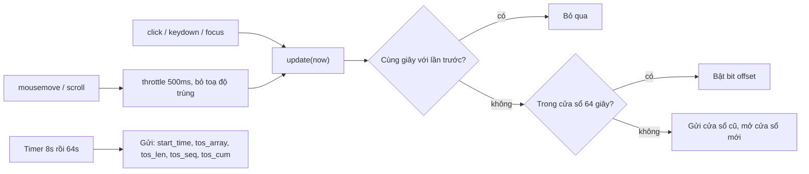

"Người dùng ở trên trang bao lâu?" là một trong những con số được hỏi nhiều nhất. Cách đo phổ biến lại sai theo nhiều kiểu:

- **Lấy giờ rời trang trừ giờ vào trang.** Tab mở cả ngày dưới nền cũng thành "8 tiếng sử dụng".
- **Gửi một sự kiện cho mỗi lần rê chuột, cuộn, gõ phím.** Một phút lướt feed sinh ra hàng trăm sự kiện, tốn băng thông và tiền lưu trữ.
- **Ping mỗi 5 giây khi tab đang hiển thị.** Đếm cả lúc người dùng bỏ đi pha cà phê.

Facebook đo "giây có hoạt động" bằng một cấu trúc rất nhỏ: mỗi giây có ít nhất một hoạt động thì bật **một bit**. 64 giây gói gọn trong 2 số nguyên 32-bit. Kèm theo đó là một cách lấy mẫu "giây hoạt động tức thời" không cần số ngẫu nhiên.

> [!TIP]
> **Tóm tắt**
> - Mỗi giây có hoạt động bật bit `offset` trong cửa sổ 64 giây: `bits[offset >> 5] |= 1 << (offset & 31)`. Nhiều sự kiện trong cùng một giây chỉ tính một lần.
> - Cửa sổ đầu tiên đóng sau 8 giây và gửi ngay; các cửa sổ sau đóng sau 64 giây. Payload chỉ khoảng 80 byte.
> - Mousemove/scroll được throttle 500ms; mousemove có toạ độ y hệt lần trước bị bỏ (đó là sự kiện giả khi nội dung cuộn dưới con trỏ đứng yên).
> - Lấy mẫu: user chỉ báo các giây có `giây % 2003 === crc32(userId) % 2003`. Bản gốc có lỗi điều kiện làm mọi người chưa đăng nhập dồn vào cùng một giây.

<iframe class="demo-frame" src="/demos/facebook-patterns/index.html?theme=dark#/time-spent" title="Demo time-spent" loading="lazy" style="height: 1300px"></iframe>

<p class="demo-links">▶ <a href="/demos/facebook-patterns/index.html#/time-spent" target="_blank" rel="noopener">Mở demo toàn màn hình ↗</a> · <a href="https://stackblitz.com/github/hunghg255/blog-hunghg/tree/master/examples/facebook-patterns?file=src/lib/timeSpent.ts" target="_blank" rel="noopener">Sửa code trên StackBlitz ↗</a> · <a href="https://github.com/hunghg255/blog-hunghg/blob/master/examples/facebook-patterns/src/lib/timeSpent.ts" target="_blank" rel="noopener">Xem source trên GitHub ↗</a></p>

## Facebook làm thế nào?

Có ba module trong bundle `3.js` của [facebook-codebase](https://github.com/hunghg255/facebook-codebase): `TimeSpentArray` (cấu trúc bitmap), `CometTimeSpentBitArrayLogger` (nối bitmap với Banzai, hệ thống gom log đã nói ở [bài #7](/blogs/facebook-batch-logger)), và `TimeSpentImmediateActiveSecondsLoggerComet` (lấy mẫu). Nguồn sự kiện là `CometTimeSpentEventListener.react` (`2.js`).

### Bật bit

```js
var g = 2, h = g * 32;           // 2 số nguyên = 64 giây
function C(sec) {                 // ghi một giây có hoạt động
  var b = sec - m;                // m = giây bắt đầu cửa sổ
  (b < 0 || b >= h) && v();       // lệch khỏi cửa sổ (kể cả đồng hồ lùi): gửi cửa sổ cũ
  !o ? y(sec)                     // chưa có cửa sổ: mở cửa sổ mới, bit 0 bật sẵn
     : (o[b >> 5] |= 1 << (b & 31), p = b + 1, q += 1, n = sec * 1e3);
}
function B(ms) {
  if (ms >= n && ms - n < 1e3) return;   // cùng giây với lần ghi trước: bỏ
  C(Math.floor(ms / 1e3));
}
```

`o` là mảng 2 số, `p` là độ dài cửa sổ tính tới giây cuối có hoạt động, `q` (`tos_cum`) đếm tổng số giây hoạt động trong phiên, `r` (`tos_seq`) là số thứ tự cửa sổ.

### Khi nào gửi

Cửa sổ mở bằng `y()`, đặt một timer theo cấu hình `TimeSpentWWWCometConfig`:

```js
"CONFIG": { "0_delay": 0, "0_timeout": 8, "delay": 1000, "timeout": 64 }
```

Cửa sổ số 0 đóng sau **8 giây** và gửi với độ trễ Banzai 0: server biết ngay phiên đã bắt đầu. Các cửa sổ sau đóng sau 64 giây, gửi với độ trễ 1 giây (đi chung lô với log khác). Ngoài timer, cửa sổ còn được gửi khi:

- hoạt động mới nằm ngoài 64 giây của cửa sổ;
- `WebSession` đổi id (`CometTimeSpentBitArrayLogger` so id mỗi lần có hoạt động);
- Banzai phát sự kiện `SHUTDOWN` (trang sắp đóng).

Lúc gửi, `tos_len` được kéo dài tới **thời điểm gửi** (`Math.ceil(now/1000 - m)`, tối đa 64), không chỉ tới giây hoạt động cuối. Các giây cuối là bit 0: server biết người dùng *có mặt* nhưng *không hoạt động*, khác với "không có dữ liệu".

### Nguồn sự kiện

```js
const k = CometThrottle(function (e) {
  if (e instanceof MouseEvent) {
    if (/^mouse(enter|leave|move|out|over)$/.test(e.type) && e.pageX === lastX && e.pageY === lastY) return;
    lastX = e.pageX; lastY = e.pageY;
  }
  updateTimeSpentArray(Date.now());
}, 500, { leading: true, trailing: false });
// <CometEventListener capture onClick={j} onFocus={j} onKeyDown={j} onMouseMove={k} onScroll={k} passive target="window" />
```

Click, focus, keydown báo ngay. Mousemove và scroll throttle 500ms. Điều kiện so `pageX/pageY` bắt một chi tiết tinh tế: khi nội dung cuộn hoặc đổi layout dưới con trỏ đứng yên, trình duyệt vẫn bắn `mouseover`/`mousemove` với cùng toạ độ trang. Không lọc thì một feed tự tải thêm cũng tính là "người dùng hoạt động".

### Lấy mẫu "giây hoạt động tức thời"

Bitmap được gửi theo lô, có thể trễ hơn một phút. Để có tín hiệu gần thời gian thực (bao nhiêu người đang hoạt động *ngay giây này*), FB gửi thêm một sự kiện nhỏ, nhưng chỉ cho một phần rất nhỏ số giây:

```js
var i = CurrentUser.getID(),
    j = i !== "" || i !== "0" ? 2003 : 0,      // bật lấy mẫu?
    k = (crc32(i) >>> 0) % j;                    // bucket của user
function m(ms) { return j > 0 && Math.floor(ms / 1e3) % j === k; }
```

Mỗi user có một "pha" cố định trong chu kỳ 2003 giây (khoảng 33 phút) và chỉ báo đúng giây có số dư bằng pha đó. Với hàng triệu user, các pha rải đều, nên server nhận được dòng mẫu liên tục, mỗi giây vài báo cáo, mà client không cần gọi `Math.random()`. 2003 là số nguyên tố, có lẽ để chu kỳ không trùng nhịp với các chu kỳ khác (phút, giờ).

**Bug:** `i !== "" || i !== "0"` luôn đúng (không chuỗi nào vừa bằng `""` vừa bằng `"0"`). Ý định có lẽ là `&&`: tắt lấy mẫu cho người chưa đăng nhập. Hậu quả: mọi user id `"0"` có cùng bucket `crc32("0") % 2003`, cùng báo trong **một** giây duy nhất của chu kỳ. Demo ở trên mô phỏng 10.000 user với 30% chưa đăng nhập: giây đó nhận khoảng 3.000 báo cáo, các giây khác chỉ khoảng 3–4.

## Bên trong trình duyệt: phép toán bit trong JavaScript

JavaScript lưu số dạng float 64-bit, nhưng các toán tử bit (`|`, `&`, `<<`, `>>`) ép về số nguyên **có dấu** 32-bit. `1 << 31` ra `-2147483648`. Bitmap vẫn đúng khi gửi đi dưới dạng số âm, nhưng dễ gây nhầm khi đọc. Bản viết lại thêm `>>> 0` (dịch không dấu 0 bit) để giữ số không âm.



## Viết lại

Phần lõi của tracker: gửi, mở cửa sổ, ghi một giây:

```ts title=src/lib/timeSpent.ts
  function snapshot(): TimeSpentPayload | null {
    if (!bits) return null;
    return { start_time: startSecond, tos_array: [bits[0], bits[1]], tos_len: length, tos_seq: seq, tos_cum: cumulative };
  }

  /** Đóng cửa sổ hiện tại và gửi đi (khi hết giờ, ra ngoài cửa sổ, đổi phiên, đóng tab). */
  function ship() {
    if (bits) {
      const t = now();
      // kéo dài tới "bây giờ" để server biết cửa sổ quan sát được bao lâu (các giây cuối là 0)
      if (t > lastActivityMs) length = Math.min(WINDOW_SECONDS, Math.ceil(t / 1000 - startSecond));
      onShip(snapshot()!, shipDelayMs);
    }
    clearTimer();
    bits = null;
    notify();
  }

  function openWindow(second: number) {
    startSecond = second;
    lastActivityMs = second * 1000;
    bits = [1, 0]; // giây đầu tiên của cửa sổ chính là giây có hoạt động
    length = 1;
    cumulative += 1;
    seq += 1;
    const config = windowConfig(seq);
    shipDelayMs = config.shipDelayMs;
    timer = setTimeout(ship, Math.min(config.timeoutSeconds, WINDOW_SECONDS) * 1000);
  }

  function recordSecond(second: number) {
    const offset = second - startSecond;
    if (bits && (offset < 0 || offset >= WINDOW_SECONDS)) ship(); // lệch khỏi cửa sổ (kể cả đồng hồ lùi)
    if (!bits) {
      openWindow(second);
    } else {
      // >>> 0 giữ số không âm khi bật bit 31
      bits[offset >> 5] = (bits[offset >> 5] | (1 << (offset & 31))) >>> 0;
      length = offset + 1;
      cumulative += 1;
      lastActivityMs = second * 1000;
    }
    notify();
  }
```

`listenForActivity` làm đúng như `CometTimeSpentEventListener` ở trên (click/focus/keydown báo ngay, mousemove/scroll throttle 500ms, bỏ toạ độ trùng), xem trong file đầy đủ. Lấy mẫu theo bucket:

```ts title=src/lib/timeSpent.ts
/**
 * Mỗi user chỉ báo các giây có `floor(t/1000) % modulo === crc32(userId) % modulo`
 * (FB: modulo 2003, số nguyên tố). Không cần random: mỗi user lệch pha một cách ổn định,
 * cả hệ thống nhận mẫu rải đều theo thời gian, khoảng 1/2003 số giây của mỗi người.
 *
 * Khác bản gốc: FB viết `id !== "" || id !== "0"` (luôn đúng), nên mọi người chưa đăng nhập
 * (id "0") dùng chung một bucket và báo cùng một giây. Ở đây user ẩn danh không được lấy mẫu.
 */
export function createActiveSecondSampler(userId: string, modulo = 2003) {
  const enabled = userId !== '' && userId !== '0';
  const bucket = enabled ? crc32(userId) % modulo : -1;
  let lastSecond = -1;
  return {
    bucket,
    /** true nếu giây chứa `ms` là giây user này phải báo (mỗi giây tối đa một lần). */
    shouldReport(ms: number) {
      const second = Math.floor(ms / 1000);
      if (!enabled || second === lastSecond) return false;
      lastSecond = second;
      return second % modulo === bucket;
    },
  };
}
```

::: spoiler Xem toàn bộ src/lib/timeSpent.ts

```ts title=src/lib/timeSpent.ts
/**
 * Đo "thời gian thực sự dùng" bằng bitmap: mỗi giây có hoạt động bật một bit,
 * cả cửa sổ 64 giây nằm gọn trong 2 số 32-bit (ý tưởng từ TimeSpentArray,
 * CometTimeSpentEventListener và TimeSpentImmediateActiveSecondsLoggerComet của Facebook).
 */

export const WINDOW_SECONDS = 64; // 2 × 32 bit

export interface TimeSpentPayload {
  /** giây (unix) bắt đầu cửa sổ */
  start_time: number;
  /** 2 số 32-bit: bit i bật = giây start_time + i có hoạt động */
  tos_array: [number, number];
  /** cửa sổ dài bao nhiêu giây tính tới lúc gửi (≤ 64) */
  tos_len: number;
  /** số thứ tự cửa sổ trong phiên: 0, 1, 2… */
  tos_seq: number;
  /** tổng số giây hoạt động đã ghi trong phiên */
  tos_cum: number;
}

export interface WindowConfig {
  /** cửa sổ tự đóng sau bấy nhiêu giây kể từ lúc mở */
  timeoutSeconds: number;
  /** độ trễ cho phép khi gửi (đưa cho batch logger) */
  shipDelayMs: number;
}

/** Cấu hình thật của Facebook (TimeSpentWWWCometConfig): cửa sổ đầu 8s gửi ngay, sau đó 64s. */
export const FB_WINDOW_CONFIG = (seq: number): WindowConfig =>
  seq === 0 ? { timeoutSeconds: 8, shipDelayMs: 0 } : { timeoutSeconds: 64, shipDelayMs: 1000 };

export interface TimeSpentTrackerOptions {
  onShip: (payload: TimeSpentPayload, shipDelayMs: number) => void;
  windowConfig?: (seq: number) => WindowConfig;
  now?: () => number;
}

export function createTimeSpentTracker({ onShip, windowConfig = FB_WINDOW_CONFIG, now = Date.now }: TimeSpentTrackerOptions) {
  let bits: [number, number] | null = null;
  let startSecond = 0;
  let lastActivityMs = 0;
  let length = 0;
  let seq = -1;
  let cumulative = 0;
  let shipDelayMs = 0;
  let timer: ReturnType<typeof setTimeout> | null = null;
  const listeners = new Set<() => void>();
  // ảnh chụp ổn định giữa các lần đổi (useSyncExternalStore cần cùng object nếu không có gì đổi)
  let cached: TimeSpentPayload | null = null;
  const notify = () => {
    cached = snapshot();
    listeners.forEach((l) => l());
  };

  function clearTimer() {
    if (timer != null) clearTimeout(timer);
    timer = null;
  }

  function snapshot(): TimeSpentPayload | null {
    if (!bits) return null;
    return { start_time: startSecond, tos_array: [bits[0], bits[1]], tos_len: length, tos_seq: seq, tos_cum: cumulative };
  }

  /** Đóng cửa sổ hiện tại và gửi đi (khi hết giờ, ra ngoài cửa sổ, đổi phiên, đóng tab). */
  function ship() {
    if (bits) {
      const t = now();
      // kéo dài tới "bây giờ" để server biết cửa sổ quan sát được bao lâu (các giây cuối là 0)
      if (t > lastActivityMs) length = Math.min(WINDOW_SECONDS, Math.ceil(t / 1000 - startSecond));
      onShip(snapshot()!, shipDelayMs);
    }
    clearTimer();
    bits = null;
    notify();
  }

  function openWindow(second: number) {
    startSecond = second;
    lastActivityMs = second * 1000;
    bits = [1, 0]; // giây đầu tiên của cửa sổ chính là giây có hoạt động
    length = 1;
    cumulative += 1;
    seq += 1;
    const config = windowConfig(seq);
    shipDelayMs = config.shipDelayMs;
    timer = setTimeout(ship, Math.min(config.timeoutSeconds, WINDOW_SECONDS) * 1000);
  }

  function recordSecond(second: number) {
    const offset = second - startSecond;
    if (bits && (offset < 0 || offset >= WINDOW_SECONDS)) ship(); // lệch khỏi cửa sổ (kể cả đồng hồ lùi)
    if (!bits) {
      openWindow(second);
    } else {
      // >>> 0 giữ số không âm khi bật bit 31
      bits[offset >> 5] = (bits[offset >> 5] | (1 << (offset & 31))) >>> 0;
      length = offset + 1;
      cumulative += 1;
      lastActivityMs = second * 1000;
    }
    notify();
  }

  return {
    /** Báo có hoạt động tại thời điểm `ms`. Nhiều sự kiện trong cùng một giây chỉ tính một lần. */
    update(ms = now()) {
      if (bits && ms >= lastActivityMs && ms - lastActivityMs < 1000) return;
      recordSecond(Math.floor(ms / 1000));
    },
    ship,
    get: () => cached,
    subscribe(listener: () => void) {
      listeners.add(listener);
      return () => void listeners.delete(listener);
    },
    destroy() {
      clearTimer();
      listeners.clear();
    },
  };
}

export type TimeSpentTracker = ReturnType<typeof createTimeSpentTracker>;

/** Giải bitmap ra danh sách giây có hoạt động (để debug hoặc phía server). */
export function activeSeconds(p: Pick<TimeSpentPayload, 'tos_array' | 'tos_len'>): number[] {
  const out: number[] = [];
  for (let i = 0; i < p.tos_len; i++) if ((p.tos_array[i >> 5] >>> (i & 31)) & 1) out.push(i);
  return out;
}

/**
 * Nghe hoạt động của người dùng như CometTimeSpentEventListener:
 * click/focus/keydown báo ngay; mousemove/scroll throttle 500ms (leading).
 * Bỏ mousemove "giả": nội dung cuộn dưới con trỏ đứng yên vẫn bắn mouse event với cùng pageX/pageY.
 */
export function listenForActivity(onActivity: () => void, target: Window = window, throttleMs = 500) {
  let lastX: number | null = null;
  let lastY: number | null = null;
  let lastThrottled = -Infinity;
  const immediate = () => onActivity();
  const throttled = (event: Event) => {
    if (event instanceof MouseEvent && /^mouse(enter|leave|move|out|over)$/.test(event.type)) {
      if (event.pageX === lastX && event.pageY === lastY) return;
      lastX = event.pageX;
      lastY = event.pageY;
    }
    const t = performance.now();
    if (t - lastThrottled < throttleMs) return;
    lastThrottled = t;
    onActivity();
  };
  const opts = { capture: true, passive: true } as const;
  const immediateEvents = ['click', 'focus', 'keydown'] as const;
  const throttledEvents = ['mousemove', 'scroll', 'pointermove'] as const;
  immediateEvents.forEach((e) => target.addEventListener(e, immediate, opts));
  throttledEvents.forEach((e) => target.addEventListener(e, throttled, opts));
  return () => {
    immediateEvents.forEach((e) => target.removeEventListener(e, immediate, opts));
    throttledEvents.forEach((e) => target.removeEventListener(e, throttled, opts));
  };
}

// ---- Lấy mẫu "giây hoạt động" theo bucket cố định của từng user ----

const CRC_TABLE = (() => {
  const table = new Uint32Array(256);
  for (let n = 0; n < 256; n++) {
    let c = n;
    for (let k = 0; k < 8; k++) c = c & 1 ? 0xedb88320 ^ (c >>> 1) : c >>> 1;
    table[n] = c >>> 0;
  }
  return table;
})();

export function crc32(text: string): number {
  let crc = 0xffffffff;
  for (const byte of new TextEncoder().encode(text)) crc = CRC_TABLE[(crc ^ byte) & 0xff] ^ (crc >>> 8);
  return (crc ^ 0xffffffff) >>> 0;
}

/**
 * Mỗi user chỉ báo các giây có `floor(t/1000) % modulo === crc32(userId) % modulo`
 * (FB: modulo 2003, số nguyên tố). Không cần random: mỗi user lệch pha một cách ổn định,
 * cả hệ thống nhận mẫu rải đều theo thời gian, khoảng 1/2003 số giây của mỗi người.
 *
 * Khác bản gốc: FB viết `id !== "" || id !== "0"` (luôn đúng), nên mọi người chưa đăng nhập
 * (id "0") dùng chung một bucket và báo cùng một giây. Ở đây user ẩn danh không được lấy mẫu.
 */
export function createActiveSecondSampler(userId: string, modulo = 2003) {
  const enabled = userId !== '' && userId !== '0';
  const bucket = enabled ? crc32(userId) % modulo : -1;
  let lastSecond = -1;
  return {
    bucket,
    /** true nếu giây chứa `ms` là giây user này phải báo (mỗi giây tối đa một lần). */
    shouldReport(ms: number) {
      const second = Math.floor(ms / 1000);
      if (!enabled || second === lastSecond) return false;
      lastSecond = second;
      return second % modulo === bucket;
    },
  };
}
```

:::

**Khác bản gốc:**

- Sửa điều kiện lấy mẫu: user rỗng hoặc `"0"` không được lấy mẫu.
- Bit thứ 31 được giữ là số không âm (`>>> 0`).
- Nghe thêm `pointermove` để bắt cảm ứng; FB có lẽ nhận tín hiệu cảm ứng qua `scroll`/`click`.
- `get()` trả về ảnh chụp được cache, để dùng trực tiếp với `useSyncExternalStore` mà không render vòng lặp.

## Đi qua code

- `update(ms)` bỏ qua nếu vẫn trong cùng giây với lần ghi trước. Đây là lý do tracker gần như không tốn gì dù mousemove bắn hàng trăm lần mỗi giây: sau throttle chỉ còn tối đa 2 lần/giây, sau bộ lọc giây chỉ còn 1.
- `recordSecond` tính `offset` so với đầu cửa sổ. Lệch ra ngoài `[0, 64)` (người dùng quay lại sau 2 phút, hoặc đồng hồ máy bị chỉnh lùi) thì gửi cửa sổ cũ và mở cửa sổ mới tại giây hiện tại.
- `openWindow` bật sẵn bit 0: cửa sổ chỉ mở khi có hoạt động, nên giây đầu tiên luôn là giây hoạt động. Timer được đặt một lần lúc mở, **không** gia hạn theo hoạt động: cửa sổ có độ dài cố định, server dễ ghép các cửa sổ liên tiếp.
- `ship` kéo `tos_len` tới hiện tại và gọi `onShip(payload, delay)`. Bạn nối `onShip` với bộ gom log của mình (ví dụ `createBatchLogger` ở bài #7, mức `vital` cho cửa sổ đầu).

## Tại sao không làm cách khác?

- **Mảng timestamp.** `[1700000000, 1700000001, …]` cho 64 giây tốn tới hàng trăm byte; bitmap luôn là 2 số.
- **Đếm số giây hoạt động.** Gọn hơn nữa, nhưng mất thông tin phân bố: 10 giây liên tục khác với 10 giây rải trong một phút. Bitmap giữ được cả hai, server muốn tính gì cũng được.
- **`setInterval` 1 giây kiểm tra "có hoạt động không".** Timer chạy cả khi tab ẩn (dù bị trình duyệt giãn ra), tốn pin. Bitmap chỉ làm việc khi có sự kiện.
- **Random sampling (`Math.random() < 1/2003`).** Cho ra cùng tỉ lệ, nhưng mỗi user có thể báo nhiều giây liên tiếp rồi im rất lâu. Bucket cố định đảm bảo mỗi user báo đều đặn đúng 1 lần mỗi chu kỳ, và server có thể tính ngược "user này đang hoạt động trong chu kỳ đó".

## Edge case và cạm bẫy

- **Tab bị đóng giữa cửa sổ.** Phải gửi khi `visibilitychange` sang `hidden` và khi `pagehide` (bằng `sendBeacon` hoặc `fetch keepalive`), không thì mất tối đa 64 giây cuối. Demo gọi `tracker.ship()` ở hai sự kiện này.
- **Đồng hồ máy sai.** `start_time` lấy từ đồng hồ client. Server nên so với thời điểm nhận để phát hiện lệch, giống `sentAt` ở bài #7.
- **Nhiều tab.** Mỗi tab có tracker riêng, cùng một giây có thể được đếm ở hai tab. Server ghép theo session/user nếu cần con số "giây duy nhất".
- **Iframe.** `CometTimeSpentBitArrayLogger.init` thoát ngay nếu đang chạy trong iframe (`isInIframe()`), tránh đếm trùng với trang chứa nó.
- **Quyền riêng tư.** Đây vẫn là theo dõi hành vi. Tôn trọng lựa chọn đồng ý (consent) của người dùng trước khi bật.

## Dùng trong dự án

```ts
const tracker = createTimeSpentTracker({
  onShip: (payload, delay) => logger.log('time_spent', payload, delay === 0 ? 'vital' : 'basic'),
});
const stop = listenForActivity(() => tracker.update());
document.addEventListener('visibilitychange', () => document.visibilityState === 'hidden' && tracker.ship());
window.addEventListener('pagehide', () => tracker.ship());

const sampler = createActiveSecondSampler(currentUser.id);
listenForActivity(() => sampler.shouldReport(Date.now()) && navigator.sendBeacon('/ias', String(Date.now())));
```

Phía server, giải `tos_array` bằng `activeSeconds()` (hoặc phép bit tương đương) rồi cộng dồn theo ngày.

## Kiểm thử

::: spoiler Ví dụ test (bản phác, không có trong repo)

```ts
import { afterEach, beforeEach, describe, expect, it, vi } from 'vitest';
import { activeSeconds, crc32, createActiveSecondSampler, createTimeSpentTracker, type TimeSpentPayload } from './timeSpent';

describe('createTimeSpentTracker', () => {
  beforeEach(() => {
    vi.useFakeTimers();
    vi.setSystemTime(1_700_000_000_000);
  });
  afterEach(() => vi.useRealTimers());

  it('mỗi giây một bit, nhiều sự kiện trong cùng giây chỉ tính một lần', () => {
    const t = createTimeSpentTracker({ onShip: () => {} });
    t.update(); // giây 0
    vi.advanceTimersByTime(300);
    t.update(); // vẫn giây 0
    vi.advanceTimersByTime(2000);
    t.update(); // giây 2
    expect(activeSeconds(t.get()!)).toEqual([0, 2]);
    expect(t.get()!.tos_cum).toBe(2);
  });

  it('cửa sổ đầu tự gửi sau 8 giây, tos_len kéo tới lúc gửi', () => {
    const shipped: [TimeSpentPayload, number][] = [];
    const t = createTimeSpentTracker({ onShip: (p, d) => shipped.push([p, d]) });
    t.update();
    vi.advanceTimersByTime(8000);
    expect(shipped).toHaveLength(1);
    expect(shipped[0][0]).toMatchObject({ tos_seq: 0, tos_len: 8, tos_array: [1, 0] });
    expect(shipped[0][1]).toBe(0); // cửa sổ đầu gửi ngay
    expect(t.get()).toBeNull();
  });

  it('hoạt động nằm ngoài 64 giây thì gửi cửa sổ cũ và mở cửa sổ mới', () => {
    const shipped: TimeSpentPayload[] = [];
    const t = createTimeSpentTracker({ onShip: (p) => shipped.push(p), windowConfig: () => ({ timeoutSeconds: 999, shipDelayMs: 0 }) });
    t.update(Date.now());
    t.update(Date.now() + 63_000);
    t.update(Date.now() + 64_000);
    expect(shipped).toHaveLength(1);
    expect(activeSeconds(shipped[0])).toEqual([0, 63]);
    expect(shipped[0].tos_array[1] >>> 31).toBe(1); // bit 63 = bit 31 của số thứ hai
    expect(t.get()!.tos_seq).toBe(1);
  });
});

describe('createActiveSecondSampler', () => {
  it('crc32 đúng giá trị chuẩn', () => {
    expect(crc32('123456789')).toBe(0xcbf43926);
  });

  it('mỗi user báo đúng 1 giây trong mỗi chu kỳ 2003 giây', () => {
    const s = createActiveSecondSampler('100042');
    let reports = 0;
    for (let sec = 0; sec < 2003 * 3; sec++) if (s.shouldReport(sec * 1000)) reports++;
    expect(reports).toBe(3);
  });

  it('user chưa đăng nhập không bị lấy mẫu', () => {
    const s = createActiveSecondSampler('0');
    expect(Array.from({ length: 2003 }, (_, i) => s.shouldReport(i * 1000)).some(Boolean)).toBe(false);
  });
});
```

:::

## So với thư viện và chuẩn web

- Google Analytics 4 có chỉ số "engagement time", tính khi trang ở foreground và có focus, gửi kèm sự kiện. Cách tính chi tiết không công khai đầy đủ, nên khó so trực tiếp.
- [Idle Detection API](https://developer.mozilla.org/docs/Web/API/Idle_Detection_API) cho biết người dùng có đang dùng **máy** hay không, cần xin quyền và chỉ có trên trình duyệt nhân Chromium (tính tới 10/2026). Nó trả lời câu hỏi khác: bitmap đo hoạt động **trong trang**.
- `document.visibilityState` và `document.hasFocus()` nên dùng kèm: tab ẩn thì chắc chắn không hoạt động, nhưng tab hiện chưa chắc có người nhìn.

---

Bài này thuộc series **[Học từ mã nguồn Facebook](/series/facebook)** (38 bài, đọc theo thứ tự).

::: spoiler Xem nhanh danh sách bài trong series

*Phần 1*

- [Mở đầu: cách đọc code minify của Facebook](/blogs/learn-from-facebook-source-code)
- [#1 Dùng chung IntersectionObserver + infinite scroll](/blogs/facebook-shared-intersection-observer)
- [#2 useViewportDuration: đo thời gian thực sự được xem](/blogs/facebook-use-viewport-duration)
- [#3 Preload code + data khi hover](/blogs/facebook-preload-on-hover)
- [#4 Toast manager với external store](/blogs/facebook-toast-manager)
- [#5 Network status + heartbeat backoff](/blogs/facebook-network-status-heartbeat)
- [#6 ErrorGuard: bắt lỗi theo ngữ cảnh](/blogs/facebook-error-guard)
- [#7 Banzai: gom log theo lô + sendBeacon](/blogs/facebook-batch-logger)
- [#8 Focus trap + Esc theo layer](/blogs/facebook-focus-trap)

*Phần 2*

- [#9 Mẹo calc(… * 9999): container query, line-clamp, mũi tên carousel bằng CSS](/blogs/facebook-css-9999-trick)
- [#10 Thanh cuộn tuỳ biến bằng CSS 3D](/blogs/facebook-css-3d-scrollbar)
- [#11 Modal cuộn bằng window, giữ vị trí trang nền](/blogs/facebook-document-scroll-modal)
- [#12 Popover, tooltip group và hovercard](/blogs/facebook-popover-tooltip)
- [#13 Primitive Pressable + focus-visible](/blogs/facebook-pressable)
- [#14 Tab "Xem thêm" + sticky header bằng IntersectionObserver](/blogs/facebook-priority-tabs-sticky-header)
- [#15 Avatar khoét mask, gradient Messenger, skeleton steps()](/blogs/facebook-visual-tricks)
- [#16 Khung chat không giật](/blogs/facebook-chat-scroller)
- [#17 Thuật toán chọn bố cục collage ảnh](/blogs/facebook-photo-collage-layout)
- [#18 Keep-alive tab trong SPA](/blogs/facebook-keep-alive-tabs)
- [#19 Tự đo Visual Completion & interaction tracing](/blogs/facebook-visual-completion)
- [#20 Router SPA bền bỉ & tải chunk có retry](/blogs/facebook-spa-router-resilient-loading)

*Phần 3*

- [#21 Smart Compose: gợi ý chữ mờ khi gõ](/blogs/facebook-smart-compose-ghost-text)
- [#22 MQTT ngay trong trình duyệt, tự chuyển sang long-poll](/blogs/facebook-mqtt-in-browser)
- **#23 Đo thời gian dùng bằng bitmap 64 giây** (bài này)
- [#24 Bảng reaction nhấn giữ rồi trượt](/blogs/facebook-reaction-press-slide)
- [#25 Tìm kiếm gấp dấu, phiên âm và highlight đầu từ](/blogs/facebook-search-diacritics-tokenize)
- [#26 Ring buffer biết trace nào đã mất log](/blogs/facebook-trace-ring-buffer)
- [#27 Engine animation JS: một vòng rAF và solver cubic-bezier](/blogs/facebook-keyframes-loop-cubic-bezier)
- [#28 Bootloader: bitmap tài nguyên đã tải, chỉ reload khi cần](/blogs/facebook-bootloader-bitmap-consistency)
- [#29 Nhận biết click do screen reader tạo ra](/blogs/facebook-virtual-cursor-detection)
- [#30 Tải trước feed theo chất lượng mạng, đoán hạng thiết bị](/blogs/facebook-network-aware-prefetch)
- [#31 Hàng đợi gửi tin chat giữ đúng thứ tự](/blogs/facebook-ordered-send-queue)
- [#32 Gộp lời gọi API trong cùng một tick](/blogs/facebook-api-batcher)
- [#33 Resize ảnh trong pool Web Worker](/blogs/facebook-jpeg-resize-worker-pool)
- [#34 Crop ảnh theo nhiều khuôn mặt](/blogs/facebook-face-aware-crop)
- [#35 Kéo-thả sắp xếp và vùng thả file không nhấp nháy](/blogs/facebook-flicker-free-drag-drop)
- [#36 Tiện ích UI: fade-out, sticky event, hàm huỷ được](/blogs/facebook-ui-utility-hooks)
- [#37 Hạ tầng nhỏ: cookie, hash lỗi, prefetch khi chuột dừng](/blogs/facebook-small-infra-cookie-hash-idle)

:::

Code + demo: [`examples/facebook-patterns`](https://github.com/hunghg255/blog-hunghg/tree/master/examples/facebook-patterns) · [Mở trên StackBlitz](https://stackblitz.com/github/hunghg255/blog-hunghg/tree/master/examples/facebook-patterns)
