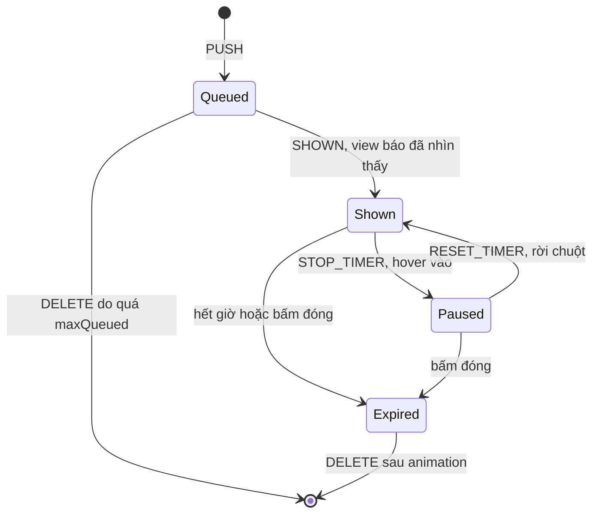

Toast ("Đã lưu bài viết", "Đã sao chép liên kết") trông đơn giản, nhưng làm cho đúng thì có kha khá câu hỏi:

- Gọi `toast()` từ **ngoài React** thế nào (trong hàm gọi API, trong service worker message handler…)?
- 10 toast bắn liên tiếp thì hiện cả 10 chồng lên nhau à?
- Toast tự tắt sau 4 giây, nhưng nếu người dùng **đang đọc** (hover) thì sao?
- Toast đang chờ trong hàng đợi thì đồng hồ có chạy không?
- Toast biến mất thì animation thoát chạy lúc nào, khi phần tử đã bị xoá khỏi state?

Facebook trả lời các câu hỏi này trong `CometToasterStateManager` (thư mục `Toaster/` của [facebook-codebase](https://github.com/hunghg255/facebook-codebase)). Thư mục này còn có `cometPushToast`, `BaseToasterView.react` và `CometToastAnimationInternal.react` cho phía view.

> [!TIP]
> **Tóm tắt**
> - State toast nằm trong một class thuần ngoài React; ai cũng gọi `store.push()` được, kể cả hàm gọi API hay interceptor.
> - Vòng đời: chờ → hiện (lúc này mới đếm giờ) → hết hạn (chạy animation thoát) → xoá. Hàng đợi giữ tối đa N toast chưa hiện.
> - Hover hoặc focus vào toast thì dừng đồng hồ.
> - Cắm vào React bằng `useSyncExternalStore`: snapshot phải bất biến và giữ nguyên tham chiếu khi không đổi.

## Facebook làm thế nào?

**1. Store là class thuần, không dính tới React.** Nó là một singleton (`getInstance()`) với các method `push`, `shown`, `expire`, `hidden`, `delete`, `stopTimer`, `resetTimer`, `addListener`, `getState`. Bên trong, mọi method đều chuyển thành **action** (`{ type: 'PUSH' }`, `{ type: 'SHOWN' }`…) và đi qua một hàm giống reducer. Mỗi lần đổi, state là một **`Map` mới** (immutable), nên view chỉ cần so sánh tham chiếu.

**2. Phát toast từ bất cứ đâu.** `cometPushToast(props, duration = 2750)` gọi thẳng `getInstance().push(<CometToast …/>, duration)`. Không cần hook, không cần context. Thời gian mặc định là **2,75 giây**. Nút đóng của toast gọi `expire(id)`.

**3. Vòng đời một toast:**



**4. Chỉ đếm giờ khi người dùng đã thực sự nhìn thấy.** Timer chỉ bắt đầu ở `SHOWN`. Điều thú vị là `SHOWN` không được gọi lúc toast được render, mà lúc `CometToastAnimationInternal` nhận callback `onVisible` từ `useVisibilityObserver`, tức là khi toast **thực sự nằm trong viewport** (cùng họ với IntersectionObserver ở [bài #1](/blogs/facebook-shared-intersection-observer)). Toast nằm chờ phía sau, hoặc bị che, không bị "hết hạn" trước khi kịp được nhìn thấy.

**5. Giới hạn hàng đợi.** Config `CometMaxEnqueuedToastsSitevarConfig.max = 2`: số toast **chưa hiện** vượt 2 thì toast cũ nhất bị xoá. 10 thông báo "đã lưu" liên tiếp không cần hiện đủ cả 10.

**6. Hết hạn trước, xoá sau.** `EXPIRE` chỉ gắn cờ `expired`, huỷ timer, và hẹn `DELETE` sau **1 giây** để view kịp chạy animation thoát (fade out bằng `useFadeEffect`).

**7. Hover dừng đồng hồ, rời chuột thì đếm lại từ đầu.** `STOP_TIMER` xoá timer. `RESET_TIMER` tạo timer mới với **nguyên `duration`**, không phải thời gian còn lại.

**8. Thông báo cho listener ở độ ưu tiên thường.** Sau mỗi thay đổi, store không gọi listener đồng bộ mà xếp lịch qua `JSScheduler.scheduleNormalPriCallback`. Push 10 toast trong một vòng lặp không gây 10 lần render đồng bộ chen vào giữa code đang chạy.

**9. Nhiều view, một store.** `registerView(handler, priority)` cho phép nhiều nơi cùng render toast (trang chính, cửa sổ chat pop-out…). Chỉ view có priority cao nhất nhận state, các view còn lại nhận state rỗng. Cùng một toast không bao giờ bị hiện hai lần.

**10. View quyết định hiện bao nhiêu.** `BaseToasterView` có `maxVisible` (mặc định **1**) và giữ "slot" ổn định: toast đang hiện ở vị trí nào thì giữ nguyên ở đó, toast mới chỉ lấp vào slot trống. Danh sách không bị nhảy khi một toast ở giữa biến mất.

## Viết lại

Bản viết lại giữ các ý 1–3 và 5–7, dùng `useSyncExternalStore` (API chính thức của React) để "cắm" store vào component. Phần chính của store là các thao tác trên vòng đời:

```ts title=src/lib/toaster.ts
  push(value: T, duration: number | null = 4000): string {
    const id = `toast-${this.nextId++}`;
    let next = [
      ...this.toasts,
      { id, value, duration, shown: false, expired: false, timerVersion: 0, paused: false },
    ];
    const queued = next.filter((t) => !t.shown && !t.expired);
    if (this.maxQueued > 0 && queued.length > this.maxQueued) {
      // Spam 10 toast liên tiếp thì người dùng không cần xem hết: bỏ cái cũ nhất đang chờ.
      next = next.filter((t) => t.id !== queued[0].id);
    }
    this.setToasts(next);
    return id;
  }

  dismiss(id: string) {
    const toast = this.get(id);
    if (!toast || toast.expired) return;
    this.clearTimer(id);
    this.update(id, { expired: true });
    // giữ lại thêm một chút cho animation thoát rồi mới xoá hẳn
    setTimeout(() => this.setToasts(this.toasts.filter((t) => t.id !== id)), this.exitDuration);
  }

  // --- API cho view ---

  /** View báo toast đã thực sự hiện trên màn hình -> lúc này mới bắt đầu đếm giờ. */
  markShown(id: string) {
    const toast = this.get(id);
    if (!toast || toast.shown) return;
    this.update(id, { shown: true });
    this.startTimer(id);
  }

  pause(id: string) {
    const toast = this.get(id);
    if (!toast || toast.expired || toast.paused) return;
    this.clearTimer(id);
    this.update(id, { paused: true });
  }

  resume(id: string) {
    const toast = this.get(id);
    if (!toast || toast.expired || !toast.paused) return;
    this.update(id, { paused: false, timerVersion: toast.timerVersion + 1 });
    this.startTimer(id);
  }

  // --- external store cho useSyncExternalStore ---
```

**Khác bản gốc:**
- **Ý 4 (lúc nào là "đã hiện").** Facebook chỉ gọi `SHOWN` khi toast thực sự nằm trong viewport (`useVisibilityObserver`). Bản viết lại đơn giản hơn: view gọi `markShown` trong `useEffect` ngay sau khi commit. Muốn sát bản gốc, hãy gọi `markShown` trong callback của `observeIntersection` ở [bài #1](/blogs/facebook-shared-intersection-observer).
- **Ý 8 (thông báo listener).** Bản viết lại gọi listener đồng bộ, không qua scheduler (xem mục "Edge case").
- **Dừng khi focus.** Facebook dừng khi hover; bản viết lại dừng cả khi focus nằm trong toast, cho người dùng bàn phím.

::: spoiler Xem toàn bộ src/lib/toaster.ts

```ts title=src/lib/toaster.ts
import { useSyncExternalStore } from 'react';

/**
 * Store quản lý toast, không phụ thuộc React (lấy ý tưởng từ CometToasterStateManager).
 *
 * Vòng đời một toast:
 *   push -> (chờ trong hàng đợi) -> shown (bắt đầu đếm giờ) -> expired (chạy animation thoát)
 *        -> bị xoá khỏi store sau `exitDuration`.
 * Hover vào toast thì dừng đồng hồ, rời chuột thì đếm lại từ đầu.
 */

export interface Toast<T> {
  id: string;
  value: T;
  /** null = không tự tắt */
  duration: number | null;
  shown: boolean;
  expired: boolean;
  /** tăng mỗi lần đồng hồ chạy lại, view dùng làm key để reset thanh progress */
  timerVersion: number;
  paused: boolean;
}

export interface ToastStoreOptions {
  /** số toast tối đa CHƯA hiển thị được giữ trong hàng đợi; vượt quá thì bỏ cái cũ nhất */
  maxQueued?: number;
  exitDuration?: number;
}

export class ToastStore<T> {
  private nextId = 0;
  private toasts: readonly Toast<T>[] = [];
  private timers = new Map<string, ReturnType<typeof setTimeout>>();
  private listeners = new Set<() => void>();
  private maxQueued: number;
  private exitDuration: number;

  constructor({ maxQueued = 2, exitDuration = 300 }: ToastStoreOptions = {}) {
    this.maxQueued = maxQueued;
    this.exitDuration = exitDuration;
  }

  // --- API cho nơi phát toast ---

  push(value: T, duration: number | null = 4000): string {
    const id = `toast-${this.nextId++}`;
    let next = [
      ...this.toasts,
      { id, value, duration, shown: false, expired: false, timerVersion: 0, paused: false },
    ];
    const queued = next.filter((t) => !t.shown && !t.expired);
    if (this.maxQueued > 0 && queued.length > this.maxQueued) {
      // Spam 10 toast liên tiếp thì người dùng không cần xem hết: bỏ cái cũ nhất đang chờ.
      next = next.filter((t) => t.id !== queued[0].id);
    }
    this.setToasts(next);
    return id;
  }

  dismiss(id: string) {
    const toast = this.get(id);
    if (!toast || toast.expired) return;
    this.clearTimer(id);
    this.update(id, { expired: true });
    // giữ lại thêm một chút cho animation thoát rồi mới xoá hẳn
    setTimeout(() => this.setToasts(this.toasts.filter((t) => t.id !== id)), this.exitDuration);
  }

  // --- API cho view ---

  /** View báo toast đã thực sự hiện trên màn hình -> lúc này mới bắt đầu đếm giờ. */
  markShown(id: string) {
    const toast = this.get(id);
    if (!toast || toast.shown) return;
    this.update(id, { shown: true });
    this.startTimer(id);
  }

  pause(id: string) {
    const toast = this.get(id);
    if (!toast || toast.expired || toast.paused) return;
    this.clearTimer(id);
    this.update(id, { paused: true });
  }

  resume(id: string) {
    const toast = this.get(id);
    if (!toast || toast.expired || !toast.paused) return;
    this.update(id, { paused: false, timerVersion: toast.timerVersion + 1 });
    this.startTimer(id);
  }

  // --- external store cho useSyncExternalStore ---

  subscribe = (listener: () => void) => {
    this.listeners.add(listener);
    return () => this.listeners.delete(listener);
  };

  getSnapshot = () => this.toasts;

  // --- nội bộ ---

  private get(id: string) {
    return this.toasts.find((t) => t.id === id);
  }

  private update(id: string, patch: Partial<Toast<T>>) {
    this.setToasts(this.toasts.map((t) => (t.id === id ? { ...t, ...patch } : t)));
  }

  private setToasts(next: readonly Toast<T>[]) {
    // luôn tạo mảng mới (immutable) để useSyncExternalStore nhận ra thay đổi
    this.toasts = next;
    this.listeners.forEach((listener) => listener());
  }

  private startTimer(id: string) {
    const toast = this.get(id);
    if (!toast || toast.duration == null) return;
    this.clearTimer(id);
    this.timers.set(
      id,
      setTimeout(() => this.dismiss(id), toast.duration),
    );
  }

  private clearTimer(id: string) {
    clearTimeout(this.timers.get(id));
    this.timers.delete(id);
  }
}

// Snapshot cho server và lần hydrate đầu: luôn rỗng, cùng một tham chiếu.
const EMPTY: readonly Toast<never>[] = [];
const getServerSnapshot = () => EMPTY;

export function useToasts<T>(store: ToastStore<T>): readonly Toast<T>[] {
  // Không dùng store.getSnapshot làm getServerSnapshot: nếu client đã push toast trước khi
  // hydrate (vd: flash message lúc khởi động), HTML server (rỗng) sẽ lệch với client.
  // React render lần hydrate bằng EMPTY rồi tự cập nhật sang snapshot thật ngay sau đó.
  return useSyncExternalStore(store.subscribe, store.getSnapshot, getServerSnapshot);
}
```

:::

Thêm hai field cho view:

- `paused`: để dừng thanh progress bằng `animation-play-state: paused`.
- `timerVersion`: tăng mỗi khi đồng hồ chạy lại từ đầu. View dùng nó làm `key` cho thanh progress, React tạo lại element nên animation CSS cũng chạy lại từ đầu. Khớp với việc store reset timer về nguyên `duration`.

### Đi qua code

**`push`** tạo toast với `shown: false`, ghép vào **mảng mới** (`[...this.toasts, toast]`), rồi đếm các toast đang chờ (`!shown && !expired`). Vượt `maxQueued` thì lọc bỏ toast chờ **cũ nhất**. Toast đang hiển thị không bao giờ bị bỏ, vì người dùng có thể đang đọc nó.

**`markShown`** là cầu nối duy nhất từ view về store: "toast này đã lên màn hình". Chỉ lúc này `startTimer` mới chạy. Gọi lại lần hai thì bị bỏ qua nhờ `if (toast.shown) return`, nên view gọi thừa trong StrictMode cũng không sao.

**`pause` / `resume`** đều có điều kiện chặn: đã expire thì không pause; chưa pause thì không resume. Chuột di vào rồi ra rất nhanh, hoặc `pointerleave` bắn khi toast đã biến mất, đều không làm hỏng trạng thái.

**`dismiss`** gắn `expired: true` trước, xoá hẳn khỏi mảng sau `exitDuration`. Trong khoảng đó, view vẫn render toast với class `expired` để CSS chạy transition mờ dần.

**`setToasts`** là nơi duy nhất ghi state: gán mảng mới rồi gọi mọi listener. Không method nào sửa `this.toasts` tại chỗ.

**Timer nằm ngoài snapshot.** `timers` là một `Map` riêng, không nằm trong `Toast`. Snapshot chỉ chứa dữ liệu thuần để render. Đưa handle của `setTimeout` vào state vừa vô nghĩa với view, vừa khiến state không serialize được.

Phía view, `Toaster` chỉ lấy snapshot, cắt `maxVisible` toast đầu và báo `markShown`:

```tsx title=src/demos/ToastDemo.tsx
function Toaster({ store, maxVisible }: { store: ToastStore<string>; maxVisible: number }) {
  const toasts = useToasts(store);
  // Hiện tối đa maxVisible toast, phần còn lại nằm chờ trong store.
  const visible = toasts.slice(0, maxVisible);

  useEffect(() => {
    // báo cho store biết toast nào đã lên màn hình -> store mới bắt đầu đếm giờ.
    // deps là `toasts` (tham chiếu ổn định từ store), không phải `visible` (mảng mới mỗi render).
    toasts.slice(0, maxVisible).forEach((t) => !t.shown && store.markShown(t.id));
  }, [toasts, maxVisible, store]);

  // aria-live đặt trên vùng LUÔN tồn tại: trình đọc màn hình chỉ đọc nội dung được chèn vào
  // một live region đã có sẵn, không đọc live region mới xuất hiện kèm nội dung.
  return (
    <ul className='toaster' role='status' aria-live='polite'>
      {visible.map((t) => (
        <ToastItem key={t.id} toast={t} store={store} />
      ))}
    </ul>
  );
}
```

Hai chi tiết đáng chú ý:

- **deps của effect là `toasts`, không phải `visible`.** `toasts.slice()` tạo mảng mới mỗi lần render, nên nếu để `[visible]` làm deps thì effect chạy sau **mọi** lần render. Không sai (vì `markShown` bỏ qua toast đã hiện), nhưng lãng phí, và ngược với chính quy tắc "tham chiếu ổn định" ở phần sau.
- **`aria-live` đặt trên `<ul>` luôn tồn tại**, không đặt trên từng `<li>`. Nhiều trình đọc màn hình chỉ đọc nội dung được **chèn vào** một live region đã có sẵn; một `<li role="status">` mới xuất hiện kèm nội dung thường bị bỏ qua.

`ToastItem` dừng đồng hồ khi chuột ở trên **hoặc** focus ở trong toast (Tab tới nút "Đóng" cũng cần thời gian đọc), và chạy lại khi cả hai đều không còn:

::: spoiler Xem ToastItem (src/demos/ToastDemo.tsx)

```tsx title=src/demos/ToastDemo.tsx
function ToastItem({ toast, store }: { toast: Toast<string>; store: ToastStore<string> }) {
  // Dừng đồng hồ khi chuột ĐANG Ở TRÊN hoặc focus ĐANG Ở TRONG toast (người dùng bàn phím
  // Tab tới nút "Đóng" cũng cần thời gian đọc). Chạy lại khi cả hai đều không còn.
  const hovered = useRef(false);
  const focused = useRef(false);
  const sync = () => {
    if (hovered.current || focused.current) store.pause(toast.id);
    else store.resume(toast.id);
  };

  return (
    <li
      className={`toast${toast.expired ? ' expired' : ''}`}
      onPointerEnter={() => {
        hovered.current = true;
        sync();
      }}
      onPointerLeave={() => {
        hovered.current = false;
        sync();
      }}
      onFocus={() => {
        focused.current = true;
        sync();
      }}
      onBlur={(e) => {
        // focus chuyển giữa các phần tử con của toast thì vẫn tính là đang ở trong
        if (e.currentTarget.contains(e.relatedTarget as Node | null)) return;
        focused.current = false;
        sync();
      }}
    >
      <span>{toast.value}</span>
      <button aria-label='Đóng' onClick={() => store.dismiss(toast.id)}>
        ✕
      </button>
      {toast.duration != null && toast.shown && (
        <div
          key={toast.timerVersion}
          className='toast-progress'
          style={{
            animationDuration: `${toast.duration}ms`,
            animationPlayState: toast.paused ? 'paused' : 'running',
          }}
        />
      )}
    </li>
  );
}
```

:::

## Bên trong `useSyncExternalStore`

```ts
const toasts = useSyncExternalStore(store.subscribe, store.getSnapshot);
```

React gọi `getSnapshot()` **mỗi lần render** và so sánh kết quả với lần trước bằng `Object.is`. Khác nhau thì render lại. Từ đó có ba quy tắc:

**1. Snapshot phải ổn định khi state không đổi.** Nếu `getSnapshot` trả về mảng mới mỗi lần gọi (ví dụ `() => [...this.toasts]` hay `() => this.toasts.filter(...)`), React thấy giá trị "luôn khác". Nó sẽ render lại mãi, và trong dev báo lỗi *"The result of getSnapshot should be cached"*. Store trong bài trả về đúng tham chiếu `this.toasts`, chỉ đổi khi `setToasts` chạy.

**2. Snapshot phải immutable.** Ngược lại, nếu sửa mảng tại chỗ (`this.toasts.push(toast)`), tham chiếu không đổi nên React tưởng không có gì thay đổi và **không render lại**. Đây là lý do mọi thay đổi đều tạo mảng hoặc object mới, giống cách Facebook tạo `new Map(...)` sau mỗi action.

**3. Không bị "tearing" khi render concurrent.** Ở chế độ concurrent (`startTransition`, Suspense), React có thể tạm dừng một lần render giữa chừng rồi tiếp tục sau. Nếu store thay đổi trong khoảng đó, nửa cây đã render với state cũ, nửa còn lại với state mới, và UI "rách" (tearing): hai component hiển thị số toast khác nhau trong cùng một frame. Tự subscribe bằng `useState` + `useEffect` không chặn được chuyện này. `useSyncExternalStore` thì phát hiện snapshot đã đổi trong lúc render và render lại **đồng bộ**, nên cả cây luôn thấy cùng một snapshot. Đó là lý do có hook này, và vì sao các thư viện state (Redux, Zustand…) đều chuyển sang dùng nó.

**SSR.** Khi render trên server, `useSyncExternalStore` cần tham số thứ ba `getServerSnapshot`. Thiếu nó thì React báo lỗi ngay lúc server render. Giá trị này còn được dùng ở **lần hydrate đầu tiên** trên client, nên nó phải trả về đúng thứ server đã render. `useToasts` dùng một mảng rỗng hằng số:

```ts title=src/lib/toaster.ts
// Snapshot cho server và lần hydrate đầu: luôn rỗng, cùng một tham chiếu.
const EMPTY: readonly Toast<never>[] = [];
const getServerSnapshot = () => EMPTY;

export function useToasts<T>(store: ToastStore<T>): readonly Toast<T>[] {
  // Không dùng store.getSnapshot làm getServerSnapshot: nếu client đã push toast trước khi
  // hydrate (vd: flash message lúc khởi động), HTML server (rỗng) sẽ lệch với client.
  // React render lần hydrate bằng EMPTY rồi tự cập nhật sang snapshot thật ngay sau đó.
  return useSyncExternalStore(store.subscribe, store.getSnapshot, getServerSnapshot);
}
```

Vì sao không truyền luôn `store.getSnapshot`? Nếu client đã `push` toast **trước khi** hydrate (ví dụ flash message "Đăng nhập thành công" lúc khởi động), snapshot client sẽ khác HTML rỗng mà server đã render, và React báo lỗi hydration. Với hằng số rỗng, React hydrate khớp với server rồi tự render lại với snapshot thật ngay sau đó.

**Cái giá của `useSyncExternalStore`:** mọi update từ store luôn được render **đồng bộ**, không bọc được trong `startTransition` để React chia nhỏ. Với toast thì không sao (vài phần tử); với store lớn cập nhật liên tục thì nên cân nhắc.

Lưu ý: nếu store là singleton ở module scope, trên server nó được **dùng chung giữa các request**. Đừng `push` toast từ code chạy trên server, nếu không toast của người này có thể lọt sang người khác.

## Tại sao không làm cách khác?

**Sao không dùng Context + `useState` ở `<ToastProvider>`?** Vì khi đó chỉ code **bên trong cây React** mới gọi được `toast()`, thông qua `useToast()`. Hàm `savePost()` trong file `api.ts`, một interceptor của axios, hay handler `message` của service worker đều không có hook để gọi. Thêm nữa, mọi component dùng `useToast()` sẽ render lại khi danh sách toast đổi, trừ khi bạn tách context. Store ngoài React giải quyết cả hai: ai cũng gọi `store.push()` được, và chỉ component subscribe mới render lại.

**Sao timer bắt đầu ở `SHOWN` mà không phải ở `push`?** Giả sử `maxVisible = 1`, người dùng lưu 3 bài liên tiếp. Nếu đếm giờ từ `push`, toast thứ 2 và 3 hết hạn trong lúc còn xếp hàng và **không bao giờ được hiện**. Hoặc chúng chỉ hiện chớp một cái rồi tắt. Đếm từ lúc hiển thị đảm bảo mỗi toast được nhìn thấy đủ `duration`.

**Sao không xoá toast ngay khi hết giờ?** React xoá element khỏi DOM ngay lúc nó biến mất khỏi state, nên không còn gì để chạy animation thoát. Tách `expired` (đang biến mất) khỏi `deleted` (đã biến mất) là cách đơn giản nhất, không cần thư viện animation.

**Sao resume lại đếm từ đầu thay vì thời gian còn lại?** Facebook chọn đếm lại từ đầu, và bản viết lại làm theo. Người dùng vừa rời chuột khỏi toast thường là vừa đọc xong, nên cho thêm trọn thời gian là an toàn. Một số thư viện (như sonner) chọn tiếp tục với thời gian còn lại. Muốn vậy thì lưu `startedAt` và `remaining` trong store, lúc `pause` lấy `remaining -= Date.now() - startedAt`.

**Sao bỏ toast chờ cũ nhất, không phải mới nhất?** Toast mới nhất phản ánh trạng thái mới nhất ("Đã lưu bản nháp lần 5"). Bỏ cái cũ là giữ thông tin còn đúng.

## Edge case và cạm bẫy

- **Gọi `push` trong lúc React đang render.** `setToasts` gọi listener đồng bộ, listener là `forceUpdate` nội bộ của `useSyncExternalStore`. Gọi `push` trong thân một component (không phải trong effect hay event handler) sẽ gây warning *"Cannot update a component while rendering a different component"*. Facebook tránh chuyện này nhờ đẩy việc thông báo qua scheduler. Quy tắc: chỉ gọi `push` trong event handler, effect, hoặc code ngoài React.
- **Timer còn sống khi component unmount.** Timer nằm trong store chứ không trong component. Toaster unmount (đổi layout chẳng hạn) thì timer vẫn chạy và `dismiss` vẫn đúng. Đây là ưu điểm: state toast sống độc lập với cây UI.
- **Store singleton trong test.** Một instance dùng chung cho cả app thì test này để lại toast cho test sau. Facebook có `resetInstance_DO_NOT_USE()` chính vì thế. Trong bài, `ToastStore` là class nên mỗi test `new ToastStore()` là xong.
- **Tab ẩn.** Trình duyệt giới hạn (throttle) `setTimeout` ở tab nền, có thể tới 1 lần/phút ở Chrome sau một thời gian. Toast vẫn tắt, chỉ là muộn hơn. Thường không sao. Nếu cần chính xác, hãy pause mọi toast khi `document.visibilityState === 'hidden'`.
- **Accessibility.** `role="status"` (tương đương `aria-live="polite"`) trên **vùng chứa luôn tồn tại** để trình đọc màn hình đọc toast mà không ngắt lời người dùng. Toast lỗi quan trọng thì dùng một vùng `role="alert"` riêng. Toast có nút hành động ("Hoàn tác") thì đừng tự tắt quá nhanh: WCAG 2.2.1 yêu cầu người dùng điều chỉnh được giới hạn thời gian, và dừng đồng hồ khi hover/focus (như `ToastItem` ở trên) là một cách đáp ứng.

## Demo

Demo đặt "Hiện tối đa" = 3 và `maxQueued` = 2. Bấm **Spam 10 toast** (10 toast cách nhau 120ms): 3 toast đầu hiện ra, hàng đợi giữ tối đa 2 toast, các toast ở giữa bị bỏ. Hover vào một toast (hoặc Tab tới nút ✕ của nó) để giữ nó lại, thanh progress dừng theo. Đổi "Hiện tối đa" để thấy hàng đợi được lấp vào.

<iframe class="demo-frame" src="/demos/facebook-patterns/index.html?theme=dark#/toaster" title="Demo toaster" loading="lazy" style="height: 440px"></iframe>

<p class="demo-links">▶ <a href="/demos/facebook-patterns/index.html#/toaster" target="_blank" rel="noopener">Mở demo toàn màn hình ↗</a> · <a href="https://stackblitz.com/github/hunghg255/blog-hunghg/tree/master/examples/facebook-patterns?file=src/lib/toaster.ts" target="_blank" rel="noopener">Sửa code trên StackBlitz ↗</a> · <a href="https://github.com/hunghg255/blog-hunghg/blob/master/examples/facebook-patterns/src/lib/toaster.ts" target="_blank" rel="noopener">Xem source trên GitHub ↗</a></p>

## Kiểm thử

Vì store không dính tới React, test nó chỉ là test một class với fake timer.

::: spoiler Ví dụ test (bản phác, không có trong repo)

```ts title=toaster.test.ts
import { beforeEach, describe, expect, it, vi } from 'vitest';
import { ToastStore } from './toaster';

describe('ToastStore', () => {
  beforeEach(() => vi.useFakeTimers());

  it('không đếm giờ trước khi được hiện', () => {
    const store = new ToastStore<string>();
    const id = store.push('Đã lưu', 1000);
    vi.advanceTimersByTime(5000);
    expect(store.getSnapshot()[0].expired).toBe(false);

    store.markShown(id);
    vi.advanceTimersByTime(1000);
    expect(store.getSnapshot()[0].expired).toBe(true);
    vi.advanceTimersByTime(300); // exitDuration
    expect(store.getSnapshot()).toHaveLength(0);
  });

  it('giữ tối đa maxQueued toast đang chờ, bỏ cái cũ nhất', () => {
    const store = new ToastStore<string>({ maxQueued: 2 });
    ['a', 'b', 'c', 'd'].forEach((v) => store.push(v));
    expect(store.getSnapshot().map((t) => t.value)).toEqual(['c', 'd']);
  });

  it('pause giữ toast, resume đếm lại từ đầu', () => {
    const store = new ToastStore<string>();
    const id = store.push('x', 1000);
    store.markShown(id);
    vi.advanceTimersByTime(900);
    store.pause(id);
    vi.advanceTimersByTime(10_000);
    store.resume(id);
    vi.advanceTimersByTime(900);
    expect(store.getSnapshot()[0].expired).toBe(false); // còn 100ms
  });

  it('snapshot giữ nguyên tham chiếu khi không đổi', () => {
    const store = new ToastStore<string>();
    expect(store.getSnapshot()).toBe(store.getSnapshot());
  });
});
```

:::

Test cuối nhỏ nhưng quan trọng: nó bảo vệ quy tắc #1 của `useSyncExternalStore`.

## Dùng trong dự án

Tạo một store dùng chung cho cả app và gọi từ bất cứ đâu:

```ts title=toast.ts
export const toastStore = new ToastStore<{ message: string; tone?: 'error' }>();

export const toast = {
  success: (message: string) => toastStore.push({ message }),
  error: (message: string) => toastStore.push({ message, tone: 'error' }, 8000),
};
```

```ts
// trong một hàm gọi API, không cần hook hay context
try {
  await savePost(post);
  toast.success('Đã lưu bài viết');
} catch {
  toast.error('Lưu thất bại, thử lại sau');
}
```

> [!TIP]
> Đây cũng là ý tưởng phía sau [sonner](https://sonner.emilkowal.ski) và `react-hot-toast`: state toast nằm ở module scope, component `<Toaster />` chỉ subscribe để render. `react-hot-toast` thậm chí dùng cả một reducer với các action `ADD_TOAST`, `UPDATE_TOAST`, `DISMISS_TOAST`, `REMOVE_TOAST`, rất giống Facebook. Hiểu pattern này thì bạn tự viết được store cho modal, command palette, notification center…

---

**Series "Học từ mã nguồn Facebook"**

← [#3 Preload code + data khi hover](/blogs/facebook-preload-on-hover) · [#5 Network status + heartbeat backoff](/blogs/facebook-network-status-heartbeat) →

::: spoiler Xem cả series (20 kỹ thuật + bài mở đầu)

*Phần 1*

- [Mở đầu: cách đọc code minify của Facebook](/blogs/learn-from-facebook-source-code)
- [#1 Dùng chung IntersectionObserver + infinite scroll](/blogs/facebook-shared-intersection-observer)
- [#2 useViewportDuration: đo thời gian thực sự được xem](/blogs/facebook-use-viewport-duration)
- [#3 Preload code + data khi hover](/blogs/facebook-preload-on-hover)
- **#4 Toast manager với external store** (bài này)
- [#5 Network status + heartbeat backoff](/blogs/facebook-network-status-heartbeat)
- [#6 ErrorGuard: bắt lỗi theo ngữ cảnh](/blogs/facebook-error-guard)
- [#7 Banzai: gom log theo lô + sendBeacon](/blogs/facebook-batch-logger)
- [#8 Focus trap + Esc theo layer](/blogs/facebook-focus-trap)

*Phần 2*

- [#9 Mẹo calc(… * 9999): container query, line-clamp, mũi tên carousel bằng CSS](/blogs/facebook-css-9999-trick)
- [#10 Thanh cuộn tuỳ biến bằng CSS 3D](/blogs/facebook-css-3d-scrollbar)
- [#11 Modal cuộn bằng window, giữ vị trí trang nền](/blogs/facebook-document-scroll-modal)
- [#12 Popover, tooltip group và hovercard](/blogs/facebook-popover-tooltip)
- [#13 Primitive Pressable + focus-visible](/blogs/facebook-pressable)
- [#14 Tab "Xem thêm" + sticky header bằng IntersectionObserver](/blogs/facebook-priority-tabs-sticky-header)
- [#15 Avatar khoét mask, gradient Messenger, skeleton steps()](/blogs/facebook-visual-tricks)
- [#16 Khung chat không giật](/blogs/facebook-chat-scroller)
- [#17 Thuật toán chọn bố cục collage ảnh](/blogs/facebook-photo-collage-layout)
- [#18 Keep-alive tab trong SPA](/blogs/facebook-keep-alive-tabs)
- [#19 Tự đo Visual Completion & interaction tracing](/blogs/facebook-visual-completion)
- [#20 Router SPA bền bỉ & tải chunk có retry](/blogs/facebook-spa-router-resilient-loading)

:::

Code + demo: [`examples/facebook-patterns`](https://github.com/hunghg255/blog-hunghg/tree/master/examples/facebook-patterns) · [Mở trên StackBlitz](https://stackblitz.com/github/hunghg255/blog-hunghg/tree/master/examples/facebook-patterns)
