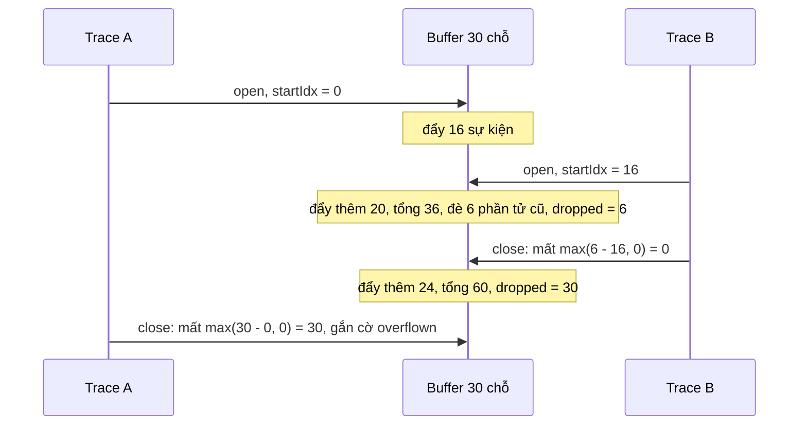

Khi đo hiệu năng phía client, ta thường mở một **trace** cho mỗi tương tác: người dùng bấm "mở chat" thì bắt đầu ghi, chat hiện xong thì dừng và gửi lên server mọi sự kiện xảy ra trong khoảng đó (task nào chạy, chạy bao lâu, ai gọi ai).

Ba vấn đề xuất hiện ngay:

1. Sự kiện đổ về rất nhiều (mỗi lần một hàm được bọc profiler chạy). Không thể giữ mãi trong bộ nhớ.
2. Các trace **chồng lên nhau**: đang đo "mở chat" thì người dùng gõ tìm kiếm, sinh thêm trace "gõ tìm kiếm".
3. Nếu giới hạn bộ nhớ thì một trace dài sẽ bị mất các sự kiện đầu. Gửi lên một trace thiếu dữ liệu mà **không biết là thiếu** thì số liệu phân tích sai.

Facebook giải cả ba bằng một cấu trúc dữ liệu khoảng 100 dòng.

> [!TIP]
> **Tóm tắt**
> - Một ring buffer **dùng chung** (mặc định 5000 phần tử) cho mọi trace, không ai sao chép sự kiện.
> - Đánh số tuyệt đối cho mọi phần tử từng đẩy vào; mỗi trace nhớ số thứ tự lúc mở. Số phần tử đã rời buffer trừ số đó ra đúng số log trace đã mất.
> - Trace đóng mà bị mất log thì gắn cờ `overflown_timeslice_buffer = 1` khi gửi lên, để server loại hoặc đánh dấu.
> - Không trace nào mở thì không ghi gì; trace đóng thì dọn luôn phần không ai cần.

<iframe class="demo-frame" src="/demos/facebook-patterns/index.html?theme=dark#/trace-ring-buffer" title="Demo trace-ring-buffer" loading="lazy" style="height: 620px"></iframe>

<p class="demo-links">▶ <a href="/demos/facebook-patterns/index.html#/trace-ring-buffer" target="_blank" rel="noopener">Mở demo toàn màn hình ↗</a> · <a href="https://stackblitz.com/github/hunghg255/blog-hunghg/tree/master/examples/facebook-patterns?file=src/lib/traceRingBuffer.ts" target="_blank" rel="noopener">Sửa code trên StackBlitz ↗</a> · <a href="https://github.com/hunghg255/blog-hunghg/blob/master/examples/facebook-patterns/src/lib/traceRingBuffer.ts" target="_blank" rel="noopener">Xem source trên GitHub ↗</a></p>

## Facebook làm thế nào?

Ba module trong thư mục `TimeSliceSham/` của [facebook-codebase](https://github.com/hunghg255/codebase/tree/main/facebook-codebase) (bản đầy đủ nằm trong các bundle `1.js`, `22.js`):

- `CircularBuffer`: ring buffer cơ bản có `onEvict`.
- `IntervalTrackingBoundedBuffer`: các "cửa sổ ghi" trên buffer đó.
- `TimeSliceSham`: tạo **một** buffer duy nhất cho cả trang, kích thước lấy từ `Env.timesliceBufferSize`, mặc định 5000.

Nơi dùng là `TimeSliceInteraction` (bundle `237.js`), lớp đại diện cho một interaction trace:

```js
// khi trace bắt đầu (được chọn mẫu)
this.$15 = b("TimeSlice").getBuffer().open();
// khi trace kết thúc
var i = this.$15 != null ? this.$15.close() : [],
    j = this.$15 != null ? this.$15.hasOverflown() : false,
    k = this.$15 != null ? this.$15.getOverflowSize() : 0;
// ... sau đó, lúc trình duyệt rảnh (requestIdleCallbackAcrossTransitions):
this.$10.addStringAnnotation("overflown_timeslice_buffer", f ? "1" : "0");
this.$10.addStringAnnotation("overflown_timeslice_entry_count", "" + h);
```

Vậy là mọi trace gửi lên đều kèm hai cờ cho biết dữ liệu có đầy đủ hay không.

### CircularBuffer

```js
c.write = function (a) {
  this.$3.length < this.$1
    ? this.$3.push(a)                                  // chưa đầy: thêm vào cuối
    : (this.$4.forEach(fn => fn(this.$3[this.$2])),    // đầy: báo onEvict phần tử cũ nhất
       this.$3[this.$2] = a, this.$2++, this.$2 %= this.$1); // đè lên, con trỏ chạy vòng
};
c.read = function () {                                 // thứ tự từ cũ đến mới
  return this.$3.slice(this.$2).concat(this.$3.slice(0, this.$2));
};
```

Không có gì lạ, trừ `onEvict`: buffer báo ra ngoài **mỗi lần** đè một phần tử.

### IntervalTrackingBoundedBuffer

Đây là phần hay. Đổi tên biến cho dễ đọc:

```js
constructor(size = 5000) {
  this.dropped = 0;                         // $6: số phần tử đã rời buffer
  this.buffer = new CircularBuffer(size);
  this.buffer.onEvict(() => this.dropped++);
  this.intervals = [];                      // $2: các cửa sổ đang mở
  this.pushed = 0;                          // $5: tổng số phần tử đã đẩy vào
}
open() {
  const startIdx = this.pushed;             // số thứ tự TUYỆT ĐỐI lúc mở
  return {
    getOverflowSize: () => Math.max(this.dropped - startIdx, 0),
    close: () => /* trả về các phần tử từ startIdx, rồi dọn */,
  };
}
pushElement(el) {
  if (this.intervals.length > 0) { this.buffer.write(el); this.pushed++; }  // không ai nghe thì bỏ
}
```

Hai con số `pushed` và `dropped` mang ý nghĩa rất gọn:

- Phần tử thứ `k` (đánh số từ 0 theo thứ tự đẩy vào) đang nằm ở vị trí `k - dropped` trong buffer.
- Buffer luôn chứa đúng các phần tử có số thứ tự trong khoảng `[dropped, pushed)`.
- Một cửa sổ mở lúc `pushed = s` đã mất `max(dropped - s, 0)` phần tử đầu của nó.

Khi một cửa sổ đóng, ngoài việc trả về dữ liệu, nó còn **dọn rác**: tìm `startIdx` nhỏ nhất của các cửa sổ còn mở; mọi phần tử đứng trước số đó không còn ai cần nên `dropFirst` luôn, đồng thời cộng vào `dropped`. Không còn cửa sổ nào thì buffer rỗng.



Mình đã đọc kỹ phần dọn rác: công thức trong bản gốc là `pos(d) - pos(c)` với `c` là startIdx nhỏ nhất của **mọi** cửa sổ (kể cả cửa sổ đang đóng) và `d` là nhỏ nhất của các cửa sổ **còn lại**. Khi cửa sổ đang đóng không phải cửa sổ mở sớm nhất thì `c = d` và không dọn gì; đúng như mong đợi. Mình không tìm thấy lỗi trong module này.

## Bên trong trình duyệt: vì sao phải giới hạn?

Mỗi sự kiện TimeSlice là một object nhỏ (tên guard, thời điểm bắt đầu, kết thúc…). Một tab Facebook mở cả ngày có thể sinh hàng triệu sự kiện. Nếu mỗi trace tự giữ mảng riêng:

- Trace chồng nhau thì cùng một sự kiện bị giữ ở nhiều mảng (demo đếm con số này ở ô "Mỗi trace một mảng").
- Một trace quên đóng (lỗi logic, người dùng rời trang giữa chừng) sẽ giữ mảng phình mãi, chiếm bộ nhớ mà GC không thu hồi được.

Ring buffer chặn trên bộ nhớ ở một con số cố định, đổi lại là có thể mất dữ liệu. Phần còn lại của thiết kế chỉ để **biết** khi nào mất.

## Viết lại

`CircularBuffer` gần như giữ nguyên bản gốc, chỉ đặt tên rõ hơn (xem file đầy đủ ở cuối mục). `IntervalTrackingBuffer` dùng `pushed`/`dropped` như bản gốc; phần dọn rác viết thẳng bằng "startIndex nhỏ nhất của các cửa sổ còn mở":

```ts title=src/lib/traceRingBuffer.ts
  open(): RecordingWindow<T> {
    const id = this.nextId++;
    const startIndex = this.pushed;
    let closed = false;
    let finalOverflow: number | null = null;
    const window: RecordingWindow<T> = {
      id,
      startIndex,
      getOverflowSize: () => finalOverflow ?? Math.max(this.dropped - startIndex, 0),
      hasOverflown: () => window.getOverflowSize() > 0,
      close: () => {
        if (closed) return [];
        closed = true;
        finalOverflow = Math.max(this.dropped - startIndex, 0);
        return this.closeWindow(id);
      },
    };
    this.windows.push(window);
    return window;
  }

  /** chỉ số tuyệt đối -> vị trí trong buffer hiện tại */
  private position(absoluteIndex: number) {
    return Math.max(absoluteIndex - this.dropped, 0);
  }

  private closeWindow(id: number): T[] {
    const index = this.windows.findIndex((w) => w.id === id);
    if (index === -1) return [];
    const [closing] = this.windows.splice(index, 1);
    const entries = this.buffer.read().slice(this.position(closing.startIndex));

    // Dọn: phần tử nằm trước cửa sổ còn mở sớm nhất thì không ai cần nữa.
    // Không còn cửa sổ nào -> dọn sạch.
    const oldestStillNeeded = this.windows.length
      ? Math.min(...this.windows.map((w) => w.startIndex))
      : this.pushed;
    const removable = this.position(oldestStillNeeded);
    if (removable > 0) {
      this.buffer.dropFirst(removable);
      this.dropped += removable;
    }
    return entries;
  }
}
```

**Khác bản gốc:** `dropFirst` trong bản viết lại không gọi `onEvict` (bản gốc cũng vậy, nhưng cộng `dropped` bằng tay ở hàm đóng). `getOverflowSize` sau khi đóng trả về con số chốt lúc đóng, giống bản gốc. Bỏ phần báo lỗi "messed up state" qua `ErrorPubSub`, thay bằng trả `[]` khi không tìm thấy cửa sổ.

## Tại sao không làm cách khác?

**Mỗi trace một mảng, giới hạn mỗi mảng 5000?** Bộ nhớ tăng theo số trace đang mở, và cùng một sự kiện bị nhân bản. Buffer chung thì bộ nhớ là hằng số.

**Mỗi phần tử ghi kèm số thứ tự, khi đóng thì lọc theo số thứ tự?** Được, nhưng tốn thêm một trường cho mỗi phần tử và một lần duyệt lọc. Bản gốc chỉ cần hai biến đếm cho cả buffer.

**Không cần biết mất bao nhiêu, chỉ cần biết có mất hay không?** Con số `overflown_timeslice_entry_count` giúp phân biệt trace thiếu vài phần tử (vẫn dùng được) với trace mất gần hết. Có lẽ đó là lý do Facebook gửi cả hai.

## Edge case và cạm bẫy

- **Không có cửa sổ nào mở thì không ghi.** Sự kiện xảy ra **trước** khi trace mở sẽ không bao giờ có. Nếu muốn có cả vài giây trước tương tác (ví dụ để xem vì sao click bị trễ) thì phải mở sẵn một cửa sổ "nền" luôn mở và tự cắt.
- **Kích thước buffer.** 5000 là mặc định; Facebook cho server đổi qua `Env.timesliceBufferSize`. Trace càng dài càng dễ mất đầu. Nhìn tỉ lệ trace bị overflown trên dashboard để chỉnh.
- **`read()` sao chép cả buffer.** Mỗi lần đóng là một lần tạo mảng 5000 phần tử. Với vài trace mỗi giây thì không sao; nếu đóng/mở liên tục hàng trăm lần mỗi giây thì nên cắt theo vị trí thay vì `read()` toàn bộ.
- **Đóng hai lần.** Lần hai trả `[]`; đừng dựa vào giá trị trả về lần hai.

## Dùng trong dự án

Đặt buffer ở một module dùng chung, mọi nơi muốn log thì `push`, mọi interaction thì `open`/`close`:

```ts
export const perfBuffer = new IntervalTrackingBuffer<PerfEvent>(5000);

function startInteraction(name: string) {
  const window = perfBuffer.open();
  return () => {
    const events = window.close();
    sendTrace({ name, events, overflown: window.hasOverflown(), lost: window.getOverflowSize() });
  };
}
```

Có thể ghép với bộ gom log ở [Học từ Facebook #7: Banzai](/blogs/facebook-batch-logger) để gửi lên theo lô, và với performance span ở [bài #11 series web](/blogs/web-performance-spans-long-tasks).

## Kiểm thử

::: spoiler Ví dụ test (bản phác, không có trong repo)

```ts
import { describe, expect, it } from 'vitest';
import { CircularBuffer, IntervalTrackingBuffer } from './traceRingBuffer';

describe('CircularBuffer', () => {
  it('đè phần tử cũ nhất và báo onEvict', () => {
    const evicted: number[] = [];
    const buf = new CircularBuffer<number>(3).onEvict((x) => evicted.push(x));
    [1, 2, 3, 4, 5].forEach((x) => buf.write(x));
    expect(buf.read()).toEqual([3, 4, 5]);
    expect(evicted).toEqual([1, 2]);
  });
});

describe('IntervalTrackingBuffer', () => {
  it('trace ngắn đủ dữ liệu, trace dài biết mình mất bao nhiêu', () => {
    const b = new IntervalTrackingBuffer<number>(30);
    const a = b.open();
    for (let i = 0; i < 16; i++) b.push(i);
    const short = b.open();
    for (let i = 16; i < 36; i++) b.push(i);
    expect(short.close()).toHaveLength(20);
    expect(short.getOverflowSize()).toBe(0);
    for (let i = 36; i < 60; i++) b.push(i);
    const entries = a.close();
    expect(entries[0]).toBe(30);
    expect(a.getOverflowSize()).toBe(30);
    expect(b.stats.size).toBe(0); // không còn trace nào: dọn sạch
  });

  it('không có trace nào mở thì không ghi', () => {
    const b = new IntervalTrackingBuffer<number>(10);
    expect(b.push(1)).toBe(false);
    expect(b.stats.pushed).toBe(0);
  });
});
```

:::

## So với chuẩn web và thư viện

- **Performance Timeline** của trình duyệt (`PerformanceObserver`, `performance.getEntries`) cũng dùng buffer có giới hạn: ví dụ `performance.setResourceTimingBufferSize()` và sự kiện `resourcetimingbufferfull` báo khi đầy. Ý tưởng giống nhau: giới hạn bộ nhớ và báo cho người dùng biết đã tràn.
- OpenTelemetry JS có `BatchSpanProcessor` với `maxQueueSize`; khi đầy thì bỏ span mới và đếm số span bị bỏ. Nó giải bài toán "gửi lên", còn buffer của Facebook giải bài toán "nhiều trace đọc chung một nguồn sự kiện".

---

Bài này thuộc series **[Học từ mã nguồn Facebook](/series/facebook)** (58 bài, đọc theo thứ tự).

::: spoiler Xem nhanh danh sách bài trong series

*Phần 1*

- [Mở đầu: cách đọc code minify của Facebook](/blogs/learn-from-facebook-source-code)
- [#1 Dùng chung IntersectionObserver + infinite scroll](/blogs/facebook-shared-intersection-observer)
- [#2 useViewportDuration: đo thời gian thực sự được xem](/blogs/facebook-use-viewport-duration)
- [#3 Preload code + data khi hover](/blogs/facebook-preload-on-hover)
- [#4 Toast manager với external store](/blogs/facebook-toast-manager)
- [#5 Network status + heartbeat backoff](/blogs/facebook-network-status-heartbeat)
- [#6 ErrorGuard: bắt lỗi theo ngữ cảnh](/blogs/facebook-error-guard)
- [#7 Banzai: gom log theo lô + sendBeacon](/blogs/facebook-batch-logger)
- [#8 Focus trap + Esc theo layer](/blogs/facebook-focus-trap)

*Phần 2*

- [#9 Mẹo calc(… * 9999): container query, line-clamp, mũi tên carousel bằng CSS](/blogs/facebook-css-9999-trick)
- [#10 Thanh cuộn tuỳ biến bằng CSS 3D](/blogs/facebook-css-3d-scrollbar)
- [#11 Modal cuộn bằng window, giữ vị trí trang nền](/blogs/facebook-document-scroll-modal)
- [#12 Popover, tooltip group và hovercard](/blogs/facebook-popover-tooltip)
- [#13 Primitive Pressable + focus-visible](/blogs/facebook-pressable)
- [#14 Tab "Xem thêm" + sticky header bằng IntersectionObserver](/blogs/facebook-priority-tabs-sticky-header)
- [#15 Avatar khoét mask, gradient Messenger, skeleton steps()](/blogs/facebook-visual-tricks)
- [#16 Khung chat không giật](/blogs/facebook-chat-scroller)
- [#17 Thuật toán chọn bố cục collage ảnh](/blogs/facebook-photo-collage-layout)
- [#18 Keep-alive tab trong SPA](/blogs/facebook-keep-alive-tabs)
- [#19 Tự đo Visual Completion & interaction tracing](/blogs/facebook-visual-completion)
- [#20 Router SPA bền bỉ & tải chunk có retry](/blogs/facebook-spa-router-resilient-loading)

*Phần 3*

- [#21 Smart Compose: gợi ý chữ mờ khi gõ](/blogs/facebook-smart-compose-ghost-text)
- [#22 MQTT ngay trong trình duyệt, tự chuyển sang long-poll](/blogs/facebook-mqtt-in-browser)
- [#23 Đo thời gian dùng bằng bitmap 64 giây](/blogs/facebook-time-spent-bitmap)
- [#24 Bảng reaction nhấn giữ rồi trượt](/blogs/facebook-reaction-press-slide)
- [#25 Tìm kiếm gấp dấu, phiên âm và highlight đầu từ](/blogs/facebook-search-diacritics-tokenize)
- **#26 Ring buffer biết trace nào đã mất log** (bài này)
- [#27 Engine animation JS: một vòng rAF và solver cubic-bezier](/blogs/facebook-keyframes-loop-cubic-bezier)
- [#28 Bootloader: bitmap tài nguyên đã tải, chỉ reload khi cần](/blogs/facebook-bootloader-bitmap-consistency)
- [#29 Nhận biết click do screen reader tạo ra](/blogs/facebook-virtual-cursor-detection)
- [#30 Tải trước feed theo chất lượng mạng, đoán hạng thiết bị](/blogs/facebook-network-aware-prefetch)
- [#31 Hàng đợi gửi tin chat giữ đúng thứ tự](/blogs/facebook-ordered-send-queue)
- [#32 Gộp lời gọi API trong cùng một tick](/blogs/facebook-api-batcher)
- [#33 Resize ảnh trong pool Web Worker](/blogs/facebook-jpeg-resize-worker-pool)
- [#34 Crop ảnh theo nhiều khuôn mặt](/blogs/facebook-face-aware-crop)
- [#35 Kéo-thả sắp xếp và vùng thả file không nhấp nháy](/blogs/facebook-flicker-free-drag-drop)
- [#36 Tiện ích UI: fade-out, sticky event, hàm huỷ được](/blogs/facebook-ui-utility-hooks)
- [#37 Hạ tầng nhỏ: cookie, hash lỗi, prefetch khi chuột dừng](/blogs/facebook-small-infra-cookie-hash-idle)

*Phần 4–6*

- [#38 Đồng bộ tin nhắn: phát hiện lỗ seqID và fetch bù theo tầng](/blogs/facebook-messenger-sync-seqid-gaps)
- [#39 OTID: ID tin nhắn kiểu Snowflake sinh ở client](/blogs/facebook-otid-client-snowflake)
- [#40 QPL: lấy mẫu từ lúc bắt đầu, đo RTT gửi tin đầu-cuối](/blogs/facebook-qpl-send-rtt)
- [#41 Bộ điều phối request bảy chế độ gộp và chống trùng](/blogs/facebook-request-dispatcher-modes)
- [#42 Thread list theo mốc thời gian, cookie presence có version](/blogs/facebook-threadlist-ranged-presence)
- [#43 Composer dạng plugin: reducer, dirty checker, chuỗi kiểm tra](/blogs/facebook-plugin-composer)
- [#44 Thanh toán bất đồng bộ: subscribe trước, poll dự phòng](/blogs/facebook-async-checkout)
- [#45 Validate số thẻ: sửa lỗi gõ, dải BIN, Luhn](/blogs/facebook-card-validation)
- [#46 Lịch chọn khoảng ngày: bo góc dải chọn, phím đủ bộ, RTL](/blogs/facebook-range-calendar-a11y)
- [#47 Giờ mở cửa theo tuần: qua đêm, gộp khoảng, phần bù](/blogs/facebook-weekly-hours-intervals)
- [#48 Tiến độ đăng realtime: giữ event chờ snapshot, watchdog](/blogs/facebook-realtime-publish-snapshot)
- [#49 Tiền tệ theo đơn vị nhỏ nhất và ô nhập tiền](/blogs/facebook-currency-minor-units)
- [#50 Sửa hàng loạt Empty/Uniform/Mixed, seen/read bằng 2 bit](/blogs/facebook-bulk-edit-seen-bits)
- [#51 Phát hiện script lạ hook vào hàm native](/blogs/facebook-native-hook-detection)
- [#52 localStorage tự dọn khi đầy quota](/blogs/facebook-quota-aware-storage)
- [#53 Cache tuyến do server phân giải, chờ sẵn promise](/blogs/facebook-route-cache-prefetch)
- [#54 Lưới phím mũi tên 2D và focus không làm cuộn trang](/blogs/facebook-focus-table-grid)
- [#55 Tách emoji bằng máy trạng thái](/blogs/facebook-emoji-segmentation)
- [#56 Đọc trước ghi sau trong một frame, con tự biết vị trí](/blogs/facebook-read-then-write-dom)
- [#57 Hàng đợi lệnh cho video và stream sắp lại chunk](/blogs/facebook-video-command-queue)

:::

Code + demo: [`examples/facebook-patterns`](https://github.com/hunghg255/blog-hunghg/tree/master/examples/facebook-patterns) · [Mở trên StackBlitz](https://stackblitz.com/github/hunghg255/blog-hunghg/tree/master/examples/facebook-patterns)
