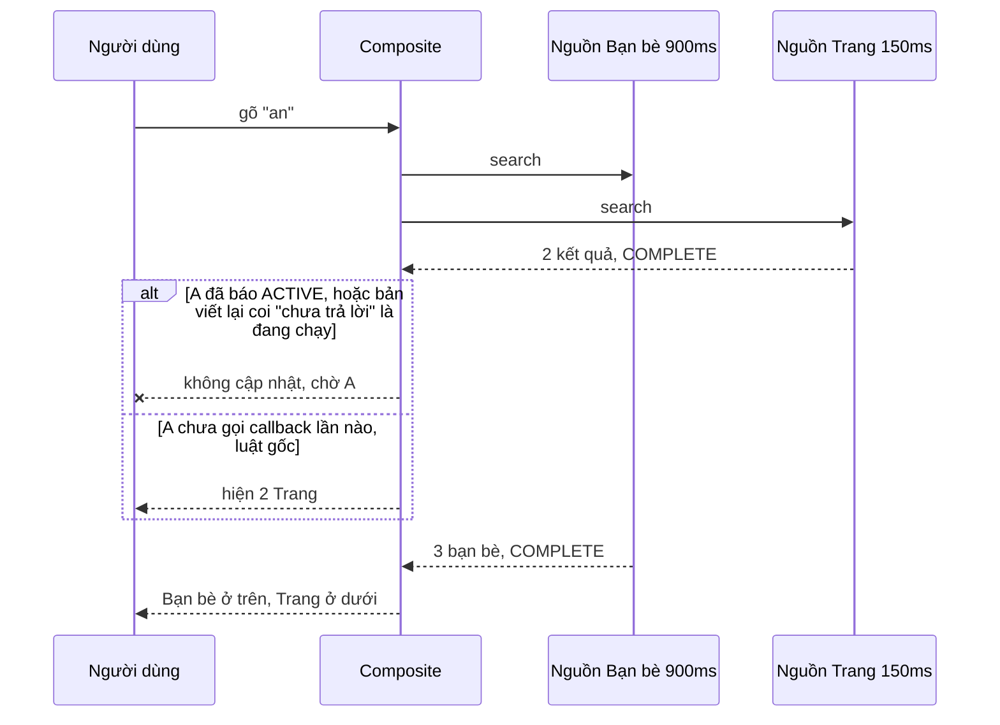

Gõ "ng" vào ô tìm kiếm. Danh sách hiện "Nguyễn An" ở dòng thứ ba, bạn đưa chuột tới định bấm. Đúng lúc đó kết quả "Bạn bè" về muộn, chèn lên trên, "Nguyễn An" tụt xuống dòng thứ sáu và bạn bấm nhầm vào một Trang lạ. Hoặc bạn bấm phím ↓ để chọn, danh sách cuộn, nội dung trượt qua dưới con trỏ chuột đang đứng yên, và mục đang chọn nhảy sang mục nằm dưới chuột.

Typeahead "nhảy" là lỗi giao diện rất phổ biến, và gần như không có cái nào xuất hiện trong unit test. Bài này đọc ba module nhỏ trong ô tìm kiếm của Facebook, mỗi module chống một kiểu nhảy:

> [!TIP]
> **Tóm tắt**
> - **Cache theo tiền tố**: kết quả của "ng" được lọc lại ngay cho "ngu" mà không chờ mạng; kết quả mạng về sau được nối vào **phía sau** để mục đã hiện không đổi chỗ. Bản gốc chuẩn hoá key lúc ghi bằng `trimLeft` nhưng lúc đọc bằng `trim`: query có dấu cách cuối không bao giờ đọc lại được kết quả mạng của nó.
> - **Ghép nhiều nguồn**: nếu một nguồn phía trên chưa xong mà nguồn phía dưới đã có kết quả thì **không cập nhật** danh sách. Muốn bỏ luật này phải bật cờ tên là `allowClownyReflow`. Luật chỉ có tác dụng khi nguồn báo "đang chạy" ngay từ đầu.
> - **Cuộn bằng phím**: đặt `pointer-events: none` cho danh sách 100ms mỗi lần cuộn, để mouseover sinh ra do nội dung trượt không đổi mục đang chọn.
> - Bản viết lại: một hàm chuẩn hoá cho cả đọc lẫn ghi, coi nguồn "chưa trả lời" như "đang chạy", và trả `pointer-events` về giá trị của stylesheet khi xong.

<iframe class="demo-frame" src="/demos/facebook-patterns/index.html?theme=dark#/typeahead-stable-results" title="Demo typeahead-stable-results" loading="lazy" style="height: 900px"></iframe>

<p class="demo-links">▶ <a href="/demos/facebook-patterns/index.html#/typeahead-stable-results" target="_blank" rel="noopener">Mở demo toàn màn hình ↗</a> · <a href="https://stackblitz.com/github/hunghg255/blog-hunghg/tree/master/examples/facebook-patterns?file=src/lib/stableTypeahead.ts" target="_blank" rel="noopener">Sửa code trên StackBlitz ↗</a> · <a href="https://github.com/hunghg255/blog-hunghg/blob/master/examples/facebook-patterns/src/lib/stableTypeahead.ts" target="_blank" rel="noopener">Xem source trên GitHub ↗</a></p>

## Facebook làm thế nào?

### Cache thu hẹp theo tiền tố

`CometSearchTypeaheadBaseQueryDataCacheProvider` (bundle `6.js`). Cache là một `Map` từ query đã chuẩn hoá sang danh sách `{entry, suffix}`, trong đó `suffix` là phần nhãn **còn lại** sau query:

```js
// cometSearchTypeaheadBaseLabelSuffixBuilder
const suffixOf = (entry, query) => {
  const label = entry.getLabel().trimLeft().toLowerCase();
  return query == null || !label.startsWith(query) ? '' : label.slice(query.length);
};

match(query) {
  query = query.trim().toLowerCase();
  const hit = this.map.get(query);
  if (hit != null) return hit.map((x) => x.entry);
  const { prefix, suffix } = this.findCachedPrefix(query); // cắt dần ký tự cuối tới khi gặp key có trong cache
  if (prefix.length > 0) {
    const narrowed = this.map.get(prefix)
      .filter((x) => x.suffix.startsWith(suffix))
      .map((x) => ({ entry: x.entry, suffix: x.suffix.slice(suffix.length) }));
    this.map.set(query, narrowed);
    return narrowed.map((x) => x.entry);
  }
  return [];
}
```

Ý tưởng giống một cây tiền tố (trie) "lười": không dựng cây, chỉ lưu kết quả của những query người dùng đã gõ. Query mới thì lùi về tiền tố dài nhất đã có, lọc tiếp bằng phép `startsWith` trên phần đuôi đã tính sẵn. Gõ "ng" rồi "ngu" rồi "nguy": mỗi phím chỉ lọc vài chục mục, kết quả hiện ngay trong cùng frame.

`add(query, entries)` khi mạng trả về: nếu key đã có thì nối kết quả mạng **sau** kết quả cũ, bỏ trùng (`cometSearchTypeaheadBaseDedupEntries`); nếu chưa có thì lấy kết quả thu hẹp từ tiền tố rồi nối kết quả mạng phía sau. Thứ tự này là chống nhảy: mục người dùng đã thấy (từ cache) giữ nguyên vị trí, mục mới chỉ xuất hiện bên dưới.

Lỗi, đọc code thấy và kiểm lại bằng node:

```js
add(entries, query = '') { query = (query ?? '').trimLeft().toLowerCase(); … this.map.set(query, …) }
match(query)             { query = query.trim().toLowerCase(); … this.map.get(query) … }
```

Người dùng gõ "an " (có dấu cách cuối, rất hay gặp khi định gõ tiếp họ). Kết quả mạng được ghi dưới key `"an "`. Lần đọc sau dùng key `"an"`. Hai key không bao giờ gặp nhau: kết quả mạng cho "an " **không bao giờ** được đọc ra từ cache, mỗi lần gõ lại là một request mới, và nếu "an" chưa từng được hỏi thì danh sách đứng trống dù mạng đã trả lời. Thêm nữa, `remove()` là hàm rỗng.

Một giới hạn thiết kế: phần đuôi chỉ có nghĩa khi **cả nhãn** bắt đầu bằng query. "Trần Nguyễn An" khớp "ng" (nhờ server tìm theo từ) nhưng `suffix` của nó là chuỗi rỗng, và ở "ngu" nó bị lọc mất cho tới khi mạng trả về và chèn lại vào cuối danh sách. Một mục nhảy từ giữa xuống cuối: đúng loại nhảy mà cache muốn tránh.

### Ghép nhiều nguồn mà không reflow

`CompositeSearchSource` (bundle `232.js`) gọi mọi nguồn (bạn bè, nhóm, trang, lịch sử tìm kiếm…) song song. Mỗi nguồn gọi callback nhiều lần với `(results, query, status)`, `status` là `ACTIVE` khi còn chờ thêm hoặc `COMPLETE`. Mỗi lần có nguồn trả về, nó ghép kết quả theo **thứ tự nguồn**, bỏ trùng theo `getUniqueID()`, rồi quyết định có báo ra ngoài không:

```js
shouldEmit(results, statuses) {
  if (this.options.allowClownyReflow === true) return true;
  const firstActive = statuses.findIndex((s) => s === 'ACTIVE');
  if (firstActive !== -1)
    for (let i = firstActive + 1; i < results.length; i++)
      if (results[i].length > 0) return false;   // nguồn dưới có kết quả trong khi nguồn trên còn chạy
  return true;
}
```

Tên cờ nói lên tất cả: cho kết quả nhảy lung tung là "clowny" (kiểu chú hề), muốn làm thì phải tự ký tên vào. Ngoài ra có `skipCallbackOnEmptyResults` để không báo danh sách rỗng khi chưa xong, và `createMemoized` dùng `memoizeWithArgsWeak` để cùng một bộ nguồn thì dùng lại một đối tượng ghép.

Kẽ hở: trạng thái ban đầu của mỗi nguồn là `undefined`, không phải `ACTIVE`. Luật chỉ tìm `ACTIVE`, nên nếu nguồn phía trên **chưa gọi callback lần nào** (đang chờ mạng, chưa có gì trong cache) thì nó không chặn được gì. Nguồn dưới trả trước sẽ hiện trước, rồi bị đẩy xuống khi nguồn trên về. Luật chỉ đúng khi mọi nguồn gọi callback đồng bộ với `ACTIVE` ngay lúc bắt đầu, thường là với kết quả từ cache cục bộ. Các nguồn trong Comet có lẽ đều làm vậy, nhưng `CompositeSearchSource` không tự đảm bảo điều đó. Cột giữa của demo cho thấy chuyện gì xảy ra khi giả định này sai.

### Cuộn mà hover không giật

`SUITokenizerItemListScroller` (bundle `233.js`), toàn bộ:

```js
const timers = new Map();
function scroll(list, item) {
  const current = Scroll.getTop(list);
  const top = Math.max(0, item.offsetTop - list.offsetHeight / 2);
  if (current !== top) {
    list.style.pointerEvents = 'none';
    Scroll.setTop(list, top);
    const id = setTimeout(() => {
      if (timers.get(list) === id) { list.style.pointerEvents = 'all'; timers.delete(list); }
    }, 100);
    timers.set(list, id);
  }
}
function unmount(list) { const id = timers.get(list); id && clearTimeout(id); }
```

Khi nội dung cuộn dưới một con trỏ chuột đứng yên, phần tử nằm dưới con trỏ thay đổi, và trình duyệt bắn `mouseover`/`mouseenter` cho phần tử mới (Chrome làm việc này bằng một "mousemove giả" sau khi cuộn). Danh sách typeahead thường đổi mục đang chọn khi hover, nên bấm ↓ để chọn mục 12 thì mục 15 nằm dưới chuột "cướp" lựa chọn. Tắt `pointer-events` trong 100ms quanh lần cuộn làm danh sách vô hình với chuột đúng lúc đó. `Map` lưu timer mới nhất của mỗi danh sách, nên giữ phím ↓ liên tục thì chỉ timer cuối mới bật lại chuột.

Hai chỗ chưa gọn: gán `'all'` ghi đè mọi giá trị `pointer-events` đặt trong stylesheet (nên gán `''` để trả về stylesheet); `unmount` huỷ timer nhưng **không** trả lại `pointer-events`, nên nếu danh sách được dùng lại sau khi component unmount giữa chừng, nó sẽ không nhận chuột nữa. Công thức `offsetTop − offsetHeight / 2` cũng chưa trừ nửa chiều cao của mục, nên mục nằm hơi dưới tâm.



## Bên trong trình duyệt

Ba loại nhảy có ba nguyên nhân khác nhau:

- **Thứ tự đổi khi dữ liệu về** là chuyện của ứng dụng: chỉ cần quy ước "mục đã hiện không bao giờ bị đẩy xuống", nối thêm thì nối ở cuối.
- **Mouseover khi cuộn** là hành vi chuẩn: đặc tả UI Events coi việc phần tử dưới con trỏ thay đổi (vì cuộn hay vì layout đổi) là lý do bắn sự kiện chuột. Chrome và Firefox bắn sau khi cuộn dừng một nhịp ngắn. Không tắt được bằng API nào khác ngoài `pointer-events`, hoặc bỏ qua hover trong một khoảng ngắn sau khi bấm phím.
- **Layout shift** khi danh sách dài ra hay co lại: đo được bằng `PerformanceObserver` loại `layout-shift` (CLS), nhưng dịch chuyển xảy ra trong vòng 500ms sau thao tác của người dùng (gõ phím) **không** bị tính vào CLS. Typeahead nhảy vì thế thường không hiện trong số liệu Web Vitals, dù người dùng thấy rõ.

## Viết lại

Cache: một hàm chuẩn hoá cho cả đọc lẫn ghi (bỏ dấu tiếng Việt, gộp khoảng trắng). Thay phần đuôi bằng một hàm khớp "đơn điệu" do người dùng truyền vào, mặc định là khớp đầu từ, nên "Trần Nguyễn An" không rơi khỏi danh sách khi gõ thêm:

```ts title=src/lib/stableTypeahead.ts
  /** Tiền tố dài nhất (ngắn hơn key) đã có trong cache. */
  private longestPrefix(key: string): string | undefined {
    for (let n = key.length - 1; n > 0; n--) {
      const p = key.slice(0, n);
      if (this.map.has(p)) return p;
    }
    return undefined;
  }

  private narrow(prefix: string, key: string): T[] {
    const match = this.o.matches ?? wordPrefixMatch;
    return (this.map.get(prefix) ?? []).filter((e) => match(this.o.label(e), key));
  }

  match(query: string): CacheHit<T> {
    const key = this.readKey(query);
    const hit = this.map.get(key);
    if (hit) return { entries: hit, via: 'exact' };
    const prefix = this.longestPrefix(key);
    if (prefix === undefined) return { entries: [], via: 'miss' };
    const entries = this.narrow(prefix, key);
    this.map.set(key, entries); // lần sau gõ lại là trúng ngay
    return { entries, via: 'narrowed', from: prefix };
  }

  /** Kết quả mạng: trộn sau kết quả đã thu hẹp (mục đã hiện giữ nguyên vị trí), bỏ trùng theo id. */
  add(query: string, fromNetwork: T[]) {
    const key = this.writeKey(query);
    const prefix = this.map.has(key) ? key : this.longestPrefix(key);
    const base = prefix === undefined ? [] : prefix === key ? this.map.get(key)! : this.narrow(prefix, key);
    const seen = new Set(base.map(this.o.id));
    this.map.set(key, [...base, ...fromNetwork.filter((e) => !seen.has(this.o.id(e)))]);
  }
```

Ghép nguồn: nguồn chưa xong (kể cả chưa trả lời lần nào) chặn mọi nguồn bên dưới:

```ts title=src/lib/stableTypeahead.ts
export function composeResults<T>(
  snaps: readonly SourceSnapshot<T>[],
  id: (e: T) => string,
  o: ComposeOptions = {},
): { results: T[]; status: 'active' | 'complete'; emit: boolean } {
  const seen = new Set<string>();
  const results: T[] = [];
  for (const s of snaps)
    for (const e of s.results) {
      const k = id(e);
      if (!seen.has(k)) {
        seen.add(k);
        results.push(e);
      }
    }
  const status = snaps.every((s) => s.status === 'complete') ? 'complete' : 'active';
  if (o.allowReflow) return { results, status, emit: true };
  // nguồn đầu tiên chưa xong: mọi nguồn bên dưới nó phải chờ, nếu không sẽ bị đẩy xuống
  const firstOpen = snaps.findIndex((s) => (o.legacyPending ? s.status === 'active' : s.status !== 'complete'));
  const blocked = firstOpen !== -1 && snaps.slice(firstOpen + 1).some((s) => s.results.length > 0);
  return { results, status, emit: !blocked };
}
```

Cuộn:

```ts title=src/lib/stableTypeahead.ts
const locks = new WeakMap<HTMLElement, ReturnType<typeof setTimeout>>();

/**
 * Cuộn để `item` nằm giữa `list`. Trong lúc nội dung trượt dưới con trỏ chuột đứng yên,
 * trình duyệt bắn mouseover/mouseenter; tắt pointer-events một nhịp ngắn để hover không
 * đổi mục đang chọn bằng phím.
 */
export function scrollItemToCenter(list: HTMLElement, item: HTMLElement, lockMs = 100) {
  // list cần position: relative để item.offsetTop tính từ đầu list
  const top = Math.max(0, item.offsetTop - (list.clientHeight - item.offsetHeight) / 2);
  if (Math.abs(list.scrollTop - top) < 1) return;
  if (lockMs > 0) {
    list.style.pointerEvents = 'none';
    clearTimeout(locks.get(list));
    locks.set(
      list,
      setTimeout(() => {
        list.style.pointerEvents = ''; // trả về giá trị của stylesheet, không ghi đè "all"
        locks.delete(list);
      }, lockMs),
    );
  }
  list.scrollTop = top;
}

/** Gọi khi unmount: huỷ timer VÀ trả lại pointer-events. */
export function releaseScrollLock(list: HTMLElement) {
  clearTimeout(locks.get(list));
  locks.delete(list);
  list.style.pointerEvents = '';
}
```

::: spoiler Xem toàn bộ src/lib/stableTypeahead.ts

```ts title=src/lib/stableTypeahead.ts
/**
 * Typeahead không nhảy: cache kết quả theo tiền tố, ghép nhiều nguồn mà không đẩy mục
 * đã hiện xuống dưới, và cuộn bằng phím mà hover không "cướp" mục đang chọn.
 * Ý tưởng học từ CometSearchTypeaheadBaseQueryDataCacheProvider, CompositeSearchSource,
 * SUITokenizerItemListScroller của Facebook; viết lại từ đầu.
 */

// ---------------------------------------------------------------- 1. cache tiền tố

/** Chuẩn hoá MỘT chỗ duy nhất, cho cả lúc ghi lẫn lúc đọc cache. */
export function normalizeQuery(s: string): string {
  return s
    .normalize('NFD')
    .replace(/\p{M}/gu, '')
    .replace(/đ/g, 'd')
    .replace(/Đ/g, 'D')
    .toLowerCase()
    .replace(/\s+/g, ' ')
    .trim();
}

/** Mặc định: mỗi từ của query là tiền tố của một từ trong nhãn ("an ng" khớp "Nguyễn An"). */
export function wordPrefixMatch(label: string, query: string): boolean {
  const words = normalizeQuery(label).split(' ');
  return query.split(' ').every((q) => words.some((w) => w.startsWith(q)));
}

export interface PrefixCacheOptions<T> {
  id: (e: T) => string;
  label: (e: T) => string;
  /**
   * Phải "đơn điệu": khớp query dài thì cũng khớp mọi tiền tố của nó.
   * Nhờ vậy kết quả của "ngu" luôn nằm trong kết quả của "ng" và thu hẹp được.
   */
  matches?: (label: string, normalizedQuery: string) => boolean;
  /** Mô phỏng bản gốc: ghi bằng trimStart, đọc bằng trim. */
  legacyKeys?: boolean;
}

export type CacheHit<T> = { entries: T[]; via: 'exact' | 'narrowed' | 'miss'; from?: string };

export class PrefixCache<T> {
  private map = new Map<string, T[]>();
  constructor(private o: PrefixCacheOptions<T>) {}

  private writeKey(q: string) {
    return this.o.legacyKeys ? q.trimStart().toLowerCase() : normalizeQuery(q);
  }
  private readKey(q: string) {
    return this.o.legacyKeys ? q.trim().toLowerCase() : normalizeQuery(q);
  }

  /** Tiền tố dài nhất (ngắn hơn key) đã có trong cache. */
  private longestPrefix(key: string): string | undefined {
    for (let n = key.length - 1; n > 0; n--) {
      const p = key.slice(0, n);
      if (this.map.has(p)) return p;
    }
    return undefined;
  }

  private narrow(prefix: string, key: string): T[] {
    const match = this.o.matches ?? wordPrefixMatch;
    return (this.map.get(prefix) ?? []).filter((e) => match(this.o.label(e), key));
  }

  match(query: string): CacheHit<T> {
    const key = this.readKey(query);
    const hit = this.map.get(key);
    if (hit) return { entries: hit, via: 'exact' };
    const prefix = this.longestPrefix(key);
    if (prefix === undefined) return { entries: [], via: 'miss' };
    const entries = this.narrow(prefix, key);
    this.map.set(key, entries); // lần sau gõ lại là trúng ngay
    return { entries, via: 'narrowed', from: prefix };
  }

  /** Kết quả mạng: trộn sau kết quả đã thu hẹp (mục đã hiện giữ nguyên vị trí), bỏ trùng theo id. */
  add(query: string, fromNetwork: T[]) {
    const key = this.writeKey(query);
    const prefix = this.map.has(key) ? key : this.longestPrefix(key);
    const base = prefix === undefined ? [] : prefix === key ? this.map.get(key)! : this.narrow(prefix, key);
    const seen = new Set(base.map(this.o.id));
    this.map.set(key, [...base, ...fromNetwork.filter((e) => !seen.has(this.o.id(e)))]);
  }

  keys() {
    return [...this.map.keys()];
  }
  clear() {
    this.map.clear();
  }
}

// ---------------------------------------------------------------- 2. ghép nhiều nguồn

/** pending: chưa trả lần nào; active: đã có một phần, còn chờ mạng; complete: xong. */
export type SourceStatus = 'pending' | 'active' | 'complete';
export interface SourceSnapshot<T> {
  status: SourceStatus;
  results: T[];
}

export interface ComposeOptions {
  /** cho phép nguồn dưới hiện trước rồi bị đẩy xuống ("allowClownyReflow" ở bản gốc) */
  allowReflow?: boolean;
  /** Mô phỏng bản gốc: nguồn chưa trả lần nào không được coi là "còn chạy". */
  legacyPending?: boolean;
}

export function composeResults<T>(
  snaps: readonly SourceSnapshot<T>[],
  id: (e: T) => string,
  o: ComposeOptions = {},
): { results: T[]; status: 'active' | 'complete'; emit: boolean } {
  const seen = new Set<string>();
  const results: T[] = [];
  for (const s of snaps)
    for (const e of s.results) {
      const k = id(e);
      if (!seen.has(k)) {
        seen.add(k);
        results.push(e);
      }
    }
  const status = snaps.every((s) => s.status === 'complete') ? 'complete' : 'active';
  if (o.allowReflow) return { results, status, emit: true };
  // nguồn đầu tiên chưa xong: mọi nguồn bên dưới nó phải chờ, nếu không sẽ bị đẩy xuống
  const firstOpen = snaps.findIndex((s) => (o.legacyPending ? s.status === 'active' : s.status !== 'complete'));
  const blocked = firstOpen !== -1 && snaps.slice(firstOpen + 1).some((s) => s.results.length > 0);
  return { results, status, emit: !blocked };
}

// ---------------------------------------------------------------- 3. cuộn bằng phím

const locks = new WeakMap<HTMLElement, ReturnType<typeof setTimeout>>();

/**
 * Cuộn để `item` nằm giữa `list`. Trong lúc nội dung trượt dưới con trỏ chuột đứng yên,
 * trình duyệt bắn mouseover/mouseenter; tắt pointer-events một nhịp ngắn để hover không
 * đổi mục đang chọn bằng phím.
 */
export function scrollItemToCenter(list: HTMLElement, item: HTMLElement, lockMs = 100) {
  // list cần position: relative để item.offsetTop tính từ đầu list
  const top = Math.max(0, item.offsetTop - (list.clientHeight - item.offsetHeight) / 2);
  if (Math.abs(list.scrollTop - top) < 1) return;
  if (lockMs > 0) {
    list.style.pointerEvents = 'none';
    clearTimeout(locks.get(list));
    locks.set(
      list,
      setTimeout(() => {
        list.style.pointerEvents = ''; // trả về giá trị của stylesheet, không ghi đè "all"
        locks.delete(list);
      }, lockMs),
    );
  }
  list.scrollTop = top;
}

/** Gọi khi unmount: huỷ timer VÀ trả lại pointer-events. */
export function releaseScrollLock(list: HTMLElement) {
  clearTimeout(locks.get(list));
  locks.delete(list);
  list.style.pointerEvents = '';
}
```

:::

## Đi qua code

- `normalizeQuery` là nơi **duy nhất** quyết định key. `legacyKeys` chỉ để demo tái hiện lỗi `trimLeft`/`trim`.
- `match` trả thêm `via` (`exact`, `narrowed`, `miss`) để lớp gọi quyết định có cần hỏi mạng không: `exact` thì không, hai loại còn lại thì có.
- `narrow` dùng `matches(label, query)`. Thu hẹp chỉ đúng khi hàm này đơn điệu: khớp "ngu" thì chắc chắn khớp "ng". Khớp đầu từ, khớp chuỗi con, khớp không dấu đều thoả; khớp mờ theo khoảng cách sửa (fuzzy) thì **không**.
- `add` giữ kết quả cũ (từ cache hoặc thu hẹp) ở đầu và nối kết quả mạng sau, bỏ trùng theo `id`.
- `composeResults` là hàm thuần trên ảnh chụp trạng thái các nguồn; việc gọi nguồn, đếm thời gian, huỷ request cũ là việc của lớp gọi (demo dùng `Promise` và `sleep`).
- `scrollItemToCenter` trừ cả nửa chiều cao của mục khi căn giữa, chỉ khoá chuột khi thật sự cuộn, và trả `pointer-events` về `''`. `releaseScrollLock` dùng khi unmount.

**Khác bản gốc:**

- Key cache chuẩn hoá giống nhau lúc đọc và ghi; có bỏ dấu tiếng Việt (bản gốc chỉ `toLowerCase`, việc bỏ dấu nằm ở tầng tìm kiếm khác, xem [#25](/blogs/facebook-search-diacritics-tokenize)).
- Thu hẹp bằng hàm khớp thay cho phần đuôi của cả nhãn.
- Nguồn chưa trả lời được coi là đang chạy.
- Khoá cuộn dùng `WeakMap` và trả `pointer-events` về stylesheet; có hàm nhả khoá khi unmount.

## Tại sao không làm cách khác?

- **Debounce ô tìm kiếm 300ms**: giảm request nhưng làm mọi phím gõ chậm 300ms; cache tiền tố cho kết quả ngay ở phím đầu tiên sau một query đã có. Hai cách dùng chung được.
- **Chờ mọi nguồn xong rồi mới hiện**: không nhảy, nhưng nhanh bằng nguồn chậm nhất. Luật của Facebook chỉ bắt chờ những nguồn **phía trên**; nếu nguồn nhanh nhất nằm trên cùng (lịch sử tìm kiếm cục bộ) thì người dùng thấy kết quả gần như tức thì.
- **Giữ chỗ cố định cho mỗi nguồn** (mỗi nhóm một khung cao cố định với skeleton): không nhảy, nhưng tốn chỗ khi nguồn rỗng. Hợp với trang kết quả đầy đủ hơn là dropdown nhỏ.
- **Bỏ qua hover trong 300ms sau phím** (thay cho `pointer-events: none`): không đụng CSS, nhưng phải sửa mọi handler hover, và cursor vẫn đổi hình khi lướt qua phần tử có `cursor: pointer`.

## Edge case và cạm bẫy

- **Kết quả mạng bị giới hạn số lượng**: server trả 6 mục cho "n" thì kết quả thu hẹp cho "ng" chỉ là tập con của 6 mục đó, có thể thiếu. Đó là lý do vẫn phải hỏi mạng khi `via === 'narrowed'`, và chỉ bỏ qua mạng khi trúng `exact`.
- **Cache không có hạn**: người dùng đổi tên, kết bạn mới; cache sống suốt phiên sẽ cũ. Xoá cache khi đóng dropdown, hoặc đặt hạn theo thời gian.
- **Request về sai thứ tự**: "ng" về sau "ngu" thì kết quả cũ đè kết quả mới. Demo kiểm `latest.current === value` trước khi hiện; thực tế dùng `AbortController` để huỷ request cũ.
- **`pointer-events: none` làm mất cả cuộn bằng bánh xe** trong 100ms đó, vì sự kiện wheel đi xuyên xuống phần tử bên dưới. Giữ thời gian khoá ngắn.
- **Bàn phím ảo trên di động**: không có hover, nhưng có cuộn bằng tay; luật chống reflow vẫn quan trọng vì ngón tay đang đặt sẵn ở một vị trí.

## Dùng trong dự án

```ts
import { PrefixCache, composeResults, scrollItemToCenter } from './stableTypeahead';

const cache = new PrefixCache<User>({ id: (u) => u.id, label: (u) => u.name });
let controller: AbortController | undefined;

async function onQuery(q: string, render: (users: User[]) => void) {
  const hit = cache.match(q);
  render(hit.entries);                         // ngay lập tức, kể cả khi thu hẹp
  if (hit.via === 'exact') return;
  controller?.abort();
  controller = new AbortController();
  const users = await fetch(`/api/users?q=${encodeURIComponent(q)}`, { signal: controller.signal }).then((r) => r.json());
  cache.add(q, users);
  render(cache.match(q).entries);              // mục cũ giữ chỗ, mục mới ở dưới
}

// khi người dùng bấm phím mũi tên
scrollItemToCenter(listEl, listEl.children[active] as HTMLElement);
```

## Kiểm thử

::: spoiler Ví dụ test (bản phác, không có trong repo)

```ts
import { describe, expect, it } from 'vitest';
import { composeResults, PrefixCache, type SourceSnapshot } from './stableTypeahead';

type P = { id: string; name: string };
const people: P[] = ['Nguyễn An', 'Nguyễn Bình', 'Trần Nguyễn An', 'Lê Ngọc'].map((name, i) => ({ id: String(i), name }));
const make = (legacyKeys = false) => new PrefixCache<P>({ id: (p) => p.id, label: (p) => p.name, legacyKeys });

describe('PrefixCache', () => {
  it('thu hẹp từ tiền tố, giữ cả mục khớp ở từ thứ hai', () => {
    const c = make();
    c.add('ng', people);
    const hit = c.match('ngu');
    expect(hit.via).toBe('narrowed');
    expect(hit.entries.map((p) => p.name)).toEqual(['Nguyễn An', 'Nguyễn Bình', 'Trần Nguyễn An']);
  });

  it('kết quả mạng nối phía sau, không trùng', () => {
    const c = make();
    c.add('ng', people.slice(0, 2));
    c.add('ngu', [people[2], people[0]]);
    expect(c.match('ngu').entries.map((p) => p.id)).toEqual(['0', '1', '2']);
  });

  it('dấu cách cuối: bản sửa đọc lại được, bản gốc thì không', () => {
    const fixed = make();
    fixed.add('an ', [people[0]]);
    expect(fixed.match('an ').via).toBe('exact');
    const legacy = make(true);
    legacy.add('an ', [people[0]]);
    expect(legacy.match('an ').via).toBe('miss');
  });
});

describe('composeResults', () => {
  const s = (status: SourceSnapshot<string>['status'], results: string[]) => ({ status, results });
  const id = (x: string) => x;
  it('nguồn trên chưa trả lời thì không hiện nguồn dưới', () => {
    expect(composeResults([s('pending', []), s('complete', ['b'])], id).emit).toBe(false);
    expect(composeResults([s('pending', []), s('complete', ['b'])], id, { legacyPending: true }).emit).toBe(true);
  });
  it('bỏ trùng theo thứ tự nguồn', () => {
    const r = composeResults([s('complete', ['a', 'b']), s('complete', ['b', 'c'])], id);
    expect(r).toEqual({ results: ['a', 'b', 'c'], status: 'complete', emit: true });
  });
  it('allowReflow luôn hiện', () => {
    expect(composeResults([s('active', []), s('complete', ['b'])], id, { allowReflow: true }).emit).toBe(true);
  });
});
```

:::

## So với thư viện và chuẩn web

- **Downshift, React Aria `useComboBox`, Headless UI Combobox**: lo phần bàn phím, ARIA (`role="combobox"`, `aria-activedescendant`) và cuộn mục vào tầm nhìn; không lo chuyện thứ tự kết quả khi nhiều nguồn trả về lệch giờ.
- **TanStack Query / SWR**: cache theo key chính xác; không có thu hẹp theo tiền tố. Có thể dùng `placeholderData` để hiện kết quả thu hẹp trong lúc chờ.
- **`Element.scrollIntoView({ block: 'center' })`**: căn giữa bằng một dòng, nhưng cuộn cả các tổ tiên cuộn được (có thể kéo cả trang); `scrollIntoViewIfNeeded` không chuẩn. Tự đặt `scrollTop` cho riêng danh sách như bản viết lại thì kiểm soát được hơn.
- **CSS `overflow-anchor`**: giữ vị trí cuộn khi nội dung **phía trên** thay đổi; không giúp gì khi chính danh sách kết quả bị chèn mục.
- Bài liên quan: [#25 Tìm kiếm gấp dấu](/blogs/facebook-search-diacritics-tokenize), [#54 Lưới phím mũi tên 2D](/blogs/facebook-focus-table-grid), [#65 Damerau-Levenshtein](/blogs/facebook-damerau-levenshtein).

---

Bài này thuộc series **[Học từ mã nguồn Facebook](/series/facebook)** (106 bài, đọc theo thứ tự).

::: spoiler Xem nhanh danh sách bài trong series

*Phần 1*

- [Mở đầu: cách đọc code minify của Facebook](/blogs/learn-from-facebook-source-code)
- [#1 Dùng chung IntersectionObserver + infinite scroll](/blogs/facebook-shared-intersection-observer)
- [#2 useViewportDuration: đo thời gian thực sự được xem](/blogs/facebook-use-viewport-duration)
- [#3 Preload code + data khi hover](/blogs/facebook-preload-on-hover)
- [#4 Toast manager với external store](/blogs/facebook-toast-manager)
- [#5 Network status + heartbeat backoff](/blogs/facebook-network-status-heartbeat)
- [#6 ErrorGuard: bắt lỗi theo ngữ cảnh](/blogs/facebook-error-guard)
- [#7 Banzai: gom log theo lô + sendBeacon](/blogs/facebook-batch-logger)
- [#8 Focus trap + Esc theo layer](/blogs/facebook-focus-trap)

*Phần 2*

- [#9 Mẹo calc(… * 9999): container query, line-clamp, mũi tên carousel bằng CSS](/blogs/facebook-css-9999-trick)
- [#10 Thanh cuộn tuỳ biến bằng CSS 3D](/blogs/facebook-css-3d-scrollbar)
- [#11 Modal cuộn bằng window, giữ vị trí trang nền](/blogs/facebook-document-scroll-modal)
- [#12 Popover, tooltip group và hovercard](/blogs/facebook-popover-tooltip)
- [#13 Primitive Pressable + focus-visible](/blogs/facebook-pressable)
- [#14 Tab "Xem thêm" + sticky header bằng IntersectionObserver](/blogs/facebook-priority-tabs-sticky-header)
- [#15 Avatar khoét mask, gradient Messenger, skeleton steps()](/blogs/facebook-visual-tricks)
- [#16 Khung chat không giật](/blogs/facebook-chat-scroller)
- [#17 Thuật toán chọn bố cục collage ảnh](/blogs/facebook-photo-collage-layout)
- [#18 Keep-alive tab trong SPA](/blogs/facebook-keep-alive-tabs)
- [#19 Tự đo Visual Completion & interaction tracing](/blogs/facebook-visual-completion)
- [#20 Router SPA bền bỉ & tải chunk có retry](/blogs/facebook-spa-router-resilient-loading)

*Phần 3*

- [#21 Smart Compose: gợi ý chữ mờ khi gõ](/blogs/facebook-smart-compose-ghost-text)
- [#22 MQTT ngay trong trình duyệt, tự chuyển sang long-poll](/blogs/facebook-mqtt-in-browser)
- [#23 Đo thời gian dùng bằng bitmap 64 giây](/blogs/facebook-time-spent-bitmap)
- [#24 Bảng reaction nhấn giữ rồi trượt](/blogs/facebook-reaction-press-slide)
- [#25 Tìm kiếm gấp dấu, phiên âm và highlight đầu từ](/blogs/facebook-search-diacritics-tokenize)
- [#26 Ring buffer biết trace nào đã mất log](/blogs/facebook-trace-ring-buffer)
- [#27 Engine animation JS: một vòng rAF và solver cubic-bezier](/blogs/facebook-keyframes-loop-cubic-bezier)
- [#28 Bootloader: bitmap tài nguyên đã tải, chỉ reload khi cần](/blogs/facebook-bootloader-bitmap-consistency)
- [#29 Nhận biết click do screen reader tạo ra](/blogs/facebook-virtual-cursor-detection)
- [#30 Tải trước feed theo chất lượng mạng, đoán hạng thiết bị](/blogs/facebook-network-aware-prefetch)
- [#31 Hàng đợi gửi tin chat giữ đúng thứ tự](/blogs/facebook-ordered-send-queue)
- [#32 Gộp lời gọi API trong cùng một tick](/blogs/facebook-api-batcher)
- [#33 Resize ảnh trong pool Web Worker](/blogs/facebook-jpeg-resize-worker-pool)
- [#34 Crop ảnh theo nhiều khuôn mặt](/blogs/facebook-face-aware-crop)
- [#35 Kéo-thả sắp xếp và vùng thả file không nhấp nháy](/blogs/facebook-flicker-free-drag-drop)
- [#36 Tiện ích UI: fade-out, sticky event, hàm huỷ được](/blogs/facebook-ui-utility-hooks)
- [#37 Hạ tầng nhỏ: cookie, hash lỗi, prefetch khi chuột dừng](/blogs/facebook-small-infra-cookie-hash-idle)

*Phần 4–6*

- [#38 Đồng bộ tin nhắn: phát hiện lỗ seqID và fetch bù theo tầng](/blogs/facebook-messenger-sync-seqid-gaps)
- [#39 OTID: ID tin nhắn kiểu Snowflake sinh ở client](/blogs/facebook-otid-client-snowflake)
- [#40 QPL: lấy mẫu từ lúc bắt đầu, đo RTT gửi tin đầu-cuối](/blogs/facebook-qpl-send-rtt)
- [#41 Bộ điều phối request bảy chế độ gộp và chống trùng](/blogs/facebook-request-dispatcher-modes)
- [#42 Thread list theo mốc thời gian, cookie presence có version](/blogs/facebook-threadlist-ranged-presence)
- [#43 Composer dạng plugin: reducer, dirty checker, chuỗi kiểm tra](/blogs/facebook-plugin-composer)
- [#44 Thanh toán bất đồng bộ: subscribe trước, poll dự phòng](/blogs/facebook-async-checkout)
- [#45 Validate số thẻ: sửa lỗi gõ, dải BIN, Luhn](/blogs/facebook-card-validation)
- [#46 Lịch chọn khoảng ngày: bo góc dải chọn, phím đủ bộ, RTL](/blogs/facebook-range-calendar-a11y)
- [#47 Giờ mở cửa theo tuần: qua đêm, gộp khoảng, phần bù](/blogs/facebook-weekly-hours-intervals)
- [#48 Tiến độ đăng realtime: giữ event chờ snapshot, watchdog](/blogs/facebook-realtime-publish-snapshot)
- [#49 Tiền tệ theo đơn vị nhỏ nhất và ô nhập tiền](/blogs/facebook-currency-minor-units)
- [#50 Sửa hàng loạt Empty/Uniform/Mixed, seen/read bằng 2 bit](/blogs/facebook-bulk-edit-seen-bits)
- [#51 Phát hiện script lạ hook vào hàm native](/blogs/facebook-native-hook-detection)
- [#52 localStorage tự dọn khi đầy quota](/blogs/facebook-quota-aware-storage)
- [#53 Cache tuyến do server phân giải, chờ sẵn promise](/blogs/facebook-route-cache-prefetch)
- [#54 Lưới phím mũi tên 2D và focus không làm cuộn trang](/blogs/facebook-focus-table-grid)
- [#55 Tách emoji bằng máy trạng thái](/blogs/facebook-emoji-segmentation)
- [#56 Đọc trước ghi sau trong một frame, con tự biết vị trí](/blogs/facebook-read-then-write-dom)
- [#57 Hàng đợi lệnh cho video và stream sắp lại chunk](/blogs/facebook-video-command-queue)

*Phần 7–10*

- [#58 Ước lượng băng thông EWMA: loại outlier, nhớ qua phiên](/blogs/facebook-bandwidth-ewma-estimator)
- [#59 ABR theo độ tự tin phát và cắt bậc bitrate theo MOS](/blogs/facebook-abr-playback-confidence)
- [#60 Prefetch segment dự đoán từ manifest, parse hộp sidx](/blogs/facebook-dash-predicted-segments)
- [#61 Đọc metadata MP4/MOV ngay trên client](/blogs/facebook-mp4-metadata-client)
- [#62 Upload tiếp tục được: offset, hash dedupe, phát hiện treo](/blogs/facebook-resumable-upload)
- [#63 Fenwick tree: chọn ngẫu nhiên có trọng số và offset dòng](/blogs/facebook-fenwick-weighted-random)
- [#64 Vạch trục số và trục thời gian "đẹp"](/blogs/facebook-nice-axis-ticks)
- [#65 Damerau-Levenshtein theo dải chéo và tự sửa tên gõ sai](/blogs/facebook-damerau-levenshtein)
- [#66 PRNG có seed, shuffle tái lập và lấy mẫu trace](/blogs/facebook-seeded-prng-sampling)
- [#67 Cặp min/max-heap tái dùng vị trí trong danh sách ảo](/blogs/facebook-dual-heap-buffer-set)
- [#68 Memo nhiều đối số bằng Map/WeakMap và interning object](/blogs/facebook-multikey-memo-interning)
- [#69 Thống kê cửa sổ trượt và đại số khoảng thời gian](/blogs/facebook-moving-stat-intervals)
- [#70 Int64 từ hai số 32-bit, decode UTF, offset theo code point](/blogs/facebook-int64-utf-codepoints)
- [#71 Engine múi giờ IANA trên client, phát hiện lệch giờ](/blogs/facebook-client-iana-timezone)
- [#72 Tự cài semver range](/blogs/facebook-semver-range)
- [#73 Auto-link URL, cắt chữ an toàn, giới hạn LaTeX](/blogs/facebook-autolink-safe-truncate)
- [#74 Parser query kiểu PHP chống prototype pollution](/blogs/facebook-php-query-serializer)
- [#75 Popover tự lật theo phần tràn nhỏ nhất](/blogs/facebook-popover-auto-flip)
- [#76 Tiền tố for(;;) chống JSON hijacking, đọc stream](/blogs/facebook-csrf-prefix-streaming)
- [#77 Chống lộ Referer, linkshim, xoá token trên URL](/blogs/facebook-referrer-linkshim-url-scrub)
- [#78 setImmediate bằng postMessage, gom delta chuột theo frame](/blogs/facebook-setimmediate-mouse-batching)
- [#79 Phát hiện crash qua heartbeat, dò proxy cache hỏng](/blogs/facebook-crash-heartbeat-proxy-check)
- [#80 DPR vào cookie cho ảnh @2x, che khoá trong log](/blogs/facebook-dpr-cookie-secret-redaction)
- [#81 Flux waitFor tự viết và proxy có đệm](/blogs/facebook-flux-dispatch-buffered-proxy)
- [#82 Crop đúng tỉ lệ, xoay sticker bằng ma trận](/blogs/facebook-image-crop-rotation-geometry)

*Phần 11–15*

- [#83 Chia subdomain giữa các tab bằng lease, long-poll theo bảng trạng thái](/blogs/facebook-tab-subdomain-lease-longpoll)
- [#84 MQTT QoS1: giữ publish chờ ack, gửi lại khi kết nối lại](/blogs/facebook-mqtt-qos1-republish)
- [#85 Cache Promise gộp request, cache lỗi ngắn, đua dữ liệu nhúng sẵn](/blogs/facebook-promise-cache-preload-race)
- [#86 Lịch retry: backoff có trần, Fibonacci, báo lỗi CDN mỗi N ngày](/blogs/facebook-retry-backoff-schedules)
- [#87 Giữ nguyên tham chiếu nhánh dữ liệu không đổi](/blogs/facebook-relay-recycle-nodes)
- [#88 Store optimistic: copy-on-write, rollback rồi áp lại](/blogs/facebook-relay-optimistic-store)
- [#89 Chỉ mục subscription theo record, hàng đợi task theo chiều sâu](/blogs/facebook-relay-subscription-index)
- [#90 Phân trang connection: cursor khớp đầu, edge không trùng](/blogs/facebook-relay-connection-pagination)
- [#91 Profiler kiểu middleware và memo selector có lấy mẫu kiểm tra](/blogs/facebook-profiler-middleware-memo-check)
- [#92 Đọc EBML/WebM Cues để tìm byte range của segment](/blogs/facebook-webm-ebml-cues)
- [#93 Stream HTTP Range tạm dừng được, tải tiếp đúng byte](/blogs/facebook-pausable-range-stream)
- [#94 Bảng khoảng thời gian gắn nhãn và nhảy qua lỗ buffer](/blogs/facebook-tagged-time-ranges-gaps)
- [#95 Gom chunk cho SourceBuffer, đồng bộ video bằng playbackRate](/blogs/facebook-sourcebuffer-video-sync)
- [#96 Gom tin nhắn thành cụm, vạch ngày và avatar đã xem](/blogs/facebook-message-grouping)
- [#97 Bao nhiêu tab chat vừa màn hình, chuỗi luật mở tab](/blogs/facebook-chat-tab-policy)
- [#98 Phím tắt Markdown trong editor, Backspace để hoàn tác](/blogs/facebook-markdown-shortcuts-editor)
- [#99 Offset theo code point hay UTF-16: bốn bug cùng một gốc](/blogs/facebook-codepoint-offset-bugs)
- **#100 Typeahead không nhảy: cache tiền tố, chặn reflow, khoá hover** (bài này)
- [#101 Hit-test trên canvas bằng phát lại path, nét đứt và cung Bézier](/blogs/facebook-canvas-hit-regions)
- [#102 Vòng tròn theo mét trên bản đồ Mercator](/blogs/facebook-mercator-meter-circles)
- [#103 Dò tính năng trình duyệt: ảnh EXIF 2×1, getter bẫy, scrollbar](/blogs/facebook-feature-probe-tricks)
- [#104 Bug định dạng số và kiểm tra dữ liệu theo locale](/blogs/facebook-locale-validation-bugs)
- [#105 Dispose cho đúng: idle callback, splice(-1), xoá nhầm key](/blogs/facebook-dispose-leak-bugs)

:::

Code + demo: [`examples/facebook-patterns`](https://github.com/hunghg255/blog-hunghg/tree/master/examples/facebook-patterns) · [Mở trên StackBlitz](https://stackblitz.com/github/hunghg255/blog-hunghg/tree/master/examples/facebook-patterns)
