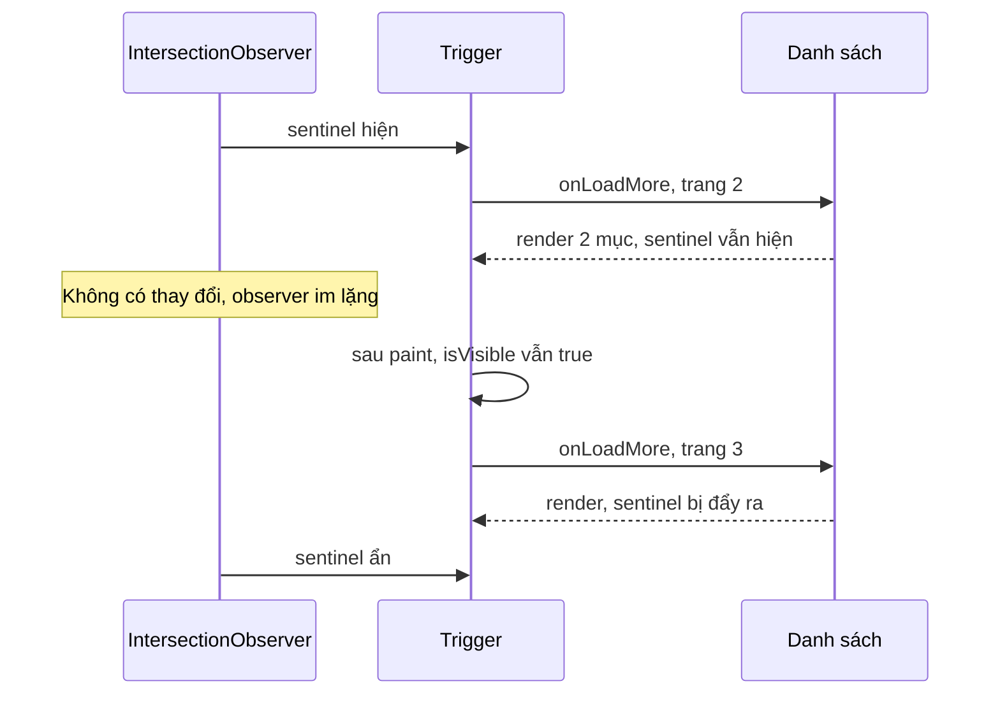

Không phải module nào trong bundle facebook.com cũng là hệ thống lớn. Có những file chỉ 20–80 dòng nhưng được import ở hàng trăm chỗ, vì chúng gỡ đúng những cái bẫy nhỏ mà ai làm UI cũng từng dính:

1. Ẩn một toast bằng fade-out: chờ `transitionend` để gỡ khỏi DOM, rồi một ngày `transitionend` không bao giờ đến, toast vô hình nằm mãi trong DOM.
2. Component mount **sau** khi sự kiện "đã kết nối" phát ra, nên không bao giờ biết là đã kết nối.
3. Callback của request chạy khi component đã unmount.
4. Danh sách vô hạn dừng tải dù vẫn còn dữ liệu, vì trang đầu quá ngắn.

Bài này gom bốn mẩu đó: `useFadeEffect`, `EventHolder`, `createCancelableFunction` và `CometInfiniteScrollTrigger`.

> [!TIP]
> **Tóm tắt**
> - `useFadeEffect`: đổi trạng thái trong `requestAnimationFrame` để transition kịp chạy, chờ `transitionend` để gỡ node, kèm **timeout dự phòng 1 giây** nếu sự kiện đó không bắn.
> - `EventHolder`: giữ lại sự kiện đã phát để listener đăng ký muộn vẫn nhận được (sticky event).
> - `createCancelableFunction`: bọc callback, `.cancel()` thay đích bằng hàm rỗng, khỏi rải cờ `isMounted`.
> - `CometInfiniteScrollTrigger`: IntersectionObserver chỉ báo khi trạng thái **đổi**, nên sau mỗi lần render phải kiểm lại sentinel còn trong màn hình không.

<iframe class="demo-frame" src="/demos/facebook-patterns/index.html?theme=dark#/ui-utilities" title="Demo ui-utilities" loading="lazy" style="height: 900px"></iframe>

<p class="demo-links">▶ <a href="/demos/facebook-patterns/index.html#/ui-utilities" target="_blank" rel="noopener">Mở demo toàn màn hình ↗</a> · <a href="https://stackblitz.com/github/hunghg255/blog-hunghg/tree/master/examples/facebook-patterns?file=src/lib/uiUtilities.ts" target="_blank" rel="noopener">Sửa code trên StackBlitz ↗</a> · <a href="https://github.com/hunghg255/blog-hunghg/blob/master/examples/facebook-patterns/src/lib/uiUtilities.ts" target="_blank" rel="noopener">Xem source trên GitHub ↗</a></p>

Bốn ô, mỗi ô có công tắc để thấy cách làm "ngây thơ" hỏng ở đâu. Ví dụ ô 1: bật "CSS tắt transition" và tắt "Timeout dự phòng", ẩn toast: sau 1,5 giây nó vẫn còn trong DOM. Bật lại timeout thì sau 1 giây nó được gỡ.

## 1. useFadeEffect: fade-out không bị kẹt

### Facebook làm thế nào?

`hooks/useFadeEffect.js` (cũng có trong bundle `26.js`). Đã đổi tên biến:

```js
const FALLBACK_MS = 1000;
// reducer: 'start' -> { isTransitioning: true, shouldBeVisible }, 'finish' -> { isTransitioning: false, … }
function useFadeEffect(isVisible) {
  const [{ isTransitioning, shouldBeVisible }, dispatch] = useReducer(reducer, { isTransitioning: false, shouldBeVisible: false });
  const finish = useCallback(() => { dispatch({ type: 'finish' }); clearTimeout(timer.current); timer.current = null; }, []);
  const start = useCallback((visible) => {
    cancelAnimationFrame(raf.current);
    raf.current = requestAnimationFrame(() => {
      dispatch({ type: 'start', shouldBeVisible: visible });
      raf.current = null;
      clearTimeout(timer.current);
      timer.current = setTimeout(finish, FALLBACK_MS);
    });
  }, [finish]);
  useLayoutEffect_SAFE_FOR_SSR(() => {
    if (prev.current !== isVisible && (!isVisible || nodeRef.current != null)) start(isVisible);
    prev.current = isVisible;
  }, [isVisible, start]);
  const ref = useCallback((node) => {
    /* gắn/gỡ transitionend + webkitTransitionEnd -> finish; nếu đang cần hiện thì start(true) */
  }, [finish, start]);
  return [isTransitioning || shouldBeVisible || isVisible, shouldBeVisible, ref];
}
```

Ba giá trị trả về: **có render không** (đang chạy transition, hoặc đang hiện, hoặc prop yêu cầu hiện), **có ở trạng thái "hiện" không** (để gắn class), và **ref**.

Hai mẹo đáng học:

- **Đổi trạng thái trong `requestAnimationFrame`.** Khi phần tử vừa được thêm vào DOM với `opacity: 0`, nếu đổi ngay sang class `opacity: 1` trong cùng một lượt, trình duyệt chưa tính style lần nào cho trạng thái đầu, nên không có transition: phần tử hiện ra tức thì. Chờ một frame đảm bảo style ban đầu đã được áp.
- **Timeout dự phòng 1 giây.** `transitionend` không bắn khi: phần tử bị `display: none` giữa chừng, transition bị CSS tắt (`transition: none`, `prefers-reduced-motion`), giá trị đầu và cuối giống nhau, hoặc phần tử bị gỡ khỏi DOM. Không có timeout thì `isTransitioning` kẹt ở `true`, node nằm mãi trong DOM.

### Viết lại

```ts title=src/lib/uiUtilities.ts
  const start = useCallback(
    (visible: boolean) => {
      if (raf.current != null) cancelAnimationFrame(raf.current);
      raf.current = requestAnimationFrame(() => {
        raf.current = null;
        dispatch({ type: 'start', visible });
        if (timer.current != null) clearTimeout(timer.current);
        const reduced = window.matchMedia?.('(prefers-reduced-motion: reduce)').matches;
        // fallbackMs = null: chỉ dựa vào transitionend (để demo trường hợp bị kẹt)
        if (reduced) timer.current = setTimeout(finish, 0);
        else if (fallbackMs != null) timer.current = setTimeout(finish, fallbackMs);
      });
    },
    [fallbackMs, finish],
  );

  useLayoutEffect(() => {
    // lúc mở: chờ ref có node (callback ref bên dưới sẽ gọi start); lúc đóng: bắt đầu ngay
    if (prevShow.current !== show && (!show || node.current != null)) start(show);
    prevShow.current = show;
  }, [show, start]);
```

Khác bản gốc: chỉ nhận `transitionend` của chính phần tử (của phần tử con thì bỏ qua, nếu không một transition ngắn trên nút bên trong sẽ kết thúc sớm cả hiệu ứng); timeout chỉnh được; `prefers-reduced-motion` thì kết thúc ngay.

## 2. Sự kiện "dính" cho người đến muộn

### Facebook làm thế nào?

`EventEmitter/EventHolder.js` giữ các sự kiện theo loại, mỗi lần `holdEvent` đẩy thêm một phần tử:

```js
class EventHolder {
  constructor() { this.held = {}; this.currentStack = []; }
  holdEvent(type, ...args) {
    this.held[type] = this.held[type] || [];
    const list = this.held[type];
    const token = { eventType: type, index: list.length };
    list.push(args);
    return token;
  }
  emitToListener(type, listener, context) {
    this.held[type]?.forEach((args, index) => {
      if (!args) return;
      this.currentStack.push({ eventType: type, index });
      listener.apply(context, args);
      this.currentStack.pop();
    });
  }
  releaseCurrentEvent() { this.releaseEvent(this.currentStack[this.currentStack.length - 1]); }
  releaseEvent(token) { delete this.held[token.eventType][token.index]; }
}
```

Một emitter dùng nó (`EventEmitterWithHolding`) có `addRetroactiveListener`: đăng ký xong thì phát lại ngay mọi sự kiện đang được giữ cho listener mới. Đây là mẫu "sticky event" kinh điển: trạng thái kết nối, cấu hình đã tải xong, user đã đăng nhập.

Hai giới hạn: mảng `held[type]` chỉ dài ra, không tự xoá; và `releaseEvent` dùng `delete` để lại "lỗ" trong mảng (giữ chỉ số cho các token khác không đổi, nên phải bỏ qua phần tử rỗng khi duyệt).

### Viết lại

Phần lớn trường hợp chỉ cần **sự kiện mới nhất** của mỗi loại, nên bản viết lại thay mảng bằng một `Map<loại, payload>`:

```ts
emitAndHold(type, payload) { held.set(type, payload); this.emit(type, payload); },
addRetroactiveListener(type, fn) {
  const off = this.addListener(type, fn);
  if (held.has(type)) fn(held.get(type));
  return off;
},
```

Trong demo: phát "đã kết nối", rồi thêm hai widget. Widget dùng `addListener` báo "không biết", widget dùng `addRetroactiveListener` báo đúng "đã kết nối".

## 3. Callback huỷ được

`stylex/createCancelableFunction.js` của Facebook chỉ có 10 dòng:

```js
function createCancelableFunction(fn) {
  let target = fn;
  const wrapped = function (...args) { return target.apply(this, args); };
  wrapped.cancel = () => { target = emptyFunction; };
  return wrapped;
}
```

Truyền `wrapped` cho bất kỳ API nào giữ callback lâu (timer, socket, SDK bên thứ ba, `requestIdleCallback`). Khi component unmount, gọi `wrapped.cancel()`: dù API kia vẫn gọi callback, nó không làm gì. Không cần cờ `isMounted` rải khắp code, không cần API kia hỗ trợ huỷ.

```ts title=src/lib/uiUtilities.ts
export function createCancelableFunction<A extends unknown[], R>(fn: (...args: A) => R): Cancelable<A, R> {
  let target: ((...args: A) => R) | null = fn;
  const wrapped = ((...args: A) => target?.(...args)) as Cancelable<A, R>;
  wrapped.cancel = () => {
    target = null; // nhả tham chiếu tới closure cũ cho GC
  };
  Object.defineProperty(wrapped, 'canceled', { get: () => target === null });
  return wrapped;
}
```

Bản viết lại gán `null` thay vì hàm rỗng để nhả closure cũ cho garbage collector (closure có thể giữ cả cây state lớn), và có thuộc tính `canceled` để debug. Demo: mở rồi đóng nhanh một component có callback 800ms; không dùng hàm huỷ thì callback chạy sau khi đã đóng (đếm được 1), có dùng thì 0.

## 4. Sentinel tải thêm không bị kẹt

### Facebook làm thế nào?

`CometInfiniteScrollTrigger.react` (thư mục `0 00MediaLibrary/MediaList/`, cũng có trong `2.js`, `49.js`):

```js
function CometInfiniteScrollTrigger({ children, hasMore, isLoading, onLoadMore, rootMargin, xstyle }) {
  const isVisible = useRef(false);
  const [startTransition] = useTransition();
  const sentinelRef = useRef(null);
  const load = useCallback(() => {
    startTransition(() => JSTracing.clear(() => onLoadMore(sentinelRef)));
  }, [onLoadMore, startTransition]);

  // sau mỗi lần paint: nếu sentinel vẫn đang hiện thì tải tiếp
  useAfterPaint(useCallback(() => {
    if (hasMore && !isLoading && isVisible.current) load();
  }, [load, isLoading, hasMore]));

  const onVisible = useCallback(() => {
    const was = isVisible.current;
    isVisible.current = true;
    if (!was && hasMore && !isLoading) load();
  }, [hasMore, isLoading, load]);
  const onHidden = useCallback(() => { isVisible.current = false; }, []);
  const observerRef = useVisibilityObserver({ onHidden, onVisible, options: { rootMargin: rootMargin ?? 0 } });

  return hasMore || isLoading ? <div ref={mergeRefs(observerRef, sentinelRef)} className={stylex(xstyle)}>{children}</div> : null;
}
```

Điểm mấu chốt là `useAfterPaint`. IntersectionObserver chỉ gọi callback khi phần tử **đổi** từ ẩn sang hiện hoặc ngược lại. Kịch bản kẹt:

1. Sentinel hiện → tải trang 2.
2. Trang 2 chỉ có 2 mục, không đủ đẩy sentinel ra khỏi màn hình.
3. Sentinel vẫn đang hiện, không có thay đổi nào, observer im lặng. Danh sách dừng ở đó.

Facebook nhớ "đang hiện" trong ref, và sau mỗi lần render đã vẽ xong thì kiểm lại. Hai chi tiết khác: tải trong `startTransition` (React coi việc render trang mới là cập nhật không khẩn cấp, không chặn thao tác của người dùng), và `JSTracing.clear` để lần tải này **không bị tính** vào tracing của tương tác đang đo (người dùng không bấm gì cả, đây là việc nền).



Một rủi ro của bản gốc: nếu `onLoadMore` lỗi và trả `isLoading` về `false` mà `hasMore` vẫn `true`, mỗi lần render sau đó lại tải tiếp, có thể thành vòng lặp gọi API liên tục.

### Viết lại

```ts title=src/lib/uiUtilities.ts
  // sau mỗi lần render: đợi paint xong rồi kiểm lại
  useEffect(() => {
    if (!recheckAfterPaint) return;
    let raf2 = 0;
    const raf1 = requestAnimationFrame(() => {
      raf2 = requestAnimationFrame(() => {
        const { hasMore, isLoading, onLoadMore } = latest.current;
        if (visible.current && hasMore && !isLoading && autoLoads.current < maxAutoLoads) {
          autoLoads.current++;
          onLoadMore();
        }
      });
    });
    return () => {
      cancelAnimationFrame(raf1);
      cancelAnimationFrame(raf2);
    };
  });
```

Khác bản gốc: hai lần `requestAnimationFrame` lồng nhau thay cho `useAfterPaint` (lần rAF thứ hai chạy sau khi frame trước đã vẽ); có `maxAutoLoads` (mặc định 20) chặn vòng lặp khi lỗi hoặc API trả trang rỗng, và đặt lại khi người dùng cuộn làm sentinel ẩn đi. Demo: mỗi trang 2 mục trong khung cao 220px. Tắt "Kiểm lại sau paint" thì dừng ở 4 mục; bật thì tự tải tới khi đầy khung (8 mục) rồi chờ người dùng cuộn.

::: spoiler Xem toàn bộ src/lib/uiUtilities.ts

```ts title=src/lib/uiUtilities.ts
import { useCallback, useEffect, useLayoutEffect, useReducer, useRef } from 'react';

/* -------------------------------------------------------------------------- */
/* 1. useFadeEffect: giữ phần tử trong DOM tới khi fade-out xong               */
/* -------------------------------------------------------------------------- */

/**
 * Ý tưởng từ useFadeEffect của Facebook: trả về [shouldRender, isVisible, ref].
 * - Đổi trạng thái trong requestAnimationFrame để trình duyệt kịp áp style ban đầu
 *   (không thì transition không chạy, phần tử hiện ra ngay).
 * - Kết thúc khi `transitionend`, kèm một timeout dự phòng: nếu transitionend không bao giờ
 *   bắn (phần tử bị display:none, transition bị tắt, tab ẩn…), phần tử vẫn được gỡ.
 * Khác bản gốc: timeout chỉnh được, chỉ nhận transitionend của chính phần tử (không phải con),
 * và bỏ qua animation khi người dùng bật prefers-reduced-motion.
 */
type FadeState = { transitioning: boolean; visible: boolean };
type FadeAction = { type: 'start'; visible: boolean } | { type: 'finish' };

function fadeReducer(state: FadeState, action: FadeAction): FadeState {
  if (action.type === 'start') return { transitioning: true, visible: action.visible };
  return { transitioning: false, visible: state.visible };
}

export function useFadeEffect(show: boolean, { fallbackMs = 1000 }: { fallbackMs?: number | null } = {}) {
  const [state, dispatch] = useReducer(fadeReducer, { transitioning: false, visible: false });
  const node = useRef<HTMLElement | null>(null);
  const raf = useRef<number | null>(null);
  const timer = useRef<ReturnType<typeof setTimeout> | null>(null);
  const prevShow = useRef(false);

  const finish = useCallback(() => {
    if (timer.current != null) clearTimeout(timer.current);
    timer.current = null;
    dispatch({ type: 'finish' });
  }, []);

  const start = useCallback(
    (visible: boolean) => {
      if (raf.current != null) cancelAnimationFrame(raf.current);
      raf.current = requestAnimationFrame(() => {
        raf.current = null;
        dispatch({ type: 'start', visible });
        if (timer.current != null) clearTimeout(timer.current);
        const reduced = window.matchMedia?.('(prefers-reduced-motion: reduce)').matches;
        // fallbackMs = null: chỉ dựa vào transitionend (để demo trường hợp bị kẹt)
        if (reduced) timer.current = setTimeout(finish, 0);
        else if (fallbackMs != null) timer.current = setTimeout(finish, fallbackMs);
      });
    },
    [fallbackMs, finish],
  );

  useLayoutEffect(() => {
    // lúc mở: chờ ref có node (callback ref bên dưới sẽ gọi start); lúc đóng: bắt đầu ngay
    if (prevShow.current !== show && (!show || node.current != null)) start(show);
    prevShow.current = show;
  }, [show, start]);

  useEffect(
    () => () => {
      if (raf.current != null) cancelAnimationFrame(raf.current);
      if (timer.current != null) clearTimeout(timer.current);
    },
    [],
  );

  const onTransitionEnd = useCallback(
    (event: Event) => {
      if (event.target === event.currentTarget) finish();
    },
    [finish],
  );

  const ref = useCallback(
    (el: HTMLElement | null) => {
      node.current?.removeEventListener('transitionend', onTransitionEnd);
      node.current = el;
      if (el) {
        el.addEventListener('transitionend', onTransitionEnd);
        if (prevShow.current) start(true);
      }
    },
    [onTransitionEnd, start],
  );

  const shouldRender = state.transitioning || state.visible || show;
  return [shouldRender, state.visible, ref] as const;
}

/* -------------------------------------------------------------------------- */
/* 2. Sticky event: người đăng ký muộn vẫn nhận sự kiện đã xảy ra             */
/* -------------------------------------------------------------------------- */

/**
 * Ý tưởng từ EventHolder + EventEmitterWithHolding: emitter có thể "giữ" sự kiện;
 * listener đăng ký bằng addRetroactiveListener nhận lại các sự kiện đang được giữ.
 * Khác bản gốc: chỉ giữ sự kiện MỚI NHẤT của mỗi loại (bản gốc giữ hết, mảng phình dần,
 * và release bằng `delete` để lại lỗ trong mảng).
 */
export function createStickyEmitter<Events extends Record<string, unknown>>() {
  type Listener<K extends keyof Events> = (payload: Events[K]) => void;
  const listeners = new Map<keyof Events, Set<Listener<keyof Events>>>();
  const held = new Map<keyof Events, Events[keyof Events]>();

  return {
    emit<K extends keyof Events>(type: K, payload: Events[K]) {
      listeners.get(type)?.forEach((fn) => fn(payload));
    },
    /** phát và giữ lại để listener đến sau vẫn nhận được */
    emitAndHold<K extends keyof Events>(type: K, payload: Events[K]) {
      held.set(type, payload);
      this.emit(type, payload);
    },
    release<K extends keyof Events>(type: K) {
      held.delete(type);
    },
    addListener<K extends keyof Events>(type: K, fn: Listener<K>) {
      if (!listeners.has(type)) listeners.set(type, new Set());
      listeners.get(type)!.add(fn as Listener<keyof Events>);
      return () => {
        listeners.get(type)?.delete(fn as Listener<keyof Events>);
      };
    },
    /** như addListener, nhưng gọi ngay với sự kiện đang được giữ (nếu có) */
    addRetroactiveListener<K extends keyof Events>(type: K, fn: Listener<K>) {
      const off = this.addListener(type, fn);
      if (held.has(type)) fn(held.get(type) as Events[K]);
      return off;
    },
  };
}

/* -------------------------------------------------------------------------- */
/* 3. Hàm huỷ được                                                            */
/* -------------------------------------------------------------------------- */

/**
 * createCancelableFunction của Facebook: bọc callback, `.cancel()` thay đích bằng hàm rỗng.
 * Dùng cho callback bất đồng bộ có thể chạy sau khi component đã unmount, mà không phải
 * rải cờ `isMounted` khắp nơi.
 */
export interface Cancelable<A extends unknown[], R> {
  (...args: A): R | undefined;
  cancel(): void;
  readonly canceled: boolean;
}

export function createCancelableFunction<A extends unknown[], R>(fn: (...args: A) => R): Cancelable<A, R> {
  let target: ((...args: A) => R) | null = fn;
  const wrapped = ((...args: A) => target?.(...args)) as Cancelable<A, R>;
  wrapped.cancel = () => {
    target = null; // nhả tham chiếu tới closure cũ cho GC
  };
  Object.defineProperty(wrapped, 'canceled', { get: () => target === null });
  return wrapped;
}

/* -------------------------------------------------------------------------- */
/* 4. Sentinel tải thêm không bị kẹt                                          */
/* -------------------------------------------------------------------------- */

/**
 * Ý tưởng từ CometInfiniteScrollTrigger: IntersectionObserver chỉ báo khi trạng thái ĐỔI.
 * Nếu trang vừa tải về quá ngắn, sentinel vẫn nằm trong viewport và observer im lặng mãi.
 * Nên nhớ "đang thấy" trong ref, và sau mỗi lần render + paint xong thì kiểm lại.
 *
 * Khác bản gốc: có `maxAutoLoads` để không tải liên tục khi lỗi hoặc khi API trả trang rỗng.
 */
export interface InfiniteTriggerOptions {
  hasMore: boolean;
  isLoading: boolean;
  onLoadMore: () => void;
  rootMargin?: string;
  root?: Element | null;
  /** tắt kiểm lại sau paint để so sánh (cách "ngây thơ") */
  recheckAfterPaint?: boolean;
  /** số lần tự tải liên tiếp tối đa khi người dùng không cuộn */
  maxAutoLoads?: number;
}

export function useInfiniteTrigger<E extends Element>({
  hasMore,
  isLoading,
  onLoadMore,
  rootMargin = '0px',
  root = null,
  recheckAfterPaint = true,
  maxAutoLoads = 20,
}: InfiniteTriggerOptions) {
  const ref = useRef<E>(null);
  const visible = useRef(false);
  const autoLoads = useRef(0);
  const latest = useRef({ hasMore, isLoading, onLoadMore });
  latest.current = { hasMore, isLoading, onLoadMore };

  useEffect(() => {
    const el = ref.current;
    if (!el) return;
    const observer = new IntersectionObserver(
      ([entry]) => {
        const wasVisible = visible.current;
        visible.current = entry.isIntersecting;
        if (!entry.isIntersecting) {
          autoLoads.current = 0; // người dùng đã cuộn: cho phép tự tải lại
          return;
        }
        const { hasMore, isLoading, onLoadMore } = latest.current;
        if (!wasVisible && hasMore && !isLoading) onLoadMore();
      },
      { root, rootMargin },
    );
    observer.observe(el);
    return () => observer.disconnect();
  }, [root, rootMargin]);

  // sau mỗi lần render: đợi paint xong rồi kiểm lại
  useEffect(() => {
    if (!recheckAfterPaint) return;
    let raf2 = 0;
    const raf1 = requestAnimationFrame(() => {
      raf2 = requestAnimationFrame(() => {
        const { hasMore, isLoading, onLoadMore } = latest.current;
        if (visible.current && hasMore && !isLoading && autoLoads.current < maxAutoLoads) {
          autoLoads.current++;
          onLoadMore();
        }
      });
    });
    return () => {
      cancelAnimationFrame(raf1);
      cancelAnimationFrame(raf2);
    };
  });

  return ref;
}
```

:::

## Tại sao không làm cách khác?

**Sao không dùng `animationend`/`transitionend` rồi thôi, đừng timeout?** Vì có quá nhiều tình huống sự kiện không bắn, và hậu quả (node vô hình chặn click, giữ bộ nhớ) khó phát hiện. Timeout dự phòng rẻ và an toàn; con số 1 giây chỉ cần lớn hơn thời lượng transition dài nhất.

**Sao không dùng React state/context thay cho sticky event?** Nếu nguồn sự kiện nằm trong React thì đúng, context là đủ. EventHolder hợp với nguồn **ngoài React** (socket, SDK, service worker) mà nhiều phần độc lập trong trang cùng nghe.

**Sao không dùng AbortController thay cho hàm huỷ?** AbortController tốt khi API hỗ trợ `signal` (fetch, addEventListener). Hàm huỷ dùng được với **mọi** API nhận callback, kể cả API không biết gì về huỷ.

**Sao không dùng `scroll` event cho infinite scroll?** Phải tự tính toán vị trí, chạy rất nhiều lần, và không bắt được trường hợp "trang quá ngắn để cuộn". Ở trường hợp đó cả cách dùng scroll lẫn IntersectionObserver đều cần một lần kiểm lại sau render.

## Edge case và cạm bẫy

- **Fade lúc mount:** nếu prop `show` là `true` ngay từ đầu, cần ref có node rồi mới `start(true)`; cả bản gốc lẫn bản viết lại đều làm việc đó trong callback ref.
- **Nhiều transition cùng lúc** (`opacity` 300ms và `transform` 500ms): `transitionend` bắn hai lần, lần đầu đã gọi `finish`. Nếu cần chính xác, chỉ lắng nghe `event.propertyName` của thuộc tính dài nhất.
- **Sticky event và dữ liệu cũ:** giữ "đã kết nối" thì cũng phải giữ "mất kết nối". `emitAndHold` cho mọi trạng thái của cùng một loại, sự kiện mới đè sự kiện cũ.
- **Sentinel unmount rồi mount lại:** bản viết lại tạo observer một lần theo `root`/`rootMargin`. Nếu sentinel bị tháo ra (hết dữ liệu) rồi gắn lại (lọc lại danh sách), hãy đổi `key` của danh sách để hook chạy lại.

## Dùng trong dự án

```tsx
function Toast({ open, children }: { open: boolean; children: ReactNode }) {
  const [render, visible, ref] = useFadeEffect(open);
  if (!render) return null;
  return <div ref={ref} className={visible ? 'toast in' : 'toast'}>{children}</div>;
}

const connection = createStickyEmitter<{ status: 'online' | 'offline' }>();
socket.onopen = () => connection.emitAndHold('status', 'online');
socket.onclose = () => connection.emitAndHold('status', 'offline');
// component nào mount lúc nào cũng biết trạng thái hiện tại
useEffect(() => connection.addRetroactiveListener('status', setStatus), []);
```

## Kiểm thử

::: spoiler Ví dụ test (bản phác, không có trong repo)

```ts
import { describe, expect, it, vi } from 'vitest';
import { createCancelableFunction, createStickyEmitter } from './uiUtilities';

describe('createStickyEmitter', () => {
  it('listener đăng ký muộn nhận sự kiện đang giữ', () => {
    const e = createStickyEmitter<{ conn: string }>();
    e.emitAndHold('conn', 'online');
    const late = vi.fn();
    const plain = vi.fn();
    e.addListener('conn', plain);
    e.addRetroactiveListener('conn', late);
    expect(plain).not.toHaveBeenCalled();
    expect(late).toHaveBeenCalledWith('online');
  });

  it('release thì listener mới không nhận nữa, hàm huỷ gỡ listener', () => {
    const e = createStickyEmitter<{ conn: string }>();
    e.emitAndHold('conn', 'online');
    e.release('conn');
    const fn = vi.fn();
    const off = e.addRetroactiveListener('conn', fn);
    expect(fn).not.toHaveBeenCalled();
    off();
    e.emit('conn', 'offline');
    expect(fn).not.toHaveBeenCalled();
  });
});

describe('createCancelableFunction', () => {
  it('sau cancel không gọi hàm gốc nữa', () => {
    const fn = vi.fn((x: number) => x * 2);
    const c = createCancelableFunction(fn);
    expect(c(2)).toBe(4);
    c.cancel();
    expect(c(3)).toBeUndefined();
    expect(fn).toHaveBeenCalledTimes(1);
    expect(c.canceled).toBe(true);
  });
});
```

:::

## So với thư viện

- **Fade:** [Framer Motion](https://motion.dev/) `AnimatePresence` và React Transition Group giữ node tới khi animation xong; View Transitions API (`document.startViewTransition`) làm được hiệu ứng vào/ra mà không cần giữ node, đã có ở Chromium và Safari, Firefox thì xem [caniuse](https://caniuse.com/view-transitions).
- **Sticky event:** RxJS gọi đây là `BehaviorSubject` / `ReplaySubject(1)`.
- **Infinite scroll:** [TanStack Virtual](https://tanstack.com/virtual) hay `react-intersection-observer` đều cần cùng một lần kiểm lại khi trang đầu quá ngắn. Bài [#1 dùng chung IntersectionObserver](/blogs/facebook-shared-intersection-observer) có bản infinite scroll dùng chung observer.

---

Bài này thuộc series **[Học từ mã nguồn Facebook](/series/facebook)** (106 bài, đọc theo thứ tự).

::: spoiler Xem nhanh danh sách bài trong series

*Phần 1*

- [Mở đầu: cách đọc code minify của Facebook](/blogs/learn-from-facebook-source-code)
- [#1 Dùng chung IntersectionObserver + infinite scroll](/blogs/facebook-shared-intersection-observer)
- [#2 useViewportDuration: đo thời gian thực sự được xem](/blogs/facebook-use-viewport-duration)
- [#3 Preload code + data khi hover](/blogs/facebook-preload-on-hover)
- [#4 Toast manager với external store](/blogs/facebook-toast-manager)
- [#5 Network status + heartbeat backoff](/blogs/facebook-network-status-heartbeat)
- [#6 ErrorGuard: bắt lỗi theo ngữ cảnh](/blogs/facebook-error-guard)
- [#7 Banzai: gom log theo lô + sendBeacon](/blogs/facebook-batch-logger)
- [#8 Focus trap + Esc theo layer](/blogs/facebook-focus-trap)

*Phần 2*

- [#9 Mẹo calc(… * 9999): container query, line-clamp, mũi tên carousel bằng CSS](/blogs/facebook-css-9999-trick)
- [#10 Thanh cuộn tuỳ biến bằng CSS 3D](/blogs/facebook-css-3d-scrollbar)
- [#11 Modal cuộn bằng window, giữ vị trí trang nền](/blogs/facebook-document-scroll-modal)
- [#12 Popover, tooltip group và hovercard](/blogs/facebook-popover-tooltip)
- [#13 Primitive Pressable + focus-visible](/blogs/facebook-pressable)
- [#14 Tab "Xem thêm" + sticky header bằng IntersectionObserver](/blogs/facebook-priority-tabs-sticky-header)
- [#15 Avatar khoét mask, gradient Messenger, skeleton steps()](/blogs/facebook-visual-tricks)
- [#16 Khung chat không giật](/blogs/facebook-chat-scroller)
- [#17 Thuật toán chọn bố cục collage ảnh](/blogs/facebook-photo-collage-layout)
- [#18 Keep-alive tab trong SPA](/blogs/facebook-keep-alive-tabs)
- [#19 Tự đo Visual Completion & interaction tracing](/blogs/facebook-visual-completion)
- [#20 Router SPA bền bỉ & tải chunk có retry](/blogs/facebook-spa-router-resilient-loading)

*Phần 3*

- [#21 Smart Compose: gợi ý chữ mờ khi gõ](/blogs/facebook-smart-compose-ghost-text)
- [#22 MQTT ngay trong trình duyệt, tự chuyển sang long-poll](/blogs/facebook-mqtt-in-browser)
- [#23 Đo thời gian dùng bằng bitmap 64 giây](/blogs/facebook-time-spent-bitmap)
- [#24 Bảng reaction nhấn giữ rồi trượt](/blogs/facebook-reaction-press-slide)
- [#25 Tìm kiếm gấp dấu, phiên âm và highlight đầu từ](/blogs/facebook-search-diacritics-tokenize)
- [#26 Ring buffer biết trace nào đã mất log](/blogs/facebook-trace-ring-buffer)
- [#27 Engine animation JS: một vòng rAF và solver cubic-bezier](/blogs/facebook-keyframes-loop-cubic-bezier)
- [#28 Bootloader: bitmap tài nguyên đã tải, chỉ reload khi cần](/blogs/facebook-bootloader-bitmap-consistency)
- [#29 Nhận biết click do screen reader tạo ra](/blogs/facebook-virtual-cursor-detection)
- [#30 Tải trước feed theo chất lượng mạng, đoán hạng thiết bị](/blogs/facebook-network-aware-prefetch)
- [#31 Hàng đợi gửi tin chat giữ đúng thứ tự](/blogs/facebook-ordered-send-queue)
- [#32 Gộp lời gọi API trong cùng một tick](/blogs/facebook-api-batcher)
- [#33 Resize ảnh trong pool Web Worker](/blogs/facebook-jpeg-resize-worker-pool)
- [#34 Crop ảnh theo nhiều khuôn mặt](/blogs/facebook-face-aware-crop)
- [#35 Kéo-thả sắp xếp và vùng thả file không nhấp nháy](/blogs/facebook-flicker-free-drag-drop)
- **#36 Tiện ích UI: fade-out, sticky event, hàm huỷ được** (bài này)
- [#37 Hạ tầng nhỏ: cookie, hash lỗi, prefetch khi chuột dừng](/blogs/facebook-small-infra-cookie-hash-idle)

*Phần 4–6*

- [#38 Đồng bộ tin nhắn: phát hiện lỗ seqID và fetch bù theo tầng](/blogs/facebook-messenger-sync-seqid-gaps)
- [#39 OTID: ID tin nhắn kiểu Snowflake sinh ở client](/blogs/facebook-otid-client-snowflake)
- [#40 QPL: lấy mẫu từ lúc bắt đầu, đo RTT gửi tin đầu-cuối](/blogs/facebook-qpl-send-rtt)
- [#41 Bộ điều phối request bảy chế độ gộp và chống trùng](/blogs/facebook-request-dispatcher-modes)
- [#42 Thread list theo mốc thời gian, cookie presence có version](/blogs/facebook-threadlist-ranged-presence)
- [#43 Composer dạng plugin: reducer, dirty checker, chuỗi kiểm tra](/blogs/facebook-plugin-composer)
- [#44 Thanh toán bất đồng bộ: subscribe trước, poll dự phòng](/blogs/facebook-async-checkout)
- [#45 Validate số thẻ: sửa lỗi gõ, dải BIN, Luhn](/blogs/facebook-card-validation)
- [#46 Lịch chọn khoảng ngày: bo góc dải chọn, phím đủ bộ, RTL](/blogs/facebook-range-calendar-a11y)
- [#47 Giờ mở cửa theo tuần: qua đêm, gộp khoảng, phần bù](/blogs/facebook-weekly-hours-intervals)
- [#48 Tiến độ đăng realtime: giữ event chờ snapshot, watchdog](/blogs/facebook-realtime-publish-snapshot)
- [#49 Tiền tệ theo đơn vị nhỏ nhất và ô nhập tiền](/blogs/facebook-currency-minor-units)
- [#50 Sửa hàng loạt Empty/Uniform/Mixed, seen/read bằng 2 bit](/blogs/facebook-bulk-edit-seen-bits)
- [#51 Phát hiện script lạ hook vào hàm native](/blogs/facebook-native-hook-detection)
- [#52 localStorage tự dọn khi đầy quota](/blogs/facebook-quota-aware-storage)
- [#53 Cache tuyến do server phân giải, chờ sẵn promise](/blogs/facebook-route-cache-prefetch)
- [#54 Lưới phím mũi tên 2D và focus không làm cuộn trang](/blogs/facebook-focus-table-grid)
- [#55 Tách emoji bằng máy trạng thái](/blogs/facebook-emoji-segmentation)
- [#56 Đọc trước ghi sau trong một frame, con tự biết vị trí](/blogs/facebook-read-then-write-dom)
- [#57 Hàng đợi lệnh cho video và stream sắp lại chunk](/blogs/facebook-video-command-queue)

*Phần 7–10*

- [#58 Ước lượng băng thông EWMA: loại outlier, nhớ qua phiên](/blogs/facebook-bandwidth-ewma-estimator)
- [#59 ABR theo độ tự tin phát và cắt bậc bitrate theo MOS](/blogs/facebook-abr-playback-confidence)
- [#60 Prefetch segment dự đoán từ manifest, parse hộp sidx](/blogs/facebook-dash-predicted-segments)
- [#61 Đọc metadata MP4/MOV ngay trên client](/blogs/facebook-mp4-metadata-client)
- [#62 Upload tiếp tục được: offset, hash dedupe, phát hiện treo](/blogs/facebook-resumable-upload)
- [#63 Fenwick tree: chọn ngẫu nhiên có trọng số và offset dòng](/blogs/facebook-fenwick-weighted-random)
- [#64 Vạch trục số và trục thời gian "đẹp"](/blogs/facebook-nice-axis-ticks)
- [#65 Damerau-Levenshtein theo dải chéo và tự sửa tên gõ sai](/blogs/facebook-damerau-levenshtein)
- [#66 PRNG có seed, shuffle tái lập và lấy mẫu trace](/blogs/facebook-seeded-prng-sampling)
- [#67 Cặp min/max-heap tái dùng vị trí trong danh sách ảo](/blogs/facebook-dual-heap-buffer-set)
- [#68 Memo nhiều đối số bằng Map/WeakMap và interning object](/blogs/facebook-multikey-memo-interning)
- [#69 Thống kê cửa sổ trượt và đại số khoảng thời gian](/blogs/facebook-moving-stat-intervals)
- [#70 Int64 từ hai số 32-bit, decode UTF, offset theo code point](/blogs/facebook-int64-utf-codepoints)
- [#71 Engine múi giờ IANA trên client, phát hiện lệch giờ](/blogs/facebook-client-iana-timezone)
- [#72 Tự cài semver range](/blogs/facebook-semver-range)
- [#73 Auto-link URL, cắt chữ an toàn, giới hạn LaTeX](/blogs/facebook-autolink-safe-truncate)
- [#74 Parser query kiểu PHP chống prototype pollution](/blogs/facebook-php-query-serializer)
- [#75 Popover tự lật theo phần tràn nhỏ nhất](/blogs/facebook-popover-auto-flip)
- [#76 Tiền tố for(;;) chống JSON hijacking, đọc stream](/blogs/facebook-csrf-prefix-streaming)
- [#77 Chống lộ Referer, linkshim, xoá token trên URL](/blogs/facebook-referrer-linkshim-url-scrub)
- [#78 setImmediate bằng postMessage, gom delta chuột theo frame](/blogs/facebook-setimmediate-mouse-batching)
- [#79 Phát hiện crash qua heartbeat, dò proxy cache hỏng](/blogs/facebook-crash-heartbeat-proxy-check)
- [#80 DPR vào cookie cho ảnh @2x, che khoá trong log](/blogs/facebook-dpr-cookie-secret-redaction)
- [#81 Flux waitFor tự viết và proxy có đệm](/blogs/facebook-flux-dispatch-buffered-proxy)
- [#82 Crop đúng tỉ lệ, xoay sticker bằng ma trận](/blogs/facebook-image-crop-rotation-geometry)

*Phần 11–15*

- [#83 Chia subdomain giữa các tab bằng lease, long-poll theo bảng trạng thái](/blogs/facebook-tab-subdomain-lease-longpoll)
- [#84 MQTT QoS1: giữ publish chờ ack, gửi lại khi kết nối lại](/blogs/facebook-mqtt-qos1-republish)
- [#85 Cache Promise gộp request, cache lỗi ngắn, đua dữ liệu nhúng sẵn](/blogs/facebook-promise-cache-preload-race)
- [#86 Lịch retry: backoff có trần, Fibonacci, báo lỗi CDN mỗi N ngày](/blogs/facebook-retry-backoff-schedules)
- [#87 Giữ nguyên tham chiếu nhánh dữ liệu không đổi](/blogs/facebook-relay-recycle-nodes)
- [#88 Store optimistic: copy-on-write, rollback rồi áp lại](/blogs/facebook-relay-optimistic-store)
- [#89 Chỉ mục subscription theo record, hàng đợi task theo chiều sâu](/blogs/facebook-relay-subscription-index)
- [#90 Phân trang connection: cursor khớp đầu, edge không trùng](/blogs/facebook-relay-connection-pagination)
- [#91 Profiler kiểu middleware và memo selector có lấy mẫu kiểm tra](/blogs/facebook-profiler-middleware-memo-check)
- [#92 Đọc EBML/WebM Cues để tìm byte range của segment](/blogs/facebook-webm-ebml-cues)
- [#93 Stream HTTP Range tạm dừng được, tải tiếp đúng byte](/blogs/facebook-pausable-range-stream)
- [#94 Bảng khoảng thời gian gắn nhãn và nhảy qua lỗ buffer](/blogs/facebook-tagged-time-ranges-gaps)
- [#95 Gom chunk cho SourceBuffer, đồng bộ video bằng playbackRate](/blogs/facebook-sourcebuffer-video-sync)
- [#96 Gom tin nhắn thành cụm, vạch ngày và avatar đã xem](/blogs/facebook-message-grouping)
- [#97 Bao nhiêu tab chat vừa màn hình, chuỗi luật mở tab](/blogs/facebook-chat-tab-policy)
- [#98 Phím tắt Markdown trong editor, Backspace để hoàn tác](/blogs/facebook-markdown-shortcuts-editor)
- [#99 Offset theo code point hay UTF-16: bốn bug cùng một gốc](/blogs/facebook-codepoint-offset-bugs)
- [#100 Typeahead không nhảy: cache tiền tố, chặn reflow, khoá hover](/blogs/facebook-typeahead-stable-results)
- [#101 Hit-test trên canvas bằng phát lại path, nét đứt và cung Bézier](/blogs/facebook-canvas-hit-regions)
- [#102 Vòng tròn theo mét trên bản đồ Mercator](/blogs/facebook-mercator-meter-circles)
- [#103 Dò tính năng trình duyệt: ảnh EXIF 2×1, getter bẫy, scrollbar](/blogs/facebook-feature-probe-tricks)
- [#104 Bug định dạng số và kiểm tra dữ liệu theo locale](/blogs/facebook-locale-validation-bugs)
- [#105 Dispose cho đúng: idle callback, splice(-1), xoá nhầm key](/blogs/facebook-dispose-leak-bugs)

:::

Code + demo: [`examples/facebook-patterns`](https://github.com/hunghg255/blog-hunghg/tree/master/examples/facebook-patterns) · [Mở trên StackBlitz](https://stackblitz.com/github/hunghg255/blog-hunghg/tree/master/examples/facebook-patterns)
