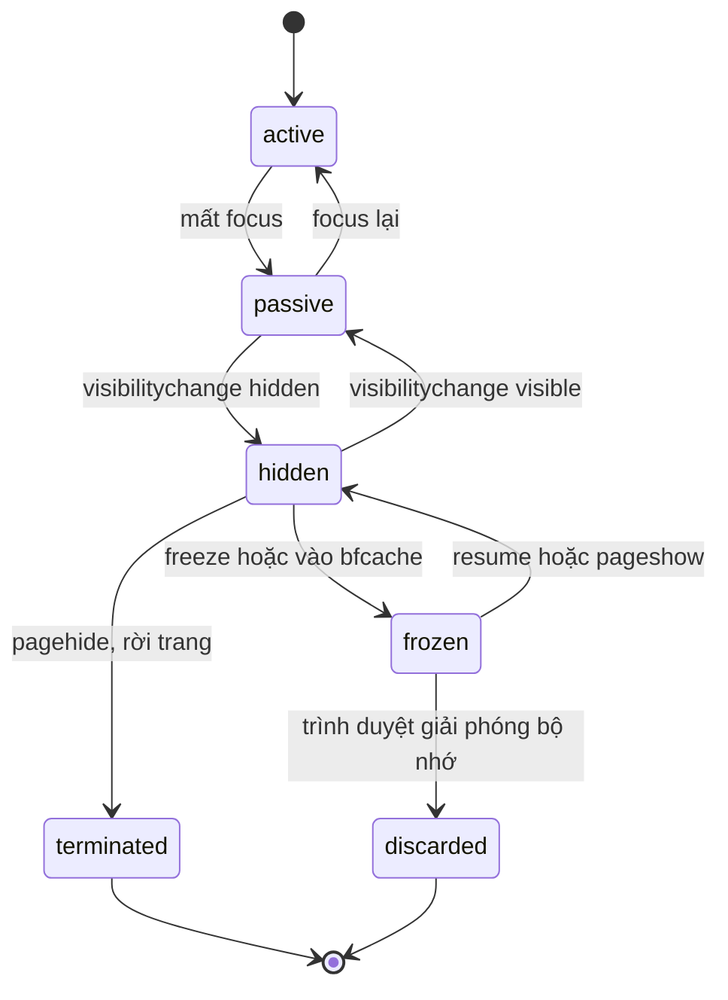
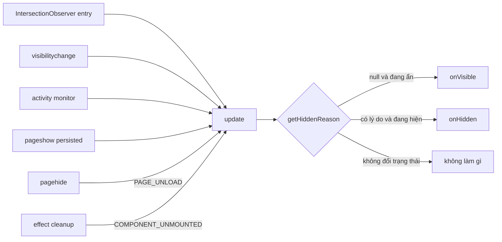

Bạn cần đếm **impression** (một bài viết hoặc quảng cáo đã được xem) hay **thời gian xem** của từng item trong feed. Cách đầu tiên ai cũng nghĩ tới là IntersectionObserver: `isIntersecting` thì bấm giờ, hết intersect thì dừng.

Con số đó sẽ sai theo nhiều cách:

- Người dùng mở feed rồi **chuyển sang tab khác** 30 phút. Element vẫn "giao" với viewport của một tab không ai nhìn.
- Người dùng **bỏ máy đi pha cà phê**, màn hình vẫn sáng.
- Element đang ở `opacity: 0`, kích thước 0 (chưa load xong, đang animate) hoặc bị **header cố định che mất**.
- Bài viết **dài hơn màn hình**: không bao giờ hiện được 50% diện tích, nên không bao giờ được tính, dù người dùng đọc nó cả phút.
- Component **unmount** hoặc **trang đóng** mà không có event "ẩn" nào được gửi. Lượt xem đó mất hẳn.
- Người dùng bấm **Back** quay lại trang cũ từ bfcache. Không có gì mount lại, nên không có gì bắt đầu đếm lại.

Hook `useViewportDuration` của Facebook (thư mục `useViewportDuration/` và `Scroll/` trong [facebook-codebase](https://github.com/hunghg255/facebook-codebase)) là một ví dụ rất tốt về cách xử lý vấn đề này một cách có hệ thống.

## Bên trong trình duyệt: "đang được xem" gồm những gì?

Có ba lớp tín hiệu, mỗi lớp đến từ một API khác nhau.

**1. Hình học: IntersectionObserver.** Như đã nói ở [bài #1](/blogs/facebook-shared-intersection-observer), observer chỉ báo khi tỉ lệ hiển thị **vượt qua một mốc threshold**, và chỉ chạy ở bước *update the rendering* của event loop. Nó **không biết** tab có đang hiện hay không. Với tab nền, trình duyệt thậm chí có thể không render frame nào, nên cũng không có entry mới.

**2. Vòng đời trang: Page Lifecycle API.** Một trang đi qua các trạng thái sau:



Những điểm cần nhớ:

- **`visibilitychange` → `hidden` là sự kiện cuối cùng đáng tin cậy.** Trên mobile, người dùng chuyển app hoặc vuốt tắt tab thì thường **không có** `pagehide` hay `unload`, nhưng `visibilitychange` gần như luôn có. Mọi thứ cần lưu hoặc gửi phải làm ở đây.
- **`pagehide`** bắn khi rời trang, kể cả khi trang được cất vào **bfcache** (back/forward cache). Khi đó `event.persisted === true`.
- **`unload`** không đáng tin trên mobile. Ở nhiều trình duyệt, chỉ cần có listener `unload` là trang **không được vào bfcache**, và Chrome đang loại bỏ dần event này. Đừng dùng.
- **bfcache** giữ nguyên toàn bộ trang trong bộ nhớ: DOM, state JS, cây React. Bấm Back thì trang hiện lại ngay lập tức với `pageshow` (`persisted: true`). **Không có component nào mount lại, không effect nào chạy lại.** Code nào chỉ bắt đầu đo trong `useEffect` lúc mount sẽ im lặng suốt phần còn lại của phiên.

**3. Người dùng: có ai đang ngồi trước màn hình không?** Không có API chuẩn nào cho việc này (Idle Detection API cần quyền và chỉ có ở Chromium). Cách thực tế là theo dõi input: chuột, phím, cuộn, chạm. Không có input trong N giây thì coi là không hoạt động.

## Facebook làm thế nào?

Ý chính: **"visible" là kết quả của nhiều điều kiện**, và mỗi lần chuyển sang "hidden" phải có **lý do**. Hàm kiểm tra của họ trả về **lý do đầu tiên** khiến element bị coi là ẩn, theo đúng thứ tự sau:

| Thứ tự | Lý do | Khi nào |
| --- | --- | --- |
| 1 | `USER_INACTIVE` | activity monitor báo người dùng không hoạt động |
| 2 | `PUSH_VIEW_HIDDEN` | cây component đang bị ẩn (ví dụ trang trước được giữ lại phía sau trang hiện tại) |
| 3 | `BACKGROUNDED` | cây component đang chạy nền |
| 4 | `NOT_IN_VIEWPORT` | ra khỏi viewport |
| 5 | `TARGET_SIZE_0` | element có width hoặc height bằng 0 (tuỳ chọn `hiddenWhenZeroArea`) |
| 6 | `TARGET_TRANSPARENT` / `TARGET_HIDDEN` | `opacity: 0` / `visibility: hidden` (tuỳ chọn `hiddenWhenCSSStyleHidden`) |
| — | `COMPONENT_UNMOUNTED` / `PAGE_UNLOAD` | component unmount / trang sắp đóng (`Run.onBeforeUnload`) |

Mỗi lần ẩn, callback `onHidden` nhận `{ entry, visibleTime, hiddenTime, visibleDuration, hiddenReason }`. Đội data có thể lọc theo lý do: impression kết thúc vì `PAGE_UNLOAD` khác hẳn impression kết thúc vì người dùng cuộn qua.

Đọc kỹ code còn thấy thêm vài chi tiết hay:

- **Activity monitor có thể thay thế được.** Mặc định là `CometVisibilityUserActivityMonitor`. Trong bản mình đọc được, nó **chỉ** dựa vào `Visibility` (tab ẩn hay hiện), không theo dõi chuột hay phím. Hook có option `activityMonitorOverride` để thay bằng monitor khác. Bản viết lại dưới đây dùng đúng điểm mở rộng này để thêm việc phát hiện người dùng không hoạt động dựa trên input.
- **Chỉ subscribe khi đang ở trong viewport.** Listener cho activity, cho trạng thái cây bị ẩn và cho `beforeunload` chỉ được gắn khi element **bắt đầu giao** viewport, và được gỡ ngay khi element ra ngoài. 200 bài viết trong feed nhưng chỉ khoảng 3–5 bài đang trên màn hình có listener.
- **Viewport đã trừ header.** `rootMargin` được tính từ `CometViewportMarginsContext` (chiều cao các thanh cố định), cộng thêm 1px rồi đổi dấu thành margin âm. Phần nằm dưới thanh điều hướng cố định không được tính là "đang xem".
- **"HiddenSubtree"**: Comet có thể giữ một trang đã rời đi trong cây React, chỉ ẩn đi, để quay lại cho nhanh. Context `HiddenSubtreePassiveContext` cho biết cây đó đang bị ẩn, nên các bài viết trong trang cũ không tiếp tục "được xem".
- **Latest ref.** Callback được giữ trong ref (`B.current = A` trong `useLayoutEffect`). Subscription chỉ tạo một lần nhưng luôn gọi callback mới nhất, nên người dùng hook truyền arrow function inline cũng không làm observer bị tạo lại.
- Khi element bị gỡ khỏi DOM, lớp `useIntersectionObserver` bên dưới bắn một entry giả "không còn giao" ([bài #1](/blogs/facebook-shared-intersection-observer)), nên thời gian xem luôn được đóng lại.

## Viết lại

### Activity monitor

Không có input (chuột, phím, cuộn, chạm) trong `inactiveAfterMs` thì báo inactive. Listener chỉ được gắn khi có người subscribe.

```ts title=src/lib/userActivity.ts
/**
 * Theo dõi người dùng còn "hoạt động" hay không (giống CometVisibilityUserActivityMonitor).
 * Không có input (chuột, phím, cuộn, chạm) trong `inactiveAfterMs` -> inactive.
 * Chỉ gắn event listener khi có người subscribe.
 */

export interface UserActivityMonitor {
  isUserActive(): boolean;
  subscribe(listener: (active: boolean) => void): () => void;
}

const ACTIVITY_EVENTS = ['pointermove', 'pointerdown', 'keydown', 'wheel', 'scroll', 'touchstart'];

export function createUserActivityMonitor(inactiveAfterMs = 10_000): UserActivityMonitor {
  const listeners = new Set<(active: boolean) => void>();
  let active = true;
  let timer: ReturnType<typeof setTimeout> | undefined;

  const setActive = (next: boolean) => {
    if (active === next) return;
    active = next;
    listeners.forEach((listener) => listener(active));
  };

  const onActivity = () => {
    setActive(true);
    clearTimeout(timer);
    timer = setTimeout(() => setActive(false), inactiveAfterMs);
  };

  const start = () => {
    ACTIVITY_EVENTS.forEach((type) =>
      window.addEventListener(type, onActivity, { capture: true, passive: true }),
    );
    onActivity();
  };

  const stop = () => {
    ACTIVITY_EVENTS.forEach((type) => window.removeEventListener(type, onActivity, true));
    clearTimeout(timer);
    active = true;
  };

  return {
    isUserActive: () => active,
    subscribe(listener) {
      if (listeners.size === 0) start();
      listeners.add(listener);
      return () => {
        listeners.delete(listener);
        if (listeners.size === 0) stop();
      };
    },
  };
}

export const defaultUserActivityMonitor = createUserActivityMonitor();
```

Chi tiết đáng chú ý:

- Listener gắn ở **capture phase** với `passive: true`. Capture để không bị `stopPropagation` của component nào đó chặn mất. Passive để không bao giờ làm chậm thao tác cuộn: trình duyệt biết chắc listener sẽ không gọi `preventDefault`.
- Mỗi lần có input, timer cũ bị huỷ và hẹn lại. Đây là một **debounce** ngược: "báo inactive sau N giây yên lặng".
- Một monitor dùng chung cho mọi element, nên 200 bài viết vẫn chỉ có 6 listener trên `window`.

### Hook chính

```ts title=src/lib/useViewportDuration.ts
import { useEffect, useLayoutEffect, useRef, useState } from 'react';
import { observeIntersection } from './observeIntersection';
import { defaultUserActivityMonitor, type UserActivityMonitor } from './userActivity';

/**
 * Đo xem một element thực sự được NHÌN THẤY bao lâu.
 * Lấy ý tưởng từ `useViewportDuration` của Facebook: "visible" không chỉ là nằm trong
 * viewport, mà tab còn phải đang mở và người dùng còn đang hoạt động.
 */

export type HiddenReason =
  | 'NOT_IN_VIEWPORT'
  | 'TAB_HIDDEN'
  | 'USER_INACTIVE'
  | 'TARGET_SIZE_0'
  | 'COMPONENT_UNMOUNTED'
  | 'PAGE_UNLOAD';

export interface VisibleEvent {
  visibleTime: number;
}

export interface HiddenEvent {
  visibleTime: number;
  hiddenTime: number;
  visibleDuration: number;
  hiddenReason: HiddenReason;
}

export interface UseViewportDurationOptions {
  /**
   * Tỉ lệ diện tích element phải nằm trong viewport, mặc định 0.5 (chuẩn impression quảng cáo).
   * Element quá cao không bao giờ đạt được tỉ lệ này, nên với nó ta tính "chiếm ≥ threshold
   * chiều cao viewport" (xem `isEntryVisible`).
   */
  threshold?: number;
  onVisible?: (event: VisibleEvent) => void;
  onHidden?: (event: HiddenEvent) => void;
  activityMonitor?: UserActivityMonitor | null;
}

// Mốc 0, 0.1, …, 1: observer báo lại mỗi khi tỉ lệ hiển thị đổi qua 10%,
// đủ mịn để biết element cao đang chiếm bao nhiêu viewport.
const THRESHOLD_STEPS = Array.from({ length: 11 }, (_, i) => i / 10);

export function isEntryVisible(entry: IntersectionObserverEntry, threshold: number): boolean {
  if (!entry.isIntersecting) return false;
  if (entry.intersectionRatio >= threshold) return true;
  // Element cao hơn viewport / threshold (vd: bài viết dài 2000px, viewport 700px) thì
  // intersectionRatio tối đa chỉ 0.35. Khi đó coi là "đang xem" nếu nó chiếm đủ
  // threshold chiều cao viewport (cùng ý với quy tắc "large ad" của IAB/MRC).
  const viewportHeight = entry.rootBounds?.height ?? window.innerHeight;
  return entry.intersectionRect.height >= viewportHeight * threshold;
}

export function useViewportDuration<T extends Element>({
  threshold = 0.5,
  onVisible,
  onHidden,
  activityMonitor = defaultUserActivityMonitor,
}: UseViewportDurationOptions) {
  const [node, setNode] = useState<T | null>(null);
  // visibleSince: mốc performance.now() (đơn điệu, không nhảy khi người dùng chỉnh đồng hồ)
  // để tính thời lượng; visibleAt: Date.now() để báo ra ngoài làm timestamp.
  const visibleSinceRef = useRef<number | null>(null);
  const visibleAtRef = useRef(0);
  const entryRef = useRef<IntersectionObserverEntry | null>(null);

  // "latest ref": các subscription bên dưới chỉ tạo 1 lần nhưng luôn gọi callback mới nhất
  const callbacksRef = useRef({ onVisible, onHidden });
  useLayoutEffect(() => {
    callbacksRef.current = { onVisible, onHidden };
  });

  useEffect(() => {
    if (!node) return;
    entryRef.current = null;

    // Trả về lý do element đang bị coi là ẩn, hoặc null nếu đang thực sự được nhìn thấy.
    const getHiddenReason = (): HiddenReason | null => {
      const entry = entryRef.current;
      if (activityMonitor && !activityMonitor.isUserActive()) return 'USER_INACTIVE';
      if (document.visibilityState === 'hidden') return 'TAB_HIDDEN';
      if (!entry || !isEntryVisible(entry, threshold)) return 'NOT_IN_VIEWPORT';
      const { width, height } = entry.boundingClientRect;
      if (width === 0 || height === 0) return 'TARGET_SIZE_0';
      return null;
    };

    // Đánh giá lại trạng thái; `forcedReason` dùng khi ta biết chắc phải kết thúc (unmount, unload).
    const update = (forcedReason?: HiddenReason) => {
      const reason = forcedReason ?? getHiddenReason();
      const wasVisible = visibleSinceRef.current != null;

      if (!wasVisible && reason === null) {
        visibleSinceRef.current = performance.now();
        visibleAtRef.current = Date.now();
        callbacksRef.current.onVisible?.({ visibleTime: visibleAtRef.current });
      } else if (wasVisible && reason !== null) {
        const visibleDuration = Math.round(performance.now() - visibleSinceRef.current!);
        visibleSinceRef.current = null;
        callbacksRef.current.onHidden?.({
          visibleTime: visibleAtRef.current,
          hiddenTime: visibleAtRef.current + visibleDuration,
          visibleDuration,
          hiddenReason: reason,
        });
      }
    };

    const stopObserving = observeIntersection(
      node,
      (entry) => {
        entryRef.current = entry;
        update();
      },
      { threshold: [...new Set([...THRESHOLD_STEPS, threshold])] },
    );
    const onVisibilityChange = () => update();
    const onPageHide = () => update('PAGE_UNLOAD');
    // Trang được khôi phục từ bfcache (bấm Back): React không mount lại, effect không chạy
    // lại, nên phải tự bắt đầu đếm lại.
    const onPageShow = (event: PageTransitionEvent) => {
      if (event.persisted) update();
    };
    document.addEventListener('visibilitychange', onVisibilityChange);
    window.addEventListener('pagehide', onPageHide);
    window.addEventListener('pageshow', onPageShow);
    const stopActivity = activityMonitor?.subscribe(() => update());

    return () => {
      update('COMPONENT_UNMOUNTED');
      stopObserving();
      stopActivity?.();
      document.removeEventListener('visibilitychange', onVisibilityChange);
      window.removeEventListener('pagehide', onPageHide);
      window.removeEventListener('pageshow', onPageShow);
    };
  }, [node, threshold, activityMonitor]);

  return setNode;
}
```

### Đi qua code

**`getHiddenReason()`** trả về lý do ẩn đầu tiên, hoặc `null` nếu đang thực sự được xem. Thứ tự kiểm tra quan trọng vì nó quyết định **lý do nào được báo** khi nhiều điều kiện cùng sai. Người dùng bỏ đi và tab bị ẩn cùng lúc thì `USER_INACTIVE` thắng, giống thứ tự của Facebook. Hãy chọn thứ tự theo câu hỏi mà đội data muốn trả lời.

**`update(forcedReason?)`** là **nơi duy nhất** thay đổi trạng thái. Mọi nguồn sự kiện chỉ gọi `update()`:



`update` so trạng thái hiện tại (`visibleSinceRef` có giá trị hay không) với trạng thái mới, và chỉ gọi callback khi **có chuyển trạng thái**. Vì vậy gọi `update()` thừa bao nhiêu lần cũng vô hại. Hàm có tính **idempotent**, và đây là lý do thiết kế này khó sai. Nếu viết từng nhánh riêng kiểu "khi visibilitychange thì dừng đồng hồ", ta rất dễ dừng một đồng hồ chưa chạy, hoặc bắt đầu một đồng hồ đang chạy.

**`forcedReason`** dùng cho những lúc ta biết chắc phải kết thúc, bất kể hình học: unmount, rời trang. Khi đó `getHiddenReason` có thể vẫn trả `null`, vì element vẫn "đang giao" theo entry cuối cùng.

### Element cao hơn viewport

Bài viết dài 2000px, viewport cao 700px: `intersectionRatio` tối đa chỉ là `700 / 2000 = 0.35`, **không bao giờ** đạt 0.5. Với cách tính ngây thơ, những bài viết dài nhất, thường cũng là bài được đọc lâu nhất, lại có thời gian xem bằng 0.

`isEntryVisible` thêm một quy tắc thứ hai: nếu phần đang hiện của element chiếm **≥ threshold chiều cao viewport** (ở đây là ≥ 350px), thì coi là đang xem. Ý tưởng này giống quy tắc của chuẩn đo lường quảng cáo (IAB/MRC): quảng cáo display cần 50% diện tích hiển thị liên tục ít nhất 1 giây, còn với quảng cáo rất lớn, ngưỡng được hạ xuống 30%.

Nhưng có một cái bẫy: IntersectionObserver chỉ báo khi **vượt mốc threshold**. Nếu chỉ observe với `[0, 0.5, 1]`, bài 2000px đi vào màn hình chỉ vượt mốc `0` rồi dừng ở 0.35. Không còn entry nào nữa, nên ta không bao giờ biết khi nào nó chiếm đủ 350px. Vì vậy hook observe với **`THRESHOLD_STEPS` = 0, 0.1, 0.2, …, 1**: cứ mỗi 10% diện tích (200px với bài 2000px) lại có một entry mới để đánh giá lại. Đổi lại là sai số khoảng ±1 bước, và nhiều entry hơn một chút. Với mục đích đo thời gian xem, đây là cái giá hợp lý.

> [!NOTE]
> Quy tắc thứ hai chỉ "kích hoạt" với element đủ cao. Element 300px không bao giờ có phần hiện ≥ 350px, nên với nó chỉ quy tắc tỉ lệ 50% có tác dụng.

### bfcache và `pageshow`

Rời trang thì `pagehide` → `update('PAGE_UNLOAD')` đóng thời gian xem lại. Nếu trang được cất vào bfcache và người dùng bấm Back:

1. Trang hiện lại nguyên vẹn, React không mount lại, effect không chạy lại.
2. IntersectionObserver không có lý do gì để bắn entry mới, vì element không hề di chuyển.
3. Không có `pageshow` thì đồng hồ sẽ **không bao giờ chạy lại**.

Hook lắng nghe `pageshow` với `event.persisted === true` và gọi `update()`. Entry cuối cùng vẫn còn trong `entryRef` nên `getHiddenReason()` trả về `null`, và đồng hồ chạy lại. Tuỳ trình duyệt, `visibilitychange` cũng có thể bắn khi khôi phục trang, nhưng `pageshow` là tín hiệu chắc chắn nhất. Vì `update` idempotent nên nhận cả hai cũng không sao.

> [!TIP]
> Muốn thử bfcache: mở DevTools → Application → **Back/forward cache** → *Test back/forward cache*. Công cụ này cũng liệt kê lý do khiến trang **không** vào được bfcache (thường là do có listener `unload`).

### Tại sao không làm cách khác?

**"Sao không dùng `beforeunload` như Facebook?"** `beforeunload` vốn để hỏi người dùng "Bạn có chắc muốn rời trang?". Nó không chạy khi tab bị trình duyệt mobile đóng ngầm. `pagehide` bắn trong nhiều trường hợp hơn và không ảnh hưởng bfcache. Còn dữ liệu quan trọng thì nên gửi ngay ở `visibilitychange`, mà hook đã xử lý qua `TAB_HIDDEN`.

**"Sao `useLayoutEffect` cho latest ref, không gán thẳng trong render?"** Gán `ref.current = ...` trong lúc render là side effect. Ở concurrent rendering, một lần render có thể bị bỏ dở, và ref sẽ trỏ tới callback của một lần render không bao giờ được commit. `useLayoutEffect` chạy ngay sau commit, trước mọi passive effect và trước khi trình duyệt kịp bắn sự kiện kế tiếp.

**"Sao subscribe mọi lúc, không chỉ khi trong viewport như Facebook?"** Để code ngắn và dễ đọc. Cái giá nhỏ, vì activity monitor là một singleton với 6 listener cho cả trang. Mỗi element chỉ thêm một callback vào `Set` và hai listener `visibilitychange`/`pagehide`. Với feed vài nghìn item, bạn có thể làm như Facebook: chỉ subscribe khi `isEntryVisible` lần đầu đúng.

## Demo

Cuộn feed, chuyển tab, hoặc **để yên chuột 5 giây** (demo đặt inactive sau 5 giây) rồi xem log bên phải. **Bài #6 dài gần 3 lần viewport**: nhờ quy tắc cho element cao, nó vẫn có viền xanh khi chiếm đủ nửa màn hình.

<iframe class="demo-frame" src="/demos/facebook-patterns/index.html?theme=dark#/viewport-duration" title="Demo viewport-duration" loading="lazy" style="height: 620px"></iframe>

<p class="demo-links">▶ <a href="/demos/facebook-patterns/index.html#/viewport-duration" target="_blank" rel="noopener">Mở demo toàn màn hình ↗</a> · <a href="https://stackblitz.com/github/hunghg255/blog-hunghg/tree/master/examples/facebook-patterns?file=src/lib/useViewportDuration.ts" target="_blank" rel="noopener">Sửa code trên StackBlitz ↗</a> · <a href="https://github.com/hunghg255/blog-hunghg/blob/master/examples/facebook-patterns/src/lib/useViewportDuration.ts" target="_blank" rel="noopener">Xem source trên GitHub ↗</a></p>

## Edge case và bẫy thường gặp

- **Lướt nhanh.** Cuộn vèo qua 20 bài trong 1 giây sẽ tạo 20 lần "xem" vài chục mili-giây. Hãy lọc ở `onHidden` (ví dụ `< 300ms` thì bỏ), hoặc chỉ tính impression khi `visibleDuration ≥ 1000ms` theo chuẩn quảng cáo.
- **Header cố định.** Truyền `rootMargin` âm bằng chiều cao header, giống `CometViewportMarginsContext`. Bản viết lại chưa có option này. Bạn có thể thêm bằng cách truyền `rootMargin` xuống `observeIntersection`, và nhớ dùng giá trị ổn định để vẫn dùng chung observer.
- **Carousel và tab ẩn bằng CSS.** Slide nằm ngoài khung nhưng vẫn trong viewport, hoặc có `opacity: 0`, sẽ bị tính là "đang xem". Facebook có option kiểm tra `getComputedStyle` cho trường hợp này. Chỉ nên kiểm tra khi có entry mới, không kiểm tra mỗi frame, vì `getComputedStyle` có thể buộc trình duyệt tính lại style.
- **Đồng hồ hệ thống.** `Date.now()` có thể nhảy khi máy đồng bộ giờ (NTP) hoặc người dùng đổi giờ. Nếu lấy hiệu của hai lần `Date.now()` thì `visibleDuration` có thể sai, thậm chí âm. Vì vậy hook đo khoảng thời gian bằng `performance.now()` (đồng hồ đơn điệu, chỉ tăng) và chỉ dùng `Date.now()` làm mốc `visibleTime` gửi lên server.
- **Gửi log lúc `PAGE_UNLOAD`** phải dùng `navigator.sendBeacon` hoặc `fetch(..., { keepalive: true })`. Request thường bị huỷ khi trang đóng. Xem [bài #7](/blogs/facebook-batch-logger).
- **IntersectionObserver v2** (chỉ có ở Chromium) có option `trackVisibility` và trường `isVisible`, cho biết element có bị phần tử khác che hay bị làm mờ không. Nó tốn hơn (bắt buộc `delay ≥ 100ms`) và chưa có ở các trình duyệt khác. Thú vị là entry giả của Facebook cũng có trường `isVisible: false`.

## Kiểm thử

Logic chính nằm trong `update`/`getHiddenReason`, nên test chỉ cần điều khiển được 3 thứ: entry, `document.visibilityState` và thời gian. Ví dụ với Vitest + Testing Library, dùng lại `FakeIO` ở [bài #1](/blogs/facebook-shared-intersection-observer) (đoạn này để minh hoạ, không có trong repo):

```tsx title=useViewportDuration.test.tsx
import { act, render } from '@testing-library/react';
import { expect, it, vi } from 'vitest';

function setVisibility(state: 'visible' | 'hidden') {
  Object.defineProperty(document, 'visibilityState', { value: state, configurable: true });
  document.dispatchEvent(new Event('visibilitychange'));
}

it('đóng thời gian xem với lý do TAB_HIDDEN', async () => {
  vi.useFakeTimers();
  const { useViewportDuration } = await import('./useViewportDuration');
  const onHidden = vi.fn();
  function Post() {
    const ref = useViewportDuration<HTMLDivElement>({ onHidden, activityMonitor: null });
    return <div ref={ref} />;
  }
  render(<Post />);

  const el = document.querySelector('div')!;
  act(() =>
    FakeIO.instances[0].cb(
      [{ target: el, isIntersecting: true, intersectionRatio: 1,
         boundingClientRect: { width: 100, height: 100 } } as any],
      {} as any,
    ),
  );
  vi.advanceTimersByTime(2000);
  act(() => setVisibility('hidden'));

  expect(onHidden).toHaveBeenCalledWith(
    expect.objectContaining({ hiddenReason: 'TAB_HIDDEN', visibleDuration: 2000 }),
  );
});
```

`activityMonitor: null` tắt việc theo dõi input, để test không phụ thuộc thời gian chờ inactive. Đây là lợi ích trực tiếp của việc cho phép thay monitor, giống `activityMonitorOverride` của Facebook.

## Dùng trong dự án

Kết hợp với batch logger ở [bài #7](/blogs/facebook-batch-logger) là có hệ thống impression tracking khá hoàn chỉnh:

```tsx
function FeedStory({ story }: { story: Story }) {
  const ref = useViewportDuration<HTMLElement>({
    onHidden: ({ visibleDuration, hiddenReason }) => {
      // dưới 300ms thường là cuộn lướt qua, không tính
      if (visibleDuration < 300) return;
      logger.log('story_vpv', { id: story.id, ms: visibleDuration, reason: hiddenReason });
    },
  });
  return <article ref={ref}>…</article>;
}
```

Phía server, cộng dồn `ms` theo `story.id` là có "thời gian xem trung bình". Nhóm theo `reason` cho biết người dùng **rời bài viết bằng cách nào**: cuộn qua, chuyển tab, hay bỏ đi.

---

**Series "Học từ mã nguồn Facebook"**

- [Mở đầu: cách đọc code minify của Facebook](/blogs/learn-from-facebook-source-code)
- [#1 Dùng chung IntersectionObserver + infinite scroll](/blogs/facebook-shared-intersection-observer)
- **#2 useViewportDuration: đo thời gian thực sự được xem** (bài này)
- [#3 Preload code + data khi hover](/blogs/facebook-preload-on-hover)
- [#4 Toast manager với external store](/blogs/facebook-toast-manager)
- [#5 Network status + heartbeat backoff](/blogs/facebook-network-status-heartbeat)
- [#6 ErrorGuard: bắt lỗi theo ngữ cảnh](/blogs/facebook-error-guard)
- [#7 Banzai: gom log theo lô + sendBeacon](/blogs/facebook-batch-logger)
- [#8 Focus trap + Esc theo layer](/blogs/facebook-focus-trap)

Code + demo: [`examples/facebook-patterns`](https://github.com/hunghg255/blog-hunghg/tree/master/examples/facebook-patterns) · [Mở trên StackBlitz](https://stackblitz.com/github/hunghg255/blog-hunghg/tree/master/examples/facebook-patterns)
