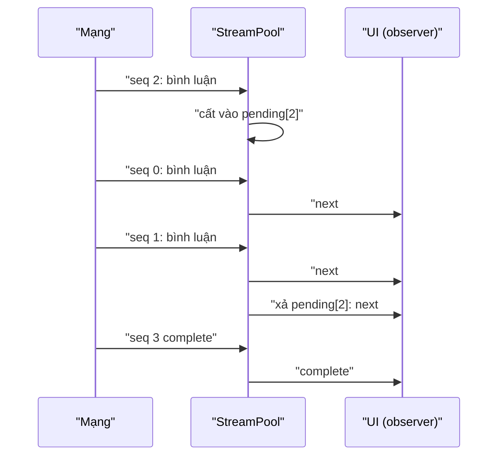

Hai bài toán, cùng một ý: **thứ tự và trạng thái cuối quan trọng hơn từng sự kiện**.

1. Trình phát video của Facebook nhận lệnh từ nhiều nơi: người dùng bấm play, feed tự phát khi cuộn tới, nút tắt tiếng, thanh tua. Lúc `<video>` chưa gắn vào trang (đang tải, đang đổi nguồn), các lệnh dồn lại. Chạy lại cả chuỗi `play, pause, play, seek, seek…` khi element sẵn sàng là thừa, và mỗi `pause()` chen giữa hai `play()` làm Promise của `play()` bị reject.
2. Dữ liệu GraphQL dạng `@defer`/`@stream` về thành nhiều chunk có **số thứ tự**. Mạng có thể giao chunk 3 trước chunk 1. UI phải nhận đúng thứ tự, và component mount sau vẫn phải thấy các chunk đã về.

> [!TIP]
> **Tóm tắt**
> - Hàng đợi lệnh video: khi xả, mỗi loại lệnh (seek, volume, rate…) chỉ giữ lệnh **cuối**; `play` và `pause` xoá lẫn nhau. Trạng thái người dùng muốn (volume, muted) được áp **sau cùng**, thắng trạng thái DOM.
> - Promise của `video.play()` được theo dõi: created, resolved, rejected (kèm lý do như autoplay bị chặn).
> - Stream pool: chunk đúng lượt thì phát và xả tiếp các chunk chờ liền sau; đến sớm thì cất. Người đăng ký muộn nhận lại toàn bộ chunk cũ.
> - Bản gốc có hai lỗi: lỗi đúng lượt bị **bỏ qua** khi đã có `complete` đến sớm (stream treo mãi), và `start()` được gọi **sau** khi đã phát lại sự kiện cũ.

<iframe class="demo-frame" src="/demos/facebook-patterns/index.html?theme=dark#/video-queue" title="Demo video-queue" loading="lazy" style="height: 1080px"></iframe>

<p class="demo-links">▶ <a href="/demos/facebook-patterns/index.html#/video-queue" target="_blank" rel="noopener">Mở demo toàn màn hình ↗</a> · <a href="https://stackblitz.com/github/hunghg255/blog-hunghg/tree/master/examples/facebook-patterns?file=src/lib/videoCommandQueue.ts" target="_blank" rel="noopener">Sửa code trên StackBlitz ↗</a> · <a href="https://github.com/hunghg255/blog-hunghg/blob/master/examples/facebook-patterns/src/lib/videoCommandQueue.ts" target="_blank" rel="noopener">Xem source trên GitHub ↗</a></p>

## Facebook làm thế nào?

### Hàng đợi lệnh cho video

Module `VideoPlayerImplementationStateMachineHostCallQueue` (có trong bundle `26.VideoPlayer/all.js` và vài bundle khác). Mỗi "host call" là một lệnh gửi xuống element: `host_call_play`, `host_call_pause`, `host_call_set_current_time`, `host_call_set_volume`, `host_call_set_muted`, `host_call_set_playback_rate`, `host_call_set_video_quality`, mỗi lệnh có `hostCallID` riêng.

`applyOrQueueHostCall`: có element thì áp ngay, không thì dispatch lệnh vào state machine (lệnh nằm trong `controlledState.hostCallQueue`). Khi element sẵn sàng, `flushHostCallQueue` nén hàng đợi rồi áp. Giải mã hàm nén:

```js
function compact(queue) {
  let out = [];
  const dropPlayPause = () => (out = out.filter((c) => c.type !== 'host_call_play' && c.type !== 'host_call_pause'));
  const dropType = (t) => (out = out.filter((c) => c.type !== t));
  queue.forEach((cmd) => {
    switch (cmd.type) {
      case 'host_call_play':
      case 'host_call_pause': dropPlayPause(); break;     // play/pause là MỘT nhóm
      default: dropType(cmd.type);                       // seek, volume, muted, rate, quality
    }
    out = out.concat([cmd]);                             // lệnh mới luôn đứng cuối
  });
  return out;
}

function flush({ state, machine, videoElementAPI, engineExtrasAPI, reason }) {
  const desired = [
    { type: 'host_call_set_volume', payload: { volume: state.controlledState.volume, reason } },
    { type: 'host_call_set_muted', payload: { muted: state.controlledState.muted, reason } },
    { type: 'host_call_set_video_quality', payload: { selectedVideoQuality: state.controlledState.selectedVideoQuality, reason } },
  ];
  const calls = compact(state.controlledState.hostCallQueue.concat(desired));
  calls.forEach((hostCall) => applyOrQueueHostCall({ hostCall, machine, videoElementAPI, engineExtrasAPI }));
  machine.dispatch({ type: 'implementation_host_call_queue_flushed', payload: { hostCallsFlushed: calls } });
}
```

Chú ý dòng `concat(desired)`: volume/muted/chất lượng lấy từ `controlledState` (trạng thái **mong muốn** mà UI giữ) được nối vào **cuối** rồi mới nén. Lệnh volume cũ trong hàng đợi bị thay bằng giá trị mong muốn mới nhất. Nguồn sự thật là state của UI, không phải element.

Khi áp `host_call_play`, `video.play()` trả về Promise. Facebook dispatch ba sự kiện: `dom_event_play_promise_created`, `…_resolved`, `…_rejected` (kèm `playPromiseRejectionReason`, ví dụ `NotAllowedError` khi autoplay có tiếng bị chặn). Lệnh nào ném lỗi khi áp thì dispatch `implementation_host_call_failed` kèm `videoElement.error`, `networkState`, `readyState` để biết element đang ở trạng thái nào.

### RelayAsyncStreamPool

Module `RelayAsyncStreamPool` (bundle `3.js`) quản lý nhiều stream theo id. Mỗi stream có `events` (đã phát, theo thứ tự), `pendingEvents[seq]` (đến sớm), `observers`, `status` (0: mở, 1: có complete/error đến sớm đang chờ, 2: đã đóng).

```js
next(id, data, seq) {
  const s = get(id);
  if (s.status === CLOSED) return;
  if (seq === s.events.length) {               // đúng lượt
    s.events.push({ kind: 'next', data, sequenceNumber: seq });
    s.observers.forEach((o) => o.next(data));
    for (let k = seq + 1; k < s.pendingEvents.length; k++) {   // xả các chunk chờ liền sau
      const ev = s.pendingEvents[k];
      if (ev == null) break;
      s.events.push(ev);
      // complete/error: đóng stream và thoát; next: phát cho observers
    }
  } else {
    invariant(seq > s.events.length && !hasOwn(s.pendingEvents, seq), 'trùng hoặc lùi');
    s.pendingEvents[seq] = { kind: 'next', data, sequenceNumber: seq };
  }
}
subscribe(id, observer) {
  const s = get(id);
  s.events.forEach((ev) => replay(observer, ev));   // phát lại toàn bộ sự kiện cũ
  s.observers.set(nextId++, observer);
  observer.start(subscription);                    // start() gọi SAU replay
}
```

Hai chỗ có vấn đề:

1. `complete(id, seq)` và `error(id, err, seq)` bắt đầu bằng `if (status !== OPEN) return`. Khi một `complete` đã đến **sớm** (status = 1, đang chờ), một `error` đến **đúng lượt** bị bỏ qua. Vị trí đó không bao giờ được lấp, `complete` đang chờ không bao giờ được xả: stream **treo mãi**, observer không nhận lỗi cũng không nhận complete. `forceComplete`/`forceError` cũng chỉ chạy khi status = 0 nên không cứu được.
2. `subscribe` phát lại sự kiện cũ **trước** rồi mới gọi `observer.start(subscription)`. Theo hợp đồng của Observable, `start` phải chạy trước mọi `next`, để observer có subscription trong tay (ví dụ để huỷ ngay giữa lúc phát lại). Ngoài ra, observer vẫn được thêm vào `observers` của stream đã đóng (không rò gì nhiều, nhưng thừa), và `pendingEvents` không được dọn sau khi xả.



## Viết lại

Nén lệnh và xả hàng đợi:

```ts title=src/lib/videoCommandQueue.ts
/** Nén hàng đợi: giữ lệnh cuối mỗi loại, play/pause tính chung một loại. */
export function compactCommands(queue: VideoCommand[]): VideoCommand[] {
  let out: VideoCommand[] = [];
  for (const cmd of queue) {
    const group = cmd.type === 'play' || cmd.type === 'pause' ? 'playback' : cmd.type;
    out = out.filter((c) => (c.type === 'play' || c.type === 'pause' ? 'playback' : c.type) !== group);
    out.push(cmd);
  }
  return out;
}
```

```ts title=src/lib/videoCommandQueue.ts
  return {
    send(cmd) {
      if (video) run(cmd);
      else queue.push(cmd);
    },
    attach(el) {
      video = el;
      if (!el) return;
      const { volume, muted } = desired();
      const all = queue.concat([{ type: 'volume', volume }, { type: 'muted', muted }]);
      queue = [];
      for (const cmd of compact ? compactCommands(all) : all) run(cmd);
    },
    pending: () => queue.slice(),
  };
}
```

Stream pool:

```ts title=src/lib/streamPool.ts
  private deliver(s: Stream<T>, ev: Event<T>) {
    s.events.push(ev);
    const observers = [...s.observers.values()];
    if (ev.kind !== 'next') {
      s.done = true;
      s.observers.clear();
      s.pending.clear();
    }
    for (const o of observers) {
      if (ev.kind === 'next') o.next(ev.data);
      else if (ev.kind === 'error') o.error(ev.error);
      else o.complete();
    }
  }

  /** Nhận sự kiện có số thứ tự `seq`. Đúng lượt thì phát và xả tiếp các sự kiện chờ liền sau. */
  push(id: string, seq: number, ev: Event<T>) {
    if (!Number.isInteger(seq) || seq < 0) throw new Error(`seq không hợp lệ: ${seq}`);
    const s = this.get(id);
    if (s.done) return;
    // Bản gốc: error()/complete() return ngay khi status = "có complete đang chờ".
    if (this.options.originalBehavior && ev.kind !== 'next' && s.pending.size > 0 &&
        [...s.pending.values()].some((p) => p.kind !== 'next')) return;
    const expected = s.events.length;
    if (seq < expected || s.pending.has(seq)) throw new Error(`seq ${seq} bị trùng`);
    if (seq > expected) {
      s.pending.set(seq, ev);
      return;
    }
    this.deliver(s, ev);
    for (let k = seq + 1; !s.done && s.pending.has(k); k++) {
      const next = s.pending.get(k)!;
      s.pending.delete(k);
      this.deliver(s, next);
    }
  }
```

::: spoiler Xem toàn bộ src/lib/videoCommandQueue.ts

```ts title=src/lib/videoCommandQueue.ts
/**
 * Hàng đợi lệnh cho <video> có nén lệnh (ý tưởng từ VideoPlayerImplementationStateMachineHostCallQueue
 * của Facebook).
 *
 * Khi element video chưa sẵn sàng (chưa mount, đang đổi nguồn…), các lệnh play/pause/seek/volume
 * được xếp hàng. Lúc áp, không cần chạy lại cả chuỗi: chỉ trạng thái CUỐI mới quan trọng.
 * - mỗi loại lệnh (seek, volume, muted, rate) chỉ giữ lệnh cuối cùng;
 * - play và pause xoá lẫn nhau: chỉ còn lệnh cuối trong hai loại;
 * - thứ tự tương đối của các lệnh còn lại được giữ.
 */

export type VideoCommand =
  | { type: 'play' }
  | { type: 'pause' }
  | { type: 'seek'; time: number }
  | { type: 'volume'; volume: number }
  | { type: 'muted'; muted: boolean }
  | { type: 'rate'; rate: number };

/** Nén hàng đợi: giữ lệnh cuối mỗi loại, play/pause tính chung một loại. */
export function compactCommands(queue: VideoCommand[]): VideoCommand[] {
  let out: VideoCommand[] = [];
  for (const cmd of queue) {
    const group = cmd.type === 'play' || cmd.type === 'pause' ? 'playback' : cmd.type;
    out = out.filter((c) => (c.type === 'play' || c.type === 'pause' ? 'playback' : c.type) !== group);
    out.push(cmd);
  }
  return out;
}

export interface DesiredState {
  volume: number;
  muted: boolean;
}

export type PlayEvent =
  | { type: 'play_promise_created'; id: number }
  | { type: 'play_promise_resolved'; id: number }
  | { type: 'play_promise_rejected'; id: number; reason: string }
  | { type: 'command_failed'; command: VideoCommand; error: string; readyState: number; networkState: number }
  | { type: 'applied'; command: VideoCommand };

function apply(video: HTMLVideoElement, cmd: VideoCommand, id: number, emit: (e: PlayEvent) => void) {
  switch (cmd.type) {
    case 'play': {
      const p = video.play();
      // play() trả Promise: bị chặn autoplay hay bị pause() chen ngang thì reject
      emit({ type: 'play_promise_created', id });
      p.then(
        () => emit({ type: 'play_promise_resolved', id }),
        (err: unknown) => emit({ type: 'play_promise_rejected', id, reason: err instanceof Error ? err.name : String(err) }),
      );
      break;
    }
    case 'pause':
      video.pause();
      break;
    case 'seek':
      video.currentTime = cmd.time;
      break;
    case 'volume':
      video.volume = cmd.volume;
      break;
    case 'muted':
      video.muted = cmd.muted;
      break;
    case 'rate':
      video.playbackRate = cmd.rate;
      break;
  }
}

export interface VideoCommandQueue {
  /** áp ngay nếu có element, không thì xếp hàng */
  send(cmd: VideoCommand): void;
  /** gắn element (hoặc null khi gỡ); có element thì xả hàng đợi */
  attach(video: HTMLVideoElement | null): void;
  /** các lệnh đang chờ */
  pending(): VideoCommand[];
}

export function createVideoCommandQueue({
  desired,
  compact = true,
  onEvent = () => {},
}: {
  /** trạng thái người dùng muốn (volume/muted): luôn được áp sau cùng khi xả, thắng trạng thái DOM */
  desired: () => DesiredState;
  compact?: boolean;
  onEvent?: (e: PlayEvent) => void;
}): VideoCommandQueue {
  let video: HTMLVideoElement | null = null;
  let queue: VideoCommand[] = [];
  let nextId = 1;

  const run = (cmd: VideoCommand) => {
    if (!video) return;
    try {
      apply(video, cmd, nextId++, onEvent);
      onEvent({ type: 'applied', command: cmd });
    } catch (e) {
      // ghi kèm readyState/networkState để biết element đang ở trạng thái nào khi lỗi
      onEvent({
        type: 'command_failed',
        command: cmd,
        error: e instanceof Error ? e.message : String(e),
        readyState: video.readyState,
        networkState: video.networkState,
      });
    }
  };

  return {
    send(cmd) {
      if (video) run(cmd);
      else queue.push(cmd);
    },
    attach(el) {
      video = el;
      if (!el) return;
      const { volume, muted } = desired();
      const all = queue.concat([{ type: 'volume', volume }, { type: 'muted', muted }]);
      queue = [];
      for (const cmd of compact ? compactCommands(all) : all) run(cmd);
    },
    pending: () => queue.slice(),
  };
}
```

:::

::: spoiler Xem toàn bộ src/lib/streamPool.ts

```ts title=src/lib/streamPool.ts
/**
 * Bộ đệm sắp lại chunk của stream theo số thứ tự và phát lại cho người đăng ký muộn
 * (ý tưởng từ RelayAsyncStreamPool của Facebook: dữ liệu @defer/@stream của GraphQL
 * có thể về lệch thứ tự, UI vẫn phải nhận đúng thứ tự).
 *
 * Khác bản gốc (xem bài viết):
 * - lỗi/complete đúng lượt vẫn được xử lý khi đã có complete "đến sớm" đang chờ
 *   (bản gốc bỏ qua, stream treo mãi);
 * - gọi start() TRƯỚC khi phát lại sự kiện cũ cho observer;
 * - dọn pending sau khi xả.
 */

export interface StreamObserver<T> {
  start?(sub: { unsubscribe(): void }): void;
  next(value: T): void;
  error(err: unknown): void;
  complete(): void;
}

type Event<T> = { kind: 'next'; data: T } | { kind: 'error'; error: unknown } | { kind: 'complete' };

interface Stream<T> {
  done: boolean;
  events: Event<T>[];
  pending: Map<number, Event<T>>;
  observers: Map<number, StreamObserver<T>>;
}

export class StreamPool<T> {
  private streams = new Map<string, Stream<T>>();
  private nextObserverId = 0;
  /** mô phỏng hành vi bản gốc để so sánh trong demo */
  constructor(private readonly options: { originalBehavior?: boolean } = {}) {}

  private get(id: string): Stream<T> {
    let s = this.streams.get(id);
    if (!s) {
      s = { done: false, events: [], pending: new Map(), observers: new Map() };
      this.streams.set(id, s);
    }
    return s;
  }

  private deliver(s: Stream<T>, ev: Event<T>) {
    s.events.push(ev);
    const observers = [...s.observers.values()];
    if (ev.kind !== 'next') {
      s.done = true;
      s.observers.clear();
      s.pending.clear();
    }
    for (const o of observers) {
      if (ev.kind === 'next') o.next(ev.data);
      else if (ev.kind === 'error') o.error(ev.error);
      else o.complete();
    }
  }

  /** Nhận sự kiện có số thứ tự `seq`. Đúng lượt thì phát và xả tiếp các sự kiện chờ liền sau. */
  push(id: string, seq: number, ev: Event<T>) {
    if (!Number.isInteger(seq) || seq < 0) throw new Error(`seq không hợp lệ: ${seq}`);
    const s = this.get(id);
    if (s.done) return;
    // Bản gốc: error()/complete() return ngay khi status = "có complete đang chờ".
    if (this.options.originalBehavior && ev.kind !== 'next' && s.pending.size > 0 &&
        [...s.pending.values()].some((p) => p.kind !== 'next')) return;
    const expected = s.events.length;
    if (seq < expected || s.pending.has(seq)) throw new Error(`seq ${seq} bị trùng`);
    if (seq > expected) {
      s.pending.set(seq, ev);
      return;
    }
    this.deliver(s, ev);
    for (let k = seq + 1; !s.done && s.pending.has(k); k++) {
      const next = s.pending.get(k)!;
      s.pending.delete(k);
      this.deliver(s, next);
    }
  }

  next(id: string, seq: number, data: T) {
    this.push(id, seq, { kind: 'next', data });
  }
  error(id: string, seq: number, error: unknown) {
    this.push(id, seq, { kind: 'error', error });
  }
  complete(id: string, seq: number) {
    this.push(id, seq, { kind: 'complete' });
  }

  /** Đăng ký: nhận lại mọi sự kiện đã phát (đúng thứ tự), rồi nhận tiếp sự kiện mới. */
  subscribe(id: string, observer: StreamObserver<T>) {
    const s = this.get(id);
    const key = this.nextObserverId++;
    const sub = { unsubscribe: () => s.observers.delete(key) };
    const replay = () => {
      for (const ev of s.events) {
        if (ev.kind === 'next') observer.next(ev.data);
        else if (ev.kind === 'error') observer.error(ev.error);
        else observer.complete();
      }
    };
    if (this.options.originalBehavior) {
      // bản gốc: phát lại trước rồi mới start(), và vẫn thêm observer vào stream đã đóng
      replay();
      s.observers.set(key, observer);
      observer.start?.(sub);
    } else {
      observer.start?.(sub);
      replay();
      if (!s.done) s.observers.set(key, observer);
    }
    return sub;
  }

  /** Số sự kiện đang chờ (để demo thấy pending được dọn). */
  pendingCount(id: string) {
    return this.streams.get(id)?.pending.size ?? 0;
  }
  isDone(id: string) {
    return this.streams.get(id)?.done ?? false;
  }
  clear(id: string) {
    this.streams.delete(id);
  }
}
```

:::

## Đi qua code

- `compactCommands` gán mỗi lệnh một "nhóm" (`play`/`pause` chung nhóm `playback`), xoá lệnh cũ cùng nhóm rồi thêm lệnh mới vào cuối. Thứ tự tương đối giữa các nhóm được giữ: `seek` trước `play` vẫn là `seek` trước `play`.
- `attach(el)` nối trạng thái mong muốn (`desired()`) vào **cuối** rồi mới nén, giống `flushHostCallQueue`.
- `apply` theo dõi Promise của `play()` và báo sự kiện; `run` bắt lỗi và ghi kèm `readyState`/`networkState`.
- `StreamPool.push` gộp `next`/`error`/`complete` thành một đường: đúng lượt thì `deliver` và xả tiếp; đến sớm thì cất vào `pending` (một `Map`, không phải mảng thưa). `deliver` của `error`/`complete` đánh dấu `done`, xoá observer, **dọn pending**.
- `subscribe` gọi `start` trước, phát lại sau, và chỉ thêm observer khi stream còn mở.

**Khác bản gốc:**
- `error`/`complete` đúng lượt luôn được xử lý, kể cả khi đã có `complete` đến sớm. Demo "Complete đến sớm rồi lỗi": bản gốc để stream "vẫn mở (treo)", observer chỉ nhận hai bình luận; bản sửa đóng stream và báo lỗi cho cả người đăng ký đầu lẫn người đăng ký muộn.
- `start()` trước khi phát lại. Demo cho thấy người đăng ký muộn ở chế độ "giống bản gốc" nhận `bình luận #1, #2` rồi mới tới `▶ start`.
- Bản viết lại không có `video_quality` (thuộc engine phát DASH riêng của Facebook) và không có state machine; hàng đợi là một mảng trong closure.

## Tại sao không làm cách khác?

**Áp lệnh ngay, không cần hàng đợi?** Element chưa có thì không áp được. Bỏ lệnh thì mất ý định của người dùng (bấm tắt tiếng lúc video đang tải).

**Chạy lại cả hàng đợi, không nén?** Demo: 11 lệnh thô thành 13 lần gọi lên element (thêm volume/muted mong muốn), một `play()` bị reject vì bị `pause()` chen ngang; bản nén chỉ 5 lần gọi, không reject nào, trạng thái cuối giống hệt. Trên trình phát thật, mỗi `seek` thừa là một lần tải lại đoạn video.

**Chỉ lưu "trạng thái mong muốn" (`{ playing, time, volume }`) thay vì hàng đợi lệnh?** Gần như tương đương, và là cách khai báo (declarative) gọn hơn. Facebook giữ hàng đợi có lẽ vì mỗi lệnh có `hostCallID` và `reason` để log, và vì `seek` là sự kiện (tua tới 10s) chứ không hẳn là trạng thái (suy đoán).

**Stream: sắp xếp lại ở UI?** Mỗi component tự sắp thì trùng code, và component mount muộn không có dữ liệu cũ. Pool dùng chung giữ thứ tự một lần, phát lại cho mọi người.

## Edge case và cạm bẫy

- **Autoplay có tiếng bị chặn.** `play()` reject với `NotAllowedError`. Phải bắt Promise, không thì có lỗi "Uncaught (in promise)" trong console. Thường xử lý bằng cách tắt tiếng rồi `play()` lại.
- **`pause()` ngay sau `play()`** làm Promise của `play()` reject với `AbortError` ("The play() request was interrupted by a call to pause()"). Nén lệnh tránh được phần lớn trường hợp này.
- **Seek trước khi có metadata.** Gán `currentTime` khi `readyState === 0` có thể bị bỏ qua hoặc áp muộn tuỳ trình duyệt. Xả hàng đợi sau sự kiện `loadedmetadata` an toàn hơn sau khi vừa gắn element.
- **Số thứ tự trùng hoặc lùi** là lỗi giao thức: cả bản gốc (invariant) và bản viết lại đều ném lỗi.
- **Pending phình ra** nếu một chunk ở giữa không bao giờ tới. Cần timeout ở tầng mạng để gọi `error` và đóng stream.

## Dùng trong dự án

```ts
// Video: mọi nơi gửi lệnh qua hàng đợi, không đụng thẳng element
const player = createVideoCommandQueue({
  desired: () => ({ volume: store.volume, muted: store.muted }),
  onEvent: (e) => {
    if (e.type === 'play_promise_rejected' && e.reason === 'NotAllowedError') {
      store.muted = true;
      player.send({ type: 'muted', muted: true });
      player.send({ type: 'play' });
    }
  },
});
// JSX: <video ref={(el) => player.attach(el)} />  (hoặc gọi attach trong onLoadedMetadata)

// Stream: tầng mạng đẩy chunk theo seq, UI chỉ subscribe
const pool = new StreamPool<Comment>();
socket.on('chunk', ({ id, seq, data, done, error }) =>
  error ? pool.error(id, seq, error) : done ? pool.complete(id, seq) : pool.next(id, seq, data));
const sub = pool.subscribe('comments:42', { next: addComment, error: showError, complete: hideSpinner });
```

## Kiểm thử

::: spoiler Ví dụ test (bản phác, không có trong repo)

```ts
import { describe, expect, it } from 'vitest';
import { compactCommands } from './videoCommandQueue';
import { StreamPool } from './streamPool';

describe('compactCommands', () => {
  it('giữ lệnh cuối mỗi loại, play/pause xoá lẫn nhau', () => {
    expect(
      compactCommands([
        { type: 'play' }, { type: 'seek', time: 1 }, { type: 'pause' },
        { type: 'volume', volume: 0.2 }, { type: 'seek', time: 5 }, { type: 'play' }, { type: 'volume', volume: 0.8 },
      ]),
    ).toEqual([{ type: 'seek', time: 5 }, { type: 'play' }, { type: 'volume', volume: 0.8 }]);
  });
});

describe('StreamPool', () => {
  const collect = (pool: StreamPool<string>) => {
    const got: string[] = [];
    pool.subscribe('s', { start: () => got.push('start'), next: (v) => got.push(v), error: () => got.push('ERR'), complete: () => got.push('DONE') });
    return got;
  };

  it('sắp lại chunk lệch thứ tự', () => {
    const pool = new StreamPool<string>();
    const got = collect(pool);
    pool.next('s', 2, 'c'); pool.next('s', 0, 'a'); pool.next('s', 1, 'b'); pool.complete('s', 3);
    expect(got).toEqual(['start', 'a', 'b', 'c', 'DONE']);
  });

  it('lỗi đúng lượt vẫn được xử lý khi đã có complete đến sớm', () => {
    const pool = new StreamPool<string>();
    const got = collect(pool);
    pool.next('s', 0, 'a'); pool.complete('s', 5); pool.error('s', 1, 'x');
    expect(got).toEqual(['start', 'a', 'ERR']);
    expect(pool.pendingCount('s')).toBe(0);
  });

  it('người đăng ký muộn nhận start trước rồi mới tới dữ liệu cũ', () => {
    const pool = new StreamPool<string>();
    pool.next('s', 0, 'a');
    expect(collect(pool)).toEqual(['start', 'a']);
  });
});
```

:::

## So với thư viện và chuẩn web

- `HTMLMediaElement.play()` trả Promise ở mọi trình duyệt hiện đại; [chính sách autoplay](https://developer.chrome.com/blog/autoplay) của Chrome cho phép tự phát khi tắt tiếng.
- `@defer`/`@stream` của GraphQL (incremental delivery) được Relay và các client khác như Apollo, urql hỗ trợ theo cách riêng; điểm chung là phải ghép các phần trả về theo đúng vị trí, dù chúng về lệch thứ tự.
- Video.js, Shaka Player, hls.js tự quản trạng thái element; khi tự viết trình phát trên `<video>`, một hàng đợi lệnh như trên tránh được phần lớn lỗi "play() interrupted".

Bài liên quan: [Học từ Facebook #22: MQTT ngay trong trình duyệt](/blogs/facebook-mqtt-in-browser) (cũng là chuyện ghép lại dữ liệu đến từng mảnh).

---

Bài này thuộc series **[Học từ mã nguồn Facebook](/series/facebook)** (106 bài, đọc theo thứ tự).

::: spoiler Xem nhanh danh sách bài trong series

*Phần 1*

- [Mở đầu: cách đọc code minify của Facebook](/blogs/learn-from-facebook-source-code)
- [#1 Dùng chung IntersectionObserver + infinite scroll](/blogs/facebook-shared-intersection-observer)
- [#2 useViewportDuration: đo thời gian thực sự được xem](/blogs/facebook-use-viewport-duration)
- [#3 Preload code + data khi hover](/blogs/facebook-preload-on-hover)
- [#4 Toast manager với external store](/blogs/facebook-toast-manager)
- [#5 Network status + heartbeat backoff](/blogs/facebook-network-status-heartbeat)
- [#6 ErrorGuard: bắt lỗi theo ngữ cảnh](/blogs/facebook-error-guard)
- [#7 Banzai: gom log theo lô + sendBeacon](/blogs/facebook-batch-logger)
- [#8 Focus trap + Esc theo layer](/blogs/facebook-focus-trap)

*Phần 2*

- [#9 Mẹo calc(… * 9999): container query, line-clamp, mũi tên carousel bằng CSS](/blogs/facebook-css-9999-trick)
- [#10 Thanh cuộn tuỳ biến bằng CSS 3D](/blogs/facebook-css-3d-scrollbar)
- [#11 Modal cuộn bằng window, giữ vị trí trang nền](/blogs/facebook-document-scroll-modal)
- [#12 Popover, tooltip group và hovercard](/blogs/facebook-popover-tooltip)
- [#13 Primitive Pressable + focus-visible](/blogs/facebook-pressable)
- [#14 Tab "Xem thêm" + sticky header bằng IntersectionObserver](/blogs/facebook-priority-tabs-sticky-header)
- [#15 Avatar khoét mask, gradient Messenger, skeleton steps()](/blogs/facebook-visual-tricks)
- [#16 Khung chat không giật](/blogs/facebook-chat-scroller)
- [#17 Thuật toán chọn bố cục collage ảnh](/blogs/facebook-photo-collage-layout)
- [#18 Keep-alive tab trong SPA](/blogs/facebook-keep-alive-tabs)
- [#19 Tự đo Visual Completion & interaction tracing](/blogs/facebook-visual-completion)
- [#20 Router SPA bền bỉ & tải chunk có retry](/blogs/facebook-spa-router-resilient-loading)

*Phần 3*

- [#21 Smart Compose: gợi ý chữ mờ khi gõ](/blogs/facebook-smart-compose-ghost-text)
- [#22 MQTT ngay trong trình duyệt, tự chuyển sang long-poll](/blogs/facebook-mqtt-in-browser)
- [#23 Đo thời gian dùng bằng bitmap 64 giây](/blogs/facebook-time-spent-bitmap)
- [#24 Bảng reaction nhấn giữ rồi trượt](/blogs/facebook-reaction-press-slide)
- [#25 Tìm kiếm gấp dấu, phiên âm và highlight đầu từ](/blogs/facebook-search-diacritics-tokenize)
- [#26 Ring buffer biết trace nào đã mất log](/blogs/facebook-trace-ring-buffer)
- [#27 Engine animation JS: một vòng rAF và solver cubic-bezier](/blogs/facebook-keyframes-loop-cubic-bezier)
- [#28 Bootloader: bitmap tài nguyên đã tải, chỉ reload khi cần](/blogs/facebook-bootloader-bitmap-consistency)
- [#29 Nhận biết click do screen reader tạo ra](/blogs/facebook-virtual-cursor-detection)
- [#30 Tải trước feed theo chất lượng mạng, đoán hạng thiết bị](/blogs/facebook-network-aware-prefetch)
- [#31 Hàng đợi gửi tin chat giữ đúng thứ tự](/blogs/facebook-ordered-send-queue)
- [#32 Gộp lời gọi API trong cùng một tick](/blogs/facebook-api-batcher)
- [#33 Resize ảnh trong pool Web Worker](/blogs/facebook-jpeg-resize-worker-pool)
- [#34 Crop ảnh theo nhiều khuôn mặt](/blogs/facebook-face-aware-crop)
- [#35 Kéo-thả sắp xếp và vùng thả file không nhấp nháy](/blogs/facebook-flicker-free-drag-drop)
- [#36 Tiện ích UI: fade-out, sticky event, hàm huỷ được](/blogs/facebook-ui-utility-hooks)
- [#37 Hạ tầng nhỏ: cookie, hash lỗi, prefetch khi chuột dừng](/blogs/facebook-small-infra-cookie-hash-idle)

*Phần 4–6*

- [#38 Đồng bộ tin nhắn: phát hiện lỗ seqID và fetch bù theo tầng](/blogs/facebook-messenger-sync-seqid-gaps)
- [#39 OTID: ID tin nhắn kiểu Snowflake sinh ở client](/blogs/facebook-otid-client-snowflake)
- [#40 QPL: lấy mẫu từ lúc bắt đầu, đo RTT gửi tin đầu-cuối](/blogs/facebook-qpl-send-rtt)
- [#41 Bộ điều phối request bảy chế độ gộp và chống trùng](/blogs/facebook-request-dispatcher-modes)
- [#42 Thread list theo mốc thời gian, cookie presence có version](/blogs/facebook-threadlist-ranged-presence)
- [#43 Composer dạng plugin: reducer, dirty checker, chuỗi kiểm tra](/blogs/facebook-plugin-composer)
- [#44 Thanh toán bất đồng bộ: subscribe trước, poll dự phòng](/blogs/facebook-async-checkout)
- [#45 Validate số thẻ: sửa lỗi gõ, dải BIN, Luhn](/blogs/facebook-card-validation)
- [#46 Lịch chọn khoảng ngày: bo góc dải chọn, phím đủ bộ, RTL](/blogs/facebook-range-calendar-a11y)
- [#47 Giờ mở cửa theo tuần: qua đêm, gộp khoảng, phần bù](/blogs/facebook-weekly-hours-intervals)
- [#48 Tiến độ đăng realtime: giữ event chờ snapshot, watchdog](/blogs/facebook-realtime-publish-snapshot)
- [#49 Tiền tệ theo đơn vị nhỏ nhất và ô nhập tiền](/blogs/facebook-currency-minor-units)
- [#50 Sửa hàng loạt Empty/Uniform/Mixed, seen/read bằng 2 bit](/blogs/facebook-bulk-edit-seen-bits)
- [#51 Phát hiện script lạ hook vào hàm native](/blogs/facebook-native-hook-detection)
- [#52 localStorage tự dọn khi đầy quota](/blogs/facebook-quota-aware-storage)
- [#53 Cache tuyến do server phân giải, chờ sẵn promise](/blogs/facebook-route-cache-prefetch)
- [#54 Lưới phím mũi tên 2D và focus không làm cuộn trang](/blogs/facebook-focus-table-grid)
- [#55 Tách emoji bằng máy trạng thái](/blogs/facebook-emoji-segmentation)
- [#56 Đọc trước ghi sau trong một frame, con tự biết vị trí](/blogs/facebook-read-then-write-dom)
- **#57 Hàng đợi lệnh cho video và stream sắp lại chunk** (bài này)

*Phần 7–10*

- [#58 Ước lượng băng thông EWMA: loại outlier, nhớ qua phiên](/blogs/facebook-bandwidth-ewma-estimator)
- [#59 ABR theo độ tự tin phát và cắt bậc bitrate theo MOS](/blogs/facebook-abr-playback-confidence)
- [#60 Prefetch segment dự đoán từ manifest, parse hộp sidx](/blogs/facebook-dash-predicted-segments)
- [#61 Đọc metadata MP4/MOV ngay trên client](/blogs/facebook-mp4-metadata-client)
- [#62 Upload tiếp tục được: offset, hash dedupe, phát hiện treo](/blogs/facebook-resumable-upload)
- [#63 Fenwick tree: chọn ngẫu nhiên có trọng số và offset dòng](/blogs/facebook-fenwick-weighted-random)
- [#64 Vạch trục số và trục thời gian "đẹp"](/blogs/facebook-nice-axis-ticks)
- [#65 Damerau-Levenshtein theo dải chéo và tự sửa tên gõ sai](/blogs/facebook-damerau-levenshtein)
- [#66 PRNG có seed, shuffle tái lập và lấy mẫu trace](/blogs/facebook-seeded-prng-sampling)
- [#67 Cặp min/max-heap tái dùng vị trí trong danh sách ảo](/blogs/facebook-dual-heap-buffer-set)
- [#68 Memo nhiều đối số bằng Map/WeakMap và interning object](/blogs/facebook-multikey-memo-interning)
- [#69 Thống kê cửa sổ trượt và đại số khoảng thời gian](/blogs/facebook-moving-stat-intervals)
- [#70 Int64 từ hai số 32-bit, decode UTF, offset theo code point](/blogs/facebook-int64-utf-codepoints)
- [#71 Engine múi giờ IANA trên client, phát hiện lệch giờ](/blogs/facebook-client-iana-timezone)
- [#72 Tự cài semver range](/blogs/facebook-semver-range)
- [#73 Auto-link URL, cắt chữ an toàn, giới hạn LaTeX](/blogs/facebook-autolink-safe-truncate)
- [#74 Parser query kiểu PHP chống prototype pollution](/blogs/facebook-php-query-serializer)
- [#75 Popover tự lật theo phần tràn nhỏ nhất](/blogs/facebook-popover-auto-flip)
- [#76 Tiền tố for(;;) chống JSON hijacking, đọc stream](/blogs/facebook-csrf-prefix-streaming)
- [#77 Chống lộ Referer, linkshim, xoá token trên URL](/blogs/facebook-referrer-linkshim-url-scrub)
- [#78 setImmediate bằng postMessage, gom delta chuột theo frame](/blogs/facebook-setimmediate-mouse-batching)
- [#79 Phát hiện crash qua heartbeat, dò proxy cache hỏng](/blogs/facebook-crash-heartbeat-proxy-check)
- [#80 DPR vào cookie cho ảnh @2x, che khoá trong log](/blogs/facebook-dpr-cookie-secret-redaction)
- [#81 Flux waitFor tự viết và proxy có đệm](/blogs/facebook-flux-dispatch-buffered-proxy)
- [#82 Crop đúng tỉ lệ, xoay sticker bằng ma trận](/blogs/facebook-image-crop-rotation-geometry)

*Phần 11–15*

- [#83 Chia subdomain giữa các tab bằng lease, long-poll theo bảng trạng thái](/blogs/facebook-tab-subdomain-lease-longpoll)
- [#84 MQTT QoS1: giữ publish chờ ack, gửi lại khi kết nối lại](/blogs/facebook-mqtt-qos1-republish)
- [#85 Cache Promise gộp request, cache lỗi ngắn, đua dữ liệu nhúng sẵn](/blogs/facebook-promise-cache-preload-race)
- [#86 Lịch retry: backoff có trần, Fibonacci, báo lỗi CDN mỗi N ngày](/blogs/facebook-retry-backoff-schedules)
- [#87 Giữ nguyên tham chiếu nhánh dữ liệu không đổi](/blogs/facebook-relay-recycle-nodes)
- [#88 Store optimistic: copy-on-write, rollback rồi áp lại](/blogs/facebook-relay-optimistic-store)
- [#89 Chỉ mục subscription theo record, hàng đợi task theo chiều sâu](/blogs/facebook-relay-subscription-index)
- [#90 Phân trang connection: cursor khớp đầu, edge không trùng](/blogs/facebook-relay-connection-pagination)
- [#91 Profiler kiểu middleware và memo selector có lấy mẫu kiểm tra](/blogs/facebook-profiler-middleware-memo-check)
- [#92 Đọc EBML/WebM Cues để tìm byte range của segment](/blogs/facebook-webm-ebml-cues)
- [#93 Stream HTTP Range tạm dừng được, tải tiếp đúng byte](/blogs/facebook-pausable-range-stream)
- [#94 Bảng khoảng thời gian gắn nhãn và nhảy qua lỗ buffer](/blogs/facebook-tagged-time-ranges-gaps)
- [#95 Gom chunk cho SourceBuffer, đồng bộ video bằng playbackRate](/blogs/facebook-sourcebuffer-video-sync)
- [#96 Gom tin nhắn thành cụm, vạch ngày và avatar đã xem](/blogs/facebook-message-grouping)
- [#97 Bao nhiêu tab chat vừa màn hình, chuỗi luật mở tab](/blogs/facebook-chat-tab-policy)
- [#98 Phím tắt Markdown trong editor, Backspace để hoàn tác](/blogs/facebook-markdown-shortcuts-editor)
- [#99 Offset theo code point hay UTF-16: bốn bug cùng một gốc](/blogs/facebook-codepoint-offset-bugs)
- [#100 Typeahead không nhảy: cache tiền tố, chặn reflow, khoá hover](/blogs/facebook-typeahead-stable-results)
- [#101 Hit-test trên canvas bằng phát lại path, nét đứt và cung Bézier](/blogs/facebook-canvas-hit-regions)
- [#102 Vòng tròn theo mét trên bản đồ Mercator](/blogs/facebook-mercator-meter-circles)
- [#103 Dò tính năng trình duyệt: ảnh EXIF 2×1, getter bẫy, scrollbar](/blogs/facebook-feature-probe-tricks)
- [#104 Bug định dạng số và kiểm tra dữ liệu theo locale](/blogs/facebook-locale-validation-bugs)
- [#105 Dispose cho đúng: idle callback, splice(-1), xoá nhầm key](/blogs/facebook-dispose-leak-bugs)

:::

Code + demo: [`examples/facebook-patterns`](https://github.com/hunghg255/blog-hunghg/tree/master/examples/facebook-patterns) · [Mở trên StackBlitz](https://stackblitz.com/github/hunghg255/blog-hunghg/tree/master/examples/facebook-patterns)
