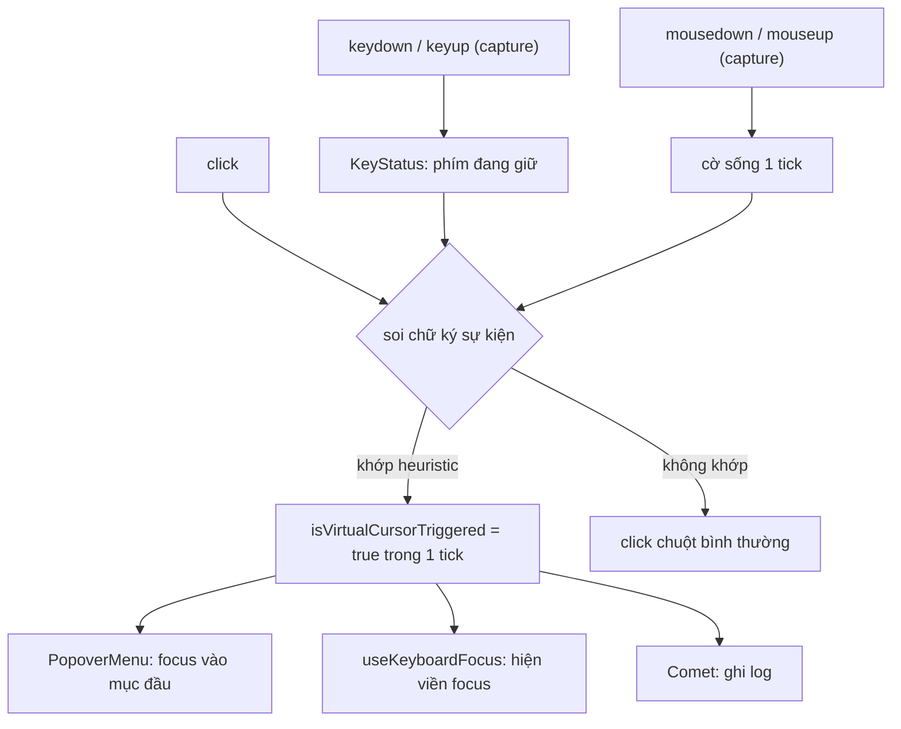

Bạn bấm nút "⋯" trên một bài viết, menu hiện ra. Giờ focus nên nằm ở đâu?

- Nếu người dùng **bấm chuột**: để focus yên trên nút. Kéo focus vào menu sẽ vẽ viền focus lên mục đầu tiên, trông như có ai đó đã chọn sẵn, và người dùng chuột không cần điều đó.
- Nếu người dùng **nhấn Enter** hoặc dùng **trình đọc màn hình** (VoiceOver, NVDA, TalkBack): phải đưa focus vào mục đầu tiên. Không thì người dùng bàn phím phải Tab mò tới menu, còn người dùng trình đọc màn hình không biết menu vừa mở ra.

Cả ba cách đều đi qua cùng một sự kiện `click`. Vấn đề là phân biệt chúng. Trình đọc màn hình còn khó hơn bàn phím: khi người dùng kích hoạt nút bằng "con trỏ ảo" (virtual cursor) của VoiceOver hay NVDA, trang không nhận được phím nào, chỉ có một cú click.

> [!TIP]
> **Tóm tắt**
> - Click từ chuột, bàn phím, trình đọc màn hình và `element.click()` trông giống nhau, nhưng "chữ ký" của MouseEvent (toạ độ, `detail`, cặp mousedown/mouseup) thì khác.
> - Facebook dò chữ ký riêng của từng trình duyệt (`VirtualCursorStatus`) để quyết định có đưa focus vào menu hay không, và ghi log tỷ lệ người dùng công nghệ trợ năng.
> - Ngày nay dùng `event.detail === 0` và `pointerType` của click là đủ cho phần lớn trường hợp; heuristic toạ độ chỉ còn là đường dự phòng.
> - Để vẽ viền focus, `:focus-visible` của CSS đã làm sẵn việc này; JS chỉ cần khi phải quyết định **di chuyển** focus.

<iframe class="demo-frame" src="/demos/facebook-patterns/index.html?theme=dark#/virtual-cursor" title="Demo virtual-cursor" loading="lazy" style="height: 720px"></iframe>

<p class="demo-links">▶ <a href="/demos/facebook-patterns/index.html#/virtual-cursor" target="_blank" rel="noopener">Mở demo toàn màn hình ↗</a> · <a href="https://stackblitz.com/github/hunghg255/blog-hunghg/tree/master/examples/facebook-patterns?file=src/lib/virtualCursor.ts" target="_blank" rel="noopener">Sửa code trên StackBlitz ↗</a> · <a href="https://github.com/hunghg255/blog-hunghg/blob/master/examples/facebook-patterns/src/lib/virtualCursor.ts" target="_blank" rel="noopener">Xem source trên GitHub ↗</a></p>

## Facebook làm thế nào?

Có hai module gần như giống nhau trong bundle: `VirtualCursorStatus` (bản cũ, file `25.js`) và `CometVirtualCursorStatus` (bản của giao diện Comet mới, file `16.js`). Cả hai cùng một ý: nghe `keydown`, `keyup`, `mousedown`, `mouseup` ở pha capture trên toàn trang, rồi khi có `click` thì soi các thuộc tính của sự kiện.

### Chữ ký của từng trình duyệt

Đây là hàm phân loại trong `VirtualCursorStatus`, đã đổi tên biến cho dễ đọc:

```js
function detectBrowsers(e) {
  const hits = new Set();
  const keyDown = KeyStatus.isKeyDown();
  // Chrome: toạ độ 0,0 nhưng offset ≥ 0, có mouseup trong cùng tick, sự kiện thật
  if (e.clientX === 0 && e.clientY === 0 && e.offsetX >= 0 && e.offsetY >= 0 &&
      sawMouseUp && e.isTrusted && e.mozInputSource == null) hits.add('Chrome');
  // Safari mới: lực nhấn nhỏ hơn mức của một cú nhấn chuột thật
  if (sawMouseDown && sawMouseUp && !keyDown && e.webkitForce != null &&
      e.webkitForce < e.WEBKIT_FORCE_AT_MOUSE_DOWN && e.offsetX === 0 && e.offsetY === 0 &&
      e.mozInputSource == null) hits.add('Safari-edge');
  // Safari cũ: toạ độ 0,0 và offset âm
  if (e.clientX === 0 && e.clientY === 0 && e.offsetX < 0 && e.offsetY < 0 &&
      sawMouseUp && e.mozInputSource == null) hits.add('Safari-old');
  // IE ≥ 10: toạ độ âm, hoặc offset nằm ngoài phần tử
  // …
  // Firefox: mozInputSource = 0 nghĩa là MOZ_SOURCE_UNKNOWN, không phải chuột thật
  if (e.mozInputSource === 0 && e.isTrusted) hits.add('Firefox');
  return hits;
}
```

Vài chi tiết đáng chú ý:

- **Cờ mousedown/mouseup chỉ sống một tick.** Mỗi lần nhận `mousedown` hay `mouseup`, module bật cờ rồi hẹn `setImmediate` (bản Comet dùng `setTimeout(…, 0)`) để tắt. Trình duyệt bắn `mouseup` và `click` liền nhau trong cùng một task, nên khi `click` tới, cờ `mouseup` vẫn còn bật.
- **Kết quả cũng chỉ sống một tick.** `isVirtualCursorTriggered()` trả `true` cho tới hết task hiện tại rồi tự xoá. Code xử lý click hỏi ngay trong handler thì có câu trả lời, hỏi trễ hơn thì không.
- **Có một dòng code chết.** Giữa nhánh Safari và nhánh IE có một biểu thức kiểm tra `pointerType === ""`, `isPrimary === false`… nhưng không gọi `add()` nào, kết quả bị bỏ đi. Có lẽ đây là một heuristic đang làm dở hoặc đã bị tắt.
- **Thuộc tính lạ của từng engine.** `mozInputSource` chỉ có trên Firefox, `webkitForce` và `WEBKIT_FORCE_AT_MOUSE_DOWN` chỉ có trên Safari (Force Touch). Đọc trên trình duyệt khác thì ra `undefined`, nên mỗi nhánh đều kiểm tra `== null` để không bắt nhầm.

### Dùng để làm gì

Tìm các chỗ gọi `isVirtualCursorTriggered()` trong bundle thì thấy ba mục đích:

```js
// PopoverMenu: mở menu bằng bàn phím hoặc trình đọc màn hình thì focus vào mục đầu tiên
d._checkInitialFocus = function () {
  var a = KeyStatus.isKeyDown() || VirtualCursorStatus.isVirtualCursorTriggered();
  this._menu && this.setInitialFocus(this._menu, a);
};

// useKeyboardFocus: chỉ hiện viền focus khi focus đến từ bàn phím hoặc trình đọc màn hình
onFocus = function (c) {
  (VirtualCursorStatus.isVirtualCursorTriggered() || KeyStatus.isKeyDown()) && setFocusVisible(true);
  // …
};
```

Mục đích thứ ba nằm ở bản Comet: `CometVirtualCursorStatus` không trả kết quả cho ai cả, chỉ **ghi log** `indicated_browsers` và `is_virtual_cursor_action` (nút có `data-accessibilityid="virtual_cursor_trigger"`). Có lẽ Facebook dùng số liệu này để ước lượng có bao nhiêu người dùng trình đọc màn hình và họ bấm vào đâu.



## Bên trong trình duyệt: click không có chuột trông thế nào?

Khi một nút được kích hoạt mà không có chuột, trình duyệt vẫn phải bắn sự kiện `click` (đó là "activation behavior" của nút). Nhưng nó không có toạ độ thật để điền vào. Mình đo trên Chromium bằng demo phía trên:

| Thuộc tính | Bấm chuột | Nhấn Enter | `element.click()` |
|---|---|---|---|
| `isTrusted` | true | true | **false** |
| `detail` | 1 | **0** | 0 |
| `pointerType` | `"mouse"` | **`""`** | (không phải PointerEvent) |
| `clientX, clientY` | toạ độ thật | **0, 0** | 0, 0 |
| có `mousedown`/`mouseup` | có | **không** | không |

Ba tín hiệu đáng tin nhất:

- **`detail`**: với `click`, đây là số lần bấm liên tiếp (1, 2 cho double-click…). Click không đến từ nút chuột có `detail = 0`.
- **`pointerType`**: Chromium (và Firefox bản mới) bắn `click` dưới dạng `PointerEvent`. Click do bàn phím hay công nghệ trợ năng tạo ra có `pointerType` là chuỗi rỗng. Safari thì tuỳ phiên bản, nên luôn kiểm tra `event instanceof PointerEvent` trước (tính tới 10/2026).
- **`isTrusted`**: sự kiện do script tạo (`dispatchEvent`, `element.click()`) luôn có `isTrusted = false`.

Heuristic của Facebook ra đời khi chưa có `pointerType` trên `click`, nên phải dựa vào toạ độ và thuộc tính riêng của từng engine. Nó có một điểm yếu dễ thấy: một cú click chuột thật đúng vào pixel (0, 0) của cửa sổ cũng có `clientX = clientY = 0`, `offset ≥ 0` và có `mouseup` cùng tick, nên bị nhánh "Chrome" bắt nhầm. Hiếm, nhưng có thể xảy ra với nút đặt sát góc trên trái.

Một điểm nữa: click do **Enter** không có cặp `mousedown`/`mouseup`, nên không khớp nhánh "Chrome". Facebook bắt trường hợp này bằng `KeyStatus.isKeyDown()` riêng. Với **Space** thì khó hơn: nút được kích hoạt ở `keyup`, lúc đó phím đã được nhả, nên một `KeyStatus` chỉ nhớ phím đang giữ sẽ trả `false`.

## Viết lại

Bản viết lại tách làm hai phần: đọc chữ ký thành một object thuần dữ liệu (để test không cần DOM), và phân loại theo thứ tự tín hiệu đáng tin nhất trước.

```ts title=src/lib/virtualCursor.ts
export function classifyClick(sig: ClickSignature): Classification {
  const reasons: string[] = [];
  if (!sig.isTrusted) {
    reasons.push('isTrusted = false: sự kiện do script tạo ra');
    return { source: 'programmatic', reasons };
  }
  if (sig.pointerType === 'mouse' || sig.pointerType === 'touch' || sig.pointerType === 'pen') {
    // click thật luôn đi sau pointerdown/pointerup; detail ≥ 1
    reasons.push(`pointerType = "${sig.pointerType}"`);
    return { source: sig.pointerType, reasons };
  }
  if (sig.keyHeld === 'Enter' || sig.keyHeld === ' ' || sig.keyHeld === 'Spacebar') {
    reasons.push(`phím "${sig.keyHeld === ' ' ? 'Space' : sig.keyHeld}" đang được giữ`);
    return { source: 'keyboard', reasons };
  }
  if (sig.detail === 0) {
    reasons.push('detail = 0: không có cú bấm chuột nào');
    if (sig.pointerType === '') reasons.push('pointerType = "": không đến từ con trỏ');
    return { source: 'assistive', reasons };
  }
  const legacy = legacyHeuristics(sig);
  if (legacy.size > 0) {
    reasons.push(`heuristic cũ của Facebook: ${[...legacy].join(', ')}`);
    return { source: 'assistive', reasons };
  }
  reasons.push(`detail = ${sig.detail}, không có pointerType: đoán là chuột`);
  return { source: 'mouse', reasons };
}
```

Phần theo dõi toàn trang giữ nguyên ý của Facebook: các cờ chỉ sống một tick. Khác biệt là phím vừa nhả cũng được nhớ thêm một tick, để Space không bị nhầm thành trình đọc màn hình:

```ts title=src/lib/virtualCursor.ts
export function createClickSourceTracker(target: Document | HTMLElement = document): ClickSourceTracker {
  let sawMouseDown = false;
  let sawMouseUp = false;
  let keyHeld: string | null = null;
  // Space kích hoạt nút ở keyup chứ không phải keydown, nên giữ phím vừa nhả thêm 1 tick
  let keyJustReleased: string | null = null;
  let current: Classification | null = null;
  const listeners = new Set<(r: Classification, s: ClickSignature, e: MouseEvent) => void>();

  const nextTick = (fn: () => void) => setTimeout(fn, 0);

  const onKeyDown = (e: Event) => {
    keyHeld = (e as KeyboardEvent).key;
  };
  const onKeyUp = (e: Event) => {
    const key = (e as KeyboardEvent).key;
    keyHeld = null;
    keyJustReleased = key;
    nextTick(() => {
      if (keyJustReleased === key) keyJustReleased = null;
    });
  };
  // keyup có thể không tới nếu cửa sổ mất focus giữa chừng (FB cũng xoá ở blur)
  const onBlur = () => {
    keyHeld = null;
  };
  const onMouseDown = () => {
    sawMouseDown = true;
    nextTick(() => (sawMouseDown = false));
  };
  const onMouseUp = () => {
    sawMouseUp = true;
    nextTick(() => (sawMouseUp = false));
  };
  const onClick = (e: Event) => {
    const event = e as MouseEvent;
    const sig = readSignature(event, { sawMouseDown, sawMouseUp, keyHeld: keyHeld ?? keyJustReleased });
    const result = classifyClick(sig);
    current = result;
    listeners.forEach((listener) => listener(result, sig, event));
    nextTick(() => {
      if (current === result) current = null;
    });
  };

  target.addEventListener('keydown', onKeyDown, true);
  target.addEventListener('keyup', onKeyUp, true);
  target.addEventListener('mousedown', onMouseDown, true);
  target.addEventListener('mouseup', onMouseUp, true);
  target.addEventListener('click', onClick, true);
  window.addEventListener('blur', onBlur);
```

::: spoiler Xem toàn bộ src/lib/virtualCursor.ts

```ts title=src/lib/virtualCursor.ts
/**
 * Phân biệt một cú click đến từ đâu: chuột/ngón tay thật, bàn phím (Enter/Space),
 * "con trỏ ảo" của trình đọc màn hình, hay code gọi element.click().
 *
 * Ý tưởng từ VirtualCursorStatus / CometVirtualCursorStatus của Facebook: soi "chữ ký"
 * của MouseEvent (toạ độ, offset, cờ mousedown/mouseup trong cùng tick, thuộc tính riêng
 * của từng engine). Bản này giữ lại heuristic cũ để so sánh, nhưng ưu tiên tín hiệu chuẩn
 * hiện đại: `event.detail === 0` và `pointerType` của click.
 */

export type ClickSource = 'mouse' | 'touch' | 'pen' | 'keyboard' | 'assistive' | 'programmatic';

export interface ClickSignature {
  isTrusted: boolean;
  /** số lần bấm của chuột; click do bàn phím/trình đọc màn hình/code tạo ra có detail = 0 */
  detail: number;
  /** '' nếu click không đến từ con trỏ; undefined nếu trình duyệt chưa bắn click dạng PointerEvent */
  pointerType: string | undefined;
  clientX: number;
  clientY: number;
  offsetX: number;
  offsetY: number;
  /** có mousedown / mouseup trong cùng tick với click không */
  sawMouseDown: boolean;
  sawMouseUp: boolean;
  /** phím đang được giữ lúc click (Enter, Space…) */
  keyHeld: string | null;
  /** Firefox: 0 = MOZ_SOURCE_UNKNOWN (không phải chuột thật) */
  mozInputSource: number | undefined;
  /** Safari: lực nhấn; nhỏ hơn WEBKIT_FORCE_AT_MOUSE_DOWN nghĩa là không có cú nhấn thật */
  webkitForce: number | undefined;
  webkitForceAtMouseDown: number | undefined;
}

export interface Classification {
  source: ClickSource;
  reasons: string[];
}

/** Chuyển sự kiện + trạng thái theo dõi thành một "chữ ký" thuần dữ liệu (dễ test). */
export function readSignature(
  event: MouseEvent,
  state: { sawMouseDown: boolean; sawMouseUp: boolean; keyHeld: string | null },
): ClickSignature {
  const legacy = event as MouseEvent & {
    mozInputSource?: number;
    webkitForce?: number;
    WEBKIT_FORCE_AT_MOUSE_DOWN?: number;
  };
  const pointerType =
    typeof PointerEvent !== 'undefined' && event instanceof PointerEvent ? event.pointerType : undefined;
  return {
    isTrusted: event.isTrusted,
    detail: event.detail,
    pointerType,
    clientX: event.clientX,
    clientY: event.clientY,
    offsetX: event.offsetX,
    offsetY: event.offsetY,
    sawMouseDown: state.sawMouseDown,
    sawMouseUp: state.sawMouseUp,
    keyHeld: state.keyHeld,
    mozInputSource: legacy.mozInputSource,
    webkitForce: legacy.webkitForce,
    webkitForceAtMouseDown: legacy.WEBKIT_FORCE_AT_MOUSE_DOWN,
  };
}

/**
 * Bản port các heuristic của Facebook (bỏ nhánh IE). Trả về tên "trình duyệt bị bắt",
 * rỗng nghĩa là coi như click thật.
 */
export function legacyHeuristics(sig: ClickSignature): Set<string> {
  const hits = new Set<string>();
  const { clientX, clientY, offsetX, offsetY, sawMouseDown, sawMouseUp, isTrusted } = sig;
  const noMoz = sig.mozInputSource == null;
  if (clientX === 0 && clientY === 0 && offsetX >= 0 && offsetY >= 0 && sawMouseUp && isTrusted && noMoz) {
    hits.add('Chrome');
  }
  if (
    sawMouseDown &&
    sawMouseUp &&
    !sig.keyHeld &&
    sig.webkitForce != null &&
    sig.webkitForceAtMouseDown != null &&
    sig.webkitForce < sig.webkitForceAtMouseDown &&
    offsetX === 0 &&
    offsetY === 0 &&
    noMoz
  ) {
    hits.add('Safari-edge');
  }
  if (clientX === 0 && clientY === 0 && offsetX < 0 && offsetY < 0 && sawMouseUp && noMoz) {
    hits.add('Safari-old');
  }
  if (sig.mozInputSource === 0 && isTrusted) hits.add('Firefox');
  return hits;
}

/** Phân loại theo thứ tự tín hiệu đáng tin nhất trước. */
export function classifyClick(sig: ClickSignature): Classification {
  const reasons: string[] = [];
  if (!sig.isTrusted) {
    reasons.push('isTrusted = false: sự kiện do script tạo ra');
    return { source: 'programmatic', reasons };
  }
  if (sig.pointerType === 'mouse' || sig.pointerType === 'touch' || sig.pointerType === 'pen') {
    // click thật luôn đi sau pointerdown/pointerup; detail ≥ 1
    reasons.push(`pointerType = "${sig.pointerType}"`);
    return { source: sig.pointerType, reasons };
  }
  if (sig.keyHeld === 'Enter' || sig.keyHeld === ' ' || sig.keyHeld === 'Spacebar') {
    reasons.push(`phím "${sig.keyHeld === ' ' ? 'Space' : sig.keyHeld}" đang được giữ`);
    return { source: 'keyboard', reasons };
  }
  if (sig.detail === 0) {
    reasons.push('detail = 0: không có cú bấm chuột nào');
    if (sig.pointerType === '') reasons.push('pointerType = "": không đến từ con trỏ');
    return { source: 'assistive', reasons };
  }
  const legacy = legacyHeuristics(sig);
  if (legacy.size > 0) {
    reasons.push(`heuristic cũ của Facebook: ${[...legacy].join(', ')}`);
    return { source: 'assistive', reasons };
  }
  reasons.push(`detail = ${sig.detail}, không có pointerType: đoán là chuột`);
  return { source: 'mouse', reasons };
}

export interface ClickSourceTracker {
  /** nguồn của click gần nhất (giữ trong 1 tick, giống isVirtualCursorTriggered của FB) */
  current(): Classification | null;
  /** true nếu click vừa rồi KHÔNG đến từ con trỏ: nên chuyển focus/hiện focus ring */
  isNonPointer(): boolean;
  subscribe(listener: (result: Classification, sig: ClickSignature, event: MouseEvent) => void): () => void;
  destroy(): void;
}

/**
 * Theo dõi toàn trang ở pha capture. Cờ mousedown/mouseup chỉ sống tới tick kế tiếp:
 * trình duyệt bắn mouseup và click liền nhau trong cùng một task, còn click do trình
 * đọc màn hình hay bàn phím thì không có cặp mousedown/mouseup thật đi kèm.
 */
export function createClickSourceTracker(target: Document | HTMLElement = document): ClickSourceTracker {
  let sawMouseDown = false;
  let sawMouseUp = false;
  let keyHeld: string | null = null;
  // Space kích hoạt nút ở keyup chứ không phải keydown, nên giữ phím vừa nhả thêm 1 tick
  let keyJustReleased: string | null = null;
  let current: Classification | null = null;
  const listeners = new Set<(r: Classification, s: ClickSignature, e: MouseEvent) => void>();

  const nextTick = (fn: () => void) => setTimeout(fn, 0);

  const onKeyDown = (e: Event) => {
    keyHeld = (e as KeyboardEvent).key;
  };
  const onKeyUp = (e: Event) => {
    const key = (e as KeyboardEvent).key;
    keyHeld = null;
    keyJustReleased = key;
    nextTick(() => {
      if (keyJustReleased === key) keyJustReleased = null;
    });
  };
  // keyup có thể không tới nếu cửa sổ mất focus giữa chừng (FB cũng xoá ở blur)
  const onBlur = () => {
    keyHeld = null;
  };
  const onMouseDown = () => {
    sawMouseDown = true;
    nextTick(() => (sawMouseDown = false));
  };
  const onMouseUp = () => {
    sawMouseUp = true;
    nextTick(() => (sawMouseUp = false));
  };
  const onClick = (e: Event) => {
    const event = e as MouseEvent;
    const sig = readSignature(event, { sawMouseDown, sawMouseUp, keyHeld: keyHeld ?? keyJustReleased });
    const result = classifyClick(sig);
    current = result;
    listeners.forEach((listener) => listener(result, sig, event));
    nextTick(() => {
      if (current === result) current = null;
    });
  };

  target.addEventListener('keydown', onKeyDown, true);
  target.addEventListener('keyup', onKeyUp, true);
  target.addEventListener('mousedown', onMouseDown, true);
  target.addEventListener('mouseup', onMouseUp, true);
  target.addEventListener('click', onClick, true);
  window.addEventListener('blur', onBlur);

  return {
    current: () => current,
    isNonPointer: () => current != null && current.source !== 'mouse' && current.source !== 'touch' && current.source !== 'pen',
    subscribe(listener) {
      listeners.add(listener);
      return () => listeners.delete(listener);
    },
    destroy() {
      target.removeEventListener('keydown', onKeyDown, true);
      target.removeEventListener('keyup', onKeyUp, true);
      target.removeEventListener('mousedown', onMouseDown, true);
      target.removeEventListener('mouseup', onMouseUp, true);
      target.removeEventListener('click', onClick, true);
      window.removeEventListener('blur', onBlur);
      listeners.clear();
    },
  };
}
```

:::

**Khác bản gốc:**

- Ưu tiên `isTrusted`, `pointerType` và `detail`; heuristic toạ độ của Facebook (bỏ nhánh IE) chỉ chạy khi trình duyệt không có `pointerType` trên `click`.
- Tách thêm loại `programmatic` cho `element.click()`. Bản gốc không phân biệt: sự kiện tạo bằng script có `isTrusted = false` nên không khớp nhánh nào và bị coi là click chuột.
- Nhớ cả phím vừa nhả trong một tick để bắt Space.
- Trả về cả danh sách lý do, để debug và để demo hiển thị.

## Đi qua code

1. **`readSignature`** chép các thuộc tính cần thiết sang object thuần. `mozInputSource`, `webkitForce` không có trong kiểu `MouseEvent` của TypeScript nên được ép kiểu riêng.
2. **`classifyClick`** đi từ tín hiệu chắc chắn nhất:
   - `isTrusted = false`: chắc chắn do code tạo ra.
   - `pointerType` là `mouse`/`touch`/`pen`: chắc chắn có con trỏ thật.
   - Có Enter hoặc Space đang giữ (hoặc vừa nhả): bàn phím.
   - `detail = 0` mà không có phím: chỉ còn lại công nghệ trợ năng.
   - Cuối cùng mới tới heuristic cũ cho trình duyệt thiếu `pointerType`.
3. **`createClickSourceTracker`** nghe ở pha capture trên `document`, nên chạy **trước** handler `onClick` của React (React gắn listener ở root container, nằm dưới `document`). Nhờ vậy, trong handler, `tracker.current()` đã có kết quả của chính click đó.
4. Sau một tick, `current` tự xoá. Code hỏi sau một `await` sẽ nhận `null`, giống hệt `isVirtualCursorTriggered()` của Facebook.

Trong demo, nút "⋯ Thêm" dùng kết quả này đúng như `PopoverMenu`: lưu nguồn của click lúc mở menu, rồi trong effect chỉ gọi `focus()` mục đầu tiên khi nguồn không phải con trỏ. Playwright trên Chromium cho đúng kết quả: bấm chuột thì focus ở lại nút, nhấn Enter hoặc Space thì focus nhảy vào "Lưu bài viết", `element.click()` được xếp vào "code".

## Tại sao không làm cách khác?

**Chỉ dùng `:focus-visible`?** Đó là cách đúng để **vẽ** viền focus, và trình duyệt tự dùng heuristic của nó (focus đến từ bàn phím thì hiện, từ chuột thì không). Nhưng `:focus-visible` không giúp quyết định có **di chuyển** focus vào menu hay không. Hook `useKeyboardFocus` của Facebook ra đời trước khi `:focus-visible` phổ biến; giờ phần đó nên giao cho CSS.

**Nghe `keydown` rồi tự mở menu, không dùng `click`?** Khi đó người dùng trình đọc màn hình kích hoạt nút bằng con trỏ ảo sẽ không mở được menu, vì trang không nhận được phím nào. Luôn xử lý trên `click`, rồi hỏi "click này từ đâu" là cách an toàn.

**Luôn đưa focus vào menu, bất kể nguồn?** Đúng về a11y, nhưng người dùng chuột thấy một mục bị tô sẵn. Nhiều design system (ví dụ React Aria) cũng phân biệt cách mở menu bằng chuột hay bàn phím để quyết định focus ban đầu.

**Đoán bằng User-Agent xem có cài trình đọc màn hình không?** Không có API nào cho biết điều đó, và đó là chủ ý: trình duyệt không lộ việc người dùng có dùng công nghệ trợ năng hay không vì lý do riêng tư. Thứ duy nhất trang thấy được là hình dạng của từng sự kiện.

## Edge case và cạm bẫy

- **Hỏi sau `await`:** kết quả chỉ sống một tick. Đọc nó ngay trong handler, lưu vào biến, rồi mới `await`.
- **Click thật ở góc (0, 0):** heuristic "Chrome" cũ bắt nhầm. Bản viết lại tránh được vì kiểm `pointerType` trước, test bên dưới có trường hợp này.
- **Space kích hoạt ở `keyup`:** nhớ phím vừa nhả thêm một tick, nếu không Space bị xếp nhầm thành trình đọc màn hình.
- **`mousedown` bị `preventDefault` hoặc `stopPropagation`:** listener ở pha capture trên `document` vẫn nhận được, vì capture đi từ ngoài vào trong trước mọi handler của phần tử.
- **Trình đọc màn hình không phải lúc nào cũng tạo click "không toạ độ".** Một số kết hợp trình đọc màn hình và trình duyệt có thể giả lập cả mousedown/mouseup ở giữa phần tử. Đây là heuristic, đừng dùng nó cho việc gì quan trọng hơn chuyện đặt focus hay ghi log.
- **Đừng dùng kết quả này để đổi nội dung hay tính năng.** Đưa ra trải nghiệm khác cho người dùng công nghệ trợ năng dựa trên phỏng đoán dễ gây khó chịu và có thể lộ thông tin họ không muốn chia sẻ.

## Dùng trong dự án

Tạo một tracker cho cả app rồi dùng trong menu, combobox, date picker, bất cứ chỗ nào mở popup:

```tsx
import { createClickSourceTracker } from './virtualCursor';

export const clickSource = createClickSourceTracker(document);

function MoreMenu() {
  const [open, setOpen] = useState(false);
  const focusFirstRef = useRef(false);
  const firstItemRef = useRef<HTMLButtonElement>(null);

  useEffect(() => {
    if (open && focusFirstRef.current) firstItemRef.current?.focus();
  }, [open]);

  return (
    <>
      <button
        aria-haspopup='menu'
        aria-expanded={open}
        onClick={() => {
          focusFirstRef.current = clickSource.isNonPointer();
          setOpen((o) => !o);
        }}
      >
        ⋯
      </button>
      {open && <Menu firstItemRef={firstItemRef} />}
    </>
  );
}
```

Còn viền focus thì để `button:focus-visible { outline: … }` của CSS lo.

## Kiểm thử

::: spoiler Ví dụ test (bản phác, không có trong repo)

```ts
import { describe, expect, it } from 'vitest';
import { classifyClick, legacyHeuristics, type ClickSignature } from './virtualCursor';

// chữ ký của một click chuột bình thường ở giữa nút
const mouse: ClickSignature = {
  isTrusted: true,
  detail: 1,
  pointerType: 'mouse',
  clientX: 120,
  clientY: 80,
  offsetX: 10,
  offsetY: 6,
  sawMouseDown: true,
  sawMouseUp: true,
  keyHeld: null,
  mozInputSource: undefined,
  webkitForce: undefined,
  webkitForceAtMouseDown: undefined,
};
// click sinh ra khi nhấn Enter trên nút (số liệu đo trên Chromium)
const enter: ClickSignature = {
  ...mouse,
  detail: 0,
  pointerType: '',
  clientX: 0,
  clientY: 0,
  offsetX: 0,
  offsetY: 0,
  sawMouseDown: false,
  sawMouseUp: false,
  keyHeld: 'Enter',
};

describe('classifyClick', () => {
  it('click chuột thật', () => {
    expect(classifyClick(mouse).source).toBe('mouse');
  });

  it('Enter hoặc Space trên nút là bàn phím', () => {
    expect(classifyClick(enter).source).toBe('keyboard');
    expect(classifyClick({ ...enter, keyHeld: ' ' }).source).toBe('keyboard');
  });

  it('detail = 0 mà không có phím nào được giữ: coi là công nghệ trợ năng', () => {
    expect(classifyClick({ ...enter, keyHeld: null }).source).toBe('assistive');
  });

  it('element.click() hay dispatchEvent: isTrusted = false', () => {
    expect(classifyClick({ ...mouse, isTrusted: false }).source).toBe('programmatic');
  });

  it('trình duyệt không có pointerType: rơi về heuristic của Facebook', () => {
    const sig = { ...mouse, pointerType: undefined, clientX: 0, clientY: 0, offsetX: 4, offsetY: 4 };
    expect([...legacyHeuristics(sig)]).toEqual(['Chrome']);
    expect(classifyClick(sig).source).toBe('assistive');
  });

  it('heuristic "Chrome" của Facebook bắt nhầm click chuột thật ở góc trên trái cửa sổ', () => {
    const cornerClick = { ...mouse, clientX: 0, clientY: 0, offsetX: 0, offsetY: 0 };
    expect(legacyHeuristics(cornerClick).has('Chrome')).toBe(true);
    // có pointerType thì không bị nhầm
    expect(classifyClick(cornerClick).source).toBe('mouse');
  });

  it('Firefox: mozInputSource = 0 (không rõ nguồn)', () => {
    expect(legacyHeuristics({ ...mouse, mozInputSource: 0 }).has('Firefox')).toBe(true);
  });
});
```

Phần tracker cần sự kiện thật (`isTrusted = true`), nên test bằng Playwright: `locator.click()` cho ra chuột, `locator.focus()` rồi `keyboard.press('Enter')` hay `press(' ')` cho ra bàn phím.

:::

## So với thư viện và chuẩn web

- **`:focus-visible`** (CSS) đã có trên mọi trình duyệt lớn: dùng nó để vẽ viền focus thay vì tự theo dõi bàn phím như `useKeyboardFocus`.
- **`PointerEvent.pointerType` trên `click`**: theo đặc tả UI Events/Pointer Events hiện nay, `click` là một `PointerEvent`; click không do con trỏ tạo ra có `pointerType` rỗng. Hỗ trợ chưa đồng đều giữa các trình duyệt, nên vẫn cần đường dự phòng (tính tới 10/2026, xem [caniuse](https://caniuse.com/mdn-api_pointerevent_pointertype)).
- **React Aria** (`usePress`, `useMenuTrigger`) xử lý đúng bài toán này: phân biệt cách mở menu bằng chuột, bàn phím hay "virtual" (họ cũng dùng `detail === 0` để nhận ra click của trình đọc màn hình) rồi đặt focus ban đầu tương ứng. Nếu dự án đã dùng React Aria, không cần tự viết.
- Bài liên quan trong series: [#8 Focus trap và Esc theo layer](/blogs/facebook-focus-trap), [#13 Pressable và focus-visible](/blogs/facebook-pressable).

---

Bài này thuộc series **[Học từ mã nguồn Facebook](/series/facebook)** (83 bài, đọc theo thứ tự).

::: spoiler Xem nhanh danh sách bài trong series

*Phần 1*

- [Mở đầu: cách đọc code minify của Facebook](/blogs/learn-from-facebook-source-code)
- [#1 Dùng chung IntersectionObserver + infinite scroll](/blogs/facebook-shared-intersection-observer)
- [#2 useViewportDuration: đo thời gian thực sự được xem](/blogs/facebook-use-viewport-duration)
- [#3 Preload code + data khi hover](/blogs/facebook-preload-on-hover)
- [#4 Toast manager với external store](/blogs/facebook-toast-manager)
- [#5 Network status + heartbeat backoff](/blogs/facebook-network-status-heartbeat)
- [#6 ErrorGuard: bắt lỗi theo ngữ cảnh](/blogs/facebook-error-guard)
- [#7 Banzai: gom log theo lô + sendBeacon](/blogs/facebook-batch-logger)
- [#8 Focus trap + Esc theo layer](/blogs/facebook-focus-trap)

*Phần 2*

- [#9 Mẹo calc(… * 9999): container query, line-clamp, mũi tên carousel bằng CSS](/blogs/facebook-css-9999-trick)
- [#10 Thanh cuộn tuỳ biến bằng CSS 3D](/blogs/facebook-css-3d-scrollbar)
- [#11 Modal cuộn bằng window, giữ vị trí trang nền](/blogs/facebook-document-scroll-modal)
- [#12 Popover, tooltip group và hovercard](/blogs/facebook-popover-tooltip)
- [#13 Primitive Pressable + focus-visible](/blogs/facebook-pressable)
- [#14 Tab "Xem thêm" + sticky header bằng IntersectionObserver](/blogs/facebook-priority-tabs-sticky-header)
- [#15 Avatar khoét mask, gradient Messenger, skeleton steps()](/blogs/facebook-visual-tricks)
- [#16 Khung chat không giật](/blogs/facebook-chat-scroller)
- [#17 Thuật toán chọn bố cục collage ảnh](/blogs/facebook-photo-collage-layout)
- [#18 Keep-alive tab trong SPA](/blogs/facebook-keep-alive-tabs)
- [#19 Tự đo Visual Completion & interaction tracing](/blogs/facebook-visual-completion)
- [#20 Router SPA bền bỉ & tải chunk có retry](/blogs/facebook-spa-router-resilient-loading)

*Phần 3*

- [#21 Smart Compose: gợi ý chữ mờ khi gõ](/blogs/facebook-smart-compose-ghost-text)
- [#22 MQTT ngay trong trình duyệt, tự chuyển sang long-poll](/blogs/facebook-mqtt-in-browser)
- [#23 Đo thời gian dùng bằng bitmap 64 giây](/blogs/facebook-time-spent-bitmap)
- [#24 Bảng reaction nhấn giữ rồi trượt](/blogs/facebook-reaction-press-slide)
- [#25 Tìm kiếm gấp dấu, phiên âm và highlight đầu từ](/blogs/facebook-search-diacritics-tokenize)
- [#26 Ring buffer biết trace nào đã mất log](/blogs/facebook-trace-ring-buffer)
- [#27 Engine animation JS: một vòng rAF và solver cubic-bezier](/blogs/facebook-keyframes-loop-cubic-bezier)
- [#28 Bootloader: bitmap tài nguyên đã tải, chỉ reload khi cần](/blogs/facebook-bootloader-bitmap-consistency)
- **#29 Nhận biết click do screen reader tạo ra** (bài này)
- [#30 Tải trước feed theo chất lượng mạng, đoán hạng thiết bị](/blogs/facebook-network-aware-prefetch)
- [#31 Hàng đợi gửi tin chat giữ đúng thứ tự](/blogs/facebook-ordered-send-queue)
- [#32 Gộp lời gọi API trong cùng một tick](/blogs/facebook-api-batcher)
- [#33 Resize ảnh trong pool Web Worker](/blogs/facebook-jpeg-resize-worker-pool)
- [#34 Crop ảnh theo nhiều khuôn mặt](/blogs/facebook-face-aware-crop)
- [#35 Kéo-thả sắp xếp và vùng thả file không nhấp nháy](/blogs/facebook-flicker-free-drag-drop)
- [#36 Tiện ích UI: fade-out, sticky event, hàm huỷ được](/blogs/facebook-ui-utility-hooks)
- [#37 Hạ tầng nhỏ: cookie, hash lỗi, prefetch khi chuột dừng](/blogs/facebook-small-infra-cookie-hash-idle)

*Phần 4–6*

- [#38 Đồng bộ tin nhắn: phát hiện lỗ seqID và fetch bù theo tầng](/blogs/facebook-messenger-sync-seqid-gaps)
- [#39 OTID: ID tin nhắn kiểu Snowflake sinh ở client](/blogs/facebook-otid-client-snowflake)
- [#40 QPL: lấy mẫu từ lúc bắt đầu, đo RTT gửi tin đầu-cuối](/blogs/facebook-qpl-send-rtt)
- [#41 Bộ điều phối request bảy chế độ gộp và chống trùng](/blogs/facebook-request-dispatcher-modes)
- [#42 Thread list theo mốc thời gian, cookie presence có version](/blogs/facebook-threadlist-ranged-presence)
- [#43 Composer dạng plugin: reducer, dirty checker, chuỗi kiểm tra](/blogs/facebook-plugin-composer)
- [#44 Thanh toán bất đồng bộ: subscribe trước, poll dự phòng](/blogs/facebook-async-checkout)
- [#45 Validate số thẻ: sửa lỗi gõ, dải BIN, Luhn](/blogs/facebook-card-validation)
- [#46 Lịch chọn khoảng ngày: bo góc dải chọn, phím đủ bộ, RTL](/blogs/facebook-range-calendar-a11y)
- [#47 Giờ mở cửa theo tuần: qua đêm, gộp khoảng, phần bù](/blogs/facebook-weekly-hours-intervals)
- [#48 Tiến độ đăng realtime: giữ event chờ snapshot, watchdog](/blogs/facebook-realtime-publish-snapshot)
- [#49 Tiền tệ theo đơn vị nhỏ nhất và ô nhập tiền](/blogs/facebook-currency-minor-units)
- [#50 Sửa hàng loạt Empty/Uniform/Mixed, seen/read bằng 2 bit](/blogs/facebook-bulk-edit-seen-bits)
- [#51 Phát hiện script lạ hook vào hàm native](/blogs/facebook-native-hook-detection)
- [#52 localStorage tự dọn khi đầy quota](/blogs/facebook-quota-aware-storage)
- [#53 Cache tuyến do server phân giải, chờ sẵn promise](/blogs/facebook-route-cache-prefetch)
- [#54 Lưới phím mũi tên 2D và focus không làm cuộn trang](/blogs/facebook-focus-table-grid)
- [#55 Tách emoji bằng máy trạng thái](/blogs/facebook-emoji-segmentation)
- [#56 Đọc trước ghi sau trong một frame, con tự biết vị trí](/blogs/facebook-read-then-write-dom)
- [#57 Hàng đợi lệnh cho video và stream sắp lại chunk](/blogs/facebook-video-command-queue)

*Phần 7–10*

- [#58 Ước lượng băng thông EWMA: loại outlier, nhớ qua phiên](/blogs/facebook-bandwidth-ewma-estimator)
- [#59 ABR theo độ tự tin phát và cắt bậc bitrate theo MOS](/blogs/facebook-abr-playback-confidence)
- [#60 Prefetch segment dự đoán từ manifest, parse hộp sidx](/blogs/facebook-dash-predicted-segments)
- [#61 Đọc metadata MP4/MOV ngay trên client](/blogs/facebook-mp4-metadata-client)
- [#62 Upload tiếp tục được: offset, hash dedupe, phát hiện treo](/blogs/facebook-resumable-upload)
- [#63 Fenwick tree: chọn ngẫu nhiên có trọng số và offset dòng](/blogs/facebook-fenwick-weighted-random)
- [#64 Vạch trục số và trục thời gian "đẹp"](/blogs/facebook-nice-axis-ticks)
- [#65 Damerau-Levenshtein theo dải chéo và tự sửa tên gõ sai](/blogs/facebook-damerau-levenshtein)
- [#66 PRNG có seed, shuffle tái lập và lấy mẫu trace](/blogs/facebook-seeded-prng-sampling)
- [#67 Cặp min/max-heap tái dùng vị trí trong danh sách ảo](/blogs/facebook-dual-heap-buffer-set)
- [#68 Memo nhiều đối số bằng Map/WeakMap và interning object](/blogs/facebook-multikey-memo-interning)
- [#69 Thống kê cửa sổ trượt và đại số khoảng thời gian](/blogs/facebook-moving-stat-intervals)
- [#70 Int64 từ hai số 32-bit, decode UTF, offset theo code point](/blogs/facebook-int64-utf-codepoints)
- [#71 Engine múi giờ IANA trên client, phát hiện lệch giờ](/blogs/facebook-client-iana-timezone)
- [#72 Tự cài semver range](/blogs/facebook-semver-range)
- [#73 Auto-link URL, cắt chữ an toàn, giới hạn LaTeX](/blogs/facebook-autolink-safe-truncate)
- [#74 Parser query kiểu PHP chống prototype pollution](/blogs/facebook-php-query-serializer)
- [#75 Popover tự lật theo phần tràn nhỏ nhất](/blogs/facebook-popover-auto-flip)
- [#76 Tiền tố for(;;) chống JSON hijacking, đọc stream](/blogs/facebook-csrf-prefix-streaming)
- [#77 Chống lộ Referer, linkshim, xoá token trên URL](/blogs/facebook-referrer-linkshim-url-scrub)
- [#78 setImmediate bằng postMessage, gom delta chuột theo frame](/blogs/facebook-setimmediate-mouse-batching)
- [#79 Phát hiện crash qua heartbeat, dò proxy cache hỏng](/blogs/facebook-crash-heartbeat-proxy-check)
- [#80 DPR vào cookie cho ảnh @2x, che khoá trong log](/blogs/facebook-dpr-cookie-secret-redaction)
- [#81 Flux waitFor tự viết và proxy có đệm](/blogs/facebook-flux-dispatch-buffered-proxy)
- [#82 Crop đúng tỉ lệ, xoay sticker bằng ma trận](/blogs/facebook-image-crop-rotation-geometry)

:::

Code + demo: [`examples/facebook-patterns`](https://github.com/hunghg255/blog-hunghg/tree/master/examples/facebook-patterns) · [Mở trên StackBlitz](https://stackblitz.com/github/hunghg255/blog-hunghg/tree/master/examples/facebook-patterns)
