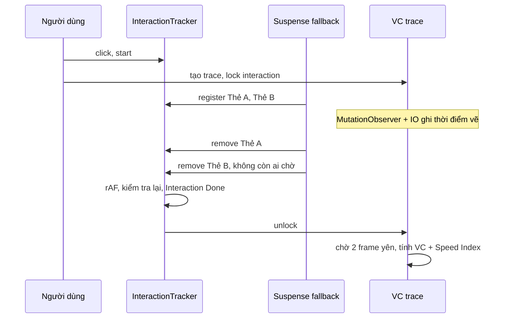

Bạn bấm vào một profile trên facebook.com. Bao lâu thì trang "xong"?

Các chỉ số quen thuộc không trả lời được câu này:

- **LCP, FCP** chỉ đo **lần tải trang đầu tiên**. Bấm link trong SPA chỉ là `pushState` + React render, không có "trang mới" nào trong mắt trình duyệt, nên không có LCP mới.
- **Thời gian gọi API** chỉ là một phần: sau khi dữ liệu về còn render, tải ảnh, chunk JS của component con, Suspense lồng nhau…
- **Speed Index** của Lighthouse rất hay (nó đo xem nội dung **hiện ra dần dần** hay "trắng xoá rồi hiện hết một lúc"), nhưng nó tính từ **video quay màn hình** trong phòng lab, không chạy được trên máy người dùng thật.

Facebook tự xây hai công cụ, chạy trên máy của **mọi người dùng**:

1. **Visual Completion (VC)**: đo thời điểm phần cuối cùng của khung nhìn được vẽ, và tự tính **Speed Index** từ đó, cho cả điều hướng trong SPA.
2. **Hero interaction tracing**: biết chính xác khi nào một tương tác (click, điều hướng) đã render **xong mọi thứ nó kích hoạt**, và cái gì đã làm nó chậm.

> [!TIP]
> **Tóm tắt**
> - **VC** = thời điểm phần tử cuối cùng có pixel trong viewport được vẽ. Thu thập bằng MutationObserver (cái gì mới xuất hiện) → IntersectionObserver `entry.time` (xấp xỉ frame vẽ nó).
> - **Speed Index** = Σ (tỉ lệ pixel × thời điểm vẽ), tính được ngay trên máy người dùng, cho cả điều hướng trong SPA.
> - **Interaction done** = không còn fallback Suspense nào đang mount. Điều hướng bằng `startTransition` không hiện fallback, nên phải giữ tương tác tới khi trang đích commit.
> - Loại spinner/quảng cáo bằng `data-visualcompletion="ignore"`, loại phiên bị ẩn giữa chừng hoặc bị timeout khỏi thống kê.

## Facebook làm thế nào?

### Visual Completion: `vc-tracker.WWW`

Module chính nằm trong `2.js` của [facebook-codebase](https://github.com/hunghg255/facebook-codebase), tên `vc-tracker.WWW`, cùng mặt tiền `CometVisualCompletion/CometVisualCompletion.js` và hằng số trong `Scroll/CometVisualCompletionConstants.js`.

**Bước 1: nghe mọi thay đổi DOM.** Mỗi lần điều hướng, `traceNavigation()` tạo một trace mới. Trace gắn một `MutationObserver` với cấu hình:

```js
g.mutationObserverConfig = {
  attributeFilter: ["hidden", "style", "href", "src"],
  attributeOldValue: !0, attributes: !0, characterData: !0, childList: !0, subtree: !0
};
```

Trong `mutationRecordHandler`, mỗi node được thêm vào DOM, mỗi phần tử bị gỡ `hidden`, hoặc `style` chuyển từ `display:none`/`visibility:hidden` sang hiện (`G(oldValue) && !G(newValue)`), đều được ghi vào `pendingMutations`. Ảnh (`IMG`, SVG `image`) được theo dõi riêng (`trackImage`) vì ảnh chỉ "được vẽ" sau khi tải xong.

**Bước 2: hỏi IntersectionObserver lúc nào phần tử được vẽ.** Mỗi phần tử trong `pendingMutations` được `observe()` bằng một IntersectionObserver. Khi IO báo về:

```js
g.addVisualElement(b.mutationSeq, a.target, b.mutationType, a.time + E /* navigationStart */)
```

`entry.time` là thời điểm trình duyệt tính giao cắt, trong bước "update the rendering" của event loop (sau layout, trước paint của frame đó). Nó không phải thời điểm pixel lên màn hình, nhưng là một ước lượng "frame vẽ phần tử này" chạy được trên mọi trình duyệt có IO (xem thêm mục "Bên trong trình duyệt"). Với ảnh, Facebook còn dùng thêm **Element Timing API** (`PerformanceObserver` với `entryTypes: ["element"]`) để lấy `renderTime` chính xác hơn ở trình duyệt hỗ trợ.

**Bước 3: phần tử nào không tính.** `checkExcluded` đi ngược lên tổ tiên, gặp thuộc tính `data-visualcompletion="ignore"` là bỏ qua. Hằng số còn có `ignore-dynamic`, `ignore-late-mutation` và `loading-state`; trace có một observer riêng (`loadingStateObserver`) cho các phần tử loading, tức là spinner/skeleton được theo dõi tách khỏi nội dung thật.

**Bước 4: chia pixel.** Khi trace kết thúc, hàm `calculatePaintedPixels` sắp các phần tử theo thời điểm vẽ **mới nhất trước**, và cho mỗi phần tử "sở hữu" một số pixel:

```js
a.sort((a, b) => b.timestamp - a.timestamp).forEach(function (a) {
  a.pixels = Math.min(d /* pixel còn lại */, a.pixels);
  e += a.pixels; d -= a.pixels;
  a.pixels -= c.calculatePaintedPixels(a.children, a.pixels); // trừ phần của con
  ...
});
```

Phần tử vẽ sau được ưu tiên vì nó là thứ người dùng nhìn thấy cuối cùng ở vùng đó (nó che lên, hoặc thay thế cái cũ). Phần tử cha bị trừ đi pixel của các con được vẽ sau nó. Tổng pixel bị chặn bởi diện tích viewport.

**Bước 5: tính chỉ số.** Trong `calculate()`, danh sách được sắp theo `latency` giảm dần:

- **`visuallyComplete`** = latency của phần tử đầu tiên trong danh sách, tức phần tử được vẽ **muộn nhất**.
- **`speedIndex`** cộng dồn `pixels / tổngPixel × latency`. Để ý: mẫu số là **tổng pixel đã vẽ** (`a.pixels / c.$2` trong code gốc), không phải diện tích viewport. Một trang để trống nửa màn hình vẫn đạt "100% hoàn tất"; con số đo **tốc độ vẽ phần có nội dung**, không đo trang lấp đầy màn hình tới đâu.
- Thêm các mốc phụ: `FP` (phần tử sớm nhất), `vcWithoutImage` (VC nếu bỏ ảnh), `scrolledVC`…

**Bước 6: khi nào chốt?** `traceNavigation` gọi `k.lock(interactionId)` ngay khi bắt đầu, và hằng số `HERO_TRACING_HOLD = "HeroTracing"` cho thấy trace VC được **giữ** cho tới khi hệ thống interaction tracing báo xong. Ngoài ra `holdTrigger()`/`resumeTrigger()` cho phép code bất kỳ giữ trace thêm. Khi tab bị ẩn (`visibilitychange`), mọi mutation đang chờ được chốt ngay với thời điểm hiện tại, và trace được gắn annotation `hidden`/`backgrounded` để loại khỏi thống kê.

### Hero interaction tracing: theo dõi fallback của Suspense

Câu hỏi "tương tác đã xong chưa" được trả lời bằng một mẹo rất gọn, nằm trong `CometPlaceholder/`:

- `CometPlaceholder` là wrapper của `React.Suspense`. **Fallback** của nó render thêm một component vô hình `CometHeroFallbackTracker`.
- `CometHeroFallbackTracker` gọi `registerPlaceholder(interactionId, uuid)` trong `useLayoutEffect`, và `removePlaceholder` trong cleanup.

```js
useLayoutEffect(function () {
  if (e != null) {
    d.registerPlaceholder(e, c, d.pageletStack);
    return function () { d.removePlaceholder(e, c) }
  }
}, [d, e, c]);
```

Fallback đang hiện = tracker đang mount = "còn chờ". Nội dung thật thế chỗ = fallback unmount = "xong một phần".

Phía bên kia, `CometHeroInteractionImpl` (thư mục `0 0Notes/`) giữ map các placeholder đang chờ. Khi map **rỗng** và cây con **không bị ẩn**, nó hẹn một `foregroundRequestAnimationFrame` (rAF, hoặc `setTimeout` khi tab ẩn vì rAF không chạy ở tab nền). Trong callback kiểm tra lại lần nữa, vẫn rỗng thì ghi mốc **"Interaction Done"**.

Interaction bị **huỷ** (`"Interaction Aborted (" + reason + ")"`) khi:

- `"New Interaction"`: người dùng đã bấm thứ khác.
- `"Unmount"`: component chứa nó bị gỡ.
- `"Hidden"`: cây con bị ẩn. Thông tin này đến từ `HiddenSubtreePassiveContext`, chính là cơ chế ở [bài #18](/blogs/facebook-keep-alive-tabs).

Thêm vài chi tiết:

- `hold()`/`unhold()` để giữ tương tác bằng tay, vd: giữ cho tới khi hydrate xong (`"Hydration"` trong `useCometPlaceholderImpl`).
- Bản React nội bộ của Facebook có prop `suspenseCallback` trên `Suspense`, nhận **tập các promise** đang làm nó treo. Mỗi promise được gắn tên (`PromiseAnnotate`), nên trace ghi được "Promise Wait: ProfileQuery" thay vì chỉ "đang chờ". React open-source không có prop này, nên bản viết lại chỉ dùng tên của boundary.
- `CometProfiler` (thư mục `16.CometProfiler/`) gom dữ liệu `React.Profiler` (`actualDuration`, số commit) theo từng pagelet để biết phần nào render chậm.



## Bên trong trình duyệt

**IntersectionObserver và thời điểm vẽ.** Theo spec, việc tính giao cắt của IO chạy trong bước "update the rendering" của event loop, sau style/layout và trước paint, cùng chỗ với `requestAnimationFrame`. `entry.time` là `DOMHighResTimeStamp` **cùng mốc** với `performance.now()`. Một phần tử vừa được thêm vào DOM sẽ có entry đầu tiên ở frame đầu tiên nó được layout, nên `entry.time` là ước lượng tốt cho "frame chứa phần tử này". Nó không phải thời điểm pixel thật sự lên màn hình (còn compositor, GPU), nhưng sai số cỡ một frame (~16ms), chấp nhận được cho mục đích so sánh.

**Speed Index là gì, vì sao hay?** Nếu vẽ `% khung nhìn đã hoàn tất` theo thời gian, Speed Index là **diện tích phía trên đường cong** (phần chưa hoàn tất). Hai trang cùng VC = 2 giây:

- Trang A trắng tới giây thứ 2 rồi hiện hết một lúc: Speed Index ≈ 2000ms.
- Trang B hiện 80% ở 300ms, 20% còn lại ở giây thứ 2: Speed Index = 0.8 × 300 + 0.2 × 2000 = 640ms.

Người dùng cảm thấy B nhanh hơn nhiều, và Speed Index phản ánh đúng điều đó. Công thức của Facebook `Σ pixels/total × latency` chính là tích phân rời rạc của diện tích đó. Lighthouse cũng tính Speed Index theo nghĩa này, nhưng từ các frame video, so sánh độ giống về màu sắc với frame cuối.

**Tại sao cần "ignore"?** Một spinner hay dải "đang tải" hiện ngay ở 50ms. Nếu tính nó là nội dung, Speed Index trông rất đẹp trong khi người dùng chỉ thấy một vòng xoay. Quảng cáo, đồng hồ đếm, số người đang xem thay đổi liên tục cũng làm VC không bao giờ "xong". Gắn `data-visualcompletion="ignore"` để loại chúng ra.

## Viết lại

### `VisualCompletionTrace`

Thu thập: ảnh chờ tải (chỉ ảnh trong viewport), phần tử chờ IO báo thời điểm vẽ:

```ts title=src/lib/visualCompletion.ts
  /**
   * Ảnh chỉ "được vẽ" sau khi tải xong, nên chờ `load` rồi mới hỏi IntersectionObserver.
   * Chỉ giữ lock cho ảnh đang nằm trong viewport: ảnh ngoài màn hình (nhất là
   * loading="lazy") có thể không bao giờ tải, và dù tải thì cũng không góp pixel nào.
   */
  private trackImage(img: HTMLImageElement) {
    if (this.report || this.isIgnored(img) || !img.getAttribute('src')) return;
    if (img.complete && img.naturalWidth > 0) return this.track(img, 'image');
    if (!isInViewport(img)) return;
    const release = this.lock('image');
    const done = () => {
      img.removeEventListener('load', done);
      img.removeEventListener('error', done);
      if (img.naturalWidth > 0) this.track(img, 'image');
      release();
    };
    img.addEventListener('load', done);
    img.addEventListener('error', done);
  }

  private onIntersect = (entries: IntersectionObserverEntry[]) => {
    for (const entry of entries) {
      const type = this.pending.get(entry.target);
      if (!type) continue;
      // entry.time cùng mốc với performance.now() (tính từ timeOrigin)
      this.records.set(entry.target, { element: entry.target, paintTime: entry.time, type });
      this.pending.delete(entry.target);
      this.intersectionObserver.unobserve(entry.target);
    }
    this.maybeFinish();
  };
```

Chốt trace khi hết lock và hết phần tử chờ, sau 2 frame yên lặng:

```ts title=src/lib/visualCompletion.ts
  private maybeFinish() {
    if (this.report) return;
    // phần tử bị gỡ khỏi DOM trước khi kịp vẽ: không chờ nữa
    this.pending.forEach((_, element) => {
      if (!element.isConnected) this.pending.delete(element);
    });
    if (this.locks.size > 0 || this.pending.size > 0) return;
    // Chờ 2 frame: nếu trong lúc đó có mutation mới thì pending lại khác rỗng.
    cancelAnimationFrame(this.settleFrame);
    this.settleFrame = requestAnimationFrame(() => {
      this.settleFrame = requestAnimationFrame(() => {
        if (this.locks.size === 0 && this.pending.size === 0) this.finish('complete');
      });
    });
  }
```

Chia pixel: vẽ muộn trước, cha bị trừ phần của con:

```ts title=src/lib/visualCompletion.ts
    // 3. Chia pixel: phần tử vẽ SAU được ưu tiên (nó là thứ người dùng thấy cuối cùng),
    //    mỗi phần tử bị giới hạn bởi số pixel còn lại, và trừ đi phần của các con.
    const flat: Node[] = [];
    const assign = (list: Node[], budget: number): number => {
      let used = 0;
      [...list]
        .sort((a, b) => b.record.paintTime - a.record.paintTime)
        .forEach((node) => {
          node.pixels = Math.min(budget, node.pixels);
          used += node.pixels;
          budget -= node.pixels;
          node.pixels -= assign(node.children, node.pixels);
          flat.push(node);
        });
      return used;
    };
    assign(roots, viewportPixels);
```

::: spoiler Xem toàn bộ src/lib/visualCompletion.ts

```ts title=src/lib/visualCompletion.ts
/**
 * Đo Visual Completion (VC) và Speed Index ngay trên trình duyệt người dùng,
 * cho cả điều hướng trong SPA (ý tưởng từ vc-tracker.WWW / CometVisualCompletion của Facebook).
 *
 * Cách làm:
 * 1. MutationObserver theo dõi vùng trang: phần tử mới được thêm, `hidden` bị gỡ,
 *    `style` hết display:none, ảnh đổi `src`.
 * 2. Mỗi phần tử đó được đưa cho IntersectionObserver. `entry.time` của lần báo đầu tiên
 *    xấp xỉ thời điểm phần tử được vẽ lên màn hình (IO chạy trong bước "update the rendering").
 * 3. Khi trang "xong" (hết lock, hết phần tử chờ), tính xem mỗi phần tử đóng góp bao nhiêu
 *    pixel trong viewport. VC = thời điểm phần tử cuối cùng có pixel được vẽ;
 *    Speed Index = Σ (tỉ lệ pixel × thời điểm vẽ).
 */

export const VC_ATTRIBUTE = 'data-visualcompletion';
/** Gắn lên phần tử không được tính (spinner, quảng cáo, đồng hồ đếm…) */
export const VC_IGNORE = 'ignore';

export interface VCElement {
  label: string;
  /** ms kể từ lúc bắt đầu điều hướng */
  latency: number;
  /** số pixel phần tử này "sở hữu" trong viewport */
  pixels: number;
  type: 'element' | 'image';
}

export interface VCReport {
  /** ms: lúc phần tử có pixel cuối cùng được vẽ */
  visuallyComplete: number;
  /** ms: lúc phần tử đầu tiên được vẽ */
  firstPaint: number;
  /** ms: càng nhỏ càng tốt, = thời điểm "trung bình" mà pixel xuất hiện */
  speedIndex: number;
  viewportPixels: number;
  paintedPixels: number;
  elements: VCElement[];
  /** đường cong % viewport đã hoàn tất theo thời gian */
  progress: { latency: number; percent: number }[];
  endReason: 'complete' | 'timeout';
  backgrounded: boolean;
}

export interface VisualCompletionOptions {
  /** vùng cần đo, mặc định document.body */
  root?: Element;
  /** quá thời gian này thì chốt kết quả dù vẫn còn lock */
  timeoutMs?: number;
  /** đặt tên phần tử trong báo cáo */
  label?: (element: Element) => string;
}

interface PaintRecord {
  element: Element;
  paintTime: number;
  type: VCElement['type'];
}

interface Node {
  record: PaintRecord;
  rect: { top: number; left: number; bottom: number; right: number };
  pixels: number;
  children: Node[];
}

const defaultLabel = (element: Element) =>
  element.closest('[data-vc-label]')?.getAttribute('data-vc-label') ?? element.tagName.toLowerCase();

const isInViewport = (element: Element) => {
  const r = element.getBoundingClientRect();
  return (
    r.bottom > 0 &&
    r.right > 0 &&
    r.top < document.documentElement.clientHeight &&
    r.left < document.documentElement.clientWidth
  );
};

const isHiddenStyle = (style: string | null) =>
  !!style && /display:\s*none|visibility:\s*hidden/.test(style);

export class VisualCompletionTrace {
  readonly startTime = performance.now();
  report: VCReport | null = null;

  private root: Element;
  private label: (element: Element) => string;
  private records = new Map<Element, PaintRecord>();
  /** phần tử đã thay đổi, đang chờ IntersectionObserver báo thời điểm vẽ */
  private pending = new Map<Element, PaintRecord['type']>();
  private locks = new Set<string>();
  private listeners = new Set<(report: VCReport) => void>();
  private mutationObserver: MutationObserver;
  private intersectionObserver: IntersectionObserver;
  private timeout: ReturnType<typeof setTimeout>;
  private settleFrame = 0;
  private backgrounded = document.visibilityState === 'hidden';
  private nextLockId = 0;

  constructor({ root = document.body, timeoutMs = 10_000, label = defaultLabel }: VisualCompletionOptions = {}) {
    this.root = root;
    this.label = label;
    this.intersectionObserver = new IntersectionObserver(this.onIntersect);
    this.mutationObserver = new MutationObserver(this.onMutations);
    this.mutationObserver.observe(root, {
      childList: true,
      subtree: true,
      attributes: true,
      attributeOldValue: true,
      attributeFilter: ['hidden', 'style', 'src'],
    });
    document.addEventListener('visibilitychange', this.onVisibilityChange);
    this.timeout = setTimeout(() => this.finish('timeout'), timeoutMs);
  }

  /**
   * Giữ trace chưa được chốt (vd: chờ interaction tracing báo xong, chờ dữ liệu).
   * Trả về hàm nhả lock.
   */
  lock(name = 'lock'): () => void {
    const id = `${name}#${this.nextLockId++}`;
    this.locks.add(id);
    return () => {
      this.locks.delete(id);
      this.maybeFinish();
    };
  }

  onComplete(listener: (report: VCReport) => void) {
    if (this.report) listener(this.report);
    else this.listeners.add(listener);
    return () => this.listeners.delete(listener);
  }

  /** Huỷ trace mà không báo cáo (vd: người dùng đã điều hướng tiếp). */
  dispose() {
    this.cleanup();
    this.listeners.clear();
  }

  // ---------- thu thập ----------

  private onMutations = (mutations: MutationRecord[]) => {
    for (const mutation of mutations) {
      if (mutation.type === 'childList') {
        mutation.addedNodes.forEach((node) => {
          if (!(node instanceof Element)) return;
          if (node instanceof HTMLImageElement) return this.trackImage(node);
          node.querySelectorAll('img').forEach((img) => this.trackImage(img));
          this.track(node, 'element');
        });
        continue;
      }
      const target = mutation.target as Element;
      if (mutation.attributeName === 'hidden' && !target.hasAttribute('hidden')) {
        this.track(target, 'element');
      } else if (
        mutation.attributeName === 'style' &&
        isHiddenStyle(mutation.oldValue) &&
        !isHiddenStyle(target.getAttribute('style'))
      ) {
        // từ display:none -> hiện ra: coi như vừa được vẽ
        this.track(target, 'element');
      } else if (mutation.attributeName === 'src' && target instanceof HTMLImageElement) {
        this.trackImage(target);
      }
    }
  };

  private isIgnored(element: Element) {
    for (let el: Element | null = element; el && el !== this.root.parentElement; el = el.parentElement) {
      if (el.getAttribute(VC_ATTRIBUTE) === VC_IGNORE) return true;
    }
    return false;
  }

  private track(element: Element, type: PaintRecord['type']) {
    if (this.report || this.isIgnored(element)) return;
    this.pending.set(element, type);
    this.intersectionObserver.observe(element);
  }

  /**
   * Ảnh chỉ "được vẽ" sau khi tải xong, nên chờ `load` rồi mới hỏi IntersectionObserver.
   * Chỉ giữ lock cho ảnh đang nằm trong viewport: ảnh ngoài màn hình (nhất là
   * loading="lazy") có thể không bao giờ tải, và dù tải thì cũng không góp pixel nào.
   */
  private trackImage(img: HTMLImageElement) {
    if (this.report || this.isIgnored(img) || !img.getAttribute('src')) return;
    if (img.complete && img.naturalWidth > 0) return this.track(img, 'image');
    if (!isInViewport(img)) return;
    const release = this.lock('image');
    const done = () => {
      img.removeEventListener('load', done);
      img.removeEventListener('error', done);
      if (img.naturalWidth > 0) this.track(img, 'image');
      release();
    };
    img.addEventListener('load', done);
    img.addEventListener('error', done);
  }

  private onIntersect = (entries: IntersectionObserverEntry[]) => {
    for (const entry of entries) {
      const type = this.pending.get(entry.target);
      if (!type) continue;
      // entry.time cùng mốc với performance.now() (tính từ timeOrigin)
      this.records.set(entry.target, { element: entry.target, paintTime: entry.time, type });
      this.pending.delete(entry.target);
      this.intersectionObserver.unobserve(entry.target);
    }
    this.maybeFinish();
  };

  /** Tab bị ẩn: trình duyệt ngừng vẽ, IO không bao giờ báo. Chốt luôn các phần tử đang chờ. */
  private onVisibilityChange = () => {
    if (document.visibilityState !== 'hidden') return;
    this.backgrounded = true;
    const now = performance.now();
    this.pending.forEach((type, element) => {
      this.records.set(element, { element, paintTime: now, type });
      this.intersectionObserver.unobserve(element);
    });
    this.pending.clear();
    this.maybeFinish();
  };

  private maybeFinish() {
    if (this.report) return;
    // phần tử bị gỡ khỏi DOM trước khi kịp vẽ: không chờ nữa
    this.pending.forEach((_, element) => {
      if (!element.isConnected) this.pending.delete(element);
    });
    if (this.locks.size > 0 || this.pending.size > 0) return;
    // Chờ 2 frame: nếu trong lúc đó có mutation mới thì pending lại khác rỗng.
    cancelAnimationFrame(this.settleFrame);
    this.settleFrame = requestAnimationFrame(() => {
      this.settleFrame = requestAnimationFrame(() => {
        if (this.locks.size === 0 && this.pending.size === 0) this.finish('complete');
      });
    });
  }

  private cleanup() {
    clearTimeout(this.timeout);
    cancelAnimationFrame(this.settleFrame);
    this.mutationObserver.disconnect();
    this.intersectionObserver.disconnect();
    document.removeEventListener('visibilitychange', this.onVisibilityChange);
  }

  private finish(endReason: VCReport['endReason']) {
    if (this.report) return;
    this.cleanup();
    this.report = this.calculate(endReason);
    this.listeners.forEach((listener) => listener(this.report!));
    this.listeners.clear();
  }

  // ---------- tính toán ----------

  private calculate(endReason: VCReport['endReason']): VCReport {
    const vw = document.documentElement.clientWidth;
    const vh = document.documentElement.clientHeight;
    const viewportPixels = vw * vh;

    // 1. Đo hình chữ nhật của từng phần tử, cắt theo viewport.
    const nodes = new Map<Element, Node>();
    this.records.forEach((record, element) => {
      if (!element.isConnected) return;
      const r = element.getBoundingClientRect();
      const rect = {
        top: Math.max(0, r.top),
        left: Math.max(0, r.left),
        bottom: Math.min(vh, r.bottom),
        right: Math.min(vw, r.right),
      };
      const area = Math.max(0, rect.right - rect.left) * Math.max(0, rect.bottom - rect.top);
      nodes.set(element, { record, rect, pixels: area, children: [] });
    });

    // 2. Dựng cây: phần tử con (được vẽ sau) nằm dưới phần tử cha gần nhất cũng được theo dõi.
    const roots: Node[] = [];
    nodes.forEach((node, element) => {
      let parent: Element | null = element.parentElement;
      while (parent && !nodes.has(parent)) parent = parent.parentElement;
      if (parent && nodes.get(parent)!.record.paintTime <= node.record.paintTime) {
        nodes.get(parent)!.children.push(node);
      } else {
        roots.push(node);
      }
    });

    // 3. Chia pixel: phần tử vẽ SAU được ưu tiên (nó là thứ người dùng thấy cuối cùng),
    //    mỗi phần tử bị giới hạn bởi số pixel còn lại, và trừ đi phần của các con.
    const flat: Node[] = [];
    const assign = (list: Node[], budget: number): number => {
      let used = 0;
      [...list]
        .sort((a, b) => b.record.paintTime - a.record.paintTime)
        .forEach((node) => {
          node.pixels = Math.min(budget, node.pixels);
          used += node.pixels;
          budget -= node.pixels;
          node.pixels -= assign(node.children, node.pixels);
          flat.push(node);
        });
      return used;
    };
    assign(roots, viewportPixels);

    const painted = flat
      .filter((node) => node.pixels > 0 && node.record.paintTime >= this.startTime)
      .map((node) => ({
        label: this.label(node.record.element),
        latency: Math.round(node.record.paintTime - this.startTime),
        pixels: Math.round(node.pixels),
        type: node.record.type,
      }))
      .sort((a, b) => a.latency - b.latency);

    const paintedPixels = painted.reduce((sum, el) => sum + el.pixels, 0);
    let cumulative = 0;
    const progress = painted.map((el) => {
      cumulative += el.pixels;
      return { latency: el.latency, percent: paintedPixels ? (cumulative / paintedPixels) * 100 : 0 };
    });

    return {
      visuallyComplete: painted.length ? painted[painted.length - 1].latency : 0,
      firstPaint: painted.length ? painted[0].latency : 0,
      speedIndex: Math.round(
        painted.reduce((sum, el) => sum + (paintedPixels ? (el.pixels / paintedPixels) * el.latency : 0), 0),
      ),
      viewportPixels,
      paintedPixels,
      elements: painted,
      progress,
      endReason,
      backgrounded: this.backgrounded,
    };
  }
}
```

:::

### Đi qua code

1. **Tạo trace ngay trong click handler**, trước khi React render. Mọi mutation sau đó đều được nhìn thấy. Tạo trong `useEffect` của trang mới là đã muộn: React đã commit, phần lớn DOM đã được thêm.
2. **`onMutations`** chỉ quan tâm phần tử (bỏ qua text node, comment), ảnh được tách ra `trackImage`, phần tử từ ẩn sang hiện cũng được tính.
3. **`trackImage`** giữ một `lock` cho tới khi ảnh `load`/`error`. Nếu không, trace có thể chốt trước khi ảnh hero kịp tải, và VC sẽ "nhanh" một cách giả tạo. Lock **chỉ** áp cho ảnh đang nằm trong viewport: ảnh `loading="lazy"` ở dưới màn hình có thể không bao giờ tải, và nếu khoá theo nó thì trace treo tới timeout. Ảnh ngoài viewport cũng không góp pixel nào, nên bỏ qua là đúng.
4. **`onIntersect`** lấy `entry.time` làm thời điểm vẽ, rồi `unobserve`: mỗi phần tử chỉ cần lần báo đầu tiên.
5. **`maybeFinish`**: hết lock và hết phần tử chờ thì đợi **2 frame**. Trong 2 frame đó có mutation mới thì `pending` lại khác rỗng và việc chốt bị hoãn. Phần tử bị gỡ khỏi DOM trước khi kịp vẽ (skeleton bị thay thế) được bỏ khỏi danh sách chờ, nếu không trace sẽ treo tới timeout.
6. **`calculate`** làm đúng 3 bước của bản gốc: đo rect (cắt theo viewport), dựng cây cha/con giữa các phần tử được theo dõi, chia pixel theo thứ tự vẽ muộn trước. Khác một chút: mình chỉ tính VC từ phần tử có `pixels > 0`, nên phần tử nằm ngoài màn hình không kéo VC lên.

### `InteractionTracker` + `TrackedSuspense`

Bắt đầu tương tác (có tuỳ chọn chờ commit cho điều hướng bằng transition):

```tsx title=src/lib/interactionTracker.tsx
  /**
   * Bắt đầu một tương tác.
   * waitForCommit: điều hướng bằng startTransition (React Router 7, Next.js App Router…) GIỮ
   * UI cũ thay vì hiện fallback, nên không có fallback nào đăng ký và tương tác sẽ bị coi là
   * "xong" trước khi trang mới kịp commit. Bật cờ này rồi gọi `commit()` từ layout effect
   * của trang đích.
   */
  start(name: string, { waitForCommit = false } = {}): number {
    if (this.current?.status === 'pending') this.abort('replaced');
    this.pending.clear();
    this.spansById.clear();
    this.startTime = performance.now();
    this.current = { id: this.nextId++, name, status: 'pending', duration: null, spans: [] };
    if (waitForCommit) this.register(COMMIT_SPAN, 'commit');
    this.emit();
    // Có thể không có Suspense nào treo cả: vẫn phải tự kiểm tra sau khi React commit.
    this.scheduleCheck();
    return this.current.id;
  }

  /** Trang đích đã commit (gọi trong useLayoutEffect của nó) — dùng với waitForCommit. */
  commit() {
    this.remove(COMMIT_SPAN);
  }
```

Kiểm tra "xong" ở frame kế tiếp:

```tsx title=src/lib/interactionTracker.tsx
  private scheduleCheck() {
    const interaction = this.current;
    if (!interaction || interaction.status !== 'pending' || this.pending.size > 0) return;
    cancelAnimationFrame(this.frame);
    // rAF: callback chạy ngay trước frame kế tiếp, tức là sau khi commit vừa rồi được vẽ.
    // Trong lúc chờ, nếu một Suspense khác treo (register) thì frame bị huỷ.
    this.frame = requestAnimationFrame(() => {
      if (this.current !== interaction || interaction.status !== 'pending' || this.pending.size > 0) return;
      interaction.status = 'done';
      interaction.duration = this.now();
      this.emit();
      this.doneListeners.forEach((listener) => listener(this.snapshot!));
    });
  }
```

Fallback đăng ký mình là "đang chờ":

```tsx title=src/lib/interactionTracker.tsx
function FallbackTracker({ name }: { name: string }) {
  const tracker = useContext(TrackerContext);
  const uuid = useId();
  // layout effect: đăng ký trong cùng commit với lúc fallback xuất hiện, trước khi vẽ
  useLayoutEffect(() => {
    if (!tracker) return;
    tracker.register(uuid, name);
    return () => tracker.remove(uuid);
  }, [tracker, uuid, name]);
  return null;
}

/** Suspense có báo cáo: mỗi lần fallback hiện là một "span" trong timeline tương tác. */
export function TrackedSuspense({
  name,
  fallback,
  children,
}: {
  name: string;
  fallback: ReactNode;
  children: ReactNode;
}) {
  return (
    <Suspense
      fallback={
        <>
          {fallback}
          <FallbackTracker name={name} />
        </>
      }
    >
      {children}
    </Suspense>
  );
}
```

::: spoiler Xem toàn bộ src/lib/interactionTracker.tsx

```tsx title=src/lib/interactionTracker.tsx
import {
  createContext,
  Suspense,
  useContext,
  useId,
  useLayoutEffect,
  useSyncExternalStore,
  type ReactNode,
} from 'react';

/**
 * Biết khi nào một tương tác (click, điều hướng) đã render XONG mọi thứ nó kích hoạt
 * (ý tưởng từ CometPlaceholder + CometHeroFallbackTracker + CometHeroInteractionImpl).
 *
 * Mẹo: fallback của mỗi Suspense render thêm một component vô hình. Fallback đang hiện
 * = component đó đang mount = "còn đang chờ". Khi không còn fallback nào đang mount,
 * và frame tiếp theo đã vẽ, tương tác được coi là hoàn tất.
 */

export interface InteractionSpan {
  name: string;
  /** ms kể từ lúc tương tác bắt đầu */
  start: number;
  end: number | null;
}

export interface Interaction {
  id: number;
  name: string;
  status: 'pending' | 'done' | 'aborted';
  /** ms tới khi hoàn tất / bị huỷ */
  duration: number | null;
  abortReason?: string;
  spans: InteractionSpan[];
}

const COMMIT_SPAN = 'interaction-commit';

export class InteractionTracker {
  private current: Interaction | null = null;
  private startTime = 0;
  private pending = new Map<string, InteractionSpan>();
  /** mọi span của interaction hiện tại theo uuid (kể cả đã xong) */
  private spansById = new Map<string, InteractionSpan>();
  private frame = 0;
  private nextId = 1;
  private snapshot: Interaction | null = null;
  private listeners = new Set<() => void>();
  private doneListeners = new Set<(interaction: Interaction) => void>();
  private abortListeners = new Set<(interaction: Interaction) => void>();

  constructor() {
    if (typeof document !== 'undefined') {
      // Facebook huỷ interaction khi bị ẩn: tab nền không vẽ, số đo sẽ sai.
      document.addEventListener('visibilitychange', () => {
        if (document.visibilityState === 'hidden') this.abort('hidden');
      });
    }
  }

  /**
   * Bắt đầu một tương tác.
   * waitForCommit: điều hướng bằng startTransition (React Router 7, Next.js App Router…) GIỮ
   * UI cũ thay vì hiện fallback, nên không có fallback nào đăng ký và tương tác sẽ bị coi là
   * "xong" trước khi trang mới kịp commit. Bật cờ này rồi gọi `commit()` từ layout effect
   * của trang đích.
   */
  start(name: string, { waitForCommit = false } = {}): number {
    if (this.current?.status === 'pending') this.abort('replaced');
    this.pending.clear();
    this.spansById.clear();
    this.startTime = performance.now();
    this.current = { id: this.nextId++, name, status: 'pending', duration: null, spans: [] };
    if (waitForCommit) this.register(COMMIT_SPAN, 'commit');
    this.emit();
    // Có thể không có Suspense nào treo cả: vẫn phải tự kiểm tra sau khi React commit.
    this.scheduleCheck();
    return this.current.id;
  }

  /** Trang đích đã commit (gọi trong useLayoutEffect của nó) — dùng với waitForCommit. */
  commit() {
    this.remove(COMMIT_SPAN);
  }

  /** Được gọi từ fallback đang mount. */
  register(uuid: string, name: string) {
    if (this.current?.status !== 'pending') return;
    // Cùng một fallback mount lại (StrictMode chạy effect 2 lần, hoặc fallback bị
    // unmount/mount lại tại cùng vị trí): dùng lại span cũ thay vì tạo span mới.
    let span = this.spansById.get(uuid);
    if (span) {
      span.end = null;
    } else {
      span = { name, start: this.now(), end: null };
      this.spansById.set(uuid, span);
      this.current.spans.push(span);
    }
    this.pending.set(uuid, span);
    cancelAnimationFrame(this.frame);
    this.emit();
  }

  /** Fallback unmount = nội dung thật đã thế chỗ. */
  remove(uuid: string) {
    const span = this.pending.get(uuid);
    if (!span) return;
    span.end = this.now();
    this.pending.delete(uuid);
    this.emit();
    this.scheduleCheck();
  }

  /** Giữ tương tác chưa xong bằng tay (vd: chờ ảnh hero tải). Trả về hàm nhả. */
  hold(name: string): () => void {
    const uuid = `hold-${Math.random().toString(36).slice(2)}`;
    this.register(uuid, name);
    return () => this.remove(uuid);
  }

  abort(reason: string) {
    if (this.current?.status !== 'pending') return;
    cancelAnimationFrame(this.frame);
    this.current.status = 'aborted';
    this.current.abortReason = reason;
    this.current.duration = this.now();
    this.pending.clear();
    this.emit();
    this.abortListeners.forEach((listener) => listener(this.snapshot!));
  }

  onDone(listener: (interaction: Interaction) => void) {
    this.doneListeners.add(listener);
    return () => this.doneListeners.delete(listener);
  }

  /** Bị huỷ: tab ẩn, tương tác mới thay thế, hoặc gọi abort() bằng tay. */
  onAbort(listener: (interaction: Interaction) => void) {
    this.abortListeners.add(listener);
    return () => this.abortListeners.delete(listener);
  }

  // --- external store cho UI ---
  subscribe = (listener: () => void) => {
    this.listeners.add(listener);
    return () => this.listeners.delete(listener);
  };
  getSnapshot = () => this.snapshot;

  private now() {
    return Math.round(performance.now() - this.startTime);
  }

  private emit() {
    // bản sao bất biến để useSyncExternalStore phát hiện thay đổi
    this.snapshot = this.current
      ? { ...this.current, spans: this.current.spans.map((span) => ({ ...span })) }
      : null;
    this.listeners.forEach((listener) => listener());
  }

  private scheduleCheck() {
    const interaction = this.current;
    if (!interaction || interaction.status !== 'pending' || this.pending.size > 0) return;
    cancelAnimationFrame(this.frame);
    // rAF: callback chạy ngay trước frame kế tiếp, tức là sau khi commit vừa rồi được vẽ.
    // Trong lúc chờ, nếu một Suspense khác treo (register) thì frame bị huỷ.
    this.frame = requestAnimationFrame(() => {
      if (this.current !== interaction || interaction.status !== 'pending' || this.pending.size > 0) return;
      interaction.status = 'done';
      interaction.duration = this.now();
      this.emit();
      this.doneListeners.forEach((listener) => listener(this.snapshot!));
    });
  }
}

const TrackerContext = createContext<InteractionTracker | null>(null);

export function InteractionTrackerProvider({
  tracker,
  children,
}: {
  tracker: InteractionTracker;
  children: ReactNode;
}) {
  return <TrackerContext.Provider value={tracker}>{children}</TrackerContext.Provider>;
}

export function useInteraction(tracker: InteractionTracker) {
  return useSyncExternalStore(tracker.subscribe, tracker.getSnapshot, tracker.getSnapshot);
}

function FallbackTracker({ name }: { name: string }) {
  const tracker = useContext(TrackerContext);
  const uuid = useId();
  // layout effect: đăng ký trong cùng commit với lúc fallback xuất hiện, trước khi vẽ
  useLayoutEffect(() => {
    if (!tracker) return;
    tracker.register(uuid, name);
    return () => tracker.remove(uuid);
  }, [tracker, uuid, name]);
  return null;
}

/** Suspense có báo cáo: mỗi lần fallback hiện là một "span" trong timeline tương tác. */
export function TrackedSuspense({
  name,
  fallback,
  children,
}: {
  name: string;
  fallback: ReactNode;
  children: ReactNode;
}) {
  return (
    <Suspense
      fallback={
        <>
          {fallback}
          <FallbackTracker name={name} />
        </>
      }
    >
      {children}
    </Suspense>
  );
}
```

:::

Chú ý:

- **`start()` tự lên lịch kiểm tra.** Nếu trang mới không có Suspense nào treo (dữ liệu đã có trong cache), không ai gọi `register`/`remove`, nhưng tương tác vẫn phải "xong" ở frame kế tiếp.
- **`register` huỷ rAF đang chờ.** Trường hợp hay gặp: fallback A vừa xong, đúng frame đó component B bên trong A lại treo (waterfall). rAF bị huỷ, tương tác chưa xong.
- **`spansById`**: StrictMode chạy layout effect 2 lần (mount, unmount, mount). Nếu mỗi lần `register` tạo span mới, timeline sẽ có các span trùng lặp dài 0ms. Gộp theo `useId()` giải quyết việc này, và cũng đúng với trường hợp fallback bị unmount/mount lại ở cùng vị trí.
- **`hold()`** cho phần không dùng Suspense: demo dùng nó cho sidebar tải bằng `setState`.
- **`onDone` và `onAbort`**: mỗi tương tác kết thúc bằng đúng một trong hai. Code dùng tracker phải nghe cả hai, nếu không lock của VC trace sẽ không bao giờ được nhả khi tương tác bị huỷ.

**Khác bản gốc:** không có `suspenseCallback` (React open-source không có), nên timeline chỉ có tên boundary chứ không có tên promise; thêm `waitForCommit`/`commit()` cho điều hướng bằng transition; VC chỉ khoá theo ảnh trong viewport; không đo lại theo viewport ban đầu khi người dùng cuộn (`measureOriginalViewport`).

## Demo

Bấm **Điều hướng**: trang mới có header, ảnh hero (khung hiện trước, ảnh tải sau), 3 thẻ dùng Suspense với độ trễ ngẫu nhiên, sidebar giữ tương tác bằng `hold()`. Bảng bên phải hiện thời gian interaction xong, VC, Speed Index, timeline các Suspense đã chờ, đường cong % hoàn tất (vùng xanh nhạt là Speed Index), và danh sách phần tử kèm % pixel. Bỏ chọn "ignore" để thấy dải "đang đồng bộ" được tính là nội dung và kéo Speed Index xuống.

<iframe class="demo-frame" src="/demos/facebook-patterns/index.html?theme=dark#/visual-completion" title="Demo visual-completion" loading="lazy" style="height: 720px"></iframe>

<p class="demo-links">▶ <a href="/demos/facebook-patterns/index.html#/visual-completion" target="_blank" rel="noopener">Mở demo toàn màn hình ↗</a> · <a href="https://stackblitz.com/github/hunghg255/blog-hunghg/tree/master/examples/facebook-patterns?file=src/lib/visualCompletion.ts" target="_blank" rel="noopener">Sửa code trên StackBlitz ↗</a> · <a href="https://github.com/hunghg255/blog-hunghg/blob/master/examples/facebook-patterns/src/lib/visualCompletion.ts" target="_blank" rel="noopener">Xem source trên GitHub ↗</a></p>

## Tại sao không làm cách khác?

**"Dùng `performance.mark` khi dữ liệu về là đủ?"** Đó là đo **mạng**, không phải đo **cái người dùng thấy**. Dữ liệu về rồi vẫn còn render, chunk JS, ảnh, và các Suspense lồng nhau. VC đo ở đầu ra cuối cùng: pixel.

**"Sao không chụp màn hình như Lighthouse?"** Không thể làm trên máy người dùng (vừa đắt vừa vi phạm quyền riêng tư). Pixel được ước lượng từ hình chữ nhật của phần tử: không chính xác như ảnh chụp (bỏ qua phần trong suốt, chồng lấp phức tạp), nhưng đủ tốt khi so sánh hai phiên bản của cùng một trang.

**"Sao tracker theo dõi fallback mà không theo dõi promise?"** Vì trong React, fallback **là** nguồn sự thật về việc "người dùng đang thấy trạng thái chờ". Một promise có thể đang chờ mà không làm gì treo (đã có dữ liệu cũ, transition giữ UI cũ). Ngược lại, fallback đang mount thì chắc chắn người dùng đang thấy skeleton.

**"Chốt VC khi nào?"** Quá sớm thì bỏ sót nội dung, quá muộn thì bị các thay đổi không liên quan (thông báo, chat) kéo VC lên. Facebook giải bằng cách gắn VC với interaction tracing (lock tới khi Suspense xong) cộng danh sách ignore. Bản viết lại làm giống vậy, thêm "2 frame yên lặng" và một timeout an toàn.

## Edge case và cạm bẫy

- **Điều hướng bằng transition.** React Router 7, Next.js App Router và mọi điều hướng bọc trong `startTransition` **giữ UI cũ** thay vì hiện fallback trong lúc trang mới đang tải. Không fallback nào mount, nên tracker thấy "không còn ai chờ" và báo xong ở frame kế tiếp, **trước khi trang mới kịp commit**. Cách sửa: `tracker.start(name, { waitForCommit: true })` khi bấm, rồi gọi `tracker.commit()` trong `useLayoutEffect` của trang đích. Các Suspense lồng bên trong trang đích vẫn được theo dõi như thường.
- **Tab bị ẩn giữa chừng.** Trình duyệt ngừng vẽ, IO không báo, rAF không chạy. Cả hai công cụ đều xử lý: VC chốt các phần tử đang chờ và đánh dấu `backgrounded`, tracker huỷ interaction với lý do `hidden`. Khi phân tích dữ liệu, **loại các phiên này ra**, nếu không p95 sẽ toàn là số rác.
- **Người dùng cuộn trong lúc tải.** Rect được đo lúc chốt, nên phần tử có thể đã cuộn ra khỏi viewport. Facebook lưu `scrollY` lúc mỗi phần tử xuất hiện và có chế độ `measureOriginalViewport` để đo theo viewport ban đầu. Bản viết lại không làm phần này; nếu cần, lưu `window.scrollY` cùng `paintTime` và trừ đi khi đo rect.
- **Ảnh nền CSS.** MutationObserver không biết `background-image` đã tải chưa. Facebook có `getBackgroundImages()` đọc style, rồi tra Resource Timing để lấy thời điểm tải xong. Bản viết lại bỏ qua.
- **Animation, transition.** Phần tử trượt vào trong 300ms được tính là "vẽ" ở frame đầu tiên. Thường chấp nhận được; nếu không, ignore phần tử animate và đánh dấu bằng tay khi animation xong.
- **Chi phí.** MutationObserver trên `subtree` của cả trang cộng IO cho mỗi phần tử mới có chi phí thật. Facebook đẩy phần tính toán nặng sang `scheduleLoggingPriCallback` (`defer_expensive_calculation`). Ở production nên **lấy mẫu** (chỉ đo X% phiên) và hoãn `calculate()` sang lúc rảnh, với hai lưu ý: hoãn càng lâu thì rect đo được càng có thể khác lúc vẽ (người dùng đã cuộn), nên hãy đo rect ngay khi chốt và chỉ hoãn phần chia pixel; và `requestIdleCallback` không có ở mọi trình duyệt (Safari từng chỉ có sau cờ thử nghiệm; xem [caniuse](https://caniuse.com/requestidlecallback)), nên cần fallback `setTimeout(fn, 0)`.
- **Waterfall Suspense.** Tracker xử lý được (huỷ rAF khi có fallback mới), nhưng timeline sẽ cho thấy span B bắt đầu đúng lúc span A kết thúc. Đó chính là thông tin bạn cần để sửa waterfall.

## So với các API chuẩn

| | Đo được SPA? | Chạy trên máy thật? | Ghi chú |
| --- | --- | --- | --- |
| LCP / FCP | Không (chỉ tải trang đầu) | Có | Chuẩn Core Web Vitals |
| Soft Navigations API | Có | Có, nhưng còn **thử nghiệm** trong Chrome (tính tới 10/2026, xem trạng thái mới nhất trên chromestatus) | Tự nhận diện điều hướng SPA và báo LCP cho từng lần; chưa phải chuẩn |
| Element Timing (`elementtiming="…"`) | Có, cho từng phần tử bạn đánh dấu | Chỉ Chromium | Facebook dùng thêm cho ảnh |
| Lighthouse Speed Index | Có trong user flow | Không, chỉ trong lab | Tính từ video |
| VC kiểu Facebook | Có | Có | Tự xây, tự hiệu chỉnh |

Nếu bạn chỉ cần một con số cho điều hướng SPA và chấp nhận dùng Chromium, hãy theo dõi Soft Navigations API. Nếu cần chạy trên mọi trình duyệt, cần biết **phần nào** của trang chậm, hoặc cần Speed Index thật trên máy người dùng, cách của Facebook vẫn là mẫu tham khảo rất tốt.

## Dùng trong dự án

Gắn vào router (ví dụ React Router, điều hướng bằng transition), mỗi lần điều hướng:

1. `dispose()` trace cũ rồi tạo `VisualCompletionTrace` mới, khoá nó bằng `lock('interaction')`.
2. `tracker.start(name, { waitForCommit: true })`, và trang đích gọi `tracker.commit()` trong `useLayoutEffect`.
3. `onDone`: nhả khoá, gửi thời gian tương tác. `onAbort`: `dispose()` trace, không gửi gì.
4. `onComplete`: bỏ báo cáo có `backgrounded` hoặc `endReason === 'timeout'`.

::: spoiler Xem code gắn vào React Router

```tsx
const tracker = new InteractionTracker();
let currentTrace: VisualCompletionTrace | null = null;

function useTraceNavigation() {
  const navigate = useNavigate();
  return (to: string) => {
    // Điều hướng liên tiếp: huỷ trace cũ, nếu không sẽ có 2 MutationObserver cùng chạy.
    currentTrace?.dispose();
    const trace = (currentTrace = new VisualCompletionTrace({
      root: document.getElementById('main')!,
      timeoutMs: 15_000,
    }));
    const release = trace.lock('interaction');

    const offDone = tracker.onDone((interaction) => {
      cleanup();
      release();
      sendMetric('interaction_done', { route: to, ms: interaction.duration, spans: interaction.spans });
    });
    // Bị huỷ (tương tác mới, tab ẩn): bỏ trace, không gửi số liệu nửa vời.
    const offAbort = tracker.onAbort(() => {
      cleanup();
      trace.dispose();
    });
    const cleanup = () => {
      offDone();
      offAbort();
    };

    trace.onComplete((report) => {
      if (report.backgrounded || report.endReason === 'timeout') return; // số liệu rác
      sendMetric('visual_completion', { route: to, vc: report.visuallyComplete, si: report.speedIndex });
    });

    tracker.start(`navigate ${to}`, { waitForCommit: true });
    navigate(to);
  };
}

// Trong component gốc của mỗi trang đích:
useLayoutEffect(() => tracker.commit(), []);
```

:::

Thay mọi `<Suspense>` quan trọng bằng `<TrackedSuspense name="…">`, và gắn `data-visualcompletion="ignore"` cho spinner, quảng cáo, widget chat. `sendMetric` nên đi qua batch logger ở [bài #7](/blogs/facebook-batch-logger).

## Kiểm thử

::: spoiler Ví dụ test (bản phác, không có trong repo)

Logic chia pixel nên được test riêng (giả sử bạn tách `assign` thành một hàm thuần):

```ts
it('phần tử vẽ sau được ưu tiên, cha bị trừ phần của con', () => {
  const viewport = 1000;
  const parent = { paintTime: 100, area: 800, children: [{ paintTime: 300, area: 300, children: [] }] };
  const other = { paintTime: 200, area: 500, children: [] };
  const result = assignPixels([parent, other], viewport);
  // other (200ms) lấy 500, parent (100ms) còn tối đa 500, trong đó con (300ms) lấy 300
  expect(result.get(other)).toBe(500);
  expect(result.get(parent.children[0])).toBe(300);
  expect(result.get(parent)).toBe(200);
});
```

Còn tracker thì test end-to-end bằng Playwright: bấm điều hướng, chờ `interaction` đổi từ "đang chờ" sang số ms, kiểm tra nó lớn hơn độ trễ của Suspense chậm nhất, và VC xấp xỉ bằng hoặc lớn hơn nó.

:::

---

Bài này thuộc series **[Học từ mã nguồn Facebook](/series/facebook)** (38 bài, đọc theo thứ tự).

::: spoiler Xem nhanh danh sách bài trong series

*Phần 1*

- [Mở đầu: cách đọc code minify của Facebook](/blogs/learn-from-facebook-source-code)
- [#1 Dùng chung IntersectionObserver + infinite scroll](/blogs/facebook-shared-intersection-observer)
- [#2 useViewportDuration: đo thời gian thực sự được xem](/blogs/facebook-use-viewport-duration)
- [#3 Preload code + data khi hover](/blogs/facebook-preload-on-hover)
- [#4 Toast manager với external store](/blogs/facebook-toast-manager)
- [#5 Network status + heartbeat backoff](/blogs/facebook-network-status-heartbeat)
- [#6 ErrorGuard: bắt lỗi theo ngữ cảnh](/blogs/facebook-error-guard)
- [#7 Banzai: gom log theo lô + sendBeacon](/blogs/facebook-batch-logger)
- [#8 Focus trap + Esc theo layer](/blogs/facebook-focus-trap)

*Phần 2*

- [#9 Mẹo calc(… * 9999): container query, line-clamp, mũi tên carousel bằng CSS](/blogs/facebook-css-9999-trick)
- [#10 Thanh cuộn tuỳ biến bằng CSS 3D](/blogs/facebook-css-3d-scrollbar)
- [#11 Modal cuộn bằng window, giữ vị trí trang nền](/blogs/facebook-document-scroll-modal)
- [#12 Popover, tooltip group và hovercard](/blogs/facebook-popover-tooltip)
- [#13 Primitive Pressable + focus-visible](/blogs/facebook-pressable)
- [#14 Tab "Xem thêm" + sticky header bằng IntersectionObserver](/blogs/facebook-priority-tabs-sticky-header)
- [#15 Avatar khoét mask, gradient Messenger, skeleton steps()](/blogs/facebook-visual-tricks)
- [#16 Khung chat không giật](/blogs/facebook-chat-scroller)
- [#17 Thuật toán chọn bố cục collage ảnh](/blogs/facebook-photo-collage-layout)
- [#18 Keep-alive tab trong SPA](/blogs/facebook-keep-alive-tabs)
- **#19 Tự đo Visual Completion & interaction tracing** (bài này)
- [#20 Router SPA bền bỉ & tải chunk có retry](/blogs/facebook-spa-router-resilient-loading)

*Phần 3*

- [#21 Smart Compose: gợi ý chữ mờ khi gõ](/blogs/facebook-smart-compose-ghost-text)
- [#22 MQTT ngay trong trình duyệt, tự chuyển sang long-poll](/blogs/facebook-mqtt-in-browser)
- [#23 Đo thời gian dùng bằng bitmap 64 giây](/blogs/facebook-time-spent-bitmap)
- [#24 Bảng reaction nhấn giữ rồi trượt](/blogs/facebook-reaction-press-slide)
- [#25 Tìm kiếm gấp dấu, phiên âm và highlight đầu từ](/blogs/facebook-search-diacritics-tokenize)
- [#26 Ring buffer biết trace nào đã mất log](/blogs/facebook-trace-ring-buffer)
- [#27 Engine animation JS: một vòng rAF và solver cubic-bezier](/blogs/facebook-keyframes-loop-cubic-bezier)
- [#28 Bootloader: bitmap tài nguyên đã tải, chỉ reload khi cần](/blogs/facebook-bootloader-bitmap-consistency)
- [#29 Nhận biết click do screen reader tạo ra](/blogs/facebook-virtual-cursor-detection)
- [#30 Tải trước feed theo chất lượng mạng, đoán hạng thiết bị](/blogs/facebook-network-aware-prefetch)
- [#31 Hàng đợi gửi tin chat giữ đúng thứ tự](/blogs/facebook-ordered-send-queue)
- [#32 Gộp lời gọi API trong cùng một tick](/blogs/facebook-api-batcher)
- [#33 Resize ảnh trong pool Web Worker](/blogs/facebook-jpeg-resize-worker-pool)
- [#34 Crop ảnh theo nhiều khuôn mặt](/blogs/facebook-face-aware-crop)
- [#35 Kéo-thả sắp xếp và vùng thả file không nhấp nháy](/blogs/facebook-flicker-free-drag-drop)
- [#36 Tiện ích UI: fade-out, sticky event, hàm huỷ được](/blogs/facebook-ui-utility-hooks)
- [#37 Hạ tầng nhỏ: cookie, hash lỗi, prefetch khi chuột dừng](/blogs/facebook-small-infra-cookie-hash-idle)

:::

Code + demo: [`examples/facebook-patterns`](https://github.com/hunghg255/blog-hunghg/tree/master/examples/facebook-patterns) · [Mở trên StackBlitz](https://stackblitz.com/github/hunghg255/blog-hunghg/tree/master/examples/facebook-patterns)
