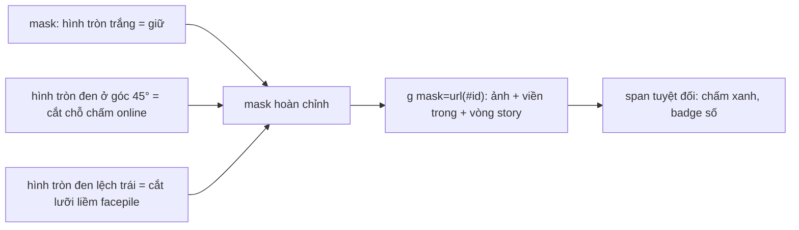

Bài này gom ba kỹ thuật nhỏ. Mỗi cái chỉ vài chục dòng, nhưng cả ba đều trả lời cùng một câu hỏi: **làm sao để UI trông đúng trên mọi nền và không tốn tài nguyên vô ích?**

1. **Avatar khoét rãnh**: chấm xanh "đang hoạt động" tách khỏi avatar bằng một khe **trong suốt**, không phải viền trắng.
2. **Bong bóng chat gradient** của Messenger: tin nhắn của bạn đổi màu dần theo vị trí trên màn hình, chỉ bằng một dòng CSS.
3. **Skeleton glimmer tiết kiệm**: nhấp nháy 10 nấc mỗi giây thay vì 60, lệch pha theo thứ tự, và tự dừng khi nằm ngoài màn hình.

> [!TIP]
> **Tóm tắt**
> - Cần "khe hở" quanh chấm online thì **khoét** avatar bằng mask (đen = cắt), đừng giả bằng viền trắng: đúng trên mọi nền.
> - `background-attachment: fixed` biến mọi bong bóng thành cửa sổ nhìn xuống **một** gradient trải theo viewport. Mất hiệu ứng nếu bong bóng hoặc tổ tiên có `transform`.
> - Skeleton: `steps(10)` để chỉ có ~10 giá trị opacity mỗi giây, `delay` 1s + so le, và pause khi khuất màn hình.
> - Ngày nay CSS `mask`/`mask-composite` làm được phần avatar; phần đáng học là ý tưởng "khoét thay vì tô".

Thử demo trước cho dễ hình dung:

<iframe class="demo-frame" src="/demos/facebook-patterns/index.html?theme=dark#/visual-tricks" title="Demo visual-tricks" loading="lazy" style="height: 900px"></iframe>

<p class="demo-links">▶ <a href="/demos/facebook-patterns/index.html#/visual-tricks" target="_blank" rel="noopener">Mở demo toàn màn hình ↗</a> · <a href="https://stackblitz.com/github/hunghg255/blog-hunghg/tree/master/examples/facebook-patterns?file=src/lib/maskedAvatar.tsx" target="_blank" rel="noopener">Sửa code trên StackBlitz ↗</a> · <a href="https://github.com/hunghg255/blog-hunghg/blob/master/examples/facebook-patterns/src/lib/maskedAvatar.tsx" target="_blank" rel="noopener">Xem source trên GitHub ↗</a></p>

## Phần 1: Avatar khoét rãnh cho chấm online

### Vấn đề của viền trắng

Cách quen thuộc để vẽ chấm online là một hình tròn xanh có `border: 2px solid white`, đặt chồng lên góc avatar. Viền trắng tạo cảm giác có "khe hở" giữa chấm và ảnh, nhưng chỉ đúng khi **nền phía sau là màu trắng**:

- Ở dark mode, mỗi chấm có một vòng trắng lạc lõng.
- Đặt avatar trên ảnh bìa hay nền gradient, vòng trắng lộ rõ là một vòng trắng chứ không phải khe hở.
- Avatar nằm trong ô được hover (nền xám nhạt), vòng trắng lại sai màu.

Ở demo phía trên, bấm "Nền ảnh" hoặc "Nền tối" là thấy ngay sự khác biệt giữa cột trái và cột phải.

Điều ta thực sự muốn là **cắt bỏ** một phần avatar quanh chấm xanh, để thứ nằm phía sau lộ ra, bất kể đó là màu gì.

### Facebook làm thế nào?

Component avatar của Facebook là `TetraProfilePhoto` (thư mục `01 Avatar/` trong [facebook-codebase](https://github.com/hunghg255/facebook-codebase)). Khi ảnh có URL, nó không render `` mà render một `<svg>` gồm hai phần:

```js
// rút gọn từ TetraProfilePhoto.js (đã đổi tên biến)
h.jsxs("mask", { id: z, children: [
  shape === "circle"
    ? h.jsx("circle", { cx: v / 2, cy: v / 2, fill: "white", r: v / 2 })
    : h.jsx("rect", { fill: "white", height: v, width: v, rx: 8, ry: 8 }),
  badge && h.jsx("circle", { cx: …, cy: …, fill: "black", r: Math.max(…, badgeSize / 2 + strokeWidth) }),
  …
]}),
h.jsxs("g", { mask: "url(#" + z + ")", children: [ image, innerBorderCircle, storyRing ] })
```

Quy tắc của SVG mask: **chỗ trắng giữ lại, chỗ đen cắt bỏ** (chính xác hơn, mask dùng độ sáng làm độ trong suốt). Mask gồm một hình tròn trắng bằng avatar, cộng một hình tròn đen nằm đúng chỗ chấm online. Bán kính lỗ đen bằng **bán kính chấm cộng độ dày khe**. Mọi thứ trong `<g mask=…>` (ảnh, viền trong mờ, vòng story) đều bị khoét theo.

Trong cùng mask còn vài "lỗ" khác:

- **Badge số thông báo** (góc trên phải): một `rect` đen bo tròn cao 22px, rộng **22, 33 hoặc 44px** cho 1, 2, 3 chữ số.
- **Avatar chồng nhau trong facepile** (prop `isOverlapped`): một hình tròn đen tâm ở `cx = -v/2 + 4`, bán kính `v/2 + 2`. Facepile đặt `margin-left: -4px` cho avatar thứ hai trở đi (class `rl04r1d5{margin-left:-4px}` trong CSS). Tâm avatar phía trước vì vậy nằm đúng ở `x = −v/2 + 4` so với avatar hiện tại, và lỗ to hơn nó 2px, tạo ra khe hình lưỡi liềm 2px.
- **Vòng story**: một vòng đen mảnh tạo khe giữa ảnh và vòng màu story.

Hai chi tiết kỹ thuật đáng học:

- **ID của mask phải duy nhất trên cả trang.** Họ lấy từ `useCometUniqueID()`, rồi gắn `id` và `mask` bằng `useSetAttributeRef` kèm `suppressHydrationWarning`. Lý do là ID sinh ở server và ở client có thể khác nhau: hai avatar cùng tham chiếu `url(#mask-1)` sẽ dùng nhầm mask của nhau, còn lệch ID khi hydrate thì React cảnh báo.
- **Vị trí chấm được tính bằng hình học**, không phải chỉnh tay theo từng cỡ.

### Hình học: đặt tâm chấm đúng trên đường tròn, ở góc 45°

`profilePhotoUtils.getBadgePosition(radius)` của Facebook (`sqrt(d²/2)` chính là `d/√2`, viết vòng hơi xa):

```js
a = Math.sqrt(2 * a * a) - a;      // a = bán kính
a = Math.round(Math.sqrt(a * a / 2));
return { bottom: a, right: a, transform: "translate(50%, 50%)" };
```

Giải thích bằng hình: avatar bán kính `r` nằm trong hình vuông cạnh `2r`.

- Khoảng cách từ góc dưới phải của hình vuông tới tâm, theo đường chéo, là `r·√2`.
- Đường tròn cách tâm `r`, nên đoạn từ góc tới đường tròn (dọc theo đường chéo) là `d = r·√2 − r`.
- Chiếu đoạn chéo đó xuống trục ngang hay dọc được `d / √2`. Đó là `right` và `bottom` cần đặt.
- `translate(50%, 50%)` kéo **tâm** chấm (chứ không phải góc trên trái của nó) về đúng điểm ấy.

| Cỡ avatar | r | d = r√2 − r | offset = round(d/√2) |
| --- | --- | --- | --- |
| 40 | 20 | 8.28 | 6 |
| 60 | 30 | 12.43 | 9 |
| 96 | 48 | 19.88 | 14 |

Rút gọn: `offset = r·(√2 − 1)/√2 = r·(1 − 1/√2) ≈ 0.293 × r`. Dễ nhớ hơn công thức hai lần căn bậc hai.

Ở RTL (tiếng Ả Rập, Do Thái), hàm đổi `right` thành `left` và `translate(50%)` thành `translate(-50%)`. Chấm chuyển sang góc trái.

Cỡ chấm và độ dày khe lấy từ một **bảng tra** theo cỡ avatar (`getBadgeSizeAndStrokeWidth`). Ví dụ avatar 40px có chấm 9px, khe 2px; avatar 132px có chấm 20px, khe 4px. Dùng bảng thay vì công thức để designer chỉnh từng cỡ cho cân mắt.



### Viết lại

Công thức đặt chấm:

```tsx title=src/lib/maskedAvatar.tsx
/**
 * Khoảng cách (px) từ cạnh phải/dưới tới tâm badge sao cho tâm badge nằm đúng trên đường tròn
 * avatar, ở góc 45°.
 *
 * Từ góc hình vuông bao tới tâm, theo đường chéo là r·√2. Đường tròn cách tâm r, nên đoạn từ
 * góc tới đường tròn là d = r·√2 − r. Chiếu đoạn chéo d xuống trục x/y: d/√2.
 */
export function getBadgeOffset(radius: number): number {
  const diagonal = Math.sqrt(2 * radius * radius) - radius;
  return Math.round(Math.sqrt((diagonal * diagonal) / 2));
}
```

Phần SVG: mask (trắng giữ, đen cắt) và nhóm ảnh bị khoét theo mask:

```tsx title=src/lib/maskedAvatar.tsx
      <svg width={size} height={size} role={alt ? 'img' : 'none'} aria-label={alt} style={{ display: 'block' }}>
        <mask id={maskId}>
          {/* trắng = giữ lại, đen = cắt bỏ */}
          {shape === 'circle' ? (
            <circle cx={radius} cy={radius} r={radius} fill='white' />
          ) : (
            <rect width={size} height={size} rx={8} ry={8} fill='white' />
          )}
          {online && (
            // tâm badge = góc dưới phải lùi vào `offset`; bán kính lỗ = bán kính badge + khe hở
            <circle cx={size - offset} cy={size - offset} r={badgeSize / 2 + gap} fill='black' />
          )}
          {showCount && (
            <rect
              x={size - offset - pillWidth / 2 - gap}
              y={offset - PILL_HEIGHT / 2 - gap}
              width={pillWidth + gap * 2}
              height={PILL_HEIGHT + gap * 2}
              rx={PILL_HEIGHT / 2 + gap}
              fill='black'
            />
          )}
          {overlapped && (
            // avatar phía trước có tâm ở x = −size/2 + 4 (do marginLeft −4px);
            // cắt một hình tròn lớn hơn nó 2px -> chừa khe 2px hình lưỡi liềm
            <circle cx={-radius + 4} cy={radius} r={radius + 2} fill='black' />
          )}
        </mask>
        <g mask={`url(#${maskId})`}>
          <image href={src} width={size} height={size} preserveAspectRatio='xMidYMid slice' />
          {/* viền trong rất mờ để ảnh trắng không "tan" vào nền trắng */}
          {shape === 'circle' ? (
            <circle cx={radius} cy={radius} r={radius - 0.5} fill='none' stroke='rgb(0 0 0 / 0.1)' />
          ) : (
            <rect x={0.5} y={0.5} width={size - 1} height={size - 1} rx={8} fill='none' stroke='rgb(0 0 0 / 0.1)' />
          )}
        </g>
      </svg>
```

::: spoiler Xem toàn bộ src/lib/maskedAvatar.tsx (bảng cỡ chấm, chấm/badge HTML, Facepile)

```tsx title=src/lib/maskedAvatar.tsx
import { useId } from 'react';

/**
 * Avatar "khoét rãnh" bằng SVG mask (ý tưởng từ TetraProfilePhoto + profilePhotoUtils của Facebook).
 *
 * Thay vì vẽ viền trắng quanh chấm online (hỏng khi nền tối hoặc nền là ảnh), ta khoét một lỗ
 * trong suốt ngay trên avatar: mask = hình tròn trắng (giữ lại) + hình tròn đen ở chỗ badge
 * (cắt bỏ). Nền phía sau lộ ra qua khe hở, nên trên nền nào trông cũng đúng.
 */

export type AvatarShape = 'circle' | 'roundedRect';

/**
 * Khoảng cách (px) từ cạnh phải/dưới tới tâm badge sao cho tâm badge nằm đúng trên đường tròn
 * avatar, ở góc 45°.
 *
 * Từ góc hình vuông bao tới tâm, theo đường chéo là r·√2. Đường tròn cách tâm r, nên đoạn từ
 * góc tới đường tròn là d = r·√2 − r. Chiếu đoạn chéo d xuống trục x/y: d/√2.
 */
export function getBadgeOffset(radius: number): number {
  const diagonal = Math.sqrt(2 * radius * radius) - radius;
  return Math.round(Math.sqrt((diagonal * diagonal) / 2));
}

/**
 * Kích thước chấm online và độ dày "khe hở" theo cỡ avatar: bảng tra giống hệt Facebook
 * (getBadgeSizeAndStrokeWidth với type "availabilityBadge"). Cỡ không có trong bảng -> [8, 2].
 */
const AVAILABILITY_BADGE: Record<number, [size: number, gap: number]> = {
  16: [6, 1.5],
  20: [6, 1.5],
  24: [6, 1.5],
  28: [7, 2],
  32: [8, 2],
  36: [8, 2],
  40: [9, 2],
  48: [9, 2],
  56: [10, 2],
  60: [10, 2],
  72: [12, 2],
  80: [14, 2],
  88: [14, 2],
  96: [15, 2],
  100: [15, 2],
  132: [20, 4],
  168: [20, 4],
};

export function getBadgeSizeAndGap(avatarSize: number): [number, number] {
  return AVAILABILITY_BADGE[avatarSize] ?? [8, 2];
}

/** Badge số thông báo: viên thuốc cao 22px, rộng 22/33/44 cho 1/2/3 chữ số (như Facebook). */
export function getCountPillWidth(count: number): number {
  return count <= 9 ? 22 : count <= 99 ? 33 : 44;
}

export interface MaskedAvatarProps {
  src: string;
  size: number;
  alt?: string;
  shape?: AvatarShape;
  /** hiện chấm xanh online ở góc dưới phải */
  online?: boolean;
  /** hiện badge số thông báo ở góc trên phải */
  count?: number;
  /**
   * Avatar này nằm đè lên avatar phía trước trong facepile (marginLeft âm 4px):
   * khoét thêm một vòng cung để tách khỏi avatar trước.
   */
  overlapped?: boolean;
}

export function MaskedAvatar({
  src,
  size,
  alt,
  shape = 'circle',
  online = false,
  count,
  overlapped = false,
}: MaskedAvatarProps) {
  // useId trả về chuỗi có thể chứa ký tự như ":" hoặc "«»". Trong `url(#…)` mấy ký tự đó dễ
  // gây lỗi, nên lọc lại chỉ giữ chữ, số, gạch.
  const maskId = `avatar-mask-${useId().replace(/[^a-zA-Z0-9_-]/g, '')}`;
  const radius = size / 2;
  const offset = getBadgeOffset(radius);
  const [badgeSize, gap] = getBadgeSizeAndGap(size);
  const showCount = count != null && count > 0;
  const pillWidth = showCount ? getCountPillWidth(count) : 0;
  const PILL_HEIGHT = 22;

  return (
    <span
      style={{ position: 'relative', display: 'inline-block', width: size, height: size, verticalAlign: 'middle' }}
    >
      <svg width={size} height={size} role={alt ? 'img' : 'none'} aria-label={alt} style={{ display: 'block' }}>
        <mask id={maskId}>
          {/* trắng = giữ lại, đen = cắt bỏ */}
          {shape === 'circle' ? (
            <circle cx={radius} cy={radius} r={radius} fill='white' />
          ) : (
            <rect width={size} height={size} rx={8} ry={8} fill='white' />
          )}
          {online && (
            // tâm badge = góc dưới phải lùi vào `offset`; bán kính lỗ = bán kính badge + khe hở
            <circle cx={size - offset} cy={size - offset} r={badgeSize / 2 + gap} fill='black' />
          )}
          {showCount && (
            <rect
              x={size - offset - pillWidth / 2 - gap}
              y={offset - PILL_HEIGHT / 2 - gap}
              width={pillWidth + gap * 2}
              height={PILL_HEIGHT + gap * 2}
              rx={PILL_HEIGHT / 2 + gap}
              fill='black'
            />
          )}
          {overlapped && (
            // avatar phía trước có tâm ở x = −size/2 + 4 (do marginLeft −4px);
            // cắt một hình tròn lớn hơn nó 2px -> chừa khe 2px hình lưỡi liềm
            <circle cx={-radius + 4} cy={radius} r={radius + 2} fill='black' />
          )}
        </mask>
        <g mask={`url(#${maskId})`}>
          <image href={src} width={size} height={size} preserveAspectRatio='xMidYMid slice' />
          {/* viền trong rất mờ để ảnh trắng không "tan" vào nền trắng */}
          {shape === 'circle' ? (
            <circle cx={radius} cy={radius} r={radius - 0.5} fill='none' stroke='rgb(0 0 0 / 0.1)' />
          ) : (
            <rect x={0.5} y={0.5} width={size - 1} height={size - 1} rx={8} fill='none' stroke='rgb(0 0 0 / 0.1)' />
          )}
        </g>
      </svg>
      {online && (
        <span
          aria-label='Đang hoạt động'
          style={{
            position: 'absolute',
            right: offset,
            bottom: offset,
            width: badgeSize,
            height: badgeSize,
            borderRadius: '50%',
            background: '#31a24c',
            // đưa tâm badge (chứ không phải góc) về đúng điểm (right, bottom)
            transform: 'translate(50%, 50%)',
          }}
        />
      )}
      {showCount && (
        <span
          style={{
            position: 'absolute',
            right: offset,
            top: offset,
            width: pillWidth,
            height: PILL_HEIGHT,
            padding: '0 6px',
            boxSizing: 'border-box',
            borderRadius: PILL_HEIGHT / 2,
            background: '#e41e3f',
            color: 'white',
            font: '600 12px/22px system-ui, sans-serif',
            textAlign: 'center',
            transform: 'translate(50%, -50%)',
          }}
        >
          {count > 99 ? '99+' : count}
        </span>
      )}
    </span>
  );
}

export interface FacepileProps {
  sources: string[];
  size?: number;
}

/** Hàng avatar chồng lên nhau, mỗi avatar (trừ cái đầu) khoét vòng cung tách khỏi cái trước. */
export function Facepile({ sources, size = 32 }: FacepileProps) {
  return (
    <span style={{ display: 'inline-flex' }}>
      {sources.map((src, i) => (
        <span key={i} style={{ marginLeft: i === 0 ? 0 : -4 }}>
          <MaskedAvatar src={src} size={size} overlapped={i > 0} />
        </span>
      ))}
    </span>
  );
}
```

:::

### Đi qua code


1. **`getBadgeOffset`** là công thức của Facebook. `getBadgeSizeAndGap` chép đúng bảng tra cho loại `availabilityBadge`, kể cả giá trị mặc định `[8, 2]` cho cỡ lạ.
2. **ID mask**: `useId()` cho ID ổn định giữa server và client, nên không cần `suppressHydrationWarning` như Facebook (có lẽ họ viết trước khi React có `useId`, suy đoán). Chuỗi do `useId` sinh ra từng thay đổi định dạng giữa các bản React và có thể chứa `:` hay `«»`. Các ký tự này hợp lệ trong `id`, nhưng phải escape khi dùng trong selector CSS hoặc trong `url(#…)` không có dấu nháy, nên lọc đi chỉ giữ chữ, số và gạch cho chắc.
3. **`<image href preserveAspectRatio="xMidYMid slice">`** tương đương `object-fit: cover` trong SVG.
4. **Viền trong** `stroke="rgb(0 0 0 / 0.1)"`: avatar trắng trên nền trắng vẫn thấy được mép. Facebook có cùng chi tiết này: class `insetSVG` = `fill: none; stroke: var(--media-inner-border); stroke-width: 2`. Vì hình tròn nằm trong mask nên chỉ nửa trong của nét 2px hiện ra.
5. **Chấm xanh và badge số là `<span>` HTML** đặt tuyệt đối bên ngoài SVG, giống Facebook. Mask chỉ lo phần **khoét**; phần **vẽ** chấm để HTML/CSS làm, nên dễ đổi màu, thêm hover hay đặt icon vào.
6. **Badge số**: Facebook khoét đúng bằng viên thuốc 22px. Bản viết lại khoét rộng thêm `gap` mỗi bên để có khe giống chấm online.

### Tại sao không làm cách khác?

**"Dùng `border` cùng màu nền là được?"** Chỉ khi bạn biết chắc màu nền. Component avatar dùng ở hàng trăm chỗ (feed, comment, hover card, ảnh bìa, dark mode, hàng đang hover…) thì không bao giờ biết chắc.

**"CSS `mask-image` cho `` có gọn hơn không?"** Có, và ngày nay mọi trình duyệt chính đều hỗ trợ:

```css
.avatar {
  border-radius: 50%;
  /* lỗ tròn bán kính 7px ở vị trí chấm, mép mềm 0.5px cho đỡ răng cưa */
  mask: radial-gradient(circle at calc(100% - 6px) calc(100% - 6px), transparent 7px, #000 7.5px);
}
```

Đổi lại, vị trí và kích thước lỗ phải nhúng vào chuỗi CSS. Facepile lưỡi liềm thì cần thêm một gradient nữa (CSS cho phép nhiều lớp mask và `mask-composite`). SVG mask dễ đọc hơn khi có nhiều lỗ, và chạy được ở cả trình duyệt cũ, thời điểm Facebook viết component này.

**"`clip-path`?"** `clip-path: path(…)` hoặc `shape()` cũng cắt được, nhưng chỉ cắt theo một đường viền: muốn "hình tròn trừ hình tròn" phải tự viết hai đường tròn trong cùng một path và đặt quy tắc tô **bên trong hàm**: `clip-path: path(evenodd, "M… Z M… Z")` (thuộc tính `fill-rule` không áp dụng cho `clip-path`). Mask cộng trừ hình trực quan hơn nhiều.

### Edge case và cạm bẫy

- **ID trùng.** Hai SVG cùng `id="mask"` trên một trang: trình duyệt lấy cái đầu tiên. Avatar thứ hai bị khoét theo hình của avatar thứ nhất (sai cỡ, sai vị trí).
- **SVG nằm trong `display: none`.** Ở một số trình duyệt, mask trong cây bị ẩn không áp dụng được cho phần tử ở chỗ khác. Không ảnh hưởng ở đây vì mask nằm ngay trong SVG của avatar.
- **Truy cập:** SVG cần `role="img"` và `aria-label` (tên người). Không có tên thì `role="none"` để trình đọc màn hình bỏ qua, giống Facebook. Chấm online nên có nhãn ("Đang hoạt động"), hoặc trạng thái đó phải được nói ở chỗ khác.
- **Cỡ không có trong bảng** sẽ rơi về mặc định `[8, 2]`. Muốn cỡ tuỳ ý thì nội suy theo tỉ lệ.

## Phần 2: Bong bóng chat gradient chỉ với một dòng CSS

Ai dùng Messenger chắc từng thấy: chủ đề gradient (cam → hồng → tím) làm tin nhắn **của mình** ở trên màn hình màu cam, ở dưới màu tím, và khi cuộn thì từng bong bóng **đổi màu dần**. Trông như có một tấm gradient khổng lồ nằm sau màn hình, còn mỗi bong bóng là một ô cửa sổ nhìn xuyên xuống.

Đó đúng là cách nó hoạt động. Trong `messenger/MessengerPhotosGroup.react.js`:

```js
// bong bóng tin nhắn của chính mình (isFromViewer), không phải emoji lớn hay code
p = isM4 && this.props.thread && o ? babelHelpers["extends"]({
  backgroundAttachment: "fixed"
}, b("MessengerColors").makeLinearGradient(thread.gradient_colors, thread.solid_color, defaultColor())) : {};
```

Còn `MessengerColors.makeLinearGradient` là:

- không có danh sách màu → `background-color` là màu đơn của thread (hoặc màu mặc định);
- 1 màu → `background-color` là màu đó;
- 2 màu → `background-image: linear-gradient(a, b)`;
- N màu → `linear-gradient(c0 0%, c1 25%, …, cN 100%)`, các mốc chia đều `100/(N−1)`%.

Phần còn lại là việc của `background-attachment: fixed`.

### Bên trong: "background positioning area" của `fixed`

Bình thường, background của một phần tử được định vị và co giãn **theo chính hộp của phần tử đó**. Mỗi bong bóng có một gradient riêng, từ cam ở mép trên tới tím ở mép dưới của **bong bóng**.

Với `background-attachment: fixed`, vùng định vị background là **viewport**: gradient được trải theo kích thước khung nhìn và đứng yên khi cuộn. Phần tử chỉ là chỗ được phép **vẽ** background. Mỗi bong bóng vì vậy hiện ra lát gradient ứng với vị trí của nó trên màn hình. Bong bóng nằm cao thì cam, nằm thấp thì tím, cuộn lên xuống thì màu trôi theo.

```css
.bubble.mine {
  color: #fff;
  background-image: linear-gradient(#ff8a3d, #f2466b 35%, #a855f7 70%, #3b82f6);
  background-attachment: fixed;
}
```

Bỏ dấu tick "background-attachment: fixed" trong demo: mọi bong bóng đều có cùng dải cam → hồng của riêng nó, mất hẳn hiệu ứng.

### Cạm bẫy của `background-attachment: fixed`

- **`transform` trên bong bóng hoặc tổ tiên.** Đặc tả CSS Transforms quy định: với phần tử **bị ảnh hưởng bởi** `transform` (trừ phần tử gốc), `fixed` được xử lý **như `scroll`**. "Bị ảnh hưởng" gồm cả khi một **tổ tiên** có `transform` (hay `will-change: transform`), điều rất phổ biến ở danh sách ảo hoá hoặc panel trượt vào. Khi đó **mọi** bong bóng mất hiệu ứng. Animation `transform: scale()` lúc bong bóng xuất hiện cũng làm mất hiệu ứng trong lúc chạy; đặt transform lên phần tử con không giúp được gì vì background nằm ở chính bong bóng. Nếu cần animation, hãy dùng `opacity`.
- **iOS Safari** từ lâu không hỗ trợ `background-attachment: fixed` (coi như `scroll`). Người dùng iPhone thấy mỗi bong bóng một dải gradient riêng. Vẫn đẹp, chỉ không "liền mạch".
- **Hiệu năng.** Background cố định so với viewport không thể cuộn đơn giản cùng nội dung, nên trình duyệt thường phải vẽ lại vùng đó khi cuộn. Với vài chục bong bóng thì không sao. Đừng áp cho những vùng lớn, cuộn liên tục.
- **Viewport là của iframe.** Nhúng trong iframe (như demo trong bài này) thì gradient trải theo iframe, không theo cửa sổ cha.

Một cách khác, chạy được cả trên iOS: đặt gradient lên **container** khung chat, và cho bong bóng "đục lỗ" xuyên xuống bằng mask hoặc bằng màu nền cho phần còn lại. Cách này phức tạp hơn nhiều so với một dòng `fixed`.

## Phần 3: Skeleton glimmer 10 khung hình mỗi giây

Trang feed lúc đang tải có thể có cả trăm khối skeleton nhấp nháy. Facebook tối ưu chúng trong `BaseGlimmer` (thư mục `15.BaseGlimmer/`). Phần lớn bí mật nằm trong CSS: tra các class atomic (`ku44ohm1`, `r8dsh44q`…) trong các file `.css` của repo, ta được:

```css
.r8dsh44q { animation-duration: 1s }
.afxn4irw { animation-direction: alternate }
.ee40wjg4 { animation-iteration-count: infinite }
.ku44ohm1 { animation-timing-function: steps(10, end) }
.lszeityy { opacity: .25 }
.sb3519qa { animation-play-state: paused }
@keyframes f4ek4deu-B { 0% { opacity: .25 } 100% { opacity: 1 } }
```

Còn trong JS:

```js
var h = 1e3, i = 100;              // 1000ms, 100ms
// …
var k = g.useState(!0), l = k[0], m = k[1];      // paused = true lúc đầu
k = useVisibilityObserver({ onHidden: … m(!0), onVisible: () => m(!1) });
return <BaseLoadingStateElement ref={k} style={{ animationDelay: h + i * index + "ms" }}
         xstyle={[j.root, l && j.paused, …]} />
```

Bốn quyết định đáng học:

1. **`steps(10, end)`**: opacity đi từ 0.25 lên 1 trong 1 giây, nhưng nhảy 10 nấc thay vì nội suy liên tục. Mắt người vẫn thấy "đang nhấp nháy", nhưng số **giá trị opacity khác nhau** giảm từ ~60 xuống ~10 mỗi giây: demo đo được **61 lần đổi opacity/giây** với nội suy mượt và **9–10 lần** với `steps`. Điều đó *có thể* giảm việc vẽ, nhưng không chắc chắn: animation opacity vốn chạy trên compositor, và trình duyệt vẫn có thể tick animation mỗi frame. Muốn biết lợi thật trên máy của bạn, hãy đo bằng DevTools (Rendering → Frame Rendering Stats, hoặc tab Performance).
2. **`animation-delay: 1000 + 100 × index` ms**:
   - 1000ms đầu: tải xong trong dưới 1 giây thì người dùng không bao giờ thấy skeleton nhấp nháy. Không nhấp nháy thì cảm giác nhanh hơn.
   - +100ms mỗi khối: các khối sáng lên lần lượt như một làn sóng thay vì nhấp nháy đồng loạt.
3. **Mặc định là paused**, và chỉ chạy khi `useVisibilityObserver` báo đang thấy. Skeleton nằm dưới màn hình không tốn gì. Callback `onHidden` bỏ qua lý do `COMPONENT_UNMOUNTED` để không `setState` sau khi unmount. `useVisibilityObserver` là anh em của [useViewportDuration ở bài #2](/blogs/facebook-use-viewport-duration).
4. **Truy cập**: `BaseLoadingStateElement` dùng một context để biết mình có đang nằm trong một glimmer khác không. Chỉ glimmer **ngoài cùng** nhận `ariaGlimmerProps`: `role="progressbar"`, `aria-busy`, `aria-valuemin/max`, `aria-valuetext="Đang tải..."`, `tabIndex: 0`. Mười khối con bên trong không làm trình đọc màn hình đọc "Đang tải" mười lần. Nó còn gắn thuộc tính để hệ thống đo [Visual Completion (bài #19)](/blogs/facebook-visual-completion) biết vùng này đang ở trạng thái loading.

### Viết lại

```tsx title=src/lib/glimmer.tsx
import { createContext, useContext, useEffect, useState, type CSSProperties, type ReactNode } from 'react';
import { observeIntersection } from './observeIntersection';
import './glimmer.css';

/**
 * Skeleton loading tiết kiệm CPU (ý tưởng từ BaseGlimmer + BaseLoadingStateElement của Facebook):
 * - animation dùng `steps(10, end)`: mỗi giây chỉ đổi ~10 lần thay vì 60
 * - `animation-delay = 1000 + 100 * index` ms: tải nhanh dưới 1 giây thì không thấy nháy,
 *   và các khối sáng lên lần lượt như một làn sóng
 * - tạm dừng (animation-play-state: paused) khi nằm ngoài viewport
 * - chỉ glimmer ngoài cùng mang thuộc tính ARIA "đang tải", các glimmer lồng bên trong thì không
 */

const BASE_DELAY_MS = 1000;
const STEP_DELAY_MS = 100;

// true khi đang nằm bên trong một Glimmer khác
const InsideGlimmerContext = createContext(false);

export interface GlimmerProps {
  /** thứ tự trong danh sách, quyết định độ trễ so le */
  index?: number;
  /** demo: chuyển sang nội suy mượt để so sánh */
  smooth?: boolean;
  style?: CSSProperties;
  className?: string;
  children?: ReactNode;
}

export function Glimmer({ index = 0, smooth = false, style, className, children }: GlimmerProps) {
  const nested = useContext(InsideGlimmerContext);
  const [node, setNode] = useState<HTMLDivElement | null>(null);
  // Mặc định paused: chưa biết có nằm trong viewport không thì đừng tốn CPU.
  const [paused, setPaused] = useState(true);

  useEffect(() => {
    if (!node) return;
    // Dùng chung IntersectionObserver với cả trang (bài #1): bao nhiêu skeleton cũng chỉ 1 observer.
    return observeIntersection(node, (entry) => setPaused(!entry.isIntersecting));
  }, [node]);

  const ariaProps = nested
    ? {}
    : {
        role: 'progressbar',
        'aria-busy': true,
        'aria-valuemin': 0,
        'aria-valuemax': 100,
        'aria-valuetext': 'Đang tải...',
      };

  return (
    <InsideGlimmerContext.Provider value={true}>
      <div
        ref={setNode}
        className={`glimmer${className ? ` ${className}` : ''}`}
        data-paused={paused}
        data-smooth={smooth}
        style={{ animationDelay: `${BASE_DELAY_MS + STEP_DELAY_MS * index}ms`, ...style }}
        {...ariaProps}
      >
        {children}
      </div>
    </InsideGlimmerContext.Provider>
  );
}
```

Phần CSS (`glimmer.css` trong repo ví dụ):

```css
@keyframes fb-glimmer {
  0% { opacity: 0.25; }
  100% { opacity: 1; }
}

.glimmer {
  background: color-mix(in oklab, var(--text, #17171c) 16%, transparent);
  border-radius: 8px;
  opacity: 0.25;
  animation: fb-glimmer 1s steps(10, end) infinite alternate;
}

.glimmer[data-paused='true'] { animation-play-state: paused; }

@media (prefers-reduced-motion: reduce) {
  .glimmer { animation: none; opacity: 0.5; }
}
```

**Khác bản gốc** ở ba chỗ:

- **Observer dùng chung.** `observeIntersection` từ [bài #1](/blogs/facebook-shared-intersection-observer) nên 90 khối skeleton trong demo (hay bao nhiêu cũng vậy) chỉ tạo 1 IntersectionObserver.
- **Tôn trọng `prefers-reduced-motion`.** Người dùng bật "giảm chuyển động" (do say tàu xe, chứng tiền đình, hoặc đơn giản là không thích) sẽ thấy khối tĩnh. Mọi animation lặp vô hạn nên có nhánh này.
- **Không đặt `tabIndex: 0`.** Facebook cho glimmer ngoài cùng nhận focus. Bản viết lại bỏ đi: một `progressbar` có thể focus được là điều còn bàn cãi, và vùng đang tải thường đã được thông báo qua `aria-busy`/live region. Nếu bạn muốn người dùng bàn phím "dừng" ở vùng đang tải, thêm lại `tabIndex={0}`.

Màu nền dùng `color-mix` từ màu chữ để tự đủ tương phản ở cả nền sáng lẫn nền tối, khỏi phải định nghĩa riêng cho dark mode (Facebook có biến thể `theme="dark"` riêng).

### Tại sao paused khi khuất lại có ích?

Animation `opacity` thường chạy trên compositor nên không tốn main thread. Nhưng compositor vẫn phải tạo khung hình mới, và GPU vẫn phải vẽ. Trên điện thoại, đó là pin. Dừng hẳn animation của các khối ngoài màn hình là cách chắc chắn nhất để giảm việc, chắc chắn hơn `steps()`. Trong demo, chỉ khoảng **13/90** khối thực sự chạy ở bất kỳ thời điểm nào.

## Kiểm thử

::: spoiler Ví dụ test Vitest (bản phác, không có trong repo)

```ts
import { describe, expect, it } from 'vitest';
import { getBadgeOffset, getCountPillWidth } from './maskedAvatar';

describe('getBadgeOffset', () => {
  it('đặt tâm chấm lên đường tròn ở góc 45°', () => {
    expect(getBadgeOffset(20)).toBe(6); // avatar 40
    expect(getBadgeOffset(30)).toBe(9); // avatar 60
    expect(getBadgeOffset(48)).toBe(14); // avatar 96
  });

  it('khoảng cách từ tâm avatar tới tâm chấm ≈ bán kính', () => {
    const r = 48;
    const off = getBadgeOffset(r);
    const dist = Math.hypot(r - off, r - off);
    expect(Math.abs(dist - r)).toBeLessThan(1);
  });
});

it('badge số rộng theo số chữ số', () => {
  expect([5, 42, 120].map(getCountPillWidth)).toEqual([22, 33, 44]);
});
```

:::

Còn glimmer thì nên kiểm bằng trình duyệt thật (Playwright): đếm số phần tử có `data-paused="false"` trước và sau khi cuộn, và đo số lần `getComputedStyle(el).opacity` đổi trong một giây bằng `requestAnimationFrame`. Demo trong bài làm đúng như vậy.

## Dùng trong dự án

- **Avatar:** chỉ cần thay `` + chấm có viền bằng `<MaskedAvatar online />`. Nếu chỉ cần một kiểu chấm, CSS `mask` với `radial-gradient` là đủ.
- **Gradient chat:** một dòng `background-attachment: fixed`. Nhớ kiểm tra lại animation xuất hiện của bong bóng, và cả các container bao quanh danh sách tin nhắn: không được có `transform`/`will-change: transform`.

## Tóm lại

Cả ba mẹo đều nhỏ, nhưng cùng một tinh thần: **làm đúng trên mọi bối cảnh** (khoét thay vì tô, gradient theo viewport thay vì theo từng hộp) và **không tốn tài nguyên cho thứ không ai nhìn thấy** (skeleton dừng khi khuất, chỉ hiện sau 1 giây).
- **Skeleton:** đổi `animation-timing-function` sang `steps(…)`, thêm `animation-delay` theo index, và pause khi khuất. Ba thay đổi đó áp được cho bất kỳ thư viện skeleton nào.

---

Bài này thuộc series **[Học từ mã nguồn Facebook](/series/facebook)** (58 bài, đọc theo thứ tự).

::: spoiler Xem nhanh danh sách bài trong series

*Phần 1*

- [Mở đầu: cách đọc code minify của Facebook](/blogs/learn-from-facebook-source-code)
- [#1 Dùng chung IntersectionObserver + infinite scroll](/blogs/facebook-shared-intersection-observer)
- [#2 useViewportDuration: đo thời gian thực sự được xem](/blogs/facebook-use-viewport-duration)
- [#3 Preload code + data khi hover](/blogs/facebook-preload-on-hover)
- [#4 Toast manager với external store](/blogs/facebook-toast-manager)
- [#5 Network status + heartbeat backoff](/blogs/facebook-network-status-heartbeat)
- [#6 ErrorGuard: bắt lỗi theo ngữ cảnh](/blogs/facebook-error-guard)
- [#7 Banzai: gom log theo lô + sendBeacon](/blogs/facebook-batch-logger)
- [#8 Focus trap + Esc theo layer](/blogs/facebook-focus-trap)

*Phần 2*

- [#9 Mẹo calc(… * 9999): container query, line-clamp, mũi tên carousel bằng CSS](/blogs/facebook-css-9999-trick)
- [#10 Thanh cuộn tuỳ biến bằng CSS 3D](/blogs/facebook-css-3d-scrollbar)
- [#11 Modal cuộn bằng window, giữ vị trí trang nền](/blogs/facebook-document-scroll-modal)
- [#12 Popover, tooltip group và hovercard](/blogs/facebook-popover-tooltip)
- [#13 Primitive Pressable + focus-visible](/blogs/facebook-pressable)
- [#14 Tab "Xem thêm" + sticky header bằng IntersectionObserver](/blogs/facebook-priority-tabs-sticky-header)
- **#15 Avatar khoét mask, gradient Messenger, skeleton steps()** (bài này)
- [#16 Khung chat không giật](/blogs/facebook-chat-scroller)
- [#17 Thuật toán chọn bố cục collage ảnh](/blogs/facebook-photo-collage-layout)
- [#18 Keep-alive tab trong SPA](/blogs/facebook-keep-alive-tabs)
- [#19 Tự đo Visual Completion & interaction tracing](/blogs/facebook-visual-completion)
- [#20 Router SPA bền bỉ & tải chunk có retry](/blogs/facebook-spa-router-resilient-loading)

*Phần 3*

- [#21 Smart Compose: gợi ý chữ mờ khi gõ](/blogs/facebook-smart-compose-ghost-text)
- [#22 MQTT ngay trong trình duyệt, tự chuyển sang long-poll](/blogs/facebook-mqtt-in-browser)
- [#23 Đo thời gian dùng bằng bitmap 64 giây](/blogs/facebook-time-spent-bitmap)
- [#24 Bảng reaction nhấn giữ rồi trượt](/blogs/facebook-reaction-press-slide)
- [#25 Tìm kiếm gấp dấu, phiên âm và highlight đầu từ](/blogs/facebook-search-diacritics-tokenize)
- [#26 Ring buffer biết trace nào đã mất log](/blogs/facebook-trace-ring-buffer)
- [#27 Engine animation JS: một vòng rAF và solver cubic-bezier](/blogs/facebook-keyframes-loop-cubic-bezier)
- [#28 Bootloader: bitmap tài nguyên đã tải, chỉ reload khi cần](/blogs/facebook-bootloader-bitmap-consistency)
- [#29 Nhận biết click do screen reader tạo ra](/blogs/facebook-virtual-cursor-detection)
- [#30 Tải trước feed theo chất lượng mạng, đoán hạng thiết bị](/blogs/facebook-network-aware-prefetch)
- [#31 Hàng đợi gửi tin chat giữ đúng thứ tự](/blogs/facebook-ordered-send-queue)
- [#32 Gộp lời gọi API trong cùng một tick](/blogs/facebook-api-batcher)
- [#33 Resize ảnh trong pool Web Worker](/blogs/facebook-jpeg-resize-worker-pool)
- [#34 Crop ảnh theo nhiều khuôn mặt](/blogs/facebook-face-aware-crop)
- [#35 Kéo-thả sắp xếp và vùng thả file không nhấp nháy](/blogs/facebook-flicker-free-drag-drop)
- [#36 Tiện ích UI: fade-out, sticky event, hàm huỷ được](/blogs/facebook-ui-utility-hooks)
- [#37 Hạ tầng nhỏ: cookie, hash lỗi, prefetch khi chuột dừng](/blogs/facebook-small-infra-cookie-hash-idle)

*Phần 4–6*

- [#38 Đồng bộ tin nhắn: phát hiện lỗ seqID và fetch bù theo tầng](/blogs/facebook-messenger-sync-seqid-gaps)
- [#39 OTID: ID tin nhắn kiểu Snowflake sinh ở client](/blogs/facebook-otid-client-snowflake)
- [#40 QPL: lấy mẫu từ lúc bắt đầu, đo RTT gửi tin đầu-cuối](/blogs/facebook-qpl-send-rtt)
- [#41 Bộ điều phối request bảy chế độ gộp và chống trùng](/blogs/facebook-request-dispatcher-modes)
- [#42 Thread list theo mốc thời gian, cookie presence có version](/blogs/facebook-threadlist-ranged-presence)
- [#43 Composer dạng plugin: reducer, dirty checker, chuỗi kiểm tra](/blogs/facebook-plugin-composer)
- [#44 Thanh toán bất đồng bộ: subscribe trước, poll dự phòng](/blogs/facebook-async-checkout)
- [#45 Validate số thẻ: sửa lỗi gõ, dải BIN, Luhn](/blogs/facebook-card-validation)
- [#46 Lịch chọn khoảng ngày: bo góc dải chọn, phím đủ bộ, RTL](/blogs/facebook-range-calendar-a11y)
- [#47 Giờ mở cửa theo tuần: qua đêm, gộp khoảng, phần bù](/blogs/facebook-weekly-hours-intervals)
- [#48 Tiến độ đăng realtime: giữ event chờ snapshot, watchdog](/blogs/facebook-realtime-publish-snapshot)
- [#49 Tiền tệ theo đơn vị nhỏ nhất và ô nhập tiền](/blogs/facebook-currency-minor-units)
- [#50 Sửa hàng loạt Empty/Uniform/Mixed, seen/read bằng 2 bit](/blogs/facebook-bulk-edit-seen-bits)
- [#51 Phát hiện script lạ hook vào hàm native](/blogs/facebook-native-hook-detection)
- [#52 localStorage tự dọn khi đầy quota](/blogs/facebook-quota-aware-storage)
- [#53 Cache tuyến do server phân giải, chờ sẵn promise](/blogs/facebook-route-cache-prefetch)
- [#54 Lưới phím mũi tên 2D và focus không làm cuộn trang](/blogs/facebook-focus-table-grid)
- [#55 Tách emoji bằng máy trạng thái](/blogs/facebook-emoji-segmentation)
- [#56 Đọc trước ghi sau trong một frame, con tự biết vị trí](/blogs/facebook-read-then-write-dom)
- [#57 Hàng đợi lệnh cho video và stream sắp lại chunk](/blogs/facebook-video-command-queue)

:::

Code + demo: [`examples/facebook-patterns`](https://github.com/hunghg255/blog-hunghg/tree/master/examples/facebook-patterns) · [Mở trên StackBlitz](https://stackblitz.com/github/hunghg255/blog-hunghg/tree/master/examples/facebook-patterns)
