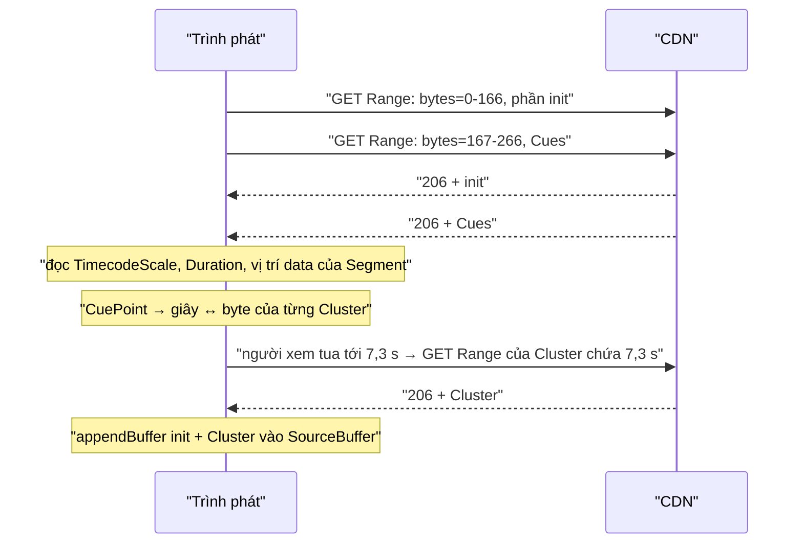

Người xem kéo thanh tua tới phút thứ 7 của một video dài. Trình phát không muốn tải 7 phút đầu, nó chỉ cần đúng vài trăm KB chứa phút thứ 7. Với DASH dùng một file cho mỗi chất lượng (kiểu `SegmentBase`), mọi thứ nằm trong một file lớn trên CDN, và trình phát tải từng đoạn bằng header `Range: bytes=a-b`. Câu hỏi là: **giây thứ 420 nằm ở byte nào?**

Với MP4, câu trả lời nằm trong hộp `sidx` ở đầu file, như [bài #60](/blogs/facebook-dash-predicted-segments) đã đi qua. Facebook còn phát nhiều video ở dạng **WebM** (VP9), và WebM không có `sidx`. Nó có một "mục lục" khác tên là **Cues**, viết bằng **EBML**, một định dạng nhị phân kiểu cây giống XML nhưng gọn hơn nhiều. Trình phát oz-player của Facebook tự viết một bộ đọc EBML nhỏ chỉ để lấy mục lục đó.

> [!TIP]
> **Tóm tắt**
> - WebM/Matroska là cây **phần tử EBML**: mỗi phần tử gồm ID, kích thước, dữ liệu. ID và kích thước là **số nguyên độ dài thay đổi (VINT)**: vị trí bit 1 đầu tiên của byte đầu cho biết số dài bao nhiêu byte.
> - `OzWebmSidxParser` đọc phần init (lấy `TimecodeScale`, `Duration`), rồi duyệt `Cues` → `CuePoint` → (`CueTime`, `CueClusterPosition`) để dựng bảng segment: thời gian bắt đầu, byte đầu, byte cuối.
> - Bản gốc có vài chỗ chưa chặt: kiểm tra 53 bit sai cho số 8 byte (nhận số 61 bit, trả về giá trị đã làm tròn), `new DataView(u8.buffer)` bỏ qua `byteOffset` (cùng lỗi với bài #60), thiếu `Duration` là bảng rỗng, và segment cuối luôn có `endByte = null`.
> - Bản viết lại đọc theo chỉ số của chính `Uint8Array`, ném lỗi khi số vượt 53 bit, chấp nhận thứ tự phần tử tuỳ ý và lấy byte cuối từ kích thước `Segment`.

<iframe class="demo-frame" src="/demos/facebook-patterns/index.html?theme=dark#/webm-ebml-cues" title="Demo webm-ebml-cues" loading="lazy" style="height: 1180px"></iframe>

<p class="demo-links">▶ <a href="/demos/facebook-patterns/index.html#/webm-ebml-cues" target="_blank" rel="noopener">Mở demo toàn màn hình ↗</a> · <a href="https://stackblitz.com/github/hunghg255/blog-hunghg/tree/master/examples/facebook-patterns?file=src/lib/ebml.ts" target="_blank" rel="noopener">Sửa code trên StackBlitz ↗</a> · <a href="https://github.com/hunghg255/blog-hunghg/blob/master/examples/facebook-patterns/src/lib/ebml.ts" target="_blank" rel="noopener">Xem source trên GitHub ↗</a></p>

## Facebook làm thế nào?

Module là `oz-player/parsers/OzWebmSidxParser`, nằm trong bundle `26.VideoPlayer/all.js` (có bản trùng ở `21.js`). Tên có chữ "Sidx" vì nó đóng vai trò giống `OzMp4SidxParser`: biến một đoạn byte thành danh sách segment.

Nơi gọi nằm trong phần đọc representation của manifest. Với WebM, trình phát gửi **hai** request: một cho `indexRange` (vùng chứa Cues) và một cho `Initialization@range` (phần init, được bật cache vì dùng lại khi đổi chất lượng), rồi mới gọi parser:

```js
// đổi tên biến
if (container === 'webm') {
  const initRange = parseRange(rep.Initialization[0].$.range);
  requests.push(fetchBytes(url, initRange, 'ENABLE_CACHE'));
  done = Promise.all(requests).then(([cues, init]) => {
    this.segments = OzWebmSidxParser.parse(url, cues, init);
  });
} else {
  done = requests[0].then((sidx) => { this.segments = OzMp4SidxParser.parse(url, indexRange.startByte, sidx); });
}
```

### EBML trong một đoạn

Một file WebM là một cây phần tử. Mỗi phần tử có ba phần:

```text
[ ID: VINT 1–4 byte ][ size: VINT 1–8 byte ][ data: size byte ]
```

Phần tử "master" chứa các phần tử con trong phần data. Các ID mà parser quan tâm:

| Phần tử | ID | Ý nghĩa |
|---|---|---|
| `EBML` | `0x1A45DFA3` | header, luôn đứng đầu file |
| `Segment` | `0x18538067` | chứa mọi thứ còn lại; vị trí trong Cues tính từ đầu data của nó |
| `Info` | `0x1549A966` | `TimecodeScale` (`0x2AD7B1`, ns cho một tick, mặc định 1 000 000) và `Duration` (`0x4489`, float, đơn vị tick) |
| `Cues` | `0x1C53BB6B` | mục lục |
| `CuePoint` | `0xBB` | một mốc: `CueTime` (`0xB3`) và `CueTrackPositions` (`0xB7`) |
| `CueClusterPosition` | `0xF1` | vị trí của Cluster chứa mốc đó |
| `Cluster` | `0x1F43B675` | một nhóm khung hình, thường bắt đầu bằng keyframe; đây chính là "segment" |

### VINT: độ dài nằm trong byte đầu

```js
// đổi tên biến
readVint() {
  const first = reader.readUint8();
  let len;
  for (len = 1; len <= 8; len++) if (first & (1 << (8 - len))) break;   // tìm bit 1 đầu tiên
  if (len > 8) throw new RangeError('EbmlParser: Variable sized integer must fit within 8 bytes.');
  const bytes = new Uint8Array(len);
  bytes[0] = first;
  for (let i = 1; i < len; i++) bytes[i] = reader.readUint8();
  return bytes;
}
// ID: giữ nguyên bit đánh dấu.  Size: bỏ bit đánh dấu.
static sizeValue(bytes) {
  if (bytes.length == 8 && bytes[1] & 0xe0) throw new RangeError('… at most 53 bits.');
  let v = bytes[0] & ((1 << (8 - bytes.length)) - 1);
  for (let i = 1; i < bytes.length; i++) v = 256 * v + bytes[i];
  return v;
}
```

Byte đầu `1xxxxxxx` là VINT 1 byte, `01xxxxxx` là 2 byte, …, `00000001` là 8 byte. Các bit sau bit đánh dấu là giá trị. Riêng kích thước có giá trị đặc biệt: **toàn bit 1** (`0xFF`, `0x7FFF`, …) nghĩa là "không biết kích thước", dùng cho luồng đang ghi (live). Bản gốc giữ một bảng 8 mẫu `[255]`, `[127,255]`, `[63,255,255]`… để nhận ra trường hợp này, và khi gặp thì lấy hết phần dữ liệu còn lại.

`parseElement` còn một chi tiết quan trọng: nếu kích thước khai báo vượt quá số byte đang có, nó **cắt bớt** thay vì ném lỗi. Nhờ vậy parser đọc được phần init dù trong đó `Segment` khai báo dài cả trăm MB.

### Từ Cues ra bảng segment

```js
// đổi tên biến
function parse(url, cuesBytes, initBytes) {
  const info = readInit(new DataView(initBytes.buffer));       // EBML → Segment → Info
  if (!info) return [];                                          // thiếu Duration cũng vào đây
  const root = new EbmlParser(new DataView(cuesBytes.buffer)).parseElement();
  if (root.id != CUES) return [];
  return buildSegments(root, info.segmentOffset, info.timecodeScale, info.duration, url);
}

function readCuePoint(el) {
  const p = el.createParser();
  const time = p.parseElement();
  if (time.id != CUE_TIME) return null;                  // CueTime phải đứng đầu
  const positions = p.parseElement();
  if (positions.id != CUE_TRACK_POSITIONS) return null;  // CueTrackPositions phải đứng thứ hai
  /* tìm CueClusterPosition bên trong positions */
}

// mỗi CuePoint i: segment [segOffset + pos_i, segOffset + pos_{i+1} - 1], thời gian [scale·time_i, scale·time_{i+1})
// segment cuối: kết thúc ở duration, endByte = null
```

`segmentOffset` là `byteOffset` của DataView chứa data của `Segment`. Vì `initBytes` bắt đầu từ byte 0 của file, con số này cũng là vị trí tuyệt đối trong file. `TimecodeScale` đổi ra giây bằng cách chia `1e9`.

Segment cuối có `endByte = null`, tức là request `Range: bytes=X-` (tới hết file). Đây là chỗ nối sang [bài #93](/blogs/facebook-pausable-range-stream): stream tạm dừng được của oz-player từng treo vĩnh viễn với range mở như vậy và phải sửa bằng cờ `fixStreamingUndefinedEndByte`.

### Những chỗ chưa chặt

**1. Kiểm tra 53 bit sai cho số 8 byte.** Hàm đọc kích thước (VINT) kiểm `bytes[1] & 0xE0`, đúng: VINT 8 byte có 56 bit dữ liệu, muốn còn 53 bit thì 3 bit cao nhất của byte thứ hai phải bằng 0. Nhưng hàm đọc số nguyên không dấu (`getUint`, dùng cho `CueTime`, `CueClusterPosition`, `TimecodeScale`) lại kiểm byte **đầu tiên**:

```js
if (this.view.byteLength == 8 && this.view.getUint8(0) & 0xe0)
  throw new RangeError('EbmlParser: Unsigned integer must be at most 53 bits.');
```

Số 8 byte có 64 bit; chặn 3 bit cao của byte đầu vẫn để lọt số 61 bit. `0x1FFFFFFFFFFFFFFF` trả về `2305843009213694000` thay vì `2305843009213693951` (đã chạy thử bằng node). Bảng "Số nguyên 8 byte" trong demo tái hiện việc này. Thực tế ít ai ghi vị trí Cluster bằng 8 byte với giá trị lớn như vậy, nhưng nếu xảy ra thì byte range sai một cách âm thầm thay vì báo lỗi.

**2. `new DataView(x.buffer)` bỏ qua `byteOffset`.** Cùng lỗi với bộ đọc `sidx` ở bài #60. Nếu `cuesBytes` là một `subarray` (ví dụ tải init và Cues trong **một** request rồi cắt ra), DataView bắt đầu từ byte 0 của ArrayBuffer gốc, tức là header `EBML` chứ không phải `Cues`, và hàm trả mảng rỗng. Trong luồng gọi hiện tại, dữ liệu được gom bằng `pumpAllData` thành một `Uint8Array` mới có offset 0, nên lỗi chưa lộ ra (đọc code thấy). Bật "Một request cho init + Cues" trong demo để thấy nó lộ ra thế nào.

**3. Thứ tự phần tử trong `CuePoint` bị cố định.** `CueTime` phải đứng đầu, `CueTrackPositions` phải đứng thứ hai, không thì cue bị bỏ qua. Các muxer phổ biến (libwebm, ffmpeg) ghi đúng thứ tự này nên hiếm khi gặp, nhưng parser đọc theo ID thì không phải giả định gì.

**4. Thiếu `Duration` là mất cả bảng.** `readInfo` trả `null` khi không có `Duration`, kéo theo `parse` trả `[]`. File WebM ghi bằng `MediaRecorder` của trình duyệt là ví dụ quen thuộc của WebM không có `Duration`. Chỉ segment cuối cần thời lượng, các segment khác vẫn tính được từ cue kế tiếp.

**5. Segment cuối luôn mở.** Kích thước của `Segment` có sẵn trong header (trừ khi là "không biết"), nên byte cuối của Cluster cuối cùng tính được chính xác. Range mở `bytes=X-` vẫn đúng với CDN, nhưng mất khả năng kiểm tra "đã nhận đủ byte chưa" ở tầng mạng.



## Bên trong trình duyệt

- **Range request.** `fetch(url, { headers: { Range: 'bytes=a-b' } })` trả `206 Partial Content` nếu server hỗ trợ (có header `Accept-Ranges: bytes`). `b` tính cả byte cuối. Server bỏ qua Range thì trả `200` kèm cả file, trường hợp bài #93 xử lý.
- **MSE không cần mục lục.** `SourceBuffer.appendBuffer()` nhận init segment rồi các Cluster theo bất kỳ thứ tự nào; trình duyệt tự đọc timestamp trong Cluster. Mục lục chỉ cần cho trình phát, để biết **tải** đoạn nào.
- **Cues ở đầu file.** Một file WebM thường ghi Cues ở cuối (vì chỉ biết vị trí Cluster sau khi ghi xong). File dùng cho DASH được muxer xếp lại để Cues nằm trước Cluster đầu tiên, và manifest khai báo `indexRange`. Nếu không có `indexRange`, phần tử `SeekHead` ở đầu `Segment` cho biết vị trí của Cues; bản viết lại đọc luôn phần này.
- **`Number` chỉ chính xác tới 2^53 − 1.** EBML cho phép số nguyên 8 byte (64 bit). Số lớn hơn `Number.MAX_SAFE_INTEGER` bị làm tròn khi cộng nhân, nên phải kiểm tra trước, hoặc dùng `BigInt` (`DataView.getBigUint64`).

## Viết lại

Bản viết lại không tạo DataView mới cho từng phần tử. Mọi vị trí là chỉ số trong chính `Uint8Array` truyền vào, nên `subarray` hay mảng riêng đều đúng. VINT và số nguyên:

```ts title=src/lib/ebml.ts
/** Bit 1 đầu tiên của byte đầu cho biết VINT dài bao nhiêu byte: 1xxxxxxx → 1, 01xxxxxx → 2, … */
export function vintLength(first: number): number {
  if (first === 0) throw new RangeError('VINT dài hơn 8 byte');
  return Math.clz32(first) - 23;
}

export function readVint(bytes: Uint8Array, pos: number, keepMarker = false): Vint {
  if (pos >= bytes.length) throw new RangeError(`Hết dữ liệu ở byte ${pos}`);
  const length = vintLength(bytes[pos]);
  if (pos + length > bytes.length) throw new RangeError(`VINT ở byte ${pos} bị cắt cụt`);
  const mask = 0xff >> length; // các bit dữ liệu của byte đầu
  let value = keepMarker ? bytes[pos] : bytes[pos] & mask;
  let allOnes = (bytes[pos] & mask) === mask;
  for (let i = 1; i < length; i++) {
    value = value * 256 + bytes[pos + i];
    allOnes &&= bytes[pos + i] === 0xff;
  }
  if (!keepMarker && allOnes) return { length, value: -1, unknown: true };
  if (value > Number.MAX_SAFE_INTEGER) throw new RangeError(`VINT ở byte ${pos} vượt 53 bit`);
  return { length, value, unknown: false };
}

/** Số nguyên không dấu big-endian 0..8 byte. Vượt 2^53 − 1 thì ném lỗi thay vì trả số đã làm tròn. */
export function readUint(bytes: Uint8Array, start: number, end: number): number {
  if (end - start > 8) throw new RangeError('uint dài hơn 8 byte');
  let v = 0;
  for (let i = start; i < end; i++) v = v * 256 + bytes[i];
  if (v > Number.MAX_SAFE_INTEGER) throw new RangeError('uint vượt 53 bit, không biểu diễn chính xác bằng number');
  return v;
}
```

Duyệt phần tử con. Kích thước "không biết" kéo dài tới hết vùng cha; header bị cắt ở cuối mảng thì dừng êm:

```ts title=src/lib/ebml.ts
/** Duyệt các phần tử con trong [start, end). Header bị cắt ở cuối thì dừng, không ném lỗi. */
export function* children(bytes: Uint8Array, start = 0, end = bytes.length): Generator<EbmlElement> {
  let pos = start;
  while (pos < end) {
    let id: Vint, size: Vint;
    try {
      id = readVint(bytes, pos, true);
      size = readVint(bytes, pos + id.length);
    } catch {
      return;
    }
    if (id.length > 4) throw new RangeError(`EBML ID ở byte ${pos} dài hơn 4 byte`);
    const dataStart = pos + id.length + size.length;
    const wanted = size.unknown ? end : dataStart + size.value;
    const dataEnd = Math.min(wanted, end);
    yield { id: id.value, start: pos, dataStart, dataEnd, unknownSize: size.unknown, truncated: wanted > end };
    pos = dataEnd;
  }
}
```

Phần init: `Info` và `SeekHead`, kèm kích thước khai báo của `Segment` để tính byte cuối:

```ts title=src/lib/ebml.ts
/**
 * Đọc phần init (EBML header + đầu Segment). `fileOffset` là vị trí của byte đầu tiên của `init` trong file.
 * Mọi vị trí tính theo chỉ số của chính Uint8Array, nên truyền một subarray cũng đúng.
 */
export function parseWebmInit(init: Uint8Array, fileOffset = 0): WebmInit | null {
  const top = children(init);
  const header = top.next().value;
  if (!header || header.id !== EBML_ID.EBML) return null;
  const segment = top.next().value;
  if (!segment || segment.id !== EBML_ID.Segment) return null;

  const base = fileOffset + segment.dataStart;
  let timecodeScaleSec = 1e-3;
  let durationTicks: number | null = null;
  let cuesOffset: number | null = null;
  for (const el of children(init, segment.dataStart, segment.dataEnd)) {
    if (el.id === EBML_ID.SeekHead) cuesOffset = readSeekHead(init, el, base);
    if (el.id !== EBML_ID.Info) continue;
    for (const f of children(init, el.dataStart, el.dataEnd)) {
      if (f.id === EBML_ID.TimecodeScale) timecodeScaleSec = readUint(init, f.dataStart, f.dataEnd) / 1e9;
      if (f.id === EBML_ID.Duration) durationTicks = readFloat(init, f.dataStart, f.dataEnd);
    }
    break;
  }
  return {
    segmentDataOffset: base,
    segmentDataEnd: segment.unknownSize ? null : base + segmentSize(init, segment),
    timecodeScaleSec,
    durationSec: durationTicks == null ? null : durationTicks * timecodeScaleSec,
    cuesOffset,
  };
}
```

Cues: đọc theo ID, thứ tự nào cũng được, bỏ cue trùng Cluster, segment cuối dùng `Duration` và kích thước `Segment` nếu có:

```ts title=src/lib/ebml.ts
/**
 * Đọc phần tử Cues và dựng bảng segment. Thứ tự CueTime/CueTrackPositions trong CuePoint không quan trọng;
 * `track` chọn CueTrackPositions của đúng track (mặc định lấy cái đầu tiên).
 */
export function parseWebmCues(cues: Uint8Array, init: WebmInit, track?: number): WebmSegment[] {
  const root = children(cues).next().value;
  if (!root || root.id !== EBML_ID.Cues) return [];
  const points: { time: number; pos: number }[] = [];
  for (const cp of children(cues, root.dataStart, root.dataEnd)) {
    if (cp.id !== EBML_ID.CuePoint) continue;
    let time: number | null = null;
    let pos: number | null = null;
    for (const f of children(cues, cp.dataStart, cp.dataEnd)) {
      if (f.id === EBML_ID.CueTime) time = readUint(cues, f.dataStart, f.dataEnd);
      if (f.id === EBML_ID.CueTrackPositions && pos == null) pos = readTrackPosition(cues, f, track);
    }
    if (time != null && pos != null) points.push({ time, pos });
  }
  points.sort((a, b) => a.time - b.time);

  const out: WebmSegment[] = [];
  points.forEach((p, i) => {
    if (i > 0 && p.pos === points[i - 1].pos) return; // hai cue cùng một Cluster
    out.push({ index: out.length, startSec: p.time * init.timecodeScaleSec, endSec: null, startByte: init.segmentDataOffset + p.pos, endByte: null });
  });
  for (let i = 0; i < out.length; i++) {
    const next = out[i + 1];
    out[i].endSec = next ? next.startSec : init.durationSec;
    out[i].endByte = next ? next.startByte - 1 : init.segmentDataEnd == null ? null : init.segmentDataEnd - 1;
  }
  return out;
}
```

::: spoiler Xem toàn bộ src/lib/ebml.ts

```ts title=src/lib/ebml.ts
/**
 * Đọc EBML (định dạng nhị phân của WebM/Matroska) đủ để dựng bảng segment cho DASH:
 * Info (TimecodeScale, Duration) trong phần init, rồi Cues: thời điểm ↔ vị trí Cluster.
 * Ý tưởng học từ oz-player/parsers/OzWebmSidxParser của Facebook, viết lại từ đầu.
 */

export const EBML_ID = {
  EBML: 0x1a45dfa3,
  Segment: 0x18538067,
  SeekHead: 0x114d9b74,
  Seek: 0x4dbb,
  SeekID: 0x53ab,
  SeekPosition: 0x53ac,
  Info: 0x1549a966,
  TimecodeScale: 0x2ad7b1,
  Duration: 0x4489,
  Tracks: 0x1654ae6b,
  Cues: 0x1c53bb6b,
  CuePoint: 0xbb,
  CueTime: 0xb3,
  CueTrackPositions: 0xb7,
  CueTrack: 0xf7,
  CueClusterPosition: 0xf1,
  Cluster: 0x1f43b675,
} as const;

export interface Vint {
  /** Số byte của VINT (1..8). */
  length: number;
  /** Giá trị: với ID giữ bit đánh dấu, với size thì bỏ. */
  value: number;
  /** Size toàn bit 1 nghĩa là "không biết kích thước" (live, đang ghi). */
  unknown: boolean;
}

/** Bit 1 đầu tiên của byte đầu cho biết VINT dài bao nhiêu byte: 1xxxxxxx → 1, 01xxxxxx → 2, … */
export function vintLength(first: number): number {
  if (first === 0) throw new RangeError('VINT dài hơn 8 byte');
  return Math.clz32(first) - 23;
}

export function readVint(bytes: Uint8Array, pos: number, keepMarker = false): Vint {
  if (pos >= bytes.length) throw new RangeError(`Hết dữ liệu ở byte ${pos}`);
  const length = vintLength(bytes[pos]);
  if (pos + length > bytes.length) throw new RangeError(`VINT ở byte ${pos} bị cắt cụt`);
  const mask = 0xff >> length; // các bit dữ liệu của byte đầu
  let value = keepMarker ? bytes[pos] : bytes[pos] & mask;
  let allOnes = (bytes[pos] & mask) === mask;
  for (let i = 1; i < length; i++) {
    value = value * 256 + bytes[pos + i];
    allOnes &&= bytes[pos + i] === 0xff;
  }
  if (!keepMarker && allOnes) return { length, value: -1, unknown: true };
  if (value > Number.MAX_SAFE_INTEGER) throw new RangeError(`VINT ở byte ${pos} vượt 53 bit`);
  return { length, value, unknown: false };
}

/** Số nguyên không dấu big-endian 0..8 byte. Vượt 2^53 − 1 thì ném lỗi thay vì trả số đã làm tròn. */
export function readUint(bytes: Uint8Array, start: number, end: number): number {
  if (end - start > 8) throw new RangeError('uint dài hơn 8 byte');
  let v = 0;
  for (let i = start; i < end; i++) v = v * 256 + bytes[i];
  if (v > Number.MAX_SAFE_INTEGER) throw new RangeError('uint vượt 53 bit, không biểu diễn chính xác bằng number');
  return v;
}

/** Float 0, 4 hoặc 8 byte (0 byte nghĩa là 0 theo chuẩn EBML). */
export function readFloat(bytes: Uint8Array, start: number, end: number): number {
  const view = new DataView(bytes.buffer, bytes.byteOffset + start, end - start);
  if (end - start === 0) return 0;
  if (end - start === 4) return view.getFloat32(0);
  if (end - start === 8) return view.getFloat64(0);
  throw new RangeError('float phải dài 0, 4 hoặc 8 byte');
}

export interface EbmlElement {
  id: number;
  /** Vị trí byte của header, tính trong mảng đang đọc. */
  start: number;
  dataStart: number;
  dataEnd: number;
  unknownSize: boolean;
  /** Phần dữ liệu dài hơn phần mảng đang có (ví dụ chỉ tải phần đầu của Segment). */
  truncated: boolean;
}

/** Duyệt các phần tử con trong [start, end). Header bị cắt ở cuối thì dừng, không ném lỗi. */
export function* children(bytes: Uint8Array, start = 0, end = bytes.length): Generator<EbmlElement> {
  let pos = start;
  while (pos < end) {
    let id: Vint, size: Vint;
    try {
      id = readVint(bytes, pos, true);
      size = readVint(bytes, pos + id.length);
    } catch {
      return;
    }
    if (id.length > 4) throw new RangeError(`EBML ID ở byte ${pos} dài hơn 4 byte`);
    const dataStart = pos + id.length + size.length;
    const wanted = size.unknown ? end : dataStart + size.value;
    const dataEnd = Math.min(wanted, end);
    yield { id: id.value, start: pos, dataStart, dataEnd, unknownSize: size.unknown, truncated: wanted > end };
    pos = dataEnd;
  }
}

function find(bytes: Uint8Array, start: number, end: number, id: number) {
  for (const el of children(bytes, start, end)) if (el.id === id) return el;
  return null;
}

export interface WebmInit {
  /** Vị trí tuyệt đối (trong file) của byte dữ liệu đầu tiên của Segment; mọi vị trí trong Cues tính từ đây. */
  segmentDataOffset: number;
  /** Vị trí tuyệt đối ngay sau Segment, null nếu Segment không biết kích thước. */
  segmentDataEnd: number | null;
  /** Giây cho một đơn vị timecode (TimecodeScale mặc định 1 000 000 ns = 1 ms). */
  timecodeScaleSec: number;
  durationSec: number | null;
  /** Vị trí tuyệt đối của Cues lấy từ SeekHead, nếu có. */
  cuesOffset: number | null;
}

/**
 * Đọc phần init (EBML header + đầu Segment). `fileOffset` là vị trí của byte đầu tiên của `init` trong file.
 * Mọi vị trí tính theo chỉ số của chính Uint8Array, nên truyền một subarray cũng đúng.
 */
export function parseWebmInit(init: Uint8Array, fileOffset = 0): WebmInit | null {
  const top = children(init);
  const header = top.next().value;
  if (!header || header.id !== EBML_ID.EBML) return null;
  const segment = top.next().value;
  if (!segment || segment.id !== EBML_ID.Segment) return null;

  const base = fileOffset + segment.dataStart;
  let timecodeScaleSec = 1e-3;
  let durationTicks: number | null = null;
  let cuesOffset: number | null = null;
  for (const el of children(init, segment.dataStart, segment.dataEnd)) {
    if (el.id === EBML_ID.SeekHead) cuesOffset = readSeekHead(init, el, base);
    if (el.id !== EBML_ID.Info) continue;
    for (const f of children(init, el.dataStart, el.dataEnd)) {
      if (f.id === EBML_ID.TimecodeScale) timecodeScaleSec = readUint(init, f.dataStart, f.dataEnd) / 1e9;
      if (f.id === EBML_ID.Duration) durationTicks = readFloat(init, f.dataStart, f.dataEnd);
    }
    break;
  }
  return {
    segmentDataOffset: base,
    segmentDataEnd: segment.unknownSize ? null : base + segmentSize(init, segment),
    timecodeScaleSec,
    durationSec: durationTicks == null ? null : durationTicks * timecodeScaleSec,
    cuesOffset,
  };
}

/** Kích thước khai báo trong header (đúng cả khi phần dữ liệu đang có bị cắt). */
function segmentSize(bytes: Uint8Array, el: EbmlElement) {
  return readVint(bytes, el.start + vintLength(bytes[el.start])).value;
}

function readSeekHead(bytes: Uint8Array, head: EbmlElement, base: number): number | null {
  for (const seek of children(bytes, head.dataStart, head.dataEnd)) {
    if (seek.id !== EBML_ID.Seek) continue;
    const idEl = find(bytes, seek.dataStart, seek.dataEnd, EBML_ID.SeekID);
    const posEl = find(bytes, seek.dataStart, seek.dataEnd, EBML_ID.SeekPosition);
    if (idEl && posEl && readUint(bytes, idEl.dataStart, idEl.dataEnd) === EBML_ID.Cues) {
      return base + readUint(bytes, posEl.dataStart, posEl.dataEnd);
    }
  }
  return null;
}

export interface WebmSegment {
  index: number;
  startSec: number;
  /** null khi không biết thời lượng (live, thiếu Duration). */
  endSec: number | null;
  startByte: number;
  /** null nghĩa là "tới hết file": Range: bytes=start- */
  endByte: number | null;
}

/**
 * Đọc phần tử Cues và dựng bảng segment. Thứ tự CueTime/CueTrackPositions trong CuePoint không quan trọng;
 * `track` chọn CueTrackPositions của đúng track (mặc định lấy cái đầu tiên).
 */
export function parseWebmCues(cues: Uint8Array, init: WebmInit, track?: number): WebmSegment[] {
  const root = children(cues).next().value;
  if (!root || root.id !== EBML_ID.Cues) return [];
  const points: { time: number; pos: number }[] = [];
  for (const cp of children(cues, root.dataStart, root.dataEnd)) {
    if (cp.id !== EBML_ID.CuePoint) continue;
    let time: number | null = null;
    let pos: number | null = null;
    for (const f of children(cues, cp.dataStart, cp.dataEnd)) {
      if (f.id === EBML_ID.CueTime) time = readUint(cues, f.dataStart, f.dataEnd);
      if (f.id === EBML_ID.CueTrackPositions && pos == null) pos = readTrackPosition(cues, f, track);
    }
    if (time != null && pos != null) points.push({ time, pos });
  }
  points.sort((a, b) => a.time - b.time);

  const out: WebmSegment[] = [];
  points.forEach((p, i) => {
    if (i > 0 && p.pos === points[i - 1].pos) return; // hai cue cùng một Cluster
    out.push({ index: out.length, startSec: p.time * init.timecodeScaleSec, endSec: null, startByte: init.segmentDataOffset + p.pos, endByte: null });
  });
  for (let i = 0; i < out.length; i++) {
    const next = out[i + 1];
    out[i].endSec = next ? next.startSec : init.durationSec;
    out[i].endByte = next ? next.startByte - 1 : init.segmentDataEnd == null ? null : init.segmentDataEnd - 1;
  }
  return out;
}

function readTrackPosition(bytes: Uint8Array, el: EbmlElement, track?: number): number | null {
  let t: number | null = null;
  let pos: number | null = null;
  for (const f of children(bytes, el.dataStart, el.dataEnd)) {
    if (f.id === EBML_ID.CueTrack) t = readUint(bytes, f.dataStart, f.dataEnd);
    if (f.id === EBML_ID.CueClusterPosition) pos = readUint(bytes, f.dataStart, f.dataEnd);
  }
  return track == null || t === track ? pos : null;
}

/** Tìm segment chứa thời điểm t (giây) bằng tìm kiếm nhị phân. */
export function segmentAt(segments: WebmSegment[], t: number): WebmSegment | null {
  let lo = 0;
  let hi = segments.length - 1;
  while (lo <= hi) {
    const mid = (lo + hi) >> 1;
    const s = segments[mid];
    if (t < s.startSec) hi = mid - 1;
    else if (s.endSec != null && t >= s.endSec) lo = mid + 1;
    else return s;
  }
  return null;
}

/** Header HTTP Range cho một segment. */
export function rangeHeader(s: Pick<WebmSegment, 'startByte' | 'endByte'>): string {
  return `bytes=${s.startByte}-${s.endByte ?? ''}`;
}
```

:::

Demo không dùng file video thật. `src/lib/ebmlFixtures.ts` dựng file WebM giả: header, `SeekHead`, `Info`, `Tracks`, `Cues`, rồi các Cluster chứa byte rác. Vị trí trong Cues và SeekHead được ghi bằng số 4 byte cố định, để tính kích thước trước rồi điền giá trị sau.

::: spoiler Xem src/lib/ebmlFixtures.ts

```ts title=src/lib/ebmlFixtures.ts
/**
 * Dựng một file WebM giả ngay trong trình duyệt cho demo: đúng cấu trúc EBML
 * (header, Segment, SeekHead, Info, Tracks, Cues, Cluster) nhưng dữ liệu khung hình là byte rác.
 */
import { EBML_ID, children } from './ebml';

const concat = (parts: Uint8Array[]) => {
  const out = new Uint8Array(parts.reduce((n, p) => n + p.length, 0));
  let offset = 0;
  for (const p of parts) {
    out.set(p, offset);
    offset += p.length;
  }
  return out;
};

/** VINT cho size; `len` cố định số byte (để kích thước không phụ thuộc giá trị). */
export function vintSize(n: number, len?: number): Uint8Array {
  let l = len ?? 1;
  while (len == null && n >= 2 ** (7 * l) - 1) l++;
  const out = new Uint8Array(l);
  let v = n;
  for (let i = l - 1; i >= 0; i--) {
    out[i] = v % 256;
    v = Math.floor(v / 256);
  }
  out[0] |= 0x80 >> (l - 1);
  return out;
}

const idBytes = (id: number) => {
  const out: number[] = [];
  for (let v = id; v > 0; v = Math.floor(v / 256)) out.unshift(v % 256);
  return Uint8Array.from(out);
};

export const el = (id: number, ...payload: Uint8Array[]) => {
  const body = concat(payload);
  return concat([idBytes(id), vintSize(body.length), body]);
};

export const uintEl = (id: number, v: number, width = 0) => {
  const out: number[] = [];
  for (let x = v; x > 0 || out.length < Math.max(1, width); x = Math.floor(x / 256)) out.unshift(x % 256);
  return el(id, Uint8Array.from(out));
};

const floatEl = (id: number, v: number) => {
  const b = new Uint8Array(8);
  new DataView(b.buffer).setFloat64(0, v);
  return el(id, b);
};

const str = (s: string) => new TextEncoder().encode(s);

export interface WebmFixtureOptions {
  clusters: number;
  clusterSec: number;
  withDuration?: boolean;
  /** Đặt CueTrackPositions trước CueTime trong CuePoint (chuẩn không cấm). */
  swapCueOrder?: boolean;
  /** Segment với size "không biết" (toàn bit 1), như luồng live đang ghi. */
  unknownSegmentSize?: boolean;
}

export interface WebmFixture {
  bytes: Uint8Array;
  /** [start, end] bao gồm, giống thuộc tính Initialization@range / indexRange trong MPD. */
  initRange: [number, number];
  indexRange: [number, number];
  blocks: { name: string; start: number; end: number }[];
}

export function buildWebm(o: WebmFixtureOptions): WebmFixture {
  const scaleNs = 1_000_000; // 1 tick = 1 ms
  const header = el(EBML_ID.EBML, uintEl(0x4286, 1), uintEl(0x42f7, 1), uintEl(0x42f2, 4), uintEl(0x42f3, 8), el(0x4282, str('webm')), uintEl(0x4287, 4), uintEl(0x4285, 2));
  const info = el(EBML_ID.Info, uintEl(EBML_ID.TimecodeScale, scaleNs), ...(o.withDuration !== false ? [floatEl(EBML_ID.Duration, o.clusters * o.clusterSec * 1000)] : []), el(0x4d80, str('fixture')));
  const tracks = el(EBML_ID.Tracks, el(0xae, uintEl(0xd7, 1), uintEl(0x83, 1), el(0x86, str('V_VP9')), el(0xe0, uintEl(0xb0, 640), uintEl(0xba, 360))));

  // Kích thước giả của từng Cluster: keyframe to, các cluster sau nhỏ dần rồi tăng lại.
  const clusters = Array.from({ length: o.clusters }, (_, i) => {
    const payload = new Uint8Array(18_000 + ((i * 7919) % 11) * 2_400);
    for (let k = 0; k < payload.length; k++) payload[k] = (k * 31 + i) & 0xff;
    return el(EBML_ID.Cluster, uintEl(0xe7, Math.round(i * o.clusterSec * 1000)), el(0xa3, Uint8Array.of(0x81, 0, 0, 0x80), payload));
  });

  // Vị trí ghi bằng uint 4 byte để kích thước Cues/SeekHead không đổi khi điền số thật.
  const makeCues = (positions: number[]) =>
    el(
      EBML_ID.Cues,
      ...positions.map((p, i) => {
        const time = uintEl(EBML_ID.CueTime, Math.round(i * o.clusterSec * 1000), 4);
        const tp = el(EBML_ID.CueTrackPositions, uintEl(EBML_ID.CueTrack, 1), uintEl(EBML_ID.CueClusterPosition, p, 4));
        return el(EBML_ID.CuePoint, ...(o.swapCueOrder ? [tp, time] : [time, tp]));
      }),
    );
  const makeSeek = (infoPos: number, tracksPos: number, cuesPos: number) =>
    el(
      EBML_ID.SeekHead,
      ...[
        [EBML_ID.Info, infoPos],
        [EBML_ID.Tracks, tracksPos],
        [EBML_ID.Cues, cuesPos],
      ].map(([id, pos]) => el(EBML_ID.Seek, el(EBML_ID.SeekID, idBytes(id)), uintEl(EBML_ID.SeekPosition, pos, 4))),
    );

  const seekLen = makeSeek(0, 0, 0).length;
  const cuesLen = makeCues(clusters.map(() => 0)).length;
  const infoPos = seekLen;
  const tracksPos = infoPos + info.length;
  const cuesPos = tracksPos + tracks.length;
  const positions: number[] = [];
  let p = cuesPos + cuesLen;
  for (const c of clusters) {
    positions.push(p);
    p += c.length;
  }
  const body = [makeSeek(infoPos, tracksPos, cuesPos), info, tracks, makeCues(positions), ...clusters];
  const bodyLen = body.reduce((n, b) => n + b.length, 0);
  const segSize = o.unknownSegmentSize ? Uint8Array.of(0x01, 0xff, 0xff, 0xff, 0xff, 0xff, 0xff, 0xff) : vintSize(bodyLen, 8);
  const segHeader = concat([idBytes(EBML_ID.Segment), segSize]);
  const bytes = concat([header, segHeader, ...body]);

  const base = header.length + segHeader.length;
  const blocks = [
    { name: 'EBML', start: 0, end: header.length - 1 },
    { name: 'Segment', start: header.length, end: base - 1 },
    { name: 'SeekHead', start: base, end: base + seekLen - 1 },
    { name: 'Info', start: base + infoPos, end: base + tracksPos - 1 },
    { name: 'Tracks', start: base + tracksPos, end: base + cuesPos - 1 },
    { name: 'Cues', start: base + cuesPos, end: base + cuesPos + cuesLen - 1 },
    ...positions.map((pos, i) => ({ name: `Cluster ${i}`, start: base + pos, end: base + pos + clusters[i].length - 1 })),
  ];
  return { bytes, initRange: [0, base + cuesPos - 1], indexRange: [base + cuesPos, base + cuesPos + cuesLen - 1], blocks };
}

const NAMES: Record<number, string> = {
  0x1a45dfa3: 'EBML', 0x4286: 'EBMLVersion', 0x42f7: 'EBMLReadVersion', 0x42f2: 'EBMLMaxIDLength', 0x42f3: 'EBMLMaxSizeLength',
  0x4282: 'DocType', 0x4287: 'DocTypeVersion', 0x4285: 'DocTypeReadVersion', 0x18538067: 'Segment', 0x114d9b74: 'SeekHead',
  0x4dbb: 'Seek', 0x53ab: 'SeekID', 0x53ac: 'SeekPosition', 0x1549a966: 'Info', 0x2ad7b1: 'TimecodeScale', 0x4489: 'Duration',
  0x4d80: 'MuxingApp', 0x1654ae6b: 'Tracks', 0xae: 'TrackEntry', 0xd7: 'TrackNumber', 0x83: 'TrackType', 0x86: 'CodecID',
  0xe0: 'Video', 0xb0: 'PixelWidth', 0xba: 'PixelHeight', 0x1c53bb6b: 'Cues', 0xbb: 'CuePoint', 0xb3: 'CueTime',
  0xb7: 'CueTrackPositions', 0xf7: 'CueTrack', 0xf1: 'CueClusterPosition', 0x1f43b675: 'Cluster', 0xe7: 'Timecode', 0xa3: 'SimpleBlock',
};
const MASTERS = new Set([0x1a45dfa3, 0x18538067, 0x114d9b74, 0x4dbb, 0x1549a966, 0x1654ae6b, 0xae, 0xe0, 0x1c53bb6b, 0xbb, 0xb7]);

export interface TreeRow {
  depth: number;
  name: string;
  id: string;
  start: number;
  headerLen: number;
  size: number | null;
}

/** Danh sách phẳng các phần tử (để vẽ cây), dừng ở `limit` dòng. */
export function ebmlTree(bytes: Uint8Array, limit = 60): TreeRow[] {
  const rows: TreeRow[] = [];
  const walk = (start: number, end: number, depth: number) => {
    for (const e of children(bytes, start, end)) {
      if (rows.length >= limit) return;
      rows.push({
        depth,
        name: NAMES[e.id] ?? '?',
        id: '0x' + e.id.toString(16).toUpperCase(),
        start: e.start,
        headerLen: e.dataStart - e.start,
        size: e.unknownSize ? null : e.dataEnd - e.dataStart,
      });
      if (MASTERS.has(e.id)) walk(e.dataStart, e.dataEnd, depth + 1);
    }
  };
  walk(0, bytes.length, 0);
  return rows;
}
```

:::

**Khác bản gốc:**

- Đọc theo chỉ số của `Uint8Array`, không dùng `.buffer`, nên an toàn với `subarray`.
- `readUint` và `readVint` ném lỗi khi giá trị vượt `Number.MAX_SAFE_INTEGER`, kiểm sau khi cộng dồn nên đúng cho mọi độ dài.
- Float 0 byte được đọc là 0 như chuẩn EBML cho phép; bản gốc ném lỗi.
- `CuePoint` đọc theo ID; chọn được `CueTrackPositions` theo số track.
- Thiếu `Duration` vẫn có bảng; segment cuối có `endSec = null`.
- Byte cuối của segment cuối lấy từ kích thước `Segment` khi biết.
- Đọc `SeekHead` để biết vị trí `Cues` khi manifest không có `indexRange`.
- ID tối đa 4 byte (giới hạn `EBMLMaxIDLength` mặc định của WebM); bản gốc cho tới 7.

## Đi qua code

- **`vintLength(first)`** dùng `Math.clz32`: với byte `0b0001xxxx`, `clz32` của số 32 bit là 27, trừ 23 ra 4 byte.
- **`readVint(bytes, pos, keepMarker)`** dùng chung cho ID (giữ bit đánh dấu, như cách các bảng ID viết `0x1A45DFA3`) và kích thước (bỏ bit đánh dấu). Kích thước toàn bit 1 trả `unknown: true`.
- **`children(bytes, start, end)`** là generator; dừng sớm là `break` hoặc lấy `.next()` một lần, không phải duyệt hết.
- **`parseWebmInit`** chỉ đọc hai phần tử đầu ở cấp cao nhất (`EBML`, `Segment`) rồi đi vào `Segment`. `segmentDataOffset` cộng thêm `fileOffset` nếu init không bắt đầu ở byte 0 của file.
- **`parseWebmCues`** sắp các mốc theo thời gian rồi gán byte cuối của mỗi segment bằng byte đầu của segment sau trừ 1.
- **`segmentAt`** tìm nhị phân; segment cuối không biết `endSec` thì coi như kéo dài vô hạn (luồng live).

## Tại sao không làm cách khác?

**Tải cả file rồi để MSE tự lo?** Video dài vài trăm MB; tua tới giữa là phải tải hết phần trước. Và không đổi được chất lượng theo đoạn.

**Để server cắt sẵn từng segment thành file riêng (`SegmentTemplate`)?** Đó là cách phổ biến cho live và HLS. Một file cho mỗi chất lượng thì CDN cache một object thay vì hàng nghìn object nhỏ, và encoder không phải ghi nhiều file. Facebook dùng cả hai kiểu.

**Dùng một thư viện EBML đầy đủ?** Thư viện đọc được mọi phần tử Matroska (tag, chapter, attachment…) thì nặng hơn nhiều so với 200 dòng cho đúng bảy loại phần tử.

**Đọc Cues bằng `BigInt` cho chắc?** Chậm hơn và phải đổi lại `Number` khi đưa vào `Range` hay `SourceBuffer`. File nhỏ hơn 8 PB không cần quá 53 bit; chỉ cần phát hiện khi vượt.

## Edge case và cạm bẫy

- **Cues nằm cuối file.** File WebM thông thường (không chuẩn bị cho DASH) để Cues sau Cluster cuối. Phải đọc `SeekHead`, rồi thêm một request nữa tới cuối file.
- **Không có Cues.** WebM từ `MediaRecorder` không có Cues lẫn `Duration`. Muốn tua được thì phải quét Cluster, hoặc ghi lại file bằng công cụ như `ffmpeg -c copy`.
- **Nhiều cue cho một Cluster.** Một số muxer ghi cue cho mọi keyframe; nếu Cluster chứa nhiều keyframe thì nhiều cue trỏ cùng vị trí. Bản viết lại gộp chúng, nếu không sẽ có segment rỗng (byte đầu lớn hơn byte cuối).
- **File có cả audio và video.** Mỗi `CuePoint` có thể có nhiều `CueTrackPositions`. DASH thường tách mỗi track một file nên lấy cái đầu tiên là đủ, còn file trộn thì nên chọn theo track video.
- **`TimecodeScale` khác 1 ms.** Ít gặp nhưng hợp lệ. Đừng coi `CueTime` là mili giây.

## Dùng trong dự án

```ts
import { parseWebmCues, parseWebmInit, rangeHeader, segmentAt } from './ebml';

async function fetchRange(url: string, a: number, b: number) {
  const res = await fetch(url, { headers: { Range: `bytes=${a}-${b}` } });
  if (res.status !== 206) throw new Error(`Server không hỗ trợ Range (${res.status})`);
  return new Uint8Array(await res.arrayBuffer());
}

// initRange, indexRange lấy từ MPD: <Initialization range="0-166"/>, indexRange="167-266"
const [init, cues] = await Promise.all([fetchRange(url, 0, 166), fetchRange(url, 167, 266)]);
const info = parseWebmInit(init);
if (!info) throw new Error('Không phải WebM');
const segments = parseWebmCues(cues, info);

video.addEventListener('seeking', async () => {
  const seg = segmentAt(segments, video.currentTime);
  if (!seg) return;
  const res = await fetch(url, { headers: { Range: rangeHeader(seg) } });
  sourceBuffer.appendBuffer(new Uint8Array(await res.arrayBuffer()));
});
```

## Kiểm thử

::: spoiler Ví dụ test (bản phác, không có trong repo)

```ts
import { describe, expect, it } from 'vitest';
import { parseWebmCues, parseWebmInit, readUint, readVint, segmentAt } from './ebml';
import { buildWebm } from './ebmlFixtures';

const split = (f: ReturnType<typeof buildWebm>) => ({
  init: f.bytes.slice(0, f.initRange[1] + 1),
  cues: f.bytes.slice(f.indexRange[0], f.indexRange[1] + 1),
});

describe('VINT và số nguyên', () => {
  it('đọc độ dài theo bit đánh dấu', () => {
    expect(readVint(Uint8Array.of(0x81), 0)).toEqual({ length: 1, value: 1, unknown: false });
    expect(readVint(Uint8Array.of(0x40, 0x02), 0)).toEqual({ length: 2, value: 2, unknown: false });
    expect(readVint(Uint8Array.of(0x1a, 0x45, 0xdf, 0xa3), 0, true).value).toBe(0x1a45dfa3);
  });
  it('kích thước toàn bit 1 là "không biết"', () => {
    expect(readVint(Uint8Array.of(0x7f, 0xff), 0).unknown).toBe(true);
  });
  it('ném lỗi khi vượt 53 bit, kể cả byte đầu nhỏ', () => {
    expect(readUint(Uint8Array.of(0, 0x1f, 255, 255, 255, 255, 255, 255), 0, 8)).toBe(Number.MAX_SAFE_INTEGER);
    expect(() => readUint(Uint8Array.of(0x1f, 255, 255, 255, 255, 255, 255, 255), 0, 8)).toThrow(RangeError);
    expect(() => readUint(Uint8Array.of(1, 0, 0, 0, 0, 0, 0, 1), 0, 8)).toThrow(RangeError);
  });
});

describe('Cues → segment', () => {
  it('khớp vị trí Cluster thật và nối liền nhau', () => {
    const f = buildWebm({ clusters: 5, clusterSec: 2 });
    const { init, cues } = split(f);
    const segs = parseWebmCues(cues, parseWebmInit(init)!);
    const clusters = f.blocks.filter((b) => b.name.startsWith('Cluster'));
    expect(segs.map((s) => [s.startByte, s.endByte])).toEqual(clusters.map((c) => [c.start, c.end]));
    expect(segs.map((s) => s.startSec)).toEqual([0, 2, 4, 6, 8]);
    expect(segmentAt(segs, 7.3)?.index).toBe(3);
  });
  it('subarray của một buffer chung vẫn đúng', () => {
    const f = buildWebm({ clusters: 3, clusterSec: 2 });
    const both = f.bytes.slice(0, f.indexRange[1] + 1);
    const info = parseWebmInit(both.subarray(0, f.initRange[1] + 1))!;
    expect(parseWebmCues(both.subarray(f.indexRange[0]), info)).toHaveLength(3);
  });
  it('thiếu Duration, thứ tự cue khác, Segment không biết kích thước', () => {
    const f = buildWebm({ clusters: 3, clusterSec: 2, withDuration: false, swapCueOrder: true, unknownSegmentSize: true });
    const { init, cues } = split(f);
    const segs = parseWebmCues(cues, parseWebmInit(init)!);
    expect(segs).toHaveLength(3);
    expect(segs[2]).toMatchObject({ startSec: 4, endSec: null, endByte: null });
  });
  it('SeekHead chỉ tới Cues', () => {
    const f = buildWebm({ clusters: 2, clusterSec: 2 });
    expect(parseWebmInit(split(f).init)!.cuesOffset).toBe(f.indexRange[0]);
  });
});
```

:::

## So với thư viện và chuẩn web

- **EBML** được chuẩn hoá trong [RFC 8794](https://www.rfc-editor.org/rfc/rfc8794) (2020), **Matroska** trong [RFC 9559](https://www.rfc-editor.org/rfc/rfc9559) (2024). WebM là một tập con của Matroska do dự án WebM định nghĩa (codec VP8/VP9/AV1, Vorbis/Opus).
- **Shaka Player** (Google) có `EbmlParser` và `WebmSegmentIndexParser` làm đúng việc của bài này; cấu trúc và thông điệp lỗi của module Oz gợi nhớ tới chúng, có lẽ Oz bắt đầu từ đó.
- **dash.js** cũng có bộ đọc `SegmentBase` cho WebM (`WebmSegmentBaseLoader`).
- Các gói npm như `ebml` và `ts-ebml` đọc/ghi EBML đầy đủ; `ts-ebml` hay được dùng để thêm `Duration` và Cues vào file ghi bằng `MediaRecorder`.
- Media Source Extensions có trên các trình duyệt chính (tính tới 10/2026), xem [caniuse](https://caniuse.com/mediasource). Hỗ trợ WebM/VP9 qua MSE thì khác nhau theo trình duyệt và thiết bị, nên luôn kiểm tra bằng `MediaSource.isTypeSupported('video/webm; codecs="vp9"')` trước khi chọn representation WebM.

---

Bài này thuộc series **[Học từ mã nguồn Facebook](/series/facebook)** (106 bài, đọc theo thứ tự).

::: spoiler Xem nhanh danh sách bài trong series

*Phần 1*

- [Mở đầu: cách đọc code minify của Facebook](/blogs/learn-from-facebook-source-code)
- [#1 Dùng chung IntersectionObserver + infinite scroll](/blogs/facebook-shared-intersection-observer)
- [#2 useViewportDuration: đo thời gian thực sự được xem](/blogs/facebook-use-viewport-duration)
- [#3 Preload code + data khi hover](/blogs/facebook-preload-on-hover)
- [#4 Toast manager với external store](/blogs/facebook-toast-manager)
- [#5 Network status + heartbeat backoff](/blogs/facebook-network-status-heartbeat)
- [#6 ErrorGuard: bắt lỗi theo ngữ cảnh](/blogs/facebook-error-guard)
- [#7 Banzai: gom log theo lô + sendBeacon](/blogs/facebook-batch-logger)
- [#8 Focus trap + Esc theo layer](/blogs/facebook-focus-trap)

*Phần 2*

- [#9 Mẹo calc(… * 9999): container query, line-clamp, mũi tên carousel bằng CSS](/blogs/facebook-css-9999-trick)
- [#10 Thanh cuộn tuỳ biến bằng CSS 3D](/blogs/facebook-css-3d-scrollbar)
- [#11 Modal cuộn bằng window, giữ vị trí trang nền](/blogs/facebook-document-scroll-modal)
- [#12 Popover, tooltip group và hovercard](/blogs/facebook-popover-tooltip)
- [#13 Primitive Pressable + focus-visible](/blogs/facebook-pressable)
- [#14 Tab "Xem thêm" + sticky header bằng IntersectionObserver](/blogs/facebook-priority-tabs-sticky-header)
- [#15 Avatar khoét mask, gradient Messenger, skeleton steps()](/blogs/facebook-visual-tricks)
- [#16 Khung chat không giật](/blogs/facebook-chat-scroller)
- [#17 Thuật toán chọn bố cục collage ảnh](/blogs/facebook-photo-collage-layout)
- [#18 Keep-alive tab trong SPA](/blogs/facebook-keep-alive-tabs)
- [#19 Tự đo Visual Completion & interaction tracing](/blogs/facebook-visual-completion)
- [#20 Router SPA bền bỉ & tải chunk có retry](/blogs/facebook-spa-router-resilient-loading)

*Phần 3*

- [#21 Smart Compose: gợi ý chữ mờ khi gõ](/blogs/facebook-smart-compose-ghost-text)
- [#22 MQTT ngay trong trình duyệt, tự chuyển sang long-poll](/blogs/facebook-mqtt-in-browser)
- [#23 Đo thời gian dùng bằng bitmap 64 giây](/blogs/facebook-time-spent-bitmap)
- [#24 Bảng reaction nhấn giữ rồi trượt](/blogs/facebook-reaction-press-slide)
- [#25 Tìm kiếm gấp dấu, phiên âm và highlight đầu từ](/blogs/facebook-search-diacritics-tokenize)
- [#26 Ring buffer biết trace nào đã mất log](/blogs/facebook-trace-ring-buffer)
- [#27 Engine animation JS: một vòng rAF và solver cubic-bezier](/blogs/facebook-keyframes-loop-cubic-bezier)
- [#28 Bootloader: bitmap tài nguyên đã tải, chỉ reload khi cần](/blogs/facebook-bootloader-bitmap-consistency)
- [#29 Nhận biết click do screen reader tạo ra](/blogs/facebook-virtual-cursor-detection)
- [#30 Tải trước feed theo chất lượng mạng, đoán hạng thiết bị](/blogs/facebook-network-aware-prefetch)
- [#31 Hàng đợi gửi tin chat giữ đúng thứ tự](/blogs/facebook-ordered-send-queue)
- [#32 Gộp lời gọi API trong cùng một tick](/blogs/facebook-api-batcher)
- [#33 Resize ảnh trong pool Web Worker](/blogs/facebook-jpeg-resize-worker-pool)
- [#34 Crop ảnh theo nhiều khuôn mặt](/blogs/facebook-face-aware-crop)
- [#35 Kéo-thả sắp xếp và vùng thả file không nhấp nháy](/blogs/facebook-flicker-free-drag-drop)
- [#36 Tiện ích UI: fade-out, sticky event, hàm huỷ được](/blogs/facebook-ui-utility-hooks)
- [#37 Hạ tầng nhỏ: cookie, hash lỗi, prefetch khi chuột dừng](/blogs/facebook-small-infra-cookie-hash-idle)

*Phần 4–6*

- [#38 Đồng bộ tin nhắn: phát hiện lỗ seqID và fetch bù theo tầng](/blogs/facebook-messenger-sync-seqid-gaps)
- [#39 OTID: ID tin nhắn kiểu Snowflake sinh ở client](/blogs/facebook-otid-client-snowflake)
- [#40 QPL: lấy mẫu từ lúc bắt đầu, đo RTT gửi tin đầu-cuối](/blogs/facebook-qpl-send-rtt)
- [#41 Bộ điều phối request bảy chế độ gộp và chống trùng](/blogs/facebook-request-dispatcher-modes)
- [#42 Thread list theo mốc thời gian, cookie presence có version](/blogs/facebook-threadlist-ranged-presence)
- [#43 Composer dạng plugin: reducer, dirty checker, chuỗi kiểm tra](/blogs/facebook-plugin-composer)
- [#44 Thanh toán bất đồng bộ: subscribe trước, poll dự phòng](/blogs/facebook-async-checkout)
- [#45 Validate số thẻ: sửa lỗi gõ, dải BIN, Luhn](/blogs/facebook-card-validation)
- [#46 Lịch chọn khoảng ngày: bo góc dải chọn, phím đủ bộ, RTL](/blogs/facebook-range-calendar-a11y)
- [#47 Giờ mở cửa theo tuần: qua đêm, gộp khoảng, phần bù](/blogs/facebook-weekly-hours-intervals)
- [#48 Tiến độ đăng realtime: giữ event chờ snapshot, watchdog](/blogs/facebook-realtime-publish-snapshot)
- [#49 Tiền tệ theo đơn vị nhỏ nhất và ô nhập tiền](/blogs/facebook-currency-minor-units)
- [#50 Sửa hàng loạt Empty/Uniform/Mixed, seen/read bằng 2 bit](/blogs/facebook-bulk-edit-seen-bits)
- [#51 Phát hiện script lạ hook vào hàm native](/blogs/facebook-native-hook-detection)
- [#52 localStorage tự dọn khi đầy quota](/blogs/facebook-quota-aware-storage)
- [#53 Cache tuyến do server phân giải, chờ sẵn promise](/blogs/facebook-route-cache-prefetch)
- [#54 Lưới phím mũi tên 2D và focus không làm cuộn trang](/blogs/facebook-focus-table-grid)
- [#55 Tách emoji bằng máy trạng thái](/blogs/facebook-emoji-segmentation)
- [#56 Đọc trước ghi sau trong một frame, con tự biết vị trí](/blogs/facebook-read-then-write-dom)
- [#57 Hàng đợi lệnh cho video và stream sắp lại chunk](/blogs/facebook-video-command-queue)

*Phần 7–10*

- [#58 Ước lượng băng thông EWMA: loại outlier, nhớ qua phiên](/blogs/facebook-bandwidth-ewma-estimator)
- [#59 ABR theo độ tự tin phát và cắt bậc bitrate theo MOS](/blogs/facebook-abr-playback-confidence)
- [#60 Prefetch segment dự đoán từ manifest, parse hộp sidx](/blogs/facebook-dash-predicted-segments)
- [#61 Đọc metadata MP4/MOV ngay trên client](/blogs/facebook-mp4-metadata-client)
- [#62 Upload tiếp tục được: offset, hash dedupe, phát hiện treo](/blogs/facebook-resumable-upload)
- [#63 Fenwick tree: chọn ngẫu nhiên có trọng số và offset dòng](/blogs/facebook-fenwick-weighted-random)
- [#64 Vạch trục số và trục thời gian "đẹp"](/blogs/facebook-nice-axis-ticks)
- [#65 Damerau-Levenshtein theo dải chéo và tự sửa tên gõ sai](/blogs/facebook-damerau-levenshtein)
- [#66 PRNG có seed, shuffle tái lập và lấy mẫu trace](/blogs/facebook-seeded-prng-sampling)
- [#67 Cặp min/max-heap tái dùng vị trí trong danh sách ảo](/blogs/facebook-dual-heap-buffer-set)
- [#68 Memo nhiều đối số bằng Map/WeakMap và interning object](/blogs/facebook-multikey-memo-interning)
- [#69 Thống kê cửa sổ trượt và đại số khoảng thời gian](/blogs/facebook-moving-stat-intervals)
- [#70 Int64 từ hai số 32-bit, decode UTF, offset theo code point](/blogs/facebook-int64-utf-codepoints)
- [#71 Engine múi giờ IANA trên client, phát hiện lệch giờ](/blogs/facebook-client-iana-timezone)
- [#72 Tự cài semver range](/blogs/facebook-semver-range)
- [#73 Auto-link URL, cắt chữ an toàn, giới hạn LaTeX](/blogs/facebook-autolink-safe-truncate)
- [#74 Parser query kiểu PHP chống prototype pollution](/blogs/facebook-php-query-serializer)
- [#75 Popover tự lật theo phần tràn nhỏ nhất](/blogs/facebook-popover-auto-flip)
- [#76 Tiền tố for(;;) chống JSON hijacking, đọc stream](/blogs/facebook-csrf-prefix-streaming)
- [#77 Chống lộ Referer, linkshim, xoá token trên URL](/blogs/facebook-referrer-linkshim-url-scrub)
- [#78 setImmediate bằng postMessage, gom delta chuột theo frame](/blogs/facebook-setimmediate-mouse-batching)
- [#79 Phát hiện crash qua heartbeat, dò proxy cache hỏng](/blogs/facebook-crash-heartbeat-proxy-check)
- [#80 DPR vào cookie cho ảnh @2x, che khoá trong log](/blogs/facebook-dpr-cookie-secret-redaction)
- [#81 Flux waitFor tự viết và proxy có đệm](/blogs/facebook-flux-dispatch-buffered-proxy)
- [#82 Crop đúng tỉ lệ, xoay sticker bằng ma trận](/blogs/facebook-image-crop-rotation-geometry)

*Phần 11–15*

- [#83 Chia subdomain giữa các tab bằng lease, long-poll theo bảng trạng thái](/blogs/facebook-tab-subdomain-lease-longpoll)
- [#84 MQTT QoS1: giữ publish chờ ack, gửi lại khi kết nối lại](/blogs/facebook-mqtt-qos1-republish)
- [#85 Cache Promise gộp request, cache lỗi ngắn, đua dữ liệu nhúng sẵn](/blogs/facebook-promise-cache-preload-race)
- [#86 Lịch retry: backoff có trần, Fibonacci, báo lỗi CDN mỗi N ngày](/blogs/facebook-retry-backoff-schedules)
- [#87 Giữ nguyên tham chiếu nhánh dữ liệu không đổi](/blogs/facebook-relay-recycle-nodes)
- [#88 Store optimistic: copy-on-write, rollback rồi áp lại](/blogs/facebook-relay-optimistic-store)
- [#89 Chỉ mục subscription theo record, hàng đợi task theo chiều sâu](/blogs/facebook-relay-subscription-index)
- [#90 Phân trang connection: cursor khớp đầu, edge không trùng](/blogs/facebook-relay-connection-pagination)
- [#91 Profiler kiểu middleware và memo selector có lấy mẫu kiểm tra](/blogs/facebook-profiler-middleware-memo-check)
- **#92 Đọc EBML/WebM Cues để tìm byte range của segment** (bài này)
- [#93 Stream HTTP Range tạm dừng được, tải tiếp đúng byte](/blogs/facebook-pausable-range-stream)
- [#94 Bảng khoảng thời gian gắn nhãn và nhảy qua lỗ buffer](/blogs/facebook-tagged-time-ranges-gaps)
- [#95 Gom chunk cho SourceBuffer, đồng bộ video bằng playbackRate](/blogs/facebook-sourcebuffer-video-sync)
- [#96 Gom tin nhắn thành cụm, vạch ngày và avatar đã xem](/blogs/facebook-message-grouping)
- [#97 Bao nhiêu tab chat vừa màn hình, chuỗi luật mở tab](/blogs/facebook-chat-tab-policy)
- [#98 Phím tắt Markdown trong editor, Backspace để hoàn tác](/blogs/facebook-markdown-shortcuts-editor)
- [#99 Offset theo code point hay UTF-16: bốn bug cùng một gốc](/blogs/facebook-codepoint-offset-bugs)
- [#100 Typeahead không nhảy: cache tiền tố, chặn reflow, khoá hover](/blogs/facebook-typeahead-stable-results)
- [#101 Hit-test trên canvas bằng phát lại path, nét đứt và cung Bézier](/blogs/facebook-canvas-hit-regions)
- [#102 Vòng tròn theo mét trên bản đồ Mercator](/blogs/facebook-mercator-meter-circles)
- [#103 Dò tính năng trình duyệt: ảnh EXIF 2×1, getter bẫy, scrollbar](/blogs/facebook-feature-probe-tricks)
- [#104 Bug định dạng số và kiểm tra dữ liệu theo locale](/blogs/facebook-locale-validation-bugs)
- [#105 Dispose cho đúng: idle callback, splice(-1), xoá nhầm key](/blogs/facebook-dispose-leak-bugs)

:::

Code + demo: [`examples/facebook-patterns`](https://github.com/hunghg255/blog-hunghg/tree/master/examples/facebook-patterns) · [Mở trên StackBlitz](https://stackblitz.com/github/hunghg255/blog-hunghg/tree/master/examples/facebook-patterns)
